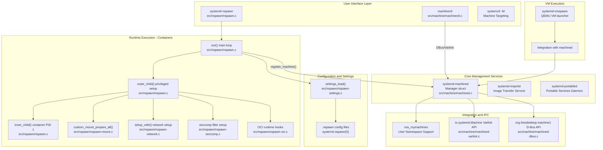
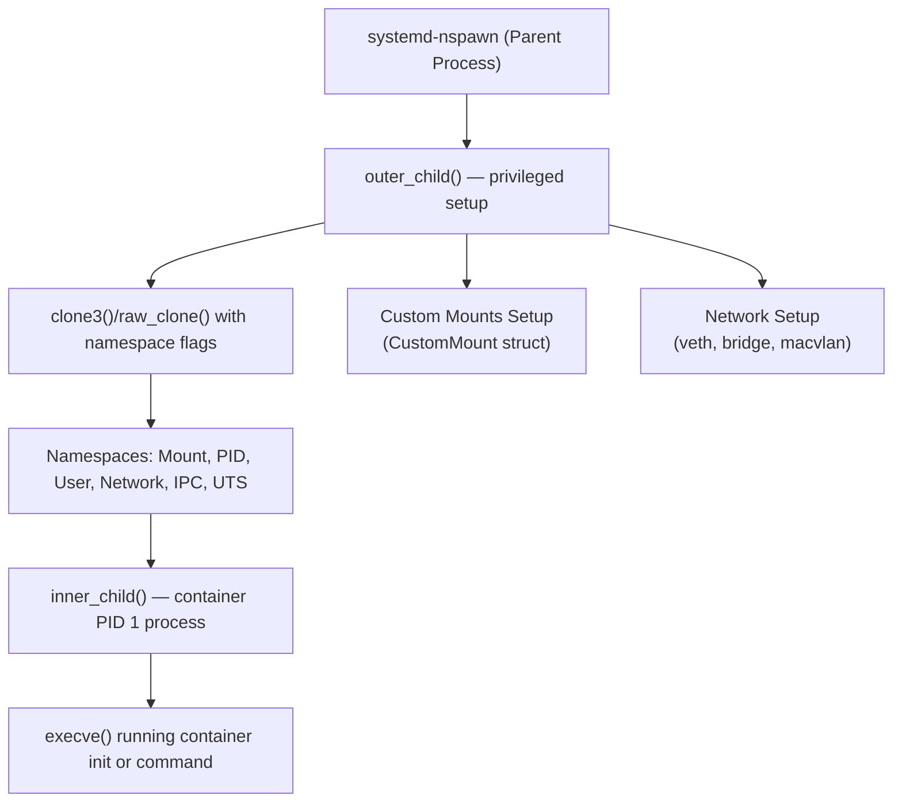
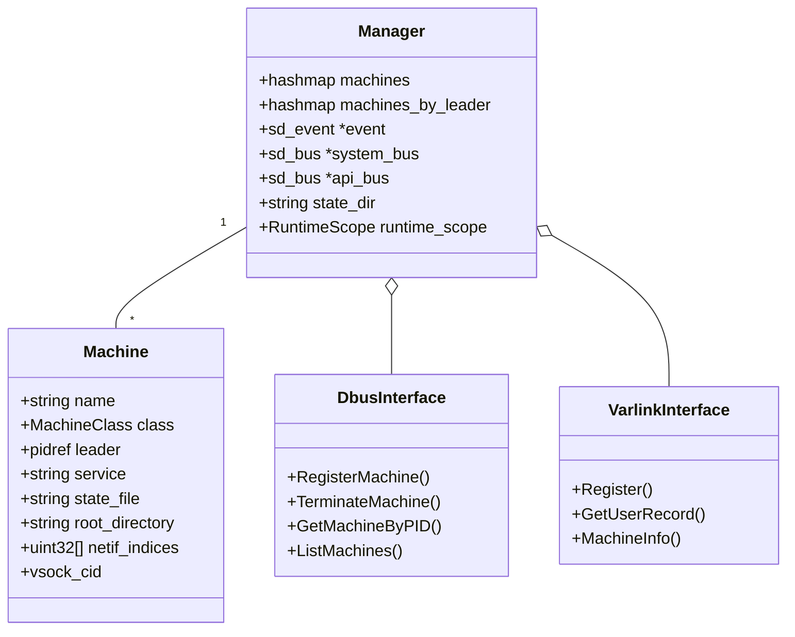

<!-- source: DeepWiki mcp.deepwiki.com · repo systemd/systemd · page 5 Containers and Virtualization · fetched 2026-11-07 -->

# Containers and Virtualization

Relevant source files

The following files were used as context for generating this wiki page:

- [man/systemd-nspawn.xml](man/systemd-nspawn.xml)
- [man/systemd.nspawn.xml](man/systemd.nspawn.xml)
- [src/machine/image-dbus.c](src/machine/image-dbus.c)
- [src/machine/image-dbus.h](src/machine/image-dbus.h)
- [src/machine/image-varlink.c](src/machine/image-varlink.c)
- [src/machine/image-varlink.h](src/machine/image-varlink.h)
- [src/machine/machine-dbus.c](src/machine/machine-dbus.c)
- [src/machine/machine-dbus.h](src/machine/machine-dbus.h)
- [src/machine/machine-varlink.c](src/machine/machine-varlink.c)
- [src/machine/machine-varlink.h](src/machine/machine-varlink.h)
- [src/machine/machine.c](src/machine/machine.c)
- [src/machine/machine.h](src/machine/machine.h)
- [src/machine/machined-core.c](src/machine/machined-core.c)
- [src/machine/machined-dbus.c](src/machine/machined-dbus.c)
- [src/machine/machined-resolve-hook.c](src/machine/machined-resolve-hook.c)
- [src/machine/machined-varlink.c](src/machine/machined-varlink.c)
- [src/machine/machined.c](src/machine/machined.c)
- [src/machine/machined.h](src/machine/machined.h)
- [src/machine/org.freedesktop.machine1.conf](src/machine/org.freedesktop.machine1.conf)
- [src/nspawn/nspawn-cgroup.c](src/nspawn/nspawn-cgroup.c)
- [src/nspawn/nspawn-cgroup.h](src/nspawn/nspawn-cgroup.h)
- [src/nspawn/nspawn-gperf.gperf](src/nspawn/nspawn-gperf.gperf)
- [src/nspawn/nspawn-mount.c](src/nspawn/nspawn-mount.c)
- [src/nspawn/nspawn-mount.h](src/nspawn/nspawn-mount.h)
- [src/nspawn/nspawn-network.c](src/nspawn/nspawn-network.c)
- [src/nspawn/nspawn-network.h](src/nspawn/nspawn-network.h)
- [src/nspawn/nspawn-settings.c](src/nspawn/nspawn-settings.c)
- [src/nspawn/nspawn-settings.h](src/nspawn/nspawn-settings.h)
- [src/nspawn/nspawn.c](src/nspawn/nspawn.c)
- [src/shared/mount-setup.c](src/shared/mount-setup.c)
- [src/shared/mount-setup.h](src/shared/mount-setup.h)
- [src/shared/varlink-io.systemd.Machine.c](src/shared/varlink-io.systemd.Machine.c)
- [src/shared/varlink-io.systemd.MachineImage.c](src/shared/varlink-io.systemd.MachineImage.c)
- [src/shared/varlink-io.systemd.MachineImage.h](src/shared/varlink-io.systemd.MachineImage.h)
- [test/units/TEST-13-NSPAWN.machined.sh](test/units/TEST-13-NSPAWN.machined.sh)
- [test/units/TEST-13-NSPAWN.nspawn.sh](test/units/TEST-13-NSPAWN.nspawn.sh)
- [test/units/TEST-13-NSPAWN.nss-mymachines.sh](test/units/TEST-13-NSPAWN.nss-mymachines.sh)
- [test/units/TEST-74-AUX-UTILS.capsule.sh](test/units/TEST-74-AUX-UTILS.capsule.sh)

## Overview

This page provides a high-level overview of systemd's container and virtualization capabilities. systemd offers a comprehensive suite of components to run and manage isolated environments ranging from lightweight containers to full virtual machines. The key parts of this ecosystem include:

- **systemd-nspawn** for managing lightweight Linux containers with namespace and cgroup isolation.
- **systemd-machined** for tracking running containers and virtual machines, providing a central registry and D-Bus/Varlink interfaces.
- **machinectl** as the user-facing command line tool for managing machines and images.
- **systemd-vmspawn** for launching virtual machines with QEMU integration.
- **systemd-portabled** and **portablectl** for portable service containers and OS image attachment/detachment.

This page acts as a parent page linking to dedicated child pages that cover each component in detail.

---

## Architecture Overview

systemd’s container and virtualization stack is architected as a layered system integrating runtime execution components, management services, and user interfaces, all orchestrated to provide easy and robust container and VM operations.

*This architecture facilitates container creation, registration, resource management, and integration with systemd's service and networking stacks.*

**Sources:** [src/nspawn/nspawn.c:75-138](), [src/nspawn/nspawn-mount.c:151-231](), [src/nspawn/nspawn-settings.c:74-104](), [src/machine/machined.c:46-89](), [src/machine/machined-dbus.c:1-221](), [src/machine/machined-varlink.c:1-70]()

---

## systemd-nspawn: Lightweight Container Manager

`systemd-nspawn` acts as a container manager for lightweight Linux containers. It provides:

- **Namespace virtualization:** filesystem, PID, user, network, IPC, UTS, and cgroup namespaces are used to isolate the container environment fully from the host.
- **Two-phase fork model:** An `outer_child` performs privileged setup (mounting filesystems, setting up namespaces, network interfaces), followed by an `inner_child` which becomes PID 1 inside the container (the init process inside the container) [src/nspawn/nspawn.c:2819-3558]().
- **Filesystem virtualization:** Supports custom mount points with flexible source and overlay handling via the `CustomMount` abstraction [src/nspawn/nspawn-mount.c:31-85](), and `.nspawn` config files to adjust container settings without manual command line overrides.
- **Network virtualization:** Implements private networking with veth pairs, macvlan, ipvlan, bridge setups or network zones [src/nspawn/nspawn-network.c]().
- **Security:** Supports seccomp filters, capability retention, and user namespaces for decreasing container privileges. It also integrates with `systemd-nsresourced` for resource monitoring [src/nspawn/nspawn-seccomp.c](), [src/nspawn/nspawn.c:75-138]().
- **OCI support:** Supports runtime hooks from OCI runtimes allowing integration with container industry standards [src/nspawn/nspawn-oci.c]().

Containers launched with `systemd-nspawn` are registered to the central registry managed by `systemd-machined`.

For in-depth details, see the child page: [systemd-nspawn Container Manager](#5.1).

### Two-Phase Fork and Namespace Setup Diagram

**Sources:** [src/nspawn/nspawn.c:2819-3558](), [src/nspawn/nspawn-mount.c:31-85](), [src/nspawn/nspawn-network.c:600-1030]()

---

## systemd-machined: Container and VM Registry

`systemd-machined` tracks running virtual machines and containers on the host, providing:

- A **central registry** keyed by machine names, supporting lookup by leader PID and D-Bus object paths [src/machine/machined.c:50-130]().
- **Host machine representation:** The host system is represented as a `Machine` object with class `MACHINE_HOST` [src/machine/machine.c:128-180]().
- APIs over **D-Bus** (`org.freedesktop.machine1` interface) and **Varlink** for querying machine status, lifecycle control (start, stop, kill), and metadata [src/machine/machined-dbus.c:90-193](), [src/machine/machined-varlink.c:166-200]().
- Management and integration of **container images** and **machine lifecycle operations.**

The `Manager` struct in `machined` maintains hashmaps of machine objects for efficient lookup and management.

For full details, see the child page: [Machine and Image Management](#5.2).

### machined Core Data Structures and IPC Interfaces

**Sources:** [src/machine/machined.c:50-130](), [src/machine/machined-dbus.c:40-221](), [src/machine/machined-varlink.c:10-70]()

---

## machinectl: Command Line Machine Management

`machinectl` is the command line tool interfacing with `systemd-machined`. It enables users to:

- List, start, terminate, reboot, and get status of machines (containers/VMs).
- Manage container images: listing, cloning, renaming, removing.
- Transfer files to/from containers, invoke shells inside containers.
- Support image import and pulling via `systemd-importd`.

It communicates with `machined` via D-Bus and Varlink and can invoke `systemd-nspawn` and `systemd-vmspawn` to launch containers or VMs.

For details, see its man page and [Machine and Image Management](#5.2).

**Sources:** [src/machine/machinectl.c:1-100](), [man/machinectl.xml]().

---

## systemd-vmspawn: Virtual Machine Launching

`systemd-vmspawn` manages launching hardware-virtualized virtual machines using QEMU:

- Uses images and VM descriptions compatible with the systemd container ecosystem.
- Integrates with `machined` for VM registration and lifecycle management.
- Supports virtio-vsock CIDs for host-guest communication [src/machine/machine.h:67-70]().

This enables running full virtual machines alongside containers within the same management framework.

For detailed documentation, see the child page: [VM Spawning with systemd-vmspawn](#5.3).

---

## Portable Services

Portable services are self-contained service bundles that can be run as systemd services without traditional OS installation steps.

- Managed by the `systemd-portabled` daemon.
- Controlled via the `portablectl` CLI tool.
- Uses OS image attachment and detachment mechanisms allowing services to be deployed or removed dynamically.
- Shares container image dissection logic allowing universal and portable service packaging.

For more information see the child page: [Portable Services](#5.4).

---

## Summary of Components

| Component               | Code Directory       | Primary Role                          |
|------------------------|----------------------|-------------------------------------|
| `systemd-nspawn`       | `src/nspawn/`        | Container runtime and namespace setup |
| `systemd-machined`     | `src/machine/`       | Machine registry and lifecycle management |
| `machinectl`           | `src/machine/`       | User CLI for container and VM management |
| `systemd-vmspawn`      | `src/vmspawn/`       | VM management (QEMU integration)    |
| `systemd-importd`      | `src/import/`        | Image download and import service   |
| `systemd-portabled`    | `src/portabled/`     | Portable service container management |

**Sources:** [src/nspawn/nspawn.c:1-219](), [src/nspawn/nspawn-mount.c:31-216](), [src/nspawn/nspawn-settings.c:26-104](), [src/machine/machined.c:1-180](), [src/machine/machined-dbus.c:1-221](), [src/machine/machined-varlink.c:1-70]()

---

This overview has introduced the major subsystems that systemd leverages for containers and virtualization, presenting a unified and modular ecosystem. Each component builds on core Linux kernel features such as namespaces, cgroups, and KVM-based virtualization, while providing integrated lifecycle, monitoring, and image handling.

For more technical depth and code-level details, refer to the following child pages:

- [systemd-nspawn Container Manager](#5.1)
- [Machine and Image Management](#5.2)
- [VM Spawning with systemd-vmspawn](#5.3)
- [Portable Services](#5.4)

---

