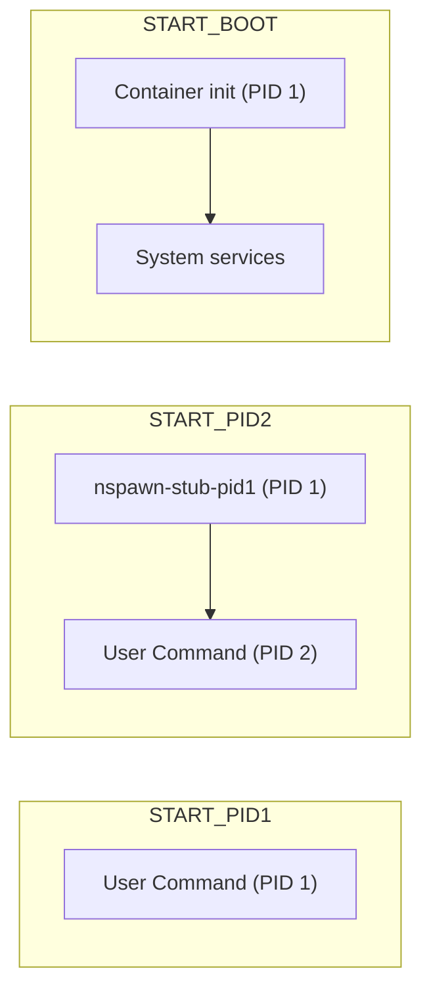
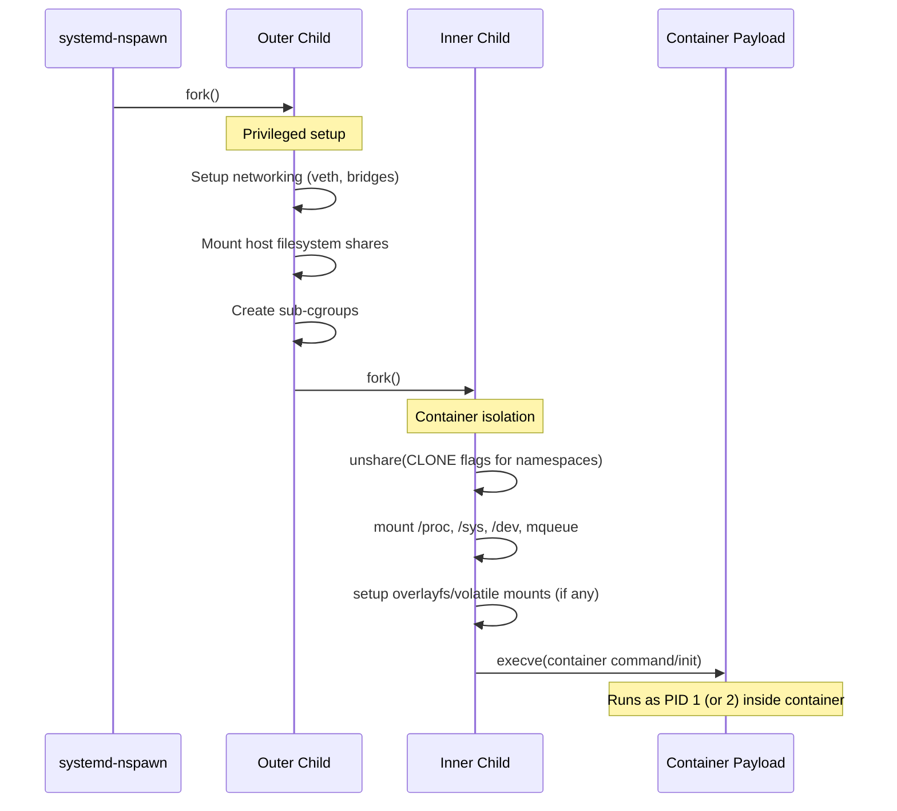
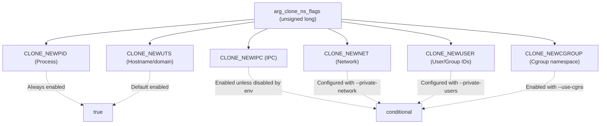
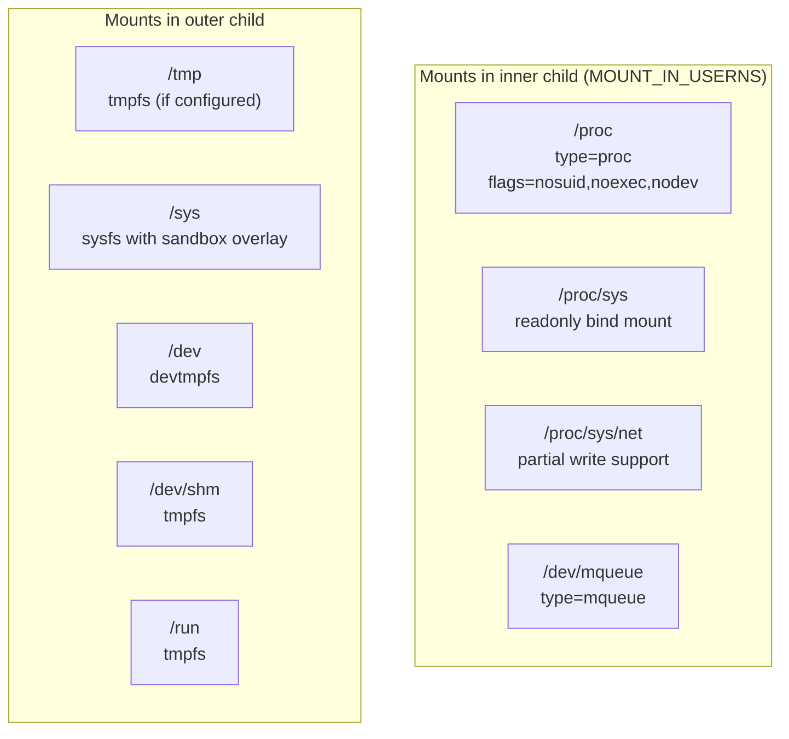
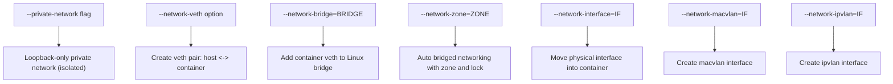
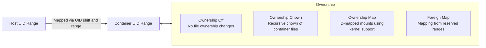
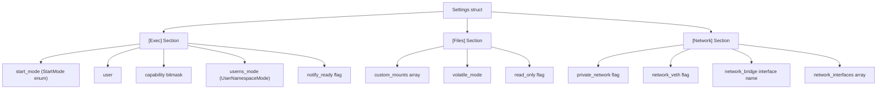
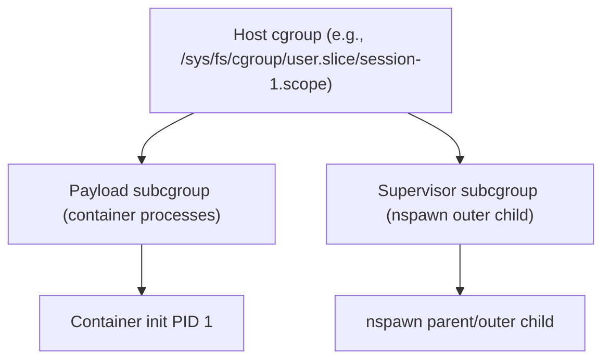
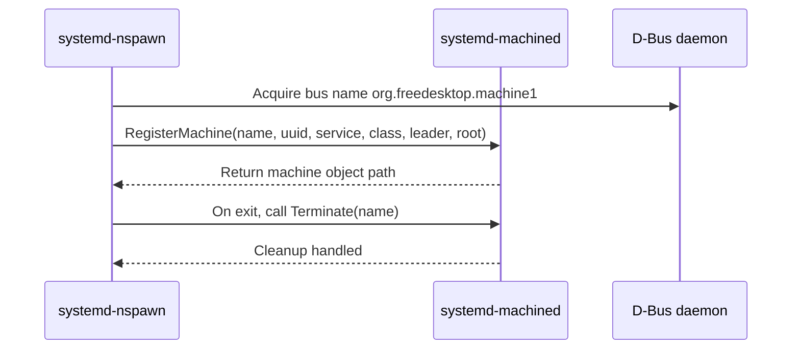

<!-- source: DeepWiki mcp.deepwiki.com · repo systemd/systemd · page 5.1 systemd-nspawn Container Manager · fetched 2026-11-07 -->

# systemd-nspawn Container Manager

<details>
<summary>Relevant source files</summary>

The following files were used as context for generating this wiki page:

- [man/systemd-nspawn.xml](man/systemd-nspawn.xml)
- [man/systemd.nspawn.xml](man/systemd.nspawn.xml)
- [src/nspawn/nspawn-cgroup.c](src/nspawn/nspawn-cgroup.c)
- [src/nspawn/nspawn-cgroup.h](src/nspawn/nspawn-cgroup.h)
- [src/nspawn/nspawn-gperf.gperf](src/nspawn/nspawn-gperf.gperf)
- [src/nspawn/nspawn-mount.c](src/nspawn/nspawn-mount.c)
- [src/nspawn/nspawn-mount.h](src/nspawn/nspawn-mount.h)
- [src/nspawn/nspawn-network.c](src/nspawn/nspawn-network.c)
- [src/nspawn/nspawn-network.h](src/nspawn/nspawn-network.h)
- [src/nspawn/nspawn-oci.c](src/nspawn/nspawn-oci.c)
- [src/nspawn/nspawn-seccomp.c](src/nspawn/nspawn-seccomp.c)
- [src/nspawn/nspawn-seccomp.h](src/nspawn/nspawn-seccomp.h)
- [src/nspawn/nspawn-settings.c](src/nspawn/nspawn-settings.c)
- [src/nspawn/nspawn-settings.h](src/nspawn/nspawn-settings.h)
- [src/nspawn/nspawn.c](src/nspawn/nspawn.c)
- [src/shared/mount-setup.c](src/shared/mount-setup.c)
- [src/shared/mount-setup.h](src/shared/mount-setup.h)
- [src/shared/seccomp-util.c](src/shared/seccomp-util.c)
- [src/shared/seccomp-util.h](src/shared/seccomp-util.h)
- [src/test/test-seccomp.c](src/test/test-seccomp.c)

</details>


## Purpose and Scope

systemd-nspawn is a lightweight container manager utilizing Linux kernel features such as namespaces, cgroups, and capabilities to spawn and manage OS containers. It isolates hostname, filesystems, process trees, users, and network stacks to securely execute commands or fully booted Linux OS instances inside containers.

This page provides a comprehensive technical documentation of systemd-nspawn’s internal architecture, including:

- The **two-phase fork model** separating privileged setup and container execution.
- Linux **namespace setup** and propagation logic.
- **Mount namespace** configuration including standard and custom mounts.
- **Network setup** modes and interface initialization.
- **seccomp sandboxing** integration.
- **OCI (Open Container Initiative) spec** support and parsing.
- Various **execution modes** and user namespace modes.
- Settings file parsing and configuration layering.
- Cgroup management and integration with **systemd-machined** for lifecycle.
- Support for **ephemeral** and **volatile** container root filesystems.

For container image management and machine-level commands, see section [Machine and Image Management](#5.2). For low-level process execution and sandbox details, see [Process Execution and Sandboxing](#2.4).

---

## Architecture Overview

### Two-Phase Fork Model

systemd-nspawn implements a **two-phase fork model** to achieve strong privilege separation between privileged setup and container execution:

- **Parent process**: the invoking systemd-nspawn instance.
- **Outer Child**: forked from parent, runs with elevated privileges on the host, responsible for:
  - Creating network devices (veth pairs, bridges, macvlan, ipvlan).
  - Mounting host-visible filesystems and bind-mounts.
  - Creating sub-cgroups and managing user namespaces.
- **Inner Child**: forked from outer child, isolated in unshared namespaces:
  - Has private user, PID, mount, network, IPC, UTS namespaces.
  - Performs container-local mount namespace setup.
  - Configures filesystems and pivots root or chroots.
  - Sets up seccomp filters and credentials.
  - Finally executes container payload.

This model allows privileged setup to be done outside the container namespace while container code runs in a highly restricted environment.

```mermaid
graph TB
    Parent["systemd-nspawn<br/>(Parent)"]
    OuterChild["Outer Child<br/>(Privileged Setup)"]
    InnerChild["Inner Child<br/>(Container Namespaces & Exec)"]

    Parent -->|"fork()"| OuterChild
    OuterChild -->|"fork()"| InnerChild

    OuterChild -->|"Network, mount, cgroup setup" HostResources["Host Resources"]

    InnerChild -->|"Namespace unshare & mount setup" ContainerNS["Container Namespaces"]

    InnerChild -->|"execve(container payload)" Payload["Container Payload (PID 1 or 2)"]
```

**Sources:** [src/nspawn/nspawn.c:3980-5063]()

---

### Execution Modes

systemd-nspawn supports different container execution modes configured via the `StartMode` enum:

| Mode           | Description                                      | CLI Option           | Container PID 1 Process             |
|----------------|------------------------------------------------|----------------------|-----------------------------------|
| `START_PID1`   | User command executes directly as PID 1        | Default (no option)   | User-specified command             |
| `START_PID2`   | Runs `nspawn-stub-pid1` as PID 1, user command as PID 2 | `--as-pid2`          | stub init + user command           |
| `START_BOOT`   | Boots full OS system within container           | `--boot`              | Container init system (`/sbin/init` or specified) |



These modes govern the container's main process and isolation setup.

**Sources:** [src/nspawn/nspawn-settings.h:17-23](), [src/nspawn/nspawn.c:158-165](), [src/nspawn/nspawn-stub-pid1.c]()

---

### Process Lifecycle and Fork Sequence

The container startup involves the following workflow:



- **Parent** handles CLI parsing and ephemeral snapshot creation.
- **Outer child** configures privileged host resources.
- **Inner child** sets up container environment and launches the payload.

**Sources:** [src/nspawn/nspawn.c:3980-5063](), [src/nspawn/nspawn-mount.c:530-660](), [src/nspawn/nspawn-cgroup.c:48-142]()

---

## Namespace Setup

Namespaces are controlled by a bitmask `arg_clone_ns_flags` of Linux namespace flags configured based on CLI options and settings.



- **PID namespace** isolates process ID numbering; PID 1 inside container is container’s init.
- **IPC namespace** isolates System V IPC and POSIX message queues.
- **UTS namespace** isolates hostname and domainname.
- **Network namespace** isolates network interfaces and stack.
- **User namespace** provides UID/GID isolation and mappings for container user.
- **Cgroup namespace** isolates cgroup filesystem visibility.

User namespace setup additionally involves UID/GID range assignment and ownership/permission mapping inside the container filesystem.

**Sources:** [src/nspawn/nspawn.c:220-230](), [src/nspawn/nspawn.c:590-665]()

---

## Mount Namespace Setup

Mounts are controlled with a set of flags (`MountSettingsMask`) specifying where and how mounts are applied.

| Flag                      | Meaning                                 |
|---------------------------|-----------------------------------------|
| `MOUNT_FATAL`             | Mount failure is fatal                  |
| `MOUNT_IN_USERNS`         | Mount applied inside user namespace (inner child) |
| `MOUNT_NON_ROOT_ONLY`     | Mount applied only in outer child       |
| `MOUNT_APPLY_APIVFS_RO`   | Make container API virtual filesystems read-only (e.g., /proc/sys) |
| `MOUNT_APPLY_TMPFS_TMP`   | Mount /tmp as tmpfs                      |
| `MOUNT_MKDIR`             | Create mount point directories if missing |

Mounts requiring kernel privileges or host visibility (e.g., `/sys`, `/dev`) are mounted in the outer child. Mounts sensitive to the user namespace or PID namespace (e.g., `/proc`) are mounted in the inner child.

**Sources:** [src/nspawn/nspawn-mount.h:7-24](), [src/nspawn/nspawn-mount.c:530-660]()

---

## Mount Management

### Standard Mounts

Standard mounts in the container are split between outer and inner child:



The outer child sets up host-exposed temporary and sysfs mounts, while the inner child configures process-visible mount points in container user namespace.

**Sources:** [src/nspawn/nspawn-mount.c:557-610]()

---

### Custom Mounts

systemd-nspawn supports user-supplied custom mounts to overlay or modify the container filesystem, specified via CLI or `.nspawn` files.

`CustomMount` struct captures mount info:

```c
typedef enum CustomMountType {
    CUSTOM_MOUNT_BIND,
    CUSTOM_MOUNT_TMPFS,
    CUSTOM_MOUNT_OVERLAY,
    CUSTOM_MOUNT_INACCESSIBLE,
    _CUSTOM_MOUNT_TYPE_MAX,
} CustomMountType;

typedef struct CustomMount {
    CustomMountType type;
    bool read_only;
    char *source;
    char *destination;
    char *options;
    char *work_dir;
    char **lower;       // For overlayfs lower layers
    bool in_userns;     // Mount applies inside user namespace (inner child)
} CustomMount;
```

- **Bind mounts** map host directories to container locations.
- **Tmpfs** mounts memory-backed filesystems.
- **Overlay** supports overlayfs with layered mounts.
- **Inaccessible** mounts hide paths inside container.

Preparatory functions like `custom_mount_prepare_all()` resolve source paths relative to container root and mark whether mounts should happen inside user namespaces.

**Sources:** [src/nspawn/nspawn-mount.c:31-74](), [src/nspawn/nspawn-mount.c:151-232](), [src/nspawn/nspawn-mount.h:26-49]()

---

### /sys Filesystem Mounting

The `/sys` mount is handled specially to sandbox container access:

1. In outer child, mount a `tmpfs` on `/sys`.
2. Create `/sys/full`.
3. Mount real `sysfs` on `/sys/full`.
4. Bind mount specific subdirectories (`block`, `bus`, `class`, `dev`, `devices`, `kernel`) back to `/sys`.
5. Unmount `/sys/full`.
6. Optionally remount `/sys` as read-only to prevent container writes.

This setup carefully restricts writable access to critical kernel sysfs nodes, preventing container manipulation of host hardware or kernel parameters.

**Sources:** [src/nspawn/nspawn-mount.c:440-526]()

---

## Network Configuration

systemd-nspawn supports multiple network configuration modes, controllable by CLI flags and settings:



These modes range from fully isolated loopback-only networks to more integrated bridged or physical interface configurations allowing connectivity.

**Sources:** [src/nspawn/nspawn.c:156-210](), [src/nspawn/nspawn-network.c]()

---

### Veth Pair Creation

For `--network-veth`, systemd-nspawn creates a virtual Ethernet pair connecting host and container:

- Host side interface named `ve-<machine>` or `vb-<machine>` if bridged.
- Container side interface named `host0`.
- MAC addresses generated deterministically using SHA1 keyed by host and container constants to avoid collision.

```mermaid
graph LR
    MachineName["arg_machine (container name)"]

    MAC_Host["Host MAC address (net_generate_mac with HOST_HASH_KEY)"]
    MAC_Container["Container MAC address (net_generate_mac with CONTAINER_HASH_KEY)"]

    MachineName --> MAC_Host
    MachineName --> MAC_Container

    MAC_Host --> HostVeth["Host veth interface (ve- or vb-)"]
    MAC_Container --> ContainerVeth["Container veth interface (host0)"]

    HostVeth -- Netlink RTM_NEWLINK --> Kernel
    ContainerVeth -- moved to container net namespace -->
```

Interfaces are created and configured via `sd-netlink` library sending netlink messages.

**Sources:** [src/nspawn/nspawn-network.c:89-213]()

---

### Bridge Setup and Management

For `--network-bridge` or `--network-zone`, systemd-nspawn:

- Creates or reuses Linux bridge devices.
- Adds container veth interface as a bridge slave.
- Uses a lockfile `/run/systemd/nspawn-network-zone` for concurrency control.
- Cleans up bridge interfaces when unused, avoiding disruption to other bridges.

This encapsulates network container connectivity via bridges.

**Sources:** [src/nspawn/nspawn-network.c:326-397]()

---

### Macvlan and Ipvlan Interfaces

`--network-macvlan` or `--network-ipvlan` create virtual layer 3 or 2 devices on top of physical interfaces:

- MAC address generated by hashing machine name and interface index with `MACVLAN_HASH_KEY`.
- Interface moved to container network namespace.

This provides isolated networking without veth overhead.

**Sources:** [src/nspawn/nspawn-network.c:467-582]()

---

## User Namespace Modes

User namespaces isolate user and group ID mappings. systemd-nspawn supports multiple modes as defined in `UserNamespaceMode`:

| Mode                       | Description                                    | CLI Syntax                    | UID Range Source               |
|----------------------------|------------------------------------------------|------------------------------|-------------------------------|
| `USER_NAMESPACE_NO`        | No user namespace                              | `--private-users=no`          | None                          |
| `USER_NAMESPACE_FIXED`     | Fixed user namespace with provided UID range  | `--private-users=BASE[:RANGE]` or `yes` | Explicit or detected          |
| `USER_NAMESPACE_PICK`      | Random UID range chosen from subrange pool     | `--private-users=pick`        | Hash-derived from machine name|
| `USER_NAMESPACE_MANAGED`   | Delegated user namespace via systemd-nsresourced | `--private-users=managed`     | Assigned externally via nsresource|

Ownership handling modes are encoded in `UserNamespaceOwnership`:



These modes influence how container filesystem ownerships are presented and modified to the container user namespace.

**Sources:** [src/nspawn/nspawn-settings.h:25-42](), [src/nspawn/nspawn.c:300-363]()

---

### Managed User Namespaces Integration

In managed mode, systemd-nspawn communicates with `systemd-nsresourced.service` over varlink:

- Calls `AllocateUserRange` method passing machine name and optional UID range.
- Receives allocated user namespace file descriptor and UID range.
- Registers container cgroup with nsresourced for resource accounting and cleanup.

This provides a managed UID range with centralized lifecycle.

**Sources:** [src/nspawn/nspawn.c:348-353](), [src/nspawn/nspawn-cgroup.c:93-126]()

---

## Settings Files

systemd-nspawn supports layered `.nspawn` configuration files providing persistent container options.

### Settings File Lookup Order

Configuration files are searched with cascading priority:

1. `/etc/systemd/nspawn/<machine>.nspawn` — Trusted, all options permitted.
2. `/run/systemd/nspawn/<machine>.nspawn` — Trusted overrides.
3. Adjacent to OS image or directory — User-placed, untrusted, restricted options only.

This allows system-wide defaults, runtime overrides, and individual user settings.

**Sources:** [man/systemd-nspawn.xml:176-221](), [src/nspawn/nspawn-settings.c:72-102]()

---

### Settings Structure and Parsing

The `Settings` struct organizes configuration into sections like `[Exec]`, `[Files]`, `[Network]`:



Parsing is done by keyed functions via gperf hash lookups (e.g., `config_parse_boot()`, `config_parse_bind()`, `config_parse_private_users()`). These load config directives from files and apply validation and normalization.

**Sources:** [src/nspawn/nspawn-settings.h:160-239](), [man/systemd-nspawn.xml:83-470](), [src/nspawn/nspawn-gperf.gperf:22-78](), [src/nspawn/nspawn-settings.c:243-537]()

---

### CLI Override Mask

systemd-nspawn tracks which options were overridden explicitly on the CLI using a bitmask enum `SettingsMask`.

```c
typedef enum SettingsMask {
    SETTING_START_MODE        = 1ULL << 0,
    SETTING_ENVIRONMENT       = 1ULL << 1,
    SETTING_USER              = 1ULL << 2,
    SETTING_CAPABILITY        = 1ULL << 3,
    // ...
    SETTING_NETWORK           = 1ULL << 7,
    SETTING_CUSTOM_MOUNTS     = 1ULL << 11,
    SETTING_USERNS            = 1ULL << 13,
    // ...
} SettingsMask;
```

Each set bit means the corresponding setting is explicitly set and should not be overridden by config files, allowing layering of configuration sources.

**Sources:** [src/nspawn/nspawn-settings.h:94-133](), [src/nspawn/nspawn.c:220-221]()

---

## Cgroup Management

systemd-nspawn automatically manages container participation in cgroups, particularly cgroup v2 hierarchies.

### Subcgroup Creation and Delegation

`create_subcgroup()` creates:

- A **payload subcgroup**, where container processes reside.
- An optional **supervisor subcgroup** for the outer nspawn process (used if `--keep-unit`).



The parent process’s cgroup is discovered, subgroups created, and container processes moved into payload subgroup. Controllers are enabled accordingly.

**Sources:** [src/nspawn/nspawn-cgroup.c:48-142]()

---

### Cgroup Ownership with User Namespaces

For unmanaged user namespaces, the container’s UID range may differ from the host. systemd-nspawn adjusts ownership of cgroup files:

- Calls `chown_cgroup_path()` to recursively chown special cgroup files and directories to mapped container UID.
- Applies to files like `cgroup.controllers`, `cgroup.procs`, `memory.oom.group`.

This grants container users proper ownership to control cgroup settings.

In managed namespaces, ownership is delegated to `systemd-nsresourced`.

**Sources:** [src/nspawn/nspawn-cgroup.c:22-46](), [src/nspawn/nspawn-cgroup.c:93-126]()

---

### Cgroup Namespace Handling

If the container is run with the cgroup namespace (`CLONE_NEWCGROUP` set), systemd-nspawn performs:

- Outer child mounts a private instance of `/sys/fs/cgroup`.
- Inner child bind mounts container cgroup to `/sys/fs/cgroup`.
- Host cgroup mount remounted read-only to hide host hierarchy.

This ensures container sees isolated cgroup filesystem view, hiding host cgroup resources.

**Sources:** [src/nspawn/nspawn-cgroup.c:172-196](), [src/nspawn/nspawn.c:225-226]()

---

## seccomp Sandbox Support

systemd-nspawn integrates with libseccomp to apply syscall filters inside the container, restricting system calls the containerized processes can invoke.

- Filters are parsed and loaded based on syscall filter sets.
- Architecture-specific filters can be applied.
- Actions include deny, allow, log, or kill on violating syscalls.
- Early libseccomp functions are dynamically loaded via dlsym.
- Filters can restrict namespaces, ptrace, and realtime signals.

This reduces kernel attack surface of containers, improving isolation.

**Sources:** [src/shared/seccomp-util.c](), [src/nspawn/nspawn-seccomp.c](), [src/shared/seccomp-util.h](), [src/test/test-seccomp.c]()

---

## OCI Support

systemd-nspawn has preliminary support for Open Container Initiative (OCI) runtime specs:

- It can parse the OCI bundle configuration JSON to apply resource, mount, and device settings.
- Supports hooks prestart, poststart, and poststop.
- Handles console modes and sizes.
- Limited implementation; several spec features unsupported or partially supported.
- OCI mount points are translated into internal custom mounts.
- Security profiles and cgroup configurations managed accordingly.

This enables systemd-nspawn to operate as a lightweight OCI runtime.

**Sources:** [src/nspawn/nspawn-oci.c]()

---

## Integration with systemd-machined

systemd-nspawn registers container lifecycle with `systemd-machined` through D-Bus:

- Acquires the well-known bus name `org.freedesktop.machine1`.
- Calls `RegisterMachine()` method, passing container name, UUID, leader PID, container root directory, and class `"container"`.
- Receives machine object path for future communication.
- On container exit, calls `Terminate()` to cleanup container registration.

This integration enables tools like `machinectl` to manage containers, provide shells, and interact consistently.



**Sources:** [src/nspawn/nspawn-register.c](), [man/systemd-nspawn.xml:100-120]()

---

## Volatile and Ephemeral Container Modes

systemd-nspawn supports ephemeral and volatile filesystem modes to avoid persistence of changes:

| Mode               | Behavior                                             | CLI Option       |
|--------------------|-----------------------------------------------------|------------------|
| None (default)      | Persistent container root filesystem                | (no option)      |
| Ephemeral          | Snapshot container root, deleted on shutdown        | `--ephemeral`    |
| `volatile=yes`     | Mount root in `tmpfs`, `/usr` readonly              | `--volatile=yes` |
| `volatile=state`   | Mount `/usr` and `/etc` readonly, `/var` tmpfs      | `--volatile=state`|
| `volatile=overlay` | Use overlayfs with tmpfs as upper layer              | `--volatile=overlay` |

These modes are implemented via overlay mounts, tmpfs mounts, and pivot root manipulations in `setup_volatile_mode()`.

**Sources:** [src/nspawn/nspawn.c:211](), [src/nspawn/nspawn-mount.c](), [src/volatile-root/volatile-root.c:21-117]()

---

## Summary

systemd-nspawn combines rigorous technical design for containerized environments featuring:

- **Two-phase fork model** isolating privileged host setup and container runtime environment.
- Multiple **container startup modes** for commands, stubs, or full OS boot.
- Comprehensive **namespace management** (PID, user, network, mount, IPC, UTS, cgroup).
- Flexible **mount namespace setup** combining standard and custom mounts.
- Extensive **networking modes** with virtual Ethernet pairs, bridges, macvlan, and ipvlan.
- Different **user namespace modes** with ownership mapping strategies, including managed namespaces.
- Layered **configuration with `.nspawn` files** and CLI overrides.
- Automated **cgroup subgroups** with ownership handling.
- **seccomp syscall filtering** for syscall sandboxing.
- **Preliminary OCI runtime support**.
- Integration with **systemd-machined** for container lifecycle.
- Support for **volatile and ephemeral container root filesystems**.

This architecture facilitates secure, flexible, and performant Linux container management based on systemd technologies.

---

# References and Sources

- `src/nspawn/nspawn.c:1-6778`
- `src/nspawn/nspawn-mount.c:1-1516`
- `src/nspawn/nspawn-settings.c:1-1094`
- `src/nspawn/nspawn-settings.h:1-296`
- `src/nspawn/nspawn-cgroup.c:1-197`
- `src/nspawn/nspawn-network.c:1-1058`
- `src/nspawn/nspawn-register.c` (not fully quoted)
- `src/nspawn/nspawn-oci.c:1-151`
- `src/shared/seccomp-util.c:1-2684`
- `src/shared/seccomp-util.h:1-187`
- `man/systemd-nspawn.xml:1-221`
- `src/test/test-seccomp.c:1-187`

---

