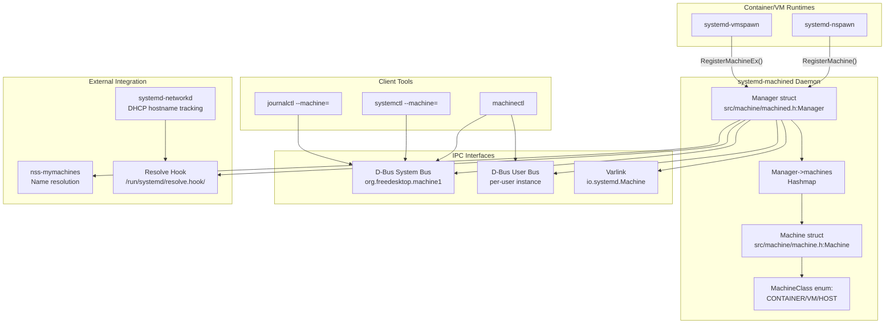
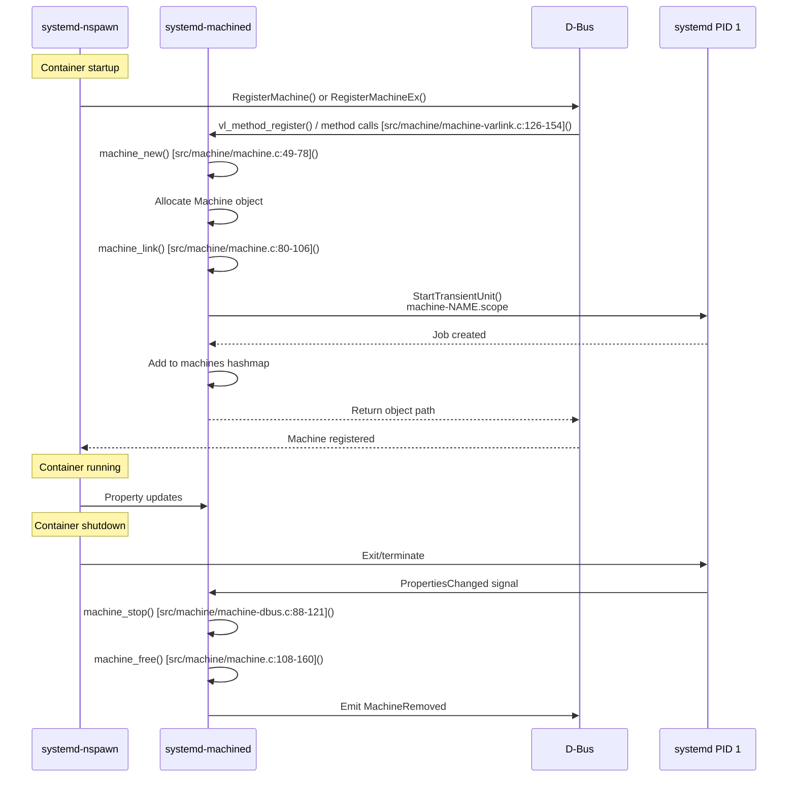
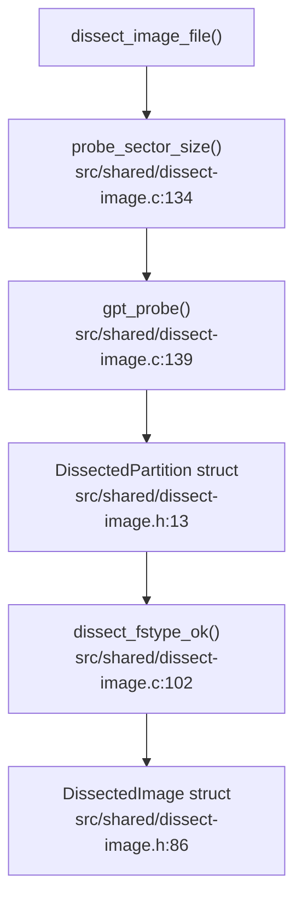

<!-- source: DeepWiki mcp.deepwiki.com · repo systemd/systemd · page 5.2 Machine and Image Management · fetched 2026-11-07 -->

# Machine and Image Management

Relevant source files

The following files were used as context for generating this wiki page:

- [man/systemd-dissect.xml](man/systemd-dissect.xml)
- [src/dissect/dissect.c](src/dissect/dissect.c)
- [src/import/export-raw.c](src/import/export-raw.c)
- [src/import/export-raw.h](src/import/export-raw.h)
- [src/import/export-tar.c](src/import/export-tar.c)
- [src/import/export-tar.h](src/import/export-tar.h)
- [src/import/export.c](src/import/export.c)
- [src/import/import-common.c](src/import/import-common.c)
- [src/import/import-common.h](src/import/import-common.h)
- [src/import/import-fs.c](src/import/import-fs.c)
- [src/import/import-raw.c](src/import/import-raw.c)
- [src/import/import-tar.c](src/import/import-tar.c)
- [src/import/import.c](src/import/import.c)
- [src/import/pull-common.c](src/import/pull-common.c)
- [src/import/pull-common.h](src/import/pull-common.h)
- [src/import/pull-forward.h](src/import/pull-forward.h)
- [src/import/pull-job.c](src/import/pull-job.c)
- [src/import/pull-job.h](src/import/pull-job.h)
- [src/import/pull-oci.c](src/import/pull-oci.c)
- [src/import/pull-oci.h](src/import/pull-oci.h)
- [src/import/pull-raw.c](src/import/pull-raw.c)
- [src/import/pull-raw.h](src/import/pull-raw.h)
- [src/import/pull-tar.c](src/import/pull-tar.c)
- [src/import/pull-tar.h](src/import/pull-tar.h)
- [src/import/pull.c](src/import/pull.c)
- [src/machine/image-dbus.c](src/machine/image-dbus.c)
- [src/machine/image-dbus.h](src/machine/image-dbus.h)
- [src/machine/image-varlink.c](src/machine/image-varlink.c)
- [src/machine/image-varlink.h](src/machine/image-varlink.h)
- [src/machine/image.c](src/machine/image.c)
- [src/machine/image.h](src/machine/image.h)
- [src/machine/machine-dbus.c](src/machine/machine-dbus.c)
- [src/machine/machine-dbus.h](src/machine/machine-dbus.h)
- [src/machine/machine-varlink.c](src/machine/machine-varlink.c)
- [src/machine/machine-varlink.h](src/machine/machine-varlink.h)
- [src/machine/machine.c](src/machine/machine.c)
- [src/machine/machine.h](src/machine/machine.h)
- [src/machine/machined-core.c](src/machine/machined-core.c)
- [src/machine/machined-dbus.c](src/machine/machined-dbus.c)
- [src/machine/machined-resolve-hook.c](src/machine/machined-resolve-hook.c)
- [src/machine/machined-varlink.c](src/machine/machined-varlink.c)
- [src/machine/machined.c](src/machine/machined.c)
- [src/machine/machined.h](src/machine/machined.h)
- [src/machine/org.freedesktop.machine1.conf](src/machine/org.freedesktop.machine1.conf)
- [src/portable/portable.c](src/portable/portable.c)
- [src/shared/discover-image.c](src/shared/discover-image.c)
- [src/shared/discover-image.h](src/shared/discover-image.h)
- [src/shared/dissect-image.c](src/shared/dissect-image.c)
- [src/shared/dissect-image.h](src/shared/dissect-image.h)
- [src/shared/varlink-io.systemd.Machine.c](src/shared/varlink-io.systemd.Machine.c)
- [src/shared/varlink-io.systemd.MachineImage.c](src/shared/varlink-io.systemd.MachineImage.c)
- [src/shared/varlink-io.systemd.MachineImage.h](src/shared/varlink-io.systemd.MachineImage.h)
- [src/sysext/sysext.c](src/sysext/sysext.c)
- [test/units/TEST-13-NSPAWN.machined.sh](test/units/TEST-13-NSPAWN.machined.sh)
- [test/units/TEST-13-NSPAWN.nspawn.sh](test/units/TEST-13-NSPAWN.nspawn.sh)
- [test/units/TEST-13-NSPAWN.nss-mymachines.sh](test/units/TEST-13-NSPAWN.nss-mymachines.sh)
- [test/units/TEST-50-DISSECT.sysext.sh](test/units/TEST-50-DISSECT.sysext.sh)
- [test/units/TEST-74-AUX-UTILS.capsule.sh](test/units/TEST-74-AUX-UTILS.capsule.sh)

## Purpose and Scope

This section covers `systemd-machined` (machine registry daemon), `systemd-importd` (image transfer daemon), and `machinectl` (unified command-line interface for both). `systemd-machined` tracks running containers and VMs, providing operations like listing machines, obtaining shell access, transferring files, and monitoring machine state. `systemd-importd` handles importing and exporting machine images from various sources including tar archives, raw disk images, Open Container Initiative (OCI) images, and remote URLs. Both daemons support system-wide and per-user instances.

For detailed information on container runtime implementation with `systemd-nspawn`, see page 5.1. For partition and disk image management with `systemd-repart`, see page 4.2.

Sources: [src/machine/machined.c:46-90](), [src/machine/machine.c:49-78]()

## systemd-machined Architecture

**systemd-machined Daemon and Machine Registry**

**Sources:** [src/machine/machined.c:46-90](), [src/machine/machine.c:49-78](), [src/machine/machined-dbus.c:195-232]()

`systemd-machined` maintains a registry of running machines, identified by name and leader PID. The daemon supports both system-wide operation and per-user instances, enabling unprivileged machine management. Each `Machine` object tracks the machine class (container or VM), leader process, root directory, network addresses, and associated service unit.

## Machine Registration and Lifecycle

**Machine Registration Flow**

**Sources:** [src/machine/machined-dbus.c:195-232](), [src/machine/machine.c:49-160](), [src/machine/machine-varlink.c:126-154]()

Machine registration occurs when `systemd-nspawn` or `systemd-vmspawn` starts a container or VM. The `RegisterMachineEx()` method and Varlink register methods accept additional parameters including `PidRef` (encapsulating PIDFDs) for improved process tracking without PID reuse ambiguity [src/machine/machined-varlink.c:50-70](). Each machine is associated with a transient scope unit (`machine-NAME.scope`) for cgroup management and resource control [src/machine/machine.c:162-230]().

**Machine Object Structure**

The `Machine` structure tracks:

| Field | Description | Code Pointer |
|-------|-------------|--------------|
| `name` | Machine name (hostname-style identifier) | `Machine->name` [src/machine/machine.c:71-71]() |
| `leader` | `PidRef` of container/VM init process | `Machine->leader` [src/machine/machine.c:65-65]() |
| `class` | `MachineClass` enum (`CONTAINER`, `VM`, `HOST`) | `Machine->class` [src/machine/machine.c:64-64]() |
| `service` | Unit name (e.g., `systemd-nspawn@machine.service`) | `Machine->service` [src/machine/machine.c:146-146]() |
| `root_directory` | Path to machine's root filesystem | `Machine->root_directory` [src/machine/machine.c:147-147]() |
| `unit` | Scope unit name (`machine-NAME.scope`) | `Machine->unit` [src/machine/machine.c:149-149]() |
| `netif` | Array of network interface indices | `Machine->netif` [src/machine/machine.c:154-154]() |
| `vsock_cid` | VSOCK context ID for VMs | `Machine->vsock_cid` [src/machine/machine.c:67-67]() |

**Sources:** [src/machine/machine.h:1-100](), [src/machine/machine.c:49-78]()

## systemd-importd and Image Management

`systemd-importd` is a daemon that facilitates importing, exporting, and pulling of container and VM images across raw, tar, and OCI formats. It manages background transfer tasks.

**Image Discovery and Search Paths**

`systemd` looks for images in specific directory hierarchies based on `ImageClass` [src/shared/discover-image.c:60-87]():

- **Machines (`IMAGE_MACHINE`)**: `/var/lib/machines`, `/run/machines`, `/etc/machines`, `/usr/lib/machines` [src/shared/discover-image.c:61-67]()
- **Portables (`IMAGE_PORTABLE`)**: `/var/lib/portables`, `/run/portables`, `/etc/portables`, `/usr/lib/portables` [src/shared/discover-image.c:69-73]()
- **Extensions (`IMAGE_SYSEXT`)**: `/var/lib/extensions`, `/run/extensions`, `/etc/extensions` [src/shared/discover-image.c:79-81]()
- **Configuration Extensions (`IMAGE_CONFEXT`)**: `/var/lib/confexts`, `/run/confexts`, `/etc/confexts`, `/usr/lib/confexts` [src/shared/discover-image.c:83-86]()

**Sources:** [src/shared/discover-image.c:60-104](), [src/shared/discover-image.h:1-50]()

## Image Dissection and Policy

The `dissect-image.c` library provides core logic for inspecting Discoverable Disk Images (DDIs), raw disk images, and loop-mounted directory trees. It probes partition tables, validates file systems, verifies cryptographic signatures, and extracts OS release metadata [src/shared/dissect-image.c:134-210]().

**Dissection Logic Flow**

**Sources:** [src/shared/dissect-image.c:102-179](), [src/shared/dissect-image.h:13-113]()

The `DissectedImage` structure contains meta-information extracted from `/etc/os-release`, including `hostname`, `machine_id`, and OS feature flags [src/shared/dissect-image.h:86-113]().

## Network Integration and Name Resolution

`systemd-machined` integrates with network and name resolution subsystems via several interfaces:

1.  **Varlink Resolution Hook**: Implements `io.systemd.Resolve.Hook` allowing `systemd-resolved` to query container and machine names dynamically [src/machine/machined-varlink.c:28-32]().
2.  **User Database Integration**: Implements `io.systemd.UserDatabase` to synthesize user records for isolated container users (e.g., mapped UID ranges via `vu-machine-uid`) [src/machine/machined-varlink.c:46-63]().
3.  **Address Discovery**: The `machine_get_addresses()` function retrieves active IP addresses assigned to container interfaces [src/machine/machine-dbus.c:176-210]().

**Sources:** [src/machine/machined-varlink.c:28-191](), [src/machine/machine-dbus.c:176-210]()

## CLI Tools and Verbs

### machinectl
The primary administrative interface for interacting with `systemd-machined`.

| Verb | Implementation Site | Description |
| :--- | :--- | :--- |
| `list` | `method_list_machines()` [src/machine/machined-dbus.c:195-232]() | List running machines and containers |
| `terminate` | `bus_machine_method_terminate()` [src/machine/machine-dbus.c:88-121]() | Terminate a machine or container |
| `kill` | `bus_machine_method_kill()` [src/machine/machine-dbus.c:123-174]() | Send a POSIX signal to a machine's processes |
| `get-addresses` | `bus_machine_method_get_addresses()` [src/machine/machine-dbus.c:176-210]() | Query active IP addresses for a container |

### systemd-dissect
Used for manual inspection, mounting, and archive generation of DDIs and raw images.

- **Actions**: `ACTION_DISSECT`, `ACTION_MOUNT`, `ACTION_COPY_FROM`, `ACTION_ATTACH`, `ACTION_MAKE_ARCHIVE` [src/dissect/dissect.c:65-80]().
- **Policy**: Enforces strict `ImagePolicy` constraints to govern mounting authorization and security checks [src/dissect/dissect.c:105-112]().

### systemd-sysext / systemd-confext
Manages OS and configuration extension images by layering them over `/usr/`, `/opt/`, or `/etc/` using OverlayFS [src/sysext/sysext.c:133-146]().

- **Mutable Mode**: Supports `MUTABLE_EPHEMERAL`, `MUTABLE_IMPORT`, and standard merge modes for managing upper layers [src/sysext/sysext.c:74-95]().

Sources: [src/machine/machined-dbus.c:88-232](), [src/dissect/dissect.c:65-112](), [src/sysext/sysext.c:74-146]()

---

