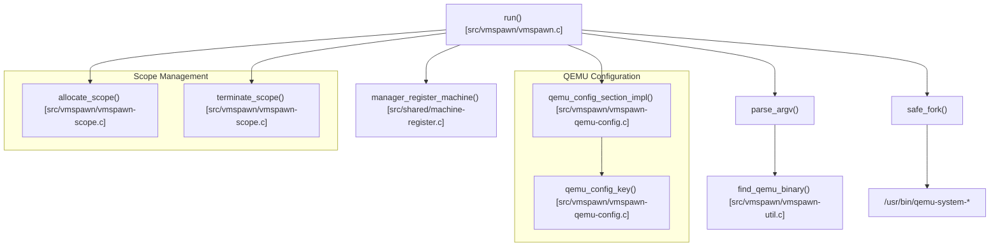
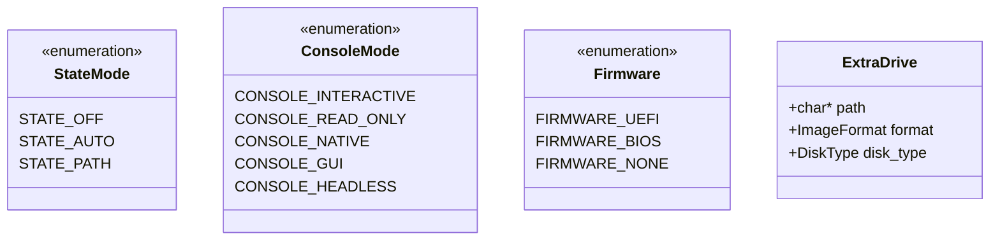

<!-- source: DeepWiki mcp.deepwiki.com · repo systemd/systemd · page 5.3 VM Spawning with systemd-vmspawn · fetched 2026-11-07 -->

# VM Spawning with systemd-vmspawn

Relevant source files

The following files were used as context for generating this wiki page:

- [man/systemd-vmspawn.xml](man/systemd-vmspawn.xml)
- [shell-completion/bash/systemd-vmspawn](shell-completion/bash/systemd-vmspawn)
- [src/shared/machine-util.c](src/shared/machine-util.c)
- [src/shared/machine-util.h](src/shared/machine-util.h)
- [src/test/test-machine-util.c](src/test/test-machine-util.c)
- [src/vmspawn/meson.build](src/vmspawn/meson.build)
- [src/vmspawn/test-vmspawn-qemu-config.c](src/vmspawn/test-vmspawn-qemu-config.c)
- [src/vmspawn/test-vmspawn-util.c](src/vmspawn/test-vmspawn-util.c)
- [src/vmspawn/vmspawn-mount.c](src/vmspawn/vmspawn-mount.c)
- [src/vmspawn/vmspawn-mount.h](src/vmspawn/vmspawn-mount.h)
- [src/vmspawn/vmspawn-qemu-config.c](src/vmspawn/vmspawn-qemu-config.c)
- [src/vmspawn/vmspawn-qemu-config.h](src/vmspawn/vmspawn-qemu-config.h)
- [src/vmspawn/vmspawn-scope.c](src/vmspawn/vmspawn-scope.c)
- [src/vmspawn/vmspawn-scope.h](src/vmspawn/vmspawn-scope.h)
- [src/vmspawn/vmspawn-settings.c](src/vmspawn/vmspawn-settings.c)
- [src/vmspawn/vmspawn-settings.h](src/vmspawn/vmspawn-settings.h)
- [src/vmspawn/vmspawn-util.c](src/vmspawn/vmspawn-util.c)
- [src/vmspawn/vmspawn-util.h](src/vmspawn/vmspawn-util.h)
- [src/vmspawn/vmspawn.c](src/vmspawn/vmspawn.c)

`systemd-vmspawn` is a tool used to start an operating system in a virtual machine (VM). While it shares a similar user interface and philosophy with `systemd-nspawn`, it utilizes hardware virtualization (QEMU/KVM) rather than Linux namespaces to provide isolation [man/systemd-vmspawn.xml:37-39](). It integrates deeply with `systemd-machined` for lifecycle tracking and `systemd-networkd` for TAP-based networking.

## Core Architecture and Execution Flow

`systemd-vmspawn` operates by preparing a QEMU configuration based on command-line arguments and machine settings, forking a QEMU process, and registering the resulting VM as a "machine" with `systemd-machined`.

### Execution Lifecycle
1.  **Argument Parsing & Validation**: The tool parses disk images (`--image`), directories (`--directory`), and resource limits (`--cpus`, `--ram`) [src/vmspawn/vmspawn.c:144-154]().
2.  **Resource Discovery**: It searches for suitable UEFI firmware (OVMF) based on architecture and feature sets using `find_ovmf_config()` [src/vmspawn/vmspawn-util.c:150]().
3.  **Process Preparation**: It sets up file descriptors for `/dev/kvm` and `/dev/vhost-vsock`, which can also be inherited via socket activation [man/systemd-vmspawn.xml:41-46]().
4.  **Registration**: The VM is registered with `systemd-machined` via `manager_register_machine()` [src/vmspawn/vmspawn.c:54]().
5.  **QEMU Launch**: A QEMU process is spawned with a generated command line, utilizing a temporary QEMU configuration file written via `qemu_config_section_impl()` [src/vmspawn/vmspawn-qemu-config.c:57]().
6.  **Monitoring**: `systemd-vmspawn` remains active to forward signals and manage the console via `ptyfwd` [src/vmspawn/vmspawn.c:71]().

Title: "systemd-vmspawn Execution and Registration Flow"

Sources: [src/vmspawn/vmspawn.c:54-100](), [src/vmspawn/vmspawn-util.c:150-153](), [src/vmspawn/vmspawn-qemu-config.c:57](), [src/vmspawn/vmspawn-scope.c:36-155]()

Sources: [src/vmspawn/vmspawn.c:144-154](), [src/vmspawn/vmspawn-util.c:150](), [man/systemd-vmspawn.xml:41-46](), [src/vmspawn/vmspawn-qemu-config.c:57](), [src/vmspawn/vmspawn.c:71]()

## Integration with systemd-machined

`systemd-vmspawn` treats VMs as first-class citizens in the `machined` ecosystem. Unlike containers, which are tracked by their leader PID (PID 1 of the container), a VM's leader is the QEMU process itself [man/systemd-vmspawn.xml:37-39]().

### Machine Registration and Scopes
When a VM is spawned, it is registered with `systemd-machined`. To ensure resource control and lifecycle management, `systemd-vmspawn` allocates a transient scope unit via `allocate_scope()` [src/vmspawn/vmspawn-scope.c:36](). This scope is created with the following properties:
*   **Description**: Set to "Virtual Machine [machine_name]" [src/vmspawn/vmspawn-scope.c:63]().
*   **Slice**: Defaults to `machine.slice` unless overridden by `arg_slice` [src/vmspawn/vmspawn-scope.c:100]().
*   **Controller**: The unique bus name of the `systemd-vmspawn` process is registered as the controller [src/vmspawn/vmspawn-scope.c:104]().

Title: "VM Configuration and State Constants"

Sources: [src/vmspawn/vmspawn.c:125-131](), [src/vmspawn/vmspawn-settings.h:20-43](), [src/vmspawn/vmspawn-settings.h:7-11]()

Sources: [man/systemd-vmspawn.xml:37-39](), [src/vmspawn/vmspawn-scope.c:36](), [src/vmspawn/vmspawn-scope.c:63](), [src/vmspawn/vmspawn-scope.c:100](), [src/vmspawn/vmspawn-scope.c:104]()

## QEMU Configuration and Virtualization Features

The tool abstracts complex QEMU parameters into high-level settings and enforces strict identifier validation [src/vmspawn/vmspawn-qemu-config.c:12]().

### Resource Management
| Feature | systemd-vmspawn Option | Internal Logic |
| :--- | :--- | :--- |
| **CPU** | `--cpus=` | Configures SMP via `arg_cpus` [src/vmspawn/vmspawn.c:152]() |
| **RAM** | `--ram=` | Supports base memory and `arg_ram_max` for hotplug [src/vmspawn/vmspawn.c:153-154]() |
| **TPM** | `--tpm=` | Integrates with `swtpm` [src/vmspawn/vmspawn.c:159]() |
| **KVM** | `--kvm=` | Checked via `qemu_check_kvm_support()` [src/vmspawn/vmspawn-util.c:97]() |

### Disk and Storage
`systemd-vmspawn` supports `raw` and `qcow2` formats [man/systemd-vmspawn.xml:133](). It handles root images via `arg_image` and additional drives via `ExtraDriveContext` [src/vmspawn/vmspawn-settings.h:13-16](). Host directories can be mounted into the VM as virtio-fs exports using `RuntimeMount` structures [src/vmspawn/vmspawn-mount.c:26-31]().

### Networking
Three networking stacks are defined in `NetworkStack` [src/vmspawn/vmspawn-util.h:121-127]():
1.  **tap**: TAP-based networking with host integration.
2.  **user**: SLIRP-based user-mode networking.
3.  **none**: No networking.

The tool can also fix the VSOCK CID for the guest using `vsock_fix_child_cid()` to avoid conflicts [src/vmspawn/vmspawn-util.h:153]().

Sources: [src/vmspawn/vmspawn-qemu-config.c:12](), [src/vmspawn/vmspawn.c:152-159](), [src/vmspawn/vmspawn-util.c:97](), [man/systemd-vmspawn.xml:133](), [src/vmspawn/vmspawn-settings.h:13-16](), [src/vmspawn/vmspawn-mount.c:26-31](), [src/vmspawn/vmspawn-util.h:121-153]()

## Firmware and Booting
The tool supports booting via:
*   **Direct Kernel Boot**: Using `--linux` (`arg_linux`) and `--initrd` (`arg_initrds`) [src/vmspawn/vmspawn.c:160-162]().
*   **UEFI**: Automatically discovering OVMF firmware files based on architecture [src/vmspawn/vmspawn-util.h:65-89]().

`systemd-vmspawn` uses `OvmfConfig` to track firmware paths and NVRAM templates [src/vmspawn/vmspawn-util.h:97-105](). It can parse QEMU firmware interop JSON data to find matching firmware for the current architecture and machine type [src/vmspawn/vmspawn-util.c:176-194]().

### Confidential Computing
`systemd-vmspawn` supports hardware-based memory encryption via the `ConfidentialComputing` enum [src/vmspawn/vmspawn-settings.h:45-51]():
*   `COCO_AMD_SEV_SNP`: AMD Secure Nested Paging.
*   `COCO_INTEL_TDX`: Intel Trust Domain Extensions.

For TDX, the tool can auto-discover the host's Quote Generation Service (qgsd) via unix sockets or vsock [src/vmspawn/vmspawn.c:109-114]().

### State Persistence
Auxiliary VM state (TPM and EFI variables) is managed via `StateMode` [src/vmspawn/vmspawn.c:125]():
*   **STATE_OFF**: No state persistence.
*   **STATE_AUTO**: State is derived from the image or directory path [src/vmspawn/vmspawn.c:126]().
*   **STATE_PATH**: Explicitly provided paths via `arg_tpm_state_path` or `arg_efi_nvram_state_path` [src/vmspawn/vmspawn.c:194-198]().

Sources: [src/vmspawn/vmspawn.c:160-162](), [src/vmspawn/vmspawn-util.h:65-105](), [src/vmspawn/vmspawn-util.c:176-194](), [src/vmspawn/vmspawn-settings.h:45-51](), [src/vmspawn/vmspawn.c:109-114](), [src/vmspawn/vmspawn.c:125-126](), [src/vmspawn/vmspawn.c:194-198]()

---

