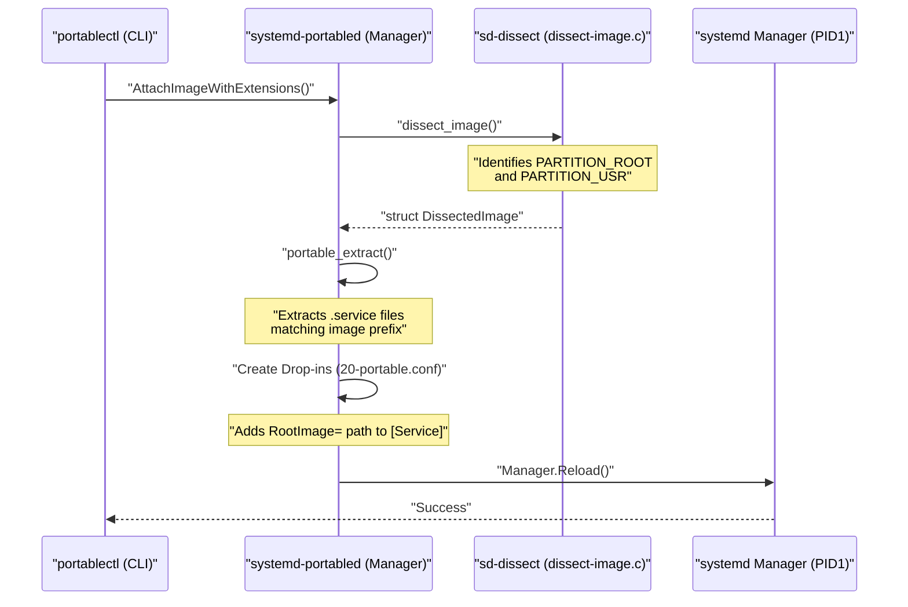
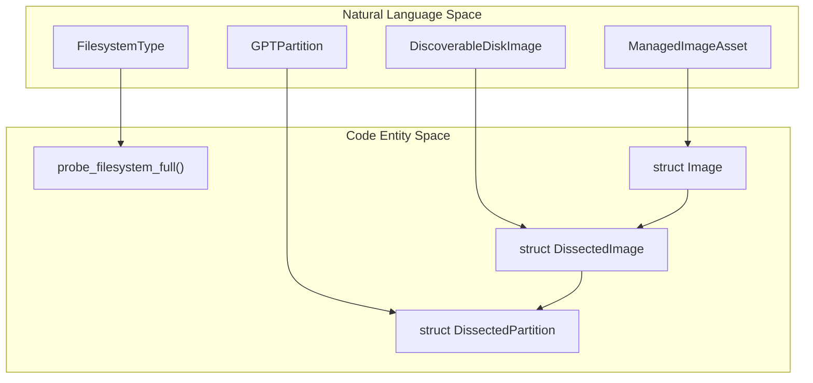

<!-- source: DeepWiki mcp.deepwiki.com · repo systemd/systemd · page 5.4 Portable Services · fetched 2026-11-07 -->

# Portable Services

Relevant source files

The following files were used as context for generating this wiki page:

- [.obs/workflows.yml](.obs/workflows.yml)
- [AGENTS.md](AGENTS.md)
- [CLAUDE.md](CLAUDE.md)
- [README.md](README.md)
- [docs/ARCHITECTURE.md](docs/ARCHITECTURE.md)
- [docs/AUTOMATIC_BOOT_ASSESSMENT.md](docs/AUTOMATIC_BOOT_ASSESSMENT.md)
- [docs/BLOCK_DEVICE_LOCKING.md](docs/BLOCK_DEVICE_LOCKING.md)
- [docs/BOOT_LOADER_INTERFACE.md](docs/BOOT_LOADER_INTERFACE.md)
- [docs/BOOT_LOADER_SPECIFICATION.md](docs/BOOT_LOADER_SPECIFICATION.md)
- [docs/BUILDING_IMAGES.md](docs/BUILDING_IMAGES.md)
- [docs/CGROUP_DELEGATION.md](docs/CGROUP_DELEGATION.md)
- [docs/CODE_OF_CONDUCT.md](docs/CODE_OF_CONDUCT.md)
- [docs/CODE_QUALITY.md](docs/CODE_QUALITY.md)
- [docs/CODING_STYLE.md](docs/CODING_STYLE.md)
- [docs/CONTRIBUTING.md](docs/CONTRIBUTING.md)
- [docs/CREDENTIALS.md](docs/CREDENTIALS.md)
- [docs/DISTRO_PORTING.md](docs/DISTRO_PORTING.md)
- [docs/HACKING.md](docs/HACKING.md)
- [docs/MOUNT_REQUIREMENTS.md](docs/MOUNT_REQUIREMENTS.md)
- [docs/PORTABLE_SERVICES.md](docs/PORTABLE_SERVICES.md)
- [docs/PORTING_TO_NEW_ARCHITECTURES.md](docs/PORTING_TO_NEW_ARCHITECTURES.md)
- [docs/RELEASE.md](docs/RELEASE.md)
- [docs/RESOLVED-VPNS.md](docs/RESOLVED-VPNS.md)
- [docs/SECURITY.md](docs/SECURITY.md)
- [docs/TESTING_WITH_SANITIZERS.md](docs/TESTING_WITH_SANITIZERS.md)
- [docs/TRANSLATORS.md](docs/TRANSLATORS.md)
- [docs/UIDS-GIDS.md](docs/UIDS-GIDS.md)
- [docs/index.md](docs/index.md)
- [man/systemd-dissect.xml](man/systemd-dissect.xml)
- [src/core/import-creds.c](src/core/import-creds.c)
- [src/dissect/dissect.c](src/dissect/dissect.c)
- [src/machine/image.c](src/machine/image.c)
- [src/machine/image.h](src/machine/image.h)
- [src/portable/portable.c](src/portable/portable.c)
- [src/shared/discover-image.c](src/shared/discover-image.c)
- [src/shared/discover-image.h](src/shared/discover-image.h)
- [src/shared/dissect-image.c](src/shared/dissect-image.c)
- [src/shared/dissect-image.h](src/shared/dissect-image.h)
- [src/sysext/sysext.c](src/sysext/sysext.c)
- [test/units/TEST-50-DISSECT.sysext.sh](test/units/TEST-50-DISSECT.sysext.sh)
- [tools/git-setup.sh](tools/git-setup.sh)
- [tools/sync-docs.py](tools/sync-docs.py)

Portable Services is a systemd concept designed to bundle system services and their dependencies into a single image (a "Portable Image"). Unlike containers, portable services run directly on the host system, utilizing the host's kernel and systemd instance, but are isolated via namespaces and cgroups using an OS image that can be "attached" or "detached" dynamically.

## Architecture and Core Components

The portable services subsystem is built on three primary layers: the command-line interface (`portablectl`), the management daemon (`systemd-portabled`), and the underlying image dissection logic.

### 1. systemd-portabled
`systemd-portabled` is the system daemon responsible for managing portable service images. It exposes a D-Bus interface (`org.freedesktop.portable1`) to handle requests for attaching, detaching, and inspecting images. It implements the `org.freedesktop.portable1.Manager` interface [src/portable/portable.c:1-59]().

### 2. portablectl
`portablectl` is the CLI tool for users to interact with `systemd-portabled`. It translates user commands into D-Bus calls to the daemon [src/portable/portable.c:1-59]().
*   **Attach**: Links unit files from an image into the host's `/etc/systemd/system.attached/` or `/run/systemd/system.attached/` [src/portable/portable.c:60-75]().
*   **Detach**: Removes the links and stops the associated services.

### 3. Image Dissection (`sd-dissect`)
The core of the portable service logic relies on the ability to "dissect" a Discoverable Disk Image (DDI). This involves identifying partitions (root, `/usr`, verity) based on GPT type UUIDs [src/shared/dissect-image.c:134-154]().

### Data Flow: Attachment Process
The following diagram illustrates the flow from a user command to the final unit file drop-in on the host, bridging natural language concepts to codebase functions.

**Portable Service Attachment Flow**

Sources: [src/portable/portable.c:60-125](), [src/shared/dissect-image.h:13-32](), [src/shared/dissect-image.c:134-179]()

---

## Image Dissection and GPT Partitions

Portable services heavily utilize the **Discoverable Partitions Specification (DPS)**. The `DissectedImage` structure holds the results of an image analysis [src/shared/dissect-image.h:86-114]().

### Partition Identification
The system uses GPT Type UUIDs to identify the role of each partition. Key types defined in the codebase include:
*   `PARTITION_ROOT`: The primary root filesystem [src/shared/dissect-image.h:86-114]().
*   `PARTITION_USR`: A separate `/usr` partition [src/shared/dissect-image.h:86-114]().
*   `PARTITION_ROOT_VERITY`: dm-verity integrity data for the root [src/shared/dissect-image.h:86-114]().

### Key Code Entities: Dissection
| Entity | File | Role |
| :--- | :--- | :--- |
| `DissectedImage` | [src/shared/dissect-image.h:86-114]() | Structure containing loop device, partitions, and OS metadata. |
| `DissectedPartition` | [src/shared/dissect-image.h:13-32]() | Metadata for a single partition (fstype, node, UUID). |
| `dissect_image()` | [src/shared/dissect-image.c:134-179]() | Main entry point for probing an image file/device. |
| `probe_filesystem_full()` | [src/shared/dissect-image.c:214-217]() | Probes filesystem type and validity on a block device/file. |
| `Image` | [src/shared/discover-image.h:61-87]() | High-level image representation used by `portabled` and `machined`. |

**Code Entity Mapping: Image Dissection**

Sources: [src/shared/dissect-image.h:13-114](), [src/shared/dissect-image.c:214-217](), [src/shared/discover-image.c:61-87]()

---

## Portable Service Lifecycle

The lifecycle of a portable service is managed via extraction and attachment routines.

### Extraction Logic
When an image is inspected, `portable_extract` scans the image for unit files.
1.  **Mounting**: The image is dissected and mounted to a temporary directory [src/shared/dissect-image.c:134-179]().
2.  **Prefix Matching**: Only unit files matching the image's name prefix (determined via `prefix_match()`) are typically extracted [src/portable/portable.c:65-74]().
3.  **Metadata**: The `PortableMetadata` struct stores the name, source image path, and file descriptor of the discovered unit files [src/portable/portable.c:98-125]().

### Attachment Logic
Attaching an image performs the following steps:
1.  **Validation**: Ensures the image is a valid OS image by checking for `/etc/os-release` [src/shared/dissect-image.h:86-114]().
2.  **Symlinking**: Creates symlinks in the host's unit search path (e.g., `/etc/systemd/system.attached/`) pointing to the unit files extracted from the image [src/portable/portable.c:60-75]().
3.  **Drop-in Creation**: A drop-in file (e.g., `20-portable.conf`) is created for each unit. It injects `RootImage=` or `RootDirectory=` settings so that systemd knows to mount the image before executing the service [src/portable/portable.c:60-64]().

**Logic Flow: Attachment and Execution**

Sources: [src/portable/portable.c:60-125](), [src/shared/dissect-image.h:48-84]()

---

## Security and Sandboxing

Portable services utilize systemd's built-in sandboxing features:
*   **Image Policy**: `systemd-portabled` applies an `ImagePolicy` to restrict what types of images can be attached (e.g., requiring signed Verity or specific filesystem types) [src/shared/dissect-image.h:48-84](), [src/shared/dissect-image.c:78-100]().
*   **Extension Images**: Portable services can be extended using `sysext` (system extensions) or `confext` (configuration extensions) which are merged via OverlayFS [src/sysext/sysext.c:149-192]().

### Extension Management
Extension images allow adding binaries to `/usr/` or configuration to `/etc/` without modifying the base image.
*   **sysext**: Merges into `/usr/` and `/opt/` hierarchies [src/sysext/sysext.c:149-192]().
*   **confext**: Merges into `/etc/` hierarchies [src/sysext/sysext.c:149-192]().
*   **Mutable Mode**: Extensions can be merged in mutable modes (e.g., `ephemeral`) using OverlayFS with upper/work directories in `/var/lib/extensions.mutable/` [src/sysext/sysext.c:124-130]().

### Image Search Paths
The system searches for images in predefined directories based on their class:
*   **Portables**: `/var/lib/portables`, `/etc/portables`, `/run/portables` [src/shared/discover-image.c:61-87]().
*   **Extensions**: `/var/lib/extensions`, `/etc/extensions`, `/run/extensions` [src/shared/discover-image.c:61-87]().

Sources: [src/sysext/sysext.c:124-192](), [src/shared/dissect-image.h:48-84](), [src/shared/dissect-image.c:78-100](), [src/shared/discover-image.c:61-87]()

---

