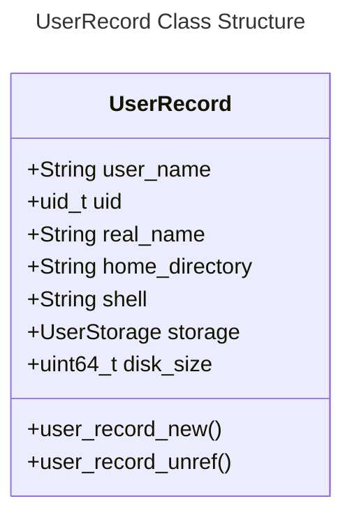
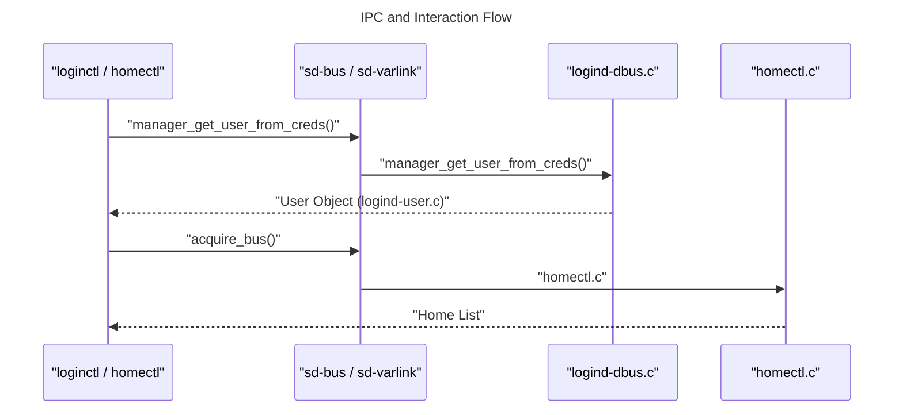

<!-- source: DeepWiki mcp.deepwiki.com · repo systemd/systemd · page 6 User and Session Management · fetched 2026-11-07 -->

# User and Session Management

<details>
<summary>Relevant source files</summary>

The following files were used as context for generating this wiki page:

- [docs/USER_RECORD.md](docs/USER_RECORD.md)
- [man/homectl.xml](man/homectl.xml)
- [man/logind.conf.xml](man/logind.conf.xml)
- [shell-completion/bash/homectl](shell-completion/bash/homectl)
- [src/home/homectl.c](src/home/homectl.c)
- [src/home/meson.build](src/home/meson.build)
- [src/login/logind-action.c](src/login/logind-action.c)
- [src/login/logind-action.h](src/login/logind-action.h)
- [src/login/logind-button.c](src/login/logind-button.c)
- [src/login/logind-button.h](src/login/logind-button.h)
- [src/login/logind-core.c](src/login/logind-core.c)
- [src/login/logind-dbus.c](src/login/logind-dbus.c)
- [src/login/logind-gperf.gperf](src/login/logind-gperf.gperf)
- [src/login/logind-inhibit.c](src/login/logind-inhibit.c)
- [src/login/logind-inhibit.h](src/login/logind-inhibit.h)
- [src/login/logind-seat-dbus.c](src/login/logind-seat-dbus.c)
- [src/login/logind-seat.c](src/login/logind-seat.c)
- [src/login/logind-seat.h](src/login/logind-seat.h)
- [src/login/logind-session-dbus.c](src/login/logind-session-dbus.c)
- [src/login/logind-session-device.c](src/login/logind-session-device.c)
- [src/login/logind-session-device.h](src/login/logind-session-device.h)
- [src/login/logind-session.c](src/login/logind-session.c)
- [src/login/logind-session.h](src/login/logind-session.h)
- [src/login/logind-user-dbus.c](src/login/logind-user-dbus.c)
- [src/login/logind-user.c](src/login/logind-user.c)
- [src/login/logind-user.h](src/login/logind-user.h)
- [src/login/logind-utmp.c](src/login/logind-utmp.c)
- [src/login/logind.c](src/login/logind.c)
- [src/login/logind.conf.in](src/login/logind.conf.in)
- [src/login/logind.h](src/login/logind.h)
- [src/shared/group-record.c](src/shared/group-record.c)
- [src/shared/group-record.h](src/shared/group-record.h)
- [src/shared/user-record-nss.c](src/shared/user-record-nss.c)
- [src/shared/user-record-nss.h](src/shared/user-record-nss.h)
- [src/shared/user-record-show.c](src/shared/user-record-show.c)
- [src/shared/user-record.c](src/shared/user-record.c)
- [src/shared/user-record.h](src/shared/user-record.h)
- [src/shared/varlink-io.systemd.ManagedOOM.c](src/shared/varlink-io.systemd.ManagedOOM.c)
- [src/shared/varlink-io.systemd.UserDatabase.c](src/shared/varlink-io.systemd.UserDatabase.c)
- [src/shared/varlink-io.systemd.oom.c](src/shared/varlink-io.systemd.oom.c)
- [src/test/test-user-record.c](src/test/test-user-record.c)
- [test/units/TEST-74-AUX-UTILS.userdbctl.sh](test/units/TEST-74-AUX-UTILS.userdbctl.sh)

</details>


This document provides an overview of systemd's user, session, and home directory management. These subsystems handle everything from tracking login sessions and physical seats to managing encrypted portable home directories.

For details on specific components, see the child pages:
- [Login Management with systemd-logind](#6.1) — Detailed session tracking, seat management, inhibitor locks, and the `loginctl` interface.
- [Home Directory Management with systemd-homed](#6.2) — Detailed LUKS-based home directories, user records, and the `homectl` interface.

## Purpose and Architecture

The user and session management subsystem serves as the bridge between the system's hardware resources (seats, devices) and the users interacting with them. It ensures that user processes are isolated, hardware access is granted only to the active session, and user data remains secure.

### Core Architecture Overview

```mermaid
---
title: "Core Architecture Overview of User and Session Management"
---
graph TD
    subgraph "systemd-logind"
        LogindManager["Manager (logind.h)"]
        Sessions["Session (logind-session.h)"]
        Users["User (logind-user.h)"]
        Seats["Seat (logind-seat.h)"]
        
        LogindManager --> Sessions
        LogindManager --> Users
        LogindManager --> Seats
    end
    
    subgraph "systemd-homed"
        HomedManager["homectl.c"]
        HomeDir["HomeDir (LUKS/fscrypt/btrfs)"]
        UserRecord["UserRecord (user-record.h)"]
        
        HomedManager --> HomeDir
        HomedManager --> UserRecord
    end
    
    subgraph "System Integration"
        PAM["pam_systemd"]
        NSS["nss-systemd"]
        IPC["sd-bus / sd-varlink"]
    end
    
    PAM --> LogindManager
    PAM --> HomedManager
    NSS --> UserRecord
    LogindManager -.-> UserRecord : "Consumes"
```

Sources: [src/login/logind.h:11-141](), [src/login/logind.c:61-114](), [src/home/homectl.c:168-183](), [src/shared/user-record.h:7-105]()

## Login Management with systemd-logind

`systemd-logind` is the daemon responsible for tracking user logins. It manages:
- **Session Tracking**: Distinguishes between graphical (`SESSION_X11`, `SESSION_WAYLAND`), TTY, and background sessions [src/login/logind-session.h:71-80]().
- **Seat Management**: Handles multi-seat configurations, ensuring that only the active user on a seat has access to its hardware [src/login/logind-seat.c:1-50]().
- **Inhibitor Locks**: Allows applications to block system shutdown or sleep via the `Inhibitor` object [src/login/logind.h:20]().

For details, see [Login Management with systemd-logind](#6.1).

### Session and User Objects

| Entity | Code Identifier | Role |
|--------|-----------------|------|
| Manager | `Manager` | Central daemon state, tracking all active seats, sessions, and users [src/login/logind.h:11-141]() |
| Session | `Session` | Represents a single login instance, linked to a leader process [src/login/logind-session.h:99-168]() |
| User | `User` | Tracks a UID across multiple sessions and manages the user runtime directory [src/login/logind-user.c:44-115]() |
| Seat | `Seat` | Represents a set of hardware (keyboard, mouse, monitor) assigned to a session [src/login/logind-seat.h:1-50]() |

Sources: [src/login/logind.c:54-59](), [src/login/logind-session.c:59-96](), [src/login/logind-user.c:44-115]()

## Home Directory Management with systemd-homed

`systemd-homed` provides a modern approach to home directory management by making them self-contained. Instead of spreading user metadata across `/etc/passwd` and `/etc/shadow`, all information is stored in a signed JSON user record [docs/USER_RECORD.md:16-19]().

Key features include:
- **Encryption**: Support for LUKS2 encrypted loopback files (`/home/*.home`) where the user password is the encryption passphrase [man/homectl.xml:51-56]().
- **Portability**: Home directories are self-contained, including the user's full metadata record in the storage itself [man/homectl.xml:42-47]().
- **Resource Management**: Per-user disk quotas, CPU weights, and memory limits defined within the `UserRecord` [src/shared/user-record.c:53-60]().

For details, see [Home Directory Management with systemd-homed](#6.2).

### User Record Structure

The `UserRecord` is the core data structure used to describe users. It is processed by `systemd-homed`, `pam_systemd`, and `systemd-logind` [docs/USER_RECORD.md:16-30]().



Sources: [src/shared/user-record.c:33-106](), [src/shared/user-record.c:146-213](), [src/shared/user-record.h:7-105]()

## Inter-Component Integration

The user management system integrates deeply with the rest of systemd:
- **Service Manager**: `logind` triggers the start of `user@UID.service` (the per-user service manager) and `user-runtime-dir@UID.service` [src/login/logind-user.c:81-87]().
- **Cgroups**: Users are placed into specific slice units (`user-UID.slice`) for resource accounting and isolation [src/login/logind-user.c:76-79]().
- **D-Bus**: Both daemons expose extensive APIs for tools like `loginctl` and `homectl` to query and manipulate state [src/login/logind-dbus.c:194-210](), [src/home/homectl.c:168-183]().

### IPC and Interaction Flow



Sources: [src/login/logind-dbus.c:194-210](), [src/home/homectl.c:168-183](), [src/login/logind-core.c:163-185]()

---

