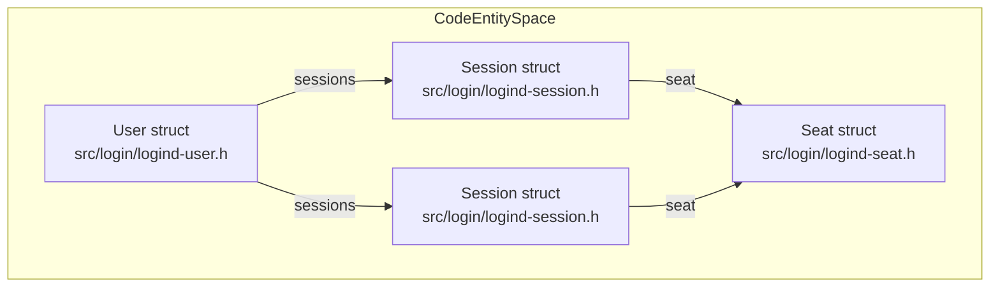
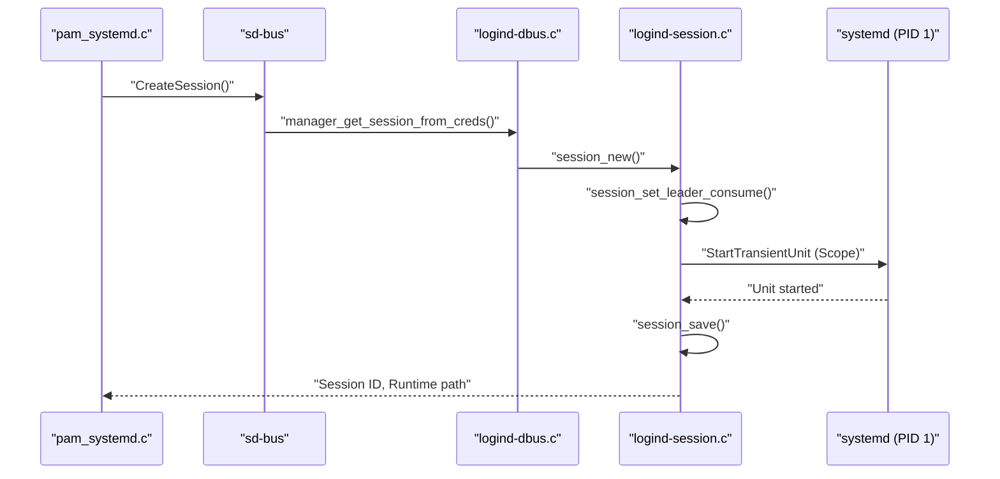

<!-- source: DeepWiki mcp.deepwiki.com · repo systemd/systemd · page 6.1 Login Management with systemd-logind · fetched 2026-11-07 -->

# Login Management with systemd-logind

Relevant source files

The following files were used as context for generating this wiki page:

- [docs/INHIBITOR_LOCKS.md](docs/INHIBITOR_LOCKS.md)
- [man/logind.conf.xml](man/logind.conf.xml)
- [man/org.freedesktop.hostname1.xml](man/org.freedesktop.hostname1.xml)
- [man/org.freedesktop.import1.xml](man/org.freedesktop.import1.xml)
- [man/org.freedesktop.locale1.xml](man/org.freedesktop.locale1.xml)
- [man/org.freedesktop.login1.xml](man/org.freedesktop.login1.xml)
- [man/org.freedesktop.machine1.xml](man/org.freedesktop.machine1.xml)
- [man/org.freedesktop.resolve1.xml](man/org.freedesktop.resolve1.xml)
- [man/org.freedesktop.timedate1.xml](man/org.freedesktop.timedate1.xml)
- [man/org.freedesktop.timesync1.xml](man/org.freedesktop.timesync1.xml)
- [man/systemd-hostnamed.service.xml](man/systemd-hostnamed.service.xml)
- [man/systemd-importd.service.xml](man/systemd-importd.service.xml)
- [man/systemd-inhibit.xml](man/systemd-inhibit.xml)
- [man/systemd-localed.service.xml](man/systemd-localed.service.xml)
- [man/systemd-logind.service.xml](man/systemd-logind.service.xml)
- [man/systemd-machined.service.xml](man/systemd-machined.service.xml)
- [man/systemd-suspend.service.xml](man/systemd-suspend.service.xml)
- [man/systemd-timedated.service.xml](man/systemd-timedated.service.xml)
- [src/basic/audit-util.c](src/basic/audit-util.c)
- [src/basic/audit-util.h](src/basic/audit-util.h)
- [src/core/apparmor-setup.c](src/core/apparmor-setup.c)
- [src/core/apparmor-setup.h](src/core/apparmor-setup.h)
- [src/core/audit-fd.c](src/core/audit-fd.c)
- [src/delta/delta.c](src/delta/delta.c)
- [src/home/pam_systemd_home.c](src/home/pam_systemd_home.c)
- [src/login/inhibit.c](src/login/inhibit.c)
- [src/login/logind-action.c](src/login/logind-action.c)
- [src/login/logind-action.h](src/login/logind-action.h)
- [src/login/logind-button.c](src/login/logind-button.c)
- [src/login/logind-button.h](src/login/logind-button.h)
- [src/login/logind-core.c](src/login/logind-core.c)
- [src/login/logind-dbus.c](src/login/logind-dbus.c)
- [src/login/logind-gperf.gperf](src/login/logind-gperf.gperf)
- [src/login/logind-inhibit.c](src/login/logind-inhibit.c)
- [src/login/logind-inhibit.h](src/login/logind-inhibit.h)
- [src/login/logind-seat-dbus.c](src/login/logind-seat-dbus.c)
- [src/login/logind-seat.c](src/login/logind-seat.c)
- [src/login/logind-seat.h](src/login/logind-seat.h)
- [src/login/logind-session-dbus.c](src/login/logind-session-dbus.c)
- [src/login/logind-session-device.c](src/login/logind-session-device.c)
- [src/login/logind-session-device.h](src/login/logind-session-device.h)
- [src/login/logind-session.c](src/login/logind-session.c)
- [src/login/logind-session.h](src/login/logind-session.h)
- [src/login/logind-user-dbus.c](src/login/logind-user-dbus.c)
- [src/login/logind-user.c](src/login/logind-user.c)
- [src/login/logind-user.h](src/login/logind-user.h)
- [src/login/logind-utmp.c](src/login/logind-utmp.c)
- [src/login/logind.c](src/login/logind.c)
- [src/login/logind.conf.in](src/login/logind.conf.in)
- [src/login/logind.h](src/login/logind.h)
- [src/login/pam_systemd.c](src/login/pam_systemd.c)
- [src/login/pam_systemd_loadkey.c](src/login/pam_systemd_loadkey.c)
- [src/shared/apparmor-util.c](src/shared/apparmor-util.c)
- [src/shared/apparmor-util.h](src/shared/apparmor-util.h)
- [src/shared/libaudit-util.c](src/shared/libaudit-util.c)
- [src/shared/libaudit-util.h](src/shared/libaudit-util.h)
- [src/shared/pam-util.c](src/shared/pam-util.c)
- [src/shared/pam-util.h](src/shared/pam-util.h)
- [src/update-utmp/update-utmp.c](src/update-utmp/update-utmp.c)
- [tools/dbus_ignorelist](tools/dbus_ignorelist)
- [tools/update-dbus-docs.py](tools/update-dbus-docs.py)

## Purpose and Scope

This document describes `systemd-logind`, the system service that manages user logins, sessions, and seats. `systemd-logind` tracks user sessions, manages multi-seat configurations, provides seat-based device access control, updates utmp/wtmp records, and handles user lifecycle operations including session termination and idle detection. The service exposes its functionality through a D-Bus API, Varlink interfaces, and the `loginctl` command-line tool.

The daemon is implemented in `src/login/logind.c` [src/login/logind.c:1-48](), with core logic distributed across specialized modules for sessions, users, seats, buttons, utmp integration, and inhibitors.

Sources: [src/login/logind.c:1-48]()

## Core Concepts

`systemd-logind` organizes login state around three primary entities:

**Sessions** represent individual login instances. Each time a user logs in (via console, SSH, graphical display manager, etc.), a new session is created. Sessions track the TTY, display, leader process (tracked via `PidRef`), and associated seat. Sessions are defined by the `Session` struct in `src/login/logind-session.h` [src/login/logind-session.h:99-166]().

**Users** represent logged-in user accounts, defined by the `User` struct [src/login/logind-user.h]() (and initialized in `src/login/logind-user.c` [src/login/logind-user.c:44-115]()). A single user may have multiple concurrent sessions. `systemd-logind` tracks whether a user has any active sessions and manages user-level resource slices and runtime directories.

**Seats** represent physical or virtual terminal configurations, defined by the `Seat` struct [src/login/logind-seat.h](). A seat consists of all hardware devices assigned to a specific workplace. `seat0` is the default seat containing the system's primary display and input devices.

**Diagram: Session, User, and Seat Code Entity Relationships**

Sources: [src/login/logind-session.h:9-166](), [src/login/logind-user.c:44-115](), [src/login/logind.h:55-57]()

## Architecture and Data Flow

The `Manager` struct [src/login/logind.h:11-141]() acts as the central hub, maintaining hash maps for all active entities including `devices`, `seats`, `sessions`, and `users` [src/login/logind.c:77-88]().

### Initialization and Device Discovery
Upon startup, the manager performs the following:
1. **Config Loading**: Parses `logind.conf` via `manager_parse_config_file()` [src/login/logind-core.c:90-99]().
2. **Device Enumeration**: Uses `sd_device_enumerator` to find hardware tagged as `master-of-seat` [src/login/logind.c:188-214]().
3. **Event Loop**: Sets up `sd-event` to monitor D-Bus, udev, and hardware buttons [src/login/logind.c:91-114]().

### Session Creation via PAM and D-Bus
When a user logs in, `pam_systemd.so` [src/login/pam_systemd.c]() communicates with `logind` to register the session. The PAM module parses arguments like `class`, `type`, and `desktop` [src/login/pam_systemd.c:113-186]() before calling the D-Bus method `CreateSession` [man/org.freedesktop.login1.xml:60-82]().

**Diagram: Session Creation Data Flow**

Sources: [src/login/pam_systemd.c:188-210](), [src/login/logind-dbus.c:139-162](), [src/login/logind-session.c:59-96](), [src/login/logind-session.c:236-255](), [man/org.freedesktop.login1.xml:60-82]()

## Inhibitor Locks

Inhibitors allow applications to delay or block system actions like shutdown, sleep, or idle.

- **Types**: `shutdown`, `sleep`, `idle`, `handle-power-key`, `handle-suspend-key`, `handle-hibernate-key`, `handle-lid-switch` [src/login/logind-inhibit.h]().
- **Modes**:
    - `block`: The action is fully blocked until the lock is released.
    - `delay`: The action is delayed for a maximum time (default 5s) defined by `m->inhibit_delay_max` [src/login/logind-core.c:44]().

The `Inhibitor` struct [src/login/logind.h:20]() is tracked in the manager's `inhibitors` hashmap [src/login/logind.c:81](). Locks are automatically released when the process holding the associated file descriptor exits.

Sources: [src/login/logind-core.c:38-45](), [src/login/logind.c:81](), [src/login/logind-inhibit.h]()

## Seat and Device Management

`logind` manages device access by applying Access Control Lists (ACLs) to device nodes when a session becomes active.

- **Seat0**: The primary seat that supports Virtual Terminals (VT). `logind` monitors VT switching via `console_active_fd` [src/login/logind.c:72]().
- **Multi-seat**: Non-seat0 seats are purely graphical and do not have VTs.
- **Device Access**: When a session is activated, `logind` opens restricted device nodes and passes file descriptors to the session controller via D-Bus [src/login/logind-session-device.c:1-50]().

Sources: [src/login/logind-core.c:123-141](), [src/login/logind.c:72](), [src/login/logind-session-device.c:1-50]()

## User Lifecycle and Runtime Directories

Users transition through states (`offline`, `lingering`, `online`, `active`, `closing`).

- **User Creation**: The `user_new()` function initializes the user's slice, runtime directory unit (`user-runtime-dir@.service`), and service manager unit [src/login/logind-user.c:44-115]().
- **Runtime Directory**: `logind` provisions `/run/user/<uid>` via the user runtime directory infrastructure [src/login/logind-user.c:70-75]().
- **Garbage Collection**: Sessions are added to a GC queue when their leader process exits via `session_dispatch_leader_pidfd()` [src/login/logind-session.c:98-110]().

Sources: [src/login/logind-user.c:44-115](), [src/login/logind-session.c:98-110]()

## utmp and wtmp Updates

`systemd-logind` maintains login accounting records in `utmp` and `wtmp` files when compiled with utmp support (`ENABLE_UTMP`).

- **Integration**: The module implemented in `src/login/logind-utmp.c` listens to session lifecycle changes and records login/logout entries.
- **Event Source**: The manager schedules utmp updates via `utmp_event_source` [src/login/logind.c:36-38](), ensuring that user login sessions and reboots are accurately logged for legacy utilities like `who` and `last`.

Sources: [src/login/logind.c:36-38](), [src/login/logind-utmp.c:1-50]()

## loginctl and D-Bus APIs

`systemd-logind` exposes its complete control surface over D-Bus via the `org.freedesktop.login11.Manager` interface [man/org.freedesktop.login1:37-176]().

- **`loginctl`**: The command-line client (`loginctl`) uses these D-Bus method calls to list sessions, inspect users, lock/unlock sessions, and terminate processes or seats.
- **Methods**: Key methods include `ListSessions()`, `TerminateSession()`, `LockSession()`, `Inhibit()`, and `CreateSession()` [man/org.freedesktop.login1.xml:44-170]().

Sources: [man/org.freedesktop.login1.xml:37-176](), [src/login/logind-dbus.c:81-137]()

## Hardware Power Keys and Actions

`logind` handles hardware events (Power, Sleep, Hibernate, Lid) via `Button` objects [src/login/logind-button.c:1-50]().

| Config Option | Default Action | Implementation |
|---------------|----------------|----------------|
| `HandlePowerKey` | `poweroff` | [src/login/logind-core.c:50]() |
| `HandleSuspendKey`| `suspend` | [src/login/logind-core.c:54]() |
| `HandleLidSwitch` | `suspend` | [src/login/logind-core.c:60]() |
| `IdleAction` | `ignore` | [src/login/logind-core.c:73]() |

Actions are executed by calling the corresponding systemd target or shutdown logic defined in `src/login/logind-action.c` [src/login/logind-action.c:27-120]().

Sources: [src/login/logind-core.c:38-88](), [src/login/logind-action.c:27-120](), [src/login/logind-button.c:1-50]()

## State Persistence

State is persisted in `/run/systemd/` to survive daemon restarts:
- **Sessions**: `/run/systemd/sessions/<id>` [src/login/logind-session.c:77]()
- **Users**: `/run/systemd/users/<uid>` [src/login/logind-user.c:70]()

The `user_save_internal()` function writes user metadata including `NAME`, `STATE`, and active sessions to the state file [src/login/logind-user.c:162-225]().

Sources: [src/login/logind-session.c:77](), [src/login/logind-user.c:162-225]()

## Time Management and Idle Detection

`logind` uses `CLOCK_MONOTONIC` for tracking idle times and scheduled actions via `now()` [src/login/logind.c:74]().

- **Idle Hint**: Sessions report their idle state. The manager aggregates these to determine if a user or seat is idle via `session_get_idle_hint()` [src/login/logind-session-dbus.c:106-121]().
- **Timestamps**: Uses `dual_timestamp` (realtime and monotonic) for session start and idle state changes.

Sources: [src/login/logind.c:74](), [src/login/logind-session-dbus.c:106-121]()

---

