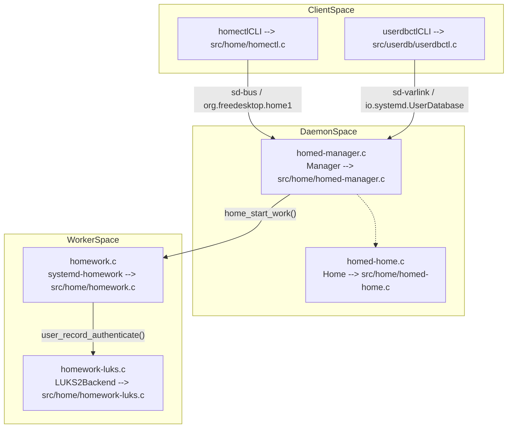
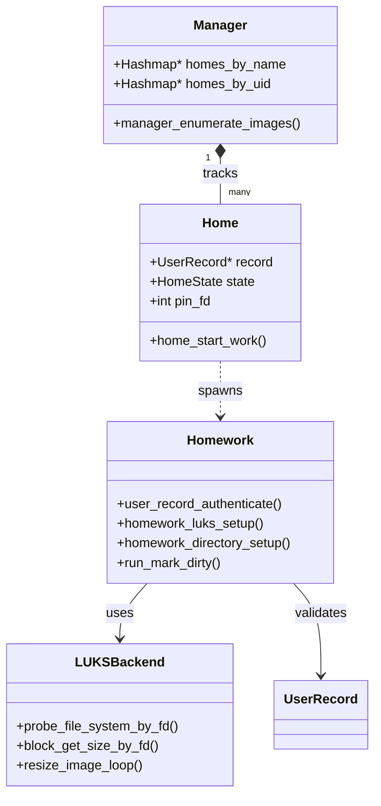

<!-- source: DeepWiki mcp.deepwiki.com · repo systemd/systemd · page 6.2 Home Directory Management with systemd-homed · fetched 2026-11-07 -->

# Home Directory Management with systemd-homed

Relevant source files

The following files were used as context for generating this wiki page:

- [docs/USER_RECORD.md](docs/USER_RECORD.md)
- [man/homectl.xml](man/homectl.xml)
- [man/nss-myhostname.xml](man/nss-myhostname.xml)
- [man/nss-mymachines.xml](man/nss-mymachines.xml)
- [man/nss-resolve.xml](man/nss-resolve.xml)
- [man/nss-systemd.xml](man/nss-systemd.xml)
- [man/org.freedesktop.home1.xml](man/org.freedesktop.home1.xml)
- [man/systemd-resolved.service.xml](man/systemd-resolved.service.xml)
- [man/user@.service.xml](man/user@.service.xml)
- [man/userdbctl.xml](man/userdbctl.xml)
- [shell-completion/bash/homectl](shell-completion/bash/homectl)
- [src/home/home-util.c](src/home/home-util.c)
- [src/home/home-util.h](src/home/home-util.h)
- [src/home/homectl.c](src/home/homectl.c)
- [src/home/homed-forward.h](src/home/homed-forward.h)
- [src/home/homed-home-bus.c](src/home/homed-home-bus.c)
- [src/home/homed-home-bus.h](src/home/homed-home-bus.h)
- [src/home/homed-home.c](src/home/homed-home.c)
- [src/home/homed-home.h](src/home/homed-home.h)
- [src/home/homed-manager-bus.c](src/home/homed-manager-bus.c)
- [src/home/homed-manager-bus.h](src/home/homed-manager-bus.h)
- [src/home/homed-manager.c](src/home/homed-manager.c)
- [src/home/homed-manager.h](src/home/homed-manager.h)
- [src/home/homed-varlink.c](src/home/homed-varlink.c)
- [src/home/homework-cifs.c](src/home/homework-cifs.c)
- [src/home/homework-cifs.h](src/home/homework-cifs.h)
- [src/home/homework-directory.c](src/home/homework-directory.c)
- [src/home/homework-directory.h](src/home/homework-directory.h)
- [src/home/homework-forward.h](src/home/homework-forward.h)
- [src/home/homework-fscrypt.c](src/home/homework-fscrypt.c)
- [src/home/homework-fscrypt.h](src/home/homework-fscrypt.h)
- [src/home/homework-luks.c](src/home/homework-luks.c)
- [src/home/homework-luks.h](src/home/homework-luks.h)
- [src/home/homework-mount.c](src/home/homework-mount.c)
- [src/home/homework-mount.h](src/home/homework-mount.h)
- [src/home/homework.c](src/home/homework.c)
- [src/home/homework.h](src/home/homework.h)
- [src/home/meson.build](src/home/meson.build)
- [src/home/org.freedesktop.home1.conf](src/home/org.freedesktop.home1.conf)
- [src/home/org.freedesktop.home1.policy](src/home/org.freedesktop.home1.policy)
- [src/home/user-record-sign.c](src/home/user-record-sign.c)
- [src/home/user-record-util.c](src/home/user-record-util.c)
- [src/home/user-record-util.h](src/home/user-record-util.h)
- [src/nss-myhostname/nss-myhostname.c](src/nss-myhostname/nss-myhostname.c)
- [src/nss-mymachines/nss-mymachines.c](src/nss-mymachines/nss-mymachines.c)
- [src/nss-resolve/nss-resolve.c](src/nss-resolve/nss-resolve.c)
- [src/nss-systemd/nss-systemd.c](src/nss-systemd/nss-systemd.c)
- [src/nss-systemd/nss-systemd.h](src/nss-systemd/nss-systemd.h)
- [src/nss-systemd/nss-systemd.sym](src/nss-systemd/nss-systemd.sym)
- [src/nss-systemd/userdb-glue.c](src/nss-systemd/userdb-glue.c)
- [src/nss-systemd/userdb-glue.h](src/nss-systemd/userdb-glue.h)
- [src/shared/group-record.c](src/shared/group-record.c)
- [src/shared/group-record.h](src/shared/group-record.h)
- [src/shared/user-record-nss.c](src/shared/user-record-nss.c)
- [src/shared/user-record-nss.h](src/shared/user-record-nss.h)
- [src/shared/user-record-show.c](src/shared/user-record-show.c)
- [src/shared/user-record.c](src/shared/user-record.c)
- [src/shared/user-record.h](src/shared/user-record.h)
- [src/shared/userdb.c](src/shared/userdb.c)
- [src/shared/userdb.h](src/shared/userdb.h)
- [src/shared/varlink-io.systemd.ManagedOOM.c](src/shared/varlink-io.systemd.ManagedOOM.c)
- [src/shared/varlink-io.systemd.UserDatabase.c](src/shared/varlink-io.systemd.UserDatabase.c)
- [src/shared/varlink-io.systemd.oom.c](src/shared/varlink-io.systemd.oom.c)
- [src/test/test-user-record.c](src/test/test-user-record.c)
- [src/userdb/userdbctl.c](src/userdb/userdbctl.c)
- [src/userdb/userwork.c](src/userdb/userwork.c)
- [test/units/TEST-74-AUX-UTILS.userdbctl.sh](test/units/TEST-74-AUX-UTILS.userdbctl.sh)

The `systemd-homed` subsystem provides a modern, self-contained approach to managing human user home directories. Unlike classic UNIX accounts defined in `/etc/passwd`, `systemd-homed` encapsulates user metadata and data within the home directory itself, facilitating portability across systems and providing robust encryption options.

## 1. Architecture Overview

The system is centered around the `systemd-homed.service` daemon, managed by `Manager` in `src/home/homed-manager.c` [src/home/homed-manager.c:39-42](), which oversees the lifecycle of home directories. It interacts with the kernel and various storage backends via worker processes (`systemd-homework`, implemented in `src/home/homework.c`) to mount, unmount, and resize home areas based on user authentication.

### Data Flow and Component Interaction

The following diagram bridges natural language subsystem descriptions to their concrete code entities within the `systemd` codebase.

**systemd-homed Process and IPC Flow to Code Entities**

Sources: [src/home/homed-manager.c:39-42](), [src/home/homectl.c:183-198](), [src/home/homework.c:27-33](), [src/home/homed-varlink.c:1-10](), [src/home/homed-home.c:107-166]()

## 2. User Records and Identity

`systemd-homed` utilizes a JSON-based user record format that extends the classic `struct passwd`. These records contain identity information, resource limits, environment variables, and cryptographic metadata [docs/USER_RECORD.md:45-62]().

### Record Structure and Sections
The `UserRecord` object defined in `src/shared/user-record.c` is structured into distinct sections:
*   **Regular**: Unconditional, non-sensitive fields such as `userName`, `realName`, and `shell` [docs/USER_RECORD.md:104-107](), [src/shared/user-record.c:150-163]().
*   **Privileged**: Security-sensitive data including password hashes and PKCS#11 encrypted keys [docs/USER_RECORD.md:108-115](), [src/shared/user-record.c:209-211]().
*   **Binding**: Host-specific information like local UID/GID assignments and partition UUIDs [docs/USER_RECORD.md:126-133](), [src/shared/user-record.h:42]().
*   **Status**: Runtime state information such as `lastChangeUsec` and authentication counters [src/shared/user-record.h:43](), [src/shared/user-record.c:76-80]().

### Key Structures
| Structure | File | Description |
| :--- | :--- | :--- |
| `UserRecord` | [src/shared/user-record.h:147-248]() | The core identity object containing JSON variants and parsed fields. |
| `Home` | [src/home/homed-home.h:20-47]() | Represents a managed home directory within the `systemd-homed` daemon. |
| `Manager` | [src/home/homed-manager.h:24-46]() | Global state for `systemd-homed`, including hashmaps `homes_by_name` and `homes_by_uid`. |

Sources: [src/shared/user-record.c:33-106](), [docs/USER_RECORD.md:101-140](), [src/home/homed-home.c:154-166]()

## 3. Storage Backends and LUKS2 Implementation

`systemd-homed` supports multiple storage mechanisms, with LUKS2-encrypted loopback files being the recommended default for maximum security [man/homectl.xml:51-56]().

### Implementation Backends
Storage setup and teardown are executed by `systemd-homework`:
*   **LUKS2 Loopback**: Encapsulates the home in a `.home` file using `libcryptsetup` [src/home/homework-luks.c:25](). It handles GPT partition tables and LUKS2 envelopes with overhead accounting (`GPT_LUKS2_OVERHEAD`) [src/home/homework-luks.c:83](). It also manages extended attributes like `user.home-dirty` via `run_mark_dirty()` to detect unclean unmounts [src/home/homework-luks.c:87-120](). Filesystem probing is handled by `probe_file_system_by_fd()` [src/home/homework-luks.c:134-192]().
*   **fscrypt**: Per-directory encryption on supported filesystems (such as `ext4`) [src/home/homework-fscrypt.c:4-5]().
*   **Directory/Btrfs**: Subvolumes or standard directories with `.identity` files [man/homectl.xml:70-77]().
*   **CIFS**: Remote Windows file shares [src/home/homework-cifs.c:1-10]().

**Storage Backend Class Mapping**

Sources: [src/home/homed-manager.h:24-46](), [src/home/homed-home.c:107-211](), [src/home/homework.c:57-98](), [src/home/homework-luks.c:87-192]()

## 4. Authentication and PAM Integration

Integration with the system login flow is handled via `pam_systemd_home.so`.

### Authentication Flow
1. `pam_sm_authenticate` calls `acquire_user_record` via D-Bus to `systemd-homed` [src/home/pam_systemd_home.c:1008-1015]().
2. If the user is managed by `homed`, the daemon requests passwords or authentication tokens (FIDO2/PKCS#11).
3. `systemd-homed` forks `systemd-homework` (`src/home/homework.c`) to validate secrets against the LUKS header or embedded JSON records [src/home/homework.c:57-111]().
4. `user_record_authenticate()` iterates through passwords, recovery keys, cached PKCS#11 keys, and FIDO2 hmac salts [src/home/homework.c:101-160]().
5. Upon successful validation, the home directory is activated (decrypted and mounted).

### Token Support
*   **FIDO2**: Uses HMAC-secret extension for derivation [src/home/homectl.c:101-107](), [src/home/homework.c:146-157]().
*   **PKCS#11**: Supports smartcards for record unlocking [src/home/homectl.c:100](), [src/home/homework.c:134-144]().

Sources: [src/home/pam_systemd_home.c:97-152](), [src/home/homework.c:57-160]()

## 5. UserDB and NSS Integration

The `userdb` subsystem provides a unified Varlink-based interface (`io.systemd.UserDatabase`) for querying user and group records, extending beyond legacy NSS limits [docs/USER_RECORD.md:40-43]().

### userdbctl and userdb.c
`userdbctl` interacts with user databases via `src/userdb/userdbctl.c` [src/userdb/userdbctl.c:73-78](). Iterators managed in `src/shared/userdb.c` coordinate multiple query sources:
*   **Varlink Services**: Connects to `io.systemd.UserDatabase` providers over AF_UNIX sockets [src/shared/userdb.c:80-81]().
*   **NSS Fallback**: Translates classic NSS records into JSON records using `user_record_nss.c` [src/shared/userdb.c:26]().
*   **Drop-ins**: Parses JSON records dropped in `/etc/userdb/` and related directories [src/shared/userdb.c:29]().

### NSS Modules
Systemd supplies modules such as `nss-systemd` to bridge modern records into legacy APIs [docs/USER_RECORD.md:31-34](), and `nss-resolve` to support `getaddrinfo()` queries via `systemd-resolved` over Varlink [src/nss-resolve/nss-resolve.c:56-65]().

Sources: [src/userdb/userdbctl.c:117-181](), [src/shared/userdb.c:49-78](), [src/nss-resolve/nss-resolve.c:124-175]()

## 6. Lifecycle Management

The `Home` object in `src/home/homed-home.c` manages the runtime state transitions of a user's home directory.

### State Machine and Key Functions
*   **Inactive / Attaching / Active / Dirty**: Tracks whether the loopback or block device is unmounted, mounting, mounted, or left dirty due to an improper unmount [src/home/homework-luks.c:87-120]().
*   `home_new()`: Initializes a new `Home` tracking structure, verifies UID/GID ranges against `HOME_UID_MIN` and `HOME_UID_MAX`, and clones the `UserRecord` [src/home/homed-home.c:55-209]().
*   `home_start_work()`: Spawns the `systemd-homework` worker for verbs like `activate`, `deactivate`, `resize`, or `create` [src/home/homed-home.c:58-64]().
*   `manager_enumerate_images()`: Scans `/home/` for `.home` and `.homedir` image files [src/home/homed-manager.c:94-160]().

Sources: [src/home/homed-home.c:51-209](), [src/home/homework-luks.c:87-132](), [src/home/homed-manager.c:94-134]()

---

