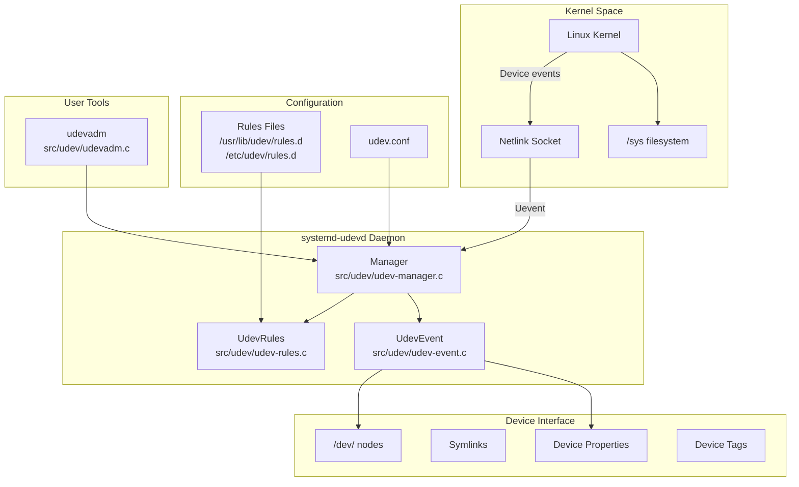
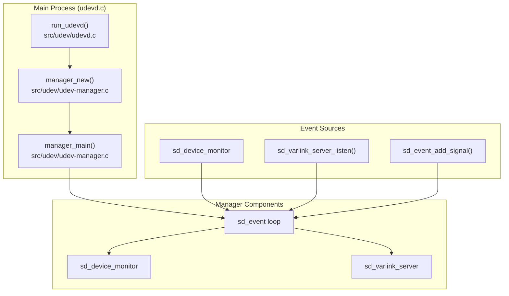
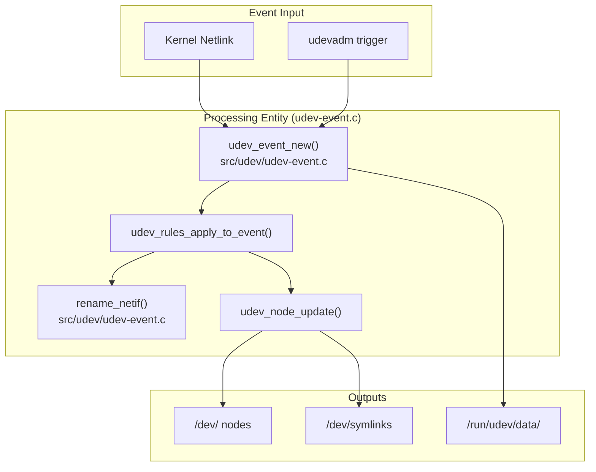

<!-- source: DeepWiki mcp.deepwiki.com · repo systemd/systemd · page 7.1 udev and Device Handling · fetched 2026-11-07 -->

# udev and Device Handling

Relevant source files

The following files were used as context for generating this wiki page:

- [man/udevadm.xml](man/udevadm.xml)
- [shell-completion/bash/udevadm](shell-completion/bash/udevadm)
- [shell-completion/zsh/_systemd-tmpfiles](shell-completion/zsh/_systemd-tmpfiles)
- [shell-completion/zsh/_udevadm](shell-completion/zsh/_udevadm)
- [src/libsystemd/sd-device/device-enumerator-private.h](src/libsystemd/sd-device/device-enumerator-private.h)
- [src/libsystemd/sd-device/device-enumerator.c](src/libsystemd/sd-device/device-enumerator.c)
- [src/libsystemd/sd-device/device-internal.h](src/libsystemd/sd-device/device-internal.h)
- [src/libsystemd/sd-device/device-monitor-private.h](src/libsystemd/sd-device/device-monitor-private.h)
- [src/libsystemd/sd-device/device-monitor.c](src/libsystemd/sd-device/device-monitor.c)
- [src/libsystemd/sd-device/device-private.c](src/libsystemd/sd-device/device-private.c)
- [src/libsystemd/sd-device/device-private.h](src/libsystemd/sd-device/device-private.h)
- [src/libsystemd/sd-device/device-util.c](src/libsystemd/sd-device/device-util.c)
- [src/libsystemd/sd-device/device-util.h](src/libsystemd/sd-device/device-util.h)
- [src/libsystemd/sd-device/sd-device.c](src/libsystemd/sd-device/sd-device.c)
- [src/libsystemd/sd-device/test-device-util.c](src/libsystemd/sd-device/test-device-util.c)
- [src/libsystemd/sd-device/test-sd-device-monitor.c](src/libsystemd/sd-device/test-sd-device-monitor.c)
- [src/libsystemd/sd-device/test-sd-device.c](src/libsystemd/sd-device/test-sd-device.c)
- [src/libudev/libudev-device-internal.h](src/libudev/libudev-device-internal.h)
- [src/libudev/libudev-device.c](src/libudev/libudev-device.c)
- [src/libudev/libudev-enumerate.c](src/libudev/libudev-enumerate.c)
- [src/libudev/libudev-hwdb.c](src/libudev/libudev-hwdb.c)
- [src/libudev/libudev-list-internal.h](src/libudev/libudev-list-internal.h)
- [src/libudev/libudev-list.c](src/libudev/libudev-list.c)
- [src/libudev/libudev-monitor.c](src/libudev/libudev-monitor.c)
- [src/libudev/libudev-queue.c](src/libudev/libudev-queue.c)
- [src/libudev/libudev-util.c](src/libudev/libudev-util.c)
- [src/libudev/libudev-util.h](src/libudev/libudev-util.h)
- [src/libudev/libudev.c](src/libudev/libudev.c)
- [src/libudev/libudev.h](src/libudev/libudev.h)
- [src/libudev/libudev.sym](src/libudev/libudev.sym)
- [src/shared/udev-util.c](src/shared/udev-util.c)
- [src/shared/udev-util.h](src/shared/udev-util.h)
- [src/shared/varlink-io.systemd.Udev.c](src/shared/varlink-io.systemd.Udev.c)
- [src/shared/varlink-io.systemd.Udev.h](src/shared/varlink-io.systemd.Udev.h)
- [src/systemd/sd-device.h](src/systemd/sd-device.h)
- [src/test/test-udev-util.c](src/test/test-udev-util.c)
- [src/udev/fuzz-udev-rules.c](src/udev/fuzz-udev-rules.c)
- [src/udev/test-udev-format.c](src/udev/test-udev-format.c)
- [src/udev/test-udev-manager.c](src/udev/test-udev-manager.c)
- [src/udev/test-udev-rule-runner.c](src/udev/test-udev-rule-runner.c)
- [src/udev/test-udev-spawn.c](src/udev/test-udev-spawn.c)
- [src/udev/udev-config.c](src/udev/udev-config.c)
- [src/udev/udev-config.h](src/udev/udev-config.h)
- [src/udev/udev-dump.c](src/udev/udev-dump.c)
- [src/udev/udev-dump.h](src/udev/udev-dump.h)
- [src/udev/udev-error.c](src/udev/udev-error.c)
- [src/udev/udev-error.h](src/udev/udev-error.h)
- [src/udev/udev-event.c](src/udev/udev-event.c)
- [src/udev/udev-event.h](src/udev/udev-event.h)
- [src/udev/udev-format.c](src/udev/udev-format.c)
- [src/udev/udev-format.h](src/udev/udev-format.h)
- [src/udev/udev-manager.c](src/udev/udev-manager.c)
- [src/udev/udev-manager.h](src/udev/udev-manager.h)
- [src/udev/udev-node.c](src/udev/udev-node.c)
- [src/udev/udev-node.h](src/udev/udev-node.h)
- [src/udev/udev-rules.c](src/udev/udev-rules.c)
- [src/udev/udev-rules.h](src/udev/udev-rules.h)
- [src/udev/udev-spawn.c](src/udev/udev-spawn.c)
- [src/udev/udev-spawn.h](src/udev/udev-spawn.h)
- [src/udev/udev-trace.h](src/udev/udev-trace.h)
- [src/udev/udev-varlink.c](src/udev/udev-varlink.c)
- [src/udev/udev-varlink.h](src/udev/udev-varlink.h)
- [src/udev/udev-watch.c](src/udev/udev-watch.c)
- [src/udev/udev-watch.h](src/udev/udev-watch.h)
- [src/udev/udev-worker.c](src/udev/udev-worker.c)
- [src/udev/udev-worker.h](src/udev/udev-worker.h)
- [src/udev/udevadm-cat.c](src/udev/udevadm-cat.c)
- [src/udev/udevadm-control.c](src/udev/udevadm-control.c)
- [src/udev/udevadm-info.c](src/udev/udevadm-info.c)
- [src/udev/udevadm-monitor.c](src/udev/udevadm-monitor.c)
- [src/udev/udevadm-settle.c](src/udev/udevadm-settle.c)
- [src/udev/udevadm-test-builtin.c](src/udev/udevadm-test-builtin.c)
- [src/udev/udevadm-test.c](src/udev/udevadm-test.c)
- [src/udev/udevadm-trigger.c](src/udev/udevadm-trigger.c)
- [src/udev/udevadm-util.c](src/udev/udevadm-util.c)
- [src/udev/udevadm-util.h](src/udev/udevadm-util.h)
- [src/udev/udevadm-verify.c](src/udev/udevadm-verify.c)
- [src/udev/udevd.c](src/udev/udevd.c)

This document covers the udev device management subsystem within systemd, including the `systemd-udevd` daemon, udev rules processing, device event handling, and device node/symlink management via `sd-device` and `libudev` APIs. This system detects hardware devices, creates device nodes, sets properties, and executes actions when devices are added, removed, or changed.

## Architecture Overview

The udev subsystem consists of several key components working together to manage device detection and configuration:

Title: udev Subsystem Architecture

Sources: [src/udev/udevd.c:28-91](), [src/udev/udev-rules.c:60-71](), [src/udev/udev-event.c:25-50]()

## systemd-udevd Implementation

The `systemd-udevd` daemon is the central component that processes device events from the kernel. It runs as PID 1's child process or a standalone daemon and manages device detection and configuration.

### Manager and Event Loop
The daemon entry point `run_udevd` initializes a `Manager` object encapsulating daemon state [src/udev/udevd.c:28-34](). The `manager_main` function drives the `sd-event` loop, handling kernel netlink events via `sd_device_monitor`, control socket commands via `sd_varlink_server`, and worker process signals [src/udev/udev-manager.c:144-178]().

Title: systemd-udevd Execution Flow

Sources: [src/udev/udevd.c:28-91](), [src/udev/udev-manager.c:180-197](), [src/udev/udev-manager.c:144-178]()

## Device Event Processing

Device events (`uevents`) flow through a structured processing pipeline. When a new event arrives, the manager creates an `Event` structure and assigns it to a worker process [src/udev/udev-manager.c:75-100]().

### UdevEvent Pipeline
The `UdevEvent` object represents the lifecycle of a single device event [src/udev/udev-event.c:25-47]().

Title: Event Processing Pipeline

Sources: [src/udev/udev-event.c:25-50](), [src/udev/udev-event.c:114-161](), [src/udev/udev-node.c:47-79]()

### Network Interface Handling
One critical task of `udev` is network interface naming. The `rename_netif` function applies interface names determined by rules [src/udev/udev-event.c:114-198](). It sets properties like `ID_RENAMING` and `ID_PROCESSING` to notify listeners that a name change is in progress [src/udev/udev-event.c:171-190]().

Sources: [src/udev/udev-event.c:114-210]()

## udev Rules Engine

Rules are parsed into a tokenized format for efficient matching [src/udev/udev-rules.c:60-71]().

### Rule Tokenization
Rules are stored as a series of tokens [src/udev/udev-rules.c:98-160]().
- **Match Tokens (`TK_M_*`)**: Used for conditions like `KERNEL`, `SUBSYSTEM`, `ATTR`, `ENV` [src/udev/udev-rules.c:100-112]().
- **Assignment Tokens (`TK_A_*`)**: Used for actions like `NAME`, `SYMLINK`, `RUN_PROGRAM`, `OWNER` [src/udev/udev-rules.c:134-157]().

Sources: [src/udev/udev-rules.c:98-160](), [src/udev/udev-rules.c:62-71]()

### Rule Evaluation Logic
The rules engine iterates through tokens. If all match tokens in a line succeed, the assignment tokens are executed.
- `OP_MATCH` (`==`) and `OP_NOMATCH` (`!=`) are used for filters [src/udev/udev-rules.c:63-64]().
- `OP_ASSIGN` (`=`), `OP_ADD` (`+=`), and `OP_ASSIGN_FINAL` (`:=`) are used for properties and options [src/udev/udev-rules.c:65-68]().

Sources: [src/udev/udev-rules.c:62-71](), [src/udev/udev-rules.c:100-128]()

## Device Enumeration and sd-device API

The `sd-device` library provides an object-oriented interface to sysfs and the udev database [src/libsystemd/sd-device/sd-device.c:35-54]().

### sd_device Object
An `sd_device` object caches properties and attributes to minimize sysfs I/O [src/libsystemd/sd-device/sd-device.c:35-54]().

| Function | Description |
|----------|-------------|
| `sd_device_new_from_syspath()` | Creates object from a `/sys` path [src/libsystemd/sd-device/sd-device.c:167-193]() |
| `sd_device_get_property_value()` | Retrieves a property from the udev database [src/libsystemd/sd-device/sd-device.c:1-54]() |
| `device_add_property()` | Internal function to attach metadata to a device [src/libsystemd/sd-device/device-private.c:33-50]() |

Sources: [src/libsystemd/sd-device/sd-device.c:35-54](), [src/libsystemd/sd-device/device-private.c:33-50]()

## Device Node Management

`systemd-udevd` manages `/dev` nodes and symlinks via `src/udev/udev-node.c` [src/udev/udev-node.c:1-31]().

### Node and Symlink Creation
The `udev-node.c` component handles the physical creation of nodes and atomic symlink updates using `symlinkat_atomic_full` [src/udev/udev-node.c:47-79]().

Sources: [src/udev/udev-node.c:47-79]()

### Priority and Stacking
When multiple devices claim the same symlink (e.g., `/dev/disk/by-id/...`), `udev` uses `DEVLINK_PRIORITY` to decide which device wins the symlink [src/udev/udev-node.c:144-155](). State is tracked via links in `/run/udev/links/` [src/udev/udev-node.c:88-95](). The `stack_directory_find_prioritized_devnode()` function determines the winner by reading priorities from these links [src/udev/udev-node.c:128-178]().

Sources: [src/udev/udev-node.c:81-196]()

Sources: [src/udev/udevd.c:28-91](), [src/udev/udev-rules.c:60-71](), [src/udev/udev-event.c:25-50](), [src/udev/udev-node.c:47-79](), [src/udev/udev-manager.c:144-178](), [src/libsystemd/sd-device/sd-device.c:35-54](), [src/libsystemd/sd-device/device-private.c:33-50]()

---

