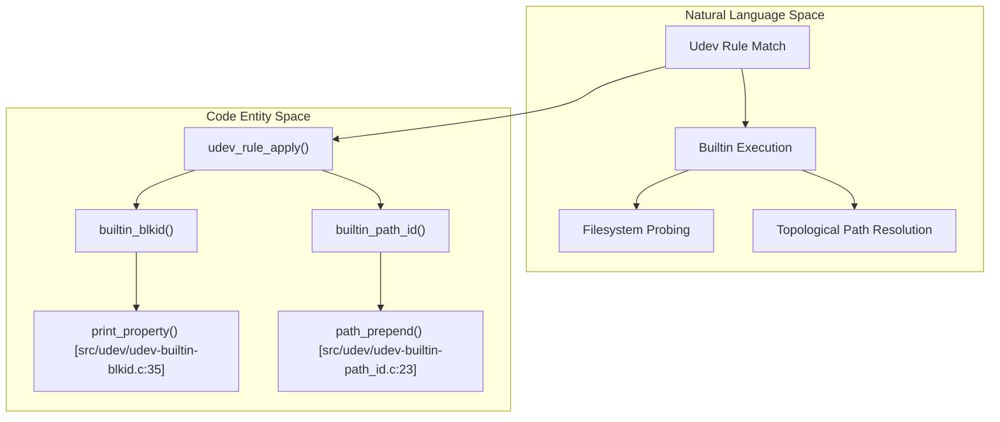
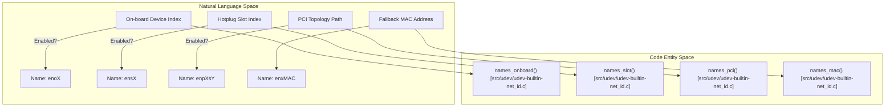
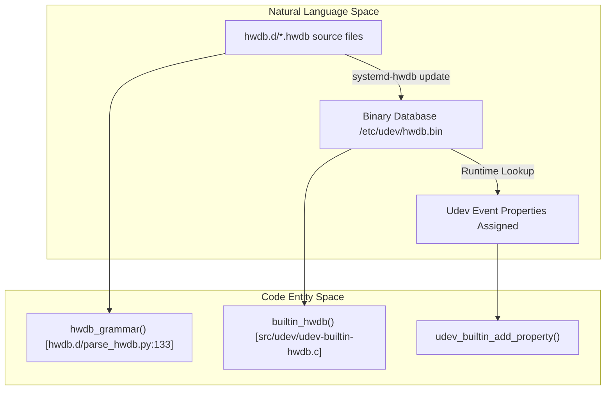

<!-- source: DeepWiki mcp.deepwiki.com · repo systemd/systemd · page 7.2 udev Builtins and Hardware Database · fetched 2026-11-07 -->

# udev Builtins and Hardware Database

<details>
<summary>Relevant source files</summary>

The following files were used as context for generating this wiki page:

- [catalog/meson.build](catalog/meson.build)
- [hwdb.d/20-OUI.hwdb](hwdb.d/20-OUI.hwdb)
- [hwdb.d/20-acpi-vendor.hwdb](hwdb.d/20-acpi-vendor.hwdb)
- [hwdb.d/20-acpi-vendor.hwdb.patch](hwdb.d/20-acpi-vendor.hwdb.patch)
- [hwdb.d/20-dmi-id.hwdb](hwdb.d/20-dmi-id.hwdb)
- [hwdb.d/20-pci-vendor-model.hwdb](hwdb.d/20-pci-vendor-model.hwdb)
- [hwdb.d/20-usb-vendor-model.hwdb](hwdb.d/20-usb-vendor-model.hwdb)
- [hwdb.d/60-autosuspend.hwdb](hwdb.d/60-autosuspend.hwdb)
- [hwdb.d/60-evdev.hwdb](hwdb.d/60-evdev.hwdb)
- [hwdb.d/60-input-id.hwdb](hwdb.d/60-input-id.hwdb)
- [hwdb.d/60-keyboard.hwdb](hwdb.d/60-keyboard.hwdb)
- [hwdb.d/60-seat.hwdb](hwdb.d/60-seat.hwdb)
- [hwdb.d/60-sensor.hwdb](hwdb.d/60-sensor.hwdb)
- [hwdb.d/60-tpm2.hwdb](hwdb.d/60-tpm2.hwdb)
- [hwdb.d/70-av-production.hwdb](hwdb.d/70-av-production.hwdb)
- [hwdb.d/70-hardware-wallets.hwdb](hwdb.d/70-hardware-wallets.hwdb)
- [hwdb.d/70-joystick.hwdb](hwdb.d/70-joystick.hwdb)
- [hwdb.d/70-lights.hwdb](hwdb.d/70-lights.hwdb)
- [hwdb.d/70-mouse.hwdb](hwdb.d/70-mouse.hwdb)
- [hwdb.d/70-pointingstick.hwdb](hwdb.d/70-pointingstick.hwdb)
- [hwdb.d/70-software-radio.hwdb](hwdb.d/70-software-radio.hwdb)
- [hwdb.d/70-sound-card.hwdb](hwdb.d/70-sound-card.hwdb)
- [hwdb.d/70-touchpad.hwdb](hwdb.d/70-touchpad.hwdb)
- [hwdb.d/acpi_id_registry.csv](hwdb.d/acpi_id_registry.csv)
- [hwdb.d/ma-large.txt](hwdb.d/ma-large.txt)
- [hwdb.d/ma-medium.txt](hwdb.d/ma-medium.txt)
- [hwdb.d/ma-small.txt](hwdb.d/ma-small.txt)
- [hwdb.d/meson.build](hwdb.d/meson.build)
- [hwdb.d/parse_hwdb.py](hwdb.d/parse_hwdb.py)
- [hwdb.d/pci.ids](hwdb.d/pci.ids)
- [hwdb.d/pnp_id_registry.csv](hwdb.d/pnp_id_registry.csv)
- [hwdb.d/usb.ids](hwdb.d/usb.ids)
- [man/systemd.net-naming-scheme.xml](man/systemd.net-naming-scheme.xml)
- [rules.d/60-autosuspend.rules](rules.d/60-autosuspend.rules)
- [rules.d/60-dmi-id.rules](rules.d/60-dmi-id.rules)
- [rules.d/60-sensor.rules](rules.d/60-sensor.rules)
- [rules.d/60-tpm2-id.rules](rules.d/60-tpm2-id.rules)
- [rules.d/70-power-switch.rules](rules.d/70-power-switch.rules)
- [rules.d/70-uaccess.rules.in](rules.d/70-uaccess.rules.in)
- [rules.d/71-seat.rules.in](rules.d/71-seat.rules.in)
- [rules.d/73-seat-late.rules.in](rules.d/73-seat-late.rules.in)
- [rules.d/meson.build](rules.d/meson.build)
- [src/pcrlock/pcrlock-firmware.c](src/pcrlock/pcrlock-firmware.c)
- [src/pcrlock/pcrlock-firmware.h](src/pcrlock/pcrlock-firmware.h)
- [src/shared/netif-naming-scheme.c](src/shared/netif-naming-scheme.c)
- [src/shared/netif-naming-scheme.h](src/shared/netif-naming-scheme.h)
- [src/shared/varlink-io.systemd.Hostname.c](src/shared/varlink-io.systemd.Hostname.c)
- [src/shared/watchdog.c](src/shared/watchdog.c)
- [src/shared/watchdog.h](src/shared/watchdog.h)
- [src/test/test-net-naming-scheme.c](src/test/test-net-naming-scheme.c)
- [src/test/test-watchdog.c](src/test/test-watchdog.c)
- [src/udev/ata_id/ata_id.c](src/udev/ata_id/ata_id.c)
- [src/udev/cdrom_id/cdrom_id.c](src/udev/cdrom_id/cdrom_id.c)
- [src/udev/dmi_memory_id/dmi_memory_id.c](src/udev/dmi_memory_id/dmi_memory_id.c)
- [src/udev/fido_id/fido_id.c](src/udev/fido_id/fido_id.c)
- [src/udev/mtd_probe/mtd_probe.c](src/udev/mtd_probe/mtd_probe.c)
- [src/udev/mtd_probe/mtd_probe.h](src/udev/mtd_probe/mtd_probe.h)
- [src/udev/mtd_probe/probe_smartmedia.c](src/udev/mtd_probe/probe_smartmedia.c)
- [src/udev/scsi_id/scsi.h](src/udev/scsi_id/scsi.h)
- [src/udev/scsi_id/scsi_id.c](src/udev/scsi_id/scsi_id.c)
- [src/udev/scsi_id/scsi_id.h](src/udev/scsi_id/scsi_id.h)
- [src/udev/scsi_id/scsi_serial.c](src/udev/scsi_id/scsi_serial.c)
- [src/udev/udev-builtin-blkid.c](src/udev/udev-builtin-blkid.c)
- [src/udev/udev-builtin-btrfs.c](src/udev/udev-builtin-btrfs.c)
- [src/udev/udev-builtin-factory_reset.c](src/udev/udev-builtin-factory_reset.c)
- [src/udev/udev-builtin-hwdb.c](src/udev/udev-builtin-hwdb.c)
- [src/udev/udev-builtin-input_id.c](src/udev/udev-builtin-input_id.c)
- [src/udev/udev-builtin-keyboard.c](src/udev/udev-builtin-keyboard.c)
- [src/udev/udev-builtin-kmod.c](src/udev/udev-builtin-kmod.c)
- [src/udev/udev-builtin-net_id.c](src/udev/udev-builtin-net_id.c)
- [src/udev/udev-builtin-net_setup_link.c](src/udev/udev-builtin-net_setup_link.c)
- [src/udev/udev-builtin-path_id.c](src/udev/udev-builtin-path_id.c)
- [src/udev/udev-builtin-tpm2_id.c](src/udev/udev-builtin-tpm2_id.c)
- [src/udev/udev-builtin-uaccess.c](src/udev/udev-builtin-uaccess.c)
- [src/udev/udev-builtin-usb_id.c](src/udev/udev-builtin-usb_id.c)
- [src/udev/udev-builtin.c](src/udev/udev-builtin.c)
- [src/udev/udev-builtin.h](src/udev/udev-builtin.h)
- [src/udev/udev-def.h](src/udev/udev-def.h)
- [src/udev/v4l_id/v4l_id.c](src/udev/v4l_id/v4l_id.c)
- [test/units/TEST-71-HOSTNAME.sh](test/units/TEST-71-HOSTNAME.sh)
- [tools/make-autosuspend-rules.py](tools/make-autosuspend-rules.py)

</details>


This page documents the internal architecture of `systemd-udevd` builtins, standalone device identification helpers, predictable network interface naming, and the hardware database (`hwdb.d/`). These components analyze kernel devices, query sysfs, evaluate binary databases, and inject persistent properties (`ID_*`, `ACCEL_MOUNT_MATRIX`, `KEYBOARD_KEY_*`) into the udev event environment.

---

## 1. udev Builtins and Standalone ID Helpers

`systemd-udevd` provides internal helper functions called "builtins" executed directly within the udev daemon worker process via rule commands (e.g., `IMPORT{builtin}="blkid"`). Additionally, standalone helper binaries in `src/udev/` execute specific block or optical device queries.

### Key Builtin Modules
*   **`net_id`**: Determines predictable network interface names using firmware-provided indices, hotplug slot indices, geographical location, or MAC addresses [src/udev/udev-builtin-net_id.c:4-13]().
*   **`path_id`**: Composes a persistent device path string based on physical bus topologies (PCI, USB, SCSI, SAS, Fibre Channel) [src/udev/udev-builtin-path_id.c:1-6]().
*   **`blkid`**: Probes block devices for filesystems, partition tables, UUIDs, and labels using `libblkid`, exporting properties like `ID_FS_TYPE`, `ID_FS_UUID`, and `ID_PART_TABLE_TYPE` [src/udev/udev-builtin-blkid.c:3-124]().
*   **`input_id`**: Classifies input devices (mice, keyboards, touchpads, joysticks, accelerometers) by reading kernel input capability bitmasks (`EVIOCGABS`, `EVIOCGBIT`) [src/udev/udev-builtin-input_id.c:1-68]().
*   **`hwdb`**: Queries the binary hardware database to attach static metadata (e.g., sensor mount matrices, mouse DPI settings) based on modaliases or DMI strings [src/udev/udev-builtin-hwdb.c]().
*   **`keyboard`**: Maps hardware scancodes to keycodes using hwdb rules [src/udev/udev-builtin-keyboard.c]().

### Standalone ID Helpers
Standalone helpers are executed via udev rules to perform complex protocol exchanges that would block or bloat the udev worker if done synchronously without external utility separation:
*   **`cdrom_id`**: Identifies optical drive capabilities and media states via `SG_IO` ioctls [src/udev/cdrom_id/cdrom_id.c:33-114]().
*   **`ata_id`**: Queries ATA disks for WWN and serial numbers via IDENTIFY DEVICE data.
*   **`scsi_id`**: Queries SCSI/SATA devices for vital product data (VPD page 0x83) to extract unique device identifiers.


Sources: [src/udev/udev-builtin-net_id.c:4-13](), [src/udev/udev-builtin-path_id.c:1-48](), [src/udev/udev-builtin-blkid.c:35-124](), [src/udev/udev-builtin-input_id.c:44-68](), [src/udev/cdrom_id/cdrom_id.c:33-114]()

---

## 2. Predictable Network Interface Naming

Predictable interface naming schemes assign names to network devices based on physical characteristics rather than dynamic kernel enumeration order (`eth0`, `eth1`). 

### Naming Priorities and Schemes
The naming logic implemented in `src/udev/udev-builtin-net_id.c` evaluates criteria in a strict priority order:
1.  **Firmware/BIOS index numbers** for on-board devices (`eno1`).
2.  **PCI-express hotplug slot index numbers** (`ens1`).
3.  **Physical/geographical hardware location** (`enp2s0`).
4.  **MAC address** (`enx001122334455`).

The naming behavior is gated by naming schemes defined in `src/shared/netif-naming-scheme.c` and versioned via `man/systemd.net-naming-scheme.xml`, allowing backwards compatibility when upgrading systemd across releases.


Sources: [src/udev/udev-builtin-net_id.c:4-61](), [src/shared/netif-naming-scheme.c](), [src/shared/netif-naming-scheme.h]()

---

## 3. The Hardware Database (`hwdb.d/`)

The hardware database maps device identification strings (modaliases, DMI attributes, USB/PCI IDs) to udev properties. 

### Structure and Compilation
Source files reside in `hwdb.d/` (e.g., `60-sensor.hwdb`, `60-keyboard.hwdb`, `70-mouse.hwdb`) and use a line-oriented format consisting of match keys followed by property assignments:

```ini
# Example sensor mount matrix rule
sensor:modalias:acpi:BOSC0200:*:dmi:*:svnAcer:*:rnBali:*
 ACCEL_MOUNT_MATRIX=0, 1, 0; 1, 0, 0; 0, 0, 1
```

The human-readable source files in `/usr/lib/systemd/hwdb.d/` are compiled into a single binary database file (`/etc/udev/hwdb.bin` or `/usr/lib/systemd/hwdb.bin`) via the `systemd-hwdb update` command. The command invokes parser routines (such as those tested/validated by Python parsers in `hwdb.d/parse_hwdb.py`) to build a fast-lookup Patricia trie.


Sources: [hwdb.d/60-sensor.hwdb:1-52](), [hwdb.d/60-keyboard.hwdb:1-35](), [hwdb.d/parse_hwdb.py:133-160](), [src/udev/udev-builtin-hwdb.c]()

---

## 4. Shipped Rules (`rules.d/`)

`systemd-udevd` ships standard rule files in `rules.d/` that orchestrate builtins and assign standard device node permissions, symlinks, and tags.

| Rule File | Primary Purpose |
| :--- | :--- |
| `50-default.rules` | Default configuration for kernel device nodes, permissions, and subsystem assignments. |
| `60-persistent-input.rules` | Invokes `input_id` and assigns persistent symlinks for input devices. |
| `60-persistent-storage.rules` | Invokes `blkid`, `ata_id`, `scsi_id` to generate `/dev/disk/by-id/` and `/dev/disk/by-uuid/` symlinks. |
| `60-persistent-net.rules` | Invokes `net_id` for predictable interface naming. |
| `70-uaccess.rules` | Manages ACLs for logged-in user sessions via `uaccess` builtin. |

Sources: [src/udev/udev-builtin.c](), [rules.d/meson.build]()

---

## 5. Summary Table of Builtins and Properties

| Builtin Name | Target Subsystem / Device | Key Exported Properties | Source File |
| :--- | :--- | :--- | :--- |
| `net_id` | Network interfaces | `ID_NET_NAME_ONBOARD`, `ID_NET_NAME_PATH`, `ID_NET_NAME_MAC` | `src/udev/udev-builtin-net_id.c` [src/udev/udev-builtin-net_id.c:4]() |
| `path_id` | All devices | `ID_PATH`, `ID_PATH_TAG` | `src/udev/udev-builtin-path_id.c` [src/udev/udev-builtin-path_id.c:1]() |
| `blkid` | Block devices | `ID_FS_TYPE`, `ID_FS_UUID`, `ID_PART_TABLE_TYPE` | `src/udev/udev-builtin-blkid.c` [src/udev/udev-builtin-blkid.c:35]() |
| `input_id` | Input devices | `ID_INPUT_MOUSE`, `ID_INPUT_KEYBOARD`, `ID_INPUT_TOUCHPAD` | `src/udev/udev-builtin-input_id.c` [src/udev/udev-builtin-input_id.c:44]() |
| `hwdb` | All devices with modalias | Properties from `hwdb.d/` (`ACCEL_MOUNT_MATRIX`, `MOUSE_DPI`) | `src/udev/udev-builtin-hwdb.c` |

Sources: [src/udev/udev-builtin-net_id.c:4-61](), [src/udev/udev-builtin-path_id.c:1-48](), [src/udev/udev-builtin-blkid.c:35-124](), [src/udev/udev-builtin-input_id.c:44-68](), [src/udev/udev-builtin-hwdb.c]()

---

