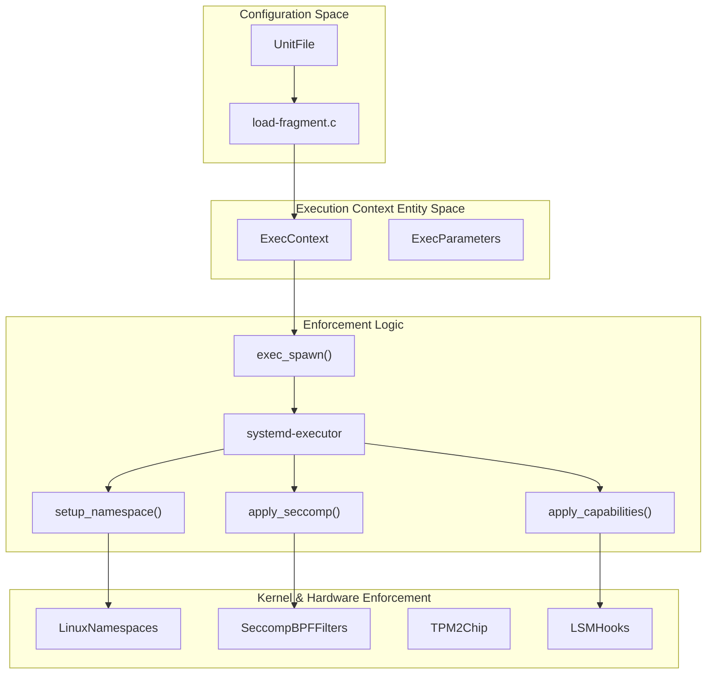
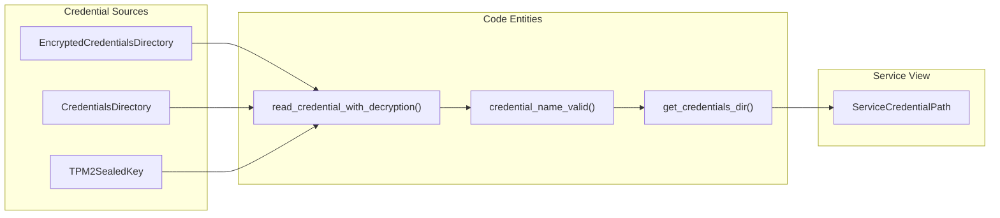

<!-- source: DeepWiki mcp.deepwiki.com · repo systemd/systemd · page 8 Security Features · fetched 2026-11-07 -->

# Security Features

Relevant source files

The following files were used as context for generating this wiki page:

- [man/crypttab.xml](man/crypttab.xml)
- [man/fido2-crypttab.sh](man/fido2-crypttab.sh)
- [man/systemd-creds.xml](man/systemd-creds.xml)
- [man/tpm2-crypttab.sh](man/tpm2-crypttab.sh)
- [man/yubikey-crypttab.sh](man/yubikey-crypttab.sh)
- [mime/io.systemd.xml](mime/io.systemd.xml)
- [mime/meson.build](mime/meson.build)
- [src/core/exec-credential.c](src/core/exec-credential.c)
- [src/core/exec-credential.h](src/core/exec-credential.h)
- [src/creds/creds.c](src/creds/creds.c)
- [src/cryptenroll/cryptenroll-tpm2.c](src/cryptenroll/cryptenroll-tpm2.c)
- [src/cryptsetup/cryptsetup-tokens/cryptsetup-token-systemd-tpm2.c](src/cryptsetup/cryptsetup-tokens/cryptsetup-token-systemd-tpm2.c)
- [src/cryptsetup/cryptsetup-tokens/luks2-tpm2.c](src/cryptsetup/cryptsetup-tokens/luks2-tpm2.c)
- [src/cryptsetup/cryptsetup-tokens/luks2-tpm2.h](src/cryptsetup/cryptsetup-tokens/luks2-tpm2.h)
- [src/cryptsetup/cryptsetup.c](src/cryptsetup/cryptsetup.c)
- [src/nspawn/nspawn-oci.c](src/nspawn/nspawn-oci.c)
- [src/nspawn/nspawn-seccomp.c](src/nspawn/nspawn-seccomp.c)
- [src/nspawn/nspawn-seccomp.h](src/nspawn/nspawn-seccomp.h)
- [src/shared/creds-util.c](src/shared/creds-util.c)
- [src/shared/creds-util.h](src/shared/creds-util.h)
- [src/shared/crypto-util.c](src/shared/crypto-util.c)
- [src/shared/crypto-util.h](src/shared/crypto-util.h)
- [src/shared/cryptsetup-tpm2.c](src/shared/cryptsetup-tpm2.c)
- [src/shared/cryptsetup-tpm2.h](src/shared/cryptsetup-tpm2.h)
- [src/shared/seccomp-util.c](src/shared/seccomp-util.c)
- [src/shared/seccomp-util.h](src/shared/seccomp-util.h)
- [src/shared/tpm2-util.c](src/shared/tpm2-util.c)
- [src/shared/tpm2-util.h](src/shared/tpm2-util.h)
- [src/shared/varlink-io.systemd.Credentials.c](src/shared/varlink-io.systemd.Credentials.c)
- [src/test/test-creds.c](src/test/test-creds.c)
- [src/test/test-crypto-util.c](src/test/test-crypto-util.c)
- [src/test/test-seccomp.c](src/test/test-seccomp.c)
- [src/test/test-tpm2.c](src/test/test-tpm2.c)
- [test/integration-tests/TEST-54-CREDS/TEST-54-CREDS.units/refresh.sh](test/integration-tests/TEST-54-CREDS/TEST-54-CREDS.units/refresh.sh)
- [test/units/TEST-54-CREDS.sh](test/units/TEST-54-CREDS.sh)

This page documents systemd's comprehensive security mechanisms for process isolation, hardware-backed cryptography, and secret management. These features implement a defense-in-depth strategy combining multiple kernel isolation technologies and hardware security modules (HSM) to reduce the system's attack surface.

For detailed technical implementation of specific subsystems, see the following child pages:
- [TPM2 and Measured Boot](#8.1) — Hardware-backed security, PCR policies, and disk encryption.
- [Process Sandboxing and Isolation](#8.2) — Namespaces, capabilities, and syscall filtering.
- [Credentials and Secrets Management](#8.3) — Secure passing of sensitive data to services.

---

## Security Architecture Overview

systemd's security model operates across multiple layers, from early boot measurement to runtime service sandboxing. The security features are primarily defined in the `ExecContext` structure [src/core/execute.h:192-330]() and enforced by the service manager and the `systemd-executor` during process spawning.

### Logical Security Flow

The following diagram illustrates how security configurations move from unit files to kernel enforcement.

Title: "Security Configuration and Enforcement Pipeline"

Sources: [src/core/execute.h:192-330](), [src/core/execute.c:124-182](), [src/core/exec-invoke.c:102-133]()

---

## Hardware-Backed Security (TPM2 & FIDO2)

systemd leverages modern hardware security features for disk encryption and boot integrity. This is primarily managed through `libtss2` integration for TPM2 and `libfido2` for security keys.

- **Measured Boot:** `systemd-boot` and `systemd-stub` measure kernel, initrd, and command line into TPM2 PCRs. The codebase defines bank preferences, prioritizing SHA256 and SHA384 [src/shared/tpm2-util.c:60-65]().
- **Disk Encryption:** `systemd-cryptsetup` and `systemd-cryptenroll` allow binding LUKS2 volumes to TPM2 PCRs, FIDO2 tokens, or PKCS#11 smartcards [src/cryptsetup/cryptsetup.c:66-72]().
- **PCR Locking:** The `systemd-pcrlock` tool manages complex PCR policies to ensure secrets are only released to a trusted software stack, utilizing `TPM2_FLAGS_USE_PCRLOCK` [src/shared/tpm2-util.h:11-14]().

For details, see [TPM2 and Measured Boot](#8.1).

Sources: [src/shared/tpm2-util.c:60-65](), [src/cryptsetup/cryptsetup.c:66-72](), [src/shared/tpm2-util.h:11-14]()

---

## Process Sandboxing and Isolation

systemd provides declarative sandboxing options that utilize Linux kernel features to restrict services.

### Namespace Isolation
Services can be isolated into private namespaces. systemd supports all major types, including Mount, Network, PID, IPC, User, UTS, and Cgroup namespaces.

### System Call Filtering (Seccomp)
Seccomp-BPF filters restrict the syscalls available to a process. systemd maps architecture-specific syscall numbers (e.g., `SCMP_ARCH_X86_64`) to human-readable names and defines semantic groups like `@clock` or `@default` [src/shared/seccomp-util.h:41-74]().

### Capability Management
systemd allows dropping privileges via `CapabilityBoundingSet=` and gaining specific privileges without root via `AmbientCapabilities=`.

For details, see [Process Sandboxing and Isolation](#8.2).

Sources: [src/shared/seccomp-util.h:41-74](), [src/shared/seccomp-util.c:51-131]()

---

## Credentials and Secrets Management

The credentials subsystem provides a secure way to pass sensitive data (passwords, SSH keys, certificates) to services.

### Credential Handling Logic

Title: "Credential Resolution and Decryption Flow"

- **Encryption:** Credentials can be encrypted for the local machine's TPM2 or a fixed host key using `systemd-creds` [src/creds/creds.c:98-112]().
- **Access:** Services access decrypted credentials via the path specified in `CREDENTIALS_DIRECTORY` [src/shared/creds-util.c:109-111]().
- **Validation:** Credential names and globs are strictly validated via `credential_name_valid()` and `credential_glob_valid()` to ensure filesystem safety [src/shared/creds-util.c:49-91]().

For details, see [Credentials and Secrets Management](#8.3).

Sources: [src/creds/creds.c:98-112](), [src/shared/creds-util.c:49-111]()

---

## Device and Filesystem Protection

- **PrivateDevices=:** Sets up a private `/dev` with only essential nodes.
- **ProtectSystem=:** Makes system directories read-only for the service.
- **ProtectHome=:** Restricts access to user home directories.

Sources: [src/core/namespace.c:58-68](), [src/core/namespace.c:151-170]()

---

