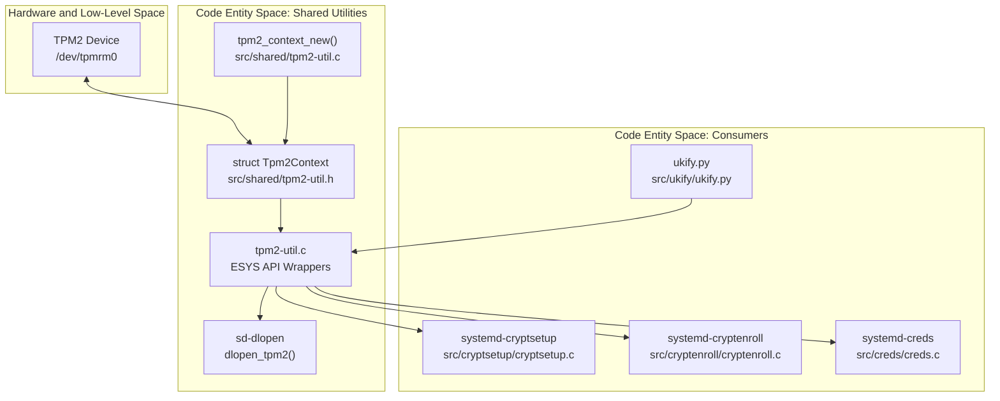
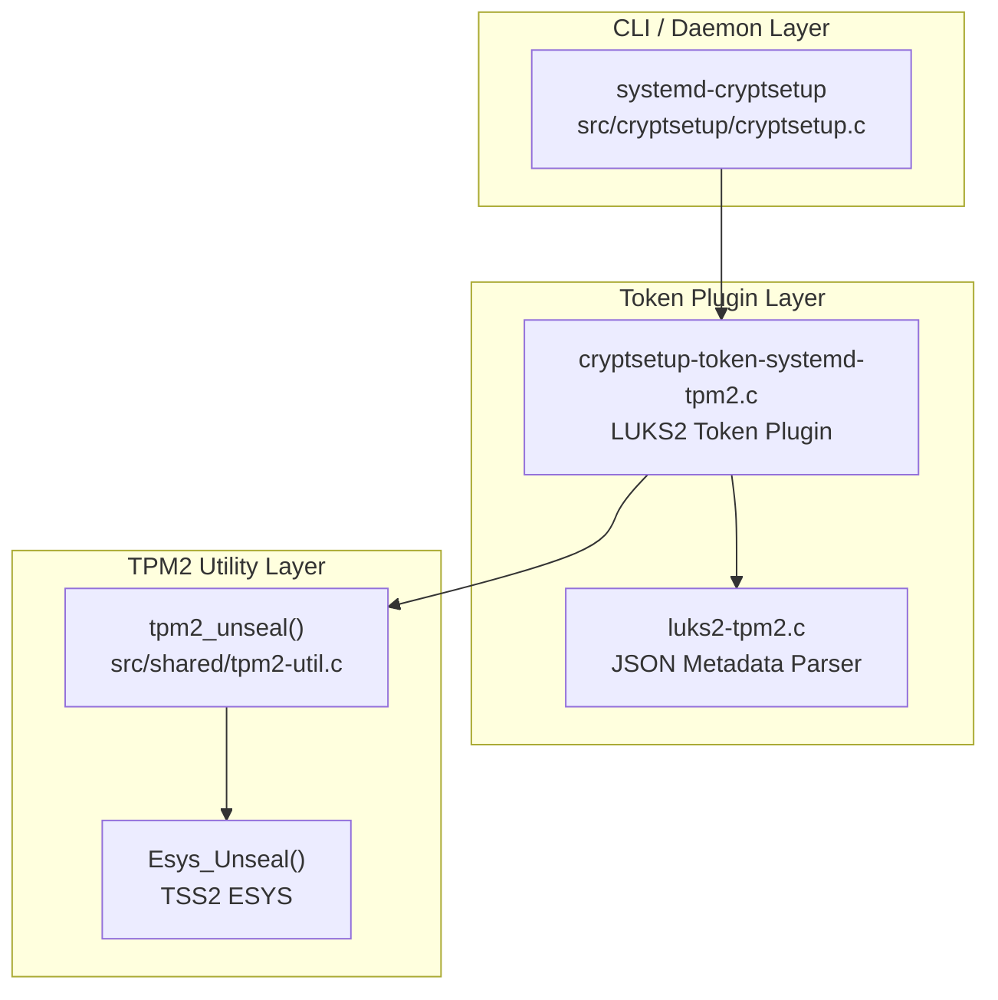

<!-- source: DeepWiki mcp.deepwiki.com · repo systemd/systemd · page 8.1 TPM2 and Measured Boot · fetched 2026-11-07 -->

# TPM2 and Measured Boot

Relevant source files

The following files were used as context for generating this wiki page:

- [man/crypttab.xml](man/crypttab.xml)
- [man/fido2-crypttab.sh](man/fido2-crypttab.sh)
- [man/systemd-creds.xml](man/systemd-creds.xml)
- [man/systemd-cryptenroll.xml](man/systemd-cryptenroll.xml)
- [man/systemd-measure.xml](man/systemd-measure.xml)
- [man/systemd-pcrphase.service.xml](man/systemd-pcrphase.service.xml)
- [man/tpm2-crypttab.sh](man/tpm2-crypttab.sh)
- [man/uki.conf.example](man/uki.conf.example)
- [man/ukify.xml](man/ukify.xml)
- [man/yubikey-crypttab.sh](man/yubikey-crypttab.sh)
- [mime/io.systemd.xml](mime/io.systemd.xml)
- [mime/meson.build](mime/meson.build)
- [src/basic/build.c](src/basic/build.c)
- [src/boot/measure.c](src/boot/measure.c)
- [src/core/exec-credential.c](src/core/exec-credential.c)
- [src/core/exec-credential.h](src/core/exec-credential.h)
- [src/creds/creds.c](src/creds/creds.c)
- [src/cryptenroll/cryptenroll-fido2.c](src/cryptenroll/cryptenroll-fido2.c)
- [src/cryptenroll/cryptenroll-fido2.h](src/cryptenroll/cryptenroll-fido2.h)
- [src/cryptenroll/cryptenroll-password.c](src/cryptenroll/cryptenroll-password.c)
- [src/cryptenroll/cryptenroll-password.h](src/cryptenroll/cryptenroll-password.h)
- [src/cryptenroll/cryptenroll-pkcs11.c](src/cryptenroll/cryptenroll-pkcs11.c)
- [src/cryptenroll/cryptenroll-pkcs11.h](src/cryptenroll/cryptenroll-pkcs11.h)
- [src/cryptenroll/cryptenroll-recovery.c](src/cryptenroll/cryptenroll-recovery.c)
- [src/cryptenroll/cryptenroll-recovery.h](src/cryptenroll/cryptenroll-recovery.h)
- [src/cryptenroll/cryptenroll-tpm2.c](src/cryptenroll/cryptenroll-tpm2.c)
- [src/cryptenroll/cryptenroll-tpm2.h](src/cryptenroll/cryptenroll-tpm2.h)
- [src/cryptenroll/cryptenroll.c](src/cryptenroll/cryptenroll.c)
- [src/cryptenroll/cryptenroll.h](src/cryptenroll/cryptenroll.h)
- [src/cryptsetup/cryptsetup-pkcs11.c](src/cryptsetup/cryptsetup-pkcs11.c)
- [src/cryptsetup/cryptsetup-pkcs11.h](src/cryptsetup/cryptsetup-pkcs11.h)
- [src/cryptsetup/cryptsetup-tokens/cryptsetup-token-systemd-tpm2.c](src/cryptsetup/cryptsetup-tokens/cryptsetup-token-systemd-tpm2.c)
- [src/cryptsetup/cryptsetup-tokens/luks2-tpm2.c](src/cryptsetup/cryptsetup-tokens/luks2-tpm2.c)
- [src/cryptsetup/cryptsetup-tokens/luks2-tpm2.h](src/cryptsetup/cryptsetup-tokens/luks2-tpm2.h)
- [src/cryptsetup/cryptsetup.c](src/cryptsetup/cryptsetup.c)
- [src/fundamental/uki.c](src/fundamental/uki.c)
- [src/fundamental/uki.h](src/fundamental/uki.h)
- [src/home/homectl-fido2.c](src/home/homectl-fido2.c)
- [src/home/homectl-fido2.h](src/home/homectl-fido2.h)
- [src/home/homectl-pkcs11.c](src/home/homectl-pkcs11.c)
- [src/home/homectl-pkcs11.h](src/home/homectl-pkcs11.h)
- [src/home/homectl-recovery-key.c](src/home/homectl-recovery-key.c)
- [src/home/homectl-recovery-key.h](src/home/homectl-recovery-key.h)
- [src/home/homework-fido2.c](src/home/homework-fido2.c)
- [src/kernel-install/60-ukify.install.in](src/kernel-install/60-ukify.install.in)
- [src/measure/measure-tool.c](src/measure/measure-tool.c)
- [src/pcrextend/pcrextend.c](src/pcrextend/pcrextend.c)
- [src/shared/creds-util.c](src/shared/creds-util.c)
- [src/shared/creds-util.h](src/shared/creds-util.h)
- [src/shared/crypto-util.c](src/shared/crypto-util.c)
- [src/shared/crypto-util.h](src/shared/crypto-util.h)
- [src/shared/cryptsetup-fido2.c](src/shared/cryptsetup-fido2.c)
- [src/shared/cryptsetup-fido2.h](src/shared/cryptsetup-fido2.h)
- [src/shared/cryptsetup-tpm2.c](src/shared/cryptsetup-tpm2.c)
- [src/shared/cryptsetup-tpm2.h](src/shared/cryptsetup-tpm2.h)
- [src/shared/kernel-image.c](src/shared/kernel-image.c)
- [src/shared/kernel-image.h](src/shared/kernel-image.h)
- [src/shared/libfido2-util.c](src/shared/libfido2-util.c)
- [src/shared/libfido2-util.h](src/shared/libfido2-util.h)
- [src/shared/pe-binary.c](src/shared/pe-binary.c)
- [src/shared/pe-binary.h](src/shared/pe-binary.h)
- [src/shared/pkcs11-util.c](src/shared/pkcs11-util.c)
- [src/shared/pkcs11-util.h](src/shared/pkcs11-util.h)
- [src/shared/tpm2-util.c](src/shared/tpm2-util.c)
- [src/shared/tpm2-util.h](src/shared/tpm2-util.h)
- [src/shared/varlink-io.systemd.Credentials.c](src/shared/varlink-io.systemd.Credentials.c)
- [src/test/test-creds.c](src/test/test-creds.c)
- [src/test/test-crypto-util.c](src/test/test-crypto-util.c)
- [src/test/test-tpm2.c](src/test/test-tpm2.c)
- [src/ukify/test/test_ukify.py](src/ukify/test/test_ukify.py)
- [src/ukify/ukify.py](src/ukify/ukify.py)
- [test/integration-tests/TEST-54-CREDS/TEST-54-CREDS.units/refresh.sh](test/integration-tests/TEST-54-CREDS/TEST-54-CREDS.units/refresh.sh)
- [test/units/TEST-54-CREDS.sh](test/units/TEST-54-CREDS.sh)
- [test/units/TEST-70-TPM2.measure.sh](test/units/TEST-70-TPM2.measure.sh)

## Purpose and Scope

This document covers systemd's integration with TPM2 (Trusted Platform Module 2.0) for measured boot, attestation, Secure Boot signing, and secure system state tracking. The focus is on Platform Configuration Register (PCR) measurements, event logging, token enrollment (`systemd-cryptenroll`), cryptsetup token plugins, policy-based access control (`systemd-pcrlock`), FIDO2/PKCS#11 token integration, and sealed credentials (`systemd-creds`).

Key topics include:
- TPM2 context management and dynamic library loading via `sd-dlopen`.
- PCR measurement flow in `systemd-boot`, `systemd-stub`, and UEFI protocols.
- Unified Kernel Image (UKI) assembly and Secure Boot / PCR signing via `ukify` and `systemd-measure`.
- LUKS2 disk enrollment and unlocking via `systemd-cryptenroll`, `systemd-cryptsetup`, and cryptographic token plugins.
- Predictive PCR policies and verification using `systemd-pcrlock`.
- Hardware-backed FIDO2 and PKCS#11 authentication tokens.
- TPM2-sealed credentials and the `systemd-creds` subsystem.

Sources: [src/shared/tpm2-util.h:1-20](), [src/cryptsetup/cryptsetup.c:66-72](), [man/ukify.xml:47-61]()

## Architecture Overview

Sources: [src/shared/tpm2-util.h:73-91](), [src/shared/tpm2-util.c:101-153](), [src/cryptsetup/cryptsetup.c:114-124](), [src/ukify/ukify.py:1-60]()

## Core TPM2 Infrastructure

### Dynamic Library Loading
systemd does not link directly against TSS2 libraries at compile time. Instead, it uses a runtime dynamic loading architecture (`sd-dlopen`) to support systems without TPM2 hardware or optional TSS2 packages. It searches for `libtss2-esys.so.0`, `libtss2-rc.so.0`, `libtss2-mu.so.0`, and `libtss2-tcti-device.so.0` [src/shared/tpm2-util.h:67-69]().

The implementation relies on `DLSYM_PROTOTYPE` macros to define runtime function pointers for the TSS2 API, covering ESYS calls such as `Esys_Initialize`, `Esys_CreatePrimary`, `Esys_Unseal`, and marshaling functions [src/shared/tpm2-util.c:102-151]().

### Context and Handle Management
The `Tpm2Context` structure manages connection state and caches TPM capabilities to minimize IPC overhead with the hardware [src/shared/tpm2-util.h:73-91]().

| Field | Description |
|:---|:---|
| `esys_context` | The ESYS context handle for the active cryptographic session. |
| `capability_pcrs` | Cached PCR bank selection and allocation configuration. |
| `max_nv_buffer_size` | Maximum buffer size supported for non-volatile (NV) index operations. |
| `tcti_context` | The Transmission Interface context (`TSS2_TCTI_CONTEXT`). |

Handles are wrapped in the `Tpm2Handle` structure, which tracks whether a handle must be explicitly flushed from the TPM when the structure is freed [src/shared/tpm2-util.h:98-103]().

Sources: [src/shared/tpm2-util.h:73-115](), [src/shared/tpm2-util.c:101-153]()

## Measured Boot Flow and Secure Boot Signing

### UEFI Measurements
During early boot, firmware, `systemd-boot`, and `systemd-stub` measure executable code, configuration, and state into the TPM PCR registers according to the [UAPI Linux TPM PCR Registry specification](https://uapi-group.org/specifications/specs/linux_tpm_pcr_registry/) [man/systemd-cryptenroll.xml:87-89]().

- **PCR 0 (Platform Code)**: Core system firmware executable code.
- **PCR 1 (Platform Config)**: Host platform configuration and basic hardware data.
- **PCR 4 (Boot Loader Code)**: Measures boot loaders and system extension images read from the EFI System Partition (ESP) [man/systemd-cryptenroll.xml:140-143]().
- **PCR 8 (Kernel Command Line)**: Measures kernel command-line parameters [src/test/test-tpm2.c:47]().
- **PCR 9 (Kernel Initrd)**: Measures the initial RAM disk image [src/test/test-tpm2.c:28-29]().
- **PCR 11 (Kernel Boot)**: Measures the unified kernel image (UKI) sections [src/test/test-tpm2.c:32-33]().
- **PCR 12 (Kernel Config)**: Measures kernel configuration and system credentials [src/test/test-tpm2.c:34-35]().
- **PCR 13 (Sysexts)**: Measures loaded system extensions [src/test/test-tpm2.c:36-37]().

### UKI Assembly, Signing, and `ukify`
Unified Kernel Images (UKIs) combine the kernel, initrd, stub, and auxiliary sections into a single PE binary. `ukify` (`src/ukify/ukify.py`) orchestrates the assembly and signs both the PE binary for Secure Boot and the anticipated PCR values for attestation [man/ukify.xml:47-61]().

- **Secure Boot Signing**: If a SecureBoot private key is provided (`--secureboot-private-key=`), `ukify` signs the PE binary so that UEFI Secure Boot firmware trusts it [man/ukify.xml:123-128]().
- **PCR Policy Signing**: Using `systemd-measure` under the hood, `ukify` calculates expected PCR values for specified boot phases and signs them with PCR private keys (`--pcr-private-key=`), embedding the resulting signatures inside the UKI [man/ukify.xml:94-110]().

Sources: [src/boot/measure.c:12-51](), [src/ukify/ukify.py:1-60](), [man/ukify.xml:47-128](), [src/test/test-tpm2.c:13-51]()

## Token Enrollment, Cryptsetup Plugins, and Unlocking

### Enrollment (`systemd-cryptenroll`)
`systemd-cryptenroll` (`src/cryptenroll/cryptenroll.c`) enables enrolling security tokens into LUKS2 encrypted volumes. It writes metadata into the LUKS2 JSON token area [src/cryptenroll/cryptenroll.c:135-154](). Supported enrollment types include:
- **TPM2 (`ENROLL_TPM2`)**: Seals the volume key against specific PCR policies or signed PCR policies [man/systemd-cryptenroll.xml:34-46]().
- **FIDO2 (`ENROLL_FIDO2`)**: Enrolls hardware security tokens implementing the `hmac-secret` extension [man/systemd-cryptenroll.xml:41-43]().
- **PKCS#11 (`ENROLL_PKCS11`)**: Enrolls smartcards or USB tokens using RSA or elliptic-curve key pairs [man/systemd-cryptenroll.xml:39-40]().
- **Passphrases and Recovery Keys (`ENROLL_PASSWORD`, `ENROLL_RECOVERY`)**: Traditional passphrases and high-entropy, easy-to-type recovery codes [man/systemd-cryptenroll.xml:47-54]().

### Cryptsetup Token Plugins and Unlocking (`systemd-cryptsetup`)
When unlocking volumes during boot, `systemd-cryptsetup` (`src/cryptsetup/cryptsetup.c`) invokes modular token plugins located in `src/cryptsetup/cryptsetup-tokens/` (e.g., `cryptsetup-token-systemd-tpm2.c`) to parse LUKS2 JSON metadata and retrieve unlocking keys [src/cryptsetup/cryptsetup.c:14-18]().

Sources: [src/cryptenroll/cryptenroll.c:135-154](), [src/cryptsetup/cryptsetup.c:14-18](), [src/cryptsetup/cryptsetup-tokens/cryptsetup-token-systemd-tpm2.c:1-50](), [src/cryptsetup/cryptsetup-tokens/luks2-tpm2.c:1-50]()

## PCR Selection, Banks, and Predictive Locking (`systemd-pcrlock`)

### PCR Banks and Preference
systemd defines a strict preference order for PCR hashing algorithms to balance hardware compatibility, security margins, and event log size limitations [src/shared/tpm2-util.c:55-65]().

| Algorithm | Preference | Rationale |
|:---|:---|:---|
| `TPM2_ALG_SHA256` | 1 | Maximum backwards compatibility for existing sealed secrets. |
| `TPM2_ALG_SHA384` | 2 | Computes in 64-bit words like SHA512 but produces a shorter digest, conserving event log memory. |
| `TPM2_ALG_SHA512` | 3 | High security margin. |
| `TPM2_ALG_SHA1` | 4 | Weak algorithm; retained strictly as a legacy fallback. |

The function `tpm2_pcr_bank_from_efi_active()` inspects active PCR banks reported by firmware to select the optimal bank [src/shared/tpm2-util.c:75-95]().

### Predictive PCR Locking (`systemd-pcrlock`)
`systemd-pcrlock` establishes predictive PCR policies by locking down expected event log entries for specific boot phases. Instead of trusting arbitrary current PCR register values, it verifies that the event log hash chain matches a baseline JSON policy file, preventing unauthorized modifications to boot components, kernel command lines, or firmwares.

Sources: [src/shared/tpm2-util.c:55-99](), [src/test/test-tpm2.c:53-115]()

## Sealed Credentials (`systemd-creds`)

`systemd-creds` (`src/creds/creds.c`) allows encrypting system and service credentials so that they can only be decrypted by the local TPM2 or host key [src/creds/creds.c:81-86]().

- **Key Types**: Credentials support various sealing methods, such as host-only (`CRED_AES256_GCM_BY_HOST`), TPM2 HMAC pinned storage root keys (`CRED_AES256_GCM_BY_TPM2_HMAC_PINNED_SRK`), or combinations thereof [src/creds/creds.c:130-142]().
- **Decryption Flow**: During early boot and service startup, `read_credential_with_decryption()` automatically handles unsealing encrypted credentials stored in system directories [src/shared/creds-util.c:182-205]().

Sources: [src/creds/creds.c:98-142](), [src/shared/creds-util.c:156-205]()

---

