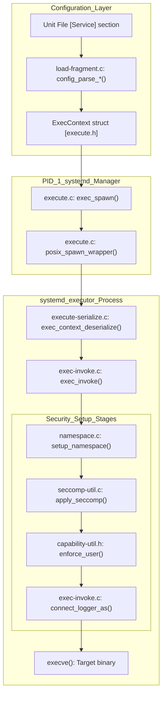
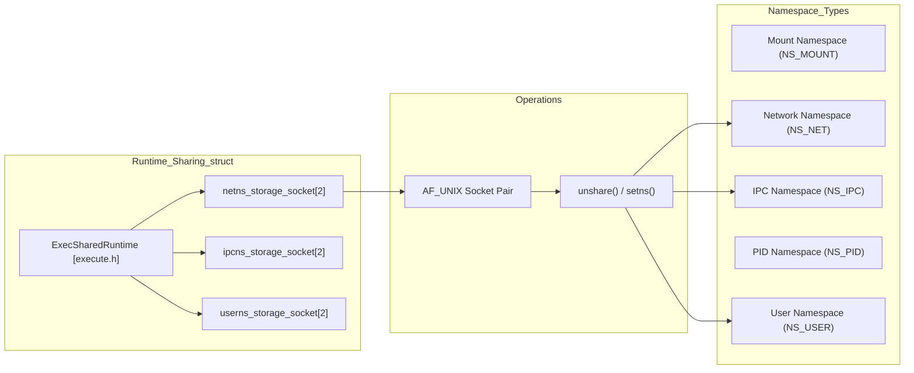

<!-- source: DeepWiki mcp.deepwiki.com · repo systemd/systemd · page 8.2 Process Sandboxing and Isolation · fetched 2026-11-07 -->

# Process Sandboxing and Isolation

Relevant source files

The following files were used as context for generating this wiki page:

- [man/org.freedesktop.systemd1.xml](man/org.freedesktop.systemd1.xml)
- [man/systemd.exec.xml](man/systemd.exec.xml)
- [src/basic/chase.c](src/basic/chase.c)
- [src/basic/chase.h](src/basic/chase.h)
- [src/core/dbus-execute.c](src/core/dbus-execute.c)
- [src/core/exec-invoke.c](src/core/exec-invoke.c)
- [src/core/execute-serialize.c](src/core/execute-serialize.c)
- [src/core/execute.c](src/core/execute.c)
- [src/core/execute.h](src/core/execute.h)
- [src/core/load-fragment-gperf.gperf.in](src/core/load-fragment-gperf.gperf.in)
- [src/core/load-fragment.c](src/core/load-fragment.c)
- [src/core/load-fragment.h](src/core/load-fragment.h)
- [src/core/namespace.c](src/core/namespace.c)
- [src/core/namespace.h](src/core/namespace.h)
- [src/mountfsd/io.systemd.mount-file-system.policy](src/mountfsd/io.systemd.mount-file-system.policy)
- [src/mountfsd/meson.build](src/mountfsd/meson.build)
- [src/mountfsd/mountwork.c](src/mountfsd/mountwork.c)
- [src/nspawn/nspawn-oci.c](src/nspawn/nspawn-oci.c)
- [src/nspawn/nspawn-seccomp.c](src/nspawn/nspawn-seccomp.c)
- [src/nspawn/nspawn-seccomp.h](src/nspawn/nspawn-seccomp.h)
- [src/shared/bus-unit-util.c](src/shared/bus-unit-util.c)
- [src/shared/bus-util.c](src/shared/bus-util.c)
- [src/shared/bus-util.h](src/shared/bus-util.h)
- [src/shared/find-esp.c](src/shared/find-esp.c)
- [src/shared/find-esp.h](src/shared/find-esp.h)
- [src/shared/seccomp-util.c](src/shared/seccomp-util.c)
- [src/shared/seccomp-util.h](src/shared/seccomp-util.h)
- [src/shared/varlink-io.systemd.BootControl.h](src/shared/varlink-io.systemd.BootControl.h)
- [src/shared/varlink-io.systemd.MountFileSystem.c](src/shared/varlink-io.systemd.MountFileSystem.c)
- [src/shared/varlink-io.systemd.MountFileSystem.h](src/shared/varlink-io.systemd.MountFileSystem.h)
- [src/test/test-chase.c](src/test/test-chase.c)
- [src/test/test-ns.c](src/test/test-ns.c)
- [src/test/test-seccomp.c](src/test/test-seccomp.c)
- [units/systemd-mountfsd.service.in](units/systemd-mountfsd.service.in)

This page documents systemd's comprehensive security and isolation mechanisms for spawned processes. These features restrict what services can access and modify, providing defense-in-depth through Linux kernel features like namespaces, mount restrictions, seccomp filters, capability dropping, BPF-based security policies, and resource management daemons such as `mountfsd` and `nsresourced`.

For information about the broader process execution pipeline, see [Process Execution and Sandboxing (2.4)](). For TPM2 and hardware-backed security, see [TPM2 and Hardware Security (8.1)]().

## Overview

systemd provides extensive sandboxing through the `ExecContext` structure, which encodes security restrictions applied to service processes. These restrictions are configured via unit file directives and enforced during process invocation in the child process before executing the actual service binary.

The sandboxing system operates through multiple layers:

1.  **Namespace isolation** - Creates separate views of system resources.
2.  **Filesystem restrictions** - Controls read/write/execute access to paths via `MountEntry` and `MountMode` [src/core/namespace.c:60-127]().
3.  **System call filtering** - Blocks dangerous syscalls via seccomp-bpf filters defined in `seccomp-util.c` [src/shared/seccomp-util.c:51-130]().
4.  **Capability management** - Limits privileged operations through bounding and ambient sets.
5.  **Security module integration** - Enforces mandatory access control policies (SELinux, AppArmor, SMACK).
6.  **BPF-based security** - Restricts filesystem types (`RestrictFileSystems=`), socket families, and BPF operations (`PrivateBPF=`) [src/core/load-fragment.c:150]().

### Key Components

| Component | Purpose | Primary Files |
| :--- | :--- | :--- |
| `ExecContext` | Configuration structure holding security settings | [src/core/execute.h:118-150]() |
| `MountEntry` / `MountMode` | Abstracted mount operations (bind, tmpfs, read-only) | [src/core/namespace.c:60-127]() |
| `seccomp_local_archs` | Multi-architecture seccomp support | [src/shared/seccomp-util.c:51-130]() |
| `connect_journal_socket()` | Secure journal logging connection for sandboxed processes | [src/core/exec-invoke.c:148-194]() |
| `config_parse_*` | Unit file fragment parsers for security directives | [src/core/load-fragment.c:142-176]() |

Sources: [src/core/execute.h:118-150](), [src/core/namespace.c:60-127](), [src/shared/seccomp-util.c:51-130](), [src/core/exec-invoke.c:148-194](), [src/core/load-fragment.c:142-176]()

## Sandboxing Architecture

The following diagram maps the conceptual sandboxing stages to the specific code entities responsible for their execution.

**Sandbox Execution Flow**

**Execution Flow**: Security restrictions are configured in unit files, parsed into `ExecContext` by `config_parse_*` functions [src/core/load-fragment.c:142-176](), serialized and passed to `systemd-executor`, then applied sequentially in `exec_invoke()` before spawning the target process.

Sources: [src/core/load-fragment.c:142-176](), [src/core/exec-invoke.c:148-247]()

## Namespace Isolation

Namespaces provide isolated views of system resources. systemd supports all Linux namespace types and manages their creation and configuration through mount namespace setup logic and runtime state sharers like `ExecSharedRuntime` [src/core/execute.h:118-137]().

### Namespace Types and Configuration

**Namespace Code Mapping**

**Shareable Namespace Management**: The `ExecSharedRuntime` structure stores file descriptors to shared namespaces (network, IPC, user) via `AF_UNIX` socket pairs [src/core/execute.h:118-137](). This allows restarted service invocations to reuse identical namespace contexts without tearing down ephemeral tunnels or virtual interfaces.

Sources: [src/core/execute.h:118-137](), [src/core/namespace.c:60-127]()

## Filesystem Restrictions

The mount namespace provides extensive filesystem isolation through `MountEntry` structures evaluated by `setup_namespace()` [src/core/namespace.c:99-127]().

### Mount Entry Types (`MountMode`)

The `MountMode` enum prioritizes and categorizes mount operations [src/core/namespace.c:60-89]():

*   `MOUNT_INACCESSIBLE`: Completely masks paths [src/core/namespace.c:62]().
*   `MOUNT_READ_ONLY`: Enforces read-only mounts [src/core/namespace.c:75]().
*   `MOUNT_BIND`: Performs bind mounts [src/core/namespace.c:65]().
*   `MOUNT_TMPFS`: Mounts temporary filesystems like `PrivateTmp=` [src/core/namespace.c:79]().
*   `MOUNT_BPFFS`: Mounts special BPF filesystems when `PrivateBPF=yes` [src/core/namespace.c:86]().

Preset tables such as `apivfs_table` [src/core/namespace.c:143-148]() and `protect_kernel_tunables_proc_table` [src/core/namespace.c:151-163]() populate default protection views for `/proc`, `/sys`, `/dev`, and `/run`.

Sources: [src/core/namespace.c:60-163]()

## System Call Filtering

System call filtering uses seccomp-bpf to block dangerous system calls. 

### Seccomp Architecture Support

systemd maintains architecture-specific translation tables in `seccomp_local_archs` [src/shared/seccomp-util.c:51-130]() and maps architectures via `seccomp_arch_to_string()` [src/shared/seccomp-util.c:132-185](). D-Bus property getters such as `property_get_protect_home` [src/core/dbus-execute.c:58]() and `property_get_private_tmp_ex` [src/core/dbus-execute.c:68]() expose these configurations to clients like `systemctl`.

Sources: [src/shared/seccomp-util.c:51-185](), [src/core/dbus-execute.c:58-71]()

## BPF-based Security Policies and Resource Daemons

Modern systemd leverages BPF and auxiliary daemons for advanced isolation:

*   **`mountfsd`**: Handles file system dissection, image mounting, and secure mount management off-process. Configuration is shipped via unit definitions like `systemd-mountfsd.service` and varlink interfaces (`io.systemd.MountFileSystem`) [units/systemd-mountfsd.service.in](), [src/shared/varlink-io.systemd.MountFileSystem.c]().
*   **`nsresourced`**: Manages namespace quota allocation and resource limits.
*   **`PrivateBPF=`**: Configured via `config_parse_private_bpf` [src/core/load-fragment.c:150](), controlling access to BPF map creation and program loading.

Sources: [src/core/load-fragment.c:150](), [units/systemd-mountfsd.service.in](), [src/shared/varlink-io.systemd.MountFileSystem.c]()

---

