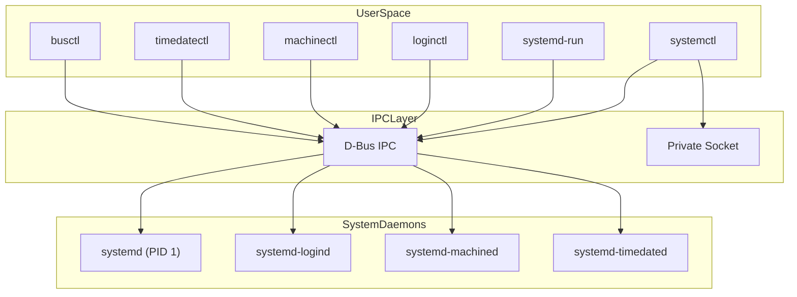

<!-- source: DeepWiki mcp.deepwiki.com · repo systemd/systemd · page 9 Command Line Utilities · fetched 2026-11-07 -->

# Command Line Utilities

Relevant source files

The following files were used as context for generating this wiki page:

- [man/busctl.xml](man/busctl.xml)
- [man/localectl.xml](man/localectl.xml)
- [man/loginctl.xml](man/loginctl.xml)
- [man/machinectl.xml](man/machinectl.xml)
- [man/shutdown.xml](man/shutdown.xml)
- [man/systemctl.xml](man/systemctl.xml)
- [man/systemd-mount.xml](man/systemd-mount.xml)
- [man/systemd-run.xml](man/systemd-run.xml)
- [man/systemd-time-wait-sync.service.xml](man/systemd-time-wait-sync.service.xml)
- [man/systemd-timesyncd.service.xml](man/systemd-timesyncd.service.xml)
- [man/timedatectl.xml](man/timedatectl.xml)
- [shell-completion/zsh/_busctl](shell-completion/zsh/_busctl)
- [src/basic/login-util.h](src/basic/login-util.h)
- [src/busctl/busctl.c](src/busctl/busctl.c)
- [src/hostname/hostnamectl.c](src/hostname/hostnamectl.c)
- [src/libsystemd/sd-bus/bus-dump-json.c](src/libsystemd/sd-bus/bus-dump-json.c)
- [src/locale/localectl.c](src/locale/localectl.c)
- [src/login/loginctl.c](src/login/loginctl.c)
- [src/machine/machinectl.c](src/machine/machinectl.c)
- [src/mount/mount-tool.c](src/mount/mount-tool.c)
- [src/run/run.c](src/run/run.c)
- [src/shared/bus-wait-for-jobs.c](src/shared/bus-wait-for-jobs.c)
- [src/shared/bus-wait-for-jobs.h](src/shared/bus-wait-for-jobs.h)
- [src/systemctl/fuzz-systemctl-parse-argv.c](src/systemctl/fuzz-systemctl-parse-argv.c)
- [src/systemctl/systemctl-compat-halt.c](src/systemctl/systemctl-compat-halt.c)
- [src/systemctl/systemctl-compat-halt.h](src/systemctl/systemctl-compat-halt.h)
- [src/systemctl/systemctl-compat-shutdown.c](src/systemctl/systemctl-compat-shutdown.c)
- [src/systemctl/systemctl-compat-shutdown.h](src/systemctl/systemctl-compat-shutdown.h)
- [src/systemctl/systemctl-kill.c](src/systemctl/systemctl-kill.c)
- [src/systemctl/systemctl-logind.c](src/systemctl/systemctl-logind.c)
- [src/systemctl/systemctl-logind.h](src/systemctl/systemctl-logind.h)
- [src/systemctl/systemctl-main.c](src/systemctl/systemctl-main.c)
- [src/systemctl/systemctl-start-special.c](src/systemctl/systemctl-start-special.c)
- [src/systemctl/systemctl-start-unit.c](src/systemctl/systemctl-start-unit.c)
- [src/systemctl/systemctl-util.c](src/systemctl/systemctl-util.c)
- [src/systemctl/systemctl-util.h](src/systemctl/systemctl-util.h)
- [src/systemctl/systemctl-whoami.c](src/systemctl/systemctl-whoami.c)
- [src/systemctl/systemctl-whoami.h](src/systemctl/systemctl-whoami.h)
- [src/systemctl/systemctl.c](src/systemctl/systemctl.c)
- [src/systemctl/systemctl.h](src/systemctl/systemctl.h)
- [src/timedate/timedatectl.c](src/timedate/timedatectl.c)
- [test/integration-tests/TEST-07-PID1/TEST-07-PID1.units/prefix-shell.service](test/integration-tests/TEST-07-PID1/TEST-07-PID1.units/prefix-shell.service)
- [test/units/TEST-07-PID1.prefix-shell.sh](test/units/TEST-07-PID1.prefix-shell.sh)
- [test/units/TEST-74-AUX-UTILS.busctl.sh](test/units/TEST-74-AUX-UTILS.busctl.sh)
- [test/units/TEST-74-AUX-UTILS.run.sh](test/units/TEST-74-AUX-UTILS.run.sh)

Command-line utilities provide the primary user-facing interface for controlling, monitoring, and introspecting systemd components. These client programs communicate with systemd daemons over D-Bus, Varlink, or private sockets to perform operations ranging from unit management and container control to time, locale, and network configuration.

For detailed information about specific tool groups, see:
- [systemctl and Unit Control](#9.1) — Document systemctl's verb-based interface, unit file installation, and D-Bus communication
- [systemd-run and Transient Units](#9.2) — Explain systemd-run's transient unit creation, PTY forwarding, run0 and execution modes
- [Other Control Tools](#9.3) — Document networkctl, loginctl, machinectl, timedatectl, hostnamectl, localectl, coredumpctl, varlinkctl, busctl, systemd-analyze and shell completions
- [Journal and Logging](#9.4) — Document systemd-journald's log collection, journalctl querying, journal file format, remote journal and log forwarding

## Architecture and Implementation Overview

Command-line utilities translate user input and options into structured IPC requests. Most client tools share a common command-line parsing structure, table formatting helpers (`format-table.c`), pagination infrastructure (`pager.c`), and verb dispatching mechanisms (`verbs.h`).

Title: Command-Line Tool to Daemon Mapping

Sources: [src/systemctl/systemctl.c:114-120](), [src/machine/machinectl.c:119-124](), [src/busctl/busctl.c:78-84]()

Client utilities support multiple transport modes (`BUS_TRANSPORT_LOCAL`, `BUS_TRANSPORT_REMOTE`, `BUS_TRANSPORT_MACHINE`, `BUS_TRANSPORT_CAPSULE`) to interact with local systems, remote hosts over SSH, or containers and capsules [src/busctl/busctl.c:132-166]().

Sources: [src/systemctl/systemctl.c:76-77](), [src/busctl/busctl.c:132-166]()

---

## 9.1 systemctl and Unit Control

`systemctl` is the central command-line tool used to introspect and control the state of the systemd manager and individual units [man/systemctl.xml:22-34](). It provides a verb-based interface (`list-units`, `start`, `stop`, `enable`, `status`) to manage service, socket, mount, path, timer, and slice units.

For details, see [systemctl and Unit Control](#9.1).

Sources: [src/systemctl/systemctl.c:114-120](), [man/systemctl.xml:22-34]()

---

## 9.2 systemd-run and Transient Units

`systemd-run` allows users and administrators to execute commands inside transient scope or service units without writing permanent unit files on disk [src/run/run.c:147-154](), [man/systemd-run.xml:22-25](). It supports PTY allocation, direct pipe forwarding, resource limit configuration via property arguments, and timer/path/socket-triggered executions.

For details, see [systemd-run and Transient Units](#9.2).

Sources: [src/run/run.c:147-154](), [man/systemd-run.xml:22-25]()

---

## 9.3 Other Control Tools

A comprehensive suite of specialized command-line tools manages specific subsystems. These include `machinectl` for container and virtual machine registration [src/machine/machinectl.c:119-124](), `loginctl` for login sessions and seats [src/login/loginctl.c:58-63](), `busctl` for raw D-Bus introspection [src/busctl/busctl.c:78-84](), `timedatectl` for time configuration [src/timedate/timedatectl.c:182-187](), `hostnamectl` for hostnames [src/hostname/hostnamectl.c:43-47](), and `localectl` for locales and keymaps [src/locale/localectl.c:40-45]().

For details, see [Other Control Tools](#9.3).

Sources: [src/machine/machinectl.c:119-124](), [src/busctl/busctl.c:78-84](), [src/login/loginctl.c:58-63](), [src/timedate/timedatectl.c:182-187](), [src/hostname/hostnamectl.c:43-47](), [src/locale/localectl.c:40-45]()

---

## 9.4 Journal and Logging

`journalctl` is the primary interface for querying and displaying logs collected by `systemd-journald`. It supports filtering by units, boots, priorities, fields, and output formatting ranging from short text to JSON.

For details, see [Journal and Logging](#9.4).

Sources: [src/machine/machinectl.c:10-10](), [src/login/loginctl.c:7-7]()

---

