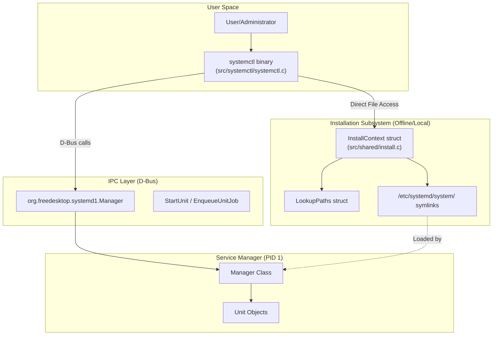
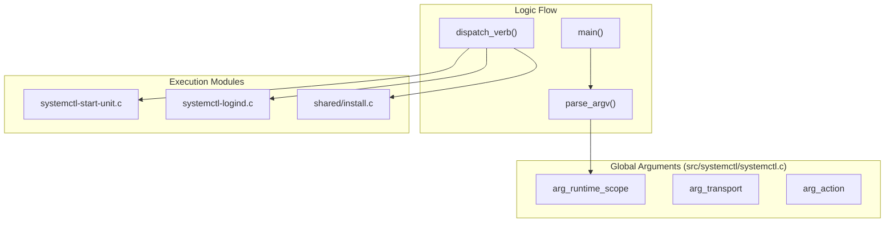
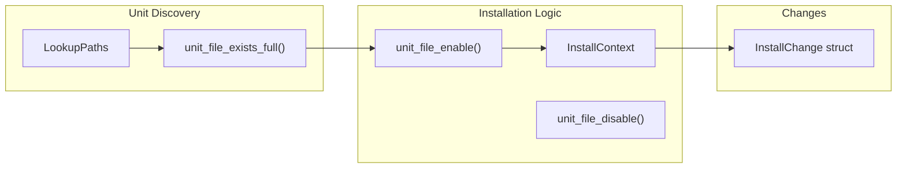

<!-- source: DeepWiki mcp.deepwiki.com · repo systemd/systemd · page 9.1 systemctl and Unit Control · fetched 2026-11-07 -->

# systemctl and Unit Control

Relevant source files

The following files were used as context for generating this wiki page:

- [man/shutdown.xml](man/shutdown.xml)
- [man/systemctl.xml](man/systemctl.xml)
- [src/basic/login-util.h](src/basic/login-util.h)
- [src/core/unit-printf.c](src/core/unit-printf.c)
- [src/shared/bus-wait-for-jobs.c](src/shared/bus-wait-for-jobs.c)
- [src/shared/bus-wait-for-jobs.h](src/shared/bus-wait-for-jobs.h)
- [src/shared/install-printf.c](src/shared/install-printf.c)
- [src/shared/install-printf.h](src/shared/install-printf.h)
- [src/shared/install.c](src/shared/install.c)
- [src/shared/install.h](src/shared/install.h)
- [src/shared/specifier.c](src/shared/specifier.c)
- [src/shared/specifier.h](src/shared/specifier.h)
- [src/systemctl/fuzz-systemctl-parse-argv.c](src/systemctl/fuzz-systemctl-parse-argv.c)
- [src/systemctl/systemctl-cancel-job.c](src/systemctl/systemctl-cancel-job.c)
- [src/systemctl/systemctl-clean-or-freeze.c](src/systemctl/systemctl-clean-or-freeze.c)
- [src/systemctl/systemctl-compat-halt.c](src/systemctl/systemctl-compat-halt.c)
- [src/systemctl/systemctl-compat-halt.h](src/systemctl/systemctl-compat-halt.h)
- [src/systemctl/systemctl-compat-shutdown.c](src/systemctl/systemctl-compat-shutdown.c)
- [src/systemctl/systemctl-compat-shutdown.h](src/systemctl/systemctl-compat-shutdown.h)
- [src/systemctl/systemctl-is-active.c](src/systemctl/systemctl-is-active.c)
- [src/systemctl/systemctl-is-enabled.c](src/systemctl/systemctl-is-enabled.c)
- [src/systemctl/systemctl-kill.c](src/systemctl/systemctl-kill.c)
- [src/systemctl/systemctl-logind.c](src/systemctl/systemctl-logind.c)
- [src/systemctl/systemctl-logind.h](src/systemctl/systemctl-logind.h)
- [src/systemctl/systemctl-main.c](src/systemctl/systemctl-main.c)
- [src/systemctl/systemctl-start-special.c](src/systemctl/systemctl-start-special.c)
- [src/systemctl/systemctl-start-unit.c](src/systemctl/systemctl-start-unit.c)
- [src/systemctl/systemctl-util.c](src/systemctl/systemctl-util.c)
- [src/systemctl/systemctl-util.h](src/systemctl/systemctl-util.h)
- [src/systemctl/systemctl-whoami.c](src/systemctl/systemctl-whoami.c)
- [src/systemctl/systemctl-whoami.h](src/systemctl/systemctl-whoami.h)
- [src/systemctl/systemctl.c](src/systemctl/systemctl.c)
- [src/systemctl/systemctl.h](src/systemctl/systemctl.h)
- [src/test/test-install-root.c](src/test/test-install-root.c)
- [src/test/test-install.c](src/test/test-install.c)
- [src/test/test-load-fragment.c](src/test/test-load-fragment.c)
- [src/test/test-specifier.c](src/test/test-specifier.c)
- [test/test-systemctl-enable.sh](test/test-systemctl-enable.sh)
- [test/units/TEST-74-AUX-UTILS.detect-virt.sh](test/units/TEST-74-AUX-UTILS.detect-virt.sh)
- [test/units/TEST-74-AUX-UTILS.mount.sh](test/units/TEST-74-AUX-UTILS.mount.sh)
- [test/units/TEST-87-AUX-UTILS-VM.detect-virt.sh](test/units/TEST-87-AUX-UTILS-VM.detect-virt.sh)
- [test/units/TEST-87-AUX-UTILS-VM.modules-load.sh](test/units/TEST-87-AUX-UTILS-VM.modules-load.sh)
- [test/units/TEST-87-AUX-UTILS-VM.pstore.sh](test/units/TEST-87-AUX-UTILS-VM.pstore.sh)

## Purpose and Scope

This document describes `systemctl`, the primary command-line interface for controlling the systemd system and service manager. `systemctl` provides a verb-based interface for querying unit state, managing unit lifecycle (start/stop/restart), and manipulating unit file installation (enable/disable/mask). This page covers the `systemctl` binary implementation, the unit file installation subsystem, and the D-Bus communication protocols used to interact with the service manager.

For transient unit creation, see [systemd-run and Transient Units](9.2). For the Manager (PID 1) orchestration logic, see [Unit Management System](2.3).

---

## Architecture Overview

### systemctl in the systemd Ecosystem

Sources: [src/systemctl/systemctl.c:114-120](), [src/shared/install.c:40-44](), [src/systemctl/systemctl-util.c:43-73]()

`systemctl` operates in two distinct modes:
1.  **Runtime Control Mode**: Communicates with the running Manager via D-Bus to query state, start/stop units, and manipulate running services [src/systemctl/systemctl-util.c:129-160]().
2.  **Installation Mode**: Directly manipulates unit file symlinks in `/etc/systemd/system/` and `/run/systemd/system/` to configure enablement state [src/shared/install.c:40-44]().

---

## Command-Line Interface Structure

### Verb Categories and Global Options

The `systemctl` binary parses arguments into global state variables that influence D-Bus transport and operation scope. Verbs are dispatched via a central command table [src/systemctl/systemctl.c:114-120]().

Sources: [src/systemctl/systemctl.c:33-95](), [src/systemctl/systemctl.c:114-120]()

### Key Global Arguments

| Variable | Type | Default | Description |
|----------|------|---------|-------------|
| `arg_runtime_scope` | `RuntimeScope` | `RUNTIME_SCOPE_SYSTEM` | Target system, user, or global manager [src/systemctl/systemctl.c:39]() |
| `arg_transport` | `BusTransport` | `BUS_TRANSPORT_LOCAL` | Connection type (local, ssh, machine) [src/systemctl/systemctl.c:76]() |
| `arg_root` | `char *` | `NULL` | Operates on an alternate root directory [src/systemctl/systemctl.c:68]() |
| `arg_no_block` | `bool` | `false` | Do not wait for job completion [src/systemctl/systemctl.c:41]() |
| `arg_preset_mode` | `UnitFilePresetMode` | `UNIT_FILE_PRESET_FULL` | Controls how presets are applied [src/systemctl/systemctl.c:62]() |

Sources: [src/systemctl/systemctl.c:33-95]()

---

## Unit File Installation Subsystem

### Installation Context and Workflow

The installation logic in `src/shared/install.c` manages how units are "enabled" by creating symlinks. This is governed by the `InstallContext` structure [src/shared/install.c:40-44]().

Sources: [src/shared/install.c:40-44](), [src/shared/install.h:54-58](), [src/shared/install.h:99-105]()

### InstallInfo Structure
The `InstallInfo` structure contains the parsed `[Install]` section of a unit file [src/shared/install.h:81-97]().
*   **Aliases**: Alternative names for the unit (`Alias=` key) [src/shared/install.h:86]().
*   **WantedBy/RequiredBy**: Targets that should gain a dependency on this unit [src/shared/install.h:87-88]().
*   **Also**: Additional units to enable/disable together with this one [src/shared/install.h:90]().

Sources: [src/shared/install.h:81-97]()

### Unit File States
The subsystem determines the state of a unit file based on its location and symlinks:
*   **Masked**: Symlinked to `/dev/null` [src/shared/install.c:99]().
*   **Alias**: Unit name is a symlink to another unit file [src/shared/install.c:98]().
*   **Linked**: Unit file is outside search paths but symlinked into the configuration directory [src/shared/install.c:97]().

Sources: [src/shared/install.c:95-102]()

---

## D-Bus Communication

`systemctl` interacts with the `org.freedesktop.systemd1` D-Bus interface. It acquires the bus via `acquire_bus_full()` which handles different transports (SSH, containers) [src/systemctl/systemctl-util.c:43-73]().

### Unit Lifecycle Actions
Verbs like `start`, `stop`, and `restart` are mapped to D-Bus methods in `src/systemctl/systemctl-start-unit.c` [src/systemctl/systemctl-start-unit.c:22-39]().

| systemctl Verb | D-Bus Method | Job Type |
|----------------|--------------|----------|
| `start` | `StartUnit` | `start` |
| `stop` | `StopUnit` | `stop` |
| `reload` | `ReloadUnit` | `reload` |
| `restart` | `RestartUnit` | `restart` |

Sources: [src/systemctl/systemctl-start-unit.c:22-39]()

### Transaction Introspection
When `--show-transaction` is used, `systemctl` calls `EnqueueUnitJob` instead of the standard `StartUnit`. This returns the anchor job and all auxiliary jobs created for the transaction [src/systemctl/systemctl-start-unit.c:88-137]().

Sources: [src/systemctl/systemctl-start-unit.c:88-137]()

### Waiting for Completion
If `arg_no_block` is false, `systemctl` uses `BusWaitForJobs` to track the lifecycle of the enqueued jobs until they succeed or fail [src/systemctl/systemctl-start-unit.c:152-157]().

Sources: [src/systemctl/systemctl-start-unit.c:152-157]()

---

## Logind Integration

For system-wide actions like `reboot` or `poweroff`, `systemctl` communicates with `systemd-logind` to handle inhibitors and polkit authorization [src/systemctl/systemctl-logind.c:53-143]().

*   **Inhibitors**: `logind_check_inhibitors()` queries logind for active locks (e.g., an application preventing shutdown) [src/systemctl/systemctl-logind.c:145-174]().
*   **Wall Messages**: `logind_set_wall_message()` broadcasts shutdown notifications to logged-in users [src/systemctl/systemctl-logind.c:29-50]().
*   **Soft Reboot**: Supports `SD_LOGIND_SOFT_REBOOT_IF_NEXTROOT_SET_UP` to transition to a new rootfs without a kernel reboot [src/systemctl/systemctl-logind.c:99-105]().

Sources: [src/systemctl/systemctl-logind.c:29-50](), [src/systemctl/systemctl-logind.c:53-143](), [src/systemctl/systemctl-logind.c:145-174]()

---

## Specifier Expansion

Unit files support `%`-style specifiers (e.g., `%u` for user, `%H` for hostname). These are expanded using the `Specifier` table and `specifier_printf()` logic [src/shared/specifier.c:33-105]().

*   **Unit Specifiers**: Handled in `src/core/unit-printf.c`, including `%n` (full unit name), `%i` (instance name), and `%p` (prefix) [src/core/unit-printf.c:147-177]().
*   **System Specifiers**: Handled in `src/shared/specifier.c`, including `%m` (machine ID) and `%b` (boot ID) [src/shared/specifier.c:172-196]().

Sources: [src/shared/specifier.c:33-105](), [src/core/unit-printf.c:147-177]()

---

