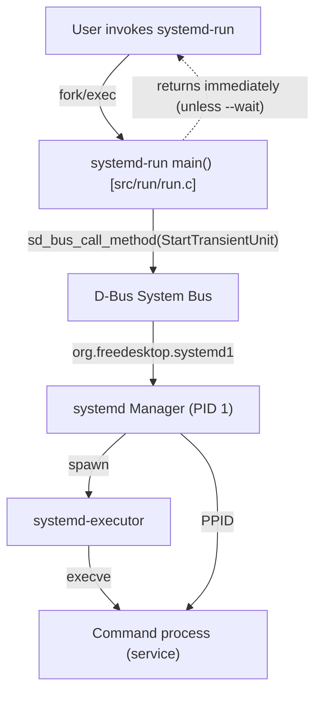
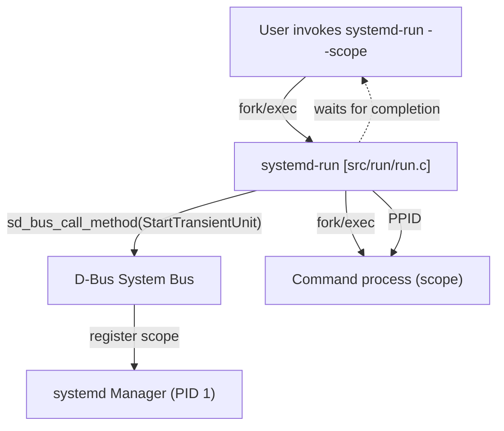
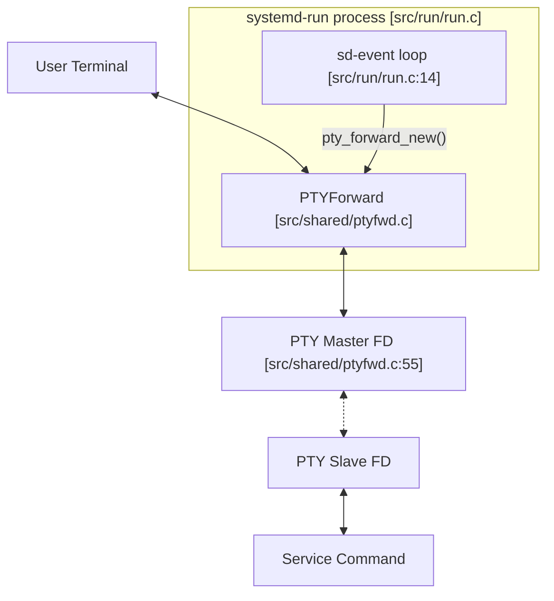
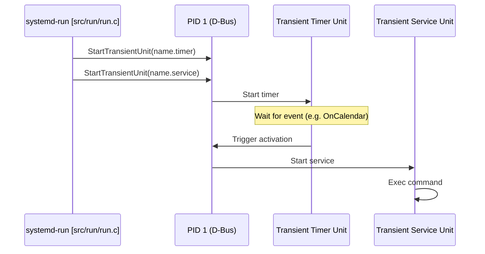

<!-- source: DeepWiki mcp.deepwiki.com · repo systemd/systemd · page 9.2 systemd-run and Transient Units · fetched 2026-11-07 -->

# systemd-run and Transient Units

Relevant source files

The following files were used as context for generating this wiki page:

- [man/busctl.xml](man/busctl.xml)
- [man/kernel-command-line.xml](man/kernel-command-line.xml)
- [man/localectl.xml](man/localectl.xml)
- [man/loginctl.xml](man/loginctl.xml)
- [man/machinectl.xml](man/machinectl.xml)
- [man/run0.xml](man/run0.xml)
- [man/standard-conf.xml](man/standard-conf.xml)
- [man/standard-options.xml](man/standard-options.xml)
- [man/systemd-mount.xml](man/systemd-mount.xml)
- [man/systemd-networkd.service.xml](man/systemd-networkd.service.xml)
- [man/systemd-path.xml](man/systemd-path.xml)
- [man/systemd-run.xml](man/systemd-run.xml)
- [man/systemd-system.conf.xml](man/systemd-system.conf.xml)
- [man/systemd-time-wait-sync.service.xml](man/systemd-time-wait-sync.service.xml)
- [man/systemd-timesyncd.service.xml](man/systemd-timesyncd.service.xml)
- [man/systemd-udevd.service.xml](man/systemd-udevd.service.xml)
- [man/systemd.xml](man/systemd.xml)
- [man/timedatectl.xml](man/timedatectl.xml)
- [man/udev.conf.xml](man/udev.conf.xml)
- [man/udev.xml](man/udev.xml)
- [shell-completion/bash/run0](shell-completion/bash/run0)
- [shell-completion/zsh/_busctl](shell-completion/zsh/_busctl)
- [shell-completion/zsh/_run0](shell-completion/zsh/_run0)
- [src/busctl/busctl.c](src/busctl/busctl.c)
- [src/core/system.conf.in](src/core/system.conf.in)
- [src/hostname/hostnamectl.c](src/hostname/hostnamectl.c)
- [src/libsystemd/sd-bus/bus-dump-json.c](src/libsystemd/sd-bus/bus-dump-json.c)
- [src/locale/localectl.c](src/locale/localectl.c)
- [src/login/loginctl.c](src/login/loginctl.c)
- [src/machine/machinectl.c](src/machine/machinectl.c)
- [src/mount/mount-tool.c](src/mount/mount-tool.c)
- [src/run/run.c](src/run/run.c)
- [src/timedate/timedatectl.c](src/timedate/timedatectl.c)
- [src/udev/udev.conf](src/udev/udev.conf)
- [test/integration-tests/TEST-07-PID1/TEST-07-PID1.units/prefix-shell.service](test/integration-tests/TEST-07-PID1/TEST-07-PID1.units/prefix-shell.service)
- [test/units/TEST-07-PID1.prefix-shell.sh](test/units/TEST-07-PID1.prefix-shell.sh)
- [test/units/TEST-74-AUX-UTILS.busctl.sh](test/units/TEST-74-AUX-UTILS.busctl.sh)
- [test/units/TEST-74-AUX-UTILS.run.sh](test/units/TEST-74-AUX-UTILS.run.sh)
- [tools/command_ignorelist](tools/command_ignorelist)

## Purpose and Scope

This page documents `systemd-run`, a command-line utility for creating and starting **transient units** in systemd. Transient units are runtime-only units that exist in memory and are automatically removed when they stop, unlike persistent units defined in unit files on disk.

For information about persistent unit management, see [Unit Management System](#2.3). For details about the process execution pipeline, see [Process Execution and Sandboxing](#2.4). For container integration, see [systemd-nspawn Container Manager](#5.1).

Sources: [src/run/run.c:73-132](), [man/systemd-run.xml:64-106]()

## Overview

`systemd-run` provides a way to execute commands as transient systemd units without creating permanent unit files. It creates `.service`, `.scope`, `.path`, `.socket`, or `.timer` units on-the-fly that are registered with PID 1, allowing full integration with systemd's management features: cgroup resource control, security sandboxing, logging, and dependency management [man/systemd-run.xml:64-68]().

The tool operates in three primary modes:
1. **Service mode**: Command runs as a child of PID 1 in a clean environment (asynchronous by default) [man/systemd-run.xml:69-74]().
2. **Scope mode**: Command runs as a child of systemd-run, inheriting the caller's environment (synchronous) [man/systemd-run.xml:76-81]().
3. **Trigger mode**: Creates path/socket/timer units that activate a transient service [man/systemd-run.xml:83-89]().

Sources: [src/run/run.c:73-132](), [man/systemd-run.xml:64-106]()

## Transient Units vs Persistent Units

| Aspect | Persistent Units | Transient Units |
|--------|------------------|-----------------|
| Storage | Unit files on disk in search paths | Memory only, created via D-Bus API |
| Lifetime | Permanent until explicitly removed | Exist only while running or have jobs |
| Creation | Written as `.service`, `.timer`, etc. files | Created programmatically via `StartTransientUnit()` |
| Location | `/etc/systemd/system/`, `/usr/lib/systemd/system/` | `/run/systemd/transient/` (runtime view) [test/units/TEST-74-AUX-UTILS.run.sh:72]() |
| Management | `systemctl enable/disable` | Cannot be enabled; start on-demand only |
| Unit Name Pattern | Fixed name from filename | Often generated (e.g., `run-u123.service`) |

Transient units are stored in the `transient` directory path, typically `/run/systemd/transient/`. This location is checked during unit installation and lookup.

Sources: [man/systemd-run.xml:64-89](), [src/run/run.c:82-83](), [test/units/TEST-74-AUX-UTILS.run.sh:71-72]()

## Service Mode vs Scope Mode

### Service Mode (Default)

In service mode (`--scope` not specified), `systemd-run` asks PID 1 to start a transient `.service` unit. The command runs as a direct child of PID 1 (or the systemd-executor).

Title: Service Mode Process Hierarchy

Sources: [src/run/run.c:74-75](), [man/systemd-run.xml:69-74](), [test/units/TEST-74-AUX-UTILS.run.sh:19-33]()

Key characteristics:
- Command runs in a **clean environment** (no inherited environment variables by default) [test/units/TEST-74-AUX-UTILS.run.sh:32]().
- Command's **parent process is PID 1**.
- Asynchronous by default: systemd-run returns after unit starts unless `--wait` or `--pty` is used [man/systemd-run.xml:72-74]().
- Command can survive systemd-run process termination.

Sources: [man/systemd-run.xml:69-74](), [src/run/run.c:74-75](), [test/units/TEST-74-AUX-UTILS.run.sh:19-33]()

### Scope Mode

Scope mode is activated with `--scope`. The command runs as a child of `systemd-run` itself, but its resource limits are managed by systemd.

Title: Scope Mode Process Hierarchy

Sources: [man/systemd-run.xml:76-81](), [src/run/run.c:73-73](), [test/units/TEST-74-AUX-UTILS.run.sh:102-115]()

Key characteristics:
- Command runs as **child of systemd-run**, not PID 1 [man/systemd-run.xml:76-78]().
- **Inherits caller's environment** and file descriptors [man/systemd-run.xml:77-78]().
- Synchronous execution: systemd-run waits for command completion [man/systemd-run.xml:79-80]().
- Used to place existing processes into cgroups.

Sources: [man/systemd-run.xml:76-81](), [src/run/run.c:73-73](), [test/units/TEST-74-AUX-UTILS.run.sh:102-115]()

## Communication with PID 1

`systemd-run` communicates with PID 1 through D-Bus, calling methods on the `org.freedesktop.systemd1.Manager` interface.

### StartTransientUnit Properties

Properties are passed as an array of `(name, variant)` pairs. Common properties set by systemd-run:

| Property | Type | Purpose |
|----------|------|---------|
| `Description` | `s` | Human-readable unit description [man/systemd-run.xml:150-153]() |
| `ExecStart` | `a(sasb)` | Command line, arguments, flags |
| `RemainAfterExit`| `b` | Keep unit loaded after process exits [src/run/run.c:74]() |
| `StandardInput` | `s` | stdin source ("tty", "null", "fd") |
| `StandardOutput`| `s` | stdout destination ("journal", "tty", "fd") |
| `Slice` | `s` | Cgroup slice to place unit in [src/run/run.c:83]() |

Sources: [src/run/run.c:72-111](), [man/systemd-run.xml:137-153]()

## PTY Forwarding and I/O Modes

`systemd-run` supports interactive behavior through PTY allocation and forwarding, controlled via `arg_stdio` [src/run/run.c:97-107]() and implemented via the `PTYForward` class [src/shared/ptyfwd.c:50-113](). This logic is also exposed via the standalone `systemd-pty-forward` tool [src/ptyfwd/ptyfwd-tool.c:30-35]().

Title: PTY Mode Architecture

Sources: [src/run/run.c:14](), [src/run/run.c:97-107](), [src/shared/ptyfwd.c:50-55](), [src/shared/ptyfwd.h:31]()

The `PTYForward` structure tracks the state of the forwarding loop, including `input_fd`, `output_fd`, and the `master` FD [src/shared/ptyfwd.c:53-55](). It handles ANSI escape sequences for window titles and background colors [src/shared/ptyfwd.c:106-113]().

Key functions:
- `pty_forward_new()`: Initializes the forwarding state machine and event sources [src/shared/ptyfwd.h:31]().
- `look_for_escape()`: Scans input for the escape sequence (default `^]` three times) to disconnect [src/shared/ptyfwd.c:211-220]().
- `pty_forward_set_background_color()`: Sends ANSI SGR sequences to change the terminal background [src/shared/ptyfwd.h:46]().

Sources: [src/run/run.c:98-109](), [src/shared/ptyfwd.c:1-220](), [src/shared/ptyfwd.h:1-61](), [src/ptyfwd/ptyfwd-tool.c:146-162]()

## Triggering Units

`systemd-run` can create triggering units that activate a transient service on specific events.

Title: Timer Activation Flow

Sources: [src/run/run.c:111-112](), [man/systemd-run.xml:83-89](), [test/units/TEST-74-AUX-UTILS.run.sh:135-154]()

Timer properties are accumulated in `arg_timer_property` and sent as part of the D-Bus message [src/run/run.c:111]().

Sources: [src/run/run.c:111-112](), [man/systemd-run.xml:83-89](), [test/units/TEST-74-AUX-UTILS.run.sh:135-154]()

## Execution Environment and Shells

`systemd-run` allows executing commands via a shell using `--shell` or `--via-shell` [src/run/run.c:118-129]().

- **Login Shell**: `make_login_shell_cmdline()` prefixes the shell name with `-` (e.g., `-bash`) to signal to the shell that it should act as a login shell [src/run/run.c:184-194]().
- **Environment Expansion**: By default, PID 1 performs variable expansion on the command line. This can be disabled via `--expand-environment=no` [man/systemd-run.xml:103-105]().

Sources: [src/run/run.c:184-194](), [man/systemd-run.xml:91-106](), [test/units/TEST-07-PID1.prefix-shell.sh:10-13]()

## Code Structure Overview

| File | Purpose |
|------|---------|
| [src/run/run.c]() | Main implementation of `systemd-run` and its logic for building D-Bus property arrays. |
| [src/shared/ptyfwd.c]() | Core PTY forwarding logic used for interactive sessions. |
| [src/ptyfwd/ptyfwd-tool.c]() | The `systemd-pty-forward` standalone utility implementation. |
| [test/units/TEST-74-AUX-UTILS.run.sh]() | Comprehensive integration tests for transient services, scopes, and timers. |

Sources: [src/run/run.c:1-148](), [src/shared/ptyfwd.c:1-113](), [src/ptyfwd/ptyfwd-tool.c:1-35](), [test/units/TEST-74-AUX-UTILS.run.sh:1-161]()

---

