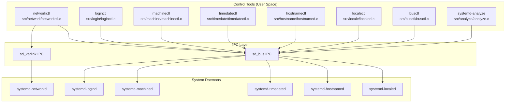
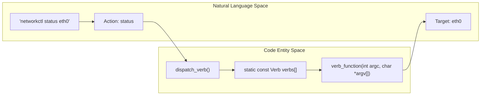

<!-- source: DeepWiki mcp.deepwiki.com · repo systemd/systemd · page 9.3 Other Control Tools · fetched 2026-11-07 -->

# Other Control Tools

Relevant source files

The following files were used as context for generating this wiki page:

- [man/busctl.xml](man/busctl.xml)
- [man/coredump.conf.xml](man/coredump.conf.xml)
- [man/coredumpctl.xml](man/coredumpctl.xml)
- [man/journald.conf.xml](man/journald.conf.xml)
- [man/localectl.xml](man/localectl.xml)
- [man/loginctl.xml](man/loginctl.xml)
- [man/machinectl.xml](man/machinectl.xml)
- [man/networkctl.xml](man/networkctl.xml)
- [man/systemd-analyze.xml](man/systemd-analyze.xml)
- [man/systemd-coredump.xml](man/systemd-coredump.xml)
- [man/systemd-environment-d-generator.xml](man/systemd-environment-d-generator.xml)
- [man/systemd-journald.service.xml](man/systemd-journald.service.xml)
- [man/systemd-mount.xml](man/systemd-mount.xml)
- [man/systemd-run.xml](man/systemd-run.xml)
- [man/systemd-system-update-generator.xml](man/systemd-system-update-generator.xml)
- [man/systemd-time-wait-sync.service.xml](man/systemd-time-wait-sync.service.xml)
- [man/systemd-timesyncd.service.xml](man/systemd-timesyncd.service.xml)
- [man/systemd.environment-generator.xml](man/systemd.environment-generator.xml)
- [man/systemd.generator.xml](man/systemd.generator.xml)
- [man/timedatectl.xml](man/timedatectl.xml)
- [man/varlinkctl.xml](man/varlinkctl.xml)
- [shell-completion/bash/busctl](shell-completion/bash/busctl)
- [shell-completion/bash/coredumpctl](shell-completion/bash/coredumpctl)
- [shell-completion/bash/journalctl](shell-completion/bash/journalctl)
- [shell-completion/bash/loginctl](shell-completion/bash/loginctl)
- [shell-completion/bash/machinectl](shell-completion/bash/machinectl)
- [shell-completion/bash/networkctl](shell-completion/bash/networkctl)
- [shell-completion/bash/portablectl](shell-completion/bash/portablectl)
- [shell-completion/bash/resolvectl](shell-completion/bash/resolvectl)
- [shell-completion/bash/systemctl.in](shell-completion/bash/systemctl.in)
- [shell-completion/bash/systemd-analyze](shell-completion/bash/systemd-analyze)
- [shell-completion/bash/systemd-cat](shell-completion/bash/systemd-cat)
- [shell-completion/bash/systemd-cgls](shell-completion/bash/systemd-cgls)
- [shell-completion/bash/systemd-cgtop](shell-completion/bash/systemd-cgtop)
- [shell-completion/bash/systemd-delta](shell-completion/bash/systemd-delta)
- [shell-completion/bash/systemd-id128](shell-completion/bash/systemd-id128)
- [shell-completion/bash/systemd-nspawn](shell-completion/bash/systemd-nspawn)
- [shell-completion/bash/systemd-resolve](shell-completion/bash/systemd-resolve)
- [shell-completion/bash/systemd-run](shell-completion/bash/systemd-run)
- [shell-completion/bash/timedatectl](shell-completion/bash/timedatectl)
- [shell-completion/bash/varlinkctl](shell-completion/bash/varlinkctl)
- [shell-completion/zsh/_busctl](shell-completion/zsh/_busctl)
- [shell-completion/zsh/_coredumpctl](shell-completion/zsh/_coredumpctl)
- [shell-completion/zsh/_journalctl](shell-completion/zsh/_journalctl)
- [shell-completion/zsh/_kernel-install](shell-completion/zsh/_kernel-install)
- [shell-completion/zsh/_loginctl](shell-completion/zsh/_loginctl)
- [shell-completion/zsh/_machinectl](shell-completion/zsh/_machinectl)
- [shell-completion/zsh/_networkctl](shell-completion/zsh/_networkctl)
- [shell-completion/zsh/_resolvectl](shell-completion/zsh/_resolvectl)
- [shell-completion/zsh/_sd_machines](shell-completion/zsh/_sd_machines)
- [shell-completion/zsh/_systemctl.in](shell-completion/zsh/_systemctl.in)
- [shell-completion/zsh/_systemd](shell-completion/zsh/_systemd)
- [shell-completion/zsh/_systemd-analyze](shell-completion/zsh/_systemd-analyze)
- [shell-completion/zsh/_systemd-inhibit](shell-completion/zsh/_systemd-inhibit)
- [shell-completion/zsh/_systemd-nspawn](shell-completion/zsh/_systemd-nspawn)
- [shell-completion/zsh/_systemd-run](shell-completion/zsh/_systemd-run)
- [shell-completion/zsh/_varlinkctl](shell-completion/zsh/_varlinkctl)
- [src/analyze/analyze-inspect-elf.c](src/analyze/analyze-inspect-elf.c)
- [src/analyze/analyze-inspect-elf.h](src/analyze/analyze-inspect-elf.h)
- [src/analyze/analyze-security.c](src/analyze/analyze-security.c)
- [src/analyze/analyze-security.h](src/analyze/analyze-security.h)
- [src/analyze/analyze.c](src/analyze/analyze.c)
- [src/analyze/analyze.h](src/analyze/analyze.h)
- [src/analyze/meson.build](src/analyze/meson.build)
- [src/busctl/busctl.c](src/busctl/busctl.c)
- [src/core/varlink-cgroup.c](src/core/varlink-cgroup.c)
- [src/core/varlink-cgroup.h](src/core/varlink-cgroup.h)
- [src/core/varlink-execute.c](src/core/varlink-execute.c)
- [src/core/varlink-scope.c](src/core/varlink-scope.c)
- [src/core/varlink-scope.h](src/core/varlink-scope.h)
- [src/core/varlink-service.c](src/core/varlink-service.c)
- [src/core/varlink-service.h](src/core/varlink-service.h)
- [src/core/varlink-socket.c](src/core/varlink-socket.c)
- [src/core/varlink-socket.h](src/core/varlink-socket.h)
- [src/core/varlink-swap.c](src/core/varlink-swap.c)
- [src/core/varlink-swap.h](src/core/varlink-swap.h)
- [src/core/varlink-timer.c](src/core/varlink-timer.c)
- [src/core/varlink-timer.h](src/core/varlink-timer.h)
- [src/core/varlink-unit.c](src/core/varlink-unit.c)
- [src/coredump/coredump.c](src/coredump/coredump.c)
- [src/coredump/coredumpctl.c](src/coredump/coredumpctl.c)
- [src/coredump/meson.build](src/coredump/meson.build)
- [src/hostname/hostnamectl.c](src/hostname/hostnamectl.c)
- [src/hostname/hostnamed.c](src/hostname/hostnamed.c)
- [src/import/importd.c](src/import/importd.c)
- [src/journal/journald-gperf.gperf](src/journal/journald-gperf.gperf)
- [src/libsystemd/sd-bus/bus-dump-json.c](src/libsystemd/sd-bus/bus-dump-json.c)
- [src/libsystemd/sd-network/sd-network.c](src/libsystemd/sd-network/sd-network.c)
- [src/locale/localectl.c](src/locale/localectl.c)
- [src/locale/localed-util.c](src/locale/localed-util.c)
- [src/locale/localed-util.h](src/locale/localed-util.h)
- [src/locale/localed.c](src/locale/localed.c)
- [src/locale/test-localed-util.c](src/locale/test-localed-util.c)
- [src/locale/xkbcommon-util.c](src/locale/xkbcommon-util.c)
- [src/locale/xkbcommon-util.h](src/locale/xkbcommon-util.h)
- [src/login/loginctl.c](src/login/loginctl.c)
- [src/machine/machinectl.c](src/machine/machinectl.c)
- [src/mount/mount-tool.c](src/mount/mount-tool.c)
- [src/network/networkctl.c](src/network/networkctl.c)
- [src/run/run.c](src/run/run.c)
- [src/shared/elf-util.c](src/shared/elf-util.c)
- [src/shared/elf-util.h](src/shared/elf-util.h)
- [src/shared/password-quality-util-passwdqc.c](src/shared/password-quality-util-passwdqc.c)
- [src/shared/password-quality-util-passwdqc.h](src/shared/password-quality-util-passwdqc.h)
- [src/shared/password-quality-util-pwquality.c](src/shared/password-quality-util-pwquality.c)
- [src/shared/password-quality-util-pwquality.h](src/shared/password-quality-util-pwquality.h)
- [src/shared/pcre2-util.c](src/shared/pcre2-util.c)
- [src/shared/pcre2-util.h](src/shared/pcre2-util.h)
- [src/shared/varlink-io.systemd.Unit.c](src/shared/varlink-io.systemd.Unit.c)
- [src/shared/varlink-io.systemd.Unit.h](src/shared/varlink-io.systemd.Unit.h)
- [src/shared/vconsole-util.c](src/shared/vconsole-util.c)
- [src/shared/vconsole-util.h](src/shared/vconsole-util.h)
- [src/systemd/sd-dlopen.h](src/systemd/sd-dlopen.h)
- [src/systemd/sd-network.h](src/systemd/sd-network.h)
- [src/test/test-coredump-stacktrace.c](src/test/test-coredump-stacktrace.c)
- [src/test/test-varlink-idl-unit.c](src/test/test-varlink-idl-unit.c)
- [src/timedate/timedatectl.c](src/timedate/timedatectl.c)
- [src/timedate/timedated.c](src/timedate/timedated.c)
- [src/varlinkctl/varlinkctl.c](src/varlinkctl/varlinkctl.c)
- [sysctl.d/50-coredump.conf.in](sysctl.d/50-coredump.conf.in)
- [test/integration-tests/TEST-07-PID1/TEST-07-PID1.units/prefix-shell.service](test/integration-tests/TEST-07-PID1/TEST-07-PID1.units/prefix-shell.service)
- [test/test.service.in](test/test.service.in)
- [test/units/TEST-07-PID1.prefix-shell.sh](test/units/TEST-07-PID1.prefix-shell.sh)
- [test/units/TEST-09-REBOOT.journal.sh](test/units/TEST-09-REBOOT.journal.sh)
- [test/units/TEST-26-SYSTEMCTL.sh](test/units/TEST-26-SYSTEMCTL.sh)
- [test/units/TEST-65-ANALYZE.sh](test/units/TEST-65-ANALYZE.sh)
- [test/units/TEST-74-AUX-UTILS.busctl.sh](test/units/TEST-74-AUX-UTILS.busctl.sh)
- [test/units/TEST-74-AUX-UTILS.run.sh](test/units/TEST-74-AUX-UTILS.run.sh)
- [test/units/TEST-74-AUX-UTILS.varlinkctl-list-sockets.sh](test/units/TEST-74-AUX-UTILS.varlinkctl-list-sockets.sh)
- [test/units/TEST-74-AUX-UTILS.varlinkctl-metrics.sh](test/units/TEST-74-AUX-UTILS.varlinkctl-metrics.sh)
- [test/units/TEST-74-AUX-UTILS.varlinkctl-network.sh](test/units/TEST-74-AUX-UTILS.varlinkctl-network.sh)
- [test/units/TEST-74-AUX-UTILS.varlinkctl-unit.sh](test/units/TEST-74-AUX-UTILS.varlinkctl-unit.sh)
- [test/units/TEST-74-AUX-UTILS.varlinkctl.sh](test/units/TEST-74-AUX-UTILS.varlinkctl.sh)
- [test/units/TEST-82-SOFTREBOOT.sh](test/units/TEST-82-SOFTREBOOT.sh)
- [test/units/TEST-87-AUX-UTILS-VM.coredump.sh](test/units/TEST-87-AUX-UTILS-VM.coredump.sh)
- [units/system-update-cleanup.service](units/system-update-cleanup.service)

## Purpose and Scope

This page documents the specialized command-line control utilities provided by systemd for managing specific subsystems. These tools provide user-friendly interfaces to introspect and modify system state through D-Bus and Varlink communication with their respective daemon services.

For general unit control, see [systemctl and Unit Control](#9.1). For creating transient units, see [systemd-run and Transient Units](#9.2). For network configuration details, see [systemd-networkd Architecture](#3.1). For session management implementation, see [Login Management with systemd-logind](#6.1). For container management, see [Machine and Image Management](#5.2).

---

## Overview of Control Tools

systemd provides a suite of specialized control tools that follow a consistent architectural pattern. Each tool communicates with a corresponding system daemon via D-Bus or Varlink to provide both introspection and modification capabilities for specific system aspects.

### System Control Tool Architecture

**Sources:** [src/network/networkctl.c:41-81](), [src/login/loginctl.c:58-63](), [src/machine/machinectl.c:119-125](), [src/busctl/busctl.c:78-84](), [src/analyze/analyze.c:199-204]()

---

## Common Architecture Pattern

### Verb-Based Command Interface and Dispatch

All control tools use a verb-based command interface where the first positional argument specifies the action to perform. The verb infrastructure is provided by `src/shared/verbs.h`.

**Sources:** [src/network/networkctl.c:41-81](), [src/analyze/analyze.c:200-205](), [src/shared/verbs.h:18-36]()

### D-Bus and Varlink Transport

Tools use the `BusTransport` abstraction for D-Bus and increasingly utilize Varlink for direct daemon communication.

| Transport Mode | Code Entity | Description |
|---------------|-------------|-------------|
| `BUS_TRANSPORT_LOCAL` | `sd_bus_open_system()` | Connect to local system bus [src/busctl/busctl.c:134-145]() |
| `BUS_TRANSPORT_REMOTE` | `bus_connect_transport()` | Connect via SSH [src/busctl/busctl.c:152-154]() |
| `BUS_TRANSPORT_MACHINE` | `bus_set_address_machine()` | Connect to container [src/busctl/busctl.c:156-158]() |
| `Varlink` | `sd_varlink_connect()` | Direct socket-based IPC [src/machine/machinectl.c:12-13]() |

**Sources:** [src/busctl/busctl.c:89-177](), [src/machine/machinectl.c:8-13]()

---

## Individual Control Tools

### networkctl - Network Status and Control

`networkctl` provides a command-line interface to `systemd-networkd` for monitoring link states and managing virtual network devices.

- **Source File:** `src/network/networkctl.c` [src/network/networkctl.c:1-81]()
- **Verbs:** Includes `list`, `status`, `up`, `down`, `renew`, and `reconfigure` [src/network/networkctl.c:48-69]().
- **Configuration Editing:** Supports editing `.network` and `.netdev` files via `verb_edit` [src/network/networkctl.c:72]().
- **JSON Output:** Implements structured output parsing via `parse_json_argument` and `arg_json_format_flags` [src/network/networkctl.c:36]().

**Sources:** [src/network/networkctl.c:1-81]()

### systemd-analyze - System Profiling

`systemd-analyze` is a multi-purpose tool for profiling boot performance, verifying unit files, and inspecting system security.

- **Source File:** `src/analyze/analyze.c` [src/analyze/analyze.c:1-207]()
- **Bus Connection:** Implements `acquire_bus()` to connect via transport or systemd transport [src/analyze/analyze.c:125-139]().
- **Core Verbs & Modules:** Includes blame plotting, calendar spec parsing, security auditing, and unit file verification across various modules (`analyze-blame.h`, `analyze-security.h`, `analyze-verify.h`) [src/analyze/analyze.c:16-51]().

**Sources:** [src/analyze/analyze.c:1-207]()

### hostnamectl - Hostname and System Identity

`hostnamectl` controls `systemd-hostnamed`, managing system metadata and hostname configurations.

- **Context Structure:** `hostnamed.c` maintains a `Context` caching properties read from `/etc/hostname`, `/etc/machine-info`, and `/etc/os-release` [src/hostname/hostnamed.c:57-105]().
- **Property Cache:** Tracks static hostname, pretty hostname, icon name, chassis type, deployment, and location [src/hostname/hostnamed.c:57-87]().

**Sources:** [src/hostname/hostnamed.c:57-132]()

### timedatectl - Time and Date Management

`timedatectl` controls `systemd-timedated`, providing an interface for time synchronization, timezone configuration, and hardware clock settings.

- **Context and NTP Service Tracking:** Manages NTP units enumerated from `systemd/ntp-units.d` and environment variables [src/timedate/timedated.c:54-183]().
- **RTC Management:** Handles local versus UTC hardware clock adjustments [src/timedate/timedated.c:69]().

**Sources:** [src/timedate/timedated.c:54-118]()

### localectl - Locale and Keymap Control

`localectl` controls `systemd-localed`, managing system locale settings, console keymaps, and X11 keyboard layouts.

- **Property Getters:** Exposes `property_get_locale`, `property_get_vconsole`, and `property_get_xkb` via D-Bus [src/locale/localed.c:41-126]().
- **VConsole Integration:** Reloads console settings via `vconsole_reload()` triggering `systemd-vconsole-setup.service` [src/locale/localed.c:29-39]().

**Sources:** [src/locale/localed.c:1-126]()

### machinectl - Container and Virtual Machine Management

`machinectl` controls `systemd-machined`, providing administrative control over containers and VMs spawned via `systemd-nspawn` or `systemd-vmspawn`.

- **Source File:** `src/machine/machinectl.c` [src/machine/machinectl.c:1-125]()
- **Runner Abstraction:** Supports `RUNNER_NSPAWN` and `RUNNER_VMSPAWN` execution engines [src/machine/machinectl.c:71-88]().
- **Introspection:** Implements method calls like `call_get_os_release` and `call_get_addresses` over D-Bus [src/machine/machinectl.c:134-219]().

**Sources:** [src/machine/machinectl.c:1-125]()

### loginctl - User and Session Management

`loginctl` controls `systemd-logind` for tracking user sessions, seats, and inhibitor locks.

- **Source File:** `src/login/loginctl.c` [src/login/loginctl.c:1-64]()
- **Table Formatting:** Formats session, user, and seat lists using `Table` and `list_sessions_table_add()` [src/login/loginctl.c:124-205]().

**Sources:** [src/login/loginctl.c:1-64]()

### coredumpctl - Coredump Retrieval and Analysis

`coredumpctl` lists and retrieves core dumps stored in the system journal.

- **Source File:** `src/coredump/coredumpctl.c` [src/coredump/coredumpctl.c:1-70]()
- **Command Line Parsing:** Parses time ranges (`--since`, `--until`), output files (`--output`), field listings (`--field`), and debugger arguments (`--debugger-arguments`) [src/coredump/coredumpctl.c:98-142]().

**Sources:** [src/coredump/coredumpctl.c:1-70]()

### busctl and varlinkctl - IPC Inspection Tools

- **`busctl` (`src/busctl/busctl.c`)**: Introspects D-Bus buses, monitors messages, dumps bus traffic, and invokes methods [src/busctl/busctl.c:78-84](). `acquire_bus()` configures monitor mode, credentials, and transport addresses [src/busctl/busctl.c:89-177]().
- **`varlinkctl` (`src/varlinkctl/varlinkctl.c`)**: Interacts with Varlink services via direct socket or bridge connections.

**Sources:** [src/busctl/busctl.c:78-177](), [src/varlinkctl/varlinkctl.c:1-20]()

---

## Shell Completions

systemd provides comprehensive shell completion scripts for Bash and Zsh for all control tools (e.g., `shell-completion/bash/systemctl.in`, `shell-completion/zsh/_systemctl.in`, `shell-completion/bash/systemd-analyze`, `shell-completion/zsh/_systemd-analyze`). These completions dynamically query active unit names, machine instances, device states, and verb lists.

**Sources:** [shell-completion/bash/systemctl.in](), [shell-completion/zsh/_systemctl.in]()

---

