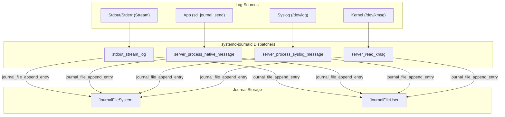
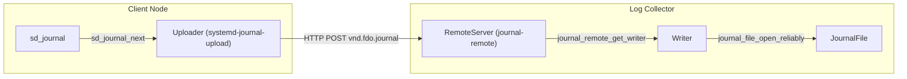

<!-- source: DeepWiki mcp.deepwiki.com · repo systemd/systemd · page 9.4 Journal and Logging · fetched 2026-11-07 -->

# Journal and Logging

Relevant source files

The following files were used as context for generating this wiki page:

- [man/coredump.conf.xml](man/coredump.conf.xml)
- [man/coredumpctl.xml](man/coredumpctl.xml)
- [man/journalctl.xml](man/journalctl.xml)
- [man/journald.conf.xml](man/journald.conf.xml)
- [man/systemd-coredump.xml](man/systemd-coredump.xml)
- [man/systemd-environment-d-generator.xml](man/systemd-environment-d-generator.xml)
- [man/systemd-journald.service.xml](man/systemd-journald.service.xml)
- [man/systemd-system-update-generator.xml](man/systemd-system-update-generator.xml)
- [man/systemd.environment-generator.xml](man/systemd.environment-generator.xml)
- [man/systemd.generator.xml](man/systemd.generator.xml)
- [shell-completion/zsh/_sd_outputmodes](shell-completion/zsh/_sd_outputmodes)
- [src/basic/forward.h](src/basic/forward.h)
- [src/core/core-forward.h](src/core/core-forward.h)
- [src/core/show-status.c](src/core/show-status.c)
- [src/core/show-status.h](src/core/show-status.h)
- [src/coredump/coredump.c](src/coredump/coredump.c)
- [src/coredump/coredumpctl.c](src/coredump/coredumpctl.c)
- [src/coredump/meson.build](src/coredump/meson.build)
- [src/journal-remote/journal-compression-util.c](src/journal-remote/journal-compression-util.c)
- [src/journal-remote/journal-compression-util.h](src/journal-remote/journal-compression-util.h)
- [src/journal-remote/journal-gatewayd.c](src/journal-remote/journal-gatewayd.c)
- [src/journal-remote/journal-remote-main.c](src/journal-remote/journal-remote-main.c)
- [src/journal-remote/journal-remote-parse.c](src/journal-remote/journal-remote-parse.c)
- [src/journal-remote/journal-remote-parse.h](src/journal-remote/journal-remote-parse.h)
- [src/journal-remote/journal-remote-write.c](src/journal-remote/journal-remote-write.c)
- [src/journal-remote/journal-remote-write.h](src/journal-remote/journal-remote-write.h)
- [src/journal-remote/journal-remote.c](src/journal-remote/journal-remote.c)
- [src/journal-remote/journal-remote.h](src/journal-remote/journal-remote.h)
- [src/journal-remote/journal-upload-journal.c](src/journal-remote/journal-upload-journal.c)
- [src/journal-remote/journal-upload.c](src/journal-remote/journal-upload.c)
- [src/journal-remote/journal-upload.h](src/journal-remote/journal-upload.h)
- [src/journal-remote/test-journal-header-util.c](src/journal-remote/test-journal-header-util.c)
- [src/journal/journalctl-authenticate.c](src/journal/journalctl-authenticate.c)
- [src/journal/journalctl-catalog.c](src/journal/journalctl-catalog.c)
- [src/journal/journalctl-filter.c](src/journal/journalctl-filter.c)
- [src/journal/journalctl-filter.h](src/journal/journalctl-filter.h)
- [src/journal/journalctl-misc.c](src/journal/journalctl-misc.c)
- [src/journal/journalctl-misc.h](src/journal/journalctl-misc.h)
- [src/journal/journalctl-show.c](src/journal/journalctl-show.c)
- [src/journal/journalctl-util.c](src/journal/journalctl-util.c)
- [src/journal/journalctl-util.h](src/journal/journalctl-util.h)
- [src/journal/journalctl-varlink.c](src/journal/journalctl-varlink.c)
- [src/journal/journalctl-varlink.h](src/journal/journalctl-varlink.h)
- [src/journal/journalctl.c](src/journal/journalctl.c)
- [src/journal/journalctl.h](src/journal/journalctl.h)
- [src/journal/journald-audit.c](src/journal/journald-audit.c)
- [src/journal/journald-audit.h](src/journal/journald-audit.h)
- [src/journal/journald-config.c](src/journal/journald-config.c)
- [src/journal/journald-config.h](src/journal/journald-config.h)
- [src/journal/journald-console.c](src/journal/journald-console.c)
- [src/journal/journald-console.h](src/journal/journald-console.h)
- [src/journal/journald-context.c](src/journal/journald-context.c)
- [src/journal/journald-context.h](src/journal/journald-context.h)
- [src/journal/journald-forward.h](src/journal/journald-forward.h)
- [src/journal/journald-gperf.gperf](src/journal/journald-gperf.gperf)
- [src/journal/journald-kmsg.c](src/journal/journald-kmsg.c)
- [src/journal/journald-kmsg.h](src/journal/journald-kmsg.h)
- [src/journal/journald-manager.c](src/journal/journald-manager.c)
- [src/journal/journald-manager.h](src/journal/journald-manager.h)
- [src/journal/journald-native.c](src/journal/journald-native.c)
- [src/journal/journald-native.h](src/journal/journald-native.h)
- [src/journal/journald-stream.c](src/journal/journald-stream.c)
- [src/journal/journald-stream.h](src/journal/journald-stream.h)
- [src/journal/journald-sync.c](src/journal/journald-sync.c)
- [src/journal/journald-sync.h](src/journal/journald-sync.h)
- [src/journal/journald-syslog.c](src/journal/journald-syslog.c)
- [src/journal/journald-syslog.h](src/journal/journald-syslog.h)
- [src/journal/journald-varlink.c](src/journal/journald-varlink.c)
- [src/journal/journald-varlink.h](src/journal/journald-varlink.h)
- [src/journal/journald-wall.c](src/journal/journald-wall.c)
- [src/journal/journald-wall.h](src/journal/journald-wall.h)
- [src/journal/journald.c](src/journal/journald.c)
- [src/journal/test-journald-config.c](src/journal/test-journald-config.c)
- [src/libsystemd/sd-journal/journal-authenticate-internal.c](src/libsystemd/sd-journal/journal-authenticate-internal.c)
- [src/libsystemd/sd-journal/journal-authenticate-internal.h](src/libsystemd/sd-journal/journal-authenticate-internal.h)
- [src/libsystemd/sd-journal/journal-def.h](src/libsystemd/sd-journal/journal-def.h)
- [src/libsystemd/sd-journal/journal-file.c](src/libsystemd/sd-journal/journal-file.c)
- [src/libsystemd/sd-journal/journal-file.h](src/libsystemd/sd-journal/journal-file.h)
- [src/libsystemd/sd-journal/journal-internal.h](src/libsystemd/sd-journal/journal-internal.h)
- [src/libsystemd/sd-journal/journal-verify.c](src/libsystemd/sd-journal/journal-verify.c)
- [src/libsystemd/sd-journal/mmap-cache.c](src/libsystemd/sd-journal/mmap-cache.c)
- [src/libsystemd/sd-journal/mmap-cache.h](src/libsystemd/sd-journal/mmap-cache.h)
- [src/libsystemd/sd-journal/sd-journal.c](src/libsystemd/sd-journal/sd-journal.c)
- [src/libsystemd/sd-journal/test-mmap-cache.c](src/libsystemd/sd-journal/test-mmap-cache.c)
- [src/shared/journal-authenticate.c](src/shared/journal-authenticate.c)
- [src/shared/journal-util.c](src/shared/journal-util.c)
- [src/shared/journal-util.h](src/shared/journal-util.h)
- [src/shared/logs-show.c](src/shared/logs-show.c)
- [src/shared/logs-show.h](src/shared/logs-show.h)
- [src/shared/output-mode.c](src/shared/output-mode.c)
- [src/shared/output-mode.h](src/shared/output-mode.h)
- [src/shared/varlink-io.systemd.Journal.c](src/shared/varlink-io.systemd.Journal.c)
- [src/test/test-coredump-stacktrace.c](src/test/test-coredump-stacktrace.c)
- [sysctl.d/50-coredump.conf.in](sysctl.d/50-coredump.conf.in)
- [test/test.service.in](test/test.service.in)
- [test/units/TEST-04-JOURNAL.fss.sh](test/units/TEST-04-JOURNAL.fss.sh)
- [test/units/TEST-04-JOURNAL.invocation.sh](test/units/TEST-04-JOURNAL.invocation.sh)
- [test/units/TEST-09-REBOOT.journal.sh](test/units/TEST-09-REBOOT.journal.sh)
- [test/units/TEST-44-LOG-NAMESPACE.sh](test/units/TEST-44-LOG-NAMESPACE.sh)
- [test/units/TEST-82-SOFTREBOOT.sh](test/units/TEST-82-SOFTREBOOT.sh)
- [test/units/TEST-87-AUX-UTILS-VM.coredump.sh](test/units/TEST-87-AUX-UTILS-VM.coredump.sh)
- [units/system-update-cleanup.service](units/system-update-cleanup.service)
- [units/systemd-journald-varlink@.socket](units/systemd-journald-varlink@.socket)

## Purpose and Scope
This page documents systemd-journald's log collection pipeline, the internal binary journal file format, query mechanisms provided by `libsystemd` and `journalctl`, remote log forwarding (`systemd-journal-remote`, `systemd-journal-upload`, `systemd-journal-gatewayd`), and integration with coredump management (`systemd-coredump` and `coredumpctl`).

---

## 1. Architecture and Data Flow

Logging in systemd follows a "push" model where various sources send structured or unstructured data to `systemd-journald`. The daemon multiplexes these streams into single or split journal files.

### Log Collection Pipeline
`systemd-journald` collects logs from several distinct entry points:
*   **Native API**: Applications using `sd_journal_send()` or `sd_journal_print()` communicate via an `AF_UNIX` datagram socket (`/run/systemd/journal/socket`).
*   **Syslog**: The daemon listens on `/dev/log` for legacy syslog messages [src/journal/journald-syslog.c:426-440]().
*   **Stdout/Stderr**: Service output is captured via pipe or socket and processed by `journald-stream.c`, managing `StdoutStream` objects which handle line-based buffering and priority parsing [src/journal/journald-stream.c:62-90]().
*   **Kernel Messages**: The `journald-kmsg.c` component reads from `/dev/kmsg` [src/journal/journald-kmsg.c:134-150]().
*   **Audit**: Reads audit events from the kernel via netlink [src/journal/journald-audit.c:160-180]().

### Code Entity Mapping: Collection to Storage
The following diagram maps the logical logging components to their implementation classes and functions.

**Title: Journal Collection and Dispatch Flow**

Sources: [src/journal/journald-stream.c:211-215](), [src/journal/journald-native.c:140-160](), [src/journal/journald-syslog.c:380-400](), [src/libsystemd/sd-journal/journal-file.c:1-200]()

---

## 2. Journal File Format and Management

The journal file format is a structured binary format designed for append-only performance and reliable recovery.

### Implementation: `JournalFile`
The `JournalFile` struct represents an open journal file, with key operations defined in `src/libsystemd/sd-journal/journal-file.c`.

*   **Header**: Every file starts with a `Header` struct containing the file ID, boot ID, and offsets to the first/last objects. The minimum header size is determined by `n_data` [src/libsystemd/sd-journal/journal-file.c:78-79]().
*   **Objects**: Data is stored as `Object` types. The implementation uses `journal_file_move_to_object()` to map file offsets to memory pointers via the `mmap` cache [src/libsystemd/sd-journal/journal-file.c:168-172]().
*   **Indexing**: Uses hash tables (`DEFAULT_DATA_HASH_TABLE_SIZE`, `DEFAULT_FIELD_HASH_TABLE_SIZE`) to allow $O(1)$ lookup of specific field values [src/libsystemd/sd-journal/journal-file.c:47-48]().

### Performance and Reliability
Journal files use `mmap` for high-performance access. The system maintains offline/online states for files to ensure integrity during concurrent access [src/libsystemd/sd-journal/journal-file.c:214-230]().

| Parameter | Value / Implementation |
| :--- | :--- |
| **Min File Size** | 512 KiB (`JOURNAL_FILE_SIZE_MIN`) [src/libsystemd/sd-journal/journal-file.c:54]() |
| **Max Use Upper Bound** | 4 GiB (`MAX_USE_UPPER`) [src/libsystemd/sd-journal/journal-file.c:59]() |
| **Default Max Files** | 100 (`DEFAULT_N_MAX_FILES`) [src/libsystemd/sd-journal/journal-file.c:76]() |
| **Verification** | Cryptographic verification via FSS (Forward Secure Sealing) [src/journal/journalctl-authenticate.c:10-50]() |

Sources: [src/libsystemd/sd-journal/journal-file.c:47-85](), [src/libsystemd/sd-journal/journal-def.h:1-25]()

---

## 3. Querying and Output: `journalctl`

`journalctl` is the primary CLI for interacting with the journal (`src/journal/journalctl.c:56-152]`). It uses `libsystemd`'s `sd-journal` API to iterate over and filter entries.

### Match Engine
Filtering is implemented using a multi-level Match tree. The `sd_journal_add_match()` function validates and adds filters to the query context [src/libsystemd/sd-journal/sd-journal.c:223-240]().
1.  **Level 0**: AND term.
2.  **Level 1**: OR terms.
3.  **Level 2**: AND terms (nested).
[src/libsystemd/sd-journal/sd-journal.c:241-246]()

### Output Formatting
The formatting logic resides in `src/shared/logs-show.c`. It supports multiple modes like `short`, `json`, `json-sse`, and `export` [src/shared/logs-show.c:84-90]().
*   **Catalog Integration**: If an entry has a Message ID, `print_catalog()` retrieves explanatory text from the journal catalog [src/shared/logs-show.c:45-56]().
*   **Field Parsing**: `parse_field()` extracts specific keys (e.g., `MESSAGE=`, `_PID=`) from binary journal objects for display [src/shared/logs-show.c:113-125]().

Sources: [src/journal/journalctl.c:55-117](), [src/libsystemd/sd-journal/sd-journal.c:223-260](), [src/shared/logs-show.c:1-146]()

---

## 4. Remote Journaling

Systemd provides tools for log forwarding and centralized collection over the network.

### Components
*   **systemd-journal-upload**: Pushes local journal data to a remote server using HTTP(S). It uses `libcurl` for transport and supports chunked transfer encoding [src/journal-remote/journal-upload.c:195-212]().
*   **systemd-journal-remote**: Receives logs (via HTTP, active pull, or raw socket) and writes them to journal files. It uses `RemoteServer` to manage multiple `RemoteSource` connections [src/journal-remote/journal-remote.c:164-180]().
*   **systemd-journal-gatewayd**: Provides a REST API to query the local journal over HTTP using `microhttpd` [src/journal-remote/journal-gatewayd.c:84-90]().

### Data Flow: Upload/Remote
**Title: Remote Logging Interaction**

Sources: [src/journal-remote/journal-upload.c:186-210](), [src/journal-remote/journal-remote.c:95-142](), [src/journal-remote/journal-remote.c:25-70]()

---

## 5. Coredump Management

The journal also serves as the storage backend for coredumps via `systemd-coredump` (`src/coredump/coredump.c:15-60]`).

*   **Collection**: The kernel invokes `systemd-coredump` via `coredump_kernel_helper()` [src/coredump/coredump.c:43-52]().
*   **Storage**: Metadata about the crash (PID, UID, executable path) is logged to the journal, while the core file itself is stored in the journal as a large field or as a separate file in `/var/lib/systemd/coredump/`.
*   **Retrieval**: `coredumpctl` (`src/coredump/coredumpctl.c:63-68]`) queries the journal for crash entries to list and extract dumps.

Sources: [src/coredump/coredump.c:14-51](), [src/coredump/coredumpctl.c:1-100]()

---

