# Page: Overview of systemd

# Overview of systemd

<details>
<summary>Relevant source files</summary>

The following files were used as context for generating this wiki page:

- [.clusterfuzzlite/Dockerfile](.clusterfuzzlite/Dockerfile)
- [.mailmap](.mailmap)
- [.obs/workflows.yml](.obs/workflows.yml)
- [AGENTS.md](AGENTS.md)
- [CLAUDE.md](CLAUDE.md)
- [NEWS](NEWS)
- [README](README)
- [README.md](README.md)
- [TODO.md](TODO.md)
- [docs/ARCHITECTURE.md](docs/ARCHITECTURE.md)
- [docs/AUTOMATIC_BOOT_ASSESSMENT.md](docs/AUTOMATIC_BOOT_ASSESSMENT.md)
- [docs/BLOCK_DEVICE_LOCKING.md](docs/BLOCK_DEVICE_LOCKING.md)
- [docs/BOOT_LOADER_INTERFACE.md](docs/BOOT_LOADER_INTERFACE.md)
- [docs/BOOT_LOADER_SPECIFICATION.md](docs/BOOT_LOADER_SPECIFICATION.md)
- [docs/BUILDING_IMAGES.md](docs/BUILDING_IMAGES.md)
- [docs/CGROUP_DELEGATION.md](docs/CGROUP_DELEGATION.md)
- [docs/CODE_OF_CONDUCT.md](docs/CODE_OF_CONDUCT.md)
- [docs/CODE_QUALITY.md](docs/CODE_QUALITY.md)
- [docs/CODING_STYLE.md](docs/CODING_STYLE.md)
- [docs/CONTRIBUTING.md](docs/CONTRIBUTING.md)
- [docs/CREDENTIALS.md](docs/CREDENTIALS.md)
- [docs/DISTRO_PORTING.md](docs/DISTRO_PORTING.md)
- [docs/HACKING.md](docs/HACKING.md)
- [docs/MOUNT_REQUIREMENTS.md](docs/MOUNT_REQUIREMENTS.md)
- [docs/PORTABLE_SERVICES.md](docs/PORTABLE_SERVICES.md)
- [docs/PORTING_TO_NEW_ARCHITECTURES.md](docs/PORTING_TO_NEW_ARCHITECTURES.md)
- [docs/RELEASE.md](docs/RELEASE.md)
- [docs/RESOLVED-VPNS.md](docs/RESOLVED-VPNS.md)
- [docs/SECURITY.md](docs/SECURITY.md)
- [docs/TESTING_WITH_SANITIZERS.md](docs/TESTING_WITH_SANITIZERS.md)
- [docs/TRANSLATORS.md](docs/TRANSLATORS.md)
- [docs/UIDS-GIDS.md](docs/UIDS-GIDS.md)
- [docs/index.md](docs/index.md)
- [man/kernel-command-line.xml](man/kernel-command-line.xml)
- [man/meson.build](man/meson.build)
- [man/run0.xml](man/run0.xml)
- [man/sd-id128.xml](man/sd-id128.xml)
- [man/sd_id128_get_machine.xml](man/sd_id128_get_machine.xml)
- [man/sd_id128_randomize.xml](man/sd_id128_randomize.xml)
- [man/sd_id128_to_string.xml](man/sd_id128_to_string.xml)
- [man/standard-conf.xml](man/standard-conf.xml)
- [man/standard-options.xml](man/standard-options.xml)
- [man/systemd-networkd.service.xml](man/systemd-networkd.service.xml)
- [man/systemd-path.xml](man/systemd-path.xml)
- [man/systemd-system.conf.xml](man/systemd-system.conf.xml)
- [man/systemd-udevd.service.xml](man/systemd-udevd.service.xml)
- [man/systemd.journal-fields.xml](man/systemd.journal-fields.xml)
- [man/systemd.xml](man/systemd.xml)
- [man/udev.conf.xml](man/udev.conf.xml)
- [man/udev.xml](man/udev.xml)
- [meson.build](meson.build)
- [meson_options.txt](meson_options.txt)
- [shell-completion/bash/run0](shell-completion/bash/run0)
- [shell-completion/zsh/_run0](shell-completion/zsh/_run0)
- [src/basic/constants.h](src/basic/constants.h)
- [src/basic/meson.build](src/basic/meson.build)
- [src/basic/random-util.c](src/basic/random-util.c)
- [src/basic/random-util.h](src/basic/random-util.h)
- [src/core/efi-random.c](src/core/efi-random.c)
- [src/core/efi-random.h](src/core/efi-random.h)
- [src/core/import-creds.c](src/core/import-creds.c)
- [src/core/meson.build](src/core/meson.build)
- [src/core/system.conf.in](src/core/system.conf.in)
- [src/fundamental/macro.h](src/fundamental/macro.h)
- [src/hostname/meson.build](src/hostname/meson.build)
- [src/import/meson.build](src/import/meson.build)
- [src/journal-remote/meson.build](src/journal-remote/meson.build)
- [src/journal/meson.build](src/journal/meson.build)
- [src/libsystemd-network/meson.build](src/libsystemd-network/meson.build)
- [src/libsystemd/meson.build](src/libsystemd/meson.build)
- [src/libsystemd/sd-id128/id128-util.c](src/libsystemd/sd-id128/id128-util.c)
- [src/libsystemd/sd-id128/id128-util.h](src/libsystemd/sd-id128/id128-util.h)
- [src/libsystemd/sd-id128/sd-id128.c](src/libsystemd/sd-id128/sd-id128.c)
- [src/libsystemd/sd-id128/test-id128.c](src/libsystemd/sd-id128/test-id128.c)
- [src/libsystemd/sd-path/test-sd-path.c](src/libsystemd/sd-path/test-sd-path.c)
- [src/libudev/meson.build](src/libudev/meson.build)
- [src/locale/meson.build](src/locale/meson.build)
- [src/login/meson.build](src/login/meson.build)
- [src/machine/meson.build](src/machine/meson.build)
- [src/nspawn/meson.build](src/nspawn/meson.build)
- [src/resolve/meson.build](src/resolve/meson.build)
- [src/shared/machine-id-setup.c](src/shared/machine-id-setup.c)
- [src/shared/meson.build](src/shared/meson.build)
- [src/shared/test-varlink-idl-util.h](src/shared/test-varlink-idl-util.h)
- [src/systemd/_sd-common.h](src/systemd/_sd-common.h)
- [src/systemd/meson.build](src/systemd/meson.build)
- [src/systemd/sd-id128.h](src/systemd/sd-id128.h)
- [src/test/meson.build](src/test/meson.build)
- [src/test/test-dlopen-so.c](src/test/test-dlopen-so.c)
- [src/test/test-random-util.c](src/test/test-random-util.c)
- [src/timedate/meson.build](src/timedate/meson.build)
- [src/timesync/meson.build](src/timesync/meson.build)
- [src/udev/meson.build](src/udev/meson.build)
- [src/udev/udev.conf](src/udev/udev.conf)
- [test/fuzz/meson.build](test/fuzz/meson.build)
- [test/meson.build](test/meson.build)
- [test/units/TEST-22-TMPFILES.01.sh](test/units/TEST-22-TMPFILES.01.sh)
- [test/units/TEST-22-TMPFILES.12.sh](test/units/TEST-22-TMPFILES.12.sh)
- [test/units/TEST-74-AUX-UTILS.machine-id-setup.sh](test/units/TEST-74-AUX-UTILS.machine-id-setup.sh)
- [tools/command_ignorelist](tools/command_ignorelist)
- [tools/git-setup.sh](tools/git-setup.sh)
- [tools/meson-build.sh](tools/meson-build.sh)
- [tools/oss-fuzz.sh](tools/oss-fuzz.sh)
- [tools/sync-docs.py](tools/sync-docs.py)

</details>


## Purpose and Scope

This document provides a high-level introduction to systemd, its architecture, and its major components. It is based on the project's README, NEWS, and TODO files and serves as an entry point for understanding the codebase structure and design principles.

For detailed information about specific subsystems:
- Core unit and job management: see [Unit Management System](#2.3)
- Process execution and isolation: see [Process Execution and Sandboxing](#2.4)
- Networking components: see [Networking Subsystems](#3)
- Container runtime: see [Containers and Virtualization](#5)
- Boot and storage: see [System Initialization and Boot](#4)

---

## What is systemd

systemd is a system and service manager for Linux operating systems that runs as PID 1 and serves as the init system. It provides aggressive parallelization capabilities, uses socket and D-Bus activation for starting services, offers on-demand starting of daemons, implements transactional dependency-based service control logic, and tracks processes using Linux control groups (cgroups).

**Key characteristics:**
- **Process ID 1**: systemd runs as the first userspace process and is responsible for spawning and maintaining userspace services [man/systemd.xml:39-41]().
- **Unit-based**: All managed entities (services, sockets, devices, mounts, etc.) are represented as "units" [man/systemd.xml:84-86]().
- **Dependency resolution**: Units declare dependencies which systemd resolves into a directed acyclic graph for proper ordering [man/systemd.xml:84-86]().
- **Cgroup integration**: Each service runs in its own cgroup for resource control and process tracking [README:35-36]().
- **Embedded Units**: The manager now embeds a basic set of unit files (e.g., `basic.target`, `sysinit.target`, `reboot.target`) to allow operation even if files cannot be loaded from disk [NEWS:109-116]().

Sources: [README:1-30](), [man/systemd.xml:36-79](), [NEWS:109-116]()

---

## Core Architecture

The following diagram shows the central components of systemd's core architecture and their relationships in code:

Title: systemd Core PID 1 Architecture
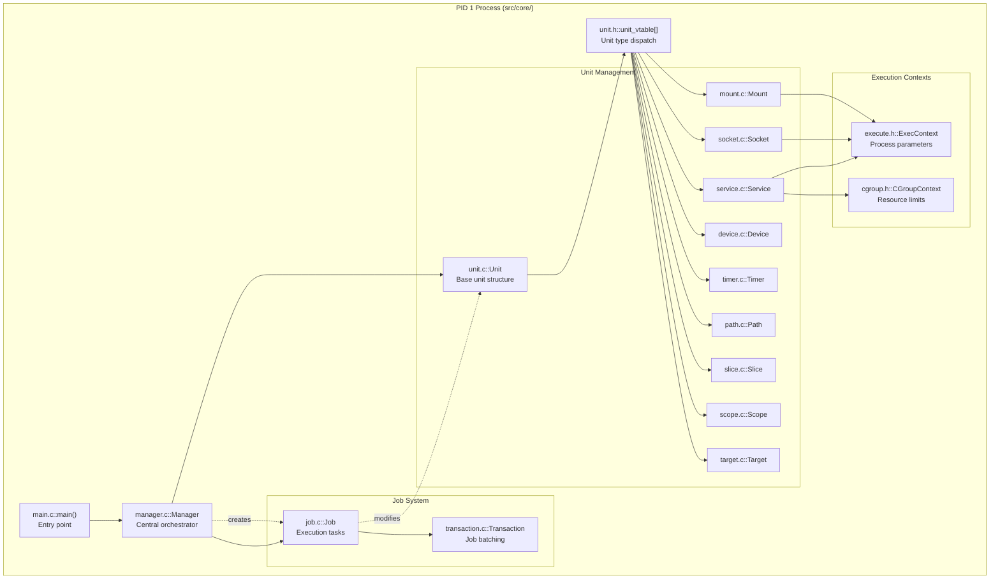

**Component descriptions:**

| Component | File Path | Purpose |
|-----------|-----------|---------|
| `Manager` | [src/core/manager.c](), [src/core/manager.h]() | Central orchestrator that maintains all units, jobs, and system state [src/core/manager.c:70](). |
| `Unit` | [src/core/unit.c](), [src/core/unit.h]() | Base structure for all unit types with common fields and vtable dispatch [src/core/unit.c:88](). |
| `Job` | [src/core/job.c](), [src/core/job.h]() | Represents an asynchronous operation to be performed on a unit (start, stop, reload) [src/core/job.c:63](). |
| `Transaction` | [src/core/transaction.c]() | Groups multiple jobs together for atomic execution [src/core/transaction.c:84](). |
| `ExecContext` | [src/core/execute.h]() | Defines process execution parameters (user, environment, namespaces, etc.) [src/core/execute.c:60](). |
| `CGroupContext` | [src/core/cgroup.h]() | Defines cgroup resource control settings (CPU, memory, IO limits) [src/core/cgroup.c:36](). |

Sources: [src/core/meson.build:25-107](), [src/core/manager.c:70](), [src/core/unit.c:88](), [src/core/main.c:12-14]()

---

## Unit Type System

systemd uses a polymorphic unit system where each unit type implements a common interface:

Title: Unit Type Hierarchy and Code Entities
```mermaid
graph TB
    UnitBase["Unit (unit.c::Unit)<br/>Base structure for all units"]
    
    UnitBase --> Service["Service (service.c::Service)<br/>Daemons and processes"]
    
    UnitBase --> Socket["Socket (socket.c::Socket)<br/>IPC and network sockets"]
    
    UnitBase --> Mount["Mount (mount.c::Mount)<br/>Filesystem mount points"]
    
    UnitBase --> Device["Device (device.c::Device)<br/>Kernel device nodes"]
    
    UnitBase --> Timer["Timer (timer.c::Timer)<br/>Time-based triggers"]
    
    UnitBase --> Path["Path (path.c::Path)<br/>Path monitoring"]
    
    UnitBase --> Target["Target (target.c::Target)<br/>Synchronization points"]
    
    UnitBase --> Slice["Slice (slice.c::Slice)<br/>Resource control hierarchy"]
    
    UnitBase --> Scope["Scope (scope.c::Scope)<br/>External process tracking"]

    UnitBase --> Automount["Automount (automount.c::Automount)<br/>On-demand mounting"]
    
    UnitBase --> Swap["Swap (swap.c::Swap)<br/>Swap device management"]
```

Each unit type provides a specialized implementation of lifecycle methods (start, stop, load):

| Unit Type | Source File | Purpose |
|-----------|--------------|---------|
| `Service` | [src/core/service.c]() | Long-running processes and one-shot commands [man/systemd.xml:99-101](). |
| `Socket` | [src/core/socket.c]() | Socket-based activation [man/systemd.xml:103-109](). |
| `Mount` | [src/core/mount.c]() | Filesystem mount point management [man/systemd.xml:120-122](). |
| `Device` | [src/core/device.c]() | Device node representation from udev [man/systemd.xml:115-118](). |
| `Timer` | [src/core/timer.c]() | Time-based activation (cron-like) [man/systemd.xml:129-131](). |
| `Path` | [src/core/path.c]() | Path-based activation (inotify) [man/systemd.xml:138-140](). |
| `Target` | [src/core/target.c]() | Grouping and synchronization points [man/systemd.xml:111-113](). |
| `Slice` | [src/core/slice.c]() | Cgroup hierarchy organization [man/systemd.xml:142-145](). |
| `Scope` | [src/core/scope.c]() | External process groups [man/systemd.xml:142-145](). |

Sources: [src/core/meson.build:25-107](), [man/systemd.xml:96-145]()

---

## Major Subsystems and Daemons

Beyond the core PID 1 manager, systemd includes multiple specialized daemon processes:

Title: systemd Ecosystem and IPC Flow
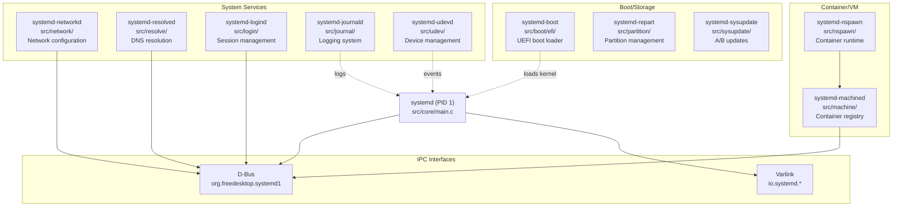

**Subsystem purposes:**

- **systemd-networkd**: Manages network configuration including interfaces, DHCP, and routing [src/network/meson.build]().
- **systemd-resolved**: Provides DNS resolution with support for mDNS and LLMNR [src/resolve/meson.build]().
- **systemd-logind**: Manages user logins, sessions, and seats [src/login/meson.build]().
- **systemd-journald**: Implements structured logging [src/journal/meson.build]().
- **systemd-udevd**: Manages device nodes and kernel events. Now uses Varlink IPC exclusively for `udevadm` control [NEWS:95-101]().
- **systemd-nspawn**: Container runtime using kernel namespaces [src/nspawn/meson.build]().
- **systemd-machined**: Tracks containers and virtual machines [src/machine/meson.build]().
- **systemd-boot**: UEFI boot manager [meson.build:79]().
- **systemd-repart**: Declarative partition management. Recently updated to support expansion of "%" specifiers in `MakeSymlinks=` targets [NEWS:51-55]().
- **systemd-sysupdate**: Atomically updates the host system. Service units have been renamed to `systemd-sysupdate-update.service` to accommodate new Varlink-activated units [NEWS:66-72]().

Sources: [src/shared/meson.build:222-250](), [meson_options.txt:99-130](), [src/core/meson.build:25-107](), [NEWS:68-101]()

---

## Process Lifecycle and Isolation

systemd provides robust process isolation using kernel features. A key architectural principle is the separation of execution logic.

**Key execution flow:**

1. **Configuration**: Unit files are parsed, populating `ExecContext` which defines how a process is to be executed with proper environment, user, and sandboxing [src/core/load-fragment.c:50-80]().
2. **Spawning**: The function `exec_spawn()` in [src/core/execute.c:50-100]() prepares the environment for execution: setting up namespaces, cgroups, capabilities, and seccomp filters.
3. **The Executor**: systemd uses a separate executable called `systemd-executor` responsible for final process setup and `execve()` call. This executor can be linked as a multicall binary with systemd using build-time options [NEWS:110-120]() and meson build definitions [meson.build:18-22]().
4. **Isolation**: systemd employs Linux namespaces (mount, PID, user, network), cgroups for resource management, seccomp filters for syscall filtering, and capability bounding sets for sandboxing [README:34-47]().
5. **Tracking**: Processes spawned are tracked using `PidRef` objects that wrap PID and pidfd to handle race conditions and process lifecycle events cleanly [src/basic/pidref.c:75-110]().

Sources: [src/core/meson.build:20-38](), [src/core/execute.c:50-100](), [src/basic/pidref.c:75-110](), [README:31-60](), [NEWS:110-120]()

---

## Communication Interfaces

### D-Bus Interface
The primary management interface is D-Bus, specifically the `org.freedesktop.systemd1` interface. It allows clients to control units, jobs, and inspect the state of the manager [src/core/dbus.c:50-100](), [man/systemd.xml:69-73]().

### Varlink Interface
Increasingly, systemd components use Varlink for IPC, providing a lightweight and secure alternative to D-Bus. Systemd defines interfaces such as `io.systemd.Manager` for manager IPC and other service-specific IDs (e.g., `io.systemd.Network`, `io.systemd.Credentials`) [src/shared/meson.build:220-250]().

Notably, `udevadm` now exclusively uses Varlink IPC to interact with the `systemd-udevd` daemon, abandoning legacy UNIX sockets [NEWS:95-101]().

Sources: [src/core/dbus.c:50-100](), [src/core/varlink.c:80-110](), [src/shared/meson.build:220-250](), [NEWS:95-101]()

---

## System Requirements

### Kernel Requirements
- **Minimum baseline**: Linux kernel version 5.10 is required for full feature support including pidfd, unique mount IDs, and essential cgroup features [README:58-59]().
- **Recommended baseline**: Linux 5.14 or later recommended for best compatibility and modern features [README:65-69]().
- Advanced features may require newer kernels (6.9 or later for pidfs, advanced cgroup memory accounting, unique mount IDs) [README:70-82]().

### Build System
systemd employs Meson as its primary build system:
- Requires Meson version 0.62.0 or later [meson.build:3-14]().
- Compiled primarily in C17 GNU dialect [meson.build:7]().
- Supports static and shared libraries, multilcall binaries, and feature flags controlling build artifacts [meson_options.txt:10-90]().
- Key build components are arranged in layered libraries: libbasic, libshared, libcore, libsystemd, libudev, with dedicated meson.build files for each [src/basic/meson.build](), [src/shared/meson.build](), [src/core/meson.build]().

Sources: [README:31-82](), [meson.build:1-174](), [meson_options.txt:1-127]()

---

## Development and Testing

systemd uses `mkosi` extensively as a helper tool for building and booting test OS images configured with the latest systemd builds [docs/HACKING.md:25-60]().

Testing infrastructure components include:
- **Unit tests**: Located in `src/test/`, targeting individual source files and modules in `src/basic/` and `src/shared/`.
- **Simple C tests**: Numerous tests covering specific utilities, data structures, and protocols [src/test/meson.build:50-220]().
- **Integration tests** and **Fuzz testing**: Higher-level tests including integration with OSS-Fuzz and LLVM LibFuzzer [meson.build:65-75]().

Sources: [docs/HACKING.md:8-51](), [src/test/meson.build:50-220](), [meson.build:65-75]()

---

This overview establishes foundational knowledge on systemd's architecture, core entities, subsystems, inter-process communication, build system, and testing infrastructure to assist new contributors and developers in navigating the codebase effectively.

---

# Page: Core Architecture

# Core Architecture

<details>
<summary>Relevant source files</summary>

The following files were used as context for generating this wiki page:

- [.clusterfuzzlite/Dockerfile](.clusterfuzzlite/Dockerfile)
- [.mailmap](.mailmap)
- [NEWS](NEWS)
- [README](README)
- [man/meson.build](man/meson.build)
- [meson.build](meson.build)
- [meson_options.txt](meson_options.txt)
- [src/basic/constants.h](src/basic/constants.h)
- [src/basic/meson.build](src/basic/meson.build)
- [src/core/automount.c](src/core/automount.c)
- [src/core/dbus-job.c](src/core/dbus-job.c)
- [src/core/dbus-job.h](src/core/dbus-job.h)
- [src/core/dbus-manager.c](src/core/dbus-manager.c)
- [src/core/dbus-unit.c](src/core/dbus-unit.c)
- [src/core/dbus-unit.h](src/core/dbus-unit.h)
- [src/core/dbus.c](src/core/dbus.c)
- [src/core/dbus.h](src/core/dbus.h)
- [src/core/device.c](src/core/device.c)
- [src/core/device.h](src/core/device.h)
- [src/core/job.c](src/core/job.c)
- [src/core/job.h](src/core/job.h)
- [src/core/main.c](src/core/main.c)
- [src/core/manager.c](src/core/manager.c)
- [src/core/manager.h](src/core/manager.h)
- [src/core/meson.build](src/core/meson.build)
- [src/core/mount.c](src/core/mount.c)
- [src/core/org.freedesktop.systemd1.conf](src/core/org.freedesktop.systemd1.conf)
- [src/core/path.c](src/core/path.c)
- [src/core/scope.c](src/core/scope.c)
- [src/core/service.c](src/core/service.c)
- [src/core/slice.c](src/core/slice.c)
- [src/core/socket.c](src/core/socket.c)
- [src/core/swap.c](src/core/swap.c)
- [src/core/target.c](src/core/target.c)
- [src/core/timer.c](src/core/timer.c)
- [src/core/transaction.c](src/core/transaction.c)
- [src/core/transaction.h](src/core/transaction.h)
- [src/core/unit.c](src/core/unit.c)
- [src/core/unit.h](src/core/unit.h)
- [src/hostname/meson.build](src/hostname/meson.build)
- [src/import/meson.build](src/import/meson.build)
- [src/journal-remote/meson.build](src/journal-remote/meson.build)
- [src/journal/meson.build](src/journal/meson.build)
- [src/libsystemd-network/meson.build](src/libsystemd-network/meson.build)
- [src/libsystemd/meson.build](src/libsystemd/meson.build)
- [src/libudev/meson.build](src/libudev/meson.build)
- [src/locale/meson.build](src/locale/meson.build)
- [src/login/meson.build](src/login/meson.build)
- [src/machine/meson.build](src/machine/meson.build)
- [src/nspawn/meson.build](src/nspawn/meson.build)
- [src/resolve/meson.build](src/resolve/meson.build)
- [src/shared/meson.build](src/shared/meson.build)
- [src/systemd/meson.build](src/systemd/meson.build)
- [src/test/meson.build](src/test/meson.build)
- [src/test/test-dlopen-so.c](src/test/test-dlopen-so.c)
- [src/timedate/meson.build](src/timedate/meson.build)
- [src/timesync/meson.build](src/timesync/meson.build)
- [src/udev/meson.build](src/udev/meson.build)
- [test/fuzz/meson.build](test/fuzz/meson.build)
- [test/meson.build](test/meson.build)
- [tools/meson-build.sh](tools/meson-build.sh)
- [tools/oss-fuzz.sh](tools/oss-fuzz.sh)

</details>


## Purpose and Scope

This document provides a high-level overview of systemd's core architectural components and design principles. It centers on the main system manager (the PID 1 `Manager`), the unit system that forms the foundation for service management, essential process and resource management abstractions, and the IPC mechanisms systemd uses to expose its interfaces.

For detailed exploration of subsystems and implementation specifics, see the corresponding child pages:
- [Library Architecture and Dependencies](#2.1)
- [Process and Namespace Management](#2.2)
- [Unit Management System](#2.3)
- [Process Execution and Sandboxing](#2.4)
- [D-Bus and Varlink IPC](#2.5)
- [Control Groups and Resource Management](#2.6)

---

## System Overview

The core of systemd is the **Manager**, running as PID 1, orchestrating system initialization, service supervision, unit life cycle, job scheduling, and resource control. The architecture is centered on the concept of **units**, which represent system resources or services. Unit state transitions are represented and processed via **jobs**.

---

## Central Manager (PID 1)

The `Manager` structure is the central coordinator managing all systemd units, jobs, and associated state.

```mermaid
graph TB
    Manager["Manager (struct Manager)<br/>src/core/manager.h"]
    
    subgraph "Core Data Structures"
        Units["units: Hashmap*<br/>All loaded units by name"]
        Jobs["jobs: Hashmap*<br/>Active jobs by ID"]
        UnitsByType["units_by_type: LIST_HEAD*<br/>Units grouped by type"]
        UnitsById["units_by_invocation_id: Hashmap*<br/>Units by invocation ID"]
    end
    
    subgraph "Operational Queues"
        LoadQueue["load_queue:<br/>Units loading pending"]
        RunQueue["run_queue:<br/>Enqueued jobs to run"]
        DBusQueue["dbus_unit_queue:<br/>Units with D-Bus property changes"]
        GCQueue["gc_unit_queue:<br/>Units eligible for garbage collection"]
        CGQueue1["cgroup_realize_queue"]
        CGQueue2["cgroup_empty_queue"]
    end
    
    subgraph "Event Handling"
        EventLoop["event: sd_event*<br/>Main event loop"]
        SignalFD["signal_event_source<br/>Signal dispatch"]
        NotifyFD["notify_event_source<br/>Notifications"]
        TimeChange["time_change_event_source<br/>Time change events"]
    end
    
    Manager --> Units
    Manager --> Jobs
    Manager --> UnitsByType
    Manager --> UnitsById
    
    Manager --> LoadQueue
    Manager --> RunQueue
    Manager --> DBusQueue
    Manager --> GCQueue
    Manager --> CGQueue1
    Manager --> CGQueue2
    
    Manager --> EventLoop
    EventLoop --> SignalFD
    EventLoop --> NotifyFD
    EventLoop --> TimeChange
```

Key aspects of the `Manager` include:
- Management of all loaded units (`units`) with indexed access by name and by invocation ID.
- Active job tracking (`jobs`) that manage unit state transitions.
- Lists of units grouped by their unit type (`units_by_type`).
- Queues for processing load requests, job execution, D-Bus updates, and cleanup.
- Integration with the systemd event loop abstraction (`sd_event`) for asynchronous event handling.

The `Manager` struct is defined in detail at [src/core/manager.h:163-400]() and initialized in [src/core/manager.c:653-958](). The main event loop driving the manager is realized using `sd_event_loop` [src/core/manager.c:4380-4440]().

Sources: [src/core/manager.h:163-400](), [src/core/manager.c:653-958](), [src/core/main.c:2615-2702]()

---

## Units: Fundamental Building Blocks

systemd models system components and services as **units**. Units represent entities managed by systemd, such as services, sockets, mount points, devices, timers, etc.

```mermaid
graph TB
    Unit["Unit (struct Unit)<br/>src/core/unit.h"]
    
    subgraph "Unit Types (UnitVTable Array)"
        Service["UNIT_SERVICE<br/>service_vtable"]
        Socket["UNIT_SOCKET<br/>socket_vtable"]
        Target["UNIT_TARGET<br/>target_vtable"]
        Device["UNIT_DEVICE<br/>device_vtable"]
        Mount["UNIT_MOUNT<br/>mount_vtable"]
        Automount["UNIT_AUTOMOUNT<br/>automount_vtable"]
        Swap["UNIT_SWAP<br/>swap_vtable"]
        Timer["UNIT_TIMER<br/>timer_vtable"]
        Path["UNIT_PATH<br/>path_vtable"]
        Slice["UNIT_SLICE<br/>slice_vtable"]
        Scope["UNIT_SCOPE<br/>scope_vtable"]
    end
    
    subgraph "Core Unit Fields"
        ID["id: char* — primary unit name"]
        Aliases["aliases: Set* — alternative names"]
        LoadState["load_state: UnitLoadState (e.g., UNIT_LOADED)"]
        ActiveState["active_state: UnitActiveState (e.g., UNIT_ACTIVE)"]
        Dependencies["dependencies: Hashmap* — unit dependency atoms"]
        Job["job: Job* — current active job on unit"]
    end
    
    Unit --> Service
    Unit --> Socket
    Unit --> Target
    Unit --> Device
    Unit --> Mount
    Unit --> Automount
    Unit --> Swap
    Unit --> Timer
    Unit --> Path
    Unit --> Slice
    Unit --> Scope
    
    Unit -.contains.-> ID
    Unit -.contains.-> Aliases
    Unit -.contains.-> LoadState
    Unit -.contains.-> ActiveState
    Unit -.contains.-> Dependencies
    Unit -.contains.-> Job
```

- Each unit's type determines its behavior through a virtual function table (`UnitVTable`) [src/core/unit.c:82-94]().
- Units track their **load state** (e.g., `UNIT_LOADED`) and **active state** (e.g., `UNIT_ACTIVE`).
- Units maintain a list of dependencies using a nested `Hashmap` keyed by `UnitDependencyAtom` for fine-grained tracking of relationships.
- Units manage their current active job, if any, representing ongoing state transitions.

Units are created with `unit_new()` [src/core/unit.c:96-130]() and initialized with type-specific defaults in `unit_init()` [src/core/unit.c:159-218]().

Sources: [src/core/unit.h:26-394](), [src/core/unit.c:81-322]()

---

## Jobs: Representing State Transitions

Units change state in response to **jobs**, which represent requested operations, like starting, stopping, or reloading a unit.

- The `Job` structure encapsulates requested transitions on units, including dependencies and conditions.
- Jobs are created and managed by the manager, often via D-Bus requests or internal triggers.
- Job dependency resolution and cycle detection are handled in the transaction subsystem.
- Execution of jobs proceeds through callbacks defined in unit vtables.

The job lifecycle and execution are managed primarily in [src/core/job.c]() and dependency cycle detection logic is in [src/core/transaction.c]().

Sources: [src/core/job.h:13-97](), [src/core/job.c:29-886](), [src/core/transaction.c:471-1082]()

---

## Unit Dependency System

systemd captures dependencies among units with a sophisticated two-level hashmap structure for expressive and flexible relations.

- The key is a `UnitDependencyAtom` denoting the type of dependency.
- The value is another hashmap that maps from a unit pointer to `UnitDependencyInfo` describing origin and destination masks.
- Masks explain the origin (e.g., file, udev) and destination (e.g., wanted-by) reasons a dependency was created.
  
This structure allows detailed queries for unit dependency relations, supports complex unit conditions, and enables precise dependency handling.

Sources: [src/core/unit.h:91-228](), [src/core/unit.c:2829-2919]()

---

## Manager Initialization Sequence

The PID 1 bootstrap procedure initializes core subsystems in well-defined steps:

1. **Early System Setup**  
   Mount critical filesystems (procfs, sysfs, devtmpfs) using `mount_setup()` to establish stable runtime state [src/core/main.c:2485]().

2. **Manager Allocation**  
   Create the `Manager` with `manager_new()` to allocate data structures for units, jobs, and IPC [src/core/main.c:2615-2640]().

3. **Startup Initialization**  
   `manager_startup()` prepares signals, cgroup setup, system-wide environment, and IPC mechanisms [src/core/main.c:2640-2655]().

4. **Unit Loading**  
   Load initial system targets, typically `default.target`, setting the stage for system startup [src/core/main.c:2670-2680]().

5. **Enter Event Loop**  
   The manager invokes `sd_event_loop()` to start processing events and job execution asynchronously [src/core/manager.c:4380-4440]().

Sources: [src/core/main.c:2000-2702](), [src/core/manager.c:653-4440]()

---

## IPC Architecture

### D-Bus Interface

- systemd exposes its primary external API over D-Bus with interfaces under `org.freedesktop.systemd1`.
- The `Manager` D-Bus interface is implemented in [src/core/dbus-manager.c](), handling global operations (e.g., unit control, manager properties).
- Each `Unit` type exposes its own D-Bus interface implemented in [src/core/dbus-unit.c]() for unit-specific methods and properties.

### Varlink Interface

- Varlink is used for efficient, modern IPC primarily for internal interfaces and newer system services.
- Interfaces like `io.systemd.Manager` and others are implemented alongside D-Bus handlers [src/core/dbus-manager.c:2800-2900]().

Recent maintenance includes switching `udevadm` control sockets exclusively to Varlink [NEWS:95-101]().

Sources: [src/core/dbus-manager.c:1-2900](), [src/core/dbus-unit.c:1-200](), [src/core/dbus.c:1012-1170](), [NEWS:95-101]()

---

## Process Management Infrastructure

### PidRef: Reliable Process Handles

`PidRef` is a core abstraction that couples a traditional PID with a Linux `pidfd` to track processes without race conditions.

- Encapsulates process identity and supports robust signaling and waiting on processes.
- Used extensively in managing service main processes and control processes.

Examples of operations are found in the execution and manager files, e.g., functions like `pidref_set_pid()`, `pidref_kill()`, and `pidref_wait()`.

Sources: [src/core/execute.c:51](), [src/core/manager.c:73](), [src/core/manager.c:128]()

---

## Event Loop Architecture

systemd uses the `sd-event` library for event-driven asynchronous processing. The manager integrates multiple event sources:

- **Signal Handling**: Delivered and dispatched by `manager_dispatch_signal_fd()` [src/core/manager.c:123-125]().
- **Notification Events**: e.g., systemctl notifications via `manager_dispatch_notify_fd()` [src/core/manager.c:122]().
- **Timers**: Used for watchdog, job progress, and time changes.
- **Child Process Events**: `SIGCHLD` handling to track process termination [src/core/manager.c:131]().

These facilitate responsive and efficient system management.

Sources: [src/core/manager.c:122-188](), [src/core/manager.c:4380-4440]()

---

## Virtual Function Table Pattern for Units

systemd uses C-based polymorphism through the `UnitVTable` abstraction.

- Each unit type (e.g., service, socket, mount) provides its own vtable describing initialization, start, stop, reload, and other operations.
- The `unit_vtable[]` array connects unit types to their implementations [src/core/unit.c:82-94]().
- Example: `service_vtable` for `UNIT_SERVICE`.

This design allows extending systemd with new unit types without modifying core manager logic.

Sources: [src/core/unit.c:82-94](), [src/core/unit.h:65]()

---

# Summary of Child Page Links

- For in-depth information on systemd's core libraries, see [Library Architecture and Dependencies](#2.1).
- For process and namespace handling, see [Process and Namespace Management](#2.2).
- For detailed unit and state management, see [Unit Management System](#2.3).
- For process execution, sandboxing, and executor separation, see [Process Execution and Sandboxing](#2.4).
- For details on D-Bus and Varlink IPC mechanisms, see [D-Bus and Varlink IPC](#2.5).
- For control groups and resource management, see [Control Groups and Resource Management](#2.6).

---

This page provides a concise introduction to systemd's core architecture, designed to inform developers and maintainers of the primary components and their interactions, with pointers to deeper documentation on each subsystem.

---

# Sources

- [src/core/manager.h:163-400]()
- [src/core/manager.c:1-197](), [src/core/manager.c:653-958](), [src/core/manager.c:4380-4440]()
- [src/core/main.c:2000-2702]()
- [src/core/unit.h:26-394]()
- [src/core/unit.c:81-322](), [src/core/unit.c:82-94]()
- [src/core/job.h:13-97](), [src/core/job.c:29-886]()
- [src/core/transaction.c:471-1082]()
- [src/core/dbus-manager.c:1-2900]()
- [src/core/dbus-unit.c:1-200]()
- [src/core/dbus.c:1012-1170]()
- [src/core/execute.c:51]()
- [NEWS:95-101]()

---

# Page: Library Architecture and Dependencies

# Library Architecture and Dependencies

<details>
<summary>Relevant source files</summary>

The following files were used as context for generating this wiki page:

- [.clusterfuzzlite/Dockerfile](.clusterfuzzlite/Dockerfile)
- [.mailmap](.mailmap)
- [NEWS](NEWS)
- [README](README)
- [coccinelle/memcmp.cocci](coccinelle/memcmp.cocci)
- [docs/CATALOG.md](docs/CATALOG.md)
- [docs/MEMORY_PRESSURE.md](docs/MEMORY_PRESSURE.md)
- [docs/NETWORK_ONLINE.md](docs/NETWORK_ONLINE.md)
- [docs/PREDICTABLE_INTERFACE_NAMES.md](docs/PREDICTABLE_INTERFACE_NAMES.md)
- [man/common-variables.xml](man/common-variables.xml)
- [man/meson.build](man/meson.build)
- [man/sd_event_add_child.xml](man/sd_event_add_child.xml)
- [man/sd_event_add_defer.xml](man/sd_event_add_defer.xml)
- [man/sd_event_add_inotify.xml](man/sd_event_add_inotify.xml)
- [man/sd_event_add_io.xml](man/sd_event_add_io.xml)
- [man/sd_event_add_memory_pressure.xml](man/sd_event_add_memory_pressure.xml)
- [man/sd_event_add_signal.xml](man/sd_event_add_signal.xml)
- [man/sd_event_add_time.xml](man/sd_event_add_time.xml)
- [man/sd_event_exit.xml](man/sd_event_exit.xml)
- [man/sd_event_get_fd.xml](man/sd_event_get_fd.xml)
- [man/sd_event_now.xml](man/sd_event_now.xml)
- [man/systemd-ask-password-console.service.xml](man/systemd-ask-password-console.service.xml)
- [man/systemd-ask-password.xml](man/systemd-ask-password.xml)
- [man/systemd-cat.xml](man/systemd-cat.xml)
- [man/systemd-tty-ask-password-agent.xml](man/systemd-tty-ask-password-agent.xml)
- [man/systemd-update-done.service.xml](man/systemd-update-done.service.xml)
- [man/systemd.time.xml](man/systemd.time.xml)
- [meson.build](meson.build)
- [meson_options.txt](meson_options.txt)
- [src/ask-password/ask-password.c](src/ask-password/ask-password.c)
- [src/basic/ansi-color.c](src/basic/ansi-color.c)
- [src/basic/ansi-color.h](src/basic/ansi-color.h)
- [src/basic/constants.h](src/basic/constants.h)
- [src/basic/env-file.c](src/basic/env-file.c)
- [src/basic/env-file.h](src/basic/env-file.h)
- [src/basic/env-util.c](src/basic/env-util.c)
- [src/basic/env-util.h](src/basic/env-util.h)
- [src/basic/escape.c](src/basic/escape.c)
- [src/basic/escape.h](src/basic/escape.h)
- [src/basic/extract-word.c](src/basic/extract-word.c)
- [src/basic/extract-word.h](src/basic/extract-word.h)
- [src/basic/fd-util.c](src/basic/fd-util.c)
- [src/basic/fd-util.h](src/basic/fd-util.h)
- [src/basic/fileio.c](src/basic/fileio.c)
- [src/basic/fileio.h](src/basic/fileio.h)
- [src/basic/format-util.c](src/basic/format-util.c)
- [src/basic/format-util.h](src/basic/format-util.h)
- [src/basic/fs-util.c](src/basic/fs-util.c)
- [src/basic/fs-util.h](src/basic/fs-util.h)
- [src/basic/hash-funcs.c](src/basic/hash-funcs.c)
- [src/basic/hash-funcs.h](src/basic/hash-funcs.h)
- [src/basic/hashmap.c](src/basic/hashmap.c)
- [src/basic/hashmap.h](src/basic/hashmap.h)
- [src/basic/iovec-wrapper.c](src/basic/iovec-wrapper.c)
- [src/basic/iovec-wrapper.h](src/basic/iovec-wrapper.h)
- [src/basic/iterator.h](src/basic/iterator.h)
- [src/basic/log.c](src/basic/log.c)
- [src/basic/log.h](src/basic/log.h)
- [src/basic/memfd-util.c](src/basic/memfd-util.c)
- [src/basic/memfd-util.h](src/basic/memfd-util.h)
- [src/basic/mempool.c](src/basic/mempool.c)
- [src/basic/mempool.h](src/basic/mempool.h)
- [src/basic/meson.build](src/basic/meson.build)
- [src/basic/nulstr-util.c](src/basic/nulstr-util.c)
- [src/basic/nulstr-util.h](src/basic/nulstr-util.h)
- [src/basic/ordered-set.c](src/basic/ordered-set.c)
- [src/basic/ordered-set.h](src/basic/ordered-set.h)
- [src/basic/os-util.c](src/basic/os-util.c)
- [src/basic/os-util.h](src/basic/os-util.h)
- [src/basic/path-util.c](src/basic/path-util.c)
- [src/basic/path-util.h](src/basic/path-util.h)
- [src/basic/psi-util.c](src/basic/psi-util.c)
- [src/basic/psi-util.h](src/basic/psi-util.h)
- [src/basic/set.h](src/basic/set.h)
- [src/basic/string-util.c](src/basic/string-util.c)
- [src/basic/string-util.h](src/basic/string-util.h)
- [src/basic/strv.c](src/basic/strv.c)
- [src/basic/strv.h](src/basic/strv.h)
- [src/basic/terminal-util.c](src/basic/terminal-util.c)
- [src/basic/terminal-util.h](src/basic/terminal-util.h)
- [src/basic/time-util.c](src/basic/time-util.c)
- [src/basic/time-util.h](src/basic/time-util.h)
- [src/basic/tmpfile-util.c](src/basic/tmpfile-util.c)
- [src/basic/tmpfile-util.h](src/basic/tmpfile-util.h)
- [src/basic/utf8.c](src/basic/utf8.c)
- [src/basic/utf8.h](src/basic/utf8.h)
- [src/core/generator-setup.c](src/core/generator-setup.c)
- [src/core/manager-serialize.c](src/core/manager-serialize.c)
- [src/core/meson.build](src/core/meson.build)
- [src/coredump/coredump-backtrace.c](src/coredump/coredump-backtrace.c)
- [src/coredump/coredump-backtrace.h](src/coredump/coredump-backtrace.h)
- [src/hostname/meson.build](src/hostname/meson.build)
- [src/import/meson.build](src/import/meson.build)
- [src/journal-remote/fuzz-journal-remote.c](src/journal-remote/fuzz-journal-remote.c)
- [src/journal-remote/meson.build](src/journal-remote/meson.build)
- [src/journal/cat.c](src/journal/cat.c)
- [src/journal/meson.build](src/journal/meson.build)
- [src/libsystemd-network/meson.build](src/libsystemd-network/meson.build)
- [src/libsystemd-network/network-common.c](src/libsystemd-network/network-common.c)
- [src/libsystemd-network/network-common.h](src/libsystemd-network/network-common.h)
- [src/libsystemd/meson.build](src/libsystemd/meson.build)
- [src/libsystemd/sd-event/event-source.h](src/libsystemd/sd-event/event-source.h)
- [src/libsystemd/sd-event/sd-event.c](src/libsystemd/sd-event/sd-event.c)
- [src/libsystemd/sd-event/test-event.c](src/libsystemd/sd-event/test-event.c)
- [src/libudev/meson.build](src/libudev/meson.build)
- [src/locale/meson.build](src/locale/meson.build)
- [src/login/meson.build](src/login/meson.build)
- [src/login/user-runtime-dir.c](src/login/user-runtime-dir.c)
- [src/machine/meson.build](src/machine/meson.build)
- [src/network/netdev/macsec.c](src/network/netdev/macsec.c)
- [src/network/netdev/macsec.h](src/network/netdev/macsec.h)
- [src/network/netdev/wireguard.c](src/network/netdev/wireguard.c)
- [src/network/netdev/wireguard.h](src/network/netdev/wireguard.h)
- [src/nspawn/meson.build](src/nspawn/meson.build)
- [src/nss-myhostname/nss-myhostname.sym](src/nss-myhostname/nss-myhostname.sym)
- [src/resolve/meson.build](src/resolve/meson.build)
- [src/shared/ask-password-api.c](src/shared/ask-password-api.c)
- [src/shared/ask-password-api.h](src/shared/ask-password-api.h)
- [src/shared/btrfs-util.c](src/shared/btrfs-util.c)
- [src/shared/btrfs-util.h](src/shared/btrfs-util.h)
- [src/shared/calendarspec.c](src/shared/calendarspec.c)
- [src/shared/calendarspec.h](src/shared/calendarspec.h)
- [src/shared/conf-parser.c](src/shared/conf-parser.c)
- [src/shared/conf-parser.h](src/shared/conf-parser.h)
- [src/shared/copy.c](src/shared/copy.c)
- [src/shared/copy.h](src/shared/copy.h)
- [src/shared/data-fd-util.c](src/shared/data-fd-util.c)
- [src/shared/data-fd-util.h](src/shared/data-fd-util.h)
- [src/shared/dev-setup.c](src/shared/dev-setup.c)
- [src/shared/dev-setup.h](src/shared/dev-setup.h)
- [src/shared/enable-mempool.c](src/shared/enable-mempool.c)
- [src/shared/format-table.c](src/shared/format-table.c)
- [src/shared/format-table.h](src/shared/format-table.h)
- [src/shared/journal-importer.c](src/shared/journal-importer.c)
- [src/shared/locale-setup.c](src/shared/locale-setup.c)
- [src/shared/locale-setup.h](src/shared/locale-setup.h)
- [src/shared/meson.build](src/shared/meson.build)
- [src/shared/nss-util.h](src/shared/nss-util.h)
- [src/shared/rm-rf.c](src/shared/rm-rf.c)
- [src/shared/rm-rf.h](src/shared/rm-rf.h)
- [src/shared/serialize.c](src/shared/serialize.c)
- [src/shared/serialize.h](src/shared/serialize.h)
- [src/systemd/meson.build](src/systemd/meson.build)
- [src/systemd/sd-event.h](src/systemd/sd-event.h)
- [src/test/meson.build](src/test/meson.build)
- [src/test/test-ask-password-agent.c](src/test/test-ask-password-agent.c)
- [src/test/test-ask-password-api.c](src/test/test-ask-password-api.c)
- [src/test/test-btrfs.c](src/test/test-btrfs.c)
- [src/test/test-calendarspec.c](src/test/test-calendarspec.c)
- [src/test/test-clock.c](src/test/test-clock.c)
- [src/test/test-conf-parser.c](src/test/test-conf-parser.c)
- [src/test/test-copy.c](src/test/test-copy.c)
- [src/test/test-core-unit.c](src/test/test-core-unit.c)
- [src/test/test-data-fd-util.c](src/test/test-data-fd-util.c)
- [src/test/test-date.c](src/test/test-date.c)
- [src/test/test-dev-setup.c](src/test/test-dev-setup.c)
- [src/test/test-dlopen-so.c](src/test/test-dlopen-so.c)
- [src/test/test-ellipsize.c](src/test/test-ellipsize.c)
- [src/test/test-env-file.c](src/test/test-env-file.c)
- [src/test/test-env-util.c](src/test/test-env-util.c)
- [src/test/test-escape.c](src/test/test-escape.c)
- [src/test/test-extract-word.c](src/test/test-extract-word.c)
- [src/test/test-fd-util.c](src/test/test-fd-util.c)
- [src/test/test-fileio.c](src/test/test-fileio.c)
- [src/test/test-format-table.c](src/test/test-format-table.c)
- [src/test/test-format-util.c](src/test/test-format-util.c)
- [src/test/test-fs-util.c](src/test/test-fs-util.c)
- [src/test/test-hashmap-plain.c](src/test/test-hashmap-plain.c)
- [src/test/test-hashmap.c](src/test/test-hashmap.c)
- [src/test/test-iovec-wrapper.c](src/test/test-iovec-wrapper.c)
- [src/test/test-log.c](src/test/test-log.c)
- [src/test/test-memfd-util.c](src/test/test-memfd-util.c)
- [src/test/test-nss-hosts.c](src/test/test-nss-hosts.c)
- [src/test/test-nss-users.c](src/test/test-nss-users.c)
- [src/test/test-nulstr-util.c](src/test/test-nulstr-util.c)
- [src/test/test-ordered-set.c](src/test/test-ordered-set.c)
- [src/test/test-os-util.c](src/test/test-os-util.c)
- [src/test/test-path-util.c](src/test/test-path-util.c)
- [src/test/test-pressure.c](src/test/test-pressure.c)
- [src/test/test-qrcode-util.c](src/test/test-qrcode-util.c)
- [src/test/test-reread-partition-table.c](src/test/test-reread-partition-table.c)
- [src/test/test-rm-rf.c](src/test/test-rm-rf.c)
- [src/test/test-serialize.c](src/test/test-serialize.c)
- [src/test/test-set-disable-mempool.c](src/test/test-set-disable-mempool.c)
- [src/test/test-set.c](src/test/test-set.c)
- [src/test/test-string-util.c](src/test/test-string-util.c)
- [src/test/test-strip-tab-ansi.c](src/test/test-strip-tab-ansi.c)
- [src/test/test-strv.c](src/test/test-strv.c)
- [src/test/test-terminal-util.c](src/test/test-terminal-util.c)
- [src/test/test-time-util.c](src/test/test-time-util.c)
- [src/test/test-tmpfile-util.c](src/test/test-tmpfile-util.c)
- [src/test/test-utf8.c](src/test/test-utf8.c)
- [src/timedate/meson.build](src/timedate/meson.build)
- [src/timesync/meson.build](src/timesync/meson.build)
- [src/tty-ask-password-agent/tty-ask-password-agent.c](src/tty-ask-password-agent/tty-ask-password-agent.c)
- [src/udev/meson.build](src/udev/meson.build)
- [src/update-done/update-done.c](src/update-done/update-done.c)
- [test/fuzz/meson.build](test/fuzz/meson.build)
- [test/meson.build](test/meson.build)
- [test/units/TEST-04-JOURNAL.journal-remote.sh](test/units/TEST-04-JOURNAL.journal-remote.sh)
- [test/units/TEST-17-UDEV.SYSTEMD_WANTS-escape.sh](test/units/TEST-17-UDEV.SYSTEMD_WANTS-escape.sh)
- [tools/meson-build.sh](tools/meson-build.sh)
- [tools/oss-fuzz.sh](tools/oss-fuzz.sh)
- [units/systemd-update-done.service.in](units/systemd-update-done.service.in)
- [units/user-.slice.d/10-defaults.conf](units/user-.slice.d/10-defaults.conf)
- [units/user-runtime-dir@.service.in](units/user-runtime-dir@.service.in)
- [units/user@.service.d/10-login-barrier.conf](units/user@.service.d/10-login-barrier.conf)
- [units/user@.service.in](units/user@.service.in)
- [units/user@0.service.d/10-login-barrier.conf](units/user@0.service.d/10-login-barrier.conf)

</details>


## Purpose and Scope

This page documents the layered library structure within the systemd codebase and details their dependencies and responsibilities. It covers the foundational utilities in `libbasic`, the public-facing `libsystemd` library, the internal shared code in `libsystemd-shared`, and the core system library `libsystemd-core`, along with commonly used utility components such as string manipulation, hashmaps, file descriptor and filesystem helpers, configuration parsing (`conf-parser`), table formatting, logging, and the event loop.

---

## Library Layer Architecture

systemd employs a layered architecture to isolate concerns, improve modularity, and enforce stable API boundaries. The hierarchy from the bottom up is:

- **libbasic**: Low-level utilities and data structures with minimal dependencies.
- **libsystemd**: Public API library exposing `sd-*` interfaces.
- **libsystemd-shared**: Internal shared code used by multiple daemons/tools.
- **libsystemd-core**: Core PID 1 system logic as a private library.
- Others such as `libsystemd-network` serve specialized protocol needs.

### systemd Library Dependency Layers

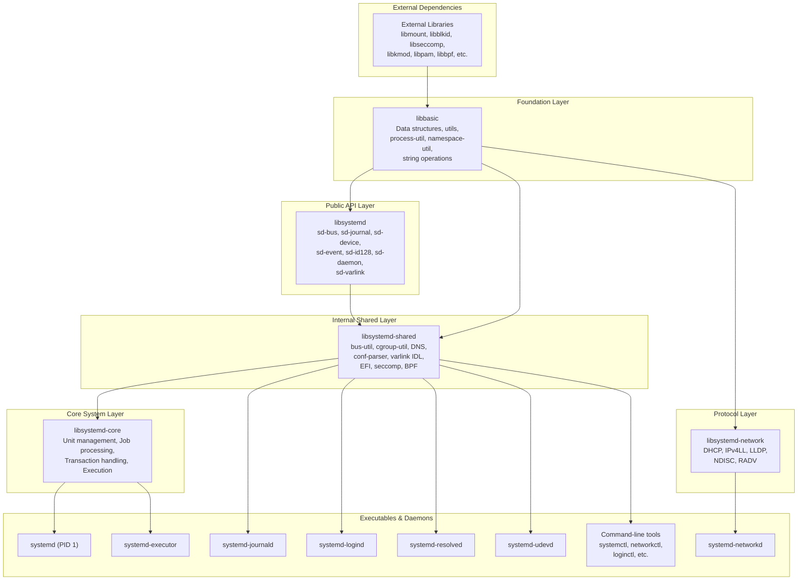

#### Notes on Layers

- **External Dependencies:** Common system libraries like `libmount`, `libblkid`, `libseccomp`, `libkmod`, `libpam`, and `libbpf` supplement systemd functionality.
- **libbasic:** Implements crucial building blocks such as process utilities, namespace helpers, string functions, hashmap implementations, and FD/filesystem helpers. It avoids dependencies beyond the C library [src/basic/meson.build:3-121]().
- **libsystemd:** Exposes stable `sd-*` APIs including D-Bus bindings (`sd-bus`), journaling (`sd-journal`), device management (`sd-device`), event loop (`sd-event`), identifiers (`sd-id128`), daemon helpers (`sd-daemon`), and Varlink IPC (`sd-varlink`) [src/libsystemd/meson.build:1-200]().
- **libsystemd-shared:** A private shared library containing common internal utilities such as bus helpers, cgroup handling, DNS, varlink IDL code, config parsing, EFI support, and security-related helpers like seccomp and BPF [src/shared/meson.build:3-248]().
- **libsystemd-core:** A static private library housing the heart of PID 1 functionality: unit management, job control, transactions, and the execution model [src/core/meson.build:3-106]().
- **libsystemd-network:** Provides network protocol stacks used by `systemd-networkd` largely focused on DHCP, IPv4LL, LLDP, NDISC, RADV protocols.

**Sources:** [src/basic/meson.build:3-121](), [src/shared/meson.build:3-248](), [src/core/meson.build:3-106](), [src/libsystemd/meson.build:1-200](), [meson.build:30-31]()

---

## libbasic – Foundation Layer

`libbasic` is a critical static library providing all foundational utilities and minimal dependencies for the entire systemd codebase.

### Core Functionalities and Components

| Category            | Representative Files                 | Key Functions/Classes                                  |
|---------------------|------------------------------------|-------------------------------------------------------|
| Process Utilities    | `process-util.c`                   | `pid_get_comm()`, `pid_get_cmdline()`                 |
| PID Reference       | `pidref.c`                        | `pidref_set_pid()`, `pidref_verify()`                 |
| Namespace Utilities  | `namespace-util.c`                 | `namespace_open()`, `namespace_enter()`               |
| Data Structures      | `hashmap.c`, `prioq.c`, `ordered-set.c` | `hashmap_new()`, `prioq_push()`, ordered-set operations |
| FD/Filesystem Helpers| `fd-util.c`, `fs-util.c`, `fileio.c`, `path-util.c` | `read_full_file()`, `rename_noreplace()`, `readlinkat_malloc()` |
| String Handling      | `string-util.c`, `strv.c`          | String manipulation helpers                            |
| Time Utilities       | `time-util.c`                     | `now()`, `dual_timestamp_now()`                        |

### Implementation and Data Flow Highlights

- Process utilities provide scoped access to process info, command lines, and ensure reference counting with `pidref` [src/basic/pidref.c:1-50]().
- Namespace helpers abstract Linux namespaces entering and opening for isolated operation contexts.
- Data structures such as hashmaps and priority queues underpin efficient lookup and event prioritization [src/basic/hashmap.c:1-50]().
- File descriptor and filesystem helpers provide safe, atomic, and race-condition resistant operations like `rename_noreplace()` [src/basic/fs-util.c:68-110]().
- String API improves manipulation of UTF-8 and null-terminated vectors.
- Time functions handle monotonic and realtime clock queries for scheduling.

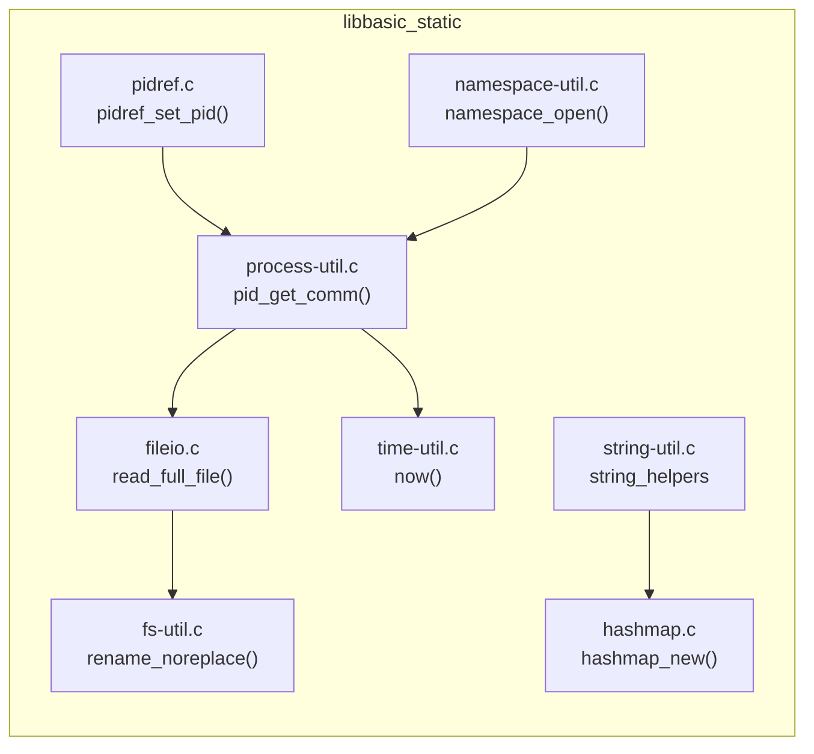

### Build and Dependency Notes

- Implemented as a static library to optimize performance with inlining.
- Depends only on the standard C library and minimal platform-specific headers [src/basic/meson.build:209-221]().
- Used extensively by higher-level libraries and systemd executables.

**Sources:** [src/basic/meson.build:3-121](), [src/basic/process-util.c:1-100](), [src/basic/namespace-util.c:1-50](), [src/basic/fs-util.c:68-110](), [src/basic/fileio.c:35-85]()

---

## libsystemd – Public API Layer

`libsystemd` is the primary shared systemd library exporting stable, backwards-compatible APIs used by external tools and components.

### Major APIs Exposed

- **sd-bus:** Implements D-Bus IPC client and server functionality, allowing integration with the D-Bus message bus.
- **sd-journal:** Journal log reading, querying, and writing interface.
- **sd-device:** Device enumeration and introspection, superseding `libudev`.
- **sd-event:** General-purpose event loop implementing epoll-based event dispatching.
- **sd-id128:** Utilities to handle 128-bit IDs.
- **sd-daemon:** Collection of functions for daemon integration such as socket activation and watchdog.
- **sd-varlink:** Implements Varlink IPC protocol with code generation support.

This library maintains ABI stability to ensure using systemd's core features outside the daemon is streamlined [src/libsystemd/meson.build:1-200](), [README:330-338]().

**Sources:** [src/libsystemd/meson.build:1-200](), [README:330-338]()

---

## libsystemd-shared – Internal Shared Library

`libsystemd-shared` is a private shared library that contains internal utility code shared across systemd daemons and tools but not exposed as public ABI.

### Subsystem Highlights

| Subsystem           | Example Files                              | Purpose                                      |
|---------------------|--------------------------------------------|----------------------------------------------|
| Bus Utilities       | `bus-util.c`, `bus-polkit.c`               | D-Bus helper functions and polkit integration |
| Control Groups      | `cgroup-setup.c`, `cgroup-show.c`          | Discovery and unified control group handling |
| DNS Utilities       | `dns-domain.c`, `dns-packet.c`, `dns-rr.c`| DNS parsing and query result processing       |
| Varlink Interfaces  | `varlink-io.systemd.*.c`                    | Implements dozens of varlink IPC interfaces    |
| Configuration Parser| `conf-parser.c`                             | Parses `.conf` and `.service` configuration files |
| Cryptographic Helpers| `tpm2-util.c`, `fido2-util.c`              | Support for TPM and FIDO2 credential handling |

### Example Internal Relationships

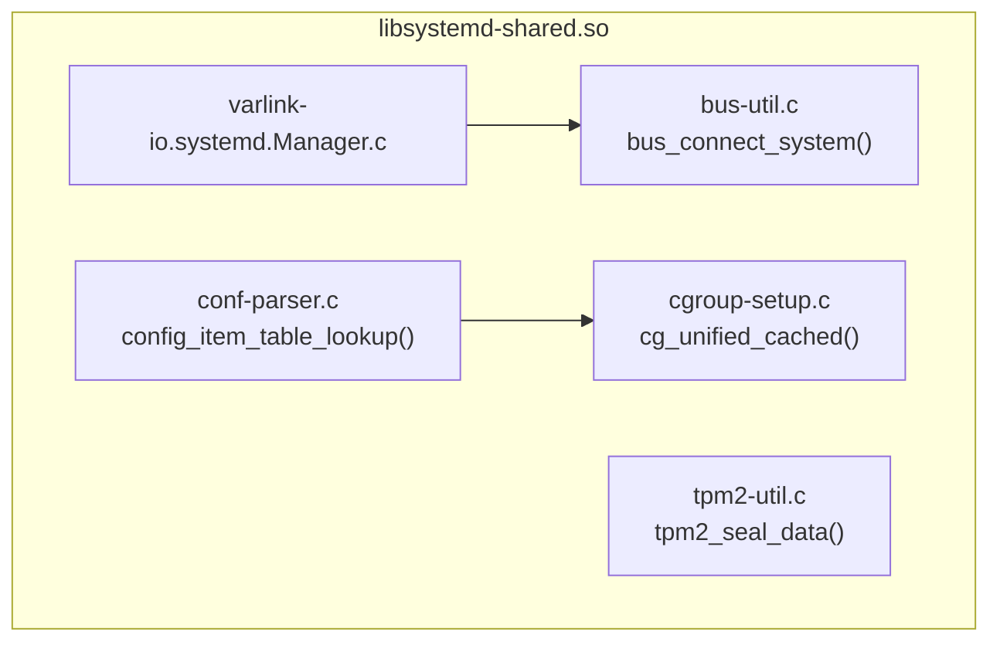

The shared library layers reusable code to avoid duplication and maintain modularity across components such as networkd, resolved, udevd, journald, and logind [src/shared/meson.build:3-248](), [src/shared/conf-parser.c:50-83]().

**Sources:** [src/shared/meson.build:3-248](), [src/shared/conf-parser.c:50-83]()

---

## libsystemd-core – Core Unit Management Library

`libsystemd-core` contains the core logic needed to implement the PID 1 systemd daemon and the systemd executor.

### Key Components

- **Manager:** Implements the main event loop, state machine, and unit/job lifecycle management (`manager.c`).
- **Unit:** Abstract base representing all unit types (e.g., service, mount) (`unit.c`).
- **Job:** Represents unit job requests and tracking (`job.c`).
- **Transaction:** Handles sets of jobs for dependency resolution and initialization ordering (`transaction.c`).
- **Execution:** Process spawning and sandboxing mechanisms (`execute.c`).

### Unit File Parsing with Perfect Hashing

To efficiently parse unit files, systemd uses [GNU gperf](https://www.gnu.org/software/gperf/) generated perfect hash tables from `.gperf.in` templates, converting unit setting names into structured parsers.

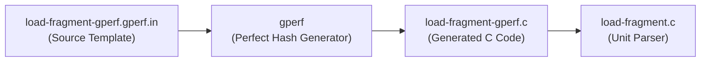

This infrastructure accelerates parsing and supports the wide variety of unit directives [src/core/meson.build:3-106](), [src/core/meson.build:76-87]().

**Sources:** [src/core/meson.build:3-106](), [src/core/meson.build:76-87]()

---

## Shared Utilities and Core Services

### Strings and HashMaps

- String utilities provide UTF-8 safe operations, trimming, splitting (`string-util.c`, `strv.c`).
- `hashmap.c` implements high-performance anonymous and generic hashmap structures used throughout systemd components.
- Priority queues (`prioq.c`) and ordered sets are foundational building blocks for event scheduling and state tracking.

### File Descriptor (FD), Filesystem, and Path Helpers

- `fd-util.c` offers safe FD allocation, duplication, and closure helpers.
- `fs-util.c` contains helpers for atomic renames (`rename_noreplace`), absolute path resolution, and readlink operations.
- `fileio.c` has buffered reading/writing with careful handling for virtual filesystems.
- `path-util.c` provides path safety checking, component extraction, and safety wrappers.

### Configuration Parsing (`conf-parser.c`)

- Handles `.conf` and unit-like files robustly with callbacks for known keys.
- Supports extension keys, ignoring unknown ones gracefully.
- Maintains metadata and error diagnostics on parsing failures.
- Uses in-memory hash tables for config sections and entries.

### Format Table

- `format-table.c` renders tables of text data in rows and columns, used for structured output formatting in tools.

### Logging and Event Loop

- Logging has multiple levels and output targets, supporting debug, info, warning, and error (e.g., `log.c`).
- `sd-event.c` implements the event loop based on epoll, handling timers, signals, file IO events, and child process tracking.

---

## Build System and Linking Strategies

systemd uses Meson for build configuration, enabling flexible linking combinations and static/shared library builds.

### Noteworthy Build Options

| Option                  | Description                                          |
|-------------------------|-----------------------------------------------------|
| `systemd-multicall-binary` | Link `systemd` and `systemd-executor` into one executable for container optimizations [meson_options.txt:19]() |
| `build-static`          | Build static versions of supported binaries [meson_options.txt:46]() |
| `link-udev-shared`      | Link udev daemon against `libsystemd-shared.so` [meson_options.txt:17]() |
| `link-systemctl-shared` | Dynamically link `systemctl` against `libsystemd-shared` if enabled [meson_options.txt:22-23]() |

### Example Linking Patterns

- `systemd` (PID 1) links against `libsystemd-core`, `libsystemd-shared`, and `libbasic` [src/core/meson.build:134-160]().
- Daemons like `resolved` link against `libsystemd-shared` and `libsystemd` [src/resolve/meson.build:7-41]().
- Command-line tools like `systemctl` and `networkctl` can optionally be linked shared (benefitting from `libsystemd-shared`) or statically [meson_options.txt:16-47]().
  
Static linking is preferred for minimal environments and containerized setups, while shared linking reduces binary sizes for systems with full library support.

**Sources:** [meson_options.txt:16-47](), [meson.build:81-83](), [NEWS:111-123]()

---

## Summary: Library Usage Matrix

| Library               | Type                 | Primary Users                            |
|-----------------------|----------------------|----------------------------------------|
| `libbasic.a`          | Static library       | All systemd components                  |
| `libsystemd.so`       | Shared library       | External apps, systemd components       |
| `libsystemd-shared.so`| Private shared library| Most daemons and tools                  |
| `libsystemd-core.a`   | Private static library| `systemd` (PID 1), `systemd-executor` |
| `libsystemd-network.a`| Private static library| `systemd-networkd`, `resolved`         |

**Sources:** [src/basic/meson.build:209-221](), [src/shared/meson.build:3-248](), [src/core/meson.build:134-160](), [src/libsystemd-network/meson.build:3-40]()

---

This architecture ensures maintainability, efficient reuse, and stable APIs critical to systemd’s extensive and growing functionality.

---

# Page: Process and Namespace Management

# Process and Namespace Management

<details>
<summary>Relevant source files</summary>

The following files were used as context for generating this wiki page:

- [src/basic/capability-util.c](src/basic/capability-util.c)
- [src/basic/capability-util.h](src/basic/capability-util.h)
- [src/basic/chase.c](src/basic/chase.c)
- [src/basic/chase.h](src/basic/chase.h)
- [src/basic/dirent-util.c](src/basic/dirent-util.c)
- [src/basic/dirent-util.h](src/basic/dirent-util.h)
- [src/basic/mountpoint-util.c](src/basic/mountpoint-util.c)
- [src/basic/mountpoint-util.h](src/basic/mountpoint-util.h)
- [src/basic/namespace-util.c](src/basic/namespace-util.c)
- [src/basic/namespace-util.h](src/basic/namespace-util.h)
- [src/basic/process-util.c](src/basic/process-util.c)
- [src/basic/process-util.h](src/basic/process-util.h)
- [src/basic/recurse-dir.c](src/basic/recurse-dir.c)
- [src/basic/recurse-dir.h](src/basic/recurse-dir.h)
- [src/basic/stat-util.c](src/basic/stat-util.c)
- [src/basic/stat-util.h](src/basic/stat-util.h)
- [src/basic/uid-range.c](src/basic/uid-range.c)
- [src/basic/uid-range.h](src/basic/uid-range.h)
- [src/basic/user-util.c](src/basic/user-util.c)
- [src/basic/user-util.h](src/basic/user-util.h)
- [src/core/dynamic-user.c](src/core/dynamic-user.c)
- [src/core/dynamic-user.h](src/core/dynamic-user.h)
- [src/firstboot/meson.build](src/firstboot/meson.build)
- [src/fsck/meson.build](src/fsck/meson.build)
- [src/machine-id-setup/meson.build](src/machine-id-setup/meson.build)
- [src/mountfsd/io.systemd.mount-file-system.policy](src/mountfsd/io.systemd.mount-file-system.policy)
- [src/mountfsd/meson.build](src/mountfsd/meson.build)
- [src/mountfsd/mountwork.c](src/mountfsd/mountwork.c)
- [src/shared/ask-password-agent.c](src/shared/ask-password-agent.c)
- [src/shared/exec-util.c](src/shared/exec-util.c)
- [src/shared/exec-util.h](src/shared/exec-util.h)
- [src/shared/find-esp.c](src/shared/find-esp.c)
- [src/shared/find-esp.h](src/shared/find-esp.h)
- [src/shared/libcrypt-util.c](src/shared/libcrypt-util.c)
- [src/shared/libcrypt-util.h](src/shared/libcrypt-util.h)
- [src/shared/mount-util.c](src/shared/mount-util.c)
- [src/shared/mount-util.h](src/shared/mount-util.h)
- [src/shared/polkit-agent.c](src/shared/polkit-agent.c)
- [src/shared/varlink-io.systemd.BootControl.h](src/shared/varlink-io.systemd.BootControl.h)
- [src/shared/varlink-io.systemd.MountFileSystem.c](src/shared/varlink-io.systemd.MountFileSystem.c)
- [src/shared/varlink-io.systemd.MountFileSystem.h](src/shared/varlink-io.systemd.MountFileSystem.h)
- [src/test/test-capability-util.c](src/test/test-capability-util.c)
- [src/test/test-chase.c](src/test/test-chase.c)
- [src/test/test-exec-util.c](src/test/test-exec-util.c)
- [src/test/test-libcrypt-util.c](src/test/test-libcrypt-util.c)
- [src/test/test-mount-util.c](src/test/test-mount-util.c)
- [src/test/test-mountpoint-util.c](src/test/test-mountpoint-util.c)
- [src/test/test-namespace.c](src/test/test-namespace.c)
- [src/test/test-path-lookup.c](src/test/test-path-lookup.c)
- [src/test/test-process-util.c](src/test/test-process-util.c)
- [src/test/test-stat-util.c](src/test/test-stat-util.c)
- [src/test/test-tests.c](src/test/test-tests.c)
- [src/test/test-uid-range.c](src/test/test-uid-range.c)
- [src/test/test-user-util.c](src/test/test-user-util.c)
- [src/volatile-root/volatile-root.c](src/volatile-root/volatile-root.c)
- [units/systemd-mountfsd.service.in](units/systemd-mountfsd.service.in)

</details>


## Purpose and Scope

This page documents the fundamental process management utilities and the namespace abstractions provided by systemd's `libbasic`. These core utilities form the basis for building process lifecycle management, stable process identification without PID reuse issues, secure forking, namespace handling, user and UID utilities, and mountpoint/mount helpers frequently used throughout the systemd ecosystem.

This is a leaf page focusing on fully explaining these low-level primitives in detail. For higher-level process execution and sandboxing, refer to [Process Execution and Sandboxing (2.4)](), and for container-specific namespace management, see [systemd-nspawn Container Manager (5.1)]().

---

## Core Process Management Abstractions

### The PidRef Structure

Systemd uses the `PidRef` abstraction to robustly refer to processes. Unlike raw PIDs, `PidRef` combines multiple identification aspects to safely track a process instance even if the PID is quickly reused.

```c
typedef struct PidRef {
    pid_t pid;      // Process ID
    int fd;         // pidfd file descriptor (optional but preferred)
    ino_t inode;    // Inode number of /proc/[pid] directory (verification)
} PidRef;
```

- The `pidfd` is a Linux kernel feature (since 5.3/5.4) that provides a stable file descriptor handle to a specific process, which prevents ambiguities common to PID reuse.
- The inode of `/proc/[pid]/` provides an additional verification step to detect PID reuse.
  
Users construct, query, and verify `PidRef` objects through accompanying API functions that guarantee the referenced process instance is still valid.

**Key Operations:**

| Function               | Description                                      | Reference                              |
|------------------------|------------------------------------------------|--------------------------------------|
| `pidref_set_pid()`     | Initialize a `PidRef` from a PID                | [src/basic/pidref.c:116-121]()       |
| `pidref_verify()`      | Verify the validity of a `PidRef`               | [src/basic/pidref.c:165-201]()       |
| `pidref_is_set()`      | Check if `PidRef` is defined                     | [src/basic/pidref.h:28-30]()         |
| `pidref_equal()`       | Compare two `PidRef` structs                      | [src/basic/pidref.c:264-278]()       |

Sources: [src/basic/pidref.h:12-32](), [src/basic/pidref.c:1-300]()

---

### Process Information Queries

The process utilities in `process-util` provide a rich set of functions to fetch details about running processes. These functions have variants accepting either raw PIDs or verified `PidRef` objects.

#### Common Process Queries and Implementation

| Function                        | Returns                                | Fallback Behavior                                  | Reference                          |
|--------------------------------|--------------------------------------|---------------------------------------------------|----------------------------------|
| `pid_get_comm(pid, &ret)`       | Command name (max 16 chars)          | None                                              | [src/basic/process-util.c:95-133]()  |
| `pid_get_cmdline(pid, ...)`     | Full command line string             | Falls back to `[comm]` string when empty          | [src/basic/process-util.c:158-217]() |
| `pid_get_ppid(pid, &ret)`       | Parent PID                          | Returns `-EADDRNOTAVAIL` for `pid == 1`            | [src/basic/process-util.c:455-483]() |
| `pid_get_uid(pid, &ret)`        | Real user ID                        | Reads from `/proc/[pid]/status`                    | [src/basic/process-util.c:351-371]() |
| `pid_is_kernel_thread(pid)`     | Boolean: kernel thread status       | Checks `PF_KTHREAD` flag in `/proc/[pid]/stat`     | [src/basic/process-util.c:711-739]() |

- All these functions perform filesystem reads from `/proc/[pid]/` pseudo-files such as `comm`, `cmdline`, `stat`, and `status`.
- The `pidref_*` variants first call `pidref_verify()` to ensure the process has not exited and PID reused before returning info [src/basic/process-util.c:135-156]().

#### Process Query Data Flow

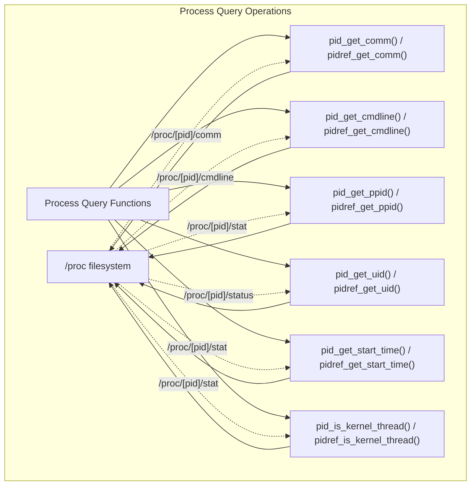

Sources: [src/basic/process-util.c:95-787](), [src/basic/process-util.h:37-55]()

---

### Process Lifecycle Operations: Safe Forking

Forking processes safely with proper cleanup and setup is critical in systemd.

#### pidref_safe_fork() and pidref_safe_fork_full()

- Provide a rich, controlled process fork mechanism.
- Accept `ForkFlags` to specify operations to perform in the child after fork:
  - Reset signal handlers
  - Close file descriptors (except some)
  - Set death signal (PR_DEATHSIG)
  - Rearrange standard input/output/error
- Can create new Linux namespaces (`FORK_NEW_*` flags) via `raw_clone()` which is unsafe in threaded programs due to glibc locking concerns. These flags must be used with care.

| ForkFlag              | Description                                                  | Thread Safety                      |
|-----------------------|--------------------------------------------------------------|----------------------------------|
| `FORK_RESET_SIGNALS`    | Reset all signal handlers and masks                           | Safe                             |
| `FORK_CLOSE_ALL_FDS`    | Close all open FDs except 0, 1, 2 and excepted FD list      | Safe                             |
| `FORK_NEW_MOUNTNS`      | Create a new mount namespace using `raw_clone()`             | 💣 Unsafe in multithreaded apps  |
| `FORK_NEW_USERNS`       | Create a new user namespace using `raw_clone()`              | 💣 Unsafe in multithreaded apps  |
| `FORK_NEW_NETNS`        | Create new network namespace                                  | 💣 Unsafe in multithreaded apps  |
| `FORK_NEW_PIDNS`        | Create new PID namespace                                      | 💣 Unsafe in multithreaded apps  |

#### Safe Forking Data Flow

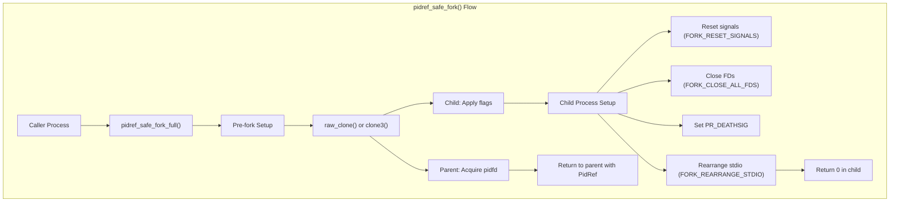

Sources: [src/basic/process-util.c:1434-1741](), [src/basic/process-util.h:145-175]()

---

## Namespace Management

### Supported Namespace Types and Structure

Linux namespaces supported are represented via the `namespace_info` array:

```c
const struct namespace_info {
    const char *proc_name;              // short name e.g. "pid"
    const char *proc_path;              // path in proc e.g. "ns/pid"
    unsigned long clone_flag;           // CLONE_NEW* flag for namespace
    unsigned long pidfd_get_ns_ioctl_cmd;  // ioctl cmd to get namespace from pidfd
    ino_t root_inode;                   // inode of initial namespace for verification
} namespace_info[_NAMESPACE_TYPE_MAX + 1];
```

Namespace Types covered include:

- `NAMESPACE_CGROUP`
- `NAMESPACE_IPC`
- `NAMESPACE_NET`
- `NAMESPACE_MOUNT`
- `NAMESPACE_PID`
- `NAMESPACE_USER`
- `NAMESPACE_UTS`
- `NAMESPACE_TIME`

Each type maps to its clone flag and `/proc/[pid]/ns` path [src/basic/namespace-util.c:30-43]().

Sources: [src/basic/namespace-util.c:28-41](), [src/basic/namespace-util.h:6-25]()

---

### Entering Namespaces (`namespace_enter()`)

`namespace_enter()` is the primary API to enter one or more namespaces of a target process, given file descriptors for those namespaces.

Key operational features:

- Blocks `dlopen()` temporarily to avoid loading incompatible shared libraries from wrong namespaces.
- Skips redundant `setns()` calls if already in the desired namespace (`is_our_namespace()`).
- Handles capability limitations gracefully: If the caller lacks `CAP_SYS_ADMIN`, it enters the user namespace first to gain the capability inside the new namespace, before entering PID and other namespaces.
- When entering mount and network namespaces, it invokes `setns()` with relevant clone flags.
- If requested, performs `chroot()` into the target root filesystem.

#### namespace_enter Implementation Flow

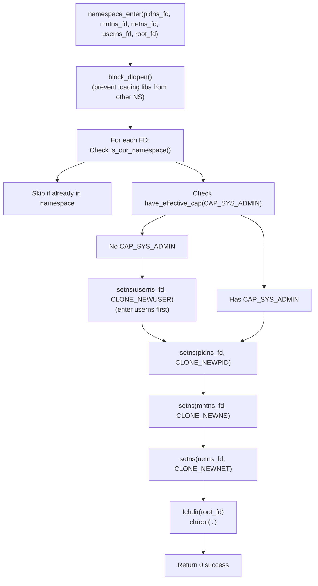

Sources: [src/basic/namespace-util.c:231-329]()

---

### Namespace Inspection and Utility Functions

Several helper functions assist in working with namespaces:

| Function                  | Description                                 | Reference                         |
|---------------------------|---------------------------------------------|---------------------------------|
| `fd_is_namespace(fd)`      | Checks if FD references a Linux namespace | [src/basic/namespace-util.c:331-348]() |
| `is_our_namespace(fd, type)` | Checks if FD references our current namespace of given type | [src/basic/namespace-util.c:368-384]() |
| `namespace_is_init(fd, type)` | Checks if FD references initial (root) namespace | [src/basic/namespace-util.c:439-455]() |
| `pidref_in_same_namespace(pidref1, pidref2, type)` | Checks if two processes are in the same namespace | [src/basic/namespace-util.c:457-478]() |

Sources: [src/basic/namespace-util.c:331-478](), [src/basic/namespace-util.h:51-60]()

---

## Mount Management and Chase Helpers

### Recursive Mount Operations

systemd provides safe recursive unmounting and remounting of mountpoints.

- `umount_recursive_full(prefix, flags, keep)` recursively unmounts all mounts under `prefix`, excluding any paths specified in the `keep` exclusion list.
- Parsing of mounts uses `libmount` to read `/proc/self/mountinfo` in backward order to unmount deepest mounts first.
- A loop retries if mounts remain after unmount to handle stacked mounts.

#### Recursive Unmount Logic Diagram

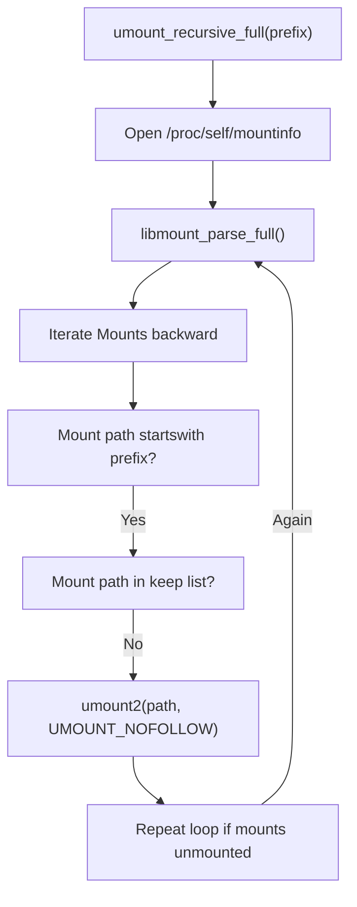

Sources: [src/shared/mount-util.c:42-119](), [src/shared/mount-util.h:20-23]()

---

### User and UID Utilities

systemd includes extensive utilities to parse, validate, and handle user and group IDs reliably and securely, avoiding common pitfalls like invalid or reserved IDs.

- `uid_is_valid(uid_t uid)` verifies if a UID is valid, explicitly prohibiting invalid values like `UINT32_MAX` or `0xFFFF` [src/basic/user-util.c:51-64]().
- `parse_uid()` and `parse_uid_range()` parse numeric UID strings strictly disallowing leading zeros, whitespace, or signs for security and correctness [src/basic/user-util.c:65-135]().
- `getusername_malloc()` and related functions fetch effective usernames from the environment or UID mappings.

Sources: [src/basic/user-util.c:51-196]()

---

## Key Design Principles

### PID Reuse Safety

- Traditional PID identification is unsafe due to rapid PID reuse.
- `PidRef` combines the pidfd and inode lookup to ensure robust process referencing.
- All `pidref_*` query functions internally verify the process is still the same using `pidref_verify()` [src/basic/process-util.c:145-156]().

### Thread Safety Boundaries

- Use of namespace-creating flags (`FORK_NEW_USERNS`, etc.) in fork is **unsafe** in multi-threaded parent processes because they internally use `raw_clone()` bypassing glibc malloc locks, which risks deadlocks.
- Such flags should only be used in single-threaded contexts or before other threads spawn [src/basic/process-util.h:145-149]().

### Capability-Aware Namespace Entry

- When entering namespaces, lack of `CAP_SYS_ADMIN` means the user namespace must be entered first to gain capabilities inside that user namespace.
- Then other namespaces (PID, mount, network) can be entered safely.
- The logic in `namespace_enter()` automates this sequence [src/basic/namespace-util.c:277-283]().

---

# Summary Diagram: Natural Language to Code Entities Mapping

```mermaid
graph TD
    A["Process and Namespace Management"] --> B["Process Management Utilities"]
    A --> C["Namespace Abstractions"]
    A --> D["Mount and Chase Helpers"]
    A --> E["User and UID Utilities"]

    B --> F[PidRef Structure]
    B --> G[process-util.c/h]
    B --> H[Safe Forking (pidref_safe_fork)*]

    C --> I[namespace-util.c/h]
    C --> J[namespace_info[] Array]
    C --> K[namespace_enter() Function]
    C --> L[Namespace Inspection Functions]

    D --> M[mount-util.c/h]
    D --> N[umount_recursive_full()]
    D --> O[bind_remount_recursive_with_mountinfo()]

    E --> P[user-util.c/h]
    E --> Q[UID Parsing and Validation]

    style A fill:#fff,stroke:#000,stroke-width:1px
    style B fill:#fff
    style C fill:#fff
    style D fill:#fff
    style E fill:#fff
```

---

# References

- [src/basic/pidref.h:10-40]()
- [src/basic/pidref.c:1-300]()
- [src/basic/process-util.c:50-787]()
- [src/basic/process-util.h:20-180]()
- [src/basic/namespace-util.c:20-480]()
- [src/basic/namespace-util.h:10-60]()
- [src/shared/mount-util.c:40-120]()
- [src/shared/mount-util.h:10-160]()
- [src/basic/user-util.c:50-195]()

---

This completes the detailed explanation of process and namespace management utilities in systemd.

---

# Page: Unit Management System

# Unit Management System

<details>
<summary>Relevant source files</summary>

The following files were used as context for generating this wiki page:

- [man/systemd-detect-virt.xml](man/systemd-detect-virt.xml)
- [man/systemd.automount.xml](man/systemd.automount.xml)
- [man/systemd.device.xml](man/systemd.device.xml)
- [man/systemd.mount.xml](man/systemd.mount.xml)
- [man/systemd.path.xml](man/systemd.path.xml)
- [man/systemd.scope.xml](man/systemd.scope.xml)
- [man/systemd.service.xml](man/systemd.service.xml)
- [man/systemd.slice.xml](man/systemd.slice.xml)
- [man/systemd.socket.xml](man/systemd.socket.xml)
- [man/systemd.swap.xml](man/systemd.swap.xml)
- [man/systemd.target.xml](man/systemd.target.xml)
- [man/systemd.timer.xml](man/systemd.timer.xml)
- [man/systemd.unit.xml](man/systemd.unit.xml)
- [shell-completion/bash/systemd-detect-virt](shell-completion/bash/systemd-detect-virt)
- [src/analyze/analyze-compare-versions.c](src/analyze/analyze-compare-versions.c)
- [src/analyze/analyze-condition.c](src/analyze/analyze-condition.c)
- [src/analyze/analyze-condition.h](src/analyze/analyze-condition.h)
- [src/analyze/analyze-verify-util.c](src/analyze/analyze-verify-util.c)
- [src/analyze/analyze-verify-util.h](src/analyze/analyze-verify-util.h)
- [src/analyze/analyze-verify.c](src/analyze/analyze-verify.c)
- [src/analyze/analyze-verify.h](src/analyze/analyze-verify.h)
- [src/analyze/test-verify.c](src/analyze/test-verify.c)
- [src/basic/bitfield.h](src/basic/bitfield.h)
- [src/basic/confidential-virt.c](src/basic/confidential-virt.c)
- [src/basic/confidential-virt.h](src/basic/confidential-virt.h)
- [src/basic/macro.h](src/basic/macro.h)
- [src/basic/static-destruct.c](src/basic/static-destruct.c)
- [src/basic/static-destruct.h](src/basic/static-destruct.h)
- [src/basic/unit-name.c](src/basic/unit-name.c)
- [src/basic/unit-name.h](src/basic/unit-name.h)
- [src/basic/virt.c](src/basic/virt.c)
- [src/basic/virt.h](src/basic/virt.h)
- [src/core/automount.c](src/core/automount.c)
- [src/core/automount.h](src/core/automount.h)
- [src/core/dbus-job.c](src/core/dbus-job.c)
- [src/core/dbus-job.h](src/core/dbus-job.h)
- [src/core/dbus-manager.c](src/core/dbus-manager.c)
- [src/core/dbus-path.c](src/core/dbus-path.c)
- [src/core/dbus-path.h](src/core/dbus-path.h)
- [src/core/dbus-service.c](src/core/dbus-service.c)
- [src/core/dbus-socket.c](src/core/dbus-socket.c)
- [src/core/dbus-timer.c](src/core/dbus-timer.c)
- [src/core/dbus-unit.c](src/core/dbus-unit.c)
- [src/core/dbus-unit.h](src/core/dbus-unit.h)
- [src/core/dbus.c](src/core/dbus.c)
- [src/core/dbus.h](src/core/dbus.h)
- [src/core/device.c](src/core/device.c)
- [src/core/device.h](src/core/device.h)
- [src/core/job.c](src/core/job.c)
- [src/core/job.h](src/core/job.h)
- [src/core/main.c](src/core/main.c)
- [src/core/manager.c](src/core/manager.c)
- [src/core/manager.h](src/core/manager.h)
- [src/core/mount.c](src/core/mount.c)
- [src/core/org.freedesktop.systemd1.conf](src/core/org.freedesktop.systemd1.conf)
- [src/core/path.c](src/core/path.c)
- [src/core/path.h](src/core/path.h)
- [src/core/scope.c](src/core/scope.c)
- [src/core/service.c](src/core/service.c)
- [src/core/service.h](src/core/service.h)
- [src/core/slice.c](src/core/slice.c)
- [src/core/socket.c](src/core/socket.c)
- [src/core/socket.h](src/core/socket.h)
- [src/core/swap.c](src/core/swap.c)
- [src/core/target.c](src/core/target.c)
- [src/core/timer.c](src/core/timer.c)
- [src/core/timer.h](src/core/timer.h)
- [src/core/transaction.c](src/core/transaction.c)
- [src/core/transaction.h](src/core/transaction.h)
- [src/core/unit-printf.c](src/core/unit-printf.c)
- [src/core/unit.c](src/core/unit.c)
- [src/core/unit.h](src/core/unit.h)
- [src/detect-virt/detect-virt.c](src/detect-virt/detect-virt.c)
- [src/libsystemd/sd-bus/bus-error.c](src/libsystemd/sd-bus/bus-error.c)
- [src/libsystemd/sd-bus/bus-error.h](src/libsystemd/sd-bus/bus-error.h)
- [src/libsystemd/sd-bus/test-bus-error.c](src/libsystemd/sd-bus/test-bus-error.c)
- [src/shared/compare-operator.c](src/shared/compare-operator.c)
- [src/shared/compare-operator.h](src/shared/compare-operator.h)
- [src/shared/condition.c](src/shared/condition.c)
- [src/shared/condition.h](src/shared/condition.h)
- [src/shared/install-printf.c](src/shared/install-printf.c)
- [src/shared/install-printf.h](src/shared/install-printf.h)
- [src/shared/install.c](src/shared/install.c)
- [src/shared/install.h](src/shared/install.h)
- [src/shared/specifier.c](src/shared/specifier.c)
- [src/shared/specifier.h](src/shared/specifier.h)
- [src/shared/tests.c](src/shared/tests.c)
- [src/shared/tests.h](src/shared/tests.h)
- [src/shared/unit-file.c](src/shared/unit-file.c)
- [src/shared/unit-file.h](src/shared/unit-file.h)
- [src/systemctl/systemctl-cancel-job.c](src/systemctl/systemctl-cancel-job.c)
- [src/systemctl/systemctl-clean-or-freeze.c](src/systemctl/systemctl-clean-or-freeze.c)
- [src/systemctl/systemctl-is-active.c](src/systemctl/systemctl-is-active.c)
- [src/systemctl/systemctl-is-enabled.c](src/systemctl/systemctl-is-enabled.c)
- [src/test/test-cgroup-mask.c](src/test/test-cgroup-mask.c)
- [src/test/test-condition.c](src/test/test-condition.c)
- [src/test/test-engine.c](src/test/test-engine.c)
- [src/test/test-execute.c](src/test/test-execute.c)
- [src/test/test-install-root.c](src/test/test-install-root.c)
- [src/test/test-install.c](src/test/test-install.c)
- [src/test/test-load-fragment.c](src/test/test-load-fragment.c)
- [src/test/test-macro.c](src/test/test-macro.c)
- [src/test/test-path.c](src/test/test-path.c)
- [src/test/test-sched-prio.c](src/test/test-sched-prio.c)
- [src/test/test-specifier.c](src/test/test-specifier.c)
- [src/test/test-unit-file.c](src/test/test-unit-file.c)
- [src/test/test-unit-name.c](src/test/test-unit-name.c)
- [test/test-compare-versions.sh](test/test-compare-versions.sh)
- [test/test-execute/exec-basic.service](test/test-execute/exec-basic.service)
- [test/test-systemctl-enable.sh](test/test-systemctl-enable.sh)
- [test/units/TEST-74-AUX-UTILS.detect-virt.sh](test/units/TEST-74-AUX-UTILS.detect-virt.sh)
- [test/units/TEST-74-AUX-UTILS.mount.sh](test/units/TEST-74-AUX-UTILS.mount.sh)
- [test/units/TEST-87-AUX-UTILS-VM.detect-virt.sh](test/units/TEST-87-AUX-UTILS-VM.detect-virt.sh)
- [test/units/TEST-87-AUX-UTILS-VM.modules-load.sh](test/units/TEST-87-AUX-UTILS-VM.modules-load.sh)
- [test/units/TEST-87-AUX-UTILS-VM.pstore.sh](test/units/TEST-87-AUX-UTILS-VM.pstore.sh)

</details>


## Purpose and Scope

The Unit Management System is fundamental to systemd's architecture, providing a polymorphic and extensible framework for managing system objects such as services, sockets, mounts, devices, timers, slices, and scopes. It governs the lifecycle of these units, handles their dependencies, and coordinates operations via jobs and transactions. This page details the core abstractions—`Unit`, `Manager`, `Job`, `Transaction`—the polymorphic unit type mechanism, unit file handling, and the condition and installation logic.

For execution and sandboxing specifics, see [Process Execution and Sandboxing](#2.4). For resource management, see [Control Groups and Resource Management](#2.6).


## Core Architecture Overview

At its core, systemd’s unit management system comprises three interacting subsystems:

- **Manager**: Orchestrates units and jobs, maintains overall state.
- **Unit**: The polymorphic abstraction representing managed entities.
- **Job**: Represents operations on units to be performed asynchronously.
- **Transaction**: Groups jobs to ensure atomic, consistent operations.

### Manager: The Central Orchestrator

The `Manager` struct maintains key data structures:

- A hashmap `units` mapping unit names to `Unit` objects.
- A hashmap `jobs` tracking active job instances.
- Various queues for loading units from disk, executing jobs, processing D-Bus notifications, and garbage collecting inactive units.
- An event loop context (`sd_event`) driving asynchronous I/O and timers.

The Manager state serves as the centralized coordinator for unit lifecycle, job scheduling, and transaction processing.

```mermaid
graph TB
    subgraph ManagerCore["Manager Core State"]
        M[ "Manager" ]:::ce --> U[ "units: Hashmap<string, Unit>" ]:::ce
        M --> J[ "jobs: Hashmap<job_id, Job>" ]:::ce
        M --> E[ "event: sd_event*" ]:::ce

        M[ "Manager\nCentral Orchestrator" ]
        U[ "units\nHashmap: name string → Unit*" ]
        J[ "jobs\nHashmap: job id → Job*" ]
        E[ "event\nlibsystemd event loop" ]

    end

    subgraph ProcessingQueues["Processing Queues"]
        M --> LQ[ "load_queue: LIST_HEAD<Unit*>" ]:::ce
        M --> RQ[ "run_queue: Prioq<Job*>" ]:::ce
        M --> DQ[ "dbus_unit_queue: LIST_HEAD<Unit*>" ]:::ce
        M --> GQ[ "gc_unit_queue: LIST_HEAD<Unit*>" ]:::ce

        LQ[ "Units to load asynchronously" ]
        RQ[ "Jobs to execute asynchronously" ]
        DQ[ "Units with D-Bus notifications pending" ]
        GQ[ "Units pending garbage collection" ]
    end

    subgraph UnitTypes["Unit Types and Virtual Function Tables"]
        UVT[ "unit_vtable[_UNIT_TYPE_MAX]" ]:::ce
        SVT[ "service_vtable" ]:::ce
        SOKVT[ "socket_vtable" ]:::ce
        MNTVT[ "mount_vtable" ]:::ce
        DEVVT[ "device_vtable" ]:::ce
        TGTVT[ "target_vtable" ]:::ce

        UVT --> SVT
        UVT --> SOKVT
        UVT --> MNTVT
        UVT --> DEVVT
        UVT --> TGTVT
    end

    classDef ce stroke-dasharray: 5 5
```

**Sources:** [src/core/manager.h:183-210](), [src/core/manager.c:122-136](), [src/core/unit.c:83-95]()


## Unit Lifecycle and Object Model

A `Unit` represents a manageable resource or entity in the system. It is a polymorphic base type, with specific derived types such as Service, Socket, Mount, Device, Target, etc., each encapsulating type-specific data and operations.

### Unit Core Structure

The `Unit` struct includes these key state fields:

- `type`: The `UnitType` enum identifying the kind of unit (service, socket, etc.).
- `id`: The canonical unit name, e.g. `"ssh.service"`.
- `aliases`: Alternative names for the unit stored in a `Set`.
- `load_state`: The loading status of the unit (e.g., `UNIT_STUB`, `UNIT_LOADED`).
- `active_state`: The unit's activation state (`UNIT_ACTIVE`, `UNIT_INACTIVE`, etc.).
- Dependency hashmaps tracking strong and weak dependencies.

Virtual function tables (`UnitVTable`) provide polymorphic operations for unit types, enabling specialized implementations of methods such as starting, stopping, loading, and serialization.

```mermaid
graph TB
    subgraph UnitObject["Unit Core Structure"]
        U[ "Unit" ]:::ce

        UT[ "type: UnitType" ]
        ID[ "id: char* (unit name)" ]
        AL[ "aliases: Set<string>" ]
        LS[ "load_state: UnitLoadState" ]
        AS[ "active_state: UnitActiveState" ]
        DEP[ "dependencies: Hashmap<Unit*, UnitDependencyInfo>" ]

        U --> UT
        U --> ID
        U --> AL
        U --> LS
        U --> AS
        U --> DEP
    end

    classDef ce stroke-dasharray: 5 5
```

### Unit Creation and Initialization

Units are created via `unit_new()` which allocates and initializes internal fields, and are named and registered with the `Manager` using `unit_add_name()`.

The function `unit_init()` initializes unit-specific contexts such as cgroup, execution, and kill contexts. Unit type specific initialization is invoked through the unit's `init` function pointer in its vtable.

```mermaid
graph LR
    UN[ "unit_new(Manager*, size_t)" ]:::ce
    UA[ "unit_add_name(Unit*, name)" ]:::ce
    UI[ "unit_init(Unit*)" ]:::ce
    MR[ "Manager.units hashmap" ]:::ce

    UN --> UA
    UA --> UI
    UA --> MR
```

This sequence ensures unit structures are properly linked, registered, and primed for management.

**Sources:** [src/core/unit.c:97-131](), [src/core/unit.c:160-219](), [src/core/unit.c:133-150]()


## Job Processing System

Jobs encapsulate operations requested on units—such as starting or stopping—and represent asynchronous tasks to be scheduled by the Manager. Each job has a state machine managing its lifecycle from creation to completion.

### Job States and Transitions

Jobs move from **waiting** to **running** and eventually to a **finished** or released state. Jobs can fail, succeed, or be canceled.

```mermaid
stateDiagram-v2
    [*] --> JOB_WAITING: job_new()
    JOB_WAITING --> JOB_RUNNING: manager_dispatch_run_queue()
    JOB_RUNNING --> JOB_WAITING: job_restart()
    JOB_RUNNING --> [*]: job_finish_and_invalidate()
    JOB_WAITING --> [*]: job_free()

    note right of JOB_WAITING
        Job is created but not started
    end

    note right of JOB_RUNNING
        Job is being executed
    end
```

This architecture supports asynchronous execution and efficient scheduling of unit operations.

### Transactional Job Groups

To ensure sets of jobs can be applied atomically and consistently, systemd uses `Transaction` objects which collect multiple jobs to be executed together.

```mermaid
graph TB
    TNew[ "transaction_new()" ] --> JAdd[ "transaction_add_job_and_dependencies()" ]
    JAdd --> Dep[ "resolve dependencies" ]
    Dep --> Verify[ "transaction_verify_order()" ]
    Verify --> Activate[ "transaction_activate()" ]

    JAdd --> JNew[ "job_new()" ]
    Activate --> JInstall[ "job_install()" ]

    classDef ce stroke-dasharray: 5 5
    class JNew,JInstall ce
```

Transactions perform job dependency resolution, ordering verification, and activate all jobs atomically.

**Sources:** [src/core/job.c:29-86](), [src/core/job.h:8-35](), [src/core/transaction.c:17-60]()


## Polymorphic Unit Type System

systemd supports different unit types via polymorphism implemented through `UnitVTable` virtual function tables. Each unit type provides its own implementation of key operations including activation, deactivation, serialization, and more.

### Unit Types and Their VTables

| Unit Type      | VTable Symbol        | Notes                              |
| -------------- | -------------------- | --------------------------------- |
| Service        | `service_vtable`     | Long-running processes            |
| Socket         | `socket_vtable`      | Socket activation and handling    |
| Mount          | `mount_vtable`       | Filesystem mounts                 |
| Device         | `device_vtable`      | Hardware devices                  |
| Target         | `target_vtable`      | Synchronization points            |
| Automount      | `automount_vtable`   | Automount units                  |
| Swap           | `swap_vtable`        | Swap devices                     |
| Timer          | `timer_vtable`       | Timers                          |
| Path           | `path_vtable`        | Path watchers                   |
| Slice          | `slice_vtable`       | Resource management slices       |
| Scope          | `scope_vtable`       | External process groups          |

The `unit_vtable` global array indexes these by unit type to dispatch calls polymorphically.

### Unit Type State Translation Tables

Each unit type implements a state machine mapping internal states to generic `UnitActiveState` for uniform external view:

- Services map service states like `SERVICE_RUNNING` → `UNIT_ACTIVE`.
- Sockets map listening and deferred states → `UNIT_ACTIVE`.
- Mounts map mount and unmount states accordingly.
  
These tables are exposed as arrays per unit source file (e.g., `src/core/service.c` lines 75-106), facilitating uniform management.

**Sources:** [src/core/unit.c:83-95](), [src/core/service.c:73-103](), [src/core/socket.c:65-82](), [src/core/mount.c:47-60]()

## Dependency Management

systemd units can declare dependencies on other units via fields like `Requires=`, `Wants=`, `After=`, and `Before=`. These dependencies form a directed graph that systemd traverses for activation ordering.

### Dependency Data Structure

Dependencies are stored in hashmaps keyed by dependency type (`UNIT_REQUIRES`, `UNIT_WANTS`, etc.). Each entry includes bitmask flags (`UnitDependencyMask`) representing the origin and nature of the dependency, such as:

- `UNIT_DEPENDENCY_FILE`: From unit files.
- `UNIT_DEPENDENCY_IMPLICIT`: Implicit dependencies (built-in).
- `UNIT_DEPENDENCY_DEFAULT`: From DefaultDependencies=yes.
- Others include udev and mountinfo dependencies.

```mermaid
graph TB
    subgraph UnitDeps["Unit Dependency Storage"]
        UD[ "unit->dependencies: Hashmap<UnitDependency, Hashmap<Unit*, UnitDependencyInfo>>" ]:::ce
        Mask[ "UnitDependencyInfo (origin & dest mask bitfields)" ]:::ce
    end

    UD --> Mask

    subgraph DependencyMasks["Dependency Mask Flags"]
        FileMask[ "UNIT_DEPENDENCY_FILE" ]
        ImplicitMask[ "UNIT_DEPENDENCY_IMPLICIT" ]
        DefaultMask[ "UNIT_DEPENDENCY_DEFAULT" ]
        UdevMask[ "UNIT_DEPENDENCY_UDEV" ]
        MountFileMask[ "UNIT_DEPENDENCY_MOUNT_FILE" ]
        MountInfoMask[ "UNIT_DEPENDENCY_MOUNTINFO" ]
    end

    Mask --> FileMask
    Mask --> ImplicitMask
    Mask --> DefaultMask
    Mask --> UdevMask
    Mask --> MountFileMask
    Mask --> MountInfoMask

    classDef ce stroke-dasharray: 5 5
```

This system enables systemd to maintain transparent and flexible unit dependencies and selectively remove or refresh subsets.

**Sources:** [src/core/unit.h:91-126](), [src/core/unit.h:131-137]()

## Unit File Installation and Conditions

Unit files describe how units are configured and are loaded from multiple paths. systemd supports installation and presets for these files, and they can contain condition clauses to control activation.

### Unit File Search and Installation

Unit files are located in multiple directories based on the scope (system or user) and purpose:

- System paths: `/etc/systemd/system/`, `/run/systemd/system/`, `/usr/lib/systemd/system/`, etc.
- User paths: `~/.config/systemd/user/`, `$XDG_RUNTIME_DIR/systemd/user/`, etc.
- Transient and generated unit directories exist for ephemeral or generated units.

The `InstallContext` collects state while processing unit file installation and preset operations.

Unit file installation manages symlinks, aliases, and preset enablement through rules associated with `InstallInfo`.

### Conditions and Unit Activation

Units support condition checks (via `ConditionXYZ=` settings in unit files) that gate whether units should activate. These conditions are evaluated during unit loading and affect activation logic accordingly.

### Installation Mode and Path Classification

Unit file paths are classified using install modes (regular, linked, alias, masked). Functions exist for checking if a unit path belongs to a generator directory, transient directory, control directory, configuration directory, or runtime directory.

This classification affects how units are loaded, how dependencies are established, and if units are considered persistent or volatile.

**Sources:** [src/shared/install.c:40-230](), [man/systemd.unit.xml:9-126]()


## D-Bus Integration and Notifications

Unit management state and operations are exposed over D-Bus via interfaces:

- **Manager**: Provides methods to operate on units (`StartUnit`, `StopUnit`) and overall daemon control.
- **Unit**: Exposes properties like `ActiveState`, `SubState`, `Id`.
- **Job**: Represents async operations and signals job completion.
- **Service**, **Socket**, etc.: Extend Unit interfaces with type-specific properties.

Unit state changes enqueue notifications on the Manager’s D-Bus queue for asynchronous emission.

**Sources:** [src/core/dbus-manager.c:50-210](), [src/core/dbus-unit.c:10-140](), [src/core/dbus-service.c:10-260]()


# Summary

The Unit Management System in systemd presents a robust architecture centered on:

- The `Manager` as a centralized orchestrator of units and jobs.
- A polymorphic `Unit` object model implemented through virtual function tables for diverse resource types.
- An asynchronous `Job` system that enforces operation order, retries, and transactional consistency.
- Sophisticated dependency management with origin tracking enabling selective refresh and cleanup.
- Comprehensive unit file installation, enabling presets and conditionals for dynamic activation control.
- An event-driven processing model supporting scalable, asynchronous system initialization and runtime service management.

This design enables systemd to manage a wide spectrum of system resources uniformly and reliably.

---

**Sources:**  
- [src/core/manager.h:180-210](), [src/core/manager.c:100-150](), [src/core/unit.c:80-130](), [src/core/unit.h:20-150](), [src/core/unit.h:90-150](), [src/core/job.c:20-90](), [src/core/transaction.c:10-60](), [src/core/service.c:70-105](), [src/core/socket.c:60-100](), [src/core/mount.c:40-100](), [src/shared/install.c:30-240](), [man/systemd.unit.xml:1-126](), [src/core/dbus-manager.c:50-150](), [src/core/dbus-unit.c:10-90]()

---

# Page: Process Execution and Sandboxing

# Process Execution and Sandboxing

<details>
<summary>Relevant source files</summary>

The following files were used as context for generating this wiki page:

- [man/org.freedesktop.systemd1.xml](man/org.freedesktop.systemd1.xml)
- [man/systemd.exec.xml](man/systemd.exec.xml)
- [src/core/dbus-execute.c](src/core/dbus-execute.c)
- [src/core/exec-invoke.c](src/core/exec-invoke.c)
- [src/core/execute-serialize.c](src/core/execute-serialize.c)
- [src/core/execute.c](src/core/execute.c)
- [src/core/execute.h](src/core/execute.h)
- [src/core/load-fragment-gperf.gperf.in](src/core/load-fragment-gperf.gperf.in)
- [src/core/load-fragment.c](src/core/load-fragment.c)
- [src/core/load-fragment.h](src/core/load-fragment.h)
- [src/core/namespace.c](src/core/namespace.c)
- [src/core/namespace.h](src/core/namespace.h)
- [src/nspawn/nspawn-oci.c](src/nspawn/nspawn-oci.c)
- [src/nspawn/nspawn-seccomp.c](src/nspawn/nspawn-seccomp.c)
- [src/nspawn/nspawn-seccomp.h](src/nspawn/nspawn-seccomp.h)
- [src/shared/bus-unit-util.c](src/shared/bus-unit-util.c)
- [src/shared/bus-util.c](src/shared/bus-util.c)
- [src/shared/bus-util.h](src/shared/bus-util.h)
- [src/shared/seccomp-util.c](src/shared/seccomp-util.c)
- [src/shared/seccomp-util.h](src/shared/seccomp-util.h)
- [src/test/test-ns.c](src/test/test-ns.c)
- [src/test/test-seccomp.c](src/test/test-seccomp.c)

</details>


## Purpose and Scope

This page details the implementation of process execution and sandboxing in systemd. It explains how processes are launched using the `ExecContext` data structure, the two-process execution model involving the systemd PID 1 and `systemd-executor`, the setup of Linux namespaces for isolation, use of seccomp filters for syscall filtering, capability management, and how standard I/O is handled in the sandboxed environment.

This functionality is critical for unit types that launch or manage processes (services, sockets, mounts, swaps) and enables systemd to enforce complex sandboxing and resource constraints as configured through unit files [man/systemd.exec.xml:32-43]().

## ExecContext: Structure for Execution Environment Configuration

The execution environment for a process in systemd is configured through the `ExecContext` structure defined in `src/core/execute.h` [src/core/execute.h:195-430](). It encapsulates all the runtime and sandbox settings derived from unit file directives (such as `User=`, `CapabilityBoundingSet=`, `PrivateTmp=`, etc.).

### Key Fields and Configuration Categories

| Category               | Representative Fields                                     | Configured via Unit Directives                        |
|------------------------|----------------------------------------------------------|------------------------------------------------------|
| **User and Group IDs**  | `user`, `group`, `supplementary_groups`, `dynamic_user` | `User=`, `Group=`, `DynamicUser=`                     |
| **Filesystem Roots**    | `root_directory`, `root_image`, `working_directory`       | `RootDirectory=`, `RootImage=`, `WorkingDirectory=`   |
| **Capabilities**       | `capability_bounding_set`, `capability_ambient_set`       | `CapabilityBoundingSet=`, `AmbientCapabilities=`      |
| **Namespace Isolation**| `private_network`, `private_tmp`, `private_devices`, `private_users`, `private_pids` | `PrivateNetwork=`, `PrivateTmp=`, `PrivateUsers=`, `PrivatePIDs=` |
| **Filesystem Protection** | `protect_system`, `protect_home`, `protect_kernel_tunables`, `protect_control_groups` | `ProtectSystem=`, `ProtectHome=`, `ProtectKernelTunables=`, `ProtectControlGroups=` |
| **System Call Filtering** | `syscall_filter`, `syscall_allow_list`, `syscall_errno`, `syscall_archs` | `SystemCallFilter=`, `SystemCallErrorNumber=`, `SystemCallArchitectures=` |
| **Mount Options**      | `read_write_paths`, `read_only_paths`, `inaccessible_paths`, `bind_mounts` | `ReadWritePaths=`, `ReadOnlyPaths=`, `InaccessiblePaths=`, `BindReadOnlyPaths=` |
| **Standard I/O**       | `std_input`, `std_output`, `std_error`                      | `StandardInput=`, `StandardOutput=`, `StandardError=` |
| **Environment**        | `environment`, `environment_files`, `pass_environment`, `unset_environment` | `Environment=`, `EnvironmentFile=`, `PassEnvironment=`, `UnsetEnvironment=` |
| **Security Context**   | `selinux_context`, `apparmor_profile`, `smack_process_label` | `SELinuxContext=`, `AppArmorProfile=`, `SmackProcessLabel=` |
| **Resource Limits**    | `rlimit[RLIM_NLIMITS]`                                     | `LimitNOFILE=`, `LimitCPU=`, etc.                      |

This structured approach enables precise specification of the process environment and sandboxing policies [src/core/execute.h:195-430]().

### Initialization of ExecContext

The `exec_context_init()` function sets default values for `ExecContext`, such as applying umask `0022`, initializing I/O priorities with defaults, and setting capabilities to a full set by default [src/core/execute.c:614-667](). This prepares a sane baseline before per-unit configuration is applied.

---

## Parsing Execution Environment from Unit Files

Unit configurations are parsed via `unit_load_fragment()` in `src/core/load-fragment.c`. This function consults a generated perfect hash table from `load-fragment-gperf` to efficiently match configuration keys with parser functions [src/core/load-fragment.c:10-176](), [src/core/load-fragment.h:1-134](). Parsers populate fields inside `ExecContext` and related structures.

The parsing flow can be summarized as:

```mermaid
graph TB
    UnitFile["Unit File (e.g., foo.service)"]
    Parser["unit_load_fragment()"]
    GperfTable["load-fragment-gperf Directive map"]
    
    UnitFile --> Parser
    Parser --> GperfTable
    
    GperfTable --> ParseUser["config_parse_user_group_compat() — User=, Group="]
    GperfTable --> ParseExec["config_parse_exec() — ExecStart="]
    GperfTable --> ParseCapability["config_parse_capability_set() — CapabilityBoundingSet="]
    GperfTable --> ParseNamespace["config_parse_namespace_flags() — Namespace settings"]
    GperfTable --> ParseSeccomp["config_parse_syscall_filter() — SystemCallFilter="]
    GperfTable --> ParseProtect["config_parse_protect_system() — ProtectSystem="]
    
    ParseUser --> ExecCtx["Populates ExecContext"]
    ParseExec --> ExecCtx
    ParseCapability --> ExecCtx
    ParseNamespace --> ExecCtx
    ParseSeccomp --> ExecCtx
    ParseProtect --> ExecCtx
```

This scheme ensures modular, extendable parsing of all relevant sandboxing and environment properties.

**Sources:** [src/core/load-fragment.c:10-176](), [src/core/load-fragment.h:1-134]()

---

## Two-Process Execution Model: systemd and systemd-executor

Due to the complex and large nature of the systemd PID 1, it cannot `fork()` processes safely without risking memory bloat or deadlocks. systemd therefore employs a two-process model:

- **PID 1 (systemd):** Initiates process spawning by serializing execution context and parameters into an in-memory file descriptor (memfd) which is passed to the executor.
- **systemd-executor:** A lightweight helper process that deserializes the context, sets up the sandbox (namespaces, capabilities, seccomp), adjusts privileges, and `execve()`s the target process.

This design segregates the sandbox/namespace setup code out of PID 1, improving modularity and reliability [src/core/execute.c:462-612]().

### Architecture of the Two-Process Model

```mermaid
graph TB
    subgraph PID1["PID 1 (systemd)"]
        ExecSpawn["exec_spawn()"]
        LoadEnv["exec_context_load_environment()"]
        Serialize["exec_serialize_invocation()"]
        Spawn["posix_spawn_wrapper() with CLONE_VM|CLONE_VFORK"]
    end

    subgraph Executor["systemd-executor"]
        Main["main()"]
        Deserialize["Deserialize ExecContext & ExecParameters"]
        SetupNS["setup_namespace() — namespaces & mounts"]
        ApplySec["apply_security() — capabilities, seccomp"]
        DropPriv["Drop privileges (setresuid/setresgid)"]
        Exec["execve() target process"]
    end

    ExecSpawn --> LoadEnv
    LoadEnv --> Serialize
    Serialize --> Spawn
    Spawn -- memfd + FD passing --> Main
    Main --> Deserialize
    Deserialize --> SetupNS
    SetupNS --> ApplySec
    ApplySec --> DropPriv
    DropPriv --> Exec
    Exec --> TargetProcess["Target Process starts here, sandboxed"]

```

**Sources:** [src/core/execute.c:462-612](), [src/core/exec-invoke.c:1-247]()

### Phase 1: Serialization and Spawning in PID 1

- `exec_spawn()` calls `exec_context_load_environment()` to process environment files for the process [src/core/execute.c:490-492]().
- An in-memory serialization FD (`memfd`) is created with `open_serialization_file()` [src/core/execute.c:530-532]().
- The execution context, commands, and parameters are serialized to this memfd using `exec_serialize_invocation()` [src/core/execute-serialize.c:1-500]().
- A collection of file descriptors (activation sockets, open files) is gathered into an `FDSet` [src/core/execute.c:534-540]().
- Finally, `posix_spawn_wrapper()` is used to spawn `systemd-executor` in a way that shares the memory layout optimally (`CLONE_VM|CLONE_VFORK` flags) [src/core/execute.c:578-603]().

---

## Namespace Isolation and Setup

Linux namespaces are instrumental to process sandboxing in systemd. The `setup_namespace()` function in `src/core/namespace.c` manages creation and configuration of namespaces according to the `ExecContext` configuration [src/core/namespace.c:1-163]().

### Supported Namespace Types and Flags

| Namespace | Corresponding `ExecContext` Flags      | Purpose                         |
|-----------|--------------------------------------|--------------------------------|
| Mount     | `root_directory`, `root_image`, `protect_system`, `protect_home` | Filesystem isolation            |
| PID       | `private_pids`                       | Isolate process ID number space |
| Network   | `private_network`                    | Network stack isolation          |
| IPC       | `private_ipc`                       | POSIX & SysV IPC isolation      |
| User      | `private_users`                     | UID/GID mapping and isolation   |
| UTS       | Not always exposed                   | Hostname and domain name isolation |
| Time      | Sometimes configured                 | Isolate system clocks           |

**Sources:** [src/core/execute.h:195-430](), [src/core/namespace.c:1-163]()

### Mount Namespace: Building the Mount List

Mount points are managed via an array of `MountEntry` structures. These entries represent bind mounts, overlays, or ephemeral filesystems required for sandboxing.

The mount list is assembled from various configuration sources:

- Root directory or root image snapshot (`RootDirectory=`, `RootImage=`)
- Protection settings such as `ProtectSystem=`, `ProtectHome=`
- Explicit read-only, read-write, or inaccessible paths
- Private temporary filesystems (`PrivateTmp=`), device nodes, and other sandbox mounts

The process consists of:

1. Collecting mount entries from different configuration categories.
2. Sorting them by mount priority.
3. Resolving any conflicting entries.
4. Applying mounts to configure the process mount namespace.

```mermaid
graph TB
    subgraph ConfigSources
        RootDir["RootDirectory/RootImage"]
        ProtectSys["ProtectSystem/ProtectHome"]
        AccessPaths["ReadOnlyPaths/ReadWritePaths"]
        PrivateTmp["PrivateTmp for /tmp and /var/tmp"]
    end

    subgraph BuildList
        AppendRoot["append_root_directory()"]
        AppendProtect["append_protect_* functions"]
        AppendAccess["append_access_mounts()"]
        AppendPrivateTmp["setup private temporary mounts"]
    end

    ConfigSources --> BuildList
    BuildList --> Sort["Sort MountEntry List"]
    Sort --> ResolveConflicts["Resolve conflicts"]
    ResolveConflicts --> ApplyMounts["mount(), bind(), pivot_root()"]
```

**Sources:** [src/core/namespace.c:60-127](), [src/core/namespace.c:143-269]()

### Filesystem Protection: Examples

- `ProtectSystem=full` mounts `/usr`, `/boot` and `/efi` read-only, and may mount `/etc` read-only as well.
- `ProtectHome=yes` hides or makes `/home`, `/root`, and `/run/user` inaccessible or read-only.
- `ProtectKernelTunables=yes` remounts various `/proc/sys` and `/sys` subtrees read-only or inaccessible to prevent kernel tunable modifications.

This high-level protection enforces strict filesystem barriers on processes [man/systemd.exec.xml:145-146](), [src/core/namespace.c:151-166]().

---

## Security Mechanisms

### Capability Management

Capabilities limit the privileges of processes without requiring full root privileges. systemd manages these by setting:

- **CapabilityBoundingSet**: The upper limit of capabilities the process can gain.
- **AmbientCapabilities**: Capabilities preserved across `execve()` calls.

Capabilities are applied via `prctl()` and setgroups calls before dropping privileges [src/core/execute.h:230-240](), [src/core/exec-invoke.c:1-50]().

### Seccomp (Secure Computing Mode)

systemd enforces syscall filtering with seccomp BPF programs. The syscall filter is defined by the `SystemCallFilter=` directive and optionally restricted further by architecture filters.

The implementation uses libseccomp APIs to create secure filter programs, which restrict the syscalls a service can execute, improving security against exploits [src/shared/seccomp-util.c:35-185](), [src/shared/seccomp-util.h](). Predefined syscall groups like `@system-service` ease configuration.

---

## Standard Input/Output Handling

systemd carefully configures standard input, output, and error for the executed process. The standard streams may be:

- Redirected to `/dev/null` (e.g., `EXEC_INPUT_NULL`)
- Connected to TTY devices
- Routed to the journal or kernel log via sockets
- Connected to files or named sockets

For example, when outputting to the journal (`EXEC_OUTPUT_JOURNAL`), the executor connects a UNIX stream socket to the journal daemon and sends identification metadata such as UID and the syslog identifier [src/core/exec-invoke.c:136-257]().

| Stream Setting            | Description                                              |
|--------------------------|----------------------------------------------------------|
| `EXEC_INPUT_NULL`         | Standard input replaced with `/dev/null`                 |
| `EXEC_OUTPUT_JOURNAL`     | Outputs to `systemd-journald` via socket stream          |
| `EXEC_OUTPUT_KMSG`        | Outputs to the kernel message buffer                      |
| `EXEC_OUTPUT_TTY`         | Outputs directed to the TTY device                        |

---

## Important Data Structures Overview

### ExecCommand

Describes a single executable command invocation.

```c
typedef struct ExecCommand {
        char *path;         /* Path to executable */
        char **argv;        /* Argument vector, NULL-terminated */
        ExecStatus exec_status; /* Runtime exec/start/exit info, not serialized */
        ExecCommandFlags flags; /* Flags (e.g. for special behavior) */
        LIST_FIELDS(ExecCommand, command); /* Chaining multiple commands */
} ExecCommand;
```

**Source:** [src/core/execute.h:106-112]()

### ExecParameters

Holds runtime execution parameters such as file descriptors, cgroup paths, and environment settings passed to `systemd-executor`.

**Source:** [src/core/execute.h:288-349]()

### ExecSharedRuntime

Allows multiple process invocations (for example, a main process and a reload helper) to share the same runtime environment, including `/tmp` directories and network namespaces.

```c
typedef struct ExecSharedRuntime {
        unsigned n_ref;
        Manager *manager;
        char *id; /* owner unit id */

        /* Temporary directory paths and namespace socket pairs */
        char *tmp_dir;
        char *var_tmp_dir;

        int netns_storage_socket[2];  /* Network namespace FD transfer */
        int ipcns_storage_socket[2];  /* IPC namespace FD transfer */
        int userns_storage_socket[2]; /* User namespace FD transfer */
} ExecSharedRuntime;
```

**Source:** [src/core/execute.h:118-137]()

---

# Summary of the Execution and Sandboxing Workflow

```mermaid
graph TD
    UnitFile[Unit File with Exec directives]
    ExecCtx[ExecContext Configuration]
    Serialize[serialize ExecContext + ExecParameters to memfd]

    PID1_Systemd["PID 1 (systemd)"]
    Executor["systemd-executor"]

    NamespaceSetup["setup_namespace()"]
    SecuritySetup["apply_security(): capabilities + seccomp"]
    PrivDrop["Drop privileges with setresuid/setresgid"]
    Execve["execve() Target process starts here"]

    UnitFile --> ExecCtx
    ExecCtx --> Serialize
    Serialize --> PID1_Systemd
    PID1_Systemd -->|spawn| Executor
    Executor --> NamespaceSetup
    NamespaceSetup --> SecuritySetup
    SecuritySetup --> PrivDrop
    PrivDrop --> Execve
```

This flow demonstrates the separation of responsibility and how systemd achieves a robust sandboxed execution environment.

---

## References and Sources

- [src/core/execute.h:195-430]()
- [src/core/execute.c:462-612]()
- [src/core/exec-invoke.c:1-247]()
- [src/core/load-fragment.c:10-176]()
- [src/core/load-fragment.h:1-134]()
- [src/core/namespace.c:1-163]()
- [src/shared/seccomp-util.c:35-185]()
- [man/systemd.exec.xml:32-43]()
- [man/systemd.exec.xml:145-146]()

---

This page documents systemd's internals for process execution and sandboxing, facilitating understanding and contributions to process management features.

---

# Page: D-Bus and Varlink IPC

# D-Bus and Varlink IPC

<details>
<summary>Relevant source files</summary>

The following files were used as context for generating this wiki page:

- [docs/INHIBITOR_LOCKS.md](docs/INHIBITOR_LOCKS.md)
- [man/org.freedesktop.hostname1.xml](man/org.freedesktop.hostname1.xml)
- [man/org.freedesktop.import1.xml](man/org.freedesktop.import1.xml)
- [man/org.freedesktop.locale1.xml](man/org.freedesktop.locale1.xml)
- [man/org.freedesktop.login1.xml](man/org.freedesktop.login1.xml)
- [man/org.freedesktop.machine1.xml](man/org.freedesktop.machine1.xml)
- [man/org.freedesktop.resolve1.xml](man/org.freedesktop.resolve1.xml)
- [man/org.freedesktop.timedate1.xml](man/org.freedesktop.timedate1.xml)
- [man/org.freedesktop.timesync1.xml](man/org.freedesktop.timesync1.xml)
- [man/sd_varlink_call_and_upgrade.xml](man/sd_varlink_call_and_upgrade.xml)
- [man/sd_varlink_reply_and_upgrade.xml](man/sd_varlink_reply_and_upgrade.xml)
- [man/systemd-hostnamed.service.xml](man/systemd-hostnamed.service.xml)
- [man/systemd-importd.service.xml](man/systemd-importd.service.xml)
- [man/systemd-inhibit.xml](man/systemd-inhibit.xml)
- [man/systemd-localed.service.xml](man/systemd-localed.service.xml)
- [man/systemd-logind.service.xml](man/systemd-logind.service.xml)
- [man/systemd-machined.service.xml](man/systemd-machined.service.xml)
- [man/systemd-suspend.service.xml](man/systemd-suspend.service.xml)
- [man/systemd-timedated.service.xml](man/systemd-timedated.service.xml)
- [man/varlinkctl.xml](man/varlinkctl.xml)
- [shell-completion/bash/varlinkctl](shell-completion/bash/varlinkctl)
- [shell-completion/zsh/_varlinkctl](shell-completion/zsh/_varlinkctl)
- [src/core/varlink-cgroup.c](src/core/varlink-cgroup.c)
- [src/core/varlink-cgroup.h](src/core/varlink-cgroup.h)
- [src/core/varlink-execute.c](src/core/varlink-execute.c)
- [src/core/varlink-scope.c](src/core/varlink-scope.c)
- [src/core/varlink-scope.h](src/core/varlink-scope.h)
- [src/core/varlink-service.c](src/core/varlink-service.c)
- [src/core/varlink-service.h](src/core/varlink-service.h)
- [src/core/varlink-socket.c](src/core/varlink-socket.c)
- [src/core/varlink-socket.h](src/core/varlink-socket.h)
- [src/core/varlink-swap.c](src/core/varlink-swap.c)
- [src/core/varlink-swap.h](src/core/varlink-swap.h)
- [src/core/varlink-timer.c](src/core/varlink-timer.c)
- [src/core/varlink-timer.h](src/core/varlink-timer.h)
- [src/core/varlink-unit.c](src/core/varlink-unit.c)
- [src/delta/delta.c](src/delta/delta.c)
- [src/libsystemd/libsystemd.sym](src/libsystemd/libsystemd.sym)
- [src/libsystemd/sd-bus/bus-control.c](src/libsystemd/sd-bus/bus-control.c)
- [src/libsystemd/sd-bus/bus-control.h](src/libsystemd/sd-bus/bus-control.h)
- [src/libsystemd/sd-bus/bus-convenience.c](src/libsystemd/sd-bus/bus-convenience.c)
- [src/libsystemd/sd-bus/bus-creds.c](src/libsystemd/sd-bus/bus-creds.c)
- [src/libsystemd/sd-bus/bus-creds.h](src/libsystemd/sd-bus/bus-creds.h)
- [src/libsystemd/sd-bus/bus-dump.c](src/libsystemd/sd-bus/bus-dump.c)
- [src/libsystemd/sd-bus/bus-dump.h](src/libsystemd/sd-bus/bus-dump.h)
- [src/libsystemd/sd-bus/bus-internal.h](src/libsystemd/sd-bus/bus-internal.h)
- [src/libsystemd/sd-bus/bus-kernel.c](src/libsystemd/sd-bus/bus-kernel.c)
- [src/libsystemd/sd-bus/bus-kernel.h](src/libsystemd/sd-bus/bus-kernel.h)
- [src/libsystemd/sd-bus/bus-message.c](src/libsystemd/sd-bus/bus-message.c)
- [src/libsystemd/sd-bus/bus-message.h](src/libsystemd/sd-bus/bus-message.h)
- [src/libsystemd/sd-bus/bus-protocol.h](src/libsystemd/sd-bus/bus-protocol.h)
- [src/libsystemd/sd-bus/bus-slot.c](src/libsystemd/sd-bus/bus-slot.c)
- [src/libsystemd/sd-bus/bus-slot.h](src/libsystemd/sd-bus/bus-slot.h)
- [src/libsystemd/sd-bus/bus-socket.c](src/libsystemd/sd-bus/bus-socket.c)
- [src/libsystemd/sd-bus/bus-track.c](src/libsystemd/sd-bus/bus-track.c)
- [src/libsystemd/sd-bus/sd-bus.c](src/libsystemd/sd-bus/sd-bus.c)
- [src/libsystemd/sd-json/json-util.c](src/libsystemd/sd-json/json-util.c)
- [src/libsystemd/sd-json/json-util.h](src/libsystemd/sd-json/json-util.h)
- [src/libsystemd/sd-json/sd-json.c](src/libsystemd/sd-json/sd-json.c)
- [src/libsystemd/sd-json/test-json.c](src/libsystemd/sd-json/test-json.c)
- [src/libsystemd/sd-varlink/sd-varlink-idl.c](src/libsystemd/sd-varlink/sd-varlink-idl.c)
- [src/libsystemd/sd-varlink/sd-varlink.c](src/libsystemd/sd-varlink/sd-varlink.c)
- [src/libsystemd/sd-varlink/test-varlink.c](src/libsystemd/sd-varlink/test-varlink.c)
- [src/libsystemd/sd-varlink/varlink-idl-util.h](src/libsystemd/sd-varlink/varlink-idl-util.h)
- [src/libsystemd/sd-varlink/varlink-internal.h](src/libsystemd/sd-varlink/varlink-internal.h)
- [src/libsystemd/sd-varlink/varlink-util.c](src/libsystemd/sd-varlink/varlink-util.c)
- [src/libsystemd/sd-varlink/varlink-util.h](src/libsystemd/sd-varlink/varlink-util.h)
- [src/login/inhibit.c](src/login/inhibit.c)
- [src/shared/varlink-io.systemd.Import.c](src/shared/varlink-io.systemd.Import.c)
- [src/shared/varlink-io.systemd.Unit.c](src/shared/varlink-io.systemd.Unit.c)
- [src/shared/varlink-io.systemd.Unit.h](src/shared/varlink-io.systemd.Unit.h)
- [src/shared/varlink-io.systemd.service.c](src/shared/varlink-io.systemd.service.c)
- [src/shared/varlink-io.systemd.service.h](src/shared/varlink-io.systemd.service.h)
- [src/shared/varlink-serialize.c](src/shared/varlink-serialize.c)
- [src/shared/varlink-serialize.h](src/shared/varlink-serialize.h)
- [src/systemd/sd-bus.h](src/systemd/sd-bus.h)
- [src/systemd/sd-json.h](src/systemd/sd-json.h)
- [src/systemd/sd-varlink-idl.h](src/systemd/sd-varlink-idl.h)
- [src/systemd/sd-varlink.h](src/systemd/sd-varlink.h)
- [src/test/test-varlink-idl-unit.c](src/test/test-varlink-idl-unit.c)
- [src/varlinkctl/varlinkctl.c](src/varlinkctl/varlinkctl.c)
- [test/units/TEST-26-SYSTEMCTL.sh](test/units/TEST-26-SYSTEMCTL.sh)
- [test/units/TEST-74-AUX-UTILS.varlinkctl-list-sockets.sh](test/units/TEST-74-AUX-UTILS.varlinkctl-list-sockets.sh)
- [test/units/TEST-74-AUX-UTILS.varlinkctl-metrics.sh](test/units/TEST-74-AUX-UTILS.varlinkctl-metrics.sh)
- [test/units/TEST-74-AUX-UTILS.varlinkctl-network.sh](test/units/TEST-74-AUX-UTILS.varlinkctl-network.sh)
- [test/units/TEST-74-AUX-UTILS.varlinkctl-unit.sh](test/units/TEST-74-AUX-UTILS.varlinkctl-unit.sh)
- [test/units/TEST-74-AUX-UTILS.varlinkctl.sh](test/units/TEST-74-AUX-UTILS.varlinkctl.sh)
- [tools/dbus_ignorelist](tools/dbus_ignorelist)
- [tools/update-dbus-docs.py](tools/update-dbus-docs.py)

</details>


## Purpose and Scope

This document describes the inter-process communication (IPC) mechanisms used within systemd that enable communication between the service manager (PID 1), system services, and user-facing tools. systemd employs two main IPC protocols: D-Bus (legacy) and Varlink (modern). This page details the implementation of the `sd-bus` and `sd-varlink` libraries, and explains the structured interfaces exposed such as `org.freedesktop.systemd1` (D-Bus) and `io.systemd.*` (Varlink).

---

## IPC Architecture Overview

systemd uses two IPC mechanisms serving complementary purposes:

| Protocol | Status | Primary Use Cases | Interface Namespace  |
|----------|--------|-------------------|----------------------|
| **D-Bus** | Legacy | Manager control, unit management, and system-wide coordination | `org.freedesktop.systemd1.*` |
| **Varlink** | Modern | Service-specific APIs with native JSON, streaming support | `io.systemd.*` |

**D-Bus** is the established IPC protocol for managing system units, exposed via the `org.freedesktop.systemd1` interface hierarchy. Its implementation is encapsulated in the `sd-bus` library, which manages connection lifecycles, authentication, asynchronous message processing, and object method dispatch [src/libsystemd/sd-bus/sd-bus.c:1-134]().

**Varlink** is designed as a modern replacement for service communication, enabling rich JSON interfaces and streaming capabilities via `sd-varlink` [src/libsystemd/sd-varlink/sd-varlink.c:1-125](). It offers simpler, efficient connections suited for structured data transfer, with interfaces under the `io.systemd.*` namespace [src/core/varlink-unit.c:40-175]().

### IPC Layer Integration

```mermaid
graph TB
    subgraph "Client Tools"
        systemctl["systemctl (D-Bus client)"]
        busctl["busctl (D-Bus inspection tool)"]
        varlinkctl["varlinkctl (Varlink client)"]
    end
    
    subgraph "IPC Transport Layer"
        sd_bus["sd-bus library<br/>Handles D-Bus connections & messages"]
        sd_varlink["sd-varlink library<br/>Handles Varlink protocol, JSON stream"]
    end
    
    subgraph "Service Manager (PID 1)"
        manager["systemd Manager<br/>Runs event loop"]
        dbus_handler["D-Bus Handlers<br/>org.freedesktop.systemd1 interface"]
        varlink_handler["Varlink Handlers<br/>io.systemd.Unit and others"]
    end
    
    systemctl --> sd_bus
    busctl --> sd_bus
    varlinkctl --> sd_varlink
    
    sd_bus --> dbus_handler
    sd_varlink --> varlink_handler
    
    dbus_handler --> manager
    varlink_handler --> manager
```

**Sources:** [src/libsystemd/sd-bus/sd-bus.c:1-134](), [src/libsystemd/sd-varlink/sd-varlink.c:1-125](), [src/core/varlink-unit.c:40-175]()

---

## D-Bus Legacy IPC

### D-Bus Service Architecture & `sd-bus` Library

The legacy IPC layer uses D-Bus for system and user bus communication. This is implemented via the `sd-bus` library, which abstracts protocol details, connection management, message queuing, and object method dispatch.

**Key Data Structures:**

- **`sd_bus`**: Represents an active bus connection, encapsulating file descriptors, state, message queues, authorization info, and associated event sources [src/libsystemd/sd-bus/bus-internal.h:169-230]().

- **`sd_bus_message`**: Represents D-Bus messages including method calls, replies, signals, and errors. Messages contain headers and typed data payloads handled with memory optimization (memfd, mmaped buffers) [src/libsystemd/sd-bus/bus-message.c:118-143]().

- **`sd_bus_slot`**: Lifecycle manager for registered callbacks such as method handlers, filters, matches, and object vtables [src/libsystemd/sd-bus/bus-internal.h:114-145]().

### `sd-bus` Message Flow and Event Loop Integration

The `sd-bus` library integrates tightly with the `sd-event` event loop for asynchronous operation, using `sd_bus_attach_event()` to register file descriptors and timers.

Messages flow through read and write queues (`rqueue`, `wqueue`), where incoming messages are parsed and dispatched to appropriate handlers based on their VTables (object method tables). Replies are queued and eventually written back asynchronously.

```mermaid
graph TD
    subgraph "sd-bus Internal Components"
        bus["sd_bus object<br/>(connection, state)"]
        rqueue["Read Queue (rqueue)"]
        wqueue["Write Queue (wqueue)"]
        vtable["VTable Dispatcher<br/>(method handlers)"]
    end

    subgraph "Event Loop"
        event["sd_event loop"]
        epoll["epoll file descriptor"]
    end

    epoll -->|"wait for events"| event
    event -->|"invoke callbacks"| bus
    bus -->|"read data"| rqueue
    rqueue --> vtable
    vtable -->|"call handler"| user_code["User Handler"]
    user_code -->|"enqueue reply"| wqueue
    wqueue -->|"write data"| epoll
```

The library manages complex states like authenticating the connection, managing queued replies, monitoring file descriptors, and handling connection lifecycle from open to close [src/libsystemd/sd-bus/bus-internal.h:169-230](), [src/libsystemd/sd-bus/sd-bus.c:178-201]().

### Connection Setup and Authentication

Typical D-Bus clients connect via:

- `sd_bus_open_system()` - connects to the system bus
- `sd_bus_open_user()` - connects to the user/session bus

These functions handle caching and selection of default bus connections, environment variable overrides, and fallback logic [src/libsystemd/sd-bus/sd-bus.c:78-121]().

The library performs SASL-based authentication, supporting `EXTERNAL` (peer credentials) and `ANONYMOUS` mechanisms during the `BUS_AUTHENTICATING` phase [src/libsystemd/sd-bus/bus-socket.c:131-236]().

---

## Varlink Modern IPC

### Varlink Protocol Principles and `sd-varlink` Library

Varlink is designed as a service-to-service JSON RPC protocol optimized for native JSON messaging and bidirectional streaming. It provides a simpler semantic model and effective integration with JSON parsing libraries.

The `sd-varlink` library implements Varlink connections with a robust state machine managing connection lifecycle, message parsing, and dispatch [src/libsystemd/sd-varlink/sd-varlink.c:50-76]().

**Connection States include:**

- `VARLINK_IDLE_CLIENT`: Idle, waiting to send a request
- `VARLINK_AWAITING_REPLY`: Waiting for response to a request
- `VARLINK_IDLE_SERVER`: Waiting for incoming request on server
- `VARLINK_PROCESSING_METHOD`: Processing a method call on server

The state machine controls when IO is expected, timeout handling, and response processing.

### Varlink Connection Creation and I/O

Varlink connections wrap a `JsonStream` object which manages JSON parsing and serializing over socket or pipe fds. On initialization, `varlink_new()` sets up this stream with callbacks for state and dispatch handling [src/libsystemd/sd-varlink/sd-varlink.c:130-160]().

Typical Varlink connections use AF_UNIX sockets or subprocesses for transport. The API allows setting socket metadata (via extended attributes) to track roles like `client`, `server`, `listen`, and `entrypoint` [src/libsystemd/sd-varlink/sd-varlink.c:160-183]().

```mermaid
sequenceDiagram
    participant Client as sd_varlink (Client)
    participant Server as sd_varlink (Server)
    
    Note over Client: VARLINK_IDLE_CLIENT
    Client->>Server: JSON method call (request)
    Note over Client: VARLINK_AWAITING_REPLY
    
    Note over Server: VARLINK_IDLE_SERVER
    Server->>Server: Receives request
    Note over Server: VARLINK_PROCESSING_METHOD
    
    Server->>Client: JSON method return (reply)
    Note over Server: VARLINK_IDLE_SERVER
    Note over Client: VARLINK_IDLE_CLIENT
```

### Varlink Interfaces in systemd

systemd exposes its modern structured APIs using Varlink interfaces under `io.systemd.*`.

For example, `io.systemd.Unit` provides unit state information, capabilities, and control methods in JSON encoded structures. The core manages conversion of internal unit state to JSON variants via functions like `unit_context_build_json()` using the `sd-json` library [src/core/varlink-unit.c:129-175](), [src/libsystemd/sd-json/sd-json.c:61-173]().

---

## Comparison and Client Tooling

| Tool         | IPC Protocol | Primary Purpose                               |
|--------------|--------------|-----------------------------------------------|
| `systemctl`  | D-Bus        | Control systemd services and units [src/libsystemd/libsystemd.sym:175-251]() |
| `busctl`     | D-Bus        | Introspect and invoke D-Bus method calls     |
| `varlinkctl` | Varlink      | Interact with Varlink APIs, call/inspect interfaces [src/varlinkctl/varlinkctl.c:1-50]() |

### Mapping of Concepts to Code Entities

```mermaid
classDiagram
    class IPC_Transport {
        <<interface>>
    }
    class sd_bus {
        +int input_fd
        +int output_fd
        +sd_bus_message** wqueue
        +sd_bus_process()
    }
    class sd_varlink {
        +VarlinkState state
        +JsonStream stream
        +sd_varlink_process()
    }
    class sd_bus_message {
        +BusMessageHeader* header
        +BusMessageBodyPart body
        +sd_bus_message_unref()
    }

    IPC_Transport <|-- sd_bus : "src/libsystemd/sd-bus/sd-bus.c"
    IPC_Transport <|-- sd_varlink : "src/libsystemd/sd-varlink/sd-varlink.c"
    sd_bus o-- sd_bus_message : "src/libsystemd/sd-bus/bus-message.c"
```

---

## Event Loop Integration

Both IPC layers integrate with `sd-event` for asynchronous I/O and dispatch:

- **sd-bus**: Registers sockets and timers with `sd_event` using `sd_bus_attach_event()`. It processes ready messages and schedules writes within the event context [src/systemd/sd-bus.h:129-130](), [src/libsystemd/sd-bus/sd-bus.c:187-200]().

- **sd-varlink**: Also attaches to `sd-event`. It uses the `json_stream` abstraction for JSON streaming with timeouts, polling, and callbacks [src/libsystemd/sd-varlink/sd-varlink.c:146-155]().

- **sd-event**: The core event loop handles epoll-based readiness notification, timers, signals, and priorities. It manages source dispatch using a priority queue to optimize event handling [src/libsystemd/sd-event/sd-event.c:116-186]().

---

# Summary

systemd uses the `sd-bus` library to provide a robust, traditional D-Bus IPC layer for control of the system manager and related components, exposing interfaces in the `org.freedesktop.systemd1` namespace. For more modern and JSON-native IPC, systemd uses the `sd-varlink` library implementing the Varlink protocol with interfaces under `io.systemd.*`. Both integrate with the `sd-event` loop for asynchronous communication, enabling efficient, non-blocking IPC mechanisms that client tools like `systemctl`, `busctl`, and `varlinkctl` rely upon.

---

**Sources:**  
- D-Bus: [src/libsystemd/sd-bus/sd-bus.c:1-134](), [src/libsystemd/sd-bus/bus-internal.h:169-230](), [src/libsystemd/sd-bus/bus-message.c:118-143](), [src/libsystemd/sd-bus/bus-socket.c:1-228](), [src/systemd/sd-bus.h:40-152]()  
- Varlink: [src/libsystemd/sd-varlink/sd-varlink.c:1-183](), [src/core/varlink-unit.c:40-175](), [src/libsystemd/sd-json/sd-json.c:61-173]()  
- Event Loop: [src/libsystemd/sd-event/sd-event.c:116-186]()

---

# Page: Control Groups and Resource Management

# Control Groups and Resource Management

<details>
<summary>Relevant source files</summary>

The following files were used as context for generating this wiki page:

- [man/oomd.conf.xml](man/oomd.conf.xml)
- [man/systemd-cgls.xml](man/systemd-cgls.xml)
- [man/systemd-cgtop.xml](man/systemd-cgtop.xml)
- [man/systemd-oomd.service.xml](man/systemd-oomd.service.xml)
- [man/systemd.resource-control.xml](man/systemd.resource-control.xml)
- [src/basic/build.h](src/basic/build.h)
- [src/basic/cgroup-util.c](src/basic/cgroup-util.c)
- [src/basic/cgroup-util.h](src/basic/cgroup-util.h)
- [src/cgls/cgls.c](src/cgls/cgls.c)
- [src/cgtop/cgtop.c](src/cgtop/cgtop.c)
- [src/core/cgroup.c](src/core/cgroup.c)
- [src/core/cgroup.h](src/core/cgroup.h)
- [src/core/dbus-cgroup.c](src/core/dbus-cgroup.c)
- [src/journal/journald-client.c](src/journal/journald-client.c)
- [src/journal/journald-client.h](src/journal/journald-client.h)
- [src/oom/oomctl.c](src/oom/oomctl.c)
- [src/oom/oomd-conf.c](src/oom/oomd-conf.c)
- [src/oom/oomd-conf.h](src/oom/oomd-conf.h)
- [src/oom/oomd-manager-bus.c](src/oom/oomd-manager-bus.c)
- [src/oom/oomd-manager-bus.h](src/oom/oomd-manager-bus.h)
- [src/oom/oomd-manager.c](src/oom/oomd-manager.c)
- [src/oom/oomd-manager.h](src/oom/oomd-manager.h)
- [src/oom/oomd-util.c](src/oom/oomd-util.c)
- [src/oom/oomd-util.h](src/oom/oomd-util.h)
- [src/oom/oomd.c](src/oom/oomd.c)
- [src/oom/test-oomd-util.c](src/oom/test-oomd-util.c)
- [src/shared/cgroup-show.c](src/shared/cgroup-show.c)
- [src/shared/cgroup-show.h](src/shared/cgroup-show.h)
- [src/test/test-cgroup-setup.c](src/test/test-cgroup-setup.c)
- [src/test/test-cgroup-util.c](src/test/test-cgroup-util.c)
- [test/integration-tests/TEST-55-OOMD/TEST-55-OOMD.units/TEST-55-OOMD-testbloat.service](test/integration-tests/TEST-55-OOMD/TEST-55-OOMD.units/TEST-55-OOMD-testbloat.service)
- [test/integration-tests/TEST-55-OOMD/TEST-55-OOMD.units/TEST-55-OOMD-testmunch.service](test/integration-tests/TEST-55-OOMD/TEST-55-OOMD.units/TEST-55-OOMD-testmunch.service)
- [test/units/TEST-55-OOMD.sh](test/units/TEST-55-OOMD.sh)

</details>


## Purpose and Scope

This document describes systemd's control group (cgroup) subsystem, which provides resource management and accounting for system units. It covers the architecture of cgroup configuration and runtime state, resource controllers (CPU, memory, IO, PIDs, CPUSet), BPF-based enforcement policies, and the tools for monitoring resource usage.

For information about process execution and sandboxing mechanisms that complement resource control, see [Process Execution and Sandboxing](src/core/execute.c). For the unit management system that drives cgroup lifecycle, see [Unit Management System](src/core/unit.c).

---

## Architecture Overview

systemd's cgroup subsystem separates immutable configuration (`CGroupContext`) from dynamic runtime state (`CGroupRuntime`). This abstraction allows configuration to be reloaded without disrupting running processes and supports serialization for manager restarts.

### Core Data Structures

The association between units and their cgroup state is maintained through two primary structures attached to the `Unit` object:

| Structure       | Role                  | Key Members                                  |
|-----------------|-----------------------|----------------------------------------------|
| `CGroupContext` | Immutable Configuration | `cpu_weight`, `memory_max`, `tasks_max`, `device_allow`  |
| `CGroupRuntime` | Dynamic Runtime State    | `cgroup_path`, `cgroup_id`, `cgroup_realized_mask`, `cpu_usage_base` |

**Sources:** [src/core/cgroup.h:123-210](), [src/core/cgroup.h:250-336]()

```mermaid
graph TB
    subgraph "Configuration Layer"
        CGroupContext["CGroupContext<br/>(Immutable Configuration)"]
        CPUSettings["cpu_weight<br/>cpu_quota_per_sec_usec<br/>cpuset_cpus"]
        MemorySettings["memory_min/low/high/max<br/>startup_memory_*<br/>memory_swap_max"]
        IOSettings["io_weight<br/>io_device_weights<br/>io_device_limits"]
        TasksSettings["tasks_max<br/>tasks_accounting"]
        BPFSettings["device_allow<br/>ip_address_allow/deny<br/>socket_bind_allow/deny"]
        
        CGroupContext --> CPUSettings
        CGroupContext --> MemorySettings
        CGroupContext --> IOSettings
        CGroupContext --> TasksSettings
        CGroupContext --> BPFSettings
    end
    
    subgraph "Runtime Layer"
        CGroupRuntime["CGroupRuntime<br/>(Dynamic State)"]
        PathInfo["cgroup_path<br/>cgroup_id"]
        Masks["cgroup_realized_mask<br/>cgroup_enabled_mask<br/>cgroup_invalidated_mask"]
        Accounting["cpu_usage_base/last<br/>memory_accounting_last<br/>io_accounting_base/last"]
        BPFState["bpf_device_control_installed<br/>ip_bpf_ingress/egress<br/>ipv4/ipv6_allow/deny_map_fd"]
        InotifyWD["cgroup_control_inotify_wd<br/>cgroup_memory_inotify_wd"]
        
        CGroupRuntime --> PathInfo
        CGroupRuntime --> Masks
        CGroupRuntime --> Accounting
        CGroupRuntime --> BPFState
        CGroupRuntime --> InotifyWD
    end
    
    subgraph "Kernel Interface"
        CGroupFS["/sys/fs/cgroup/<br/>Unified Hierarchy"]
        Controllers["cpu.weight<br/>memory.max<br/>io.max<br/>pids.max"]
        Events["cgroup.events<br/>memory.events"]
        
        CGroupFS --> Controllers
        CGroupFS --> Events
    end
    
    Unit["Unit (Service/Slice/Scope)"] --> CGroupContext
    Unit --> CGroupRuntime
    CGroupRuntime --> CGroupFS
    CGroupContext -.realizes into.-> Controllers
    Events -.monitored via.-> InotifyWD
```

---

### Controller Types and Masks

systemd tracks controllers using bitmasks that represent which controllers are active or required. The enum `CGroupController` defines both kernel cgroup controllers and systemd's BPF-based pseudo-controllers.

| Controller                             | Mask                         | Purpose                              | Cgroup v2 |
|--------------------------------------|------------------------------|------------------------------------|-----------|
| `CGROUP_CONTROLLER_CPU`               | `CGROUP_MASK_CPU`             | CPU time distribution and quota    | ✓         |
| `CGROUP_CONTROLLER_CPUSET`            | `CGROUP_MASK_CPUSET`          | CPU and memory node affinity       | ✓         |
| `CGROUP_CONTROLLER_IO`                | `CGROUP_MASK_IO`              | Block I/O bandwidth control        | ✓         |
| `CGROUP_CONTROLLER_MEMORY`            | `CGROUP_MASK_MEMORY`          | Memory usage limits and accounting | ✓         |
| `CGROUP_CONTROLLER_PIDS`              | `CGROUP_MASK_PIDS`            | Process/thread count limits        | ✓         |
| `CGROUP_CONTROLLER_BPF_FIREWALL`     | `CGROUP_MASK_BPF_FIREWALL`   | IP filtering via BPF               | Pseudo    |
| `CGROUP_CONTROLLER_BPF_DEVICES`      | `CGROUP_MASK_BPF_DEVICES`    | Device access via BPF              | Pseudo    |
| `CGROUP_CONTROLLER_BPF_SOCKET_BIND`  | `CGROUP_MASK_BPF_SOCKET_BIND`| Socket bind restrictions           | Pseudo    |
| `CGROUP_CONTROLLER_BPF_RESTRICT_NETWORK_INTERFACES` | `CGROUP_MASK_BPF_RESTRICT_NETWORK_INTERFACES` | Network interface filtering | Pseudo |

**Sources:** [src/basic/cgroup-util.h:9-67]()

---

## Configuration Model

### CGroupContext Structure

`CGroupContext` holds the user-configured resource limits parsed from unit files. It is initialized with kernel defaults (e.g., `CGROUP_LIMIT_MAX`) in the function `cgroup_context_init()`, which sets sane defaults for weights, limits, and flags.

```mermaid
graph LR
    subgraph "Unit File Parsing"
        UnitFile["*.service<br/>*.slice<br/>*.scope"]
        LoadFragment["load_fragment_gperf_lookup<br/>config_parse_*"]
    end
    
    subgraph "CGroupContext Fields"
        Accounting["io_accounting<br/>memory_accounting<br/>tasks_accounting<br/>ip_accounting"]
        CPUFields["cpu_weight<br/>startup_cpu_weight<br/>cpu_quota_per_sec_usec<br/>cpu_quota_period_usec<br/>cpuset_cpus<br/>startup_cpuset_cpus"]
        MemoryFields["memory_min<br/>memory_low/high/max<br/>startup_memory_*<br/>memory_swap_max<br/>memory_zswap_max"]
        IOFields["io_weight<br/>startup_io_weight<br/>io_device_weights<br/>io_device_limits<br/>io_device_latencies"]
        TasksFields["tasks_max"]
        DeviceFields["device_policy<br/>device_allow"]
        NetworkFields["ip_address_allow/deny<br/>ip_filters_ingress/egress<br/>socket_bind_allow/deny<br/>restrict_network_interfaces"]
        DelegationFields["delegate<br/>delegate_controllers<br/>disable_controllers<br/>delegate_subgroup"]
    end
    
    UnitFile --> LoadFragment
    LoadFragment --> Accounting
    LoadFragment --> CPUFields
    LoadFragment --> MemoryFields
    LoadFragment --> IOFields
    LoadFragment --> TasksFields
    LoadFragment --> DeviceFields
    LoadFragment --> NetworkFields
    LoadFragment --> DelegationFields
```

**Sources:** [src/core/cgroup.h:123-210](), [src/core/cgroup.c:147-194]()

### Startup vs. Runtime Settings

Many resource limits support separate "startup" values that apply during system initialization and shutdown phases. These are reflected in "startup_" prefixed fields such as `startup_cpu_weight` and `startup_memory_high`.

The function `unit_has_startup_cgroup_constraints()` detects when any such startup/shutdown controls apply to a unit.

- `startup_cpu_weight` vs `cpu_weight`
- `startup_memory_low`, `startup_memory_high`, `startup_memory_max` vs their runtime counterparts
- `startup_io_weight` vs `io_weight`
- `startup_cpuset_cpus` vs `cpuset_cpus`

**Sources:** [src/core/cgroup.c:106-126](), [man/systemd.resource-control.xml:215-218]()

---

## CPU Resource Control

### Weight-Based Scheduling

CPU time is distributed proportionally based on `cpu.weight` values configured via `CPUWeight=` in unit files. Systemd uses the constant `CGROUP_WEIGHT_DEFAULT` (100) as a baseline.

When `CGroupContext` is applied (via `cgroup_context_apply()`), the appropriate values are written to the cgroup filesystem using `cg_set_attribute()` calls.

**Sources:** [src/core/cgroup.c:1420-1485](), [src/basic/cgroup-util.h:70-74](), [man/systemd.resource-control.xml:186-229]()

### CPU Quota

CPU quota limits the maximum CPU time a unit can consume. It is expressed as microseconds of CPU time available per second and controlled through `cpu.max` file in the cgroup.

The default quota period is 100ms:

```c
#define CGROUP_CPU_QUOTA_DEFAULT_PERIOD_USEC (100 * USEC_PER_MSEC)
```

Quota is set by writing two space-separated values in `cpu.max`: the max quota and the period, both in microseconds.

**Sources:** [src/core/cgroup.c:60](), [src/core/cgroup.c:1487-1583](), [man/systemd.resource-control.xml:232-275]()

---

## Memory Resource Control

### Memory Limit Hierarchy

Memory resource control uses multiple limit types mapped to kernel attributes:

| Attribute       | Corresponding systemd Setting | Kernel Effect                                  |
|-----------------|-------------------------------|-----------------------------------------------|
| `memory.min`    | `MemoryMin=`                   | Hard protection preventing reclaim            |
| `memory.low`    | `MemoryLow=`                   | Soft protection, reclaimed only as last resort |
| `memory.high`   | `MemoryHigh=`                  | Throttling resource when exceeded             |
| `memory.max`    | `MemoryMax=`                   | Hard limit, triggering OOM if exceeded        |

**Sources:** [src/core/cgroup.c:1890-2054](), [man/systemd.resource-control.xml:328-423]()

### Managed OOM (systemd-oomd)

Systemd integrates with `systemd-oomd` to provide userspace OOM handling based on Pressure Stall Information (PSI) from the kernel. `systemd-oomd` monitors cgroups via `OomdCGroupContext` structures and triggers memory reclaim or process killing in response to sustained memory pressure.

The function `oomd_pressure_above()` determines which cgroups exceed their configured pressure threshold over the required duration.

**Sources:** [src/core/cgroup.h:201-206](), [src/oom/oomd-manager.c:113-118](), [src/oom/oomd-util.c:91-128]()

---

## BPF-Based Enforcement

Systemd uses Berkeley Packet Filter (BPF) programs attached to cgroups as pseudo-controllers to enforce fine-grained access control policies on devices and network communication.

### BPF Controller Architecture

```mermaid
graph TB
    subgraph "Configuration Space"
        DeviceAllow["device_allow<br/>(DeviceAllow=)"]
        IPAddressAllow["ip_address_allow/deny<br/>(IPAddressAllow/Deny=)"]
        SocketBind["socket_bind_allow/deny<br/>(SocketBindAllow/Deny=)"]
    end
    
    subgraph "BPF Code Space"
        DeviceBPF["bpf_device_control_installed<br/>(cgroup/dev)"]
        FirewallBPF["ip_bpf_ingress/egress<br/>(cgroup/skb)"]
        SocketBindBPF["ipv4/ipv6_socket_bind_link<br/>(cgroup/bind4/6)"]
    end
    
    subgraph "BPF Maps"
        DeviceMap["BPF_MAP_TYPE_ARRAY<br/>(device rules)"]
        IPv4Allow["ipv4_allow_map_fd<br/>(BPF_MAP_TYPE_LPM_TRIE)"]
    end
    
    DeviceAllow --> DeviceBPF
    DeviceBPF --> DeviceMap
    IPAddressAllow --> FirewallBPF
    FirewallBPF --> IPv4Allow
```

The `CGroupContext` contains lists for device access permissions, IP address allow/deny sets, and socket bind allow/deny lists. When `cgroup_context_apply()` is called (see `src/core/cgroup.c` lines ~2607-2843), it sets up and attaches BPF programs as required.

**Sources:** [src/core/cgroup.h:281-325](), [src/core/cgroup.c:2607-2843]()

---

## Monitoring and Tools

### systemd-cgtop

`systemd-cgtop` provides real-time monitoring of cgroup resource usage, showing CPU, memory, and IO statistics. It uses the `Group` structure from `src/cgtop/cgtop.c` to maintain per-cgroup stats such as:

- Number of tasks
- CPU usage (absolute and fraction)
- Memory usage
- IO throughput

```mermaid
graph TB
    subgraph "Natural Language Space"
        CPUUsage["CPU Usage %"]
        MemCurrent["Memory Current"]
        IOStats["IO Statistics"]
    end

    subgraph "Code Entity Space"
        GroupStruct["struct Group<br/>(src/cgtop/cgtop.c)"]
        proc_mem["process_memory()<br/>(reads memory.current)"]
        proc_io["process_io()<br/>(reads io.stat)"]
        cg_get_path["cg_get_path()<br/>(src/basic/cgroup-util.c)"]
    end

    CPUUsage --> GroupStruct
    MemCurrent --> proc_mem
    IOStats --> proc_io
    proc_mem --> cg_get_path
    proc_io --> cg_get_path
```

**Sources:** [src/cgtop/cgtop.c:31-52](), [src/cgtop/cgtop.c:177-206](), [src/cgtop/cgtop.c:208-234]()

### Path Resolution and Queries

Systemd provides several utilities to map process IDs to their cgroup paths and extract unit names from cgroup paths, essential for resource attribution to units.

- `cg_path_get_unit()` extracts the unit name from a cgroup path.
- `cg_pidref_get_path()` obtains the cgroup path a process belongs to.

These functions, found in `src/basic/cgroup-util.c`, support name mangling conventions and robust error handling useful in managing systemd units and cgroup relationships.

**Sources:** [src/basic/cgroup-util.c:152-153](), [src/test/test-cgroup-util.c:41-49](), [src/basic/cgroup-util.h:153]()

---

## Summary

systemd's cgroup subsystem provides comprehensive resource management by combining:

1. **Hierarchical Configuration:** Immutable `CGroupContext` for resource limits with dynamic `CGroupRuntime` to track applied state.
2. **Multi-controller support:** CPU, memory, IO, PIDs, CPUSet, and BPF-based enforcement pseudo-controllers.
3. **BPF-based Policies:** Fine-grained device and network policies using BPF programs attached as cgroup pseudo-controllers.
4. **Userspace OOM Handling:** Integration with systemd-oomd for memory pressure monitoring and reactive process killing.
5. **Monitoring Tools:** `systemd-cgtop` and utilities to inspect and manage cgroups and units.

This architecture enables both fine control and efficient monitoring of system resource utilization, ensuring systemd can enforce resource constraints consistently across services, slices, and scopes.

**Sources:** [src/core/cgroup.c:1-500](), [src/core/cgroup.h:1-203](), [src/basic/cgroup-util.c:1-200](), [src/basic/cgroup-util.h:1-67]()

---

# Page: Networking Subsystems

# Networking Subsystems

<details>
<summary>Relevant source files</summary>

The following files were used as context for generating this wiki page:

- [man/systemd.network.xml](man/systemd.network.xml)
- [src/network/meson.build](src/network/meson.build)
- [src/network/networkd-address.c](src/network/networkd-address.c)
- [src/network/networkd-address.h](src/network/networkd-address.h)
- [src/network/networkd-dhcp4.c](src/network/networkd-dhcp4.c)
- [src/network/networkd-dhcp6.c](src/network/networkd-dhcp6.c)
- [src/network/networkd-ipv4ll.c](src/network/networkd-ipv4ll.c)
- [src/network/networkd-ipv4ll.h](src/network/networkd-ipv4ll.h)
- [src/network/networkd-link.c](src/network/networkd-link.c)
- [src/network/networkd-link.h](src/network/networkd-link.h)
- [src/network/networkd-manager.c](src/network/networkd-manager.c)
- [src/network/networkd-manager.h](src/network/networkd-manager.h)
- [src/network/networkd-ndisc.c](src/network/networkd-ndisc.c)
- [src/network/networkd-network-gperf.gperf](src/network/networkd-network-gperf.gperf)
- [src/network/networkd-network.c](src/network/networkd-network.c)
- [src/network/networkd-network.h](src/network/networkd-network.h)
- [src/network/networkd-route.c](src/network/networkd-route.c)
- [src/network/networkd-route.h](src/network/networkd-route.h)
- [src/network/networkd.c](src/network/networkd.c)
- [src/network/tc/cake.c](src/network/tc/cake.c)
- [src/network/tc/cake.h](src/network/tc/cake.h)
- [src/network/tc/codel.c](src/network/tc/codel.c)
- [src/network/tc/drr.c](src/network/tc/drr.c)
- [src/network/tc/ets.c](src/network/tc/ets.c)
- [src/network/tc/fifo.c](src/network/tc/fifo.c)
- [src/network/tc/fifo.h](src/network/tc/fifo.h)
- [src/network/tc/fq-codel.c](src/network/tc/fq-codel.c)
- [src/network/tc/fq-codel.h](src/network/tc/fq-codel.h)
- [src/network/tc/fq.c](src/network/tc/fq.c)
- [src/network/tc/fq.h](src/network/tc/fq.h)
- [src/network/tc/gred.c](src/network/tc/gred.c)
- [src/network/tc/hhf.c](src/network/tc/hhf.c)
- [src/network/tc/htb.c](src/network/tc/htb.c)
- [src/network/tc/netem.c](src/network/tc/netem.c)
- [src/network/tc/netem.h](src/network/tc/netem.h)
- [src/network/tc/pie.c](src/network/tc/pie.c)
- [src/network/tc/pie.h](src/network/tc/pie.h)
- [src/network/tc/qdisc.c](src/network/tc/qdisc.c)
- [src/network/tc/qdisc.h](src/network/tc/qdisc.h)
- [src/network/tc/qfq.c](src/network/tc/qfq.c)
- [src/network/tc/sfb.c](src/network/tc/sfb.c)
- [src/network/tc/sfq.c](src/network/tc/sfq.c)
- [src/network/tc/sfq.h](src/network/tc/sfq.h)
- [src/network/tc/tbf.c](src/network/tc/tbf.c)
- [src/network/tc/tbf.h](src/network/tc/tbf.h)
- [src/network/tc/tc.c](src/network/tc/tc.c)
- [src/network/tc/tc.h](src/network/tc/tc.h)
- [src/network/tc/tclass.c](src/network/tc/tclass.c)
- [src/network/tc/tclass.h](src/network/tc/tclass.h)

</details>


## Purpose and Scope

This page provides a high-level overview of systemd's key networking components and their architecture. It focuses on the networking daemons **systemd-networkd** and **systemd-resolved**, their roles in Linux network management, and their interaction through kernel and IPC interfaces.

For comprehensive technical details, please refer to the dedicated child pages:  
- [systemd-networkd Architecture](#3.1)  
- [DNS Resolution with systemd-resolved](#3.2)  
- [Network Testing Framework](#3.3)  

## System Overview

systemd's networking stack divides responsibilities primarily between two daemons:

| Daemon                | Purpose                        | Main Responsibilities                                       |
|-----------------------|--------------------------------|-------------------------------------------------------------|
| **systemd-networkd**  | Network Configuration Manager  | Interface state management, DHCP (v4/v6), RA/NDisc, routing, VLANs, bridges, and link configuration |
| **systemd-resolved**  | DNS Resolution Service         | DNS caching, DNSSEC, DNS-over-TLS, mDNS, LLMNR, name resolution over D-Bus and local stub resolver |

Both daemons interact with kernel networking via Netlink sockets and monitor device events via udev, while exposing D-Bus APIs for external control and scripts.

**Sources:** [src/network/networkd-manager.c:1-62](), [src/resolve/resolved-dns-transaction.c:1-34]()

## High-Level Architecture

```mermaid
graph TB
    %% User space CLI tools
    subgraph "User Space CLI Tools"
        networkctl["networkctl"]
        systemctl["systemctl"]
    end
    
    %% systemd-networkd daemon and main data structures
    subgraph "systemd-networkd Daemon"
        Manager["Manager<br/>links_by_index: Hashmap<br/>request_queue: OrderedSet"]
        Link["Link<br/>ifindex: int<br/>state: LinkState<br/>network: Network*<br/>addresses: Set"]
        Network["Network<br/>match: NetMatch<br/>stacked_netdevs: Hashmap"]
        
        Address["Address<br/>family: int<br/>scope: uint8_t<br/>source: NetworkConfigSource"]
        Route["Route<br/>family: int<br/>dst: union in_addr_union<br/>table: uint32"]
        NextHop["NextHop<br/>id: uint32<br/>gw: union in_addr_union"]
        
        DHCP4Client["sd_dhcp_client<br/>(networkd-dhcp4.c)"]
        DHCP6Client["sd_dhcp6_client<br/>(networkd-dhcp6.c)"]
        NDiscClient["sd_ndisc<br/>(networkd-ndisc.c)"]
    end
    
    %% IPC and kernel interfaces
    subgraph "IPC & Kernel Interfaces"
        DBusAPI["D-Bus API<br/>org.freedesktop.network1"]
        NetlinkRTNL["sd_netlink (RTNL)<br/>RTM_NEWLINK / RTM_NEWADDR / RTM_NEWROUTE"]
        Udev["sd_device_monitor<br/>udev events"]
    end
    
    %% Connections
    networkctl -->|"D-Bus" | DBusAPI
    systemctl -->|"D-Bus" | DBusAPI
    DBusAPI --> Manager
    
    Manager -->|"udev event processing:\nmanager_udev_process_link()"| Udev
    Manager --> Link
    
    Link --> Network
    Link --> Address
    Link --> Route
    Link --> DHCP4Client
    Link --> DHCP6Client
    Link --> NDiscClient
    
    Route --> NextHop
    
    Address -->|"Netlink config updates:\naddress_configure()"| NetlinkRTNL
    Route -->|"Netlink config updates:\nroute_configure()"| NetlinkRTNL
```

This diagram relates the high-level components and how they map to central code entities such as `Manager`, `Link`, and protocol client implementations.

**Sources:**  
[src/network/networkd-manager.h:35-156](),  
[src/network/networkd-link.h:49-264](),  
[src/network/networkd-network.h:58-300](),  
[src/network/networkd-address.h:173](),  
[src/network/networkd-route.c:79-134](),  
[src/network/networkd-manager.c:108-157](),  
[src/network/networkd-manager.c:159-181]()

## systemd-networkd Components

### Core Data Structures Overview

| Structure | Location and Lines | Description | Important Members |
|-----------|--------------------|-------------|-------------------|
| `Manager` | [src/network/networkd-manager.h:35-156]() | Tracks all links, holds global networkd state and event loop references | `links_by_index` (Hashmap of Links), `request_queue` (OrderedSet of pending requests), `device_monitor` (udev) |
| `Link` | [src/network/networkd-link.h:31-203]() | Represents a single network interface with its state and protocols | `ifindex`, `state`, `network`, `addresses`, `dhcp_client` pointers, `ndisc`, and `radv` clients |
| `Network` | [src/network/networkd-network.h:58-206]() | Holds parsed `.network` file configuration and associated settings | `match` structure, stacked netdevs (bridges/bond/vrf), DHCP and NDisc flags |

#### Manager

The `Manager` is the central orchestrator which:
- Initializes D-Bus API for `org.freedesktop.network1`  
- Listens to udev events and netlink messages to detect and configure links  
- Maintains collections of links and orchestrates requests for network configuration  
  
Key code: `manager_connect_bus()` and `manager_connect_udev()` [src/network/networkd-manager.c:108-210]()

#### Link

Each `Link` tracks:
- Current interface index and name  
- Link state machine (`LINK_STATE_CONFIGURING`, `LINK_STATE_CONFIGURED`, etc.)  
- Attached configuration via `Network` object parsed from `.network` files
- Addresses, routes, and protocol client states for DHCP, NDisc, RADV  
  
Key code snippets:  
- `link_required_operstate_for_online()` determines the operational state conditions for online readiness [src/network/networkd-link.c:79-106]()  
- `link_is_ready_to_configure()` tests if link has carrier and protocol engines are ready [src/network/networkd-link.c:176-200]()

#### Network

The `Network` object holds configuration directives (from `.network` files) that match links based on criteria like interface name or MAC address. It manages protocol options such as DHCP, NDisc, and routing policy rules.

Validation and resolution of network configuration is done via `network_verify()` and `network_resolve_netdev_one()` [src/network/networkd-network.c:53-321]().

**Sources:**  
[src/network/networkd-manager.h:35-156](),  
[src/network/networkd-link.h:31-203](),  
[src/network/networkd-network.h:58-300](),  
[src/network/networkd-manager.c:108-210](),  
[src/network/networkd-network.c:53-321](),  
[src/network/networkd-link.c:79-204]()

### Link State and Configuration Management

systemd-networkd employs a staged link state machine to apply network configuration only when appropriate:

- `LINK_STATE_CONFIGURING`: The link is ready to receive configuration requests (addresses, DHCP, routes). Usually occurs after udev initialized the interface and a carrier is present (unless overridden).  
- `LINK_STATE_CONFIGURED`: Configuration done, interface is operational.  
- `LINK_STATE_UNMANAGED`: Link is explicitly unmanaged via config and will not be configured by networkd.

The helper `link_is_ready_to_configure_one()` ensures no conflicting netlink messages are in progress and the carrier state matches configuration needs before starting configuration with protocol clients.

**Sources:** [src/network/networkd-link.c:176-200]()

### Protocol Engines

systemd-networkd integrates several key network address and routing protocols:

| Protocol   | Source Location            | Functionality Summary                            |
|------------|----------------------------|------------------------------------------------|
| **DHCPv4** | [src/network/networkd-dhcp4.c]() | IPv4 DHCP lease acquisition and renewal including router and classless static routes handling. Supported by `sd_dhcp_client` API. |
| **DHCPv6** | [src/network/networkd-dhcp6.c]() | IPv6 DHCP client and prefix delegation, managing IPv6 lease lifetimes and routes via `sd_dhcp6_client`. |
| **NDisc**  | [src/network/networkd-ndisc.c]()  | IPv6 Neighbor Discovery and SLAAC address configuration (`sd_ndisc`). Handles Router Advertisements and Prefix Information. |

Each engine watches link changes and netlink to update addressing state and initiate or refresh configuration dynamically.

**Sources:**  
[src/network/networkd-dhcp4.c:122-153](),  
[src/network/networkd-dhcp6.c:113-139](),  
[src/network/networkd-ndisc.c:128-165]()

## systemd-resolved Components

### DNS Resolution Architecture

systemd-resolved provides an advanced name resolution service with caching, DNSSEC validation, and support for various DNS protocols such as DNS-over-TLS, mDNS, and LLMNR.

Key entities include:

- `DnsManager`: Oversees DNS scopes and transactions.  
- `DnsScope`: Represents per-link or per-domain DNS configurations.  
- `DnsTransaction`: Handles individual DNS queries, including retries, timeouts, and UDP socket lifecycle management via the "graveyard" concept.  
- `DnsCache`: Caches DNS responses for efficiency.

```mermaid
graph TD
    Manager["DnsManager<br/>(resolved-manager.c)"]
    Scope["DnsScope<br/>(resolved-dns-scope.c)"]
    Transaction["DnsTransaction<br/>(resolved-dns-transaction.c)"]
    Cache["DnsCache<br/>(resolved-dns-cache.c)"]
    
    Manager --> Scope
    Scope --> Transaction
    Transaction --> Cache
```

The transaction lifecycle is carefully managed with timers and socket reuse to handle transient failures and delays in DNS replies.

**Sources:** [src/resolve/resolved-dns-transaction.c:93-184]()

## Configuration Flow and Parsing

systemd-networkd uses a high-performance configuration parser generated from a `.gperf` file:

| Section | Directive Example | Parsing Function | File Reference |
|---------|-------------------|------------------|----------------|
| [Match] | `Name=`           | `config_parse_match_ifnames` | [networkd-network-gperf.gperf:87]() |
| [Link]  | `MACAddress=`     | `config_parse_hw_addr`        | [networkd-network-gperf.gperf:98]() |
| [Network]| `DHCP=`          | `config_parse_dhcp`           | [networkd-network-gperf.gperf:113]() |

This parser maps configuration keys efficiently to internal structure fields, enabling fast runtime configuration reloads and verification.

**Sources:** [src/network/networkd-network-gperf.gperf:78-113]()

## Inter-Component and Kernel Integration

### networkd ↔ resolved Communication

- systemd-networkd provides resolved with per-link DNS server addresses, search domains, and routing decisions via D-Bus interfaces for `org.freedesktop.resolve1`.  
- This allows resolved to maintain accurate DNS scope information aligned with the network configuration and routing state.

### Kernel Netlink Monitoring

- Both daemons monitor kernel RTNL events for link, address, and route changes.  
- networkd handles these to maintain interface states and network topology, while resolved adjusts DNS scopes and server configurations accordingly.

### udev Device Monitoring

- systemd-networkd uses an `sd_device_monitor` to watch udev events in `net`, `ieee80211`, and `rfkill` subsystems, enabling dynamic detection and management of network interfaces.

**Sources:**  
[src/network/networkd-manager.c:159-181](),  
[src/network/networkd-manager.c:183-210](),  
[src/resolve/resolved-dns-transaction.c:93-108]()

---

This overview bridges the conceptual roles of systemd's networking components with the central code entities and files managing them. For deep dives into each area, please consult the child pages:

- [systemd-networkd Architecture](#3.1)  
- [DNS Resolution with systemd-resolved](#3.2)  
- [Network Testing Framework](#3.3)

---

# Page: systemd-networkd Architecture

# systemd-networkd Architecture

<details>
<summary>Relevant source files</summary>

The following files were used as context for generating this wiki page:

- [man/networkctl.xml](man/networkctl.xml)
- [man/org.freedesktop.network1.xml](man/org.freedesktop.network1.xml)
- [man/org.freedesktop.oom1.xml](man/org.freedesktop.oom1.xml)
- [man/systemd.link.xml](man/systemd.link.xml)
- [man/systemd.netdev.xml](man/systemd.netdev.xml)
- [man/systemd.network.xml](man/systemd.network.xml)
- [shell-completion/bash/coredumpctl](shell-completion/bash/coredumpctl)
- [shell-completion/bash/networkctl](shell-completion/bash/networkctl)
- [shell-completion/zsh/_coredumpctl](shell-completion/zsh/_coredumpctl)
- [shell-completion/zsh/_kernel-install](shell-completion/zsh/_kernel-install)
- [shell-completion/zsh/_networkctl](shell-completion/zsh/_networkctl)
- [src/core/org.freedesktop.systemd1.policy.in](src/core/org.freedesktop.systemd1.policy.in)
- [src/hostname/org.freedesktop.hostname1.policy](src/hostname/org.freedesktop.hostname1.policy)
- [src/import/org.freedesktop.import1.conf](src/import/org.freedesktop.import1.conf)
- [src/import/org.freedesktop.import1.policy](src/import/org.freedesktop.import1.policy)
- [src/libsystemd-network/network-internal.c](src/libsystemd-network/network-internal.c)
- [src/libsystemd-network/network-internal.h](src/libsystemd-network/network-internal.h)
- [src/libsystemd/sd-network/sd-network.c](src/libsystemd/sd-network/sd-network.c)
- [src/locale/org.freedesktop.locale1.policy](src/locale/org.freedesktop.locale1.policy)
- [src/login/org.freedesktop.login1.conf](src/login/org.freedesktop.login1.conf)
- [src/login/org.freedesktop.login1.policy](src/login/org.freedesktop.login1.policy)
- [src/machine/org.freedesktop.machine1.policy](src/machine/org.freedesktop.machine1.policy)
- [src/network/meson.build](src/network/meson.build)
- [src/network/netdev/batadv.c](src/network/netdev/batadv.c)
- [src/network/netdev/bond.c](src/network/netdev/bond.c)
- [src/network/netdev/bond.h](src/network/netdev/bond.h)
- [src/network/netdev/bridge.c](src/network/netdev/bridge.c)
- [src/network/netdev/bridge.h](src/network/netdev/bridge.h)
- [src/network/netdev/geneve.c](src/network/netdev/geneve.c)
- [src/network/netdev/geneve.h](src/network/netdev/geneve.h)
- [src/network/netdev/netdev-gperf.gperf](src/network/netdev/netdev-gperf.gperf)
- [src/network/netdev/netdev.c](src/network/netdev/netdev.c)
- [src/network/netdev/netdev.h](src/network/netdev/netdev.h)
- [src/network/netdev/tunnel.c](src/network/netdev/tunnel.c)
- [src/network/netdev/tunnel.h](src/network/netdev/tunnel.h)
- [src/network/netdev/vxlan.c](src/network/netdev/vxlan.c)
- [src/network/netdev/vxlan.h](src/network/netdev/vxlan.h)
- [src/network/netdev/xfrm.c](src/network/netdev/xfrm.c)
- [src/network/networkctl.c](src/network/networkctl.c)
- [src/network/networkd-address-label.c](src/network/networkd-address-label.c)
- [src/network/networkd-address-label.h](src/network/networkd-address-label.h)
- [src/network/networkd-address.c](src/network/networkd-address.c)
- [src/network/networkd-address.h](src/network/networkd-address.h)
- [src/network/networkd-dhcp4.c](src/network/networkd-dhcp4.c)
- [src/network/networkd-dhcp6.c](src/network/networkd-dhcp6.c)
- [src/network/networkd-ipv4ll.c](src/network/networkd-ipv4ll.c)
- [src/network/networkd-ipv4ll.h](src/network/networkd-ipv4ll.h)
- [src/network/networkd-json.c](src/network/networkd-json.c)
- [src/network/networkd-link-bus.c](src/network/networkd-link-bus.c)
- [src/network/networkd-link-bus.h](src/network/networkd-link-bus.h)
- [src/network/networkd-link.c](src/network/networkd-link.c)
- [src/network/networkd-link.h](src/network/networkd-link.h)
- [src/network/networkd-manager-bus.c](src/network/networkd-manager-bus.c)
- [src/network/networkd-manager.c](src/network/networkd-manager.c)
- [src/network/networkd-manager.h](src/network/networkd-manager.h)
- [src/network/networkd-ndisc.c](src/network/networkd-ndisc.c)
- [src/network/networkd-neighbor.c](src/network/networkd-neighbor.c)
- [src/network/networkd-neighbor.h](src/network/networkd-neighbor.h)
- [src/network/networkd-network-gperf.gperf](src/network/networkd-network-gperf.gperf)
- [src/network/networkd-network.c](src/network/networkd-network.c)
- [src/network/networkd-network.h](src/network/networkd-network.h)
- [src/network/networkd-nexthop.c](src/network/networkd-nexthop.c)
- [src/network/networkd-nexthop.h](src/network/networkd-nexthop.h)
- [src/network/networkd-route.c](src/network/networkd-route.c)
- [src/network/networkd-route.h](src/network/networkd-route.h)
- [src/network/networkd-routing-policy-rule.c](src/network/networkd-routing-policy-rule.c)
- [src/network/networkd-routing-policy-rule.h](src/network/networkd-routing-policy-rule.h)
- [src/network/networkd-state-file.c](src/network/networkd-state-file.c)
- [src/network/networkd.c](src/network/networkd.c)
- [src/network/org.freedesktop.network1.conf](src/network/org.freedesktop.network1.conf)
- [src/network/org.freedesktop.network1.policy](src/network/org.freedesktop.network1.policy)
- [src/network/tc/cake.c](src/network/tc/cake.c)
- [src/network/tc/cake.h](src/network/tc/cake.h)
- [src/network/tc/codel.c](src/network/tc/codel.c)
- [src/network/tc/drr.c](src/network/tc/drr.c)
- [src/network/tc/ets.c](src/network/tc/ets.c)
- [src/network/tc/fifo.c](src/network/tc/fifo.c)
- [src/network/tc/fifo.h](src/network/tc/fifo.h)
- [src/network/tc/fq-codel.c](src/network/tc/fq-codel.c)
- [src/network/tc/fq-codel.h](src/network/tc/fq-codel.h)
- [src/network/tc/fq.c](src/network/tc/fq.c)
- [src/network/tc/fq.h](src/network/tc/fq.h)
- [src/network/tc/gred.c](src/network/tc/gred.c)
- [src/network/tc/hhf.c](src/network/tc/hhf.c)
- [src/network/tc/htb.c](src/network/tc/htb.c)
- [src/network/tc/netem.c](src/network/tc/netem.c)
- [src/network/tc/netem.h](src/network/tc/netem.h)
- [src/network/tc/pie.c](src/network/tc/pie.c)
- [src/network/tc/pie.h](src/network/tc/pie.h)
- [src/network/tc/qdisc.c](src/network/tc/qdisc.c)
- [src/network/tc/qdisc.h](src/network/tc/qdisc.h)
- [src/network/tc/qfq.c](src/network/tc/qfq.c)
- [src/network/tc/sfb.c](src/network/tc/sfb.c)
- [src/network/tc/sfq.c](src/network/tc/sfq.c)
- [src/network/tc/sfq.h](src/network/tc/sfq.h)
- [src/network/tc/tbf.c](src/network/tc/tbf.c)
- [src/network/tc/tbf.h](src/network/tc/tbf.h)
- [src/network/tc/tc.c](src/network/tc/tc.c)
- [src/network/tc/tc.h](src/network/tc/tc.h)
- [src/network/tc/tclass.c](src/network/tc/tclass.c)
- [src/network/tc/tclass.h](src/network/tc/tclass.h)
- [src/network/test-network.c](src/network/test-network.c)
- [src/portable/org.freedesktop.portable1.policy](src/portable/org.freedesktop.portable1.policy)
- [src/resolve/org.freedesktop.resolve1.policy](src/resolve/org.freedesktop.resolve1.policy)
- [src/shared/ethtool-util.c](src/shared/ethtool-util.c)
- [src/shared/ethtool-util.h](src/shared/ethtool-util.h)
- [src/shared/import-util.c](src/shared/import-util.c)
- [src/shared/import-util.h](src/shared/import-util.h)
- [src/systemd/sd-network.h](src/systemd/sd-network.h)
- [src/timedate/org.freedesktop.timedate1.policy](src/timedate/org.freedesktop.timedate1.policy)
- [src/udev/net/link-config-gperf.gperf](src/udev/net/link-config-gperf.gperf)
- [src/udev/net/link-config.c](src/udev/net/link-config.c)
- [src/udev/net/link-config.h](src/udev/net/link-config.h)

</details>


## Purpose and Scope

This document details the architecture of `systemd-networkd`, the systemd daemon responsible for managing network interfaces, their addressing, routing, and network-related protocols. It focuses on the key internal components — the Manager, Link, and Network objects — as well as the integrated protocol engines and the asynchronous request queue orchestrating configuration changes. This high-level overview introduces how these components relate and work together, with pointers to child pages for deeper technical details.

This page is a parent page specific to `systemd-networkd` internals, complementing broader systemd networking documentation and covering core concepts that frame detailed protocol and configuration handling.


---

## Core Data Structures and Relationships

### Manager-Link-Network Hierarchy

At its core, `systemd-networkd` is organized around three fundamental data structures that represent the management hierarchy and configuration model:

- **Manager**: The global singleton instance that supervises the entire network configuration and state system. It tracks all active network interfaces (`Link`), loaded configuration files (`Network`), and queues asynchronous requests for kernel configuration changes.
- **Link**: Represents one network interface instance on the system (e.g., "eth0", "wlan0"). It encapsulates the current interface state, protocol engine contexts (like DHCP clients), and runtime data such as addresses and routes.
- **Network**: A parsed representation of a `.network` configuration file that defines settings and matching criteria for one or multiple `Link`s. Networks are templates for applying configuration to matching interfaces.

These objects collaborate to apply configuration, monitor hardware and kernel state, and run protocol handlers like DHCP, RADV, NDISC, and more.


### Code Entity Space: Object Relationships

The following class diagram maps these natural language concepts to the corresponding primary C structs and their key members, offering a direct code entity perspective:


```mermaid
classDiagram
    class Manager {
        +Hashmap* links_by_index
        +Hashmap* links_by_name
        +OrderedHashmap* networks
        +OrderedSet* request_queue
        +sd_netlink* rtnl
        +sd_event* event
    }
    class Link {
        +int ifindex
        +char* ifname
        +Network* network
        +LinkState state
        +sd_dhcp_client* dhcp_client
        +sd_ndisc* ndisc
        +Set* addresses
    }
    class Network {
        +char* filename
        +NetworkMatch match
        +AddressFamily dhcp
        +Hashmap* addresses_by_section
        +Hashmap* routes_by_section
    }
    class Address {
        +struct in_addr address
        +unsigned char prefixlen
        +NetworkConfigSource source
    }
    class Route {
        +union in_addr_union dst
        +unsigned char dst_prefixlen
        +uint32_t priority
    }

    Manager "1" *-- "many" Link : links_by_index
    Manager "1" *-- "many" Network : networks
    Link "many" o-- "0..1" Network : network
    Link "1" *-- "many" Address : addresses
    Network "1" *-- "many" Address : addresses_by_section
    Network "1" *-- "many" Route : routes_by_section
```

**Sources:** [src/network/networkd-manager.h:16-111](), [src/network/networkd-link.h:31-178](), [src/network/networkd-network.h:54-379](), [src/network/networkd-address.h:38-95](), [src/network/networkd-route.h:17-94]()


---

## Manager: Central Orchestrator

The `Manager` struct is the central orchestrator within `systemd-networkd`. It oversees interface monitoring, configuration application, protocol engine lifecycle, and the request queue that serializes kernel configuration changes.

Key components include:

| Field | Type | Description |
|-------|------|-------------|
| `sd_netlink *rtnl` | RTNETLINK socket | Monitors kernel network events: link, address, route, neighbor updates. |
| `sd_netlink *genl` | Generic netlink | Used for nl80211 wireless device control and wifi-related features. |
| `sd_event *event` | Event loop | Central event context managing asynchronous IO, timers, and netlink message processing. |
| `sd_bus *bus` | D-Bus Connection | Exposes the D-Bus API for configuration management and status queries. |
| `sd_varlink_server *varlink_server` | Varlink IPC server | Provides an IPC interface for clients such as `networkctl`. |
| `Hashmap *links_by_index` | Network interface map | Allows quick lookup of `Link` objects by their kernel interface index. |
| `OrderedHashmap *networks` | Loaded network configurations | Stores all parsed `.network` files keyed by filename. |
| `OrderedSet *request_queue` | Request serialization queue | Manages asynchronous requests for applying network changes in order to the kernel. |

`Manager` initializes netlink sockets, sets up udev monitors to listen to device hotplug events (e.g., new network interfaces), loads configuration files at startup, tracks interface states, and manages the lifecycle and state transitions of `Link` and protocol engines.

**Sources:** [src/network/networkd-manager.h:16-111](), [src/network/networkd-manager.c:1-202]()


---

## Link: Network Interface Representation

The `Link` struct represents a single network interface in the system, encapsulating both static and dynamic state, as well as protocol engine context and addressing details.

- Each `Link` corresponds to one real or virtual device, tracked by kernel interface index (`ifindex`) and interface name (`ifname`).
- Interfaces progress through states like `LINK_STATE_INITIALIZED`, `LINK_STATE_CONFIGURING`, and `LINK_STATE_CONFIGURED` governed by event feedback and configuration application success.
- Protocol engines (e.g., DHCP client, IPv6 Router Advertisement via NDisc) are hosted within the `Link` struct to handle relevant network protocols on that interface.
- A `Link` is bound to a single `Network` configuration object when matched, which drives its configuration parameters.

The link lifecycle is illustrated by this state transition diagram:

```mermaid
graph LR
    subgraph "Link State Lifecycle [src/network/networkd-link.h]"
        PENDING["LINK_STATE_PENDING"]
        INITIALIZED["LINK_STATE_INITIALIZED"]
        CONFIGURING["LINK_STATE_CONFIGURING"]
        CONFIGURED["LINK_STATE_CONFIGURED"]
        UNMANAGED["LINK_STATE_UNMANAGED"]
        FAILED["LINK_STATE_FAILED"]

        PENDING -->|udev initialization| INITIALIZED
        INITIALIZED -->|Network match| CONFIGURING
        CONFIGURING -->|link_check_ready()| CONFIGURED
        INITIALIZED -->|Unmanaged=yes| UNMANAGED
        CONFIGURING -->|Error| FAILED
    end
```

Key protocol engine pointers often embedded in Link include:

- `sd_dhcp_client *dhcp_client` — DHCPv4 client engine
- `sd_dhcp6_client *dhcp6_client` — DHCPv6 client engine
- `sd_ndisc *ndisc` — IPv6 Router Advertisement listener (NDisc)
- `sd_ipv4ll *ipv4ll` — IPv4 Link Local address engine (AutoIP/zeroconf)

**Sources:** [src/network/networkd-link.h:31-178](), [src/network/networkd-link.c:1-205]()


---

## Network: Configuration Template

Each `.network` configuration file parsed by `systemd-networkd` corresponds to a `Network` struct instance. These contain the parsed configuration data and matching rules used to bind the configuration onto network interfaces (`Link`s).

- The `.network` files use INI-style sections like `[Match]`, `[Network]`, `[Address]` to specify which interfaces are matched and what configuration they get.
- Matching criteria in the `[Match]` section map to the `Network.match` structure, holding patterns on interface name, MAC address, driver, kind, etc.
- Protocol configuration options such as DHCP, NDisc (IPv6 Router Advertisement), IPv6 token, VLANs, bridges, bonding, etc. are stored with the `Network` object.
- Network settings specify parameters for protocol engagement, static IP assignment, routing, and more.

Parsing of key directives is heavily driven by `networkd-network-gperf.gperf`, which efficiently maps keys to config parsing functions.

```plaintext
[Match]          - Specifies interface matching conditions (e.g. Name, MAC, Driver)
[Link]           - Character device-level settings (e.g. MTU, ARP, promiscuous mode)
[Network]        - Protocol-level settings (e.g. DHCP, IPv6AcceptRA, LinkLocalAddressing)
```

To apply a configuration, `systemd-networkd` matches the loaded `Network` objects against detected network interfaces (`Link`s) using these criteria.

**Sources:** [src/network/networkd-network.h:58-206](), [src/network/networkd-network.c:1-167](), [src/network/networkd-network-gperf.gperf:70-108](), [man/systemd.network.xml:30-100]()


---

## Protocol Engines

`systemd-networkd` integrates several protocol engines responsible for managing dynamic networking protocols on interfaces.

### DHCP Client (IPv4 and IPv6)

- The DHCPv4 client engine is implemented via the `sd-dhcp-client` library, wrapped inside the `networkd-dhcp4.c` module.
- The DHCPv6 client is implemented via `sd-dhcp6-client` and managed by `networkd-dhcp6.c`.
- These engines provide lease negotiation, renewal, and address assignment.
- DHCP options such as hostname, vendor class, and additional configuration parameters are all handled within these clients, with detailed parameter management in `Network` objects.
- Configuration flags controlling DHCP behavior, such as client identifiers and rapid commit, are set according to network config and enforced in the DHCP engine.

### IPv6 Router Discovery (NDisc)

- IPv6 Router Advertisement protocol is implemented by the `sd-ndisc` engine wrapped in `networkd-ndisc.c`.
- It listens for router advertisements, processes prefix information (for SLAAC addresses), DNS server options (RDNSS), and other IPv6-specific network settings.
- NDisc interacts closely with the link for dynamic address generation and route insertion.

### Other Engines

- Link-local IPv4 addressing (AutoIP) is handled via the `sd-ipv4ll` client.
- DHCP server functionality for managing static leases exists within `networkd-dhcp-server.c`.
- Additional protocol support includes LLDP (Link Layer Discovery Protocol), RADV (Router Advertisement daemon), and custom netlink operations.

The protocol engines cooperate with the `Link` state machine to acquire network configuration and report readiness.

For technical protocol library details, see the child page:

- [Network Protocol Libraries (libsystemd-network)](#3.1.1)

**Sources:** [src/network/networkd-dhcp4.c:1-191](), [src/network/networkd-dhcp6.c:1-196](), [src/network/networkd-ndisc.c:1-206](), [src/network/networkd-link.c:1-205]()


---

## Virtual Devices and Traffic Control

`systemd-networkd` supports virtual network devices and advanced traffic control functions:

- Network devices such as `bridge`, `bond`, `batadv`, and `vrf` are tracked and managed as part of `Network` and `Link` objects, with support for stacking and nesting.
- Traffic control (TC) configurations such as queuing disciplines (qdisc) and classes are implemented in the `tc/` components integrated with networkd.
- These components allow shaping, policing, and scheduling of network traffic on interfaces.

---

## Routing and Routing Policy Rules

Routing is managed via `Route` objects associated with either `Link` or `Network` instances. Key features include:

- Support for IPv4 and IPv6 static and dynamic routes.
- Full route comparison and hash functions to detect duplicates and manage kernel routing tables efficiently.
- Routing policy rules used to define routing preferences and rulesets.
- Routes are distributed via `Request`s enqueued in the `Manager`'s request queue and asynchronously applied to the kernel.
  
Routing policy rules and route objects ensure proper traffic flow and routing preferences on each interface.

---

## DHCP Server

`systemd-networkd` includes a DHCP server capability via `sd-dhcp-server`:

- Offers static lease and dynamic address assignment services for IPv4.
- Controlled and configured via corresponding `.network` and `.netdev` files.
- Supports features such as lease lifetime, vendor options, and relay via `sd-dhcp-relay`.

---

## .link Configuration Files

- `.link` files provide low-level Ethernet device configuration independent of network protocol configuration in `.network` files.
- Manage device-level settings such as MAC addresses, MTU, and link mode.
- Applied early before higher-level `Network` objects take effect.
  
For details see `systemd.link` man page and related internal parsing in the `udev` sources.

---

## networkctl: Command Line Interface

`networkctl` is a tool interfacing with `systemd-networkd` for:

- Querying network interfaces, their state, addressing, and statistics.
- Controlling link state (bring up/down), renewing DHCP leases, and editing configs.
- Principally interacts with `Manager` over D-Bus and Varlink IPC.

The code implements `networkctl` as a client-side tool tying together the management operations exposed by `systemd-networkd`.

**Sources:** [src/network/networkctl.c:1-160]()

---

## Asynchronous Request Processing Queue

To ensure consistent and race-free configuration application, `systemd-networkd` uses a serialized request queue model:

- All interface changes (address additions, route changes, routing policy rules) create `Request` objects.
- The `Manager` maintains an ordered set queue serializing these requests.
- Requests are asynchronously processed and sent to the kernel via netlink calls (`sd_netlink_call_async`).
- Upon kernel acknowledgment, completion handlers update `Link` readiness and trigger further processing.

This design ensures that protocol engines and configuration logic do not conflict when applying changes, and the kernel state remains coherent.

### Code Entity Space: Request Handling

```mermaid
graph TD
    subgraph "Request Creation"
        AddrReq["address_configure()"]
        RouteReq["route_configure()"]
        RuleReq["routing_policy_rule_configure()"]
    end

    subgraph "Manager Request Queue [src/network/networkd-queue.c]"
        Queue["OrderedSet* request_queue"]
        Proc["manager_process_requests()"]
    end

    subgraph "Kernel Interaction"
        Netlink["sd_netlink_call_async()"]
        Reply["request_netlink_handler()"]
    end

    AddrReq -->|request_add| Queue
    RouteReq -->|request_add| Queue
    RuleReq -->|request_add| Queue
    
    Queue --> Proc
    Proc -->|RTM_NEWADDR / RTM_NEWROUTE| Netlink
    Netlink -->|Acknowledgment| Reply
    Reply -->|link_check_ready| LinkReady["link_check_ready()"]
```

**Sources:** [src/network/networkd-queue.c:522](), [src/network/networkd-address.c:1615-1745](), [src/network/networkd-route.c:1186-1210]()

---

## Summary of Key Functions

| Function | File | Purpose |
|----------|------|---------|
| `link_check_ready` | `networkd-link.c` | Evaluates whether a link is fully configured and ready; marks interface state accordingly. |
| `network_load_one` | `networkd-network.c` | Parses and verifies a single `.network` configuration file. |
| `manager_rtnl_process_link` | `networkd-manager.c` | Callback processing RTM_NEWLINK netlink messages — updates Link state. |
| `address_new` | `networkd-address.c` | Allocates and initializes a new Address struct. |
| `route_compare_func` | `networkd-route.c` | Implements route comparison logic for deduplication and ordering. |

---

## Further Reading

For a detailed exploration of the individual protocol implementations, parsing internals, and IPC APIs, see the child page:

- [Network Protocol Libraries (libsystemd-network)](#3.1.1)

---

**Sources:**  
[src/network/networkd-manager.h:1-133](),  
[src/network/networkd-manager.c:1-202](),  
[src/network/networkd-link.h:31-178](),  
[src/network/networkd-link.c:1-205](),  
[src/network/networkd-network.h:30-206](),  
[src/network/networkd-network.c:1-167](),  
[src/network/networkd-network-gperf.gperf:70-108](),  
[man/systemd.network.xml:30-100](),  
[src/network/networkd-dhcp4.c:1-191](),  
[src/network/networkd-dhcp6.c:1-196](),  
[src/network/networkd-ndisc.c:1-206](),  
[src/network/networkctl.c:1-160](),  
[src/network/networkd-queue.c:500-522](),  
[src/network/networkd-address.c:1400-1750](),  
[src/network/networkd-route.c:1100-1250]()

---

# Page: Network Protocol Libraries (libsystemd-network)

# Network Protocol Libraries (libsystemd-network)

<details>
<summary>Relevant source files</summary>

The following files were used as context for generating this wiki page:

- [src/basic/cleanup-util.h](src/basic/cleanup-util.h)
- [src/basic/in-addr-util.c](src/basic/in-addr-util.c)
- [src/basic/in-addr-util.h](src/basic/in-addr-util.h)
- [src/basic/socket-util.c](src/basic/socket-util.c)
- [src/basic/socket-util.h](src/basic/socket-util.h)
- [src/basic/string-table.c](src/basic/string-table.c)
- [src/basic/string-table.h](src/basic/string-table.h)
- [src/boot/efi-string-table.h](src/boot/efi-string-table.h)
- [src/libsystemd-network/dhcp-lease-internal.h](src/libsystemd-network/dhcp-lease-internal.h)
- [src/libsystemd-network/dhcp-protocol.c](src/libsystemd-network/dhcp-protocol.c)
- [src/libsystemd-network/dhcp-protocol.h](src/libsystemd-network/dhcp-protocol.h)
- [src/libsystemd-network/dhcp-server-internal.h](src/libsystemd-network/dhcp-server-internal.h)
- [src/libsystemd-network/dhcp-server-lease-internal.h](src/libsystemd-network/dhcp-server-lease-internal.h)
- [src/libsystemd-network/dhcp-server-request.c](src/libsystemd-network/dhcp-server-request.c)
- [src/libsystemd-network/dhcp-server-request.h](src/libsystemd-network/dhcp-server-request.h)
- [src/libsystemd-network/dhcp-server-send.c](src/libsystemd-network/dhcp-server-send.c)
- [src/libsystemd-network/dhcp-server-send.h](src/libsystemd-network/dhcp-server-send.h)
- [src/libsystemd-network/dhcp6-internal.h](src/libsystemd-network/dhcp6-internal.h)
- [src/libsystemd-network/dhcp6-lease-internal.h](src/libsystemd-network/dhcp6-lease-internal.h)
- [src/libsystemd-network/dhcp6-network.c](src/libsystemd-network/dhcp6-network.c)
- [src/libsystemd-network/dhcp6-option.c](src/libsystemd-network/dhcp6-option.c)
- [src/libsystemd-network/dhcp6-option.h](src/libsystemd-network/dhcp6-option.h)
- [src/libsystemd-network/dhcp6-protocol.c](src/libsystemd-network/dhcp6-protocol.c)
- [src/libsystemd-network/dhcp6-protocol.h](src/libsystemd-network/dhcp6-protocol.h)
- [src/libsystemd-network/fuzz-dhcp-server.c](src/libsystemd-network/fuzz-dhcp-server.c)
- [src/libsystemd-network/fuzz-dhcp6-client.c](src/libsystemd-network/fuzz-dhcp6-client.c)
- [src/libsystemd-network/fuzz-ndisc-rs.c](src/libsystemd-network/fuzz-ndisc-rs.c)
- [src/libsystemd-network/icmp6-util.c](src/libsystemd-network/icmp6-util.c)
- [src/libsystemd-network/icmp6-util.h](src/libsystemd-network/icmp6-util.h)
- [src/libsystemd-network/ndisc-internal.h](src/libsystemd-network/ndisc-internal.h)
- [src/libsystemd-network/ndisc-option.c](src/libsystemd-network/ndisc-option.c)
- [src/libsystemd-network/ndisc-option.h](src/libsystemd-network/ndisc-option.h)
- [src/libsystemd-network/radv-internal.h](src/libsystemd-network/radv-internal.h)
- [src/libsystemd-network/sd-dhcp-client.c](src/libsystemd-network/sd-dhcp-client.c)
- [src/libsystemd-network/sd-dhcp-lease.c](src/libsystemd-network/sd-dhcp-lease.c)
- [src/libsystemd-network/sd-dhcp-server-lease.c](src/libsystemd-network/sd-dhcp-server-lease.c)
- [src/libsystemd-network/sd-dhcp-server.c](src/libsystemd-network/sd-dhcp-server.c)
- [src/libsystemd-network/sd-dhcp6-client.c](src/libsystemd-network/sd-dhcp6-client.c)
- [src/libsystemd-network/sd-dhcp6-lease.c](src/libsystemd-network/sd-dhcp6-lease.c)
- [src/libsystemd-network/sd-ndisc.c](src/libsystemd-network/sd-ndisc.c)
- [src/libsystemd-network/sd-radv.c](src/libsystemd-network/sd-radv.c)
- [src/libsystemd-network/test-dhcp-client.c](src/libsystemd-network/test-dhcp-client.c)
- [src/libsystemd-network/test-dhcp-server.c](src/libsystemd-network/test-dhcp-server.c)
- [src/libsystemd-network/test-dhcp6-client.c](src/libsystemd-network/test-dhcp6-client.c)
- [src/libsystemd-network/test-ndisc-ra.c](src/libsystemd-network/test-ndisc-ra.c)
- [src/libsystemd-network/test-ndisc-rs.c](src/libsystemd-network/test-ndisc-rs.c)
- [src/libsystemd-network/test-ndisc-send.c](src/libsystemd-network/test-ndisc-send.c)
- [src/libsystemd/sd-netlink/netlink-genl.c](src/libsystemd/sd-netlink/netlink-genl.c)
- [src/libsystemd/sd-netlink/netlink-internal.h](src/libsystemd/sd-netlink/netlink-internal.h)
- [src/libsystemd/sd-netlink/netlink-message-nfnl.c](src/libsystemd/sd-netlink/netlink-message-nfnl.c)
- [src/libsystemd/sd-netlink/netlink-message-rtnl.c](src/libsystemd/sd-netlink/netlink-message-rtnl.c)
- [src/libsystemd/sd-netlink/netlink-message.c](src/libsystemd/sd-netlink/netlink-message.c)
- [src/libsystemd/sd-netlink/netlink-slot.c](src/libsystemd/sd-netlink/netlink-slot.c)
- [src/libsystemd/sd-netlink/netlink-slot.h](src/libsystemd/sd-netlink/netlink-slot.h)
- [src/libsystemd/sd-netlink/netlink-socket.c](src/libsystemd/sd-netlink/netlink-socket.c)
- [src/libsystemd/sd-netlink/netlink-types-genl.c](src/libsystemd/sd-netlink/netlink-types-genl.c)
- [src/libsystemd/sd-netlink/netlink-types-internal.h](src/libsystemd/sd-netlink/netlink-types-internal.h)
- [src/libsystemd/sd-netlink/netlink-types-nfnl.c](src/libsystemd/sd-netlink/netlink-types-nfnl.c)
- [src/libsystemd/sd-netlink/netlink-types-rtnl.c](src/libsystemd/sd-netlink/netlink-types-rtnl.c)
- [src/libsystemd/sd-netlink/netlink-types.c](src/libsystemd/sd-netlink/netlink-types.c)
- [src/libsystemd/sd-netlink/netlink-types.h](src/libsystemd/sd-netlink/netlink-types.h)
- [src/libsystemd/sd-netlink/netlink-util.c](src/libsystemd/sd-netlink/netlink-util.c)
- [src/libsystemd/sd-netlink/netlink-util.h](src/libsystemd/sd-netlink/netlink-util.h)
- [src/libsystemd/sd-netlink/sd-netlink.c](src/libsystemd/sd-netlink/sd-netlink.c)
- [src/libsystemd/sd-netlink/test-netlink.c](src/libsystemd/sd-netlink/test-netlink.c)
- [src/network/networkd-dhcp-server-bus.c](src/network/networkd-dhcp-server-bus.c)
- [src/network/networkd-dhcp-server-bus.h](src/network/networkd-dhcp-server-bus.h)
- [src/network/networkd-dhcp-server.c](src/network/networkd-dhcp-server.c)
- [src/network/networkd-dhcp-server.h](src/network/networkd-dhcp-server.h)
- [src/network/networkd-dhcp4-bus.c](src/network/networkd-dhcp4-bus.c)
- [src/network/networkd-dhcp4-bus.h](src/network/networkd-dhcp4-bus.h)
- [src/network/networkd-dhcp6-bus.c](src/network/networkd-dhcp6-bus.c)
- [src/network/networkd-dhcp6-bus.h](src/network/networkd-dhcp6-bus.h)
- [src/network/networkd-manager-bus.h](src/network/networkd-manager-bus.h)
- [src/network/networkd-network-bus.h](src/network/networkd-network-bus.h)
- [src/network/networkd-radv.c](src/network/networkd-radv.c)
- [src/network/networkd-radv.h](src/network/networkd-radv.h)
- [src/shared/log-link.h](src/shared/log-link.h)
- [src/shared/socket-label.c](src/shared/socket-label.c)
- [src/shared/socket-label.h](src/shared/socket-label.h)
- [src/shared/socket-netlink.c](src/shared/socket-netlink.c)
- [src/shared/socket-netlink.h](src/shared/socket-netlink.h)
- [src/systemd/sd-dhcp-client.h](src/systemd/sd-dhcp-client.h)
- [src/systemd/sd-dhcp-lease.h](src/systemd/sd-dhcp-lease.h)
- [src/systemd/sd-dhcp-protocol.h](src/systemd/sd-dhcp-protocol.h)
- [src/systemd/sd-dhcp-server.h](src/systemd/sd-dhcp-server.h)
- [src/systemd/sd-dhcp6-client.h](src/systemd/sd-dhcp6-client.h)
- [src/systemd/sd-dhcp6-lease.h](src/systemd/sd-dhcp6-lease.h)
- [src/systemd/sd-dhcp6-option.h](src/systemd/sd-dhcp6-option.h)
- [src/systemd/sd-dhcp6-protocol.h](src/systemd/sd-dhcp6-protocol.h)
- [src/systemd/sd-dns-resolver.h](src/systemd/sd-dns-resolver.h)
- [src/systemd/sd-ndisc.h](src/systemd/sd-ndisc.h)
- [src/systemd/sd-netlink.h](src/systemd/sd-netlink.h)
- [src/systemd/sd-radv.h](src/systemd/sd-radv.h)
- [src/test/test-in-addr-prefix-util.c](src/test/test-in-addr-prefix-util.c)
- [src/test/test-in-addr-util.c](src/test/test-in-addr-util.c)
- [src/test/test-socket-netlink.c](src/test/test-socket-netlink.c)
- [src/test/test-socket-util.c](src/test/test-socket-util.c)

</details>


This page documents the core network protocol libraries contained in `libsystemd-network`, which provide implementation for DHCP clients and servers (both IPv4 and IPv6), Neighbor Discovery and Router Advertisement protocols, as well as low-level netlink and socket helper functionalities. These libraries are primarily used by `systemd-networkd` but are designed as reusable APIs that encapsulate complex protocol handling and kernel interactions, exposing clean and robust interfaces.

---

## Scope and Purpose

`libsystemd-network` implements:

- **DHCPv4 Client:** `sd-dhcp-client`
- **DHCPv6 Client:** `sd-dhcp6-client`
- **DHCPv4 Server:** `sd-dhcp-server`
- **Neighbor Discovery (NDISC) and Router Advertisement (RADV):** `sd-ndisc` and `sd-radv`
- **Network Link Communication via Netlink:** `sd-netlink`
- **Low-level socket and netlink helpers** for robust asynchronous I/O and packet transmission

The libraries encapsulate protocol state machines, packet parsing and construction, lease management, event loop integration, and interaction with the Linux kernel's networking stack.

---

## 1. DHCPv4 Client (`sd-dhcp-client`)

The DHCPv4 client implemented in `sd-dhcp-client.c` handles acquiring IP configuration via DHCP on given interfaces. It manages DHCP states, retransmissions, lease renewal, parsing DHCP offers, and notifying the user of lease changes or failures.

### Implementation Highlights

- **State Machine:** The client follows the DHCP client finite state machine, transitioning through states such as INIT, SELECTING, REQUESTING, BOUND, RENEWING, REBINDING, and INIT-REBOOT.

- **Callbacks Interface:** Consumers can register callbacks via `sd_dhcp_client_set_callback()` or `dhcp_client_set_state_callback()` to receive asynchronous updates about DHCP events or state changes.

- **Configuration:** Interfaces can be assigned by interface index or name using `sd_dhcp_client_set_ifindex()` or `sd_dhcp_client_set_ifname()`. The MAC address and ARP type are configurable for constructing DHCP packets.

- **Request Options:** The library manages which DHCP options to request, ensuring invalid options are rejected.

- **Lease Handling:** Internally tracks leases and timestamps with TTLs and timers to initiate renewals or transitions.

### Core Functionality Flow

1. **Initialization:** Create client instance and set interface parameters (MAC, ifindex, options).
2. **Start DHCP:** Client sends DHCPDISCOVER or DHCPREQUEST as per current state.
3. **Receive Response:** Parses DHCPOFFER and DHCPACK messages.
4. **Update Lease:** Updates internal lease data, resets timers.
5. **Notify User:** Invokes callback on lease acquisition or failure.
6. **Renewal:** On lease expiry, sends Renew or Rebind requests.

```mermaid
flowchart TD
  Init["sd_dhcp_client_new"]
  SetIf["sd_dhcp_client_set_ifindex / set_ifname / set_mac"]
  ConfigureOpts["sd_dhcp_client_set_request_option"]
  Start["sd_dhcp_client_start"]
  SendDiscover["Send DHCPDISCOVER"]
  RecvOffer["Receive DHCPOFFER"]
  SendRequest["Send DHCPREQUEST"]
  RecvAck["Receive DHCPACK"]
  UpdateLease["Update Lease"]
  NotifyCB["Invoke state_callback / callback"]
  LeaseExpire["Lease expiry triggers renew/rebind"]

  Init --> SetIf --> ConfigureOpts --> Start
  Start --> SendDiscover --> RecvOffer --> SendRequest --> RecvAck --> UpdateLease --> NotifyCB --> LeaseExpire
  LeaseExpire --> SendRequest
```

Sources: `src/libsystemd-network/sd-dhcp-client.c` [1-208]()

---

## 2. DHCPv6 Client (`sd-dhcp6-client`)

The DHCPv6 client in `sd-dhcp6-client.c` supports IPv6 address configuration using DHCPv6. It manages IA_NA (Non-temporary Addresses), IA_PD (Prefix Delegation), DUID generation, options management, and communication with DHCPv6 servers and relay agents.

### Implementation Highlights

- **Callback Support:** Similar to DHCPv4 client, allows setting notification callbacks (`sd_dhcp6_client_set_callback`).

- **Interface Configuration:** Set interface index or name, and local link-local IPv6 address.

- **DUID Management:** Supports setting and generating DHCP Unique Identifiers (DUID), including hardware-based and prefix-based DUIDs.

- **Vendor Options:** Can add vendor-specific DHCPv6 options.

- **Lease and Prefix Delegation:** Maintains IA_NA and IA_PD leases internally with associated addresses and prefixes.

- **State Transitions:** Client manages DHCPv6 states and retransmissions.

### Data Flow and Functions

- Client starts transactions via `client_start_transaction()` triggering solicit/request messages.
- Incoming DHCPv6 messages are parsed, with options extracted and leases updated.
- State callbacks inform user code about lease status changes and events.

```mermaid
flowchart TD
  NewClient["sd_dhcp6_client_new"]
  SetIf["sd_dhcp6_client_set_ifindex / set_ifname"]
  SetMAC["sd_dhcp6_client_set_mac"]
  SetDUID["sd_dhcp6_client_set_duid_llt / set_duid_ll"]
  AddVendorOpts["sd_dhcp6_client_add_vendor_option"]
  StartTrans["client_start_transaction"]
  RecvMsg["Receive DHCPv6 message"]
  ParseOpts["Parse DHCPv6 options"]
  UpdateLease["Update IA_NA / IA_PD leases"]
  NotifyCallbacks["Invoke registered callbacks"]

  NewClient --> SetIf --> SetMAC --> SetDUID --> AddVendorOpts --> StartTrans
  StartTrans --> RecvMsg --> ParseOpts --> UpdateLease --> NotifyCallbacks
```

Sources: `src/libsystemd-network/sd-dhcp6-client.c` [1-223]() and `src/libsystemd-network/dhcp6-option.c` [1-176]()

---

## 3. DHCPv4 Server (`sd-dhcp-server`)

The DHCPv4 server implementation provides management of pools of IP addresses, lease allocation and renewal, and network configuration distribution to DHCP clients.

### Implementation Highlights

- **Pool Configuration:** Configure server subnet, prefixlen, offset and pool size with `sd_dhcp_server_configure_pool()`.

- **Leases Storage:** Maintains data structures tracking bound and static leases indexed by address and client ID.

- **Event Loop Integration:** Attaches to `sd-event` for asynchronous packet reception and transmit.

- **Options Support:** Supports additional vendor and extra DHCP options.

- **Client Interaction:** Allocates addresses based on the pool for incoming requests, deals with DHCP message processing.

- **Lifecycle Management:** Start and stop the DHCP server, manage socket file descriptors.

### Data Flow Diagram

```mermaid
flowchart TD
  NewServer["sd_dhcp_server_new"]
  ConfigurePool["sd_dhcp_server_configure_pool"]
  AttachEvent["sd_dhcp_server_attach_event"]
  ListenSocket["Listen for DHCP client packets"]
  ProcessRequest["Process DHCPREQUEST/DISCOVER"]
  AllocateAddr["Allocate lease from pool"]
  SendReply["Send DHCPACK/NACK"]
  UpdateLeases["Update internal lease maps"]
  CallbackNotify["Invoke server callback if any"]

  NewServer --> ConfigurePool --> AttachEvent --> ListenSocket
  ListenSocket --> ProcessRequest --> AllocateAddr --> SendReply --> UpdateLeases --> CallbackNotify
```

Sources: `src/libsystemd-network/sd-dhcp-server.c` [1-203]()

---

## 4. Neighbor Discovery and Router Advertisement (`sd-ndisc` and `sd-radv`)

The IPv6 neighbor discovery (NDISC) and router advertisement (RADV) protocols are implemented mainly in `sd-ndisc.c` and `sd-radv.c`.

### Key Functions and Features

- **Router Advertisements:** `sd-radv` manages sending unsolicited and solicited ICMPv6 Router Advertisement messages, with configurable lifetimes, hop limits and flags.

- **Router Solicitations Handling:** Listens for Neighbor Discovery Router Solicitations (RS) and responds appropriately.

- **Options Management:** Supports multiple options as sets, including Source Link-Layer Addresses.

- **Event Loop:** Integrates with systemd's event loop to schedule periodic and solicited RA transmissions.

- **Packet Parsing:** Validates incoming ICMPv6 packets and generates appropriate responses.

### Router Advertisement Processing Flow

```mermaid
flowchart TD
  NewRadv["sd_radv_new"]
  AttachEvent["sd_radv_attach_event"]
  ListenRS["Listen for Router Solicitation"]
  RecvPacket["Receive ICMPv6 Packet"]
  ParsePacket["Verify Packet Type == ND_ROUTER_SOLICIT"]
  ProcessRS["Parse RS and extract sender address"]
  SendRA["Send Router Advertisement to soliciting node"]
  TimerRenew["Periodic RA transmission timer"]

  NewRadv --> AttachEvent --> ListenRS
  ListenRS --> RecvPacket --> ParsePacket --> ProcessRS --> SendRA
  TimerRenew --> SendRA
```

Sources: `src/libsystemd-network/sd-radv.c` [1-211]() and `src/network/networkd-radv.c` [1-218]()

---

## 5. Netlink Communication Helpers (`sd-netlink`)

The `sd-netlink` subsystem provides reusable abstractions for asynchronous communication with the Linux kernel's Netlink sockets. It encapsulates message handling, policy-based attribute parsing, message sending, and socket management.

### Core Concepts and Structures

- **sd_netlink:** Represents a netlink socket, managing socket setup, message queues, and event loop integration.

- **sd_netlink_message:** Represents individual netlink messages, supports reference counting, attribute management, and type querying.

- **NLAPolicy and NLAPolicySet:** Define expected message formats and attribute types, enabling safe parsing of kernel messages.

### Key Functions and Features

- **Message Creation:** Use `message_new()`, `message_new_full()` to allocate messages with proper headers and policies.

- **Attribute Handling:** Add and inspect attributes via `add_rtattr()` and policy queries.

- **Error Handling:** Create synthetic error messages for kernel errors.

### Interaction Flow in Networkd

The netlink helpers underpin all network object management such as links, addresses, and routes inside `systemd-networkd`, enabling it to send RTM_NEWLINK, RTM_NEWADDR, RTM_NEWROUTE messages and parse kernel responses.

```mermaid
flowchart TD
  CreateNetlink["sd_netlink_new() / sd_netlink_ref()"]
  CreateMsg["sd_netlink_message_new()"]
  AddAttrs["add_rtattr() - Add attributes"]
  SendMsg["sd_netlink_send()"]
  ReceiveMsg["Receive netlink message"]
  ParseAttrs["Policy-based attribute parsing"]
  NotifyClient["Notify systemd-networkd subsystems"]

  CreateNetlink --> CreateMsg --> AddAttrs --> SendMsg --> ReceiveMsg --> ParseAttrs --> NotifyClient
```

Sources: `src/libsystemd-network/sd-netlink/netlink-message.c` [1-222]() and `src/libsystemd/sd-netlink/netlink-types.c` [1-158]()

---

## 6. Low-level Socket and Netlink Helpers (`socket-util`)

The `socket-util.c` library provides foundational socket-related helper functions used by all the above network protocols. It includes:

- Address validation and printing (`socket_address_verify()`, `socket_address_print()`).
- Socket option configuration (send/receive buffer sizing).
- Generic send/receive wrappers for socket I/O.
- Netlink socket address validation and utilities.

The interface defined in `socket-util.h` provides type-safe manipulation of various socket address families (INET, INET6, UNIX, NETLINK, VSOCK) and supports consistent error checking.

This abstraction ensures robust and portable code that can reliably communicate on various socket types.

Sources: `src/basic/socket-util.c` [1-198]() and `src/basic/socket-util.h` [1-164]()

---

# Relationship Diagram: Protocol Libraries to Code Entities

```mermaid
graph LR
  DHCP4[sd-dhcp-client.c]
  DHCP6[sd-dhcp6-client.c]
  DHCP6Opt[dhcp6-option.c]
  DHCPServer[sd-dhcp-server.c]
  RADV[sd-radv.c]
  NDISC[sd-ndisc.c]
  NetlinkMsg[netlink-message.c]
  NetlinkTypes[netlink-types.c]
  SocketUtil[socket-util.c]

  DHCP4 -- Implements --> SD_DHCP_CLIENT
  DHCP6 -- Implements --> SD_DHCP6_CLIENT
  DHCP6Opt -- Supports --> DHCP6_MSG_OPTIONS
  DHCPServer -- Implements --> SD_DHCP_SERVER
  RADV -- Implements --> SD_RADV
  NDISC -- Implements --> SD_NDISC
  NetlinkMsg -- Implements --> SD_NETLINK_MESSAGE
  NetlinkTypes -- Implements --> NETLINK_POLICIES
  SocketUtil -- Provides --> SOCKET_HELPERS

  SD_DHCP_CLIENT -->|Uses| SOCKET_HELPERS
  SD_DHCP6_CLIENT -->|Uses| SOCKET_HELPERS
  SD_DHCP_SERVER -->|Uses| SOCKET_HELPERS
  SD_RADV -->|Uses| SOCKET_HELPERS
  SD_NETLINK_MESSAGE -->|Uses| SOCKET_HELPERS
```

---

# Typical Data Flow Inside `systemd-networkd` Using These Libraries

```mermaid
flowchart TD
  Kernel["Linux Kernel"]
  NetlinkSock["Netlink Socket (sd-netlink)"]
  DHCPClient["DHCP Client (sd-dhcp-client, sd-dhcp6-client)"]
  DHCPServer["DHCP Server (sd-dhcp-server)"]
  RouterAdv["Router Advertisement (sd-radv)"]
  NeighborDisc["Neighbor Discovery (sd-ndisc)"]
  EventLoop["sd-event Loop"]
  Networkd["systemd-networkd"]

  Kernel -- Receives/Sends packets --> NetlinkSock
  NetlinkSock -- Provides messages --> Networkd
  Networkd -- Controls/Configures --> DHCPClient
  Networkd -- Controls/Configures --> DHCPServer
  Networkd -- Controls/Configures --> RouterAdv
  Networkd -- Controls/Configures --> NeighborDisc
  DHCPClient -- Requests IP config --> Kernel
  DHCPClient -- Receives Offer/Ack --> Kernel
  DHCPServer -- Responds to clients --> Kernel
  RouterAdv -- Sends ICMPv6 Router AD --> Kernel
  NeighborDisc -- Processes ND --> Kernel
  Networkd -- Integrates events --> EventLoop
  DHCPClient -- relies on --> EventLoop
  DHCPServer -- relies on --> EventLoop
  RouterAdv -- relies on --> EventLoop
  NeighborDisc -- relies on --> EventLoop
```

---

# Summary of Provided APIs

| Library / Component          | Key Functions / Types                                   | Purpose                                        |
|-----------------------------|--------------------------------------------------------|------------------------------------------------|
| `sd-dhcp-client.c`           | `sd_dhcp_client_new()`, `sd_dhcp_client_set_ifindex()`, `sd_dhcp_client_set_callback()`           | DHCPv4 client implementation                    |
| `sd-dhcp6-client.c`          | `sd_dhcp6_client_new()`, `sd_dhcp6_client_set_ifindex()`, `sd_dhcp6_client_set_callback()`        | DHCPv6 client implementation                     |
| `sd-dhcp-server.c`           | `sd_dhcp_server_new()`, `sd_dhcp_server_configure_pool()`, `sd_dhcp_server_attach_event()`        | DHCPv4 server implementation                      |
| `sd-radv.c`                  | `sd_radv_new()`, `sd_radv_attach_event()`, `sd_radv_send()`                                       | Router Advertisement protocol                     |
| `sd-ndisc.c` (not detailed) | Implements Neighbor Discovery protocol processing                                               | Neighbor Solicitation and Advertisement handling   |
| `sd-netlink/`                | `sd_netlink_new()`, `sd_netlink_message_new()`, message building and parsing with policies        | Netlink socket communication helpers               |
| `socket-util.c`              | `socket_address_verify()`, `socket_address_print()`, buffer sizing and generic send/recv helpers | Generic socket utilities for all network libs      |

---

# References to Source Code

- DHCPv4 Client: `src/libsystemd-network/sd-dhcp-client.c:1-208`  
- DHCPv6 Client: `src/libsystemd-network/sd-dhcp6-client.c:1-223`  
- DHCPv6 Option Support: `src/libsystemd-network/dhcp6-option.c:1-176`  
- DHCPv4 Server: `src/libsystemd-network/sd-dhcp-server.c:1-203`  
- Router Advertisement: `src/libsystemd-network/sd-radv.c:1-211`  
- Neighbor Discovery (NDISC): `src/libsystemd-network/sd-ndisc.c` (files exist, not fully shown)  
- Netlink Messages and Types: `src/libsystemd-network/sd-netlink/netlink-message.c:1-222`, `src/libsystemd-network/sd-netlink/netlink-types.c:1-158`  
- Socket Helpers: `src/basic/socket-util.c:1-198`, `src/basic/socket-util.h:1-164`  

---

# Conclusion

The `libsystemd-network` component implements a robust, modular foundation of network protocol libraries used primarily by `systemd-networkd`. It provides complete DHCPv4/IPv6 clients, DHCPv4 server, IPv6 Neighbor Discovery and Router Advertisement support along with powerful Netlink and socket utilities. These libraries abstract complex networking protocols and kernel interactions into manageable and event-driven APIs that can be integrated into the systemd network stack or reused by other components requiring DHCP or IPv6 networking capabilities.

---

# End of Page 3.1.1: Network Protocol Libraries (libsystemd-network)

---

# Page: DNS Resolution with systemd-resolved

# DNS Resolution with systemd-resolved

<details>
<summary>Relevant source files</summary>

The following files were used as context for generating this wiki page:

- [man/nss-myhostname.xml](man/nss-myhostname.xml)
- [man/nss-mymachines.xml](man/nss-mymachines.xml)
- [man/nss-resolve.xml](man/nss-resolve.xml)
- [man/nss-systemd.xml](man/nss-systemd.xml)
- [man/resolvectl.xml](man/resolvectl.xml)
- [man/resolved.conf.xml](man/resolved.conf.xml)
- [man/systemd-id128.xml](man/systemd-id128.xml)
- [man/systemd-resolved.service.xml](man/systemd-resolved.service.xml)
- [man/user@.service.xml](man/user@.service.xml)
- [man/userdbctl.xml](man/userdbctl.xml)
- [src/home/homed-varlink.c](src/home/homed-varlink.c)
- [src/home/user-record-sign.c](src/home/user-record-sign.c)
- [src/id128/id128.c](src/id128/id128.c)
- [src/nss-myhostname/nss-myhostname.c](src/nss-myhostname/nss-myhostname.c)
- [src/nss-mymachines/nss-mymachines.c](src/nss-mymachines/nss-mymachines.c)
- [src/nss-resolve/nss-resolve.c](src/nss-resolve/nss-resolve.c)
- [src/nss-systemd/nss-systemd.c](src/nss-systemd/nss-systemd.c)
- [src/nss-systemd/nss-systemd.h](src/nss-systemd/nss-systemd.h)
- [src/nss-systemd/nss-systemd.sym](src/nss-systemd/nss-systemd.sym)
- [src/nss-systemd/userdb-glue.c](src/nss-systemd/userdb-glue.c)
- [src/nss-systemd/userdb-glue.h](src/nss-systemd/userdb-glue.h)
- [src/resolve/resolv.conf](src/resolve/resolv.conf)
- [src/resolve/resolvconf-compat.c](src/resolve/resolvconf-compat.c)
- [src/resolve/resolvconf-compat.h](src/resolve/resolvconf-compat.h)
- [src/resolve/resolvectl.c](src/resolve/resolvectl.c)
- [src/resolve/resolvectl.h](src/resolve/resolvectl.h)
- [src/resolve/resolved-bus.c](src/resolve/resolved-bus.c)
- [src/resolve/resolved-bus.h](src/resolve/resolved-bus.h)
- [src/resolve/resolved-conf.c](src/resolve/resolved-conf.c)
- [src/resolve/resolved-conf.h](src/resolve/resolved-conf.h)
- [src/resolve/resolved-dns-cache.c](src/resolve/resolved-dns-cache.c)
- [src/resolve/resolved-dns-cache.h](src/resolve/resolved-dns-cache.h)
- [src/resolve/resolved-dns-delegate.c](src/resolve/resolved-dns-delegate.c)
- [src/resolve/resolved-dns-dnssec-crypto.h](src/resolve/resolved-dns-dnssec-crypto.h)
- [src/resolve/resolved-dns-dnssec.c](src/resolve/resolved-dns-dnssec.c)
- [src/resolve/resolved-dns-dnssec.h](src/resolve/resolved-dns-dnssec.h)
- [src/resolve/resolved-dns-query.c](src/resolve/resolved-dns-query.c)
- [src/resolve/resolved-dns-query.h](src/resolve/resolved-dns-query.h)
- [src/resolve/resolved-dns-scope.c](src/resolve/resolved-dns-scope.c)
- [src/resolve/resolved-dns-scope.h](src/resolve/resolved-dns-scope.h)
- [src/resolve/resolved-dns-server.c](src/resolve/resolved-dns-server.c)
- [src/resolve/resolved-dns-server.h](src/resolve/resolved-dns-server.h)
- [src/resolve/resolved-dns-stream.c](src/resolve/resolved-dns-stream.c)
- [src/resolve/resolved-dns-stream.h](src/resolve/resolved-dns-stream.h)
- [src/resolve/resolved-dns-stub.c](src/resolve/resolved-dns-stub.c)
- [src/resolve/resolved-dns-stub.h](src/resolve/resolved-dns-stub.h)
- [src/resolve/resolved-dns-transaction.c](src/resolve/resolved-dns-transaction.c)
- [src/resolve/resolved-dns-transaction.h](src/resolve/resolved-dns-transaction.h)
- [src/resolve/resolved-dns-zone.c](src/resolve/resolved-dns-zone.c)
- [src/resolve/resolved-dns-zone.h](src/resolve/resolved-dns-zone.h)
- [src/resolve/resolved-dnssd-bus.c](src/resolve/resolved-dnssd-bus.c)
- [src/resolve/resolved-dnssd-bus.h](src/resolve/resolved-dnssd-bus.h)
- [src/resolve/resolved-dnssd-gperf.gperf](src/resolve/resolved-dnssd-gperf.gperf)
- [src/resolve/resolved-dnssd.c](src/resolve/resolved-dnssd.c)
- [src/resolve/resolved-dnssd.h](src/resolve/resolved-dnssd.h)
- [src/resolve/resolved-dnstls.h](src/resolve/resolved-dnstls.h)
- [src/resolve/resolved-gperf.gperf](src/resolve/resolved-gperf.gperf)
- [src/resolve/resolved-link-bus.c](src/resolve/resolved-link-bus.c)
- [src/resolve/resolved-link-bus.h](src/resolve/resolved-link-bus.h)
- [src/resolve/resolved-link.c](src/resolve/resolved-link.c)
- [src/resolve/resolved-link.h](src/resolve/resolved-link.h)
- [src/resolve/resolved-llmnr.c](src/resolve/resolved-llmnr.c)
- [src/resolve/resolved-llmnr.h](src/resolve/resolved-llmnr.h)
- [src/resolve/resolved-manager.c](src/resolve/resolved-manager.c)
- [src/resolve/resolved-manager.h](src/resolve/resolved-manager.h)
- [src/resolve/resolved-mdns.c](src/resolve/resolved-mdns.c)
- [src/resolve/resolved-resolv-conf.c](src/resolve/resolved-resolv-conf.c)
- [src/resolve/resolved-resolv-conf.h](src/resolve/resolved-resolv-conf.h)
- [src/resolve/resolved-varlink.c](src/resolve/resolved-varlink.c)
- [src/resolve/resolved.conf.in](src/resolve/resolved.conf.in)
- [src/resolve/test-dnssec-complex.c](src/resolve/test-dnssec-complex.c)
- [src/resolve/test-dnssec-crypto.c](src/resolve/test-dnssec-crypto.c)
- [src/resolve/test-dnssec.c](src/resolve/test-dnssec.c)
- [src/shared/dns-domain.c](src/shared/dns-domain.c)
- [src/shared/dns-domain.h](src/shared/dns-domain.h)
- [src/shared/fsprg-openssl.c](src/shared/fsprg-openssl.c)
- [src/shared/fsprg-openssl.h](src/shared/fsprg-openssl.h)
- [src/shared/options.c](src/shared/options.c)
- [src/shared/options.h](src/shared/options.h)
- [src/shared/userdb.c](src/shared/userdb.c)
- [src/shared/userdb.h](src/shared/userdb.h)
- [src/shared/verbs.c](src/shared/verbs.c)
- [src/shared/verbs.h](src/shared/verbs.h)
- [src/test/fsprg.c](src/test/fsprg.c)
- [src/test/fsprg.h](src/test/fsprg.h)
- [src/test/gcrypt-util.c](src/test/gcrypt-util.c)
- [src/test/gcrypt-util.h](src/test/gcrypt-util.h)
- [src/test/test-bpf-token.c](src/test/test-bpf-token.c)
- [src/test/test-dns-domain.c](src/test/test-dns-domain.c)
- [src/test/test-fsprg.c](src/test/test-fsprg.c)
- [src/test/test-options.c](src/test/test-options.c)
- [src/test/test-verbs.c](src/test/test-verbs.c)
- [src/userdb/userdbctl.c](src/userdb/userdbctl.c)
- [src/userdb/userwork.c](src/userdb/userwork.c)
- [test/units/TEST-74-AUX-UTILS.id128.sh](test/units/TEST-74-AUX-UTILS.id128.sh)
- [test/units/TEST-75-RESOLVED.sh](test/units/TEST-75-RESOLVED.sh)

</details>


## Purpose and Scope

This page documents the DNS resolution subsystem provided by `systemd-resolved`. It details systemd-resolved's capabilities for DNS name resolution, support for multiple name resolution protocols (DNS, LLMNR, mDNS), secure DNS validation via DNSSEC, caching strategies, and its integration with `systemd-networkd` for network-aware DNS configuration management.

The scope includes an architectural overview, the resolution data flow, an explanation of core implementations including key functions and data structures, and integration points that provide a comprehensive DNS resolving interface on the host.

---

## Architecture Overview

`systemd-resolved` is a local DNS resolver daemon that offers a multi-protocol name resolution stack with DNSSEC validation and caching. It partitions resolution into scopes tied to network interfaces, delegated domains, or globally, tracks DNS servers, and exposes a local stub resolver interface on `127.0.0.53:53` for clients on the machine.

### Core Components and Their Relationships

```mermaid
graph TB
    Manager["Manager<br/>(resolved-manager.c)"]

    subgraph "Query Layer"
        DnsQuery["DnsQuery<br/>(resolved-dns-query.c)"]
        QueryCandidate["DnsQueryCandidate<br/>(per scope)"]
    end

    subgraph "Transaction Layer"
        DnsTransaction["DnsTransaction<br/>(resolved-dns-transaction.c)"]
        TransactionState["States:<br/>NULL, PENDING, VALIDATING,<br/>SUCCESS, FAILURE"]
    end

    subgraph "Scope Layer"
        DnsScope["DnsScope<br/>(resolved-dns-scope.c)"]
        ScopeTypes["Types: GLOBAL, LINK, DELEGATE"]
        Protocols["Protocols: DNS,<br/>LLMNR, mDNS"]
        DnsCache["DnsCache<br/>(resolved-dns-cache.c)"]
        DnsZone["DnsZone<br/>(resolved-dns-zone.c)"]
    end

    subgraph "Server Layer"
        DnsServer["DnsServer<br/>(resolved-dns-server.c)"]
        ServerTypes["Types: SYSTEM,<br/>FALLBACK, LINK,<br/>DELEGATE"]
        FeatureLevel["Feature Levels:<br/>UDP, TCP, EDNS0,<br/>DO, TLS"]
    end

    subgraph "Frontend"
        StubListener["DNS Stub Listener<br/>127.0.0.53:53<br/>(resolved-dns-stub.c)"]
        DBusAPI["D-Bus API<br/>(resolved-bus.c)"]
        VarlinkAPI["Varlink API<br/>(resolved-varlink.c)"]
    end

    subgraph "Link Integration"
        Link["Link<br/>(resolved-link.c)"]
        LinkScope["Per-Link Scopes"]
    end

    Manager --> DnsQuery
    DnsQuery --> QueryCandidate
    QueryCandidate --> DnsTransaction
    QueryCandidate --> DnsScope
    DnsTransaction --> DnsScope
    DnsScope --> DnsCache
    DnsScope --> DnsZone
    DnsScope --> DnsServer
    DnsServer --> FeatureLevel

    StubListener --> Manager
    DBusAPI --> Manager
    VarlinkAPI --> Manager

    Link --> Manager
    Link --> LinkScope
    LinkScope -.-> DnsScope

    Manager -.->|"unicast_scope"| DnsScope
```

This diagram highlights the layered abstractions running inside `systemd-resolved` starting from the central `Manager` that coordinates queries, scopes, servers, and links, down to the transactions responsible for network exchanges, and caches holding DNS answers.

Sources: [src/resolve/resolved-manager.c:63-133](), [src/resolve/resolved-dns-query.c:36-124](), [src/resolve/resolved-dns-transaction.c:116-184](), [src/resolve/resolved-dns-scope.c:48-119]()

---

## Manager Structure and State

The `Manager` is the primary struct maintaining the global state for DNS resolution. It controls network interface links, active queries, DNS servers, configurations, and manages event processing for resolution.

| Field                | Description                                          | Implementation Reference                     |
|----------------------|------------------------------------------------------|----------------------------------------------|
| `links`              | Hashmap mapping network interface indices (`ifindex`) to `Link` objects | [src/resolve/resolved-manager.c:80-111]()    |
| `dns_transactions`   | Hashmap of active DNS transactions indexed by transaction ID | [src/resolve/resolved-dns-transaction.c:148-150]() |
| `dns_scopes`         | Linked list of all DNS resolution scopes (`DnsScope`) | [src/resolve/resolved-dns-scope.c:105-105]() |
| `dns_servers`        | List of system-wide DNS servers                       | [src/resolve/resolved-dns-server.c:105-108]() |
| `dns_queries`        | List of all currently active DNS queries              | [src/resolve/resolved-dns-stub.c:114-116]()  |

The manager receives kernel network updates (links, addresses, routes) and updates the corresponding network interface representations (`Link`), DNS scopes, and DNS server lists dynamically.

Sources: [src/resolve/resolved-manager.c:63-220](), [src/resolve/resolved-dns-server.c:37-135](), [src/resolve/resolved-dns-scope.c:48-119]()

---

## DNS Resolution Flow

### High-Level Query Processing Sequence

```mermaid
sequenceDiagram
    participant Client
    participant StubListener as "DNS Stub 127.0.0.53:53"
    participant Manager
    participant Query as "DnsQuery"
    participant Candidate as "DnsQueryCandidate"
    participant Scope as "DnsScope"
    participant Transaction as "DnsTransaction"
    participant Cache as "DnsCache"
    participant Server as "DnsServer"
    participant Network

    Client->>StubListener: DNS query packet (UDP/TCP)
    StubListener->>Manager: Process Packet
    Manager->>Query: dns_query_new()
    Query->>Candidate: dns_query_candidate_new()

    loop Each DnsScope relevant to query
        Candidate->>Scope: Check suitability
        alt Cache hit
            Scope->>Cache: dns_cache_lookup()
            Cache-->>Candidate: Return cached answer
        else Cache miss
            Candidate->>Transaction: dns_transaction_new()
            Transaction->>Server: dns_transaction_pick_server()
            Transaction->>Network: Send DNS query
            Network-->>Transaction: DNS response received
            Transaction->>Transaction: dns_transaction_process_reply()

            alt DNSSEC enabled
                Transaction->>Transaction: DNSSEC verification
            end

            Transaction->>Cache: dns_cache_put()
            Transaction-->>Candidate: dns_query_candidate_notify()
        end
    end

    Candidate-->>Query: Completion
    Query-->>StubListener: Construct reply
    StubListener->>Client: DNS response packet
```

This sequence diagram traces how a DNS query is received from a client, parsed by the local stub listener, passed to the `Manager` which creates a new `DnsQuery`. Query candidates are created per relevant scope. Each candidate tries to answer from its cache or triggers network transactions if necessary. Transactions contact DNS servers, process replies including DNSSEC validation, then cache the results and notify completion. The final consolidated answer is handed back to the stub listener and the client.

Sources: [src/resolve/resolved-dns-stub.c:189-215](), [src/resolve/resolved-dns-query.c:36-58](), [src/resolve/resolved-dns-transaction.c:116-184](), [src/resolve/resolved-dns-cache.c:180-212]()

---

## Scope Management and Protocol Selection

### Scope Types and Organization

A **Scope** (`DnsScope`) represents a lookup context tied to a network interface (`LINK`), a delegated DNS domain (`DELEGATE`), or a global context (`GLOBAL`).

- **LINK Scopes** are bound to specific network interfaces and resolve queries attached to those paths.
- **DELEGATE Scopes** handle DNS zones delegated explicitly to systemd-resolved.
- **GLOBAL Scope** applies when no interface-specific scope matches or for global queries.

### Supported Protocols

- **DNS (Unicast)**: Standard DNS queries sent to configured DNS servers.
- **LLMNR (Link-Local Multicast Name Resolution)**: Multicast-based name resolution on local links, allowing name resolution without DNS servers.
- **mDNS (Multicast DNS)**: Multicast protocol enabling host and service discovery on local networks.

When scopes are instantiated (e.g., in `dns_scope_new()`), their DNSSEC and DNS-over-TLS modes are initialized either from the link's settings or the global manager settings.

Sources: [src/resolve/resolved-dns-scope.c:48-119](), [src/resolve/resolved-link.c:143-195]()

---

## DNS Transaction Processing

A `DnsTransaction` encapsulates a network request and response cycle for a specific DNS resource key, within a particular scope.

- **State Lifecycle**: Transactions transit through states like `DNS_TRANSACTION_NULL`, `PENDING`, `VALIDATING`, and finally either `SUCCESS` or `FAILURE` [src/resolve/resolved-dns-transaction.c:196-196]().

- **Resource Management**: The transaction manages UDP socket and TCP stream I/O, detaching streams on closure and optionally inserting UDP sockets into a "socket graveyard" to tolerate late UDP replies without triggering ICMP errors [src/resolve/resolved-dns-transaction.c:64-108]().

- **Garbage Collection**: Transactions maintain reference sets to query candidates and DNSSEC transactions, freeing themselves only when no longer referenced [src/resolve/resolved-dns-transaction.c:168-184]().

These transactions also accommodate DNS-over-TLS (if enabled on the server) and DNSSEC verification during reply processing.

Sources: [src/resolve/resolved-dns-transaction.c:37-108](), [src/resolve/resolved-dns-transaction.c:116-184]()

---

## DNS Caching

`systemd-resolved` maintains a per-scope cache of DNS responses in a `DnsCache` structure.

- **Data Structures**: Uses a hashmap keyed by DNS resource keys for immediate lookup and a priority queue to order items by expiration time [src/resolve/resolved-dns-cache.c:165-178]().

- **Cache Item Types**:
  - `DNS_CACHE_POSITIVE`: Successful DNS answers [src/resolve/resolved-dns-cache.c:77-87]().
  - `DNS_CACHE_NODATA`: Negative caching for no-data responses.
  - `DNS_CACHE_NXDOMAIN`: Negative cache for non-existent domains.
  - `DNS_CACHE_RCODE`: For caching certain DNS error responses (e.g., SERVFAIL).

- **Cache Maintenance**: The cache obeys TTL constraints and has mechanisms (`dns_cache_make_space()`) to evict old entries when size limits are exceeded, ensuring memory use stays reasonable.

Sources: [src/resolve/resolved-dns-cache.c:33-105](), [src/resolve/resolved-dns-cache.c:165-212]()

---

## DNSSEC Validation

DNSSEC validation is fully implemented and aims to establish a chain of trust using resource record signatures (RRSIGs), keys (DNSKEYs), and delegations (DS records).

- **Algorithm Support**: Cryptographic verification supports RSA, ECDSA, EdDSA, leveraging OpenSSL cryptographic primitives [src/resolve/resolved-dns-dnssec.c:42-145]().

- **Verification Functions**:
  - `dnssec_rsa_verify_raw()`: Performs raw RSA signature verification with proper padding and hashing [src/resolve/resolved-dns-dnssec.c:76-145]().
  - `dnssec_verify_errno()`: Maps internal cryptographic error codes to DNSSEC validation outcomes, distinguishing unsupported algorithm errors.

- **NSEC3 Handling**: For authenticated denial of existence, NSEC3 iteration caps reduce computational load while maintaining compliance [src/resolve/resolved-dns-dnssec.c:27-29]().

Systemd-resolved's DNSSEC code forms the security backbone validating DNS responses before caching and responding to clients.

Sources: [src/resolve/resolved-dns-dnssec.c:21-145]()

---

## DNS Stub Listener and API Interfaces

`systemd-resolved` provides a local DNS stub resolver bound to `127.0.0.53:53`, which listens for DNS queries from client applications and delegates those to the internal resolution machinery.

- **Listener Management**: Supports multiple listeners and extra listeners on various addresses for flexibility and compatibility with different network setups [src/resolve/resolved-dns-stub.c:80-96]().

- **Query Tracking**: Maintains a hashmap `queries_by_packet` linking incoming packets to queries to correctly associate responses [src/resolve/resolved-dns-stub.c:109-118]().

- **Answer Filtering**: Functions like `dns_stub_collect_answer_by_question()` selectively extract and assemble responses matching the original question, including RRSIGs when appropriate [src/resolve/resolved-dns-stub.c:189-215]().

- **APIs**: `systemd-resolved` exposes D-Bus and Varlink interfaces (`resolved-bus.c`, `resolved-varlink.c`) that allow querying status, requesting resolutions, and configuring the resolver.

Sources: [src/resolve/resolved-dns-stub.c:40-121](), [src/resolve/resolved-dns-stub.c:189-215](), [src/resolve/resolved-bus.c:79-96]()

---

## Integration with systemd-networkd

`systemd-resolved` integrates tightly with `systemd-networkd` through netlink to react dynamically to network changes:

- **Link Recognition**: Processes `RTM_NEWLINK` and `RTM_DELLINK` netlink messages to add or remove network interfaces (`Link` objects) and their associated DNS configurations [src/resolve/resolved-manager.c:63-119]().

- **Address Updates**: Reacts to `RTM_NEWADDR` and `RTM_DELADDR` messages to maintain accurate IP addressing state and update DNS configurations accordingly [src/resolve/resolved-manager.c:135-219]().

- **Scope Allocation**: Per-link DNS scopes are allocated based on link relevance and support flags. This includes enabling or disabling LLMNR and mDNS protocols per-interface, based on link operational state and user configuration [src/resolve/resolved-link.c:117-195]().

This integration ensures that DNS configuration is always consistent with the current network topology and interface state.

Sources: [src/resolve/resolved-manager.c:63-220](), [src/resolve/resolved-link.c:117-195]()

---

## Code Entity Mapping Diagrams

### DNS Query Execution Path

```mermaid
graph LR
    subgraph "Entry Points"
        Bus["resolved-bus.c<br/>dns_query_bus_track()"]
        Stub["resolved-dns-stub.c<br/>manager_dns_stub_process_packet()"]
    end

    subgraph "Core Logic"
        Query["resolved-dns-query.c<br/>DnsQuery"]
        Candidate["resolved-dns-query.c<br/>DnsQueryCandidate"]
        Transaction["resolved-dns-transaction.c<br/>DnsTransaction"]
    end

    subgraph "Resolution"
        Scope["resolved-dns-scope.c<br/>DnsScope"]
        Server["resolved-dns-server.c<br/>DnsServer"]
    end

    Bus --> Query
    Stub --> Query
    Query --> Candidate
    Candidate --> Transaction
    Transaction --> Scope
    Transaction --> Server
```

This diagram associates runtime components and code entities for query processing from bus and stub entry points through queries, candidates, transactions, scopes, and servers.

Sources: [src/resolve/resolved-bus.c:79-96](), [src/resolve/resolved-dns-query.c:155-202](), [src/resolve/resolved-dns-transaction.c:116-184]()

---

### Network State to DNS Scope Mapping

```mermaid
graph TD
    RTNL["sd-netlink<br/>(RTM_NEWLINK)"]
    Manager["resolved-manager.c<br/>manager_process_link()"]
    Link["resolved-link.c<br/>Link"]
    ScopeAlloc["resolved-link.c<br/>link_allocate_scopes()"]
    DnsScope["resolved-dns-scope.c<br/>DnsScope"]

    RTNL --> Manager
    Manager --> Link
    Link --> ScopeAlloc
    ScopeAlloc --> DnsScope
```

This diagram illustrates how network link updates from netlink messages are processed by the manager and translated to link objects and subsequently DNS resolution scopes allocation.

Sources: [src/resolve/resolved-manager.c:63-133](), [src/resolve/resolved-link.c:117-195](), [src/resolve/resolved-dns-scope.c:48-119]()

---

# Summary

`systemd-resolved` is a fully featured, secure local DNS resolver with multi-protocol support (DNS, LLMNR, mDNS), DNSSEC validation, caching, and tight integration with the system network state via systemd-networkd. Its modular architecture separates queries, scopes, transactions, and servers into manageable layers coordinated by a central manager object. This design enables scalable, secure, and dynamic name resolution services on modern Linux systems.

This page serves as a technical guide to the design and internals of the DNS resolution system inside systemd, helping developers and maintainers understand the data flow, code structure, and integration points for enhancing or debugging this subsystem.

---

# Page: Network Testing Framework

# Network Testing Framework

<details>
<summary>Relevant source files</summary>

The following files were used as context for generating this wiki page:

- [test/networkd-test.py](test/networkd-test.py)
- [test/test-network/conf/25-address-static.network](test/test-network/conf/25-address-static.network)
- [test/test-network/conf/25-address-static.network.d/10-many-address.conf](test/test-network/conf/25-address-static.network.d/10-many-address.conf)
- [test/test-network/conf/25-address-static.network.d/10-override.conf](test/test-network/conf/25-address-static.network.d/10-override.conf)
- [test/test-network/conf/25-dhcp-client-ipv4-only.network](test/test-network/conf/25-dhcp-client-ipv4-only.network)
- [test/test-network/conf/25-dhcp-pd-downstream-dummy98.network](test/test-network/conf/25-dhcp-pd-downstream-dummy98.network)
- [test/test-network/conf/25-ipv6-prefix-veth.network](test/test-network/conf/25-ipv6-prefix-veth.network)
- [test/test-network/conf/25-route-static-test1.network](test/test-network/conf/25-route-static-test1.network)
- [test/test-network/conf/25-route-static.network](test/test-network/conf/25-route-static.network)
- [test/test-network/conf/25-route-via-ipv6.network](test/test-network/conf/25-route-via-ipv6.network)
- [test/test-network/conf/25-sit-dhcp4.netdev](test/test-network/conf/25-sit-dhcp4.netdev)
- [test/test-network/conf/25-sit-dhcp4.network](test/test-network/conf/25-sit-dhcp4.network)
- [test/test-network/systemd-networkd-tests.py](test/test-network/systemd-networkd-tests.py)

</details>


## Purpose and Scope

The Network Testing Framework provides a comprehensive Python-based integration test infrastructure focused on `systemd-networkd`. It validates network configuration parsing, network device and protocol management (e.g. DHCP, IPv6 RA), routing, and interaction with external components like DHCP servers and router advertisement daemons. The framework runs tests in isolated environments such as systemd mkosi images booted inside QEMU or containers. It uses temporary configurations, controlled network devices, and external server processes to simulate varied networking scenarios and verify correct behavior.

This framework helps maintain systemd-networkd’s resilience, correctness, and interoperability by exercising real-world scenarios with automated checks of low-level kernel and networkd states.

Sources: [test/test-network/systemd-networkd-tests.py:1-47](), [test/networkd-test.py:1-20]()

---

## Test File Organization

The test suite is organized mainly under the `test/test-network/` directory with additional legacy tests in `test/networkd-test.py`. It is composed of:

| Component                 | Location                                  | Description                                    |
|---------------------------|-------------------------------------------|----------------------------------------------|
| Primary Test Suite         | `test/test-network/systemd-networkd-tests.py` | Large integration tests (~11k lines) for networkd networking features |
| Legacy Integration Tests   | `test/networkd-test.py`                   | Older networkd-dhcp-related tests with veth |
| Network Configuration Files| `test/test-network/conf/`                 | Template configuration files (`.network`, `.netdev`, `.link`) used in tests |
| Test Runtime Directories   | `/run/networkd-ci`, `/run/systemd/network` | Temporary directories for ephemeral configs and daemon runtime state |
| External Servers           | -                                         | Simulated DHCP/DNS/RA servers (dnsmasq, isc-dhcpd, radvd) |

### Test Organization Diagram

```mermaid
graph TB
    subgraph "Test Entry Points"
        MainTest["systemd-networkd-tests.py<br/>Primary test suite"]
        LegacyTest["networkd-test.py<br/>Legacy integration tests"]
    end
    
    subgraph "Configuration Templates"
        NetworkConf["*.network files<br/>Network configs"]
        NetdevConf["*.netdev files<br/>Netdev configs"]
        LinkConf["*.link files<br/>Link configs"]
    end
    
    subgraph "Test Runtime Environment"
        TempDirs["/run/networkd-ci<br/>Test temp dir"]
        NetworkDir["/run/systemd/network<br/>Network unit dir"]
        UdevDir["/run/udev/rules.d<br/>Udev rules dir"]
    end
    
    subgraph "External Services"
        Dnsmasq["dnsmasq<br/>DHCP/DNS/RA server"]
        IscDhcpd["isc-dhcpd<br/>Alternative DHCP server"]
        Radvd["radvd<br/>Router Advertisement daemon"]
    end
    
    MainTest --> NetworkConf
    MainTest --> NetdevConf
    MainTest --> LinkConf
    MainTest --> TempDirs
    TempDirs --> NetworkDir
    TempDirs --> UdevDir
    MainTest --> Dnsmasq
    MainTest --> IscDhcpd
    MainTest --> Radvd
    LegacyTest --> NetworkDir
    LegacyTest --> Dnsmasq
```

Sources: [test/test-network/systemd-networkd-tests.py:50-75](), [test/networkd-test.py:31-38]()

---

## Test Execution Model

### Execution Environment and Entry Point

Tests are mainly designed to run inside a systemd mkosi image booted with QEMU, enabled by systemd CI infrastructure. Inside the VM or container environment, the main test script is located at:

```
/usr/lib/systemd/tests/testdata/test-network/systemd-networkd-tests.py
```

This script integrates multiple test classes covering different networkd components and behaviors [test/test-network/systemd-networkd-tests.py:5-7]().

### Running Individual Tests and Full Suite

The framework allows running specific test methods by specifying class and method names:

```bash
run0 ./systemd-networkd-tests.py NetworkdMTUTests.test_ipv6_mtu
```

This example runs the `test_ipv6_mtu` method in the `NetworkdMTUTests` class.

Tests can also be run with executables (e.g., networkd, networkctl) overridden by specifying a build directory:

```bash
run0 ./systemd-networkd-tests.py --build-dir=/path/to/build NetworkdNetworkTests.test_address_static
```

### Build Directory Integration and Executable Resolution

The test infrastructure discovers executables needed for testing (`systemd-networkd`, `systemd-resolved`, `networkctl`, `udevadm`, etc.) by searching specific systemd library paths combined with the environment PATH. The paths can be overridden by providing a `build_dir`, allowing tests to verify the current development build instead of installed binaries [test/test-network/systemd-networkd-tests.py:65-78]().

Sources: [test/test-network/systemd-networkd-tests.py:9-22,65-78]()

---

## Test Infrastructure Components

### Runtime Directory and Filesystem Layout

The framework uses well-defined runtime directories and files to isolate test artifacts and runtime states:

```mermaid
graph TB
    subgraph "Runtime Directories"
        NetworkCI["/run/networkd-ci (/run/networkd-ci)"]
        NetworkUnit["/run/systemd/network (network_unit_dir)"]
        NetworkdConf["/run/systemd/networkd.conf.d (networkd_conf_dropin_dir)"]
        UdevRules["/run/udev/rules.d (udev_rules_dir)"]
        Credstore["/run/credstore (credstore_dir)"]
    end
    
    subgraph "External Service PIDs and Logs"
        DnsmasqPID["dnsmasq_pid_file /run/networkd-ci/test-dnsmasq.pid"]
        DnsmasqLog["dnsmasq_log_file /run/networkd-ci/test-dnsmasq.log"]
        DnsmasqLease["dnsmasq_lease_file /run/networkd-ci/test-dnsmasq.lease"]
        IscPID["isc_dhcpd_pid_file /run/networkd-ci/test-isc-dhcpd.pid"]
        IscLease["isc_dhcpd_lease_file /run/networkd-ci/test-isc-dhcpd.lease"]
        RadvdPID["radvd_pid_file /run/networkd-ci/test-radvd.pid"]
    end
    
    NetworkCI --> DnsmasqPID & DnsmasqLog & DnsmasqLease
    NetworkCI --> IscPID & IscLease
    NetworkCI --> RadvdPID
```

These locations store temporary network configurations, drop-in snippets, udev rules, credential stores, and PID/log files for external services.

Sources: [test/test-network/systemd-networkd-tests.py:50-63]()

### Network Interfaces and Link Management

The framework manipulates Linux network interfaces for tests. It maintains a set of `protected_links` which it will not touch or remove to avoid destabilizing the host system. These include core kernel virtual interfaces like `lo`, `sit0`, tunnels (`tunl0`), GRE and ERSPAN devices, and IFB devices (`ifb0`, `ifb1`) [test/test-network/systemd-networkd-tests.py:93-106]().

Tests usually create temporary test interfaces (like `veth` pairs) and clean them up after completion.

Sources: [test/test-network/systemd-networkd-tests.py:93-106]()

---

## External Service Integration

### dnsmasq DHCP/DNS/RA Server

The testing framework can launch the `dnsmasq` server to simulate DHCPv4, DHCPv6, and DNS functionality used in networkd tests. It controls the command-line parameters for interface, IPv4/IPv6 ranges, router advertisement mode, and leases. The launched daemon's logs, PID, and lease files are stored under `/run/networkd-ci/` for inspection and lifecycle management.

```mermaid
graph LR
    subgraph "Code Entity: start_dnsmasq()"
        Cmd["Build dnsmasq command line"]
        Proc["Launch subprocess.Popen for dnsmasq"]
    end

    subgraph "Parameters"
        Iface["Interface argument"]
        IPv4Range["IPv4 address range"]
        IPv6Range["IPv6 address range"]
        RAMode["RA mode"]
    end

    subgraph "Runtime Files"
        LogFile["dnsmasq_log_file"]
        PIDFile["dnsmasq_pid_file"]
        LeaseFile["dnsmasq_lease_file"]
    end

    Iface & IPv4Range & IPv6Range & RAMode --> Cmd
    Cmd --> Proc
    Proc --> LogFile & PIDFile & LeaseFile
```

Sources: [test/test-network/systemd-networkd-tests.py:56-58](), [test/networkd-test.py:31]()

### radvd Router Advertisement Daemon

For IPv6 Router Advertisement testing, the framework controls the `radvd` daemon with helper functions:

- `start_radvd(config, *options)`: Starts radvd using provided configuration.
- `stop_radvd()`: Stops the radvd process.
- `radvd_check_config(config)`: Validates that radvd is running with expected config.

These functions facilitate control and verification of IPv6 RA behavior during tests.

Sources: [test/test-network/systemd-networkd-tests.py:958-979](), [test/test-network/systemd-networkd-tests.py:63]()

---

## State Verification Utilities

The testing framework contains several utilities to inspect current network state from multiple layers:

| Function                        | Description                                               |
|--------------------------------|-----------------------------------------------------------|
| `read_link_attr(link, attribute)` | Reads attribute value for given network link from `/sys/class/net/link/attribute` sysfs. |
| `read_manager_state_file()`         | Reads the global state file `/run/systemd/netif/state` representing manager-wide network status. |
| `read_link_state_file(link)`         | Reads per-link state from `/run/systemd/netif/links/index` file describing link status. |
| `get_link_description(link)`         | Using `networkctl --json=short`, obtains detailed JSON description of a network link. |

These utilities enable verification of test-induced network changes, matching internal state with expected outcomes.

Sources: [test/test-network/systemd-networkd-tests.py:773-785](), [test/test-network/systemd-networkd-tests.py:944-956](), [test/networkd-test.py:173-181]()

---

## Test Configuration Examples

The framework leverages a rich set of network configuration snippets under `test/test-network/conf/` to cover broad networking features.

### Static Address Configuration

`25-address-static.network` showcases testing various static address properties:

- Setting multiple IP addresses per interface.
- Address label management (`Label=label1`).
- Broadcast address settings including `Broadcast=no` and explicit broadcasts.
- Peer address assignments (`Peer=10.5.1.101/24`).
- Address lifetimes (`PreferredLifetime=infinity` and `0`).
- Route metrics and prefix route flags.

This coverage ensures networkd properly parses and applies address-related options.

Sources: [test/test-network/conf/25-address-static.network:1-183]()

### Static Route Configuration

`25-route-static.network` is used to test routing logic:

- Static routes with explicit gateways.
- Multipath routes spreading traffic over multiple next-hops.
- Various route types: blackhole, unreachable, prohibit, local, anycast, broadcast, multicast.
- Route attributes like `InitialCongestionWindow`, `InitialAdvertisedReceiveWindow`.

These ensure route configuration and kernel routing table manipulation behave as expected.

Sources: [test/test-network/conf/25-route-static.network:1-122]()

### DHCPv4 Client Configuration

`25-dhcp-client-ipv4-only.network` tests DHCP client functionality:

- Requesting specific DHCP options and address.
- Hostname and vendor class identifiers.
- Route and DNS related DHCP options.
- Allow and deny lists controlling DHCP scope.

Used in tests involving integration with DHCP servers such as dnsmasq.

Sources: [test/test-network/conf/25-dhcp-client-ipv4-only.network:1-51]()

---

## Helper Utilities

### Subprocess Execution Wrappers

The test framework provides wrappers around `subprocess` calls to standardize output handling:

| Function        | Behavior                                                  |
|-----------------|-----------------------------------------------------------|
| `check_output()` | Runs a command, returns stdout on success, raises on failure after printing output. |
| `call()`        | Runs a command, returns return code, merges stdout/stderr to console. |
| `call_check()`  | Like `call()`, but raises `CalledProcessError` if return code != 0. |
| `call_quiet()`  | Runs command suppressing all output.                      |
| `run()`         | Runs command returning `CompletedProcess` object with captured output. |

These enable tests to invoke system tools reliably and handle errors properly.

Sources: [test/test-network/systemd-networkd-tests.py:139-202]()

### Kernel Feature and Module Availability Checks

To skip tests requiring specific kernel features or modules not available in the running kernel, decorators and helpers include:

- `is_module_available()` which checks `lsmod` output and tries to `modprobe` modules.
- `expectedFailureIfModuleIsNotAvailable()` decorator to mark tests as expected failures if modules are missing.
- `compare_kernel_version()` to compare running kernel versions against minimum requirements.

These ensure tests only run when environment prerequisites are met.

Sources: [test/test-network/systemd-networkd-tests.py:213-245]()

---

# Summary

The Network Testing Framework in systemd consists of a large Python-based test suite that performs integration-style testing of `systemd-networkd` and related networking components. Tests run inside controlled isolated environments with temporary configs and virtual interfaces, simulating diverse network scenarios and verifying kernel and daemon states. The framework integrates external servers like dnsmasq and radvd for protocol testing, and provides rich means of inspecting link state and configuration application correctness. It relies on templated configuration files and flexible subprocess management utilities for robust testing.

This infrastructure is a critical part of ensuring the reliability and correctness of systemd-networkd’s complex networking functionality.

Sources:  
[test/test-network/systemd-networkd-tests.py:1-230,770-980](),  
[test/networkd-test.py:1-181](),  
[test/test-network/conf/25-address-static.network:1-183](),  
[test/test-network/conf/25-route-static.network:1-122](),  
[test/test-network/conf/25-dhcp-client-ipv4-only.network:1-51]()

---

# Page: System Initialization and Boot

# System Initialization and Boot

<details>
<summary>Relevant source files</summary>

The following files were used as context for generating this wiki page:

- [docs/TPM2_PCR_MEASUREMENTS.md](docs/TPM2_PCR_MEASUREMENTS.md)
- [man/binfmt.d.xml](man/binfmt.d.xml)
- [man/dnssec-trust-anchors.d.xml](man/dnssec-trust-anchors.d.xml)
- [man/modules-load.d.xml](man/modules-load.d.xml)
- [man/standard-specifiers.xml](man/standard-specifiers.xml)
- [man/systemd-cryptsetup-generator.xml](man/systemd-cryptsetup-generator.xml)
- [man/systemd-debug-generator.xml](man/systemd-debug-generator.xml)
- [man/systemd-firstboot.xml](man/systemd-firstboot.xml)
- [man/systemd-fstab-generator.xml](man/systemd-fstab-generator.xml)
- [man/systemd-getty-generator.xml](man/systemd-getty-generator.xml)
- [man/systemd-gpt-auto-generator.xml](man/systemd-gpt-auto-generator.xml)
- [man/systemd-machine-id-setup.xml](man/systemd-machine-id-setup.xml)
- [man/systemd-modules-load.service.xml](man/systemd-modules-load.service.xml)
- [man/systemd-stub.xml](man/systemd-stub.xml)
- [man/systemd-sysusers.xml](man/systemd-sysusers.xml)
- [man/systemd-tmpfiles.xml](man/systemd-tmpfiles.xml)
- [man/systemd.dnssd.xml](man/systemd.dnssd.xml)
- [man/systemd.image-policy.xml](man/systemd.image-policy.xml)
- [man/sysusers.d.xml](man/sysusers.d.xml)
- [man/tmpfiles.d.xml](man/tmpfiles.d.xml)
- [src/basic/conf-files.c](src/basic/conf-files.c)
- [src/basic/conf-files.h](src/basic/conf-files.h)
- [src/basic/special.h](src/basic/special.h)
- [src/boot/boot.c](src/boot/boot.c)
- [src/boot/efi-firmware.c](src/boot/efi-firmware.c)
- [src/boot/efi-firmware.h](src/boot/efi-firmware.h)
- [src/boot/initrd.c](src/boot/initrd.c)
- [src/boot/initrd.h](src/boot/initrd.h)
- [src/boot/linux.c](src/boot/linux.c)
- [src/boot/meson.build](src/boot/meson.build)
- [src/boot/pe.c](src/boot/pe.c)
- [src/boot/pe.h](src/boot/pe.h)
- [src/boot/proto/memory-attribute.h](src/boot/proto/memory-attribute.h)
- [src/boot/secure-boot.c](src/boot/secure-boot.c)
- [src/boot/secure-boot.h](src/boot/secure-boot.h)
- [src/boot/stub.c](src/boot/stub.c)
- [src/cryptsetup/cryptsetup-generator.c](src/cryptsetup/cryptsetup-generator.c)
- [src/debug-generator/debug-generator.c](src/debug-generator/debug-generator.c)
- [src/firstboot/firstboot.c](src/firstboot/firstboot.c)
- [src/fstab-generator/fstab-generator.c](src/fstab-generator/fstab-generator.c)
- [src/fundamental/tpm2-pcr.h](src/fundamental/tpm2-pcr.h)
- [src/getty-generator/getty-generator.c](src/getty-generator/getty-generator.c)
- [src/gpt-auto-generator/gpt-auto-generator.c](src/gpt-auto-generator/gpt-auto-generator.c)
- [src/machine-id-setup/machine-id-setup-main.c](src/machine-id-setup/machine-id-setup-main.c)
- [src/shared/generator.c](src/shared/generator.c)
- [src/shared/generator.h](src/shared/generator.h)
- [src/shared/main-func.c](src/shared/main-func.c)
- [src/shared/main-func.h](src/shared/main-func.h)
- [src/storagetm/meson.build](src/storagetm/meson.build)
- [src/system-update-generator/system-update-generator.c](src/system-update-generator/system-update-generator.c)
- [src/sysusers/sysusers.c](src/sysusers/sysusers.c)
- [src/test/test-conf-files.c](src/test/test-conf-files.c)
- [src/test/test-main-func-fiber.c](src/test/test-main-func-fiber.c)
- [src/test/test-main-func.c](src/test/test-main-func.c)
- [src/tmpfiles/tmpfiles.c](src/tmpfiles/tmpfiles.c)
- [src/veritysetup/veritysetup-generator.c](src/veritysetup/veritysetup-generator.c)
- [test/test-fstab-generator/test-19-mounts-from-cmdline.input](test/test-fstab-generator/test-19-mounts-from-cmdline.input)
- [test/test-fstab-generator/test-20-swap-from-cmdline.input](test/test-fstab-generator/test-20-swap-from-cmdline.input)
- [test/test-systemd-tmpfiles.py](test/test-systemd-tmpfiles.py)
- [test/units/TEST-74-AUX-UTILS.firstboot.sh](test/units/TEST-74-AUX-UTILS.firstboot.sh)
- [units/storage-target-mode.target](units/storage-target-mode.target)
- [units/systemd-firstboot.service](units/systemd-firstboot.service)
- [units/systemd-homed-firstboot.service](units/systemd-homed-firstboot.service)
- [units/systemd-pcrnvdone.service.in](units/systemd-pcrnvdone.service.in)
- [units/systemd-pcrphase-factory-reset.service.in](units/systemd-pcrphase-factory-reset.service.in)
- [units/systemd-pcrphase-storage-target-mode.service.in](units/systemd-pcrphase-storage-target-mode.service.in)
- [units/systemd-pcrproduct.service.in](units/systemd-pcrproduct.service.in)
- [units/systemd-storagetm.service.in](units/systemd-storagetm.service.in)

</details>


## Purpose and Scope

This page provides a high-level overview of systemd's role in system initialization and boot, outlining the main phases from firmware startup through to systemd's full activation of system services. It covers

- The complete boot chain on modern UEFI-based Linux systems
- systemd as the system manager (PID 1)
- Integration with UEFI firmware and boot loader components
- Usage of unit generators for early system setup
- Storage and partition management during boot

For deeper technical details, please refer to the following child pages:

- [Early Boot, UEFI, and Measured Boot](#4.1) — systemd-boot, systemd-stub, TPM measurements, UKI generation, secure boot integration, and bootctl.
- [Partition Management with systemd-repart](#4.2) — declarative disk partitioning, repart.d configuration, filesystem creation, systemd-dissect, and loop device utilities.
- [System Update with systemd-sysupdate](#4.3) — atomic A/B updates, transfer resources, configuration, the sysupdated daemon, factory reset, and system installation.
- [Generators, Early Setup and Shutdown](#4.4) — systemd unit generators (fstab, cryptsetup, getty, debug), early setup helpers (sysctl, modules-load, fsck), first boot provisioning (tmpfiles, sysusers, firstboot), and shutdown/unmount sequences.

---

## Boot Chain Overview

Modern Linux boot on UEFI systems progresses through multiple stages from firmware initialization to running user services under systemd management:

```mermaid
graph TB
    UEFI["UEFI Firmware<br/>(BIOS replacement)"]
    ESP["EFI System Partition<br/>(FAT32, mounted at /boot or /efi)"]
    BootMgr["Boot Manager<br/>(systemd-boot or GRUB)"]
    UKI["Unified Kernel Image<br/>(kernel + initrd + cmdline)"]
    Kernel["Linux Kernel<br/>(initializes hardware, decompresses)"]
    Initrd["Initial RAM Disk<br/>(early userspace environment)"]
    RootMount["Mount Root Filesystem<br/>(LVM, cryptsetup, etc.)"]
    SwitchRoot["Switch to Real Root<br/>(pivot_root or switch_root)"]
    Systemd["systemd (PID 1)<br/>(init system)"]
    Units["Unit Activation<br/>(services, mount points, targets)"]
    Target["Target Reached<br/>(multi-user.target or graphical.target)"]

    UEFI -->|"Loads boot manager"| ESP
    ESP -->|"Executes bootloader"| BootMgr
    BootMgr -->|"Loads kernel & initrd"| UKI
    UKI -->|"Boot kernel"| Kernel
    Kernel -->|"Starts initrd userspace"| Initrd
    Initrd -->|"Mounts root filesystem"| RootMount
    RootMount -->|"Switches root"| SwitchRoot
    SwitchRoot -->|"Executes systemd"| Systemd
    Systemd -->|"Starts boot units"| Units
    Units -->|"Reach system target"| Target
```

The UEFI firmware initializes hardware and locates boot entries stored in NVRAM or on the EFI System Partition (ESP). It loads a boot manager like `systemd-boot` or GRUB, which selects a boot entry. Modern boot setups may use a Unified Kernel Image (UKI) — a PE binary embedding kernel, initrd, kernel command line, and optional firmware resources — enabling simplified signed boot chains.

After the kernel initializes and decompresses, it runs early userspace (initrd/initramfs), where systemd can operate to mount root filesystems and enable early services. Finally, systemd is executed as PID 1 to manage system initialization.

**Sources:** [src/boot/boot.c:59-96](), [man/systemd-boot.xml:27-62](), [man/systemd-stub.xml:48-59]()

### Boot Chain Components Table

| Stage         | Component                   | Role                                         | Typical Configuration Location             |
|---------------|-----------------------------|----------------------------------------------|--------------------------------------------|
| Firmware      | UEFI                        | Hardware init, boot manager execution         | Firmware (NVRAM) boot entries               |
| Boot Manager  | systemd-boot or GRUB        | Load kernel/initrd, provide UI menu          | ESP `/loader/entries/*.conf` or config files |
| Kernel        | Linux kernel                | Initialize hardware, mount initrd             | Kernel command line parameters              |
| Early Userspace | initrd (with systemd)      | Setup root devices (LVM, dm-crypt), mount root | Initrd overlay, generators, cryptsetup     |
| Switch Root   | systemd (in initrd)         | Transition to real root filesystem             | `switch_root` or `pivot_root` mechanism     |
| Init System   | systemd pid 1               | Service and unit activation                    | `/etc/systemd/system/`, `/usr/lib/systemd/` |

**Sources:** [src/shared/bootspec.h:9-16](), [man/kernel-install.xml:61-86](), [man/bootctl.xml:34-38]()

---

## systemd as System Manager (PID 1)

Once the kernel completes early initialization and mounts the real root filesystem, it execs systemd as the first userland process (PID 1). systemd then assumes control over the system, orchestrating service startup, mounting filesystems, device management, and system state transitions.

### Initialization Phases

systemd’s initialization consists of multiple phases:

- Mount API filesystems (`/proc`, `/sys`, `/dev`) needed for dynamic device and filesystem info.
- Initialize `Manager` object to track unit definitions and system state.
- Load unit files and generators to create dynamic units.
- Activate targets according to default or requested system state (e.g., `multi-user.target`).
- Manage dependencies and lifecycle of all system units.

This structured initialization ensures parallel and efficient boot with strict dependency management.

**Sources:** [src/core/main.c:2200-2800](), [src/core/manager.c:800-1200]()

---

## Manager Initialization and Unit Orchestration

The heart of systemd’s logic is the `Manager` structure, responsible for unit tracking, job control, event loop, IPC connections, and signal handling.

### Unit Loading and Dependency Graph

Units are loaded with awareness of drop-in configurations, default behaviors, and masks. systemd comprehends multiple unit types (service, mount, automount, device, target, swap, timer, snapshot, etc.) via distinct vtables encapsulating type-specific behaviors.

The boot process begins with the detection of boot configuration and selection of boot entry data structures (`BootConfig`, `BootEntry`), representing OS kernel options discovered on the ESP or XBOOTLDR partitions.

```mermaid
classDiagram
    class Manager {
        +unordered_map units
        +JobQueue job_queue
        +start()
        +load_unit()
        +manage_dependencies()
    }
    class Unit {
        +unit_type
        +load()
        +start()
        +stop()
    }
    class BootConfig {
        +BootEntry[] entries
        +size_t selected_entry
        +load()
        +finalize()
    }
    class BootEntry {
        +type
        +id
        +kernel
        +initrd
        +options
    }

    Manager "1" *-- "many" Unit : manages
    BootConfig "1" *-- "many" BootEntry : contains
```

**Sources:** [src/shared/bootspec.h:45-106](), [src/shared/bootspec.c:130-154](), [src/core/manager.c:1400-1500]()

---

## UEFI Boot and Secure Boot Integration

systemd integrates tightly with modern UEFI firmware to enable secure and flexible boot loading.

- **systemd-boot** is a simple UEFI boot manager implementing the Boot Loader Specification. It manages boot entries of type #1 (`.conf` files) and #2 (EFI/UKI binaries) [man/systemd-boot.xml:27-29]().
- **systemd-stub** is a minimal UEFI boot stub attached to Linux kernels to provide UEFI binary compatibility and embedded resources support inside a Unified Kernel Image [man/systemd-stub.xml:48-59]().
- **ukify** is a tool for assembling UKIs by combining the Linux kernel, initrd images, stubs, and other resources into a single PE binary.
- **bootctl** is the user command line tool to manage firmware boot variables, boot loaders, and boot entries.
- **kernel-install** handles automated kernel and initrd installation/removal and triggers generator components like `90-loaderentry.install`.

These components support TPM measurements, PCR extensions, Secure Boot signing, and measured boot policies vital for secure system startup.

**Sources:** [src/boot/boot.c:59-74](), [src/shared/bootspec.c:37-42](), [man/systemd-stub.xml:48-96](), [man/systemd-boot.xml:27-62](), [src/ukify/ukify.py:1-60](), [src/kernel-install/kernel-install.c:78-84]()

---

## Partition Management and Storage Configuration

systemd employs multiple tools to handle partition discovery, creation, and filesystem setup during early boot.

- **systemd-repart** implements declarative and incremental partition management based on `repart.d/` configuration files, enabling resizing or creating partitions and filesystems safely at boot or factory reset stages.
- **systemd-gpt-auto-generator** is a unit generator that automatically scans GPT partition tables for standard partition types like root, `/home`, `/var`, ESP, and swap partitions, generating appropriate mount and swap units. It applies heuristics to detect the boot device and creates systemd mount units dynamically.

These tools ensure storage devices are correctly identified, partitioned, and mounted consistently during startup.

For comprehensive details, see **[Partition Management with systemd-repart](#4.2)**.

**Sources:** [src/gpt-auto-generator/gpt-auto-generator.c:1-191](), [man/systemd-gpt-auto-generator.xml:1-115]()

---

## System Update and Maintenance

systemd includes facilities for OS and boot loader update management to support seamless atomic upgrades and rollbacks.

- **systemd-sysupdate** handles A/B style updates for the kernel and UKIs by scanning available transfer resources, coordinating updates with the sysupdated daemon.
- **systemd-boot** tracks boot success and failure through the Boot Loader Specification's boot attempt counters and status flags, automatically rolling back to previous kernels if needed.

These features add robustness and reliability to system upgrades and boot management.

For expanded coverage, see **[System Update with systemd-sysupdate](#4.3)**.

**Sources:** [src/system-update-generator/system-update-generator.c:1-87]() (not shown but described), [man/sysupdate.d.xml:1-120](), [man/systemd-boot.xml:91-93]()

---

## Unit Generators, Early Setup, and Shutdown

systemd uses a variety of generators and early setup helpers to prepare the system environment before activating standard units:

- **Unit generators** create `.mount`, `.service`, and other units dynamically based on configuration files like `/etc/fstab`, GPT partitions, cryptsetup tokens, and virtual terminals. Examples include `fstab-generator`, `gpt-auto-generator`, `cryptsetup-generator`, and `getty-generator`.
- **Early setup helpers** include units for kernel parameter tuning (sysctl), loading kernel modules, filesystem checks on disks (fsck), binary format handler registrations (binfmt), and console initialization (vconsole).
- **First boot provisioning** consists of services like `systemd-firstboot` that configure locale, keymap, timezone, and root password on new installations.
- **Shutdown and unmount paths** ensure orderly service and resource termination on system halt or reboot.

For detailed insights, see **[Generators, Early Setup and Shutdown](#4.4)**.

**Sources:** [src/tmpfiles/tmpfiles.c:1-232](), [src/sysusers/sysusers.c:1-216](), [src/firstboot/firstboot.c:1-199](), [src/fstab-generator/fstab-generator.c:1-234](), [src/shared/generator.c:1-199]()

---

# Summary Diagram: Natural Language to Key Code Entities in System Initialization

```mermaid
graph TD
    UEFI_Firmware["UEFI Firmware"]
    BootMgr["systemd-boot <br/> (src/boot/boot.c)"]
    UKI["Unified Kernel Image <br/> (systemd-stub, src/systemd-stub.xml)"]
    Kernel["Linux Kernel"]
    Initrd["Early /initramfs (initrd)"]
    systemd_PID1["systemd PID 1 <br/> (src/core/main.c)"]
    Manager["Manager struct <br/> (src/core/manager.c)"]
    Units["Units and Jobs <br/> (src/core/unit.c)"]
    Generators["Unit Generators <br/> (src/shared/generator.c)"]
    Repart["systemd-repart <br/> (partition management)"]
    GPTGen["systemd-gpt-auto-generator <br/> (src/gpt-auto-generator/gpt-auto-generator.c)"]
    SysUpdate["systemd-sysupdate <br/> (system-update-generator.c)"]

    UEFI_Firmware --> BootMgr
    BootMgr --> UKI
    UKI --> Kernel
    Kernel --> Initrd
    Initrd --> systemd_PID1
    systemd_PID1 --> Manager
    Manager --> Units
    Manager --> Generators
    Generators --> GPTGen
    GPTGen --> Repart
    Manager --> SysUpdate
```

---

# Summary Diagram: systemd Components in Boot and Initialization

```mermaid
classDiagram
    class systemd {
        +main(int argc, char** argv)
        +init()
        +run_manager()
    }
    class Manager {
        +load_units()
        +activate_units()
        +manage_jobs()
    }
    class UnitGenerator {
        +generate_units()
        +fstab_generator()
        +gpt_auto_generator()
        +cryptsetup_generator()
        +debug_generator()
    }
    class systemdRepart {
        +apply_repart_d()
        +create_partitions()
        +create_filesystems()
    }
    class systemdSysupdate {
        +scan_resources()
        +perform_updates()
        +manage_AB_updates()
    }
    class UEFIBoot {
        +systemd_boot()
        +systemd_stub()
    }

    systemd "1" *-- "1" Manager
    Manager "1" *-- "*" UnitGenerator
    UnitGenerator "1" <-- "1" GPTGen : uses
    UnitGenerator "1" <-- "1" FstabGen : uses
    Manager "1" *-- "1" systemdSysupdate
    Manager "1" *-- "1" systemdRepart
    UEFIBoot <-- systemd
```

---

## References and Further Reading

- Early Boot, UEFI, and Measured Boot: Boot loader protocols, TPM integration, UKI creation [#4.1]
- Partition Management with systemd-repart: disk partitioning and filesystem creation [#4.2]
- System Update with systemd-sysupdate: atomic updates and sysupdated daemon [#4.3]
- Generators, Early Setup and Shutdown: dynamic unit generation, system tuning, provisioning [#4.4]

---

**Sources:**  
- [src/boot/boot.c:59-96]()  
- [man/systemd-boot.xml:27-62]()  
- [man/systemd-stub.xml:48-59]()  
- [src/shared/bootspec.h:9-16]()  
- [src/shared/bootspec.c:37-42, 130-154]()  
- [src/core/main.c:2200-2800]()  
- [src/core/manager.c:800-1200, 1400-1500]()  
- [src/ukify/ukify.py:1-60]()  
- [src/kernel-install/kernel-install.c:78-84]()  
- [src/gpt-auto-generator/gpt-auto-generator.c:1-191]()  
- [src/shared/generator.c:1-199]()  
- [src/tmpfiles/tmpfiles.c:1-232]()  
- [src/sysusers/sysusers.c:1-216]()  
- [src/firstboot/firstboot.c:1-199]()

---

# Page: Early Boot, UEFI, and Measured Boot

# Early Boot, UEFI, and Measured Boot

<details>
<summary>Relevant source files</summary>

The following files were used as context for generating this wiki page:

- [docs/TPM2_PCR_MEASUREMENTS.md](docs/TPM2_PCR_MEASUREMENTS.md)
- [man/bootctl.xml](man/bootctl.xml)
- [man/kernel-install.xml](man/kernel-install.xml)
- [man/loader.conf.xml](man/loader.conf.xml)
- [man/systemd-boot.xml](man/systemd-boot.xml)
- [man/systemd-measure.xml](man/systemd-measure.xml)
- [man/systemd-pcrphase.service.xml](man/systemd-pcrphase.service.xml)
- [man/systemd-stub.xml](man/systemd-stub.xml)
- [man/uki.conf.example](man/uki.conf.example)
- [man/ukify.xml](man/ukify.xml)
- [network/meson.build](network/meson.build)
- [shell-completion/bash/bootctl](shell-completion/bash/bootctl)
- [shell-completion/bash/kernel-install](shell-completion/bash/kernel-install)
- [shell-completion/zsh/_bootctl](shell-completion/zsh/_bootctl)
- [src/basic/build.c](src/basic/build.c)
- [src/bless-boot/bless-boot.c](src/bless-boot/bless-boot.c)
- [src/boot/boot.c](src/boot/boot.c)
- [src/boot/efi-firmware.c](src/boot/efi-firmware.c)
- [src/boot/efi-firmware.h](src/boot/efi-firmware.h)
- [src/boot/initrd.c](src/boot/initrd.c)
- [src/boot/initrd.h](src/boot/initrd.h)
- [src/boot/linux.c](src/boot/linux.c)
- [src/boot/measure.c](src/boot/measure.c)
- [src/boot/meson.build](src/boot/meson.build)
- [src/boot/pe.c](src/boot/pe.c)
- [src/boot/pe.h](src/boot/pe.h)
- [src/boot/proto/memory-attribute.h](src/boot/proto/memory-attribute.h)
- [src/boot/secure-boot.c](src/boot/secure-boot.c)
- [src/boot/secure-boot.h](src/boot/secure-boot.h)
- [src/boot/stub.c](src/boot/stub.c)
- [src/bootctl/bootctl-install.c](src/bootctl/bootctl-install.c)
- [src/bootctl/bootctl-link.c](src/bootctl/bootctl-link.c)
- [src/bootctl/bootctl-link.h](src/bootctl/bootctl-link.h)
- [src/bootctl/bootctl-random-seed.c](src/bootctl/bootctl-random-seed.c)
- [src/bootctl/bootctl-set-efivar.c](src/bootctl/bootctl-set-efivar.c)
- [src/bootctl/bootctl-status.c](src/bootctl/bootctl-status.c)
- [src/bootctl/bootctl-util.c](src/bootctl/bootctl-util.c)
- [src/bootctl/bootctl-util.h](src/bootctl/bootctl-util.h)
- [src/bootctl/bootctl.c](src/bootctl/bootctl.c)
- [src/bootctl/bootctl.h](src/bootctl/bootctl.h)
- [src/fundamental/tpm2-pcr.h](src/fundamental/tpm2-pcr.h)
- [src/fundamental/uki.c](src/fundamental/uki.c)
- [src/fundamental/uki.h](src/fundamental/uki.h)
- [src/kernel-install/50-depmod.install](src/kernel-install/50-depmod.install)
- [src/kernel-install/60-ukify.install.in](src/kernel-install/60-ukify.install.in)
- [src/kernel-install/90-loaderentry.install.in](src/kernel-install/90-loaderentry.install.in)
- [src/kernel-install/90-uki-copy.install](src/kernel-install/90-uki-copy.install)
- [src/kernel-install/install.conf](src/kernel-install/install.conf)
- [src/kernel-install/kernel-install.c](src/kernel-install/kernel-install.c)
- [src/kernel-install/meson.build](src/kernel-install/meson.build)
- [src/kernel-install/test-kernel-install.sh](src/kernel-install/test-kernel-install.sh)
- [src/kernel-install/test-ukify-install.py](src/kernel-install/test-ukify-install.py)
- [src/measure/measure-tool.c](src/measure/measure-tool.c)
- [src/pcrextend/pcrextend.c](src/pcrextend/pcrextend.c)
- [src/shared/bootspec.c](src/shared/bootspec.c)
- [src/shared/bootspec.h](src/shared/bootspec.h)
- [src/shared/kernel-config.c](src/shared/kernel-config.c)
- [src/shared/kernel-config.h](src/shared/kernel-config.h)
- [src/shared/kernel-image.c](src/shared/kernel-image.c)
- [src/shared/kernel-image.h](src/shared/kernel-image.h)
- [src/shared/pe-binary.c](src/shared/pe-binary.c)
- [src/shared/pe-binary.h](src/shared/pe-binary.h)
- [src/shared/varlink-io.systemd.BootControl.c](src/shared/varlink-io.systemd.BootControl.c)
- [src/test/test-bootspec.c](src/test/test-bootspec.c)
- [src/ukify/test/test_ukify.py](src/ukify/test/test_ukify.py)
- [src/ukify/ukify.py](src/ukify/ukify.py)
- [sysctl.d/meson.build](sysctl.d/meson.build)
- [sysusers.d/meson.build](sysusers.d/meson.build)
- [test/units/TEST-70-TPM2.measure.sh](test/units/TEST-70-TPM2.measure.sh)
- [test/units/TEST-87-AUX-UTILS-VM.bootctl.sh](test/units/TEST-87-AUX-UTILS-VM.bootctl.sh)
- [tmpfiles.d/meson.build](tmpfiles.d/meson.build)
- [tools/meson-render-jinja2.py](tools/meson-render-jinja2.py)
- [units/systemd-pcrnvdone.service.in](units/systemd-pcrnvdone.service.in)
- [units/systemd-pcrproduct.service.in](units/systemd-pcrproduct.service.in)

</details>


## Purpose and Scope

This document provides a detailed technical overview of systemd's early boot components on UEFI systems, emphasizing the UEFI boot manager (`systemd-boot`), the Unified Kernel Images (UKI) with the `systemd-stub`, TPM2-based measured boot using PCR extensions, boot assessment with automatic fallback, and related tooling such as `ukify`, `kernel-install`, and `bootctl`. It explains key implementation details, data flow, and critical code entities involved in establishing secure, measured, and configurable boot processes on modern UEFI platforms.

---

## Boot Flow Overview

On a typical UEFI platform, the boot sequence leverages the Trusted Platform Module (TPM2) to extend integrity measurements at multiple stages, establishing a chain of trust from firmware to userspace. The UEFI firmware executes the UEFI boot manager (`systemd-boot`), which presents a boot menu, selects a boot entry, and launches a Unified Kernel Image (UKI). The UKI is a single signed PE executable embedding the Linux kernel, initrd, and configuration.

The `systemd-stub`, a UEFI kernel boot stub, executes the UKI, performs TPM PCR measurements of all embedded components (kernel, initrd, command line, signatures), and then boots the Linux kernel. The kernel mounts the initrd, continues booting, and finally starts `systemd` as PID 1. Userspace continues with runtime PCR extensions by `systemd` as needed.

```mermaid
flowchart TB
    UEFI["UEFI Firmware"]
    Boot["systemd-boot<br/>(UEFI Boot Manager)"]
    Stub["systemd-stub<br/>(UKI Boot Stub)"]
    Kernel["Linux Kernel"]
    Initrd["initrd"]
    PID1["systemd (PID 1)"]

    UEFI -->|"Executes"| Boot
    Boot -->|"Loads boot entry"| Stub
    Stub -->|"Measures & loads"| Kernel
    Stub -->|"Provides embedded"| Initrd
    Kernel -->|"Mounts & pivots root"| Initrd
    Initrd -->|"Launches"| PID1

    TPM["TPM2 Chip"]
    PCR["PCR Registers (0-15)"]

    UEFI -.->|"Measures firmware"| PCR
    Boot -.->|"Measures loader & config"| PCR
    Stub -.->|"Measures kernel & resources"| PCR
    PID1 -.->|"Runtime measurements"| PCR

    TPM --- PCR
```

Key files and concepts:
- Boot entry parsing and management in `src/shared/bootspec.c`.
- The boot manager logic in `src/boot/boot.c`.
- Definitions in `src/shared/bootspec.h`.

Sources: [src/shared/bootspec.c:1-200](), [src/boot/boot.c:59-174](), [src/shared/bootspec.h:9-32]()

---

## systemd-boot: UEFI Boot Manager

`systemd-boot` is a minimalistic UEFI boot manager implementing the UAPI.1 Boot Loader Specification, providing a simple textual menu, keyboard editor for kernel command lines, and TPM-based boot assessment features.

### Core Features and Design

- **Entry Discovery:**
  - Supports **Type 1 entries**: `.conf` files describing kernels, initrds, and options, located under `/loader/entries/` on the EFI System Partition (ESP).
  - Supports **Type 2 entries**: Unified Kernel Images (UKIs), executable EFI binaries under `\EFI\Linux\`.
  - Integrates with firmware-resident boot loaders for additional entries (Windows, macOS).
- **Boot Entries Management:**
  - Reads global config `loader.conf` with overrides from SMBIOS and EFI variables.
  - Maintains tries-left counters per entry to enable automatic fallback on failed boots.
  - Selects default entry based on config, last boot, or fallback logic.
- **Menu and Input:**
  - Displays a boot menu with formatted entries using `BootEntry` structs.
  - Supports interactive command line editing within boot UI.
- **Secure Boot:**
  - Enrolls Secure Boot keys if firmware is in setup mode and keys are provided on ESP.
- **Random Seed:**
  - Reads and combines early random seed from ESP with system token stored persistently.

### Key Data Structures and Enumerations

```c
typedef enum LoaderType {
    LOADER_UNDEFINED,
    LOADER_AUTO,
    LOADER_EFI,           // BLS Type #1 entries with "efi" line
    LOADER_LINUX,         // BLS Type #1 entries with "linux" line
    LOADER_UKI,           // BLS Type #1 entries with "uki" line (UKIs)
    LOADER_UKI_URL,       // BLS Type #1 entries with "uki-url" line
    LOADER_TYPE2_UKI,     // BLS Type #2 entries (executables)
    LOADER_SECURE_BOOT_KEYS,
    LOADER_BAD,
    LOADER_IGNORE,
    LOADER_REBOOT,
    LOADER_POWEROFF,
    LOADER_FWSETUP,
    _LOADER_TYPE_MAX,
} LoaderType;
```

The boot entries are represented by the `BootEntry` struct:

```c
typedef struct BootEntry {
    char16_t *id;                // Unique entry ID (file basename)
    char16_t *id_without_profile;
    char16_t *title_show;        // Display title (unique)
    char16_t *title;             // Raw human-readable title
    char16_t *sort_key;          // Sort key (OS ID etc)
    char16_t *version;           
    char16_t *machine_id;
    EFI_HANDLE *device;
    LoaderType type;
    char16_t *loader;
    char16_t *url;
    char16_t *devicetree;
    char16_t *options;
    bool options_implied;
    char16_t **initrd;
    char16_t **extras;
    EFI_STATUS (*call)(const struct BootEntry *entry, EFI_FILE *root_dir, EFI_HANDLE parent_image);
    int tries_done;
    int tries_left;
    char16_t *directory;
    unsigned profile;
} BootEntry;
```

### Boot Entry Selection Flow

An overview of the boot entry selection process in `systemd-boot`:

```mermaid
flowchart TB
    Start["UEFI boots systemd-boot"]
    ReadLoaderConf["Read loader.conf & EFI variables"]
    DiscoverEntries["Discover boot entries"]
    FilterTriesLeft["Filter entries with tries_left > 0"]
    SelectPreferred["Select preferred or default entry"]
    ShowMenu["Display boot menu if needed"]
    UserSelection["User picks or timeout"]
    LoadEntry["Load chosen boot entry"]
    ExecuteEntry["Launch kernel or EFI binary"]

    Start --> ReadLoaderConf
    ReadLoaderConf --> DiscoverEntries
    DiscoverEntries --> FilterTriesLeft
    FilterTriesLeft --> SelectPreferred
    SelectPreferred -->|If no valid entry| ShowMenu
    ShowMenu --> UserSelection
    UserSelection --> LoadEntry
    LoadEntry --> ExecuteEntry
```

Sources: [man/bootctl.xml:34-57](), [src/boot/boot.c:59-174](), [src/shared/bootspec.h:45-74]()

---

## systemd-stub and Unified Kernel Images (UKI)

`systemd-stub` is a UEFI kernel boot stub designed to execute Unified Kernel Images (UKIs), a single PE executable format embedding the Linux kernel and ancillary data.

### Unified Kernel Image (UKI) Format

A UKI is a Portable Executable (PE) binary that combines multiple sections representing boot components, signed together for Secure Boot and TPM attestation.

| Section Name | Purpose                                      |
|--------------|----------------------------------------------|
| `.linux`     | ELF Linux kernel binary                       |
| `.initrd`    | Initial Ramdisk (initramfs/initrd)            |
| `.cmdline`   | Kernel command line                           |
| `.osrel`     | OS release metadata (contents of `os-release`) |
| `.uname`     | Kernel version string                         |
| `.splash`    | Optional BMP splash image                     |
| `.dtb`       | Device Tree Blob (typically ARM)             |
| `.dtbauto`   | Auto-selected Device Tree based on hardware IDs |
| `.hwids`     | Hardware ID entries for matching device tree |
| `.pcrsig`    | TPM PCR signature for boot attestation       |
| `.sbat`      | Security Boot Advanced Targeting data         |

### UKI Assembly via `ukify`

The utility `ukify` creates UKIs by combining kernel, initrd, and sections into a PE file [src/ukify/ukify.py:65-121](). It supports embedding TPM PCR signatures computed by `systemd-measure`, Secure Boot signing, and generation of additional sections.

Workflow of `ukify` during build:

```mermaid
flowchart LR
    Kernel["Linux Kernel ELF"]
    Initrd["Initrd(s)"]
    Stub["systemd-stub UEFI stub"]
    Config["Boot config (cmdline, os-release, hwids, etc.)"]
    PCRKeys["PCR Signing Keys (optional)"]
    UKI["Unified Kernel Image (PE binary)"]

    Kernel & Initrd & Stub & Config --> ukify[ukify tool]
    PCRKeys --> ukify
    ukify --> UKI
```

### systemd-stub Functionality

At boot time, `systemd-stub`:

- Parses embedded PE sections inside the UKI.
- Measures the kernel image, initrd(s), command line, and other sections into TPM2 PCRs for secure attestation.
- Optionally verifies signatures.
- Loads the Linux kernel and passes kernel parameters.
- Provides extension points to load additional resources such as system extensions or configuration extensions.

```mermaid
sequenceDiagram
    participant FW as UEFI Firmware
    participant Boot as systemd-boot UEFI Manager
    participant Stub as systemd-stub (UKI Boot Stub)
    participant TPM as TPM2
    participant Kernel as Linux Kernel
    
    Boot->>Stub: Execute UKI PE image
    Stub->>Stub: Parse PE sections (.linux, .initrd, .cmdline, etc.)
    Stub->>TPM: Extend PCRs with measurements of sections
    Stub->>Kernel: Load kernel from `.linux` section
    Stub->>Kernel: Supply initrd, cmdline
    Kernel->>Kernel: Continue boot
```

Sources: [man/ukify.xml:6-129](), [src/ukify/ukify.py:65-121](), [src/boot/boot.c:59-100]()

---

## Boot Loader Specification (BLS)

BLS standardizes boot configuration file formats and discovery paths to enable reliable and interoperable boot loading.

### Type 1 Entries: `.conf` Files

- Plain-text files located typically under `/loader/entries/` on the ESP.
- Describe kernels, initrds, boot options, and other metadata.
- Support embedding tries-left/tries-done counters for boot assessment.

### Type 2 Entries: UKIs

- Executable PE files embedding kernel and resources as sections.
- Located under `\EFI\Linux\` on the ESP or Extended Boot Loader Partition.

### Boot Assessment via Tries Counter

To improve boot robustness, entries encode boot attempt counters within filenames. The systemd boot manager decrements tries-left on failed boots, and skips entries when tries reach zero.

- `tries-left`: Number of attempts remaining before ignoring entry.
- `tries-done`: Tracks number of successful boots.

The function `boot_filename_extract_tries` in `src/shared/bootspec.c` handles parsing these attempts counters.

Sources: [src/shared/bootspec.h:9-83](), [man/bootctl.xml:105-147](), [src/shared/bootspec.c:130-154]()

---

## TPM2 and Measured Boot

Measured boot with TPM2 enables recording cryptographic hashes of boot components in Platform Configuration Registers (PCRs), allowing attestation to remote verifiers and protection against tampering.

### PCR Allocation Strategy

| PCR Index | Measurement Target                | Entity Performing Measurement            |
|-----------|---------------------------------|-----------------------------------------|
| 0–7       | Firmware and UEFI services       | UEFI firmware                           |
| 8–9       | Bootloader and configuration     | `systemd-boot`                          |
| 11        | Kernel and embedded resources     | `systemd-stub` (UKI boot stub)          |
| 12        | Linux kernel command line         | `systemd-stub`                          |
| 13        | Initrd image                     | `systemd-stub`                          |
| 14        | System extensions (sysext)       | `systemd-stub`                          |
| 15        | Runtime measurements             | `systemd` (userspace PID 1)             |

### Implementation Highlights

- `systemd-stub` and `systemd-boot` extend accordingly the PCR registers on the TPM device.
- `systemd-pcrextend` allows userspace to extend PCR 15 with arbitrary data, such as machine IDs or volume keys.
- The `systemd-gpt-auto-generator` can detect measured boot and TPM availability, triggering automatic unlocking of encrypted volumes with TPM-bound keys.

```mermaid
flowchart LR
    subgraph Early_Boot
        FW["UEFI Firmware"]
        Boot["systemd-boot"]
        Stub["systemd-stub"]
        TPM["TPM2"]
    end
    
    subgraph Userspace
        GPT["gpt-auto-generator"]
        Cryptsetup["systemd-cryptsetup"]
    end
    
    FW -->|Measures firmware| TPM
    Boot -->|Measures boot loader and config| TPM
    Stub -->|Measures kernel/initrd| TPM
    
    GPT -->|Detects measured system| Cryptsetup
    Cryptsetup -->|Requests key release| TPM
```

Sources: [src/boot/measure.c:12-189](), [docs/TPM2_PCR_MEASUREMENTS.md](), [src/gpt-auto-generator/gpt-auto-generator.c:119-137]()

---

## Command-Line Tools and EFI Interfaces

### `bootctl`

`bootctl` is the primary management CLI for EFI boot settings and `systemd-boot`.

- **Capabilities:**
  - Show EFI firmware and boot loader status.
  - List Boot Loader Specification entries, including boot entries and UKIs.
  - Manage installation and updates of `systemd-boot` on the EFI System Partition.
  - Set reboot-to-firmware flags to enter EFI setup on next boot.

Typical commands:

| Command                | Description                              |
|------------------------|------------------------------------------|
| `bootctl status`        | Show firmware, available entries status  |
| `bootctl list`          | List available boot loader entries      |
| `bootctl install`       | Install or update systemd-boot bootloader |
| `bootctl unlink ID`     | Remove boot entry and associated files   |

Sources: [man/bootctl.xml:6-144]()

---

### `kernel-install`

`kernel-install` automates installing and removing kernels and initrd images on the boot partition, generating boot loader entries as per the Boot Loader Specification.

- Executes plugins from `/usr/lib/kernel/install.d/` and `/etc/kernel/install.d/` for modular operations.
- Supports multiple layouts including UKI (Unified Kernel Image) and BLS.
- The `90-loaderentry.install` plugin creates BLS Type 1 boot entries.

Typical usage includes adding/removing kernels with associated initrds, generating UKIs, and listing installed kernels.

Sources: [man/kernel-install.xml:6-136](), [src/kernel-install/kernel-install.c:1-209]()

---

### `ukify`

`ukify` is a tool to create signed Unified Kernel Images by combining kernel, initrd(s), systemd-stub, and metadata sections into a single PE binary.

- Supports PCR signing and embedding TPM PCR signatures.
- Allows specifying multiple boot phases and keys for attestation.
- Can generate auxiliary images such as configuration extensions, system extensions, and credentials.
- Also supports key and certificate generation for Secure Boot and PCR signatures.

Common verbs and options:

| Verb    | Description                        |
|---------|----------------------------------|
| `build` | Create a UKI from given components |
| `genkey`| Generate keys for PCR signing or Secure Boot |
| `inspect`| Show detailed UKI content information |

Sources: [src/ukify/ukify.py:1-207](), [man/ukify.xml:6-129]()

---

## Summary Mermaid Diagram: System Components to Code Entities

```mermaid
flowchart TD
    UEFI["UEFI Firmware"]
    BootManager["systemd-boot (src/boot/boot.c)"]
    StubLoader["systemd-stub (src/boot/stub.c)"]
    UKIBuilder["ukify (src/ukify/ukify.py)"]
    KernelInstall["kernel-install (src/kernel-install/kernel-install.c)"]
    TPMMeasure["TPM Measurement (src/boot/measure.c)"]
    BootSpec["BootSpec Parsing (src/shared/bootspec.c)"]
    BootCTL["bootctl CLI (man/bootctl.xml, src/bootctl/)"]

    UEFI --> BootManager
    BootManager --> StubLoader
    StubLoader --> TPMMeasure
    KernelInstall --> UKIBuilder
    UKIBuilder --> StubLoader
    BootManager --> BootSpec
    BootManager --> BootCTL
```

Sources: Combined from multiple files listed above.

---

# References

- `src/shared/bootspec.c`, `src/shared/bootspec.h`
- `src/boot/boot.c`, `src/boot/measure.c`
- `src/ukify/ukify.py`
- `src/kernel-install/kernel-install.c`
- Manual pages: `bootctl(1)`, `systemd-boot(7)`, `systemd-stub(7)`, `ukify(1)`, `kernel-install(8)`

---

This page is a standalone technical reference describing the early boot, UEFI, and measured boot architecture and implementation inside systemd.

---

# Page: Partition Management with systemd-repart

# Partition Management with systemd-repart

<details>
<summary>Relevant source files</summary>

The following files were used as context for generating this wiki page:

- [man/repart.d.xml](man/repart.d.xml)
- [man/systemd-dissect.xml](man/systemd-dissect.xml)
- [man/systemd-repart.xml](man/systemd-repart.xml)
- [man/systemd-report-sign-tpm2@.service.xml](man/systemd-report-sign-tpm2@.service.xml)
- [man/systemd-storagetm.service.xml](man/systemd-storagetm.service.xml)
- [src/basic/strbuf.c](src/basic/strbuf.c)
- [src/basic/strbuf.h](src/basic/strbuf.h)
- [src/dissect/dissect.c](src/dissect/dissect.c)
- [src/hwdb/hwdb.c](src/hwdb/hwdb.c)
- [src/machine/image.c](src/machine/image.c)
- [src/machine/image.h](src/machine/image.h)
- [src/portable/portable.c](src/portable/portable.c)
- [src/repart/repart-list-candidate-devices.c](src/repart/repart-list-candidate-devices.c)
- [src/repart/repart-list-candidate-devices.h](src/repart/repart-list-candidate-devices.h)
- [src/repart/repart.c](src/repart/repart.c)
- [src/report/report-sign-tpm2.c](src/report/report-sign-tpm2.c)
- [src/shared/blockdev-list.c](src/shared/blockdev-list.c)
- [src/shared/blockdev-list.h](src/shared/blockdev-list.h)
- [src/shared/blockdev-util.c](src/shared/blockdev-util.c)
- [src/shared/blockdev-util.h](src/shared/blockdev-util.h)
- [src/shared/discover-image.c](src/shared/discover-image.c)
- [src/shared/discover-image.h](src/shared/discover-image.h)
- [src/shared/dissect-image.c](src/shared/dissect-image.c)
- [src/shared/dissect-image.h](src/shared/dissect-image.h)
- [src/shared/loop-util.c](src/shared/loop-util.c)
- [src/shared/loop-util.h](src/shared/loop-util.h)
- [src/shared/mkfs-util.c](src/shared/mkfs-util.c)
- [src/shared/mkfs-util.h](src/shared/mkfs-util.h)
- [src/shared/tpm2-report.c](src/shared/tpm2-report.c)
- [src/shared/tpm2-report.h](src/shared/tpm2-report.h)
- [src/shared/varlink-io.systemd.Repart.c](src/shared/varlink-io.systemd.Repart.c)
- [src/storagetm/storagetm.c](src/storagetm/storagetm.c)
- [src/sysext/sysext.c](src/sysext/sysext.c)
- [src/test/test-blockdev-util.c](src/test/test-blockdev-util.c)
- [src/test/test-strbuf.c](src/test/test-strbuf.c)
- [src/udev/udevadm-hwdb.c](src/udev/udevadm-hwdb.c)
- [src/udev/udevadm-lock.c](src/udev/udevadm-lock.c)
- [src/udev/udevadm.c](src/udev/udevadm.c)
- [src/udev/udevadm.h](src/udev/udevadm.h)
- [test/units/TEST-50-DISSECT.dissect.sh](test/units/TEST-50-DISSECT.dissect.sh)
- [test/units/TEST-50-DISSECT.sh](test/units/TEST-50-DISSECT.sh)
- [test/units/TEST-50-DISSECT.sysext.sh](test/units/TEST-50-DISSECT.sysext.sh)
- [test/units/TEST-58-REPART.sh](test/units/TEST-58-REPART.sh)
- [test/units/TEST-64-UDEV-STORAGE.sh](test/units/TEST-64-UDEV-STORAGE.sh)
- [test/units/TEST-67-INTEGRITY.sh](test/units/TEST-67-INTEGRITY.sh)
- [test/units/TEST-74-AUX-UTILS.introspect-cli.sh](test/units/TEST-74-AUX-UTILS.introspect-cli.sh)
- [test/units/TEST-81-GENERATORS.fstab-generator.sh](test/units/TEST-81-GENERATORS.fstab-generator.sh)
- [test/units/TEST-84-STORAGETM.sh](test/units/TEST-84-STORAGETM.sh)
- [test/units/TEST-87-AUX-UTILS-VM.mount.sh](test/units/TEST-87-AUX-UTILS-VM.mount.sh)
- [test/units/TEST-87-AUX-UTILS-VM.validatefs.sh](test/units/TEST-87-AUX-UTILS-VM.validatefs.sh)

</details>


systemd-repart provides declarative, incremental partition management for GPT partition tables. It reads partition definitions from configuration files in `repart.d/` directories and automatically creates or grows partitions to match the desired state, without shrinking, deleting, or moving existing partitions. This makes it suitable for both building OS images and expanding minimal images on first boot.

The tool is implemented in [src/repart/repart.c:1-58]() and operates on block devices or disk image files. It integrates with the filesystem creation utilities in [src/shared/mkfs-util.c:1-22]() and supports encryption via LUKS2, integrity verification via dm-verity, and content population via `CopyBlocks=` and `CopyFiles=` directives.

## Overview

systemd-repart is designed for two primary use cases:

1. **Building OS Images**: During image creation, systemd-repart can create complete partition layouts from scratch, format filesystems, and populate them with content.

2. **First Boot Expansion**: Deployed with minimal-sized images, systemd-repart runs at boot (via `systemd-repart.service`) to automatically expand partitions to use available disk space.

The key principle is **incremental operation**: existing partitions are never shrunk, moved, or deleted. Partitions are only added or grown, making the operation safe to run repeatedly. This incremental strategy preserves existing data while augmenting the system's partitions to utilize free space and fulfill configured needs.

Sources: [src/repart/repart.c:1-160](), [man/systemd-repart.xml:35-65]()

## Core Data Structures

systemd-repart relies on a suite of core data structures to orchestrate the repartitioning process, describing both existing and planned partitions, as well as free space segments on disk:

```mermaid
graph TB
    subgraph "Main Context"
        Context["struct Context<br/>[src/repart/repart.c:402-540]"]
    end
    
    subgraph "Partition Definition"
        Partition["struct Partition<br/>[src/repart/repart.c:550-620]"]
    end
    
    subgraph "libfdisk Integration"
        fdisk_ctx["struct fdisk_context (libfdisk)"]
        fdisk_part["struct fdisk_partition (libfdisk)"]
    end
    
    subgraph "Supporting Structures"
        FreeArea["struct FreeArea<br/>[src/repart/repart.c:660-670]"]
        CopyFiles["CopyFiles (file copy directives)"]
        Subvolume["Subvolume (Btrfs subvolumes)"]
    end
    
    Context -->|"partitions[]"| Partition
    Context -->|"free_areas[]"| FreeArea
    Context -->|"fdisk_context"| fdisk_ctx
    
    Partition -->|"current_partition"| fdisk_part
    Partition -->|"new_partition"| fdisk_part
    Partition -->|"copy_files[]"| CopyFiles
    Partition -->|"subvolumes[]"| Subvolume
```

- **`Context`**: Central orchestrator managing repartitioning state including the array of user-defined `Partition` objects, disk free areas, and the libfdisk context for GPT manipulation [src/repart/repart.c:400-550]().

- **`Partition`**: Represents each partition's desired configuration and current state. It manages GPT type UUIDs, labels, size limits, filesystem format info, encryption settings, and copy directives for populating the partition [src/repart/repart.c:550-620]().

- **`FreeArea`**: Marks segments of unused disk space visible to the partitioner—these areas are candidates for new partitions or growth [src/repart/repart.c:660-670]().

Supporting abstractions such as `CopyFiles` and `Subvolume` relay instructions for recursive copying of filesystem content or creating btrfs subvolumes inside partitions.

Sources: [src/repart/repart.c:400-670]()

## Configuration File Discovery and Parsing

systemd-repart reads partition definitions from drop-in style configuration files located in multiple standard directories:

- `/etc/repart.d/`
- `/run/repart.d/`
- `/usr/local/lib/repart.d/`
- `/usr/lib/repart.d/`

These directories are scanned and their `.conf` files loaded, sorted lexically by filename to guarantee deterministic processing order. Drop-in snippets named with `.d/` suffixes are also handled for granular overrides or augmentation.

```mermaid
graph TB
    ConfDirs["Configuration directories\n/etc/repart.d/\n/run/repart.d/\n/usr/local/lib/repart.d/\n/usr/lib/repart.d/"] --> conf_files_list["conf_files_list_strv()\n[src/shared/conf-files.c]"]
    conf_files_list --> ResolveOverrides["Resolve file overrides by lex order"]
    ResolveOverrides --> ParseConf["Parse config with config_parse()\n[src/shared/conf-parser.c]"]
    ParseConf --> PartitionAlloc["partition_new() allocates Partition objects\n[src/repart/repart.c:691-727]"]
    PartitionAlloc --> ParseDirectives["Parse key directives:\nType=, Label=, SizeMinBytes=, Format=, etc."]
```

Key parsing functions handle the specifics of partition configuration directives:

- `config_parse_type()` parses GPT partition types, including known aliases and architecture-specific labels.
- `config_parse_label()` extracts GPT partition labels.
- Size-related parsers handle byte-aligned sizes with 4KiB granularity via `config_parse_size4096()`.
- Filesystem types are validated and set via `config_parse_fstype()`.

Sources: [src/repart/repart.c:691-727](), [man/repart.d.xml:24-31]()

## Partition Definition Format (`repart.d/*.conf`)

Partitions are defined in standard INI format with sections named `[Partition]`. Each file typically defines a single partition with a set of properties:

| Directive       | Type/Parser                  | Description                                                      |
|-----------------|------------------------------|------------------------------------------------------------------|
| `Type=`          | GPT UUID/Alias (`config_parse_type`) | GPT partition type UUID or well-known alias (`esp`, `root`, etc.) |
| `Label=`         | String                       | Partition label displayed in GPT partition table                 |
| `Weight=`        | Integer                     | Relative weight for proportional size allocation                 |
| `SizeMinBytes=`  | Bytes (4K aligned)            | Minimum byte size for partition                                |
| `SizeMaxBytes=`  | Bytes (4K aligned)            | Maximum byte size allowed                                        |
| `Format=`        | Filesystem type (`ext4`, `btrfs`, `swap`, etc.) | Filesystem to create inside partition                           |
| `CopyBlocks=`    | List of block copy operations | Copy raw block data from sources                                |
| `CopyFiles=`     | List of file copy operations  | Copy directories/files into the new filesystem                  |
| `Encrypt=`       | Enum (`luks2-offline`, etc.)  | Enable LUKS2 encryption and select encryption mode             |
| `Verity=`        | Enum (`off`, `data`, `hash`, `signature`) | Enable dm-verity for integrity validation                        |
| `GrowFileSystem=`| Boolean                     | Grow filesystem with partition on first mount                   |

### Partition Type Aliases and Architecture Awareness

For convenience, aliases like `root` or `usr` are resolved to architecture-specific GPT partition type UUIDs depending on the detected host architecture or user override. This allows images to be architecture-portable while still applying correct partition semantics on each device.

Sources: [man/repart.d.xml:72-617](), [src/repart/repart.c:3800-4000]()

## Incremental Partitioning Algorithm

systemd-repart works incrementally, always preserving existing partitions and avoiding destructive operations. It performs the following high-level steps:

```mermaid
flowchart TD
    Start["systemd-repart start"] --> LoadDefs["context_load_partition_definitions()\n[parse repart.d configs]"]
    LoadDefs --> OpenDevice["Open device or disk image file"]
    OpenDevice --> ReadGPT["Read existing GPT via libfdisk"]
    ReadGPT --> MatchPartitions["context_match_partitions()\n[match existing partitions to definitions]"]
    MatchPartitions --> AllocatePartitions["context_allocate_partitions()\n[calculate new and grown partitions]"]
    AllocatePartitions --> CheckFit{"Do partitions fit on disk?"}
    CheckFit -->|no| DropLowest["context_drop_or_foreignize_one_priority()\n[drop lowest priority partition]"]
    DropLowest --> AllocatePartitions
    CheckFit -->|yes| WriteGPT["fdisk_write_disklabel()\n[commit updated partition table]"]
    WriteGPT --> ProcessPartitions["Format and populate partitions\n(create fs, copy data, apply encryption)"]
```

This process ensures:

- **Preservation of existing data:** No partitions are deleted, moved, or shrunk.
- **Space allocation:** Satisfy minimum size constraints and distribute remaining space among partitions weighted by `Weight=`.
- **Partition matching:** Existing partitions are matched by GPT type UUID to partition definitions, supporting multiple partitions of same type.
- **Incremental growth:** Existing partitions flagged for growth have their size increased up to `SizeMaxBytes=`.
- **Priority-based dropping:** If disk too small for all partitions, those with higher `Priority=` values are dropped or foreignized before applying changes.

Sources: [src/repart/repart.c:5400-5600](), [src/repart/repart.c:6200-6400](), [src/repart/repart.c:6700-7200](), [man/systemd-repart.xml:78-116]()

### Space Allocation Algorithm Details

The allocation stage considers partitions in phases:

- Fixed-size partitions are allocated their exact sizes within `SizeMinBytes=` and `SizeMaxBytes=`.
- Remaining free space on disk is divided proportionally to partition weights for flexible partitions.
- Partitions are aligned to 4KiB boundaries for optimal disk performance.

Partitions that cannot fit due to size constraints and available free space are selectively excluded according to priority.

Sources: [src/repart/repart.c:1028-1057](), [src/repart/repart.c:6700-7200]()

## Filesystem Creation and Population

### Filesystem Creation via `mkfs-util`

systemd-repart leverages the shared filesystem creation helper in `mkfs-util.c`. The function `make_filesystem()` executes appropriate `mkfs.*` utilities (e.g., `mkfs.ext4`, `mkswap`, `mksquashfs`) to create filesystems on partition devices.

```mermaid
flowchart TD
    Start["make_filesystem()\n[src/shared/mkfs-util.c:168]"] --> Fork["Fork+exec mkfs binary"]
    Fork --> PostProcess{"Post-processing needed?"}
    PostProcess -->|vfat| MCopy["Run mcopy to copy files"]
    PostProcess -->|none| Done["Filesystem created successfully"]
```

Supported filesystems include `ext4`, `btrfs`, `xfs`, `vfat`, `erofs`, and `squashfs` ([src/shared/mkfs-util.c:20-200]()). Some filesystems support populating with a source tree during creation (`root=` option).

### Content Population

Partitions can be populated with content in various ways:

- **CopyBlocks=**: Copies raw blocks from existing disk/image sources into the partition device.
- **CopyFiles=**: Performs recursive file copying from source directories into the newly formatted filesystem.
- **MakeDirectories=**: Creates directories inside the filesystem.

These operations facilitate provisioning partitions with necessary content, such as base system files or stateful data.

Sources: [src/shared/mkfs-util.c:150-300](), [src/repart/repart.c:3000-3500]()

## Encryption and Integrity Support

### LUKS2 Encryption

The `Encrypt=` directive enables LUKS2 encryption for partitions. The function `partition_encrypt()` sets up encryption metadata and formats the partition using `cryptsetup luksFormat`.

- Supports offline encryption modes.
- Integrates with TPM2 for key sealing where applicable.
- Ensures free space reservation for LUKS metadata growth ([src/repart/repart.c:2400-2700]()).

### dm-verity Integrity

`Verity=` can enable dm-verity partitions, which provide read-only integrity validation of the data device.

- Verity data and hash partitions are created alongside data partitions.
- The `verify_grow_areas()` and `verity_setup_partitions()` logic computes tree sizes and prepares verity tables.
- Support for embedded PKCS#7 signatures (`root-verity-sig` type partitions).

Sources: [src/repart/repart.c:644-689](), [src/repart/repart.c:2400-2700]()

## systemd-dissect and Image Handling

`systemd-dissect` (in [src/dissect/dissect.c]()) is the counterpart tool to analyze and operate on disk images (DDI). It dissects images to identify partitions, examine filesystems, and mount or copy contents.

### Dissection Logic

The core function `dissect_image()` in [src/shared/dissect-image.c]() analyzes a block device or image, identifying partitions by GPT type and reading assembly info such as OS release data and host identity.

```mermaid
graph LR
    Image["Block Device or Image File"] --> dissect_image["dissect_image()"]
    dissect_image --> DissectedImage["DissectedImage struct\n[src/shared/dissect-image.h]"]
    DissectedImage --> Partitions["DissectedPartition array"]
    DissectedImage --> Metadata["Metadata: OS release, hostname, machine-id"]
```

This structure feeds tools and subsystems like systemd-repart and systemd-sysext, which consume image metadata to perform operations like mounting, merging, or updating images on disk.

### Loop Device Management

`loop-util.c` provides abstractions to attach and manage loop devices for image files, crucial for mounting image content or performing partition operations on sparse files.

- `loop_device_make()` manages `LOOP_CONFIGURE` ioctl with appropriate flags like `LO_FLAGS_PARTSCAN` to enable automatic partition scanning.
- Validation of direct I/O settings and fallback mechanisms mitigate kernel compatibility quirks ([src/shared/loop-util.c:40-160](), [src/shared/loop-util.c:200-350]()).

Sources: [src/dissect/dissect.c:1-100](), [src/shared/dissect-image.c:1200-1500](), [src/shared/loop-util.c:40-160,200-350]()

## systemd-sysext and sysext.d

`systemd-sysext` (implemented in [src/sysext/sysext.c]()) manages system extension images layered into the system at runtime:

- Merges extension images into `/usr/` and `/opt/` via OverlayFS.
- Looks for extension images in `/var/lib/extensions/`, `/etc/extensions/`, `/run/extensions/`, and other well-known locations ([src/shared/discover-image.c:61-87]()).
- Validates images against host OS metadata to ensure compatibility, rejecting mismatched or invalid extensions ([src/sysext/sysext.c:200-400]()).

This mechanism complements systemd-repart by managing supplemental system image layers, often co-deployed with partition management.

Sources: [src/sysext/sysext.c:1-150](), [src/shared/discover-image.c:61-87]()

## Varlink API for systemd-repart

systemd-repart exposes its partitioning functionality via a Varlink D-Bus API, allowing clients to invoke repartitioning or query candidate devices programmatically ([src/shared/varlink-io.systemd.Repart.c:1-50]()).

### Progress Reporting

During repartitioning, progress updates are emitted on the Varlink interface include phases such as:

- `loading-definitions`
- `placing`
- `formatting-partition`
- `writing-table`

This enables interactive clients to track repartitioning status and handle errors gracefully ([src/repart/repart.c:604-618]()).

---

This page documents the internals and mechanisms of systemd's incremental GPT partition management with systemd-repart, linking partition definition with disk actions, filesystem provisioning, encryption, verity, and image layering.

Sources:  
[src/repart/repart.c:1-160,400-750,1028-1057,2400-2700,3000-3500,5400-5600,6200-6400,6700-7200]()  
[man/systemd-repart.xml:35-116]()  
[src/shared/mkfs-util.c:1-203]()  
[src/shared/dissect-image.c:1-217]()  
[src/dissect/dissect.c:1-212]()  
[src/shared/loop-util.c:40-160,200-350]()  
[src/sysext/sysext.c:1-150]()  
[src/shared/discover-image.c:61-87]()  
[src/shared/varlink-io.systemd.Repart.c:1-50]()

---

# Page: System Update with systemd-sysupdate

# System Update with systemd-sysupdate

<details>
<summary>Relevant source files</summary>

The following files were used as context for generating this wiki page:

- [man/importctl.xml](man/importctl.xml)
- [man/systemd-sysupdate.xml](man/systemd-sysupdate.xml)
- [man/sysupdate.components.xml](man/sysupdate.components.xml)
- [man/sysupdate.d.xml](man/sysupdate.d.xml)
- [man/sysupdate.features.xml](man/sysupdate.features.xml)
- [src/shared/fdisk-util.c](src/shared/fdisk-util.c)
- [src/shared/fdisk-util.h](src/shared/fdisk-util.h)
- [src/shared/varlink-io.systemd.SysUpdate.c](src/shared/varlink-io.systemd.SysUpdate.c)
- [src/sysupdate/sysupdate-cache.h](src/sysupdate/sysupdate-cache.h)
- [src/sysupdate/sysupdate-cleanup.c](src/sysupdate/sysupdate-cleanup.c)
- [src/sysupdate/sysupdate-cleanup.h](src/sysupdate/sysupdate-cleanup.h)
- [src/sysupdate/sysupdate-feature.c](src/sysupdate/sysupdate-feature.c)
- [src/sysupdate/sysupdate-feature.h](src/sysupdate/sysupdate-feature.h)
- [src/sysupdate/sysupdate-forward.h](src/sysupdate/sysupdate-forward.h)
- [src/sysupdate/sysupdate-instance.c](src/sysupdate/sysupdate-instance.c)
- [src/sysupdate/sysupdate-instance.h](src/sysupdate/sysupdate-instance.h)
- [src/sysupdate/sysupdate-partition.c](src/sysupdate/sysupdate-partition.c)
- [src/sysupdate/sysupdate-partition.h](src/sysupdate/sysupdate-partition.h)
- [src/sysupdate/sysupdate-pattern.c](src/sysupdate/sysupdate-pattern.c)
- [src/sysupdate/sysupdate-pattern.h](src/sysupdate/sysupdate-pattern.h)
- [src/sysupdate/sysupdate-resource.c](src/sysupdate/sysupdate-resource.c)
- [src/sysupdate/sysupdate-resource.h](src/sysupdate/sysupdate-resource.h)
- [src/sysupdate/sysupdate-transfer.c](src/sysupdate/sysupdate-transfer.c)
- [src/sysupdate/sysupdate-transfer.h](src/sysupdate/sysupdate-transfer.h)
- [src/sysupdate/sysupdate-update-set-flags.c](src/sysupdate/sysupdate-update-set-flags.c)
- [src/sysupdate/sysupdate-update-set-flags.h](src/sysupdate/sysupdate-update-set-flags.h)
- [src/sysupdate/sysupdate-update-set.c](src/sysupdate/sysupdate-update-set.c)
- [src/sysupdate/sysupdate-update-set.h](src/sysupdate/sysupdate-update-set.h)
- [src/sysupdate/sysupdate.c](src/sysupdate/sysupdate.c)
- [src/sysupdate/sysupdate.h](src/sysupdate/sysupdate.h)
- [test/units/TEST-72-SYSUPDATE.sh](test/units/TEST-72-SYSUPDATE.sh)

</details>


This section documents the system update mechanism implemented via `systemd-sysupdate` in the systemd codebase. It covers the A/B update model, resource transfer abstractions, configuration file handling under `sysupdate.d`, and the `sysupdated` daemon's role in managing updates. The explanations dive into the implementation details, key data structures and functions, control and data flow, aligning system components with their code-level counterparts.

---

## 1. Overview

`systemd-sysupdate` is a system update utility designed to provide a clean, atomic, and robust update mechanism through an A/B partition model. It manages the installation of system images and related resources, ensuring that updates are prepared in a "candidate" slot and switched atomically upon successful installation.

Key functionality includes:

- Managing transfers and updates of system components via configurable `Transfer` definitions.
- Parsing update definitions from multiple configuration directories (`sysupdate.d`).
- Abstracting update targets and managing image versions.
- Running update jobs that perform installation or acquisition of updates.
- A running daemon `sysupdated` that orchestrates and tracks update jobs.

Sources: `[src/sysupdate/sysupdate.c:1-170]()`


---

## 2. A/B Update Mechanism

`systemd-sysupdate` implements an A/B style update process designed to minimize downtime and ensure system integrity during updates. The model uses two or more sets of system partitions or image sets:

- **Active Slot**: The currently booted and running system.
- **Candidate Slot**: A non-active slot where the update is downloaded and prepared.
- **Additional Slots**: Optionally more than two slots (A/B/C/D...), supporting multiple prepared versions.

### Update Flow

1. **Acquire Phase**: Downloads or prepares a new version of system components into the candidate slot. Data is staged in temporary locations, such as `.sysupdate.partial.` or `.sysupdate.pending.` prefixed files or partitions, enabling atomic updates.

2. **Installation Phase**: Upon successful transfer of all required resources, atomically switch the active slot to the candidate version by updating symbolic links or bootloader configurations.

3. **Check-New**: Enumerates and compares installed and downloadable versions to detect update availability.

4. **Vacuum/Cleanup**: Prunes old or obsolete versions and maintains installation database consistency.

### Data Model

The update mechanism is centered around the `UpdateSet` concept in the internal codebase, a collection of `Transfer` elements representing multiple resources (e.g., kernel, rootfs, verity partition) that form a complete coherent update.

This mechanism is reflected in the management of `UpdateSet` abstractions inside the `Context` structure and the operations exposed by the CLI and daemon.

#### Key Code Reference

- The `Context` struct models runtime state including update candidates, installed sets, and transfer definitions.
- The commands and update steps work on `UpdateSet` instances that coordinate transfers.

Sources: `[src/sysupdate/sysupdate.c:91-180]()`


---

## 3. Transfer Resources

The fundamental unit for update in `systemd-sysupdate` is the **Transfer**. A `Transfer` represents one resource to acquire and install—such as a disk partition, regular file, or directory tree.

### 3.1. Transfer Structure and Lifecycle

The `Transfer` struct (defined and manipulated primarily in `sysupdate-transfer.c`) contains comprehensive metadata necessary to manage resource acquisition and installation:

- **Identifiers and Versioning**
  - `id`: Unique identifier string of the transfer.
  - `min_version`: Minimum acceptable version string.
  - `protected_versions`: Array of version strings that must be safeguarded from removal.
  - `current_symlink`: Optional symlink path representing the currently active version.

- **Feature Flags and Requirements**
  - `features`: List of features enabling this transfer.
  - `requisite_features`: Features that must be enabled for this transfer.
  - `enabled`: Whether the transfer is active.
  - `verify`: Whether to verify downloaded data.

- **Paths and Resource Elements**
  - `source` and `target`: `Resource` structs representing the source (remote/download location) and target (local installation destination).
  - `temporary_partial_path` and `temporary_pending_path`: Paths used for atomic update staging.
  - `final_path`: The final path where the transferred resource will reside.

- **Partition-specific Metadata**
  - `partition_info`: Holds GPT partition info if the resource corresponds to a partition.

- **Miscellaneous**
  - `no_auto`, `read_only`, `growfs`: Flags influencing installation behavior and permissions.
  - Counters for retries (`tries_left` and `tries_done`).
  
### Creation and Cleanup

- `transfer_new(Context *ctx)` allocates and initializes a new `Transfer` object with default values and associates it with an update `Context`.
- `transfer_free(Transfer *t)` deallocates all memory and cleans up contained fields to avoid leaks.

These functions are essential for managing transfer objects throughout their lifecycle.

### 3.2. Transfer Configuration Parsing

Transfer resource definitions come from `*.transfer` files located in configured `sysupdate.d` directories. These files describe how to acquire resources and where to install them.

Parsing includes:

- Reading the `[Transfer]`, `[Source]` and `[Target]` sections of files.
- Handling version constraints such as `MinVersion=` and `ProtectVersion=`.
- Expanding specifiers in strings using `specifier_printf()`.
- Loading URLs, file paths, partition labels, and other settings.
- Populating Transfer fields accordingly.

This parsing happens in callback functions specific to each config item (e.g., `config_parse_protect_version()`, `config_parse_min_version()`) that handle specifier expansion, validation, and error logging.

Sources:  
- `Transfer` lifecycle and parsing: `[src/sysupdate/sysupdate-transfer.c:57-116]()`  
- Transfer version parsing: `[src/sysupdate/sysupdate-transfer.c:118-200]()`  
- Context setup: `[src/sysupdate/sysupdate.c:103-141]()`  

---

## 4. sysupdate.d Configuration

The update system uses a hierarchical configuration mechanism with files placed in these directories (in increasing order of priority):

- `/usr/lib/sysupdate.d/` — system vendor defaults
- `/run/sysupdate.d/` — runtime overrides
- `/etc/sysupdate.d/` — administrator customizations

### 4.1. File Types and Syntax

- `*.transfer` files define what resources to update, their sources and targets.
- `*.feature` files define optional features that can be enabled/disabled.
- These files use an INI-style key-value configuration with distinct sections `[Transfer]`, `[Source]`, `[Target]`, and `[Feature]`.

### 4.2. Processing Configuration

The function `context_read_definitions` parses these files and merges them into a coherent `Context`:

- It considers configured component names and selectors.
- Loads enabled or suggested features according to selection mode.
- Builds a list of enabled and disabled `Transfer` objects based on features and component criteria.
- Constructs `UpdateSet` objects grouping transfers by version for atomic update operations.

This configuration system enables flexible definition of update resources, their conditions, and dependency relations between features.

Sources:  
- Config locations and file formats: `[man/sysupdate.d.xml:6-124]()`  
- Parsing coordination: `[src/sysupdate/sysupdate.c:143-180]()`  


---

## 5. sysupdated Daemon

`sysupdated` is the background daemon responsible for managing and orchestrating system updates at runtime.

### 5.1. Core Data Structures

- **Manager**: Holds the main event loop, `sd_bus` connection, and hashmaps for active targets and jobs.
- **Target**: Represents an entity on the system subject to updates (e.g., the host system or a container). Tracks its class, unique identifier, and busy status to serialize operations.
- **Job**: Represents an in-progress update operation, identified by a unique job ID, type (install, acquire, etc.), and contains process handles and status percentages.

### 5.2. Job Lifecycle and Execution

- Jobs are created dynamically (`job_new()`), inserted into manager hashmaps, and exposed on bus paths.
- The daemon spawns `systemd-sysupdate` CLI processes to perform actual update operations, passing appropriate arguments.
- It monitors the child process output to parse progress updates.
- Job completion updates internal state and notifies clients.

This design cleanly separates control and UI from the actual execution of potentially long-running, possibly failing, updates.

Sources:  
- Job and job lifecycle: `[src/sysupdate/sysupdate.c:54-83]()`  
- Varlink and D-Bus interfaces: `[src/shared/varlink-io.systemd.SysUpdate.c:5-20]()`  


---

## 6. Factory Reset and Installation Tooling

While not the focus of `systemd-sysupdate`, systemd provides facilities like `systemd-firstboot` and `systemd-tmpfiles` to support factory resets and new system installations.

### 6.1. systemd-firstboot

- Configures initial boot properties such as hostname, locale, timezone, and root password.
- Can operate offline on disk images or live systems.
- Allows configuring fstab and root password hashes for machine initialization.

### 6.2. systemd-tmpfiles

- Manages volatile and temporary files and directories during early boot.
- Supports complex rules including btrfs subvolumes, ACLs, and symlink handling.
- Primarily configured via `tmpfiles.d` directories.

These tools complement the update mechanism by enabling system provisioning and cleaning state for new or reset systems.

Sources:  
- Firstboot: `[src/firstboot/firstboot.c:120-175]()`  
- Tmpfiles: `[src/tmpfiles/tmpfiles.c:86-119]()`  
- Tmpfiles documentation: `[man/tmpfiles.d.xml:44-118]()`  


---

## 7. Natural Language to Code Entity Space

```mermaid
flowchart TD
    SYSUPDATE_C["src/sysupdate/sysupdate.c"]
    CONTEXT_STRUCT["Context struct (Context)"]
    TRANSFER_C["src/sysupdate/sysupdate-transfer.c"]
    TRANSFER_STRUCT["Transfer struct"]
    RESOURCE_STRUCT["Resource struct (src/sysupdate/sysupdate-resource.c)"]
    PATTERN_C["src/sysupdate/sysupdate-pattern.c"]
    INSTANCE_STRUCT["Instance struct (src/sysupdate/sysupdate-instance.h)"]
    CONFIG_FILES["sysupdate.d/*.transfer files"]
    FEATURE_C["sysupdate-feature.c"]
    FEATURE_STRUCT["Feature struct"]

    CONFIG_FILES -->|Parsed by| TRANSFER_C
    TRANSFER_C -->|Creates| TRANSFER_STRUCT
    TRANSFER_STRUCT -->|Contains| RESOURCE_STRUCT
    RESOURCE_STRUCT -->|Discovers| INSTANCE_STRUCT
    TRANSFER_STRUCT -->|References| FEATURE_STRUCT
    FEATURE_C -->|Manages| FEATURE_STRUCT
    CONTEXT_STRUCT -->|Holds| TRANSFER_STRUCT
    SYSUPDATE_C -->|Defines| CONTEXT_STRUCT
```

**Description:**  
This diagram connects the different entities from the natural language domain (configuration files, concepts of transfers and features) to the associated code components and data structures. It shows how transfer files are parsed into `Transfer` objects, which internally manage their `Resource` objects and contain discovered `Instance` versions. The `Feature` subsystem manages optional capabilities that affect transfers. The `Context` keeps all transfers together during updates.

Sources:  
- Parsing and structures: `[src/sysupdate/sysupdate-transfer.c:57-116]()`  
- Resources: `[src/sysupdate/sysupdate-resource.c:41-50]()`  
- Features: `[src/sysupdate/sysupdate-feature.c:16-125]()`  
- Context: `[src/sysupdate/sysupdate.h:15-61]()`  
- sysupdate core: `[src/sysupdate/sysupdate.c:91-180]()`  


---

## 8. sysupdate Operation Data Flow

```mermaid
sequenceDiagram
    participant USER as User/CLI
    participant DAEMON as systemd-sysupdated (daemon)
    participant PROC as systemd-sysupdate (worker process)
    participant FS_NET as Filesystem/Network

    USER->>DAEMON: Varlink call "CheckNew"
    DAEMON->>PROC: Spawn "sysupdate --check-new"
    PROC->>FS_NET: Enumerate available and installed versions
    FS_NET-->>PROC: Version metadata
    PROC-->>DAEMON: JSON available update info
    DAEMON-->>USER: Reply with available update data

    USER->>DAEMON: Varlink call "Update" / "Acquire" / "Install"
    DAEMON->>PROC: Spawn "sysupdate --update" or "sysupdate --acquire"
    PROC->>FS_NET: Download and decompress resources to .sysupdate.partial
    PROC->>FS_NET: Rename partial to .sysupdate.pending on completion
    PROC-->>DAEMON: Progress updates and success/failure status
    DAEMON-->>USER: Job status notification
```

**Description:**  
This illustrates the interaction between user commands, the update daemon, the worker update process (`systemd-sysupdate`), and underlying file/network resources. The daemon acts as a coordinator and front-end for concurrent update requests, while the worker handles actual data transfers, staging, and installation with atomic renames.

Sources:  
- Daemon-user interaction: `[src/sysupdate/sysupdate.c:45-56]()`  
- Integration test hints: `[test/units/TEST-72-SYSUPDATE.sh:144-172]()`  
- Resource staging: `[src/sysupdate/sysupdate-resource.c:152-161]()`  


---

## 9. Appendix: Transfer Resource Types

| Type Code | Description            | Implementation (tmpfiles semantics) |
|-----------|------------------------|------------------------------------|
| `f`       | Regular File           | `CREATE_FILE`                      |
| `d`       | Directory              | `CREATE_DIRECTORY`                 |
| `v`       | Btrfs Subvolume        | `CREATE_SUBVOLUME`                 |
| `b`       | Block Device           | `CREATE_BLOCK_DEVICE`              |
| `L`       | Symlink                | `CREATE_SYMLINK`                   |

These resource types correspond to the kind of entities that `systemd-sysupdate` manages for installation and updates. The types affect transfer handling strategies during updates.

Sources: `[src/tmpfiles/tmpfiles.c:86-119]()`


---

# Summary

`systemd-sysupdate` provides an A/B style atomic update mechanism by managing a set of transfers representing system resources. Through configuration files under `sysupdate.d`, transfers are declared, parsed, and grouped into coherent update sets. The `sysupdated` daemon orchestrates update jobs by spawning worker processes to carry out actual installs or acquisitions. This model guarantees robust, restart-resilient updates, supporting complex system resource update scenarios including partitions, files, and directories, augmented by optional feature flags and update policies.

# End of Document

---

# Page: Generators, Early Setup and Shutdown

# 4.4 Generators, Early Setup and Shutdown

<details>
<summary>Relevant source files</summary>

The following files were used as context for generating this wiki page:

- [factory/templates/locale.conf.in](factory/templates/locale.conf.in)
- [factory/templates/meson.build](factory/templates/meson.build)
- [factory/templates/nsswitch.conf](factory/templates/nsswitch.conf)
- [factory/templates/vconsole.conf.in](factory/templates/vconsole.conf.in)
- [man/binfmt.d.xml](man/binfmt.d.xml)
- [man/custom-entities.ent.in](man/custom-entities.ent.in)
- [man/dnssec-trust-anchors.d.xml](man/dnssec-trust-anchors.d.xml)
- [man/hostnamectl.xml](man/hostnamectl.xml)
- [man/locale.conf.xml](man/locale.conf.xml)
- [man/localtime.xml](man/localtime.xml)
- [man/machine-info.xml](man/machine-info.xml)
- [man/modules-load.d.xml](man/modules-load.d.xml)
- [man/networkd.conf.xml](man/networkd.conf.xml)
- [man/os-release.xml](man/os-release.xml)
- [man/standard-specifiers.xml](man/standard-specifiers.xml)
- [man/systemd-binfmt.service.xml](man/systemd-binfmt.service.xml)
- [man/systemd-cryptsetup-generator.xml](man/systemd-cryptsetup-generator.xml)
- [man/systemd-debug-generator.xml](man/systemd-debug-generator.xml)
- [man/systemd-firstboot.xml](man/systemd-firstboot.xml)
- [man/systemd-fsck@.service.xml](man/systemd-fsck@.service.xml)
- [man/systemd-fstab-generator.xml](man/systemd-fstab-generator.xml)
- [man/systemd-getty-generator.xml](man/systemd-getty-generator.xml)
- [man/systemd-gpt-auto-generator.xml](man/systemd-gpt-auto-generator.xml)
- [man/systemd-machine-id-setup.xml](man/systemd-machine-id-setup.xml)
- [man/systemd-makefs@.service.xml](man/systemd-makefs@.service.xml)
- [man/systemd-modules-load.service.xml](man/systemd-modules-load.service.xml)
- [man/systemd-sleep.conf.xml](man/systemd-sleep.conf.xml)
- [man/systemd-sysctl.service.xml](man/systemd-sysctl.service.xml)
- [man/systemd-sysext.xml](man/systemd-sysext.xml)
- [man/systemd-sysusers.xml](man/systemd-sysusers.xml)
- [man/systemd-tmpfiles.xml](man/systemd-tmpfiles.xml)
- [man/systemd-vconsole-setup.service.xml](man/systemd-vconsole-setup.service.xml)
- [man/systemd.dnssd.xml](man/systemd.dnssd.xml)
- [man/systemd.image-policy.xml](man/systemd.image-policy.xml)
- [man/systemd.system-credentials.xml](man/systemd.system-credentials.xml)
- [man/sysusers.d.xml](man/sysusers.d.xml)
- [man/timesyncd.conf.xml](man/timesyncd.conf.xml)
- [man/tmpfiles.d.xml](man/tmpfiles.d.xml)
- [man/vconsole.conf.xml](man/vconsole.conf.xml)
- [shell-completion/bash/hostnamectl](shell-completion/bash/hostnamectl)
- [shell-completion/bash/localectl](shell-completion/bash/localectl)
- [shell-completion/zsh/_hostnamectl](shell-completion/zsh/_hostnamectl)
- [shell-completion/zsh/_localectl](shell-completion/zsh/_localectl)
- [src/basic/conf-files.c](src/basic/conf-files.c)
- [src/basic/conf-files.h](src/basic/conf-files.h)
- [src/basic/log-context.c](src/basic/log-context.c)
- [src/basic/log-context.h](src/basic/log-context.h)
- [src/basic/special.h](src/basic/special.h)
- [src/binfmt/binfmt.c](src/binfmt/binfmt.c)
- [src/core/kmod-setup.c](src/core/kmod-setup.c)
- [src/core/user.conf.in](src/core/user.conf.in)
- [src/coredump/coredump.conf](src/coredump/coredump.conf)
- [src/cryptsetup/cryptsetup-generator.c](src/cryptsetup/cryptsetup-generator.c)
- [src/debug-generator/debug-generator.c](src/debug-generator/debug-generator.c)
- [src/firstboot/firstboot.c](src/firstboot/firstboot.c)
- [src/fsck/fsck.c](src/fsck/fsck.c)
- [src/fstab-generator/fstab-generator.c](src/fstab-generator/fstab-generator.c)
- [src/getty-generator/getty-generator.c](src/getty-generator/getty-generator.c)
- [src/gpt-auto-generator/gpt-auto-generator.c](src/gpt-auto-generator/gpt-auto-generator.c)
- [src/growfs/growfs.c](src/growfs/growfs.c)
- [src/growfs/makefs.c](src/growfs/makefs.c)
- [src/home/homed.conf](src/home/homed.conf)
- [src/journal-remote/journal-remote.conf.in](src/journal-remote/journal-remote.conf.in)
- [src/journal-remote/journal-upload.conf.in](src/journal-remote/journal-upload.conf.in)
- [src/machine-id-setup/machine-id-setup-main.c](src/machine-id-setup/machine-id-setup-main.c)
- [src/modules-load/modules-load.c](src/modules-load/modules-load.c)
- [src/network/networkd-gperf.gperf](src/network/networkd-gperf.gperf)
- [src/network/networkd.conf](src/network/networkd.conf)
- [src/oom/oomd.conf](src/oom/oomd.conf)
- [src/pstore/pstore.conf](src/pstore/pstore.conf)
- [src/quotacheck/quotacheck.c](src/quotacheck/quotacheck.c)
- [src/shared/async.c](src/shared/async.c)
- [src/shared/async.h](src/shared/async.h)
- [src/shared/binfmt-util.c](src/shared/binfmt-util.c)
- [src/shared/binfmt-util.h](src/shared/binfmt-util.h)
- [src/shared/generator.c](src/shared/generator.c)
- [src/shared/generator.h](src/shared/generator.h)
- [src/shared/libmount-util.c](src/shared/libmount-util.c)
- [src/shared/libmount-util.h](src/shared/libmount-util.h)
- [src/shared/main-func.c](src/shared/main-func.c)
- [src/shared/main-func.h](src/shared/main-func.h)
- [src/shared/sleep-config.c](src/shared/sleep-config.c)
- [src/shared/sleep-config.h](src/shared/sleep-config.h)
- [src/shared/switch-root.c](src/shared/switch-root.c)
- [src/shared/switch-root.h](src/shared/switch-root.h)
- [src/shutdown/detach-dm.c](src/shutdown/detach-dm.c)
- [src/shutdown/detach-dm.h](src/shutdown/detach-dm.h)
- [src/shutdown/detach-loopback.c](src/shutdown/detach-loopback.c)
- [src/shutdown/detach-loopback.h](src/shutdown/detach-loopback.h)
- [src/shutdown/detach-md.c](src/shutdown/detach-md.c)
- [src/shutdown/detach-md.h](src/shutdown/detach-md.h)
- [src/shutdown/detach-swap.c](src/shutdown/detach-swap.c)
- [src/shutdown/detach-swap.h](src/shutdown/detach-swap.h)
- [src/shutdown/shutdown.c](src/shutdown/shutdown.c)
- [src/shutdown/shutdown.h](src/shutdown/shutdown.h)
- [src/shutdown/test-umount.c](src/shutdown/test-umount.c)
- [src/shutdown/umount.c](src/shutdown/umount.c)
- [src/shutdown/umount.h](src/shutdown/umount.h)
- [src/sleep/sleep.c](src/sleep/sleep.c)
- [src/sleep/sleep.conf](src/sleep/sleep.conf)
- [src/storagetm/meson.build](src/storagetm/meson.build)
- [src/sysctl/sysctl.c](src/sysctl/sysctl.c)
- [src/system-update-generator/system-update-generator.c](src/system-update-generator/system-update-generator.c)
- [src/sysusers/sysusers.c](src/sysusers/sysusers.c)
- [src/test/test-async.c](src/test/test-async.c)
- [src/test/test-binfmt-util.c](src/test/test-binfmt-util.c)
- [src/test/test-conf-files.c](src/test/test-conf-files.c)
- [src/test/test-main-func-fiber.c](src/test/test-main-func-fiber.c)
- [src/test/test-main-func.c](src/test/test-main-func.c)
- [src/test/test-netlink-manual.c](src/test/test-netlink-manual.c)
- [src/test/test-sleep-config.c](src/test/test-sleep-config.c)
- [src/test/test-sleep.c](src/test/test-sleep.c)
- [src/timesync/timesyncd.conf.in](src/timesync/timesyncd.conf.in)
- [src/tmpfiles/tmpfiles.c](src/tmpfiles/tmpfiles.c)
- [src/vconsole/vconsole-setup.c](src/vconsole/vconsole-setup.c)
- [src/veritysetup/veritysetup-generator.c](src/veritysetup/veritysetup-generator.c)
- [test/test-fstab-generator/test-19-mounts-from-cmdline.input](test/test-fstab-generator/test-19-mounts-from-cmdline.input)
- [test/test-fstab-generator/test-20-swap-from-cmdline.input](test/test-fstab-generator/test-20-swap-from-cmdline.input)
- [test/test-network/conf/25-routing-policy-rule-test1.network](test/test-network/conf/25-routing-policy-rule-test1.network)
- [test/test-systemd-tmpfiles.py](test/test-systemd-tmpfiles.py)
- [test/units/TEST-74-AUX-UTILS.firstboot.sh](test/units/TEST-74-AUX-UTILS.firstboot.sh)
- [test/units/TEST-87-AUX-UTILS-VM.sysctl.sh](test/units/TEST-87-AUX-UTILS-VM.sysctl.sh)
- [units/storage-target-mode.target](units/storage-target-mode.target)
- [units/systemd-firstboot.service](units/systemd-firstboot.service)
- [units/systemd-fsck-root.service.in](units/systemd-fsck-root.service.in)
- [units/systemd-fsck@.service.in](units/systemd-fsck@.service.in)
- [units/systemd-homed-firstboot.service](units/systemd-homed-firstboot.service)
- [units/systemd-pcrphase-factory-reset.service.in](units/systemd-pcrphase-factory-reset.service.in)
- [units/systemd-pcrphase-storage-target-mode.service.in](units/systemd-pcrphase-storage-target-mode.service.in)
- [units/systemd-storagetm.service.in](units/systemd-storagetm.service.in)

</details>


This page provides an in-depth technical explanation of systemd's mechanisms around unit generators (for fstab, GPT partitioning, cryptsetup, getty, debug units), early system setup helpers (sysctl, modules-load, fsck, binfmt, vconsole), first boot provisioning utilities (tmpfiles, sysusers, firstboot), and the system shutdown and unmount path. These components are fundamental to system initialization and finalization, enabling systemd to dynamically build unit files, prepare essential runtime files and users, configure kernel parameters and console settings early in the boot, and cleanly tear down services and mounts during shutdown.

---

## 1. Unit Generators

Systemd uses *unit generators* during early boot to dynamically generate units from system configuration files or hardware state. These units mostly take the form of `.service`, `.mount`, `.device`, or other types, and are written to `/run/systemd/generator/` or similar directories. They allow systemd to adapt its control logic to the system's current configuration and hardware state before the full initrd or root filesystem is mounted.

### 1.1 fstab-generator

The `fstab-generator` parses `/etc/fstab` and other mount table sources to produce `.mount` and `.swap` units dynamically.

- It reads lines from `fstab` files and converts each mount entry into a corresponding mount unit.
- It supports special flags and options such as `noauto`, `nofail`, or filesystem checking settings.
- Generated `.mount` units specify `What=`, `Where=`, `Options=`, and are linked into the dependency tree for automatic mount order.
- Swap entries create swap units dynamically, with safeguards to check `/proc/swaps` availability.
  
Key functions and data flow:

- Mount entries are parsed and stored in an internal array of `Mount` structures.
- `mount_array_add_internal()` adds mount entries (file systems or swap).
- Units are generated by creating unit files with `[Mount]` sections using `generator_open_unit_file()` and emitting parameters.
- The generator writes the units into the configured destination directory.

This generator is implemented in `src/fstab-generator/fstab-generator.c` lines 1-234.

### 1.2 gpt-auto-generator

The `gpt-auto-generator` handles GPT partitioned disks, detecting partitions, and generating mount and cryptsetup units as needed.

- Supports automatic detection of partitions based on GPT metadata.
- Automatically generates units for encrypted partitions by invoking cryptsetup generator functionality.
- Supports measuring volumes with TPM2 for secure boot and integrity verification.
- Creates device and mount units dynamically with appropriate ordering and dependencies.

Key implementation points:

- `add_cryptsetup()` generates systemd units for unlocking encrypted partitions.
- Encryption units are written with dependencies such as `Before=umount.target cryptsetup.target`.
- The generator handles options such as read-only mounts and TPM-based measurements.
  
Source: `src/gpt-auto-generator/gpt-auto-generator.c` lines 1-191.

### 1.3 cryptsetup-generator

The `cryptsetup-generator` reads `/etc/crypttab` or encryption metadata to produce units that unlock encrypted volumes at boot time.

- Parses crypttab entries and generates `systemd-cryptsetup@.service` units with parameters for key files, headers, and options.
- Supports drop-in configurations and device timeout management.
- Generates mount units for key device and header device if specified.

Notable code sections include:

- `split_locationspec()` parses location specifications into file/device components.
- `generate_device_mount()` creates mount units for key files or header files used by cryptsetup.
- The main generation logic produces appropriate unit files and manages dependencies.

Found in `src/cryptsetup/cryptsetup-generator.c` lines 1-201.

### 1.4 getty-generator and debug-generator

Though less detailed in provided files, these generators produce units for serial console getty devices and debug related units, respectively, following a similar pattern of reading configuration / state and emitting units.

---

## 2. Early Setup Helpers

These helpers are invoked during early boot, prior to most unit activation, to configure critical system aspects.

### 2.1 sysctl

- Applies kernel parameter settings before services start.
- Reads `/etc/sysctl.d/` and other sysctl drop-in files.
- Configured via `src/sysctl/sysctl.c` (not fully shown).
- Systemd's `systemd-sysctl.service` manages invoking the helper.

### 2.2 modules-load

- Loads kernel modules specified in configuration files (`/etc/modules-load.d/` etc).
- Can set parameters for modules and is triggered very early.

### 2.3 fsck

- File system check utility run via generated units from mount specification.
- Ensures file systems are in a consistent state before mounting.

### 2.4 binfmt

- Configures binary format handlers (e.g., for running non-native binaries).
- Early helper to register handlers via `/proc/sys/fs/binfmt_misc`.

### 2.5 vconsole

The `vconsole-setup` component configures virtual console keyboard layouts and fonts early:

- Reads settings from multiple sources in precedence order:
  - EFI keymap (firmware provided)
  - Credentials subsystem (user-supplied settings)
  - `/etc/vconsole.conf`
  - Kernel command line options (proc cmdline)
- Applies keyboard map and font settings using `ioctl` calls.
- The main configuration struct is `Context`, managing fields such as `keymap`, `font`, and `font_scale`.
- The merging of configuration from various layers is done in `context_merge_config()`.
- Font scaling parsing supports percentages with bounded checks.

Core implementation in `src/vconsole/vconsole-setup.c`, lines 1-204.

---

## 3. First Boot Provisioning

On first boots or system resets, systemd employs special helpers to provision system state, users, and temporary files.

### 3.1 tmpfiles

- The tmpfiles utility (`src/tmpfiles/tmpfiles.c`) parses multiple `.conf` files (e.g., `/etc/tmpfiles.d/*.conf`).
- Supports creating/removing/truncating files, directories, symlinks, device nodes, setting attributes like mode, ownership, ACLs, xattrs, and cleaning up based on aging.
- Defines a rich set of operation types (`ItemType`) like `CREATE_FILE`, `REMOVE_PATH`, `SET_ACL` etc.
- Used to initialize runtime directories like `/run`, `/tmp` with proper ownership and permissions.
- The core data structure is `Item` which defines an action on a path.
- The utility runs on boot and periodically for cleanup.

For detailed semantics and item types, see XML docs (`man/tmpfiles.d.xml`) and implementation starting at line 74 in `src/tmpfiles/tmpfiles.c`.

### 3.2 sysusers

- The sysusers utility (`src/sysusers/sysusers.c`) allows declarative creation of system users, groups, and membership.
- Parses configuration files to add users/groups, specify UID/GID, descriptions, home directories, shells, etc.
- Uses `ItemType` enum with `ADD_USER`, `ADD_GROUP`, `ADD_MEMBER`.
- Data structures track users and groups in hashmaps (`Context` contains OrderedHashmaps).
- Supports dry-run and replacement modes.
- Logs audit events if enabled.

Sysusers enables declarative provisioning of system accounts during initial setup.

### 3.3 firstboot

- The `systemd-firstboot` tool (`src/firstboot/firstboot.c`) provides interactive system initial configuration.
- Allows configuring locale, timezone, hostname, machine ID, root password, root shell, and keymap.
- Supports prompting for parameters with consoles, or automatic setting from options.
- Integrates with credential and label subsystems.
- Displays welcome message on first invocation and supports chroming for boot splash elimination.
- Reads and writes to configuration files, and uses various utility helpers for each setting type.

Located at lines 1-199 in `src/firstboot/firstboot.c`.

---

## 4. Shutdown and Unmount Path

Systemd's shutdown is controlled by the `systemd-shutdown` binary (`src/shutdown/shutdown.c`).

- It parses the shutdown verb (`reboot`, `poweroff`, `halt`, `kexec`, `exit`) and options such as timeout and exit code.
- Shutdown tasks include:
  - Killing all remaining processes.
  - Syncing disks and disabling automatic syncing to avoid unnecessary operations during root switching.
  - Detaching device-mapper, loopback, MD RAID, and swap devices cleanly (`detach-dm`, `detach-loopback`, `detach-md`, `detach-swap`).
  - Unmounting all mount points, including `/run/initramfs` if applicable.
  - Logging and confirming the system state during shutdown.
- The unmount logic (`src/shutdown/umount.c`, not shown) is carefully ordered to unmount filesystems in the correct dependency order, prevent data loss, and handle failures gracefully.
- An internal timeout ensures shutdown does not hang indefinitely.

Key shutdown parsing logic starts around line 72 in `src/shutdown/shutdown.c`.

---

## Diagrams

### Diagram 1: Mapping Natural Language Entities to Code Entities for Unit Generators

```mermaid
graph TD
    A[Unit Generators] --> B[fstab-generator]
    A --> C[gpt-auto-generator]
    A --> D[cryptsetup-generator]
    A --> E[getty-generator]
    A --> F[debug-generator]

    B --> B1["src/fstab-generator/fstab-generator.c"]
    C --> C1["src/gpt-auto-generator/gpt-auto-generator.c"]
    D --> D1["src/cryptsetup/cryptsetup-generator.c"]
    E --> E1["src/getty-generator/getty-generator.c (not shown)"]
    F --> F1["src/debug-generator/debug-generator.c (not shown)"]

    B1 --> B2[Functions: mount_array_add_internal, mount_array_add_swap, write_options]
    C1 --> C2[Functions: add_cryptsetup]
    D1 --> D2[Functions: split_locationspec, generate_device_mount]
```

**Sources:**  
- `src/fstab-generator/fstab-generator.c:1-234`  
- `src/gpt-auto-generator/gpt-auto-generator.c:1-191`  
- `src/cryptsetup/cryptsetup-generator.c:1-201`

---

### Diagram 2: Early Setup Helpers and Boot Provisioning to Code Entities

```mermaid
graph TD
    A[Early Setup Helpers & First Boot Provisioning]

    A --> B[sysctl]
    A --> C[modules-load]
    A --> D[fsck]
    A --> E[binfmt]
    A --> F[vconsole]

    A --> G[tmpfiles]
    A --> H[sysusers]
    A --> I[firstboot]

    F --> F1[src/vconsole/vconsole-setup.c]
    G --> G1[src/tmpfiles/tmpfiles.c]
    H --> H1[src/sysusers/sysusers.c]
    I --> I1[src/firstboot/firstboot.c]

    G1 --> G2[Data Struct: Item, Functions: tmpfiles_setup]
    H1 --> H2[Data Struct: Item, Context; Functions: sysusers_load_config]
    I1 --> I2[Main flow: parse args, interactive config, file write]
```

**Sources:**  
- `src/vconsole/vconsole-setup.c:1-204`  
- `src/tmpfiles/tmpfiles.c:1-232`  
- `src/sysusers/sysusers.c:1-216`  
- `src/firstboot/firstboot.c:1-199`

---

### Diagram 3: Shutdown and Unmount Sequence

```mermaid
sequenceDiagram
    participant User
    participant systemd-shutdown
    participant MountSubsystem
    participant DeviceManager

    User->>systemd-shutdown: Initiate shutdown (reboot/poweroff/etc)
    systemd-shutdown->>MountSubsystem: Unmount all filesystems (in order)
    systemd-shutdown->>DeviceManager: Detach swap, loop, dm, md devices
    systemd-shutdown->>systemd-shutdown: Kill remaining processes
    systemd-shutdown->>systemd-shutdown: Sync disks (multiple attempts)
    systemd-shutdown-->>User: System halts/reboots/powers off
```

**Sources:**  
- `src/shutdown/shutdown.c:1-189`  
- `src/shutdown/umount.c (not shown)`

---

## Summary Table of Key Components

| Component          | Functionality                                    | Primary Source File                           |
|--------------------|-------------------------------------------------|-----------------------------------------------|
| fstab-generator    | Dynamic unit generation from /etc/fstab         | `fstab-generator/fstab-generator.c`          |
| gpt-auto-generator | GPT partition detection and unit generation      | `gpt-auto-generator/gpt-auto-generator.c`    |
| cryptsetup-generator | Encrypted volume units from `/etc/crypttab`    | `cryptsetup/cryptsetup-generator.c`          |
| vconsole-setup     | Early console keyboard and font configuration    | `vconsole/vconsole-setup.c`                    |
| tmpfiles           | Management of volatile and runtime files         | `tmpfiles/tmpfiles.c`                          |
| sysusers           | Provisioning system users and groups              | `sysusers/sysusers.c`                          |
| firstboot          | Interactive first boot configuration tool         | `firstboot/firstboot.c`                        |
| shutdown           | System shutdown logic and unmounting              | `shutdown/shutdown.c`                          |

---

# End of Page

---

**Sources Cited:**  
- `src/fstab-generator/fstab-generator.c:1-234`  
- `src/gpt-auto-generator/gpt-auto-generator.c:1-191`  
- `src/cryptsetup/cryptsetup-generator.c:1-201`  
- `src/vconsole/vconsole-setup.c:1-204`  
- `src/tmpfiles/tmpfiles.c:1-232`  
- `src/sysusers/sysusers.c:1-216`  
- `src/firstboot/firstboot.c:1-199`  
- `src/shutdown/shutdown.c:1-189`

---

# Page: Containers and Virtualization

# Containers and Virtualization

<details>
<summary>Relevant source files</summary>

The following files were used as context for generating this wiki page:

- [man/systemd-nspawn.xml](man/systemd-nspawn.xml)
- [man/systemd.nspawn.xml](man/systemd.nspawn.xml)
- [src/machine/image-dbus.c](src/machine/image-dbus.c)
- [src/machine/image-dbus.h](src/machine/image-dbus.h)
- [src/machine/image-varlink.c](src/machine/image-varlink.c)
- [src/machine/image-varlink.h](src/machine/image-varlink.h)
- [src/machine/machine-dbus.c](src/machine/machine-dbus.c)
- [src/machine/machine-dbus.h](src/machine/machine-dbus.h)
- [src/machine/machine-varlink.c](src/machine/machine-varlink.c)
- [src/machine/machine-varlink.h](src/machine/machine-varlink.h)
- [src/machine/machine.c](src/machine/machine.c)
- [src/machine/machine.h](src/machine/machine.h)
- [src/machine/machined-core.c](src/machine/machined-core.c)
- [src/machine/machined-dbus.c](src/machine/machined-dbus.c)
- [src/machine/machined-resolve-hook.c](src/machine/machined-resolve-hook.c)
- [src/machine/machined-varlink.c](src/machine/machined-varlink.c)
- [src/machine/machined.c](src/machine/machined.c)
- [src/machine/machined.h](src/machine/machined.h)
- [src/machine/org.freedesktop.machine1.conf](src/machine/org.freedesktop.machine1.conf)
- [src/nspawn/nspawn-cgroup.c](src/nspawn/nspawn-cgroup.c)
- [src/nspawn/nspawn-cgroup.h](src/nspawn/nspawn-cgroup.h)
- [src/nspawn/nspawn-gperf.gperf](src/nspawn/nspawn-gperf.gperf)
- [src/nspawn/nspawn-mount.c](src/nspawn/nspawn-mount.c)
- [src/nspawn/nspawn-mount.h](src/nspawn/nspawn-mount.h)
- [src/nspawn/nspawn-network.c](src/nspawn/nspawn-network.c)
- [src/nspawn/nspawn-network.h](src/nspawn/nspawn-network.h)
- [src/nspawn/nspawn-settings.c](src/nspawn/nspawn-settings.c)
- [src/nspawn/nspawn-settings.h](src/nspawn/nspawn-settings.h)
- [src/nspawn/nspawn.c](src/nspawn/nspawn.c)
- [src/shared/mount-setup.c](src/shared/mount-setup.c)
- [src/shared/mount-setup.h](src/shared/mount-setup.h)
- [src/shared/varlink-io.systemd.Machine.c](src/shared/varlink-io.systemd.Machine.c)
- [src/shared/varlink-io.systemd.MachineImage.c](src/shared/varlink-io.systemd.MachineImage.c)
- [src/shared/varlink-io.systemd.MachineImage.h](src/shared/varlink-io.systemd.MachineImage.h)
- [test/units/TEST-13-NSPAWN.machined.sh](test/units/TEST-13-NSPAWN.machined.sh)
- [test/units/TEST-13-NSPAWN.nspawn.sh](test/units/TEST-13-NSPAWN.nspawn.sh)
- [test/units/TEST-13-NSPAWN.nss-mymachines.sh](test/units/TEST-13-NSPAWN.nss-mymachines.sh)
- [test/units/TEST-74-AUX-UTILS.capsule.sh](test/units/TEST-74-AUX-UTILS.capsule.sh)

</details>


## Overview

This page provides a high-level overview of systemd's container and virtualization capabilities. systemd offers a comprehensive suite of components to run and manage isolated environments ranging from lightweight containers to full virtual machines. The key parts of this ecosystem include:

- **systemd-nspawn** for managing lightweight Linux containers with namespace and cgroup isolation.
- **systemd-machined** for tracking running containers and virtual machines, providing a central registry and D-Bus/Varlink interfaces.
- **machinectl** as the user-facing command line tool for managing machines and images.
- **systemd-vmspawn** for launching virtual machines with QEMU integration.
- **systemd-portabled** and **portablectl** for portable service containers and OS image attachment/detachment.

This page acts as a parent page linking to dedicated child pages that cover each component in detail.

---

## Architecture Overview

systemd’s container and virtualization stack is architected as a layered system integrating runtime execution components, management services, and user interfaces, all orchestrated to provide easy and robust container and VM operations.

```mermaid
graph TB
    subgraph "User Interface Layer"
        machinectl["machinectl<br/>src/machine/machinectl.c"]
        nspawn_cli["systemd-nspawn<br/>src/nspawn/nspawn.c"]
        systemctl_m["systemctl -M<br/>Machine Targeting"]
    end

    subgraph "Core Management Services"
        machined["systemd-machined<br/>Manager struct<br/>src/machine/machined.c"]
        importd["systemd-importd<br/>Image Transfer Service"]
        portabled["systemd-portabled<br/>Portable Services Daemon"]
    end

    subgraph "Runtime Execution - Containers"
        nspawn_main["run() main loop<br/>src/nspawn/nspawn.c"]
        outer_child["outer_child() privileged setup<br/>src/nspawn/nspawn.c"]
        inner_child["inner_child() container PID 1<br/>src/nspawn/nspawn.c"]
        mount_impl["custom_mount_prepare_all()<br/>src/nspawn/nspawn-mount.c"]
        network_impl["setup_veth() network setup<br/>src/nspawn/nspawn-network.c"]
        seccomp_impl["seccomp filter setup<br/>src/nspawn/nspawn-seccomp.c"]
        oci_support["OCI runtime hooks<br/>src/nspawn/nspawn-oci.c"]
    end

    subgraph "VM Execution"
        vmspawn["systemd-vmspawn<br/>QEMU VM launcher"]
        vmspawn_machined["Integration with machined"]
    end

    subgraph "Configuration and Settings"
        settings_parse["settings_load()<br/>src/nspawn/nspawn-settings.c"]
        nspawn_files[".nspawn config files<br/>systemd.nspawn(5)"]
    end

    subgraph "Integration and IPC"
        nss_mymachines["nss_mymachines<br/>User Namespace Support"]
        varlink_machine["io.systemd.Machine Varlink API<br/>src/machine/machined-varlink.c"]
        dbus_machine["org.freedesktop.machine1 D-Bus API<br/>src/machine/machined-dbus.c"]
    end

    machinectl -->|"DBus/Varlink"| machined
    nspawn_cli --> nspawn_main
    nspawn_main --> settings_parse
    settings_parse --> nspawn_files

    nspawn_main --> outer_child
    outer_child --> inner_child
    outer_child --> mount_impl
    outer_child --> network_impl
    outer_child --> seccomp_impl
    outer_child --> oci_support

    nspawn_main -->|"register_machine()"| machined
    machined --> nss_mymachines
    machined --> varlink_machine
    machined --> dbus_machine

    vmspawn --> vmspawn_machined
    vmspawn_machined --> machined
```

*This architecture facilitates container creation, registration, resource management, and integration with systemd's service and networking stacks.*

**Sources:** [src/nspawn/nspawn.c:75-138](), [src/nspawn/nspawn-mount.c:151-231](), [src/nspawn/nspawn-settings.c:74-104](), [src/machine/machined.c:46-89](), [src/machine/machined-dbus.c:1-221](), [src/machine/machined-varlink.c:1-70]()

---

## systemd-nspawn: Lightweight Container Manager

`systemd-nspawn` acts as a container manager for lightweight Linux containers. It provides:

- **Namespace virtualization:** filesystem, PID, user, network, IPC, UTS, and cgroup namespaces are used to isolate the container environment fully from the host.
- **Two-phase fork model:** An `outer_child` performs privileged setup (mounting filesystems, setting up namespaces, network interfaces), followed by an `inner_child` which becomes PID 1 inside the container (the init process inside the container) [src/nspawn/nspawn.c:2819-3558]().
- **Filesystem virtualization:** Supports custom mount points with flexible source and overlay handling via the `CustomMount` abstraction [src/nspawn/nspawn-mount.c:31-85](), and `.nspawn` config files to adjust container settings without manual command line overrides.
- **Network virtualization:** Implements private networking with veth pairs, macvlan, ipvlan, bridge setups or network zones [src/nspawn/nspawn-network.c]().
- **Security:** Supports seccomp filters, capability retention, and user namespaces for decreasing container privileges. It also integrates with `systemd-nsresourced` for resource monitoring [src/nspawn/nspawn-seccomp.c](), [src/nspawn/nspawn.c:75-138]().
- **OCI support:** Supports runtime hooks from OCI runtimes allowing integration with container industry standards [src/nspawn/nspawn-oci.c]().

Containers launched with `systemd-nspawn` are registered to the central registry managed by `systemd-machined`.

For in-depth details, see the child page: [systemd-nspawn Container Manager](#5.1).

### Two-Phase Fork and Namespace Setup Diagram

```mermaid
flowchart TB
    A["systemd-nspawn (Parent Process)"]
    B["outer_child() — privileged setup"]
    C["clone3()/raw_clone() with namespace flags"]
    D["Namespaces: Mount, PID, User, Network, IPC, UTS"]
    E["inner_child() — container PID 1 process"]
    F["execve() running container init or command"]
    G["Custom Mounts Setup <br/>(CustomMount struct)"]
    H["Network Setup <br/>(veth, bridge, macvlan)"]

    A --> B
    B --> C
    C --> D
    D --> E
    E --> F
    B --> G
    B --> H
```

**Sources:** [src/nspawn/nspawn.c:2819-3558](), [src/nspawn/nspawn-mount.c:31-85](), [src/nspawn/nspawn-network.c:600-1030]()

---

## systemd-machined: Container and VM Registry

`systemd-machined` tracks running virtual machines and containers on the host, providing:

- A **central registry** keyed by machine names, supporting lookup by leader PID and D-Bus object paths [src/machine/machined.c:50-130]().
- **Host machine representation:** The host system is represented as a `Machine` object with class `MACHINE_HOST` [src/machine/machine.c:128-180]().
- APIs over **D-Bus** (`org.freedesktop.machine1` interface) and **Varlink** for querying machine status, lifecycle control (start, stop, kill), and metadata [src/machine/machined-dbus.c:90-193](), [src/machine/machined-varlink.c:166-200]().
- Management and integration of **container images** and **machine lifecycle operations.**

The `Manager` struct in `machined` maintains hashmaps of machine objects for efficient lookup and management.

For full details, see the child page: [Machine and Image Management](#5.2).

### machined Core Data Structures and IPC Interfaces

```mermaid
classDiagram
    class Manager {
        +hashmap<string, Machine> machines
        +hashmap<pidref, Machine> machines_by_leader
        +sd_event *event
        +sd_bus *system_bus
        +sd_bus *api_bus
        +string state_dir
        +RuntimeScope runtime_scope
    }

    class Machine {
        +string name
        +MachineClass class
        +pidref leader
        +string service
        +string state_file
        +string root_directory
        +uint32[] netif_indices
        +vsock_cid
    }

    class DbusInterface {
        +RegisterMachine()
        +TerminateMachine()
        +GetMachineByPID()
        +ListMachines()
    }

    class VarlinkInterface {
        +Register()
        +GetUserRecord()
        +MachineInfo()
    }

    Manager "1" -- "*" Machine
    Manager o-- DbusInterface
    Manager o-- VarlinkInterface
```

**Sources:** [src/machine/machined.c:50-130](), [src/machine/machined-dbus.c:40-221](), [src/machine/machined-varlink.c:10-70]()

---

## machinectl: Command Line Machine Management

`machinectl` is the command line tool interfacing with `systemd-machined`. It enables users to:

- List, start, terminate, reboot, and get status of machines (containers/VMs).
- Manage container images: listing, cloning, renaming, removing.
- Transfer files to/from containers, invoke shells inside containers.
- Support image import and pulling via `systemd-importd`.

It communicates with `machined` via D-Bus and Varlink and can invoke `systemd-nspawn` and `systemd-vmspawn` to launch containers or VMs.

For details, see its man page and [Machine and Image Management](#5.2).

**Sources:** [src/machine/machinectl.c:1-100](), [man/machinectl.xml]().

---

## systemd-vmspawn: Virtual Machine Launching

`systemd-vmspawn` manages launching hardware-virtualized virtual machines using QEMU:

- Uses images and VM descriptions compatible with the systemd container ecosystem.
- Integrates with `machined` for VM registration and lifecycle management.
- Supports virtio-vsock CIDs for host-guest communication [src/machine/machine.h:67-70]().

This enables running full virtual machines alongside containers within the same management framework.

For detailed documentation, see the child page: [VM Spawning with systemd-vmspawn](#5.3).

---

## Portable Services

Portable services are self-contained service bundles that can be run as systemd services without traditional OS installation steps.

- Managed by the `systemd-portabled` daemon.
- Controlled via the `portablectl` CLI tool.
- Uses OS image attachment and detachment mechanisms allowing services to be deployed or removed dynamically.
- Shares container image dissection logic allowing universal and portable service packaging.

For more information see the child page: [Portable Services](#5.4).

---

## Summary of Components

| Component               | Code Directory       | Primary Role                          |
|------------------------|----------------------|-------------------------------------|
| `systemd-nspawn`       | `src/nspawn/`        | Container runtime and namespace setup |
| `systemd-machined`     | `src/machine/`       | Machine registry and lifecycle management |
| `machinectl`           | `src/machine/`       | User CLI for container and VM management |
| `systemd-vmspawn`      | `src/vmspawn/`       | VM management (QEMU integration)    |
| `systemd-importd`      | `src/import/`        | Image download and import service   |
| `systemd-portabled`    | `src/portabled/`     | Portable service container management |

**Sources:** [src/nspawn/nspawn.c:1-219](), [src/nspawn/nspawn-mount.c:31-216](), [src/nspawn/nspawn-settings.c:26-104](), [src/machine/machined.c:1-180](), [src/machine/machined-dbus.c:1-221](), [src/machine/machined-varlink.c:1-70]()

---

This overview has introduced the major subsystems that systemd leverages for containers and virtualization, presenting a unified and modular ecosystem. Each component builds on core Linux kernel features such as namespaces, cgroups, and KVM-based virtualization, while providing integrated lifecycle, monitoring, and image handling.

For more technical depth and code-level details, refer to the following child pages:

- [systemd-nspawn Container Manager](#5.1)
- [Machine and Image Management](#5.2)
- [VM Spawning with systemd-vmspawn](#5.3)
- [Portable Services](#5.4)

---

# Page: systemd-nspawn Container Manager

# systemd-nspawn Container Manager

<details>
<summary>Relevant source files</summary>

The following files were used as context for generating this wiki page:

- [man/systemd-nspawn.xml](man/systemd-nspawn.xml)
- [man/systemd.nspawn.xml](man/systemd.nspawn.xml)
- [src/nspawn/nspawn-cgroup.c](src/nspawn/nspawn-cgroup.c)
- [src/nspawn/nspawn-cgroup.h](src/nspawn/nspawn-cgroup.h)
- [src/nspawn/nspawn-gperf.gperf](src/nspawn/nspawn-gperf.gperf)
- [src/nspawn/nspawn-mount.c](src/nspawn/nspawn-mount.c)
- [src/nspawn/nspawn-mount.h](src/nspawn/nspawn-mount.h)
- [src/nspawn/nspawn-network.c](src/nspawn/nspawn-network.c)
- [src/nspawn/nspawn-network.h](src/nspawn/nspawn-network.h)
- [src/nspawn/nspawn-oci.c](src/nspawn/nspawn-oci.c)
- [src/nspawn/nspawn-seccomp.c](src/nspawn/nspawn-seccomp.c)
- [src/nspawn/nspawn-seccomp.h](src/nspawn/nspawn-seccomp.h)
- [src/nspawn/nspawn-settings.c](src/nspawn/nspawn-settings.c)
- [src/nspawn/nspawn-settings.h](src/nspawn/nspawn-settings.h)
- [src/nspawn/nspawn.c](src/nspawn/nspawn.c)
- [src/shared/mount-setup.c](src/shared/mount-setup.c)
- [src/shared/mount-setup.h](src/shared/mount-setup.h)
- [src/shared/seccomp-util.c](src/shared/seccomp-util.c)
- [src/shared/seccomp-util.h](src/shared/seccomp-util.h)
- [src/test/test-seccomp.c](src/test/test-seccomp.c)

</details>


## Purpose and Scope

systemd-nspawn is a lightweight container manager utilizing Linux kernel features such as namespaces, cgroups, and capabilities to spawn and manage OS containers. It isolates hostname, filesystems, process trees, users, and network stacks to securely execute commands or fully booted Linux OS instances inside containers.

This page provides a comprehensive technical documentation of systemd-nspawn’s internal architecture, including:

- The **two-phase fork model** separating privileged setup and container execution.
- Linux **namespace setup** and propagation logic.
- **Mount namespace** configuration including standard and custom mounts.
- **Network setup** modes and interface initialization.
- **seccomp sandboxing** integration.
- **OCI (Open Container Initiative) spec** support and parsing.
- Various **execution modes** and user namespace modes.
- Settings file parsing and configuration layering.
- Cgroup management and integration with **systemd-machined** for lifecycle.
- Support for **ephemeral** and **volatile** container root filesystems.

For container image management and machine-level commands, see section [Machine and Image Management](#5.2). For low-level process execution and sandbox details, see [Process Execution and Sandboxing](#2.4).

---

## Architecture Overview

### Two-Phase Fork Model

systemd-nspawn implements a **two-phase fork model** to achieve strong privilege separation between privileged setup and container execution:

- **Parent process**: the invoking systemd-nspawn instance.
- **Outer Child**: forked from parent, runs with elevated privileges on the host, responsible for:
  - Creating network devices (veth pairs, bridges, macvlan, ipvlan).
  - Mounting host-visible filesystems and bind-mounts.
  - Creating sub-cgroups and managing user namespaces.
- **Inner Child**: forked from outer child, isolated in unshared namespaces:
  - Has private user, PID, mount, network, IPC, UTS namespaces.
  - Performs container-local mount namespace setup.
  - Configures filesystems and pivots root or chroots.
  - Sets up seccomp filters and credentials.
  - Finally executes container payload.

This model allows privileged setup to be done outside the container namespace while container code runs in a highly restricted environment.

```mermaid
graph TB
    Parent["systemd-nspawn<br/>(Parent)"]
    OuterChild["Outer Child<br/>(Privileged Setup)"]
    InnerChild["Inner Child<br/>(Container Namespaces & Exec)"]

    Parent -->|"fork()"| OuterChild
    OuterChild -->|"fork()"| InnerChild

    OuterChild -->|"Network, mount, cgroup setup" HostResources["Host Resources"]

    InnerChild -->|"Namespace unshare & mount setup" ContainerNS["Container Namespaces"]

    InnerChild -->|"execve(container payload)" Payload["Container Payload (PID 1 or 2)"]
```

**Sources:** [src/nspawn/nspawn.c:3980-5063]()

---

### Execution Modes

systemd-nspawn supports different container execution modes configured via the `StartMode` enum:

| Mode           | Description                                      | CLI Option           | Container PID 1 Process             |
|----------------|------------------------------------------------|----------------------|-----------------------------------|
| `START_PID1`   | User command executes directly as PID 1        | Default (no option)   | User-specified command             |
| `START_PID2`   | Runs `nspawn-stub-pid1` as PID 1, user command as PID 2 | `--as-pid2`          | stub init + user command           |
| `START_BOOT`   | Boots full OS system within container           | `--boot`              | Container init system (`/sbin/init` or specified) |

```mermaid
graph LR
    subgraph START_PID1
        UserCmd["User Command (PID 1)"]
    end
    
    subgraph START_PID2
        StubInit["nspawn-stub-pid1 (PID 1)"]
        UserCmd2["User Command (PID 2)"]
        StubInit --> UserCmd2
    end

    subgraph START_BOOT
        InitSys["Container init (PID 1)"]
        Services["System services"]
        InitSys --> Services
    end
```

These modes govern the container's main process and isolation setup.

**Sources:** [src/nspawn/nspawn-settings.h:17-23](), [src/nspawn/nspawn.c:158-165](), [src/nspawn/nspawn-stub-pid1.c]()

---

### Process Lifecycle and Fork Sequence

The container startup involves the following workflow:

```mermaid
sequenceDiagram
    participant Parent as systemd-nspawn
    participant Outer as Outer Child
    participant Inner as Inner Child
    participant Payload as Container Payload

    Parent->>Outer: fork()
    Note over Outer: Privileged setup
    Outer->>Outer: Setup networking (veth, bridges)
    Outer->>Outer: Mount host filesystem shares
    Outer->>Outer: Create sub-cgroups

    Outer->>Inner: fork()
    Note over Inner: Container isolation
    Inner->>Inner: unshare(CLONE flags for namespaces)
    Inner->>Inner: mount /proc, /sys, /dev, mqueue
    Inner->>Inner: setup overlayfs/volatile mounts (if any)

    Inner->>Payload: execve(container command/init)
    Note over Payload: Runs as PID 1 (or 2) inside container
```

- **Parent** handles CLI parsing and ephemeral snapshot creation.
- **Outer child** configures privileged host resources.
- **Inner child** sets up container environment and launches the payload.

**Sources:** [src/nspawn/nspawn.c:3980-5063](), [src/nspawn/nspawn-mount.c:530-660](), [src/nspawn/nspawn-cgroup.c:48-142]()

---

## Namespace Setup

Namespaces are controlled by a bitmask `arg_clone_ns_flags` of Linux namespace flags configured based on CLI options and settings.

```mermaid
graph TB
    Flags["arg_clone_ns_flags (unsigned long)"]

    Flags --> PIDNS["CLONE_NEWPID (Process)"]
    Flags --> IPCNS["CLONE_NEWIPC (IPC)"]
    Flags --> UTSNS["CLONE_NEWUTS (Hostname/domain)"]
    Flags --> NETNS["CLONE_NEWNET (Network)"]
    Flags --> USERNS["CLONE_NEWUSER (User/Group IDs)"]
    Flags --> CGNS["CLONE_NEWCGROUP (Cgroup namespace)"]

    PIDNS -. Always enabled .-> true
    IPCNS -. Enabled unless disabled by env .-> conditional
    UTSNS -. Default enabled .-> true
    NETNS -. Configured with --private-network .-> conditional
    USERNS -. Configured with --private-users .-> conditional
    CGNS -. Enabled with --use-cgns .-> conditional
```

- **PID namespace** isolates process ID numbering; PID 1 inside container is container’s init.
- **IPC namespace** isolates System V IPC and POSIX message queues.
- **UTS namespace** isolates hostname and domainname.
- **Network namespace** isolates network interfaces and stack.
- **User namespace** provides UID/GID isolation and mappings for container user.
- **Cgroup namespace** isolates cgroup filesystem visibility.

User namespace setup additionally involves UID/GID range assignment and ownership/permission mapping inside the container filesystem.

**Sources:** [src/nspawn/nspawn.c:220-230](), [src/nspawn/nspawn.c:590-665]()

---

## Mount Namespace Setup

Mounts are controlled with a set of flags (`MountSettingsMask`) specifying where and how mounts are applied.

| Flag                      | Meaning                                 |
|---------------------------|-----------------------------------------|
| `MOUNT_FATAL`             | Mount failure is fatal                  |
| `MOUNT_IN_USERNS`         | Mount applied inside user namespace (inner child) |
| `MOUNT_NON_ROOT_ONLY`     | Mount applied only in outer child       |
| `MOUNT_APPLY_APIVFS_RO`   | Make container API virtual filesystems read-only (e.g., /proc/sys) |
| `MOUNT_APPLY_TMPFS_TMP`   | Mount /tmp as tmpfs                      |
| `MOUNT_MKDIR`             | Create mount point directories if missing |

Mounts requiring kernel privileges or host visibility (e.g., `/sys`, `/dev`) are mounted in the outer child. Mounts sensitive to the user namespace or PID namespace (e.g., `/proc`) are mounted in the inner child.

**Sources:** [src/nspawn/nspawn-mount.h:7-24](), [src/nspawn/nspawn-mount.c:530-660]()

---

## Mount Management

### Standard Mounts

Standard mounts in the container are split between outer and inner child:

```mermaid
graph TB
    subgraph Inner_Child_Mounts["Mounts in inner child (MOUNT_IN_USERNS)"]
        proc["/proc<br/>type=proc<br/>flags=nosuid,noexec,nodev"]
        proc_sys["/proc/sys<br/>readonly bind mount"]
        proc_sys_net["/proc/sys/net<br/>partial write support"]
        mqueue["/dev/mqueue<br/>type=mqueue"]
    end
    
    subgraph Outer_Child_Mounts["Mounts in outer child"]
        tmp["/tmp<br/>tmpfs (if configured)"]
        sys["/sys<br/>sysfs with sandbox overlay"]
        dev["/dev<br/>devtmpfs"]
        dev_shm["/dev/shm<br/>tmpfs"]
        run["/run<br/>tmpfs"]
    end
```

The outer child sets up host-exposed temporary and sysfs mounts, while the inner child configures process-visible mount points in container user namespace.

**Sources:** [src/nspawn/nspawn-mount.c:557-610]()

---

### Custom Mounts

systemd-nspawn supports user-supplied custom mounts to overlay or modify the container filesystem, specified via CLI or `.nspawn` files.

`CustomMount` struct captures mount info:

```c
typedef enum CustomMountType {
    CUSTOM_MOUNT_BIND,
    CUSTOM_MOUNT_TMPFS,
    CUSTOM_MOUNT_OVERLAY,
    CUSTOM_MOUNT_INACCESSIBLE,
    _CUSTOM_MOUNT_TYPE_MAX,
} CustomMountType;

typedef struct CustomMount {
    CustomMountType type;
    bool read_only;
    char *source;
    char *destination;
    char *options;
    char *work_dir;
    char **lower;       // For overlayfs lower layers
    bool in_userns;     // Mount applies inside user namespace (inner child)
} CustomMount;
```

- **Bind mounts** map host directories to container locations.
- **Tmpfs** mounts memory-backed filesystems.
- **Overlay** supports overlayfs with layered mounts.
- **Inaccessible** mounts hide paths inside container.

Preparatory functions like `custom_mount_prepare_all()` resolve source paths relative to container root and mark whether mounts should happen inside user namespaces.

**Sources:** [src/nspawn/nspawn-mount.c:31-74](), [src/nspawn/nspawn-mount.c:151-232](), [src/nspawn/nspawn-mount.h:26-49]()

---

### /sys Filesystem Mounting

The `/sys` mount is handled specially to sandbox container access:

1. In outer child, mount a `tmpfs` on `/sys`.
2. Create `/sys/full`.
3. Mount real `sysfs` on `/sys/full`.
4. Bind mount specific subdirectories (`block`, `bus`, `class`, `dev`, `devices`, `kernel`) back to `/sys`.
5. Unmount `/sys/full`.
6. Optionally remount `/sys` as read-only to prevent container writes.

This setup carefully restricts writable access to critical kernel sysfs nodes, preventing container manipulation of host hardware or kernel parameters.

**Sources:** [src/nspawn/nspawn-mount.c:440-526]()

---

## Network Configuration

systemd-nspawn supports multiple network configuration modes, controllable by CLI flags and settings:

```mermaid
graph TB
    PN["--private-network flag"]

    PN --> isolated["Loopback-only private network (isolated)"]

    VETH["--network-veth option"] --> vethpair["Create veth pair: host <-> container"]

    BRIDGE["--network-bridge=BRIDGE"] --> bridged["Add container veth to Linux bridge"]

    ZONE["--network-zone=ZONE"] --> zonebridge["Auto bridged networking with zone and lock"]

    IFACE["--network-interface=IF"] --> movedif["Move physical interface into container"]

    MACVLAN["--network-macvlan=IF"] --> macvlanif["Create macvlan interface"]

    IPVLAN["--network-ipvlan=IF"] --> ipvlanif["Create ipvlan interface"]
```

These modes range from fully isolated loopback-only networks to more integrated bridged or physical interface configurations allowing connectivity.

**Sources:** [src/nspawn/nspawn.c:156-210](), [src/nspawn/nspawn-network.c]()

---

### Veth Pair Creation

For `--network-veth`, systemd-nspawn creates a virtual Ethernet pair connecting host and container:

- Host side interface named `ve-<machine>` or `vb-<machine>` if bridged.
- Container side interface named `host0`.
- MAC addresses generated deterministically using SHA1 keyed by host and container constants to avoid collision.

```mermaid
graph LR
    MachineName["arg_machine (container name)"]

    MAC_Host["Host MAC address (net_generate_mac with HOST_HASH_KEY)"]
    MAC_Container["Container MAC address (net_generate_mac with CONTAINER_HASH_KEY)"]

    MachineName --> MAC_Host
    MachineName --> MAC_Container

    MAC_Host --> HostVeth["Host veth interface (ve- or vb-)"]
    MAC_Container --> ContainerVeth["Container veth interface (host0)"]

    HostVeth -- Netlink RTM_NEWLINK --> Kernel
    ContainerVeth -- moved to container net namespace -->
```

Interfaces are created and configured via `sd-netlink` library sending netlink messages.

**Sources:** [src/nspawn/nspawn-network.c:89-213]()

---

### Bridge Setup and Management

For `--network-bridge` or `--network-zone`, systemd-nspawn:

- Creates or reuses Linux bridge devices.
- Adds container veth interface as a bridge slave.
- Uses a lockfile `/run/systemd/nspawn-network-zone` for concurrency control.
- Cleans up bridge interfaces when unused, avoiding disruption to other bridges.

This encapsulates network container connectivity via bridges.

**Sources:** [src/nspawn/nspawn-network.c:326-397]()

---

### Macvlan and Ipvlan Interfaces

`--network-macvlan` or `--network-ipvlan` create virtual layer 3 or 2 devices on top of physical interfaces:

- MAC address generated by hashing machine name and interface index with `MACVLAN_HASH_KEY`.
- Interface moved to container network namespace.

This provides isolated networking without veth overhead.

**Sources:** [src/nspawn/nspawn-network.c:467-582]()

---

## User Namespace Modes

User namespaces isolate user and group ID mappings. systemd-nspawn supports multiple modes as defined in `UserNamespaceMode`:

| Mode                       | Description                                    | CLI Syntax                    | UID Range Source               |
|----------------------------|------------------------------------------------|------------------------------|-------------------------------|
| `USER_NAMESPACE_NO`        | No user namespace                              | `--private-users=no`          | None                          |
| `USER_NAMESPACE_FIXED`     | Fixed user namespace with provided UID range  | `--private-users=BASE[:RANGE]` or `yes` | Explicit or detected          |
| `USER_NAMESPACE_PICK`      | Random UID range chosen from subrange pool     | `--private-users=pick`        | Hash-derived from machine name|
| `USER_NAMESPACE_MANAGED`   | Delegated user namespace via systemd-nsresourced | `--private-users=managed`     | Assigned externally via nsresource|

Ownership handling modes are encoded in `UserNamespaceOwnership`:

```mermaid
graph LR
    HostUIDRange["Host UID Range"]
    ContainerUIDRange["Container UID Range"]

    HostUIDRange -->|Mapped via UID shift and range| ContainerUIDRange

    subgraph Ownership
        OFF["Ownership Off<br/>No file ownership changes"]
        CHOWN["Ownership Chown<br/>Recursive chown of container files"]
        MAP["Ownership Map<br/>ID-mapped mounts using kernel support"]
        FOREIGN["Foreign Map<br/>Mapping from reserved ranges"]
    end

    ContainerUIDRange <--> Ownership
```

These modes influence how container filesystem ownerships are presented and modified to the container user namespace.

**Sources:** [src/nspawn/nspawn-settings.h:25-42](), [src/nspawn/nspawn.c:300-363]()

---

### Managed User Namespaces Integration

In managed mode, systemd-nspawn communicates with `systemd-nsresourced.service` over varlink:

- Calls `AllocateUserRange` method passing machine name and optional UID range.
- Receives allocated user namespace file descriptor and UID range.
- Registers container cgroup with nsresourced for resource accounting and cleanup.

This provides a managed UID range with centralized lifecycle.

**Sources:** [src/nspawn/nspawn.c:348-353](), [src/nspawn/nspawn-cgroup.c:93-126]()

---

## Settings Files

systemd-nspawn supports layered `.nspawn` configuration files providing persistent container options.

### Settings File Lookup Order

Configuration files are searched with cascading priority:

1. `/etc/systemd/nspawn/<machine>.nspawn` — Trusted, all options permitted.
2. `/run/systemd/nspawn/<machine>.nspawn` — Trusted overrides.
3. Adjacent to OS image or directory — User-placed, untrusted, restricted options only.

This allows system-wide defaults, runtime overrides, and individual user settings.

**Sources:** [man/systemd-nspawn.xml:176-221](), [src/nspawn/nspawn-settings.c:72-102]()

---

### Settings Structure and Parsing

The `Settings` struct organizes configuration into sections like `[Exec]`, `[Files]`, `[Network]`:

```mermaid
graph TB
    Settings["Settings struct"]

    Settings --> Exec["[Exec] Section"]
    Settings --> Files["[Files] Section"]
    Settings --> Network["[Network] Section"]

    Exec --> start_mode["start_mode (StartMode enum)"]
    Exec --> user["user"]
    Exec --> capability["capability bitmask"]
    Exec --> userns_mode["userns_mode (UserNamespaceMode)"]
    Exec --> notify_ready["notify_ready flag"]

    Files --> custom_mounts["custom_mounts array"]
    Files --> volatile_mode["volatile_mode"]
    Files --> read_only["read_only flag"]

    Network --> private_network["private_network flag"]
    Network --> network_veth["network_veth flag"]
    Network --> network_bridge["network_bridge interface name"]
    Network --> network_interfaces["network_interfaces array"]
```

Parsing is done by keyed functions via gperf hash lookups (e.g., `config_parse_boot()`, `config_parse_bind()`, `config_parse_private_users()`). These load config directives from files and apply validation and normalization.

**Sources:** [src/nspawn/nspawn-settings.h:160-239](), [man/systemd-nspawn.xml:83-470](), [src/nspawn/nspawn-gperf.gperf:22-78](), [src/nspawn/nspawn-settings.c:243-537]()

---

### CLI Override Mask

systemd-nspawn tracks which options were overridden explicitly on the CLI using a bitmask enum `SettingsMask`.

```c
typedef enum SettingsMask {
    SETTING_START_MODE        = 1ULL << 0,
    SETTING_ENVIRONMENT       = 1ULL << 1,
    SETTING_USER              = 1ULL << 2,
    SETTING_CAPABILITY        = 1ULL << 3,
    // ...
    SETTING_NETWORK           = 1ULL << 7,
    SETTING_CUSTOM_MOUNTS     = 1ULL << 11,
    SETTING_USERNS            = 1ULL << 13,
    // ...
} SettingsMask;
```

Each set bit means the corresponding setting is explicitly set and should not be overridden by config files, allowing layering of configuration sources.

**Sources:** [src/nspawn/nspawn-settings.h:94-133](), [src/nspawn/nspawn.c:220-221]()

---

## Cgroup Management

systemd-nspawn automatically manages container participation in cgroups, particularly cgroup v2 hierarchies.

### Subcgroup Creation and Delegation

`create_subcgroup()` creates:

- A **payload subcgroup**, where container processes reside.
- An optional **supervisor subcgroup** for the outer nspawn process (used if `--keep-unit`).

```mermaid
graph TB
    HostCgroup["Host cgroup (e.g., /sys/fs/cgroup/user.slice/session-1.scope)"]

    HostCgroup --> PayloadCgroup["Payload subcgroup (container processes)"]
    HostCgroup --> SupervisorCgroup["Supervisor subcgroup (nspawn outer child)"]

    PayloadCgroup --> ContainerInit["Container init PID 1"]
    SupervisorCgroup --> NspawnProc["nspawn parent/outer child"]
```

The parent process’s cgroup is discovered, subgroups created, and container processes moved into payload subgroup. Controllers are enabled accordingly.

**Sources:** [src/nspawn/nspawn-cgroup.c:48-142]()

---

### Cgroup Ownership with User Namespaces

For unmanaged user namespaces, the container’s UID range may differ from the host. systemd-nspawn adjusts ownership of cgroup files:

- Calls `chown_cgroup_path()` to recursively chown special cgroup files and directories to mapped container UID.
- Applies to files like `cgroup.controllers`, `cgroup.procs`, `memory.oom.group`.

This grants container users proper ownership to control cgroup settings.

In managed namespaces, ownership is delegated to `systemd-nsresourced`.

**Sources:** [src/nspawn/nspawn-cgroup.c:22-46](), [src/nspawn/nspawn-cgroup.c:93-126]()

---

### Cgroup Namespace Handling

If the container is run with the cgroup namespace (`CLONE_NEWCGROUP` set), systemd-nspawn performs:

- Outer child mounts a private instance of `/sys/fs/cgroup`.
- Inner child bind mounts container cgroup to `/sys/fs/cgroup`.
- Host cgroup mount remounted read-only to hide host hierarchy.

This ensures container sees isolated cgroup filesystem view, hiding host cgroup resources.

**Sources:** [src/nspawn/nspawn-cgroup.c:172-196](), [src/nspawn/nspawn.c:225-226]()

---

## seccomp Sandbox Support

systemd-nspawn integrates with libseccomp to apply syscall filters inside the container, restricting system calls the containerized processes can invoke.

- Filters are parsed and loaded based on syscall filter sets.
- Architecture-specific filters can be applied.
- Actions include deny, allow, log, or kill on violating syscalls.
- Early libseccomp functions are dynamically loaded via dlsym.
- Filters can restrict namespaces, ptrace, and realtime signals.

This reduces kernel attack surface of containers, improving isolation.

**Sources:** [src/shared/seccomp-util.c](), [src/nspawn/nspawn-seccomp.c](), [src/shared/seccomp-util.h](), [src/test/test-seccomp.c]()

---

## OCI Support

systemd-nspawn has preliminary support for Open Container Initiative (OCI) runtime specs:

- It can parse the OCI bundle configuration JSON to apply resource, mount, and device settings.
- Supports hooks prestart, poststart, and poststop.
- Handles console modes and sizes.
- Limited implementation; several spec features unsupported or partially supported.
- OCI mount points are translated into internal custom mounts.
- Security profiles and cgroup configurations managed accordingly.

This enables systemd-nspawn to operate as a lightweight OCI runtime.

**Sources:** [src/nspawn/nspawn-oci.c]()

---

## Integration with systemd-machined

systemd-nspawn registers container lifecycle with `systemd-machined` through D-Bus:

- Acquires the well-known bus name `org.freedesktop.machine1`.
- Calls `RegisterMachine()` method, passing container name, UUID, leader PID, container root directory, and class `"container"`.
- Receives machine object path for future communication.
- On container exit, calls `Terminate()` to cleanup container registration.

This integration enables tools like `machinectl` to manage containers, provide shells, and interact consistently.

```mermaid
sequenceDiagram
    participant nspawn as systemd-nspawn
    participant machined as systemd-machined
    participant dbus as D-Bus daemon

    nspawn->>dbus: Acquire bus name org.freedesktop.machine1
    nspawn->>machined: RegisterMachine(name, uuid, service, class, leader, root)
    machined-->>nspawn: Return machine object path
    nspawn->>machined: On exit, call Terminate(name)
    machined-->>nspawn: Cleanup handled
```

**Sources:** [src/nspawn/nspawn-register.c](), [man/systemd-nspawn.xml:100-120]()

---

## Volatile and Ephemeral Container Modes

systemd-nspawn supports ephemeral and volatile filesystem modes to avoid persistence of changes:

| Mode               | Behavior                                             | CLI Option       |
|--------------------|-----------------------------------------------------|------------------|
| None (default)      | Persistent container root filesystem                | (no option)      |
| Ephemeral          | Snapshot container root, deleted on shutdown        | `--ephemeral`    |
| `volatile=yes`     | Mount root in `tmpfs`, `/usr` readonly              | `--volatile=yes` |
| `volatile=state`   | Mount `/usr` and `/etc` readonly, `/var` tmpfs      | `--volatile=state`|
| `volatile=overlay` | Use overlayfs with tmpfs as upper layer              | `--volatile=overlay` |

These modes are implemented via overlay mounts, tmpfs mounts, and pivot root manipulations in `setup_volatile_mode()`.

**Sources:** [src/nspawn/nspawn.c:211](), [src/nspawn/nspawn-mount.c](), [src/volatile-root/volatile-root.c:21-117]()

---

## Summary

systemd-nspawn combines rigorous technical design for containerized environments featuring:

- **Two-phase fork model** isolating privileged host setup and container runtime environment.
- Multiple **container startup modes** for commands, stubs, or full OS boot.
- Comprehensive **namespace management** (PID, user, network, mount, IPC, UTS, cgroup).
- Flexible **mount namespace setup** combining standard and custom mounts.
- Extensive **networking modes** with virtual Ethernet pairs, bridges, macvlan, and ipvlan.
- Different **user namespace modes** with ownership mapping strategies, including managed namespaces.
- Layered **configuration with `.nspawn` files** and CLI overrides.
- Automated **cgroup subgroups** with ownership handling.
- **seccomp syscall filtering** for syscall sandboxing.
- **Preliminary OCI runtime support**.
- Integration with **systemd-machined** for container lifecycle.
- Support for **volatile and ephemeral container root filesystems**.

This architecture facilitates secure, flexible, and performant Linux container management based on systemd technologies.

---

# References and Sources

- `src/nspawn/nspawn.c:1-6778`
- `src/nspawn/nspawn-mount.c:1-1516`
- `src/nspawn/nspawn-settings.c:1-1094`
- `src/nspawn/nspawn-settings.h:1-296`
- `src/nspawn/nspawn-cgroup.c:1-197`
- `src/nspawn/nspawn-network.c:1-1058`
- `src/nspawn/nspawn-register.c` (not fully quoted)
- `src/nspawn/nspawn-oci.c:1-151`
- `src/shared/seccomp-util.c:1-2684`
- `src/shared/seccomp-util.h:1-187`
- `man/systemd-nspawn.xml:1-221`
- `src/test/test-seccomp.c:1-187`

---

# Page: Machine and Image Management

# Machine and Image Management

<details>
<summary>Relevant source files</summary>

The following files were used as context for generating this wiki page:

- [man/systemd-dissect.xml](man/systemd-dissect.xml)
- [src/dissect/dissect.c](src/dissect/dissect.c)
- [src/import/export-raw.c](src/import/export-raw.c)
- [src/import/export-raw.h](src/import/export-raw.h)
- [src/import/export-tar.c](src/import/export-tar.c)
- [src/import/export-tar.h](src/import/export-tar.h)
- [src/import/export.c](src/import/export.c)
- [src/import/import-common.c](src/import/import-common.c)
- [src/import/import-common.h](src/import/import-common.h)
- [src/import/import-fs.c](src/import/import-fs.c)
- [src/import/import-raw.c](src/import/import-raw.c)
- [src/import/import-tar.c](src/import/import-tar.c)
- [src/import/import.c](src/import/import.c)
- [src/import/pull-common.c](src/import/pull-common.c)
- [src/import/pull-common.h](src/import/pull-common.h)
- [src/import/pull-forward.h](src/import/pull-forward.h)
- [src/import/pull-job.c](src/import/pull-job.c)
- [src/import/pull-job.h](src/import/pull-job.h)
- [src/import/pull-oci.c](src/import/pull-oci.c)
- [src/import/pull-oci.h](src/import/pull-oci.h)
- [src/import/pull-raw.c](src/import/pull-raw.c)
- [src/import/pull-raw.h](src/import/pull-raw.h)
- [src/import/pull-tar.c](src/import/pull-tar.c)
- [src/import/pull-tar.h](src/import/pull-tar.h)
- [src/import/pull.c](src/import/pull.c)
- [src/machine/image-dbus.c](src/machine/image-dbus.c)
- [src/machine/image-dbus.h](src/machine/image-dbus.h)
- [src/machine/image-varlink.c](src/machine/image-varlink.c)
- [src/machine/image-varlink.h](src/machine/image-varlink.h)
- [src/machine/image.c](src/machine/image.c)
- [src/machine/image.h](src/machine/image.h)
- [src/machine/machine-dbus.c](src/machine/machine-dbus.c)
- [src/machine/machine-dbus.h](src/machine/machine-dbus.h)
- [src/machine/machine-varlink.c](src/machine/machine-varlink.c)
- [src/machine/machine-varlink.h](src/machine/machine-varlink.h)
- [src/machine/machine.c](src/machine/machine.c)
- [src/machine/machine.h](src/machine/machine.h)
- [src/machine/machined-core.c](src/machine/machined-core.c)
- [src/machine/machined-dbus.c](src/machine/machined-dbus.c)
- [src/machine/machined-resolve-hook.c](src/machine/machined-resolve-hook.c)
- [src/machine/machined-varlink.c](src/machine/machined-varlink.c)
- [src/machine/machined.c](src/machine/machined.c)
- [src/machine/machined.h](src/machine/machined.h)
- [src/machine/org.freedesktop.machine1.conf](src/machine/org.freedesktop.machine1.conf)
- [src/portable/portable.c](src/portable/portable.c)
- [src/shared/discover-image.c](src/shared/discover-image.c)
- [src/shared/discover-image.h](src/shared/discover-image.h)
- [src/shared/dissect-image.c](src/shared/dissect-image.c)
- [src/shared/dissect-image.h](src/shared/dissect-image.h)
- [src/shared/varlink-io.systemd.Machine.c](src/shared/varlink-io.systemd.Machine.c)
- [src/shared/varlink-io.systemd.MachineImage.c](src/shared/varlink-io.systemd.MachineImage.c)
- [src/shared/varlink-io.systemd.MachineImage.h](src/shared/varlink-io.systemd.MachineImage.h)
- [src/sysext/sysext.c](src/sysext/sysext.c)
- [test/units/TEST-13-NSPAWN.machined.sh](test/units/TEST-13-NSPAWN.machined.sh)
- [test/units/TEST-13-NSPAWN.nspawn.sh](test/units/TEST-13-NSPAWN.nspawn.sh)
- [test/units/TEST-13-NSPAWN.nss-mymachines.sh](test/units/TEST-13-NSPAWN.nss-mymachines.sh)
- [test/units/TEST-50-DISSECT.sysext.sh](test/units/TEST-50-DISSECT.sysext.sh)
- [test/units/TEST-74-AUX-UTILS.capsule.sh](test/units/TEST-74-AUX-UTILS.capsule.sh)

</details>


## Purpose and Scope

This section covers `systemd-machined` (machine registry daemon), `systemd-importd` (image transfer daemon), and `machinectl` (unified command-line interface for both). `systemd-machined` tracks running containers and VMs, providing operations like listing machines, obtaining shell access, transferring files, and monitoring machine state. `systemd-importd` handles importing and exporting machine images from various sources including tar archives, raw disk images, Open Container Initiative (OCI) images, and remote URLs. Both daemons support system-wide and per-user instances.

For detailed information on container runtime implementation with `systemd-nspawn`, see page 5.1. For partition and disk image management with `systemd-repart`, see page 4.2.

Sources: [src/machine/machined.c:46-90](), [src/machine/machine.c:49-78]()

## systemd-machined Architecture

**systemd-machined Daemon and Machine Registry**

```mermaid
graph TB
    subgraph "Container/VM Runtimes"
        nspawn["systemd-nspawn"]
        vmspawn["systemd-vmspawn"]
    end
    
    subgraph "systemd-machined Daemon"
        Manager["Manager struct<br/>src/machine/machined.h:Manager"]
        MachineHashmap["Manager->machines<br/>Hashmap"]
        MachineObject["Machine struct<br/>src/machine/machine.h:Machine"]
        MachineClass["MachineClass enum:<br/>CONTAINER/VM/HOST"]
    end
    
    subgraph "IPC Interfaces"
        DBusSystem["D-Bus System Bus<br/>org.freedesktop.machine1"]
        DBusUser["D-Bus User Bus<br/>per-user instance"]
        VarlinkIPC["Varlink<br/>io.systemd.Machine"]
    end
    
    subgraph "External Integration"
        NSS["nss-mymachines<br/>Name resolution"]
        ResolvHook["Resolve Hook<br/>/run/systemd/resolve.hook/"]
        NetworkdDHCP["systemd-networkd<br/>DHCP hostname tracking"]
    end
    
    subgraph "Client Tools"
        machinectl["machinectl"]
        systemctl["systemctl --machine="]
        journalctl["journalctl --machine="]
    end
    
    nspawn -->|"RegisterMachine()"| Manager
    vmspawn -->|"RegisterMachineEx()"| Manager
    Manager --> MachineHashmap
    MachineHashmap --> MachineObject
    MachineObject --> MachineClass
    
    Manager --> DBusSystem
    Manager --> DBusUser
    Manager --> VarlinkIPC
    
    Manager --> NSS
    Manager --> ResolvHook
    NetworkdDHCP --> ResolvHook
    
    machinectl --> DBusSystem
    machinectl --> DBusUser
    systemctl --> DBusSystem
    journalctl --> DBusSystem
```

**Sources:** [src/machine/machined.c:46-90](), [src/machine/machine.c:49-78](), [src/machine/machined-dbus.c:195-232]()

`systemd-machined` maintains a registry of running machines, identified by name and leader PID. The daemon supports both system-wide operation and per-user instances, enabling unprivileged machine management. Each `Machine` object tracks the machine class (container or VM), leader process, root directory, network addresses, and associated service unit.

## Machine Registration and Lifecycle

**Machine Registration Flow**

```mermaid
sequenceDiagram
    participant nspawn as systemd-nspawn
    participant machined as systemd-machined
    participant dbus as D-Bus
    participant unit as systemd PID 1
    
    Note over nspawn: Container startup
    nspawn->>dbus: RegisterMachine() or RegisterMachineEx()
    dbus->>machined: vl_method_register() / method calls [src/machine/machine-varlink.c:126-154]()
    machined->>machined: machine_new() [src/machine/machine.c:49-78]()
    machined->>machined: Allocate Machine object
    machined->>machined: machine_link() [src/machine/machine.c:80-106]()
    machined->>unit: StartTransientUnit()<br/>machine-NAME.scope
    unit-->>machined: Job created
    machined->>machined: Add to machines hashmap
    machined-->>dbus: Return object path
    dbus-->>nspawn: Machine registered
    
    Note over nspawn: Container running
    nspawn->>machined: Property updates
    
    Note over nspawn: Container shutdown
    nspawn->>unit: Exit/terminate
    unit->>machined: PropertiesChanged signal
    machined->>machined: machine_stop() [src/machine/machine-dbus.c:88-121]()
    machined->>machined: machine_free() [src/machine/machine.c:108-160]()
    machined->>dbus: Emit MachineRemoved
```

**Sources:** [src/machine/machined-dbus.c:195-232](), [src/machine/machine.c:49-160](), [src/machine/machine-varlink.c:126-154]()

Machine registration occurs when `systemd-nspawn` or `systemd-vmspawn` starts a container or VM. The `RegisterMachineEx()` method and Varlink register methods accept additional parameters including `PidRef` (encapsulating PIDFDs) for improved process tracking without PID reuse ambiguity [src/machine/machined-varlink.c:50-70](). Each machine is associated with a transient scope unit (`machine-NAME.scope`) for cgroup management and resource control [src/machine/machine.c:162-230]().

**Machine Object Structure**

The `Machine` structure tracks:

| Field | Description | Code Pointer |
|-------|-------------|--------------|
| `name` | Machine name (hostname-style identifier) | `Machine->name` [src/machine/machine.c:71-71]() |
| `leader` | `PidRef` of container/VM init process | `Machine->leader` [src/machine/machine.c:65-65]() |
| `class` | `MachineClass` enum (`CONTAINER`, `VM`, `HOST`) | `Machine->class` [src/machine/machine.c:64-64]() |
| `service` | Unit name (e.g., `systemd-nspawn@machine.service`) | `Machine->service` [src/machine/machine.c:146-146]() |
| `root_directory` | Path to machine's root filesystem | `Machine->root_directory` [src/machine/machine.c:147-147]() |
| `unit` | Scope unit name (`machine-NAME.scope`) | `Machine->unit` [src/machine/machine.c:149-149]() |
| `netif` | Array of network interface indices | `Machine->netif` [src/machine/machine.c:154-154]() |
| `vsock_cid` | VSOCK context ID for VMs | `Machine->vsock_cid` [src/machine/machine.c:67-67]() |

**Sources:** [src/machine/machine.h:1-100](), [src/machine/machine.c:49-78]()

## systemd-importd and Image Management

`systemd-importd` is a daemon that facilitates importing, exporting, and pulling of container and VM images across raw, tar, and OCI formats. It manages background transfer tasks.

**Image Discovery and Search Paths**

`systemd` looks for images in specific directory hierarchies based on `ImageClass` [src/shared/discover-image.c:60-87]():

- **Machines (`IMAGE_MACHINE`)**: `/var/lib/machines`, `/run/machines`, `/etc/machines`, `/usr/lib/machines` [src/shared/discover-image.c:61-67]()
- **Portables (`IMAGE_PORTABLE`)**: `/var/lib/portables`, `/run/portables`, `/etc/portables`, `/usr/lib/portables` [src/shared/discover-image.c:69-73]()
- **Extensions (`IMAGE_SYSEXT`)**: `/var/lib/extensions`, `/run/extensions`, `/etc/extensions` [src/shared/discover-image.c:79-81]()
- **Configuration Extensions (`IMAGE_CONFEXT`)**: `/var/lib/confexts`, `/run/confexts`, `/etc/confexts`, `/usr/lib/confexts` [src/shared/discover-image.c:83-86]()

**Sources:** [src/shared/discover-image.c:60-104](), [src/shared/discover-image.h:1-50]()

## Image Dissection and Policy

The `dissect-image.c` library provides core logic for inspecting Discoverable Disk Images (DDIs), raw disk images, and loop-mounted directory trees. It probes partition tables, validates file systems, verifies cryptographic signatures, and extracts OS release metadata [src/shared/dissect-image.c:134-210]().

**Dissection Logic Flow**

```mermaid
graph TD
    Start["dissect_image_file()"] --> ProbeSector["probe_sector_size()<br/>src/shared/dissect-image.c:134"]
    ProbeSector --> ProbeTable["gpt_probe()<br/>src/shared/dissect-image.c:139"]
    ProbeTable --> IdentifyPart["DissectedPartition struct<br/>src/shared/dissect-image.h:13"]
    IdentifyPart --> VerifyOS["dissect_fstype_ok()<br/>src/shared/dissect-image.c:102"]
    VerifyOS --> Result["DissectedImage struct<br/>src/shared/dissect-image.h:86"]
```

**Sources:** [src/shared/dissect-image.c:102-179](), [src/shared/dissect-image.h:13-113]()

The `DissectedImage` structure contains meta-information extracted from `/etc/os-release`, including `hostname`, `machine_id`, and OS feature flags [src/shared/dissect-image.h:86-113]().

## Network Integration and Name Resolution

`systemd-machined` integrates with network and name resolution subsystems via several interfaces:

1.  **Varlink Resolution Hook**: Implements `io.systemd.Resolve.Hook` allowing `systemd-resolved` to query container and machine names dynamically [src/machine/machined-varlink.c:28-32]().
2.  **User Database Integration**: Implements `io.systemd.UserDatabase` to synthesize user records for isolated container users (e.g., mapped UID ranges via `vu-machine-uid`) [src/machine/machined-varlink.c:46-63]().
3.  **Address Discovery**: The `machine_get_addresses()` function retrieves active IP addresses assigned to container interfaces [src/machine/machine-dbus.c:176-210]().

**Sources:** [src/machine/machined-varlink.c:28-191](), [src/machine/machine-dbus.c:176-210]()

## CLI Tools and Verbs

### machinectl
The primary administrative interface for interacting with `systemd-machined`.

| Verb | Implementation Site | Description |
| :--- | :--- | :--- |
| `list` | `method_list_machines()` [src/machine/machined-dbus.c:195-232]() | List running machines and containers |
| `terminate` | `bus_machine_method_terminate()` [src/machine/machine-dbus.c:88-121]() | Terminate a machine or container |
| `kill` | `bus_machine_method_kill()` [src/machine/machine-dbus.c:123-174]() | Send a POSIX signal to a machine's processes |
| `get-addresses` | `bus_machine_method_get_addresses()` [src/machine/machine-dbus.c:176-210]() | Query active IP addresses for a container |

### systemd-dissect
Used for manual inspection, mounting, and archive generation of DDIs and raw images.

- **Actions**: `ACTION_DISSECT`, `ACTION_MOUNT`, `ACTION_COPY_FROM`, `ACTION_ATTACH`, `ACTION_MAKE_ARCHIVE` [src/dissect/dissect.c:65-80]().
- **Policy**: Enforces strict `ImagePolicy` constraints to govern mounting authorization and security checks [src/dissect/dissect.c:105-112]().

### systemd-sysext / systemd-confext
Manages OS and configuration extension images by layering them over `/usr/`, `/opt/`, or `/etc/` using OverlayFS [src/sysext/sysext.c:133-146]().

- **Mutable Mode**: Supports `MUTABLE_EPHEMERAL`, `MUTABLE_IMPORT`, and standard merge modes for managing upper layers [src/sysext/sysext.c:74-95]().

Sources: [src/machine/machined-dbus.c:88-232](), [src/dissect/dissect.c:65-112](), [src/sysext/sysext.c:74-146]()

---

# Page: VM Spawning with systemd-vmspawn

# VM Spawning with systemd-vmspawn

<details>
<summary>Relevant source files</summary>

The following files were used as context for generating this wiki page:

- [man/systemd-vmspawn.xml](man/systemd-vmspawn.xml)
- [shell-completion/bash/systemd-vmspawn](shell-completion/bash/systemd-vmspawn)
- [src/shared/machine-util.c](src/shared/machine-util.c)
- [src/shared/machine-util.h](src/shared/machine-util.h)
- [src/test/test-machine-util.c](src/test/test-machine-util.c)
- [src/vmspawn/meson.build](src/vmspawn/meson.build)
- [src/vmspawn/test-vmspawn-qemu-config.c](src/vmspawn/test-vmspawn-qemu-config.c)
- [src/vmspawn/test-vmspawn-util.c](src/vmspawn/test-vmspawn-util.c)
- [src/vmspawn/vmspawn-mount.c](src/vmspawn/vmspawn-mount.c)
- [src/vmspawn/vmspawn-mount.h](src/vmspawn/vmspawn-mount.h)
- [src/vmspawn/vmspawn-qemu-config.c](src/vmspawn/vmspawn-qemu-config.c)
- [src/vmspawn/vmspawn-qemu-config.h](src/vmspawn/vmspawn-qemu-config.h)
- [src/vmspawn/vmspawn-scope.c](src/vmspawn/vmspawn-scope.c)
- [src/vmspawn/vmspawn-scope.h](src/vmspawn/vmspawn-scope.h)
- [src/vmspawn/vmspawn-settings.c](src/vmspawn/vmspawn-settings.c)
- [src/vmspawn/vmspawn-settings.h](src/vmspawn/vmspawn-settings.h)
- [src/vmspawn/vmspawn-util.c](src/vmspawn/vmspawn-util.c)
- [src/vmspawn/vmspawn-util.h](src/vmspawn/vmspawn-util.h)
- [src/vmspawn/vmspawn.c](src/vmspawn/vmspawn.c)

</details>


`systemd-vmspawn` is a tool used to start an operating system in a virtual machine (VM). While it shares a similar user interface and philosophy with `systemd-nspawn`, it utilizes hardware virtualization (QEMU/KVM) rather than Linux namespaces to provide isolation [man/systemd-vmspawn.xml:37-39](). It integrates deeply with `systemd-machined` for lifecycle tracking and `systemd-networkd` for TAP-based networking.

## Core Architecture and Execution Flow

`systemd-vmspawn` operates by preparing a QEMU configuration based on command-line arguments and machine settings, forking a QEMU process, and registering the resulting VM as a "machine" with `systemd-machined`.

### Execution Lifecycle
1.  **Argument Parsing & Validation**: The tool parses disk images (`--image`), directories (`--directory`), and resource limits (`--cpus`, `--ram`) [src/vmspawn/vmspawn.c:144-154]().
2.  **Resource Discovery**: It searches for suitable UEFI firmware (OVMF) based on architecture and feature sets using `find_ovmf_config()` [src/vmspawn/vmspawn-util.c:150]().
3.  **Process Preparation**: It sets up file descriptors for `/dev/kvm` and `/dev/vhost-vsock`, which can also be inherited via socket activation [man/systemd-vmspawn.xml:41-46]().
4.  **Registration**: The VM is registered with `systemd-machined` via `manager_register_machine()` [src/vmspawn/vmspawn.c:54]().
5.  **QEMU Launch**: A QEMU process is spawned with a generated command line, utilizing a temporary QEMU configuration file written via `qemu_config_section_impl()` [src/vmspawn/vmspawn-qemu-config.c:57]().
6.  **Monitoring**: `systemd-vmspawn` remains active to forward signals and manage the console via `ptyfwd` [src/vmspawn/vmspawn.c:71]().

Title: "systemd-vmspawn Execution and Registration Flow"
```mermaid
graph TD
    Main["run() [src/vmspawn/vmspawn.c]"] --> Parse["parse_argv()"]
    Parse --> FindBinary["find_qemu_binary() [src/vmspawn/vmspawn-util.c]"]
    Main --> Register["manager_register_machine() [src/shared/machine-register.c]"]
    
    subgraph "QEMU Configuration"
        Config["qemu_config_section_impl() [src/vmspawn/vmspawn-qemu-config.c]"]
        Key["qemu_config_key() [src/vmspawn/vmspawn-qemu-config.c]"]
    end
    
    Main --> Config
    Config --> Key
    Main --> Fork["safe_fork()"]
    Fork --> QEMU["/usr/bin/qemu-system-*"]
    
    subgraph "Scope Management"
        Alloc["allocate_scope() [src/vmspawn/vmspawn-scope.c]"]
        Term["terminate_scope() [src/vmspawn/vmspawn-scope.c]"]
    end
    
    Main --> Alloc
    Main --> Term
```
Sources: [src/vmspawn/vmspawn.c:54-100](), [src/vmspawn/vmspawn-util.c:150-153](), [src/vmspawn/vmspawn-qemu-config.c:57](), [src/vmspawn/vmspawn-scope.c:36-155]()

Sources: [src/vmspawn/vmspawn.c:144-154](), [src/vmspawn/vmspawn-util.c:150](), [man/systemd-vmspawn.xml:41-46](), [src/vmspawn/vmspawn-qemu-config.c:57](), [src/vmspawn/vmspawn.c:71]()

## Integration with systemd-machined

`systemd-vmspawn` treats VMs as first-class citizens in the `machined` ecosystem. Unlike containers, which are tracked by their leader PID (PID 1 of the container), a VM's leader is the QEMU process itself [man/systemd-vmspawn.xml:37-39]().

### Machine Registration and Scopes
When a VM is spawned, it is registered with `systemd-machined`. To ensure resource control and lifecycle management, `systemd-vmspawn` allocates a transient scope unit via `allocate_scope()` [src/vmspawn/vmspawn-scope.c:36](). This scope is created with the following properties:
*   **Description**: Set to "Virtual Machine [machine_name]" [src/vmspawn/vmspawn-scope.c:63]().
*   **Slice**: Defaults to `machine.slice` unless overridden by `arg_slice` [src/vmspawn/vmspawn-scope.c:100]().
*   **Controller**: The unique bus name of the `systemd-vmspawn` process is registered as the controller [src/vmspawn/vmspawn-scope.c:104]().

Title: "VM Configuration and State Constants"
```mermaid
classDiagram
    class StateMode {
        <<enumeration>>
        STATE_OFF
        STATE_AUTO
        STATE_PATH
    }
    class ConsoleMode {
        <<enumeration>>
        CONSOLE_INTERACTIVE
        CONSOLE_READ_ONLY
        CONSOLE_NATIVE
        CONSOLE_GUI
        CONSOLE_HEADLESS
    }
    class Firmware {
        <<enumeration>>
        FIRMWARE_UEFI
        FIRMWARE_BIOS
        FIRMWARE_NONE
    }
    class ExtraDrive {
        +char* path
        +ImageFormat format
        +DiskType disk_type
    }
```
Sources: [src/vmspawn/vmspawn.c:125-131](), [src/vmspawn/vmspawn-settings.h:20-43](), [src/vmspawn/vmspawn-settings.h:7-11]()

Sources: [man/systemd-vmspawn.xml:37-39](), [src/vmspawn/vmspawn-scope.c:36](), [src/vmspawn/vmspawn-scope.c:63](), [src/vmspawn/vmspawn-scope.c:100](), [src/vmspawn/vmspawn-scope.c:104]()

## QEMU Configuration and Virtualization Features

The tool abstracts complex QEMU parameters into high-level settings and enforces strict identifier validation [src/vmspawn/vmspawn-qemu-config.c:12]().

### Resource Management
| Feature | systemd-vmspawn Option | Internal Logic |
| :--- | :--- | :--- |
| **CPU** | `--cpus=` | Configures SMP via `arg_cpus` [src/vmspawn/vmspawn.c:152]() |
| **RAM** | `--ram=` | Supports base memory and `arg_ram_max` for hotplug [src/vmspawn/vmspawn.c:153-154]() |
| **TPM** | `--tpm=` | Integrates with `swtpm` [src/vmspawn/vmspawn.c:159]() |
| **KVM** | `--kvm=` | Checked via `qemu_check_kvm_support()` [src/vmspawn/vmspawn-util.c:97]() |

### Disk and Storage
`systemd-vmspawn` supports `raw` and `qcow2` formats [man/systemd-vmspawn.xml:133](). It handles root images via `arg_image` and additional drives via `ExtraDriveContext` [src/vmspawn/vmspawn-settings.h:13-16](). Host directories can be mounted into the VM as virtio-fs exports using `RuntimeMount` structures [src/vmspawn/vmspawn-mount.c:26-31]().

### Networking
Three networking stacks are defined in `NetworkStack` [src/vmspawn/vmspawn-util.h:121-127]():
1.  **tap**: TAP-based networking with host integration.
2.  **user**: SLIRP-based user-mode networking.
3.  **none**: No networking.

The tool can also fix the VSOCK CID for the guest using `vsock_fix_child_cid()` to avoid conflicts [src/vmspawn/vmspawn-util.h:153]().

Sources: [src/vmspawn/vmspawn-qemu-config.c:12](), [src/vmspawn/vmspawn.c:152-159](), [src/vmspawn/vmspawn-util.c:97](), [man/systemd-vmspawn.xml:133](), [src/vmspawn/vmspawn-settings.h:13-16](), [src/vmspawn/vmspawn-mount.c:26-31](), [src/vmspawn/vmspawn-util.h:121-153]()

## Firmware and Booting
The tool supports booting via:
*   **Direct Kernel Boot**: Using `--linux` (`arg_linux`) and `--initrd` (`arg_initrds`) [src/vmspawn/vmspawn.c:160-162]().
*   **UEFI**: Automatically discovering OVMF firmware files based on architecture [src/vmspawn/vmspawn-util.h:65-89]().

`systemd-vmspawn` uses `OvmfConfig` to track firmware paths and NVRAM templates [src/vmspawn/vmspawn-util.h:97-105](). It can parse QEMU firmware interop JSON data to find matching firmware for the current architecture and machine type [src/vmspawn/vmspawn-util.c:176-194]().

### Confidential Computing
`systemd-vmspawn` supports hardware-based memory encryption via the `ConfidentialComputing` enum [src/vmspawn/vmspawn-settings.h:45-51]():
*   `COCO_AMD_SEV_SNP`: AMD Secure Nested Paging.
*   `COCO_INTEL_TDX`: Intel Trust Domain Extensions.

For TDX, the tool can auto-discover the host's Quote Generation Service (qgsd) via unix sockets or vsock [src/vmspawn/vmspawn.c:109-114]().

### State Persistence
Auxiliary VM state (TPM and EFI variables) is managed via `StateMode` [src/vmspawn/vmspawn.c:125]():
*   **STATE_OFF**: No state persistence.
*   **STATE_AUTO**: State is derived from the image or directory path [src/vmspawn/vmspawn.c:126]().
*   **STATE_PATH**: Explicitly provided paths via `arg_tpm_state_path` or `arg_efi_nvram_state_path` [src/vmspawn/vmspawn.c:194-198]().

Sources: [src/vmspawn/vmspawn.c:160-162](), [src/vmspawn/vmspawn-util.h:65-105](), [src/vmspawn/vmspawn-util.c:176-194](), [src/vmspawn/vmspawn-settings.h:45-51](), [src/vmspawn/vmspawn.c:109-114](), [src/vmspawn/vmspawn.c:125-126](), [src/vmspawn/vmspawn.c:194-198]()

---

# Page: Portable Services

# Portable Services

<details>
<summary>Relevant source files</summary>

The following files were used as context for generating this wiki page:

- [.obs/workflows.yml](.obs/workflows.yml)
- [AGENTS.md](AGENTS.md)
- [CLAUDE.md](CLAUDE.md)
- [README.md](README.md)
- [docs/ARCHITECTURE.md](docs/ARCHITECTURE.md)
- [docs/AUTOMATIC_BOOT_ASSESSMENT.md](docs/AUTOMATIC_BOOT_ASSESSMENT.md)
- [docs/BLOCK_DEVICE_LOCKING.md](docs/BLOCK_DEVICE_LOCKING.md)
- [docs/BOOT_LOADER_INTERFACE.md](docs/BOOT_LOADER_INTERFACE.md)
- [docs/BOOT_LOADER_SPECIFICATION.md](docs/BOOT_LOADER_SPECIFICATION.md)
- [docs/BUILDING_IMAGES.md](docs/BUILDING_IMAGES.md)
- [docs/CGROUP_DELEGATION.md](docs/CGROUP_DELEGATION.md)
- [docs/CODE_OF_CONDUCT.md](docs/CODE_OF_CONDUCT.md)
- [docs/CODE_QUALITY.md](docs/CODE_QUALITY.md)
- [docs/CODING_STYLE.md](docs/CODING_STYLE.md)
- [docs/CONTRIBUTING.md](docs/CONTRIBUTING.md)
- [docs/CREDENTIALS.md](docs/CREDENTIALS.md)
- [docs/DISTRO_PORTING.md](docs/DISTRO_PORTING.md)
- [docs/HACKING.md](docs/HACKING.md)
- [docs/MOUNT_REQUIREMENTS.md](docs/MOUNT_REQUIREMENTS.md)
- [docs/PORTABLE_SERVICES.md](docs/PORTABLE_SERVICES.md)
- [docs/PORTING_TO_NEW_ARCHITECTURES.md](docs/PORTING_TO_NEW_ARCHITECTURES.md)
- [docs/RELEASE.md](docs/RELEASE.md)
- [docs/RESOLVED-VPNS.md](docs/RESOLVED-VPNS.md)
- [docs/SECURITY.md](docs/SECURITY.md)
- [docs/TESTING_WITH_SANITIZERS.md](docs/TESTING_WITH_SANITIZERS.md)
- [docs/TRANSLATORS.md](docs/TRANSLATORS.md)
- [docs/UIDS-GIDS.md](docs/UIDS-GIDS.md)
- [docs/index.md](docs/index.md)
- [man/systemd-dissect.xml](man/systemd-dissect.xml)
- [src/core/import-creds.c](src/core/import-creds.c)
- [src/dissect/dissect.c](src/dissect/dissect.c)
- [src/machine/image.c](src/machine/image.c)
- [src/machine/image.h](src/machine/image.h)
- [src/portable/portable.c](src/portable/portable.c)
- [src/shared/discover-image.c](src/shared/discover-image.c)
- [src/shared/discover-image.h](src/shared/discover-image.h)
- [src/shared/dissect-image.c](src/shared/dissect-image.c)
- [src/shared/dissect-image.h](src/shared/dissect-image.h)
- [src/sysext/sysext.c](src/sysext/sysext.c)
- [test/units/TEST-50-DISSECT.sysext.sh](test/units/TEST-50-DISSECT.sysext.sh)
- [tools/git-setup.sh](tools/git-setup.sh)
- [tools/sync-docs.py](tools/sync-docs.py)

</details>


Portable Services is a systemd concept designed to bundle system services and their dependencies into a single image (a "Portable Image"). Unlike containers, portable services run directly on the host system, utilizing the host's kernel and systemd instance, but are isolated via namespaces and cgroups using an OS image that can be "attached" or "detached" dynamically.

## Architecture and Core Components

The portable services subsystem is built on three primary layers: the command-line interface (`portablectl`), the management daemon (`systemd-portabled`), and the underlying image dissection logic.

### 1. systemd-portabled
`systemd-portabled` is the system daemon responsible for managing portable service images. It exposes a D-Bus interface (`org.freedesktop.portable1`) to handle requests for attaching, detaching, and inspecting images. It implements the `org.freedesktop.portable1.Manager` interface [src/portable/portable.c:1-59]().

### 2. portablectl
`portablectl` is the CLI tool for users to interact with `systemd-portabled`. It translates user commands into D-Bus calls to the daemon [src/portable/portable.c:1-59]().
*   **Attach**: Links unit files from an image into the host's `/etc/systemd/system.attached/` or `/run/systemd/system.attached/` [src/portable/portable.c:60-75]().
*   **Detach**: Removes the links and stops the associated services.

### 3. Image Dissection (`sd-dissect`)
The core of the portable service logic relies on the ability to "dissect" a Discoverable Disk Image (DDI). This involves identifying partitions (root, `/usr`, verity) based on GPT type UUIDs [src/shared/dissect-image.c:134-154]().

### Data Flow: Attachment Process
The following diagram illustrates the flow from a user command to the final unit file drop-in on the host, bridging natural language concepts to codebase functions.

**Portable Service Attachment Flow**
```mermaid
sequenceDiagram
    participant U as "portablectl (CLI)"
    participant P as "systemd-portabled (Manager)"
    participant D as "sd-dissect (dissect-image.c)"
    participant S as "systemd Manager (PID1)"

    U->>P: "AttachImageWithExtensions()"
    P->>D: "dissect_image()"
    Note over D: "Identifies PARTITION_ROOT<br/>and PARTITION_USR"
    D-->>P: "struct DissectedImage"
    P->>P: "portable_extract()"
    Note over P: "Extracts .service files<br/>matching image prefix"
    P->>P: "Create Drop-ins (20-portable.conf)"
    Note over P: "Adds RootImage= path to [Service]"
    P->>S: "Manager.Reload()"
    S-->>U: "Success"
```
Sources: [src/portable/portable.c:60-125](), [src/shared/dissect-image.h:13-32](), [src/shared/dissect-image.c:134-179]()

---

## Image Dissection and GPT Partitions

Portable services heavily utilize the **Discoverable Partitions Specification (DPS)**. The `DissectedImage` structure holds the results of an image analysis [src/shared/dissect-image.h:86-114]().

### Partition Identification
The system uses GPT Type UUIDs to identify the role of each partition. Key types defined in the codebase include:
*   `PARTITION_ROOT`: The primary root filesystem [src/shared/dissect-image.h:86-114]().
*   `PARTITION_USR`: A separate `/usr` partition [src/shared/dissect-image.h:86-114]().
*   `PARTITION_ROOT_VERITY`: dm-verity integrity data for the root [src/shared/dissect-image.h:86-114]().

### Key Code Entities: Dissection
| Entity | File | Role |
| :--- | :--- | :--- |
| `DissectedImage` | [src/shared/dissect-image.h:86-114]() | Structure containing loop device, partitions, and OS metadata. |
| `DissectedPartition` | [src/shared/dissect-image.h:13-32]() | Metadata for a single partition (fstype, node, UUID). |
| `dissect_image()` | [src/shared/dissect-image.c:134-179]() | Main entry point for probing an image file/device. |
| `probe_filesystem_full()` | [src/shared/dissect-image.c:214-217]() | Probes filesystem type and validity on a block device/file. |
| `Image` | [src/shared/discover-image.h:61-87]() | High-level image representation used by `portabled` and `machined`. |

**Code Entity Mapping: Image Dissection**
```mermaid
graph TD
    subgraph "Code Entity Space"
        DI["struct DissectedImage"]
        DP["struct DissectedPartition"]
        IF["probe_filesystem_full()"]
        IMG["struct Image"]
    end

    subgraph "Natural Language Space"
        DDI["DiscoverableDiskImage"]
        PART["GPTPartition"]
        FST["FilesystemType"]
        MNG["ManagedImageAsset"]
    end

    DDI --> DI
    PART --> DP
    FST --> IF
    MNG --> IMG
    DI --> DP
    IMG --> DI
```
Sources: [src/shared/dissect-image.h:13-114](), [src/shared/dissect-image.c:214-217](), [src/shared/discover-image.c:61-87]()

---

## Portable Service Lifecycle

The lifecycle of a portable service is managed via extraction and attachment routines.

### Extraction Logic
When an image is inspected, `portable_extract` scans the image for unit files.
1.  **Mounting**: The image is dissected and mounted to a temporary directory [src/shared/dissect-image.c:134-179]().
2.  **Prefix Matching**: Only unit files matching the image's name prefix (determined via `prefix_match()`) are typically extracted [src/portable/portable.c:65-74]().
3.  **Metadata**: The `PortableMetadata` struct stores the name, source image path, and file descriptor of the discovered unit files [src/portable/portable.c:98-125]().

### Attachment Logic
Attaching an image performs the following steps:
1.  **Validation**: Ensures the image is a valid OS image by checking for `/etc/os-release` [src/shared/dissect-image.h:86-114]().
2.  **Symlinking**: Creates symlinks in the host's unit search path (e.g., `/etc/systemd/system.attached/`) pointing to the unit files extracted from the image [src/portable/portable.c:60-75]().
3.  **Drop-in Creation**: A drop-in file (e.g., `20-portable.conf`) is created for each unit. It injects `RootImage=` or `RootDirectory=` settings so that systemd knows to mount the image before executing the service [src/portable/portable.c:60-64]().

**Logic Flow: Attachment and Execution**
```mermaid
graph LR
    A["portablectl"] --> B["systemd-portabled"]
    B --> C["dissect_image()"]
    C --> D["portable_extract()"]
    D --> E["WriteDropinConfig"]
    E --> F["ManagerReload"]
    F --> G["StartUnit"]
    G --> H["SetupRootImage"]
    H --> I["ExecuteServiceNamespace"]
```
Sources: [src/portable/portable.c:60-125](), [src/shared/dissect-image.h:48-84]()

---

## Security and Sandboxing

Portable services utilize systemd's built-in sandboxing features:
*   **Image Policy**: `systemd-portabled` applies an `ImagePolicy` to restrict what types of images can be attached (e.g., requiring signed Verity or specific filesystem types) [src/shared/dissect-image.h:48-84](), [src/shared/dissect-image.c:78-100]().
*   **Extension Images**: Portable services can be extended using `sysext` (system extensions) or `confext` (configuration extensions) which are merged via OverlayFS [src/sysext/sysext.c:149-192]().

### Extension Management
Extension images allow adding binaries to `/usr/` or configuration to `/etc/` without modifying the base image.
*   **sysext**: Merges into `/usr/` and `/opt/` hierarchies [src/sysext/sysext.c:149-192]().
*   **confext**: Merges into `/etc/` hierarchies [src/sysext/sysext.c:149-192]().
*   **Mutable Mode**: Extensions can be merged in mutable modes (e.g., `ephemeral`) using OverlayFS with upper/work directories in `/var/lib/extensions.mutable/` [src/sysext/sysext.c:124-130]().

### Image Search Paths
The system searches for images in predefined directories based on their class:
*   **Portables**: `/var/lib/portables`, `/etc/portables`, `/run/portables` [src/shared/discover-image.c:61-87]().
*   **Extensions**: `/var/lib/extensions`, `/etc/extensions`, `/run/extensions` [src/shared/discover-image.c:61-87]().

Sources: [src/sysext/sysext.c:124-192](), [src/shared/dissect-image.h:48-84](), [src/shared/dissect-image.c:78-100](), [src/shared/discover-image.c:61-87]()

---

# Page: User and Session Management

# User and Session Management

<details>
<summary>Relevant source files</summary>

The following files were used as context for generating this wiki page:

- [docs/USER_RECORD.md](docs/USER_RECORD.md)
- [man/homectl.xml](man/homectl.xml)
- [man/logind.conf.xml](man/logind.conf.xml)
- [shell-completion/bash/homectl](shell-completion/bash/homectl)
- [src/home/homectl.c](src/home/homectl.c)
- [src/home/meson.build](src/home/meson.build)
- [src/login/logind-action.c](src/login/logind-action.c)
- [src/login/logind-action.h](src/login/logind-action.h)
- [src/login/logind-button.c](src/login/logind-button.c)
- [src/login/logind-button.h](src/login/logind-button.h)
- [src/login/logind-core.c](src/login/logind-core.c)
- [src/login/logind-dbus.c](src/login/logind-dbus.c)
- [src/login/logind-gperf.gperf](src/login/logind-gperf.gperf)
- [src/login/logind-inhibit.c](src/login/logind-inhibit.c)
- [src/login/logind-inhibit.h](src/login/logind-inhibit.h)
- [src/login/logind-seat-dbus.c](src/login/logind-seat-dbus.c)
- [src/login/logind-seat.c](src/login/logind-seat.c)
- [src/login/logind-seat.h](src/login/logind-seat.h)
- [src/login/logind-session-dbus.c](src/login/logind-session-dbus.c)
- [src/login/logind-session-device.c](src/login/logind-session-device.c)
- [src/login/logind-session-device.h](src/login/logind-session-device.h)
- [src/login/logind-session.c](src/login/logind-session.c)
- [src/login/logind-session.h](src/login/logind-session.h)
- [src/login/logind-user-dbus.c](src/login/logind-user-dbus.c)
- [src/login/logind-user.c](src/login/logind-user.c)
- [src/login/logind-user.h](src/login/logind-user.h)
- [src/login/logind-utmp.c](src/login/logind-utmp.c)
- [src/login/logind.c](src/login/logind.c)
- [src/login/logind.conf.in](src/login/logind.conf.in)
- [src/login/logind.h](src/login/logind.h)
- [src/shared/group-record.c](src/shared/group-record.c)
- [src/shared/group-record.h](src/shared/group-record.h)
- [src/shared/user-record-nss.c](src/shared/user-record-nss.c)
- [src/shared/user-record-nss.h](src/shared/user-record-nss.h)
- [src/shared/user-record-show.c](src/shared/user-record-show.c)
- [src/shared/user-record.c](src/shared/user-record.c)
- [src/shared/user-record.h](src/shared/user-record.h)
- [src/shared/varlink-io.systemd.ManagedOOM.c](src/shared/varlink-io.systemd.ManagedOOM.c)
- [src/shared/varlink-io.systemd.UserDatabase.c](src/shared/varlink-io.systemd.UserDatabase.c)
- [src/shared/varlink-io.systemd.oom.c](src/shared/varlink-io.systemd.oom.c)
- [src/test/test-user-record.c](src/test/test-user-record.c)
- [test/units/TEST-74-AUX-UTILS.userdbctl.sh](test/units/TEST-74-AUX-UTILS.userdbctl.sh)

</details>


This document provides an overview of systemd's user, session, and home directory management. These subsystems handle everything from tracking login sessions and physical seats to managing encrypted portable home directories.

For details on specific components, see the child pages:
- [Login Management with systemd-logind](#6.1) — Detailed session tracking, seat management, inhibitor locks, and the `loginctl` interface.
- [Home Directory Management with systemd-homed](#6.2) — Detailed LUKS-based home directories, user records, and the `homectl` interface.

## Purpose and Architecture

The user and session management subsystem serves as the bridge between the system's hardware resources (seats, devices) and the users interacting with them. It ensures that user processes are isolated, hardware access is granted only to the active session, and user data remains secure.

### Core Architecture Overview

```mermaid
---
title: "Core Architecture Overview of User and Session Management"
---
graph TD
    subgraph "systemd-logind"
        LogindManager["Manager (logind.h)"]
        Sessions["Session (logind-session.h)"]
        Users["User (logind-user.h)"]
        Seats["Seat (logind-seat.h)"]
        
        LogindManager --> Sessions
        LogindManager --> Users
        LogindManager --> Seats
    end
    
    subgraph "systemd-homed"
        HomedManager["homectl.c"]
        HomeDir["HomeDir (LUKS/fscrypt/btrfs)"]
        UserRecord["UserRecord (user-record.h)"]
        
        HomedManager --> HomeDir
        HomedManager --> UserRecord
    end
    
    subgraph "System Integration"
        PAM["pam_systemd"]
        NSS["nss-systemd"]
        IPC["sd-bus / sd-varlink"]
    end
    
    PAM --> LogindManager
    PAM --> HomedManager
    NSS --> UserRecord
    LogindManager -.-> UserRecord : "Consumes"
```

Sources: [src/login/logind.h:11-141](), [src/login/logind.c:61-114](), [src/home/homectl.c:168-183](), [src/shared/user-record.h:7-105]()

## Login Management with systemd-logind

`systemd-logind` is the daemon responsible for tracking user logins. It manages:
- **Session Tracking**: Distinguishes between graphical (`SESSION_X11`, `SESSION_WAYLAND`), TTY, and background sessions [src/login/logind-session.h:71-80]().
- **Seat Management**: Handles multi-seat configurations, ensuring that only the active user on a seat has access to its hardware [src/login/logind-seat.c:1-50]().
- **Inhibitor Locks**: Allows applications to block system shutdown or sleep via the `Inhibitor` object [src/login/logind.h:20]().

For details, see [Login Management with systemd-logind](#6.1).

### Session and User Objects

| Entity | Code Identifier | Role |
|--------|-----------------|------|
| Manager | `Manager` | Central daemon state, tracking all active seats, sessions, and users [src/login/logind.h:11-141]() |
| Session | `Session` | Represents a single login instance, linked to a leader process [src/login/logind-session.h:99-168]() |
| User | `User` | Tracks a UID across multiple sessions and manages the user runtime directory [src/login/logind-user.c:44-115]() |
| Seat | `Seat` | Represents a set of hardware (keyboard, mouse, monitor) assigned to a session [src/login/logind-seat.h:1-50]() |

Sources: [src/login/logind.c:54-59](), [src/login/logind-session.c:59-96](), [src/login/logind-user.c:44-115]()

## Home Directory Management with systemd-homed

`systemd-homed` provides a modern approach to home directory management by making them self-contained. Instead of spreading user metadata across `/etc/passwd` and `/etc/shadow`, all information is stored in a signed JSON user record [docs/USER_RECORD.md:16-19]().

Key features include:
- **Encryption**: Support for LUKS2 encrypted loopback files (`/home/*.home`) where the user password is the encryption passphrase [man/homectl.xml:51-56]().
- **Portability**: Home directories are self-contained, including the user's full metadata record in the storage itself [man/homectl.xml:42-47]().
- **Resource Management**: Per-user disk quotas, CPU weights, and memory limits defined within the `UserRecord` [src/shared/user-record.c:53-60]().

For details, see [Home Directory Management with systemd-homed](#6.2).

### User Record Structure

The `UserRecord` is the core data structure used to describe users. It is processed by `systemd-homed`, `pam_systemd`, and `systemd-logind` [docs/USER_RECORD.md:16-30]().

```mermaid
---
title: "UserRecord Class Structure"
---
classDiagram
    class UserRecord {
        +String user_name
        +uid_t uid
        +String real_name
        +String home_directory
        +String shell
        +UserStorage storage
        +uint64_t disk_size
        +user_record_new()
        +user_record_unref()
    }
```

Sources: [src/shared/user-record.c:33-106](), [src/shared/user-record.c:146-213](), [src/shared/user-record.h:7-105]()

## Inter-Component Integration

The user management system integrates deeply with the rest of systemd:
- **Service Manager**: `logind` triggers the start of `user@UID.service` (the per-user service manager) and `user-runtime-dir@UID.service` [src/login/logind-user.c:81-87]().
- **Cgroups**: Users are placed into specific slice units (`user-UID.slice`) for resource accounting and isolation [src/login/logind-user.c:76-79]().
- **D-Bus**: Both daemons expose extensive APIs for tools like `loginctl` and `homectl` to query and manipulate state [src/login/logind-dbus.c:194-210](), [src/home/homectl.c:168-183]().

### IPC and Interaction Flow

```mermaid
---
title: "IPC and Interaction Flow"
---
sequenceDiagram
    participant Client as "loginctl / homectl"
    participant Bus as "sd-bus / sd-varlink"
    participant Logind as "logind-dbus.c"
    participant Homed as "homectl.c"

    Client->>Bus: "manager_get_user_from_creds()"
    Bus->>Logind: "manager_get_user_from_creds()"
    Logind-->>Client: "User Object (logind-user.c)"
    
    Client->>Bus: "acquire_bus()"
    Bus->>Homed: "homectl.c"
    Homed-->>Client: "Home List"
```

Sources: [src/login/logind-dbus.c:194-210](), [src/home/homectl.c:168-183](), [src/login/logind-core.c:163-185]()

---

# Page: Login Management with systemd-logind

# Login Management with systemd-logind

<details>
<summary>Relevant source files</summary>

The following files were used as context for generating this wiki page:

- [docs/INHIBITOR_LOCKS.md](docs/INHIBITOR_LOCKS.md)
- [man/logind.conf.xml](man/logind.conf.xml)
- [man/org.freedesktop.hostname1.xml](man/org.freedesktop.hostname1.xml)
- [man/org.freedesktop.import1.xml](man/org.freedesktop.import1.xml)
- [man/org.freedesktop.locale1.xml](man/org.freedesktop.locale1.xml)
- [man/org.freedesktop.login1.xml](man/org.freedesktop.login1.xml)
- [man/org.freedesktop.machine1.xml](man/org.freedesktop.machine1.xml)
- [man/org.freedesktop.resolve1.xml](man/org.freedesktop.resolve1.xml)
- [man/org.freedesktop.timedate1.xml](man/org.freedesktop.timedate1.xml)
- [man/org.freedesktop.timesync1.xml](man/org.freedesktop.timesync1.xml)
- [man/systemd-hostnamed.service.xml](man/systemd-hostnamed.service.xml)
- [man/systemd-importd.service.xml](man/systemd-importd.service.xml)
- [man/systemd-inhibit.xml](man/systemd-inhibit.xml)
- [man/systemd-localed.service.xml](man/systemd-localed.service.xml)
- [man/systemd-logind.service.xml](man/systemd-logind.service.xml)
- [man/systemd-machined.service.xml](man/systemd-machined.service.xml)
- [man/systemd-suspend.service.xml](man/systemd-suspend.service.xml)
- [man/systemd-timedated.service.xml](man/systemd-timedated.service.xml)
- [src/basic/audit-util.c](src/basic/audit-util.c)
- [src/basic/audit-util.h](src/basic/audit-util.h)
- [src/core/apparmor-setup.c](src/core/apparmor-setup.c)
- [src/core/apparmor-setup.h](src/core/apparmor-setup.h)
- [src/core/audit-fd.c](src/core/audit-fd.c)
- [src/delta/delta.c](src/delta/delta.c)
- [src/home/pam_systemd_home.c](src/home/pam_systemd_home.c)
- [src/login/inhibit.c](src/login/inhibit.c)
- [src/login/logind-action.c](src/login/logind-action.c)
- [src/login/logind-action.h](src/login/logind-action.h)
- [src/login/logind-button.c](src/login/logind-button.c)
- [src/login/logind-button.h](src/login/logind-button.h)
- [src/login/logind-core.c](src/login/logind-core.c)
- [src/login/logind-dbus.c](src/login/logind-dbus.c)
- [src/login/logind-gperf.gperf](src/login/logind-gperf.gperf)
- [src/login/logind-inhibit.c](src/login/logind-inhibit.c)
- [src/login/logind-inhibit.h](src/login/logind-inhibit.h)
- [src/login/logind-seat-dbus.c](src/login/logind-seat-dbus.c)
- [src/login/logind-seat.c](src/login/logind-seat.c)
- [src/login/logind-seat.h](src/login/logind-seat.h)
- [src/login/logind-session-dbus.c](src/login/logind-session-dbus.c)
- [src/login/logind-session-device.c](src/login/logind-session-device.c)
- [src/login/logind-session-device.h](src/login/logind-session-device.h)
- [src/login/logind-session.c](src/login/logind-session.c)
- [src/login/logind-session.h](src/login/logind-session.h)
- [src/login/logind-user-dbus.c](src/login/logind-user-dbus.c)
- [src/login/logind-user.c](src/login/logind-user.c)
- [src/login/logind-user.h](src/login/logind-user.h)
- [src/login/logind-utmp.c](src/login/logind-utmp.c)
- [src/login/logind.c](src/login/logind.c)
- [src/login/logind.conf.in](src/login/logind.conf.in)
- [src/login/logind.h](src/login/logind.h)
- [src/login/pam_systemd.c](src/login/pam_systemd.c)
- [src/login/pam_systemd_loadkey.c](src/login/pam_systemd_loadkey.c)
- [src/shared/apparmor-util.c](src/shared/apparmor-util.c)
- [src/shared/apparmor-util.h](src/shared/apparmor-util.h)
- [src/shared/libaudit-util.c](src/shared/libaudit-util.c)
- [src/shared/libaudit-util.h](src/shared/libaudit-util.h)
- [src/shared/pam-util.c](src/shared/pam-util.c)
- [src/shared/pam-util.h](src/shared/pam-util.h)
- [src/update-utmp/update-utmp.c](src/update-utmp/update-utmp.c)
- [tools/dbus_ignorelist](tools/dbus_ignorelist)
- [tools/update-dbus-docs.py](tools/update-dbus-docs.py)

</details>


## Purpose and Scope

This document describes `systemd-logind`, the system service that manages user logins, sessions, and seats. `systemd-logind` tracks user sessions, manages multi-seat configurations, provides seat-based device access control, updates utmp/wtmp records, and handles user lifecycle operations including session termination and idle detection. The service exposes its functionality through a D-Bus API, Varlink interfaces, and the `loginctl` command-line tool.

The daemon is implemented in `src/login/logind.c` [src/login/logind.c:1-48](), with core logic distributed across specialized modules for sessions, users, seats, buttons, utmp integration, and inhibitors.

Sources: [src/login/logind.c:1-48]()

## Core Concepts

`systemd-logind` organizes login state around three primary entities:

**Sessions** represent individual login instances. Each time a user logs in (via console, SSH, graphical display manager, etc.), a new session is created. Sessions track the TTY, display, leader process (tracked via `PidRef`), and associated seat. Sessions are defined by the `Session` struct in `src/login/logind-session.h` [src/login/logind-session.h:99-166]().

**Users** represent logged-in user accounts, defined by the `User` struct [src/login/logind-user.h]() (and initialized in `src/login/logind-user.c` [src/login/logind-user.c:44-115]()). A single user may have multiple concurrent sessions. `systemd-logind` tracks whether a user has any active sessions and manages user-level resource slices and runtime directories.

**Seats** represent physical or virtual terminal configurations, defined by the `Seat` struct [src/login/logind-seat.h](). A seat consists of all hardware devices assigned to a specific workplace. `seat0` is the default seat containing the system's primary display and input devices.

```mermaid
graph TB
    subgraph "CodeEntitySpace"
        User["User struct<br/>src/login/logind-user.h"]
        Session1["Session struct<br/>src/login/logind-session.h"]
        Session2["Session struct<br/>src/login/logind-session.h"]
        Seat0["Seat struct<br/>src/login/logind-seat.h"]
    end
    
    User -->|sessions| Session1
    User -->|sessions| Session2
    Session1 -->|seat| Seat0
    Session2 -->|seat| Seat0
```

**Diagram: Session, User, and Seat Code Entity Relationships**

Sources: [src/login/logind-session.h:9-166](), [src/login/logind-user.c:44-115](), [src/login/logind.h:55-57]()

## Architecture and Data Flow

The `Manager` struct [src/login/logind.h:11-141]() acts as the central hub, maintaining hash maps for all active entities including `devices`, `seats`, `sessions`, and `users` [src/login/logind.c:77-88]().

### Initialization and Device Discovery
Upon startup, the manager performs the following:
1. **Config Loading**: Parses `logind.conf` via `manager_parse_config_file()` [src/login/logind-core.c:90-99]().
2. **Device Enumeration**: Uses `sd_device_enumerator` to find hardware tagged as `master-of-seat` [src/login/logind.c:188-214]().
3. **Event Loop**: Sets up `sd-event` to monitor D-Bus, udev, and hardware buttons [src/login/logind.c:91-114]().

### Session Creation via PAM and D-Bus
When a user logs in, `pam_systemd.so` [src/login/pam_systemd.c]() communicates with `logind` to register the session. The PAM module parses arguments like `class`, `type`, and `desktop` [src/login/pam_systemd.c:113-186]() before calling the D-Bus method `CreateSession` [man/org.freedesktop.login1.xml:60-82]().

```mermaid
sequenceDiagram
    participant PAM as "pam_systemd.c"
    participant Bus as "sd-bus"
    participant Manager as "logind-dbus.c"
    participant Session as "logind-session.c"
    participant Systemd as "systemd (PID 1)"

    PAM->>Bus: "CreateSession()"
    Bus->>Manager: "manager_get_session_from_creds()"
    Manager->>Session: "session_new()"
    Session->>Session: "session_set_leader_consume()"
    Session->>Systemd: "StartTransientUnit (Scope)"
    Systemd-->>Session: "Unit started"
    Session->>Session: "session_save()"
    Session-->>PAM: "Session ID, Runtime path"
```

**Diagram: Session Creation Data Flow**

Sources: [src/login/pam_systemd.c:188-210](), [src/login/logind-dbus.c:139-162](), [src/login/logind-session.c:59-96](), [src/login/logind-session.c:236-255](), [man/org.freedesktop.login1.xml:60-82]()

## Inhibitor Locks

Inhibitors allow applications to delay or block system actions like shutdown, sleep, or idle.

- **Types**: `shutdown`, `sleep`, `idle`, `handle-power-key`, `handle-suspend-key`, `handle-hibernate-key`, `handle-lid-switch` [src/login/logind-inhibit.h]().
- **Modes**:
    - `block`: The action is fully blocked until the lock is released.
    - `delay`: The action is delayed for a maximum time (default 5s) defined by `m->inhibit_delay_max` [src/login/logind-core.c:44]().

The `Inhibitor` struct [src/login/logind.h:20]() is tracked in the manager's `inhibitors` hashmap [src/login/logind.c:81](). Locks are automatically released when the process holding the associated file descriptor exits.

Sources: [src/login/logind-core.c:38-45](), [src/login/logind.c:81](), [src/login/logind-inhibit.h]()

## Seat and Device Management

`logind` manages device access by applying Access Control Lists (ACLs) to device nodes when a session becomes active.

- **Seat0**: The primary seat that supports Virtual Terminals (VT). `logind` monitors VT switching via `console_active_fd` [src/login/logind.c:72]().
- **Multi-seat**: Non-seat0 seats are purely graphical and do not have VTs.
- **Device Access**: When a session is activated, `logind` opens restricted device nodes and passes file descriptors to the session controller via D-Bus [src/login/logind-session-device.c:1-50]().

Sources: [src/login/logind-core.c:123-141](), [src/login/logind.c:72](), [src/login/logind-session-device.c:1-50]()

## User Lifecycle and Runtime Directories

Users transition through states (`offline`, `lingering`, `online`, `active`, `closing`).

- **User Creation**: The `user_new()` function initializes the user's slice, runtime directory unit (`user-runtime-dir@.service`), and service manager unit [src/login/logind-user.c:44-115]().
- **Runtime Directory**: `logind` provisions `/run/user/<uid>` via the user runtime directory infrastructure [src/login/logind-user.c:70-75]().
- **Garbage Collection**: Sessions are added to a GC queue when their leader process exits via `session_dispatch_leader_pidfd()` [src/login/logind-session.c:98-110]().

Sources: [src/login/logind-user.c:44-115](), [src/login/logind-session.c:98-110]()

## utmp and wtmp Updates

`systemd-logind` maintains login accounting records in `utmp` and `wtmp` files when compiled with utmp support (`ENABLE_UTMP`).

- **Integration**: The module implemented in `src/login/logind-utmp.c` listens to session lifecycle changes and records login/logout entries.
- **Event Source**: The manager schedules utmp updates via `utmp_event_source` [src/login/logind.c:36-38](), ensuring that user login sessions and reboots are accurately logged for legacy utilities like `who` and `last`.

Sources: [src/login/logind.c:36-38](), [src/login/logind-utmp.c:1-50]()

## loginctl and D-Bus APIs

`systemd-logind` exposes its complete control surface over D-Bus via the `org.freedesktop.login11.Manager` interface [man/org.freedesktop.login1:37-176]().

- **`loginctl`**: The command-line client (`loginctl`) uses these D-Bus method calls to list sessions, inspect users, lock/unlock sessions, and terminate processes or seats.
- **Methods**: Key methods include `ListSessions()`, `TerminateSession()`, `LockSession()`, `Inhibit()`, and `CreateSession()` [man/org.freedesktop.login1.xml:44-170]().

Sources: [man/org.freedesktop.login1.xml:37-176](), [src/login/logind-dbus.c:81-137]()

## Hardware Power Keys and Actions

`logind` handles hardware events (Power, Sleep, Hibernate, Lid) via `Button` objects [src/login/logind-button.c:1-50]().

| Config Option | Default Action | Implementation |
|---------------|----------------|----------------|
| `HandlePowerKey` | `poweroff` | [src/login/logind-core.c:50]() |
| `HandleSuspendKey`| `suspend` | [src/login/logind-core.c:54]() |
| `HandleLidSwitch` | `suspend` | [src/login/logind-core.c:60]() |
| `IdleAction` | `ignore` | [src/login/logind-core.c:73]() |

Actions are executed by calling the corresponding systemd target or shutdown logic defined in `src/login/logind-action.c` [src/login/logind-action.c:27-120]().

Sources: [src/login/logind-core.c:38-88](), [src/login/logind-action.c:27-120](), [src/login/logind-button.c:1-50]()

## State Persistence

State is persisted in `/run/systemd/` to survive daemon restarts:
- **Sessions**: `/run/systemd/sessions/<id>` [src/login/logind-session.c:77]()
- **Users**: `/run/systemd/users/<uid>` [src/login/logind-user.c:70]()

The `user_save_internal()` function writes user metadata including `NAME`, `STATE`, and active sessions to the state file [src/login/logind-user.c:162-225]().

Sources: [src/login/logind-session.c:77](), [src/login/logind-user.c:162-225]()

## Time Management and Idle Detection

`logind` uses `CLOCK_MONOTONIC` for tracking idle times and scheduled actions via `now()` [src/login/logind.c:74]().

- **Idle Hint**: Sessions report their idle state. The manager aggregates these to determine if a user or seat is idle via `session_get_idle_hint()` [src/login/logind-session-dbus.c:106-121]().
- **Timestamps**: Uses `dual_timestamp` (realtime and monotonic) for session start and idle state changes.

Sources: [src/login/logind.c:74](), [src/login/logind-session-dbus.c:106-121]()

---

# Page: Home Directory Management with systemd-homed

# Home Directory Management with systemd-homed

<details>
<summary>Relevant source files</summary>

The following files were used as context for generating this wiki page:

- [docs/USER_RECORD.md](docs/USER_RECORD.md)
- [man/homectl.xml](man/homectl.xml)
- [man/nss-myhostname.xml](man/nss-myhostname.xml)
- [man/nss-mymachines.xml](man/nss-mymachines.xml)
- [man/nss-resolve.xml](man/nss-resolve.xml)
- [man/nss-systemd.xml](man/nss-systemd.xml)
- [man/org.freedesktop.home1.xml](man/org.freedesktop.home1.xml)
- [man/systemd-resolved.service.xml](man/systemd-resolved.service.xml)
- [man/user@.service.xml](man/user@.service.xml)
- [man/userdbctl.xml](man/userdbctl.xml)
- [shell-completion/bash/homectl](shell-completion/bash/homectl)
- [src/home/home-util.c](src/home/home-util.c)
- [src/home/home-util.h](src/home/home-util.h)
- [src/home/homectl.c](src/home/homectl.c)
- [src/home/homed-forward.h](src/home/homed-forward.h)
- [src/home/homed-home-bus.c](src/home/homed-home-bus.c)
- [src/home/homed-home-bus.h](src/home/homed-home-bus.h)
- [src/home/homed-home.c](src/home/homed-home.c)
- [src/home/homed-home.h](src/home/homed-home.h)
- [src/home/homed-manager-bus.c](src/home/homed-manager-bus.c)
- [src/home/homed-manager-bus.h](src/home/homed-manager-bus.h)
- [src/home/homed-manager.c](src/home/homed-manager.c)
- [src/home/homed-manager.h](src/home/homed-manager.h)
- [src/home/homed-varlink.c](src/home/homed-varlink.c)
- [src/home/homework-cifs.c](src/home/homework-cifs.c)
- [src/home/homework-cifs.h](src/home/homework-cifs.h)
- [src/home/homework-directory.c](src/home/homework-directory.c)
- [src/home/homework-directory.h](src/home/homework-directory.h)
- [src/home/homework-forward.h](src/home/homework-forward.h)
- [src/home/homework-fscrypt.c](src/home/homework-fscrypt.c)
- [src/home/homework-fscrypt.h](src/home/homework-fscrypt.h)
- [src/home/homework-luks.c](src/home/homework-luks.c)
- [src/home/homework-luks.h](src/home/homework-luks.h)
- [src/home/homework-mount.c](src/home/homework-mount.c)
- [src/home/homework-mount.h](src/home/homework-mount.h)
- [src/home/homework.c](src/home/homework.c)
- [src/home/homework.h](src/home/homework.h)
- [src/home/meson.build](src/home/meson.build)
- [src/home/org.freedesktop.home1.conf](src/home/org.freedesktop.home1.conf)
- [src/home/org.freedesktop.home1.policy](src/home/org.freedesktop.home1.policy)
- [src/home/user-record-sign.c](src/home/user-record-sign.c)
- [src/home/user-record-util.c](src/home/user-record-util.c)
- [src/home/user-record-util.h](src/home/user-record-util.h)
- [src/nss-myhostname/nss-myhostname.c](src/nss-myhostname/nss-myhostname.c)
- [src/nss-mymachines/nss-mymachines.c](src/nss-mymachines/nss-mymachines.c)
- [src/nss-resolve/nss-resolve.c](src/nss-resolve/nss-resolve.c)
- [src/nss-systemd/nss-systemd.c](src/nss-systemd/nss-systemd.c)
- [src/nss-systemd/nss-systemd.h](src/nss-systemd/nss-systemd.h)
- [src/nss-systemd/nss-systemd.sym](src/nss-systemd/nss-systemd.sym)
- [src/nss-systemd/userdb-glue.c](src/nss-systemd/userdb-glue.c)
- [src/nss-systemd/userdb-glue.h](src/nss-systemd/userdb-glue.h)
- [src/shared/group-record.c](src/shared/group-record.c)
- [src/shared/group-record.h](src/shared/group-record.h)
- [src/shared/user-record-nss.c](src/shared/user-record-nss.c)
- [src/shared/user-record-nss.h](src/shared/user-record-nss.h)
- [src/shared/user-record-show.c](src/shared/user-record-show.c)
- [src/shared/user-record.c](src/shared/user-record.c)
- [src/shared/user-record.h](src/shared/user-record.h)
- [src/shared/userdb.c](src/shared/userdb.c)
- [src/shared/userdb.h](src/shared/userdb.h)
- [src/shared/varlink-io.systemd.ManagedOOM.c](src/shared/varlink-io.systemd.ManagedOOM.c)
- [src/shared/varlink-io.systemd.UserDatabase.c](src/shared/varlink-io.systemd.UserDatabase.c)
- [src/shared/varlink-io.systemd.oom.c](src/shared/varlink-io.systemd.oom.c)
- [src/test/test-user-record.c](src/test/test-user-record.c)
- [src/userdb/userdbctl.c](src/userdb/userdbctl.c)
- [src/userdb/userwork.c](src/userdb/userwork.c)
- [test/units/TEST-74-AUX-UTILS.userdbctl.sh](test/units/TEST-74-AUX-UTILS.userdbctl.sh)

</details>


The `systemd-homed` subsystem provides a modern, self-contained approach to managing human user home directories. Unlike classic UNIX accounts defined in `/etc/passwd`, `systemd-homed` encapsulates user metadata and data within the home directory itself, facilitating portability across systems and providing robust encryption options.

## 1. Architecture Overview

The system is centered around the `systemd-homed.service` daemon, managed by `Manager` in `src/home/homed-manager.c` [src/home/homed-manager.c:39-42](), which oversees the lifecycle of home directories. It interacts with the kernel and various storage backends via worker processes (`systemd-homework`, implemented in `src/home/homework.c`) to mount, unmount, and resize home areas based on user authentication.

### Data Flow and Component Interaction

The following diagram bridges natural language subsystem descriptions to their concrete code entities within the `systemd` codebase.

**systemd-homed Process and IPC Flow to Code Entities**

```mermaid
graph TD
    subgraph "ClientSpace"
        CLI["homectlCLI" --> src/home/homectl.c]
        UserDBCLI["userdbctlCLI" --> src/userdb/userdbctl.c]
    end

    subgraph "DaemonSpace"
        Manager["homed-manager.c\nManager" --> src/home/homed-manager.c]
        HomeObj["homed-home.c\nHome" --> src/home/homed-home.c]
    end

    subgraph "WorkerSpace"
        Worker["homework.c\nsystemd-homework" --> src/home/homework.c]
        LUKSWorker["homework-luks.c\nLUKS2Backend" --> src/home/homework-luks.c]
    end

    CLI -- "sd-bus / org.freedesktop.home1" --> Manager
    UserDBCLI -- "sd-varlink / io.systemd.UserDatabase" --> Manager
    Manager -- "home_start_work()" --> Worker
    Worker -- "user_record_authenticate()" --> LUKSWorker
    Manager -.-> HomeObj
```
Sources: [src/home/homed-manager.c:39-42](), [src/home/homectl.c:183-198](), [src/home/homework.c:27-33](), [src/home/homed-varlink.c:1-10](), [src/home/homed-home.c:107-166]()

## 2. User Records and Identity

`systemd-homed` utilizes a JSON-based user record format that extends the classic `struct passwd`. These records contain identity information, resource limits, environment variables, and cryptographic metadata [docs/USER_RECORD.md:45-62]().

### Record Structure and Sections
The `UserRecord` object defined in `src/shared/user-record.c` is structured into distinct sections:
*   **Regular**: Unconditional, non-sensitive fields such as `userName`, `realName`, and `shell` [docs/USER_RECORD.md:104-107](), [src/shared/user-record.c:150-163]().
*   **Privileged**: Security-sensitive data including password hashes and PKCS#11 encrypted keys [docs/USER_RECORD.md:108-115](), [src/shared/user-record.c:209-211]().
*   **Binding**: Host-specific information like local UID/GID assignments and partition UUIDs [docs/USER_RECORD.md:126-133](), [src/shared/user-record.h:42]().
*   **Status**: Runtime state information such as `lastChangeUsec` and authentication counters [src/shared/user-record.h:43](), [src/shared/user-record.c:76-80]().

### Key Structures
| Structure | File | Description |
| :--- | :--- | :--- |
| `UserRecord` | [src/shared/user-record.h:147-248]() | The core identity object containing JSON variants and parsed fields. |
| `Home` | [src/home/homed-home.h:20-47]() | Represents a managed home directory within the `systemd-homed` daemon. |
| `Manager` | [src/home/homed-manager.h:24-46]() | Global state for `systemd-homed`, including hashmaps `homes_by_name` and `homes_by_uid`. |

Sources: [src/shared/user-record.c:33-106](), [docs/USER_RECORD.md:101-140](), [src/home/homed-home.c:154-166]()

## 3. Storage Backends and LUKS2 Implementation

`systemd-homed` supports multiple storage mechanisms, with LUKS2-encrypted loopback files being the recommended default for maximum security [man/homectl.xml:51-56]().

### Implementation Backends
Storage setup and teardown are executed by `systemd-homework`:
*   **LUKS2 Loopback**: Encapsulates the home in a `.home` file using `libcryptsetup` [src/home/homework-luks.c:25](). It handles GPT partition tables and LUKS2 envelopes with overhead accounting (`GPT_LUKS2_OVERHEAD`) [src/home/homework-luks.c:83](). It also manages extended attributes like `user.home-dirty` via `run_mark_dirty()` to detect unclean unmounts [src/home/homework-luks.c:87-120](). Filesystem probing is handled by `probe_file_system_by_fd()` [src/home/homework-luks.c:134-192]().
*   **fscrypt**: Per-directory encryption on supported filesystems (such as `ext4`) [src/home/homework-fscrypt.c:4-5]().
*   **Directory/Btrfs**: Subvolumes or standard directories with `.identity` files [man/homectl.xml:70-77]().
*   **CIFS**: Remote Windows file shares [src/home/homework-cifs.c:1-10]().

**Storage Backend Class Mapping**

```mermaid
classDiagram
    class Manager {
        +Hashmap* homes_by_name
        +Hashmap* homes_by_uid
        +manager_enumerate_images()
    }
    class Home {
        +UserRecord* record
        +HomeState state
        +int pin_fd
        +home_start_work()
    }
    class Homework {
        +user_record_authenticate()
        +homework_luks_setup()
        +homework_directory_setup()
        +run_mark_dirty()
    }
    class LUKSBackend {
        +probe_file_system_by_fd()
        +block_get_size_by_fd()
        +resize_image_loop()
    }

    Manager "1" *-- "many" Home : tracks
    Home ..> Homework : spawns
    Homework --> LUKSBackend : uses
    Homework --> UserRecord : validates
```
Sources: [src/home/homed-manager.h:24-46](), [src/home/homed-home.c:107-211](), [src/home/homework.c:57-98](), [src/home/homework-luks.c:87-192]()

## 4. Authentication and PAM Integration

Integration with the system login flow is handled via `pam_systemd_home.so`.

### Authentication Flow
1. `pam_sm_authenticate` calls `acquire_user_record` via D-Bus to `systemd-homed` [src/home/pam_systemd_home.c:1008-1015]().
2. If the user is managed by `homed`, the daemon requests passwords or authentication tokens (FIDO2/PKCS#11).
3. `systemd-homed` forks `systemd-homework` (`src/home/homework.c`) to validate secrets against the LUKS header or embedded JSON records [src/home/homework.c:57-111]().
4. `user_record_authenticate()` iterates through passwords, recovery keys, cached PKCS#11 keys, and FIDO2 hmac salts [src/home/homework.c:101-160]().
5. Upon successful validation, the home directory is activated (decrypted and mounted).

### Token Support
*   **FIDO2**: Uses HMAC-secret extension for derivation [src/home/homectl.c:101-107](), [src/home/homework.c:146-157]().
*   **PKCS#11**: Supports smartcards for record unlocking [src/home/homectl.c:100](), [src/home/homework.c:134-144]().

Sources: [src/home/pam_systemd_home.c:97-152](), [src/home/homework.c:57-160]()

## 5. UserDB and NSS Integration

The `userdb` subsystem provides a unified Varlink-based interface (`io.systemd.UserDatabase`) for querying user and group records, extending beyond legacy NSS limits [docs/USER_RECORD.md:40-43]().

### userdbctl and userdb.c
`userdbctl` interacts with user databases via `src/userdb/userdbctl.c` [src/userdb/userdbctl.c:73-78](). Iterators managed in `src/shared/userdb.c` coordinate multiple query sources:
*   **Varlink Services**: Connects to `io.systemd.UserDatabase` providers over AF_UNIX sockets [src/shared/userdb.c:80-81]().
*   **NSS Fallback**: Translates classic NSS records into JSON records using `user_record_nss.c` [src/shared/userdb.c:26]().
*   **Drop-ins**: Parses JSON records dropped in `/etc/userdb/` and related directories [src/shared/userdb.c:29]().

### NSS Modules
Systemd supplies modules such as `nss-systemd` to bridge modern records into legacy APIs [docs/USER_RECORD.md:31-34](), and `nss-resolve` to support `getaddrinfo()` queries via `systemd-resolved` over Varlink [src/nss-resolve/nss-resolve.c:56-65]().

Sources: [src/userdb/userdbctl.c:117-181](), [src/shared/userdb.c:49-78](), [src/nss-resolve/nss-resolve.c:124-175]()

## 6. Lifecycle Management

The `Home` object in `src/home/homed-home.c` manages the runtime state transitions of a user's home directory.

### State Machine and Key Functions
*   **Inactive / Attaching / Active / Dirty**: Tracks whether the loopback or block device is unmounted, mounting, mounted, or left dirty due to an improper unmount [src/home/homework-luks.c:87-120]().
*   `home_new()`: Initializes a new `Home` tracking structure, verifies UID/GID ranges against `HOME_UID_MIN` and `HOME_UID_MAX`, and clones the `UserRecord` [src/home/homed-home.c:55-209]().
*   `home_start_work()`: Spawns the `systemd-homework` worker for verbs like `activate`, `deactivate`, `resize`, or `create` [src/home/homed-home.c:58-64]().
*   `manager_enumerate_images()`: Scans `/home/` for `.home` and `.homedir` image files [src/home/homed-manager.c:94-160]().

Sources: [src/home/homed-home.c:51-209](), [src/home/homework-luks.c:87-132](), [src/home/homed-manager.c:94-134]()

---

# Page: Device Management

# Device Management

<details>
<summary>Relevant source files</summary>

The following files were used as context for generating this wiki page:

- [man/udevadm.xml](man/udevadm.xml)
- [shell-completion/bash/udevadm](shell-completion/bash/udevadm)
- [shell-completion/zsh/_systemd-tmpfiles](shell-completion/zsh/_systemd-tmpfiles)
- [shell-completion/zsh/_udevadm](shell-completion/zsh/_udevadm)
- [src/libsystemd/sd-device/device-enumerator-private.h](src/libsystemd/sd-device/device-enumerator-private.h)
- [src/libsystemd/sd-device/device-enumerator.c](src/libsystemd/sd-device/device-enumerator.c)
- [src/libsystemd/sd-device/device-internal.h](src/libsystemd/sd-device/device-internal.h)
- [src/libsystemd/sd-device/device-monitor-private.h](src/libsystemd/sd-device/device-monitor-private.h)
- [src/libsystemd/sd-device/device-monitor.c](src/libsystemd/sd-device/device-monitor.c)
- [src/libsystemd/sd-device/device-private.c](src/libsystemd/sd-device/device-private.c)
- [src/libsystemd/sd-device/device-private.h](src/libsystemd/sd-device/device-private.h)
- [src/libsystemd/sd-device/device-util.c](src/libsystemd/sd-device/device-util.c)
- [src/libsystemd/sd-device/device-util.h](src/libsystemd/sd-device/device-util.h)
- [src/libsystemd/sd-device/sd-device.c](src/libsystemd/sd-device/sd-device.c)
- [src/libsystemd/sd-device/test-device-util.c](src/libsystemd/sd-device/test-device-util.c)
- [src/libsystemd/sd-device/test-sd-device-monitor.c](src/libsystemd/sd-device/test-sd-device-monitor.c)
- [src/libsystemd/sd-device/test-sd-device.c](src/libsystemd/sd-device/test-sd-device.c)
- [src/systemd/sd-device.h](src/systemd/sd-device.h)
- [src/udev/fuzz-udev-rules.c](src/udev/fuzz-udev-rules.c)
- [src/udev/udev-event.c](src/udev/udev-event.c)
- [src/udev/udev-event.h](src/udev/udev-event.h)
- [src/udev/udev-rules.c](src/udev/udev-rules.c)
- [src/udev/udev-rules.h](src/udev/udev-rules.h)
- [src/udev/udevadm-cat.c](src/udev/udevadm-cat.c)
- [src/udev/udevadm-control.c](src/udev/udevadm-control.c)
- [src/udev/udevadm-info.c](src/udev/udevadm-info.c)
- [src/udev/udevadm-monitor.c](src/udev/udevadm-monitor.c)
- [src/udev/udevadm-settle.c](src/udev/udevadm-settle.c)
- [src/udev/udevadm-test-builtin.c](src/udev/udevadm-test-builtin.c)
- [src/udev/udevadm-test.c](src/udev/udevadm-test.c)
- [src/udev/udevadm-trigger.c](src/udev/udevadm-trigger.c)
- [src/udev/udevadm-util.c](src/udev/udevadm-util.c)
- [src/udev/udevadm-util.h](src/udev/udevadm-util.h)
- [src/udev/udevadm-verify.c](src/udev/udevadm-verify.c)
- [src/udev/udevd.c](src/udev/udevd.c)

</details>


This document provides a high-level overview of systemd's device management subsystem, focusing on `systemd-udevd`, event processing, rule evaluation, and client APIs. For detailed technical information, refer to the child pages:
- [udev and Device Handling](#7.1) — Covers `systemd-udevd` worker/manager architecture, udev rules, device node management, `udevadm`, `sd-device`, and `libudev` APIs.
- [udev Builtins and Hardware Database](#7.2) — Documents udev builtins (`net_id`, `path_id`, `blkid`, `input_id`, `hwdb`, `keyboard`), predictable network interface naming, `hwdb.d/`, and rules files.

## Architecture Overview

systemd's device management layer relies on the kernel's `sysfs` filesystem and `uevent` netlink notifications. When kernel devices change, `systemd-udevd` captures the raw events using `sd_device_monitor` [src/libsystemd/sd-device/device-monitor.c:156-171]() and distributes them across worker processes for parallelized rule execution.

**Title: Udev Event Pipeline Architecture**
```mermaid
graph TD
    KernelUevents["KernelUevents<br/>(NETLINK_KOBJECT_UEVENT)"] -->|netlink socket| ManagerNode["Manager<br/>[src/udev/udevd.c]"]
    Sysfs["Sysfs<br/>(/sys)"] -->|attributes| WorkerPool["UdevWorkerPool<br/>[src/udev/udev-manager.c]"]
    ManagerNode -->|dispatch| WorkerPool
    WorkerPool -->|applies| UdevRules["UdevRules<br/>[src/udev/udev-rules.c]"]
    UdevRules -->|populates| DeviceDB["DeviceDatabase<br/>(/run/udev/data/)"]
    UdevAdm["udevadm<br/>[src/udev/udevadm.c]"] -->|control commands| ControlSocket["ControlSocket<br/>(/run/udev/control)"]
    ControlSocket --> ManagerNode
```
Sources: [src/udev/udevd.c:28-91](), [src/udev/udev-rules.c:60-160](), [src/libsystemd/sd-device/device-monitor.c:156-171]()

## Core Components

### systemd-udevd Daemon
The daemon initializes via `run_udevd()` in `src/udev/udevd.c`, establishing the `Manager` instance, configuring signal masks, bumping file descriptor limits, and opening required shared libraries (`libkmod`, `libblkid`, `libmount`, `libacl`) before spawning workers [src/udev/udevd.c:28-91]().

Sources: [src/udev/udevd.c:28-91]()

### Device Representation (`sd_device`)
The core abstraction library `sd-device` models devices through the `sd_device` struct [src/libsystemd/sd-device/sd-device.c:35-55](). It handles syspath verification, attributes caching, tags, and property maps stored in an `OrderedHashmap` [src/libsystemd/sd-device/sd-device.c:72-73]().

**Title: Device Entity and Event Relationships**
```mermaid
classDiagram
    class sd_device {
        +char* syspath
        +char* sysname
        +char* subsystem
        +char* driver
        +OrderedHashmap* properties
        +OrderedHashmap* properties_db
    }
    class UdevEvent {
        +sd_device* dev
        +sd_device* dev_db_clone
        +UdevWorker* worker
        +char* name
    }
    class sd_device_enumerator {
        +DeviceEnumerationType type
        +Hashmap* devices_by_syspath
    }
    UdevEvent --> sd_device : "manages [src/udev/udev-event.c:39]"
    sd_device_enumerator --> sd_device : "enumerates [src/libsystemd/sd-device/device-enumerator.c:44]"
```
Sources: [src/libsystemd/sd-device/sd-device.c:35-81](), [src/udev/udev-event.c:25-50](), [src/libsystemd/sd-device/device-enumerator.c:40-63]()

### Rule Processing Engine
Rules parsed in `src/udev/udev-rules.c` consist of match tokens (`TK_M_*`) and assignment tokens (`TK_A_*`) [src/udev/udev-rules.c:98-160](). These inspect attributes, subsystems, and properties, or dictate ownership, symlinks, and run actions.

For detailed rule syntax and parser internals, see [udev and Device Handling](#7.1).

Sources: [src/udev/udev-rules.c:60-160]()

## Device Event Flow

Device events are encapsulated in `UdevEvent` structures [src/udev/udev-event.c:25-50](). Workers handle the event lifecycle: matching rules, updating databases under `/run/udev/data/`, and executing renames for network interfaces through `rename_netif()` [src/udev/udev-event.c:114-161]().

Sources: [src/udev/udev-event.c:25-50](), [src/udev/udev-event.c:114-161]()

## Management Utilities (`udevadm`)

`udevadm` provides command-line control over the device management stack, supporting operations such as querying database attributes (`udevadm info`) [src/udev/udevadm-info.c:38-65](), triggering uevents (`udevadm trigger`) [src/udev/udevadm-trigger.c:26-56](), monitoring netlink traffic, and testing rule evaluations.

Sources: [src/udev/udevadm-info.c:38-65](), [src/udev/udevadm-trigger.c:26-56]()

---

# Page: udev and Device Handling

# udev and Device Handling

<details>
<summary>Relevant source files</summary>

The following files were used as context for generating this wiki page:

- [man/udevadm.xml](man/udevadm.xml)
- [shell-completion/bash/udevadm](shell-completion/bash/udevadm)
- [shell-completion/zsh/_systemd-tmpfiles](shell-completion/zsh/_systemd-tmpfiles)
- [shell-completion/zsh/_udevadm](shell-completion/zsh/_udevadm)
- [src/libsystemd/sd-device/device-enumerator-private.h](src/libsystemd/sd-device/device-enumerator-private.h)
- [src/libsystemd/sd-device/device-enumerator.c](src/libsystemd/sd-device/device-enumerator.c)
- [src/libsystemd/sd-device/device-internal.h](src/libsystemd/sd-device/device-internal.h)
- [src/libsystemd/sd-device/device-monitor-private.h](src/libsystemd/sd-device/device-monitor-private.h)
- [src/libsystemd/sd-device/device-monitor.c](src/libsystemd/sd-device/device-monitor.c)
- [src/libsystemd/sd-device/device-private.c](src/libsystemd/sd-device/device-private.c)
- [src/libsystemd/sd-device/device-private.h](src/libsystemd/sd-device/device-private.h)
- [src/libsystemd/sd-device/device-util.c](src/libsystemd/sd-device/device-util.c)
- [src/libsystemd/sd-device/device-util.h](src/libsystemd/sd-device/device-util.h)
- [src/libsystemd/sd-device/sd-device.c](src/libsystemd/sd-device/sd-device.c)
- [src/libsystemd/sd-device/test-device-util.c](src/libsystemd/sd-device/test-device-util.c)
- [src/libsystemd/sd-device/test-sd-device-monitor.c](src/libsystemd/sd-device/test-sd-device-monitor.c)
- [src/libsystemd/sd-device/test-sd-device.c](src/libsystemd/sd-device/test-sd-device.c)
- [src/libudev/libudev-device-internal.h](src/libudev/libudev-device-internal.h)
- [src/libudev/libudev-device.c](src/libudev/libudev-device.c)
- [src/libudev/libudev-enumerate.c](src/libudev/libudev-enumerate.c)
- [src/libudev/libudev-hwdb.c](src/libudev/libudev-hwdb.c)
- [src/libudev/libudev-list-internal.h](src/libudev/libudev-list-internal.h)
- [src/libudev/libudev-list.c](src/libudev/libudev-list.c)
- [src/libudev/libudev-monitor.c](src/libudev/libudev-monitor.c)
- [src/libudev/libudev-queue.c](src/libudev/libudev-queue.c)
- [src/libudev/libudev-util.c](src/libudev/libudev-util.c)
- [src/libudev/libudev-util.h](src/libudev/libudev-util.h)
- [src/libudev/libudev.c](src/libudev/libudev.c)
- [src/libudev/libudev.h](src/libudev/libudev.h)
- [src/libudev/libudev.sym](src/libudev/libudev.sym)
- [src/shared/udev-util.c](src/shared/udev-util.c)
- [src/shared/udev-util.h](src/shared/udev-util.h)
- [src/shared/varlink-io.systemd.Udev.c](src/shared/varlink-io.systemd.Udev.c)
- [src/shared/varlink-io.systemd.Udev.h](src/shared/varlink-io.systemd.Udev.h)
- [src/systemd/sd-device.h](src/systemd/sd-device.h)
- [src/test/test-udev-util.c](src/test/test-udev-util.c)
- [src/udev/fuzz-udev-rules.c](src/udev/fuzz-udev-rules.c)
- [src/udev/test-udev-format.c](src/udev/test-udev-format.c)
- [src/udev/test-udev-manager.c](src/udev/test-udev-manager.c)
- [src/udev/test-udev-rule-runner.c](src/udev/test-udev-rule-runner.c)
- [src/udev/test-udev-spawn.c](src/udev/test-udev-spawn.c)
- [src/udev/udev-config.c](src/udev/udev-config.c)
- [src/udev/udev-config.h](src/udev/udev-config.h)
- [src/udev/udev-dump.c](src/udev/udev-dump.c)
- [src/udev/udev-dump.h](src/udev/udev-dump.h)
- [src/udev/udev-error.c](src/udev/udev-error.c)
- [src/udev/udev-error.h](src/udev/udev-error.h)
- [src/udev/udev-event.c](src/udev/udev-event.c)
- [src/udev/udev-event.h](src/udev/udev-event.h)
- [src/udev/udev-format.c](src/udev/udev-format.c)
- [src/udev/udev-format.h](src/udev/udev-format.h)
- [src/udev/udev-manager.c](src/udev/udev-manager.c)
- [src/udev/udev-manager.h](src/udev/udev-manager.h)
- [src/udev/udev-node.c](src/udev/udev-node.c)
- [src/udev/udev-node.h](src/udev/udev-node.h)
- [src/udev/udev-rules.c](src/udev/udev-rules.c)
- [src/udev/udev-rules.h](src/udev/udev-rules.h)
- [src/udev/udev-spawn.c](src/udev/udev-spawn.c)
- [src/udev/udev-spawn.h](src/udev/udev-spawn.h)
- [src/udev/udev-trace.h](src/udev/udev-trace.h)
- [src/udev/udev-varlink.c](src/udev/udev-varlink.c)
- [src/udev/udev-varlink.h](src/udev/udev-varlink.h)
- [src/udev/udev-watch.c](src/udev/udev-watch.c)
- [src/udev/udev-watch.h](src/udev/udev-watch.h)
- [src/udev/udev-worker.c](src/udev/udev-worker.c)
- [src/udev/udev-worker.h](src/udev/udev-worker.h)
- [src/udev/udevadm-cat.c](src/udev/udevadm-cat.c)
- [src/udev/udevadm-control.c](src/udev/udevadm-control.c)
- [src/udev/udevadm-info.c](src/udev/udevadm-info.c)
- [src/udev/udevadm-monitor.c](src/udev/udevadm-monitor.c)
- [src/udev/udevadm-settle.c](src/udev/udevadm-settle.c)
- [src/udev/udevadm-test-builtin.c](src/udev/udevadm-test-builtin.c)
- [src/udev/udevadm-test.c](src/udev/udevadm-test.c)
- [src/udev/udevadm-trigger.c](src/udev/udevadm-trigger.c)
- [src/udev/udevadm-util.c](src/udev/udevadm-util.c)
- [src/udev/udevadm-util.h](src/udev/udevadm-util.h)
- [src/udev/udevadm-verify.c](src/udev/udevadm-verify.c)
- [src/udev/udevd.c](src/udev/udevd.c)

</details>


This document covers the udev device management subsystem within systemd, including the `systemd-udevd` daemon, udev rules processing, device event handling, and device node/symlink management via `sd-device` and `libudev` APIs. This system detects hardware devices, creates device nodes, sets properties, and executes actions when devices are added, removed, or changed.

## Architecture Overview

The udev subsystem consists of several key components working together to manage device detection and configuration:

Title: udev Subsystem Architecture
```mermaid
graph TD
    subgraph "Kernel Space"
        Kernel["Linux Kernel"]
        Sysfs["/sys filesystem"]
        Netlink["Netlink Socket"]
    end
    
    subgraph "systemd-udevd Daemon"
        Manager["Manager<br/>src/udev/udev-manager.c"]
        RulesEngine["UdevRules<br/>src/udev/udev-rules.c"]
        EventProcessor["UdevEvent<br/>src/udev/udev-event.c"]
    end
    
    subgraph "Configuration"
        RulesFiles["Rules Files<br/>/usr/lib/udev/rules.d<br/>/etc/udev/rules.d"]
        UdevConf["udev.conf"]
    end
    
    subgraph "Device Interface"
        DevNodes["/dev/ nodes"]
        Symlinks["Symlinks"]
        Properties["Device Properties"]
        Tags["Device Tags"]
    end
    
    subgraph "User Tools"
        Udevadm["udevadm<br/>src/udev/udevadm.c"]
    end
    
    Kernel -->|"Device events"| Netlink
    Kernel --> Sysfs
    Netlink -->|"Uevent"| Manager
    Manager --> RulesEngine
    Manager --> EventProcessor
    EventProcessor --> DevNodes
    EventProcessor --> Properties
    RulesFiles --> RulesEngine
    UdevConf --> Manager
    Udevadm --> Manager
```
Sources: [src/udev/udevd.c:28-91](), [src/udev/udev-rules.c:60-71](), [src/udev/udev-event.c:25-50]()

## systemd-udevd Implementation

The `systemd-udevd` daemon is the central component that processes device events from the kernel. It runs as PID 1's child process or a standalone daemon and manages device detection and configuration.

### Manager and Event Loop
The daemon entry point `run_udevd` initializes a `Manager` object encapsulating daemon state [src/udev/udevd.c:28-34](). The `manager_main` function drives the `sd-event` loop, handling kernel netlink events via `sd_device_monitor`, control socket commands via `sd_varlink_server`, and worker process signals [src/udev/udev-manager.c:144-178]().

Title: systemd-udevd Execution Flow
```mermaid
graph TD
    subgraph "Main Process (udevd.c)"
        RunUdevd["run_udevd()<br/>src/udev/udevd.c"]
        ManagerNew["manager_new()<br/>src/udev/udev-manager.c"]
        ManagerMain["manager_main()<br/>src/udev/udev-manager.c"]
    end
    
    subgraph "Manager Components"
        EventLoop["sd_event loop"]
        MonitorSetup["sd_device_monitor"]
        VarlinkServer["sd_varlink_server"]
    end
    
    subgraph "Event Sources"
        DeviceMonitor["sd_device_monitor"]
        VarlinkSource["sd_varlink_server_listen()"]
        SignalSource["sd_event_add_signal()"]
    end
    
    RunUdevd --> ManagerNew
    ManagerNew --> ManagerMain
    ManagerMain --> EventLoop
    EventLoop --> MonitorSetup
    EventLoop --> VarlinkServer
    DeviceMonitor --> EventLoop
    VarlinkSource --> EventLoop
    SignalSource --> EventLoop
```
Sources: [src/udev/udevd.c:28-91](), [src/udev/udev-manager.c:180-197](), [src/udev/udev-manager.c:144-178]()

## Device Event Processing

Device events (`uevents`) flow through a structured processing pipeline. When a new event arrives, the manager creates an `Event` structure and assigns it to a worker process [src/udev/udev-manager.c:75-100]().

### UdevEvent Pipeline
The `UdevEvent` object represents the lifecycle of a single device event [src/udev/udev-event.c:25-47]().

Title: Event Processing Pipeline
```mermaid
graph TD
    subgraph "Event Input"
        KernelUevent["Kernel Netlink"]
        SyntheticEvent["udevadm trigger"]
    end
    
    subgraph "Processing Entity (udev-event.c)"
        UdevEvent["udev_event_new()<br/>src/udev/udev-event.c"]
        RulesApply["udev_rules_apply_to_event()"]
        NetifRename["rename_netif()<br/>src/udev/udev-event.c"]
        NodeUpdate["udev_node_update()"]
    end
    
    subgraph "Outputs"
        DevNodes["/dev/ nodes"]
        Symlinks["/dev/symlinks"]
        Database["/run/udev/data/"]
    end
    
    KernelUevent --> UdevEvent
    SyntheticEvent --> UdevEvent
    UdevEvent --> RulesApply
    RulesApply --> NetifRename
    RulesApply --> NodeUpdate
    NodeUpdate --> DevNodes
    NodeUpdate --> Symlinks
    UdevEvent --> Database
```
Sources: [src/udev/udev-event.c:25-50](), [src/udev/udev-event.c:114-161](), [src/udev/udev-node.c:47-79]()

### Network Interface Handling
One critical task of `udev` is network interface naming. The `rename_netif` function applies interface names determined by rules [src/udev/udev-event.c:114-198](). It sets properties like `ID_RENAMING` and `ID_PROCESSING` to notify listeners that a name change is in progress [src/udev/udev-event.c:171-190]().

Sources: [src/udev/udev-event.c:114-210]()

## udev Rules Engine

Rules are parsed into a tokenized format for efficient matching [src/udev/udev-rules.c:60-71]().

### Rule Tokenization
Rules are stored as a series of tokens [src/udev/udev-rules.c:98-160]().
- **Match Tokens (`TK_M_*`)**: Used for conditions like `KERNEL`, `SUBSYSTEM`, `ATTR`, `ENV` [src/udev/udev-rules.c:100-112]().
- **Assignment Tokens (`TK_A_*`)**: Used for actions like `NAME`, `SYMLINK`, `RUN_PROGRAM`, `OWNER` [src/udev/udev-rules.c:134-157]().

Sources: [src/udev/udev-rules.c:98-160](), [src/udev/udev-rules.c:62-71]()

### Rule Evaluation Logic
The rules engine iterates through tokens. If all match tokens in a line succeed, the assignment tokens are executed.
- `OP_MATCH` (`==`) and `OP_NOMATCH` (`!=`) are used for filters [src/udev/udev-rules.c:63-64]().
- `OP_ASSIGN` (`=`), `OP_ADD` (`+=`), and `OP_ASSIGN_FINAL` (`:=`) are used for properties and options [src/udev/udev-rules.c:65-68]().

Sources: [src/udev/udev-rules.c:62-71](), [src/udev/udev-rules.c:100-128]()

## Device Enumeration and sd-device API

The `sd-device` library provides an object-oriented interface to sysfs and the udev database [src/libsystemd/sd-device/sd-device.c:35-54]().

### sd_device Object
An `sd_device` object caches properties and attributes to minimize sysfs I/O [src/libsystemd/sd-device/sd-device.c:35-54]().

| Function | Description |
|----------|-------------|
| `sd_device_new_from_syspath()` | Creates object from a `/sys` path [src/libsystemd/sd-device/sd-device.c:167-193]() |
| `sd_device_get_property_value()` | Retrieves a property from the udev database [src/libsystemd/sd-device/sd-device.c:1-54]() |
| `device_add_property()` | Internal function to attach metadata to a device [src/libsystemd/sd-device/device-private.c:33-50]() |

Sources: [src/libsystemd/sd-device/sd-device.c:35-54](), [src/libsystemd/sd-device/device-private.c:33-50]()

## Device Node Management

`systemd-udevd` manages `/dev` nodes and symlinks via `src/udev/udev-node.c` [src/udev/udev-node.c:1-31]().

### Node and Symlink Creation
The `udev-node.c` component handles the physical creation of nodes and atomic symlink updates using `symlinkat_atomic_full` [src/udev/udev-node.c:47-79]().

Sources: [src/udev/udev-node.c:47-79]()

### Priority and Stacking
When multiple devices claim the same symlink (e.g., `/dev/disk/by-id/...`), `udev` uses `DEVLINK_PRIORITY` to decide which device wins the symlink [src/udev/udev-node.c:144-155](). State is tracked via links in `/run/udev/links/` [src/udev/udev-node.c:88-95](). The `stack_directory_find_prioritized_devnode()` function determines the winner by reading priorities from these links [src/udev/udev-node.c:128-178]().

Sources: [src/udev/udev-node.c:81-196]()

Sources: [src/udev/udevd.c:28-91](), [src/udev/udev-rules.c:60-71](), [src/udev/udev-event.c:25-50](), [src/udev/udev-node.c:47-79](), [src/udev/udev-manager.c:144-178](), [src/libsystemd/sd-device/sd-device.c:35-54](), [src/libsystemd/sd-device/device-private.c:33-50]()

---

# Page: udev Builtins and Hardware Database

# udev Builtins and Hardware Database

<details>
<summary>Relevant source files</summary>

The following files were used as context for generating this wiki page:

- [catalog/meson.build](catalog/meson.build)
- [hwdb.d/20-OUI.hwdb](hwdb.d/20-OUI.hwdb)
- [hwdb.d/20-acpi-vendor.hwdb](hwdb.d/20-acpi-vendor.hwdb)
- [hwdb.d/20-acpi-vendor.hwdb.patch](hwdb.d/20-acpi-vendor.hwdb.patch)
- [hwdb.d/20-dmi-id.hwdb](hwdb.d/20-dmi-id.hwdb)
- [hwdb.d/20-pci-vendor-model.hwdb](hwdb.d/20-pci-vendor-model.hwdb)
- [hwdb.d/20-usb-vendor-model.hwdb](hwdb.d/20-usb-vendor-model.hwdb)
- [hwdb.d/60-autosuspend.hwdb](hwdb.d/60-autosuspend.hwdb)
- [hwdb.d/60-evdev.hwdb](hwdb.d/60-evdev.hwdb)
- [hwdb.d/60-input-id.hwdb](hwdb.d/60-input-id.hwdb)
- [hwdb.d/60-keyboard.hwdb](hwdb.d/60-keyboard.hwdb)
- [hwdb.d/60-seat.hwdb](hwdb.d/60-seat.hwdb)
- [hwdb.d/60-sensor.hwdb](hwdb.d/60-sensor.hwdb)
- [hwdb.d/60-tpm2.hwdb](hwdb.d/60-tpm2.hwdb)
- [hwdb.d/70-av-production.hwdb](hwdb.d/70-av-production.hwdb)
- [hwdb.d/70-hardware-wallets.hwdb](hwdb.d/70-hardware-wallets.hwdb)
- [hwdb.d/70-joystick.hwdb](hwdb.d/70-joystick.hwdb)
- [hwdb.d/70-lights.hwdb](hwdb.d/70-lights.hwdb)
- [hwdb.d/70-mouse.hwdb](hwdb.d/70-mouse.hwdb)
- [hwdb.d/70-pointingstick.hwdb](hwdb.d/70-pointingstick.hwdb)
- [hwdb.d/70-software-radio.hwdb](hwdb.d/70-software-radio.hwdb)
- [hwdb.d/70-sound-card.hwdb](hwdb.d/70-sound-card.hwdb)
- [hwdb.d/70-touchpad.hwdb](hwdb.d/70-touchpad.hwdb)
- [hwdb.d/acpi_id_registry.csv](hwdb.d/acpi_id_registry.csv)
- [hwdb.d/ma-large.txt](hwdb.d/ma-large.txt)
- [hwdb.d/ma-medium.txt](hwdb.d/ma-medium.txt)
- [hwdb.d/ma-small.txt](hwdb.d/ma-small.txt)
- [hwdb.d/meson.build](hwdb.d/meson.build)
- [hwdb.d/parse_hwdb.py](hwdb.d/parse_hwdb.py)
- [hwdb.d/pci.ids](hwdb.d/pci.ids)
- [hwdb.d/pnp_id_registry.csv](hwdb.d/pnp_id_registry.csv)
- [hwdb.d/usb.ids](hwdb.d/usb.ids)
- [man/systemd.net-naming-scheme.xml](man/systemd.net-naming-scheme.xml)
- [rules.d/60-autosuspend.rules](rules.d/60-autosuspend.rules)
- [rules.d/60-dmi-id.rules](rules.d/60-dmi-id.rules)
- [rules.d/60-sensor.rules](rules.d/60-sensor.rules)
- [rules.d/60-tpm2-id.rules](rules.d/60-tpm2-id.rules)
- [rules.d/70-power-switch.rules](rules.d/70-power-switch.rules)
- [rules.d/70-uaccess.rules.in](rules.d/70-uaccess.rules.in)
- [rules.d/71-seat.rules.in](rules.d/71-seat.rules.in)
- [rules.d/73-seat-late.rules.in](rules.d/73-seat-late.rules.in)
- [rules.d/meson.build](rules.d/meson.build)
- [src/pcrlock/pcrlock-firmware.c](src/pcrlock/pcrlock-firmware.c)
- [src/pcrlock/pcrlock-firmware.h](src/pcrlock/pcrlock-firmware.h)
- [src/shared/netif-naming-scheme.c](src/shared/netif-naming-scheme.c)
- [src/shared/netif-naming-scheme.h](src/shared/netif-naming-scheme.h)
- [src/shared/varlink-io.systemd.Hostname.c](src/shared/varlink-io.systemd.Hostname.c)
- [src/shared/watchdog.c](src/shared/watchdog.c)
- [src/shared/watchdog.h](src/shared/watchdog.h)
- [src/test/test-net-naming-scheme.c](src/test/test-net-naming-scheme.c)
- [src/test/test-watchdog.c](src/test/test-watchdog.c)
- [src/udev/ata_id/ata_id.c](src/udev/ata_id/ata_id.c)
- [src/udev/cdrom_id/cdrom_id.c](src/udev/cdrom_id/cdrom_id.c)
- [src/udev/dmi_memory_id/dmi_memory_id.c](src/udev/dmi_memory_id/dmi_memory_id.c)
- [src/udev/fido_id/fido_id.c](src/udev/fido_id/fido_id.c)
- [src/udev/mtd_probe/mtd_probe.c](src/udev/mtd_probe/mtd_probe.c)
- [src/udev/mtd_probe/mtd_probe.h](src/udev/mtd_probe/mtd_probe.h)
- [src/udev/mtd_probe/probe_smartmedia.c](src/udev/mtd_probe/probe_smartmedia.c)
- [src/udev/scsi_id/scsi.h](src/udev/scsi_id/scsi.h)
- [src/udev/scsi_id/scsi_id.c](src/udev/scsi_id/scsi_id.c)
- [src/udev/scsi_id/scsi_id.h](src/udev/scsi_id/scsi_id.h)
- [src/udev/scsi_id/scsi_serial.c](src/udev/scsi_id/scsi_serial.c)
- [src/udev/udev-builtin-blkid.c](src/udev/udev-builtin-blkid.c)
- [src/udev/udev-builtin-btrfs.c](src/udev/udev-builtin-btrfs.c)
- [src/udev/udev-builtin-factory_reset.c](src/udev/udev-builtin-factory_reset.c)
- [src/udev/udev-builtin-hwdb.c](src/udev/udev-builtin-hwdb.c)
- [src/udev/udev-builtin-input_id.c](src/udev/udev-builtin-input_id.c)
- [src/udev/udev-builtin-keyboard.c](src/udev/udev-builtin-keyboard.c)
- [src/udev/udev-builtin-kmod.c](src/udev/udev-builtin-kmod.c)
- [src/udev/udev-builtin-net_id.c](src/udev/udev-builtin-net_id.c)
- [src/udev/udev-builtin-net_setup_link.c](src/udev/udev-builtin-net_setup_link.c)
- [src/udev/udev-builtin-path_id.c](src/udev/udev-builtin-path_id.c)
- [src/udev/udev-builtin-tpm2_id.c](src/udev/udev-builtin-tpm2_id.c)
- [src/udev/udev-builtin-uaccess.c](src/udev/udev-builtin-uaccess.c)
- [src/udev/udev-builtin-usb_id.c](src/udev/udev-builtin-usb_id.c)
- [src/udev/udev-builtin.c](src/udev/udev-builtin.c)
- [src/udev/udev-builtin.h](src/udev/udev-builtin.h)
- [src/udev/udev-def.h](src/udev/udev-def.h)
- [src/udev/v4l_id/v4l_id.c](src/udev/v4l_id/v4l_id.c)
- [test/units/TEST-71-HOSTNAME.sh](test/units/TEST-71-HOSTNAME.sh)
- [tools/make-autosuspend-rules.py](tools/make-autosuspend-rules.py)

</details>


This page documents the internal architecture of `systemd-udevd` builtins, standalone device identification helpers, predictable network interface naming, and the hardware database (`hwdb.d/`). These components analyze kernel devices, query sysfs, evaluate binary databases, and inject persistent properties (`ID_*`, `ACCEL_MOUNT_MATRIX`, `KEYBOARD_KEY_*`) into the udev event environment.

---

## 1. udev Builtins and Standalone ID Helpers

`systemd-udevd` provides internal helper functions called "builtins" executed directly within the udev daemon worker process via rule commands (e.g., `IMPORT{builtin}="blkid"`). Additionally, standalone helper binaries in `src/udev/` execute specific block or optical device queries.

### Key Builtin Modules
*   **`net_id`**: Determines predictable network interface names using firmware-provided indices, hotplug slot indices, geographical location, or MAC addresses [src/udev/udev-builtin-net_id.c:4-13]().
*   **`path_id`**: Composes a persistent device path string based on physical bus topologies (PCI, USB, SCSI, SAS, Fibre Channel) [src/udev/udev-builtin-path_id.c:1-6]().
*   **`blkid`**: Probes block devices for filesystems, partition tables, UUIDs, and labels using `libblkid`, exporting properties like `ID_FS_TYPE`, `ID_FS_UUID`, and `ID_PART_TABLE_TYPE` [src/udev/udev-builtin-blkid.c:3-124]().
*   **`input_id`**: Classifies input devices (mice, keyboards, touchpads, joysticks, accelerometers) by reading kernel input capability bitmasks (`EVIOCGABS`, `EVIOCGBIT`) [src/udev/udev-builtin-input_id.c:1-68]().
*   **`hwdb`**: Queries the binary hardware database to attach static metadata (e.g., sensor mount matrices, mouse DPI settings) based on modaliases or DMI strings [src/udev/udev-builtin-hwdb.c]().
*   **`keyboard`**: Maps hardware scancodes to keycodes using hwdb rules [src/udev/udev-builtin-keyboard.c]().

### Standalone ID Helpers
Standalone helpers are executed via udev rules to perform complex protocol exchanges that would block or bloat the udev worker if done synchronously without external utility separation:
*   **`cdrom_id`**: Identifies optical drive capabilities and media states via `SG_IO` ioctls [src/udev/cdrom_id/cdrom_id.c:33-114]().
*   **`ata_id`**: Queries ATA disks for WWN and serial numbers via IDENTIFY DEVICE data.
*   **`scsi_id`**: Queries SCSI/SATA devices for vital product data (VPD page 0x83) to extract unique device identifiers.

```mermaid
graph TD
    subgraph "Natural Language Space"
        A["Udev Rule Match"] --> B["Builtin Execution"]
        B --> C["Filesystem Probing"]
        B --> D["Topological Path Resolution"]
    end
    subgraph "Code Entity Space"
        A --> E["udev_rule_apply()"]
        E --> F["builtin_blkid()"]
        E --> G["builtin_path_id()"]
        F --> H["print_property() [src/udev/udev-builtin-blkid.c:35]"]
        G --> I["path_prepend() [src/udev/udev-builtin-path_id.c:23]"]
    end
```
Sources: [src/udev/udev-builtin-net_id.c:4-13](), [src/udev/udev-builtin-path_id.c:1-48](), [src/udev/udev-builtin-blkid.c:35-124](), [src/udev/udev-builtin-input_id.c:44-68](), [src/udev/cdrom_id/cdrom_id.c:33-114]()

---

## 2. Predictable Network Interface Naming

Predictable interface naming schemes assign names to network devices based on physical characteristics rather than dynamic kernel enumeration order (`eth0`, `eth1`). 

### Naming Priorities and Schemes
The naming logic implemented in `src/udev/udev-builtin-net_id.c` evaluates criteria in a strict priority order:
1.  **Firmware/BIOS index numbers** for on-board devices (`eno1`).
2.  **PCI-express hotplug slot index numbers** (`ens1`).
3.  **Physical/geographical hardware location** (`enp2s0`).
4.  **MAC address** (`enx001122334455`).

The naming behavior is gated by naming schemes defined in `src/shared/netif-naming-scheme.c` and versioned via `man/systemd.net-naming-scheme.xml`, allowing backwards compatibility when upgrading systemd across releases.

```mermaid
graph TD
    subgraph "Natural Language Space"
        N1["On-board Device Index"] -->|Enabled?| O1["Name: enoX"]
        N2["Hotplug Slot Index"] -->|Enabled?| O2["Name: ensX"]
        N3["PCI Topology Path"] -->|Enabled?| O3["Name: enpXsY"]
        N4["Fallback MAC Address"] --> O4["Name: enxMAC"]
    end
    subgraph "Code Entity Space"
        N1 --> C1["names_onboard() [src/udev/udev-builtin-net_id.c]"]
        N2 --> C2["names_slot() [src/udev/udev-builtin-net_id.c]"]
        N3 --> C3["names_pci() [src/udev/udev-builtin-net_id.c]"]
        N4 --> C4["names_mac() [src/udev/udev-builtin-net_id.c]"]
    end
```
Sources: [src/udev/udev-builtin-net_id.c:4-61](), [src/shared/netif-naming-scheme.c](), [src/shared/netif-naming-scheme.h]()

---

## 3. The Hardware Database (`hwdb.d/`)

The hardware database maps device identification strings (modaliases, DMI attributes, USB/PCI IDs) to udev properties. 

### Structure and Compilation
Source files reside in `hwdb.d/` (e.g., `60-sensor.hwdb`, `60-keyboard.hwdb`, `70-mouse.hwdb`) and use a line-oriented format consisting of match keys followed by property assignments:

```ini
# Example sensor mount matrix rule
sensor:modalias:acpi:BOSC0200:*:dmi:*:svnAcer:*:rnBali:*
 ACCEL_MOUNT_MATRIX=0, 1, 0; 1, 0, 0; 0, 0, 1
```

The human-readable source files in `/usr/lib/systemd/hwdb.d/` are compiled into a single binary database file (`/etc/udev/hwdb.bin` or `/usr/lib/systemd/hwdb.bin`) via the `systemd-hwdb update` command. The command invokes parser routines (such as those tested/validated by Python parsers in `hwdb.d/parse_hwdb.py`) to build a fast-lookup Patricia trie.

```mermaid
graph TD
    subgraph "Natural Language Space"
        S1["hwdb.d/*.hwdb source files"] -->|systemd-hwdb update| S2["Binary Database /etc/udev/hwdb.bin"]
        S2 -->|Runtime Lookup| S3["Udev Event Properties Assigned"]
    end
    subgraph "Code Entity Space"
        S1 --> E1["hwdb_grammar() [hwdb.d/parse_hwdb.py:133]"]
        S2 --> E2["builtin_hwdb() [src/udev/udev-builtin-hwdb.c]"]
        S3 --> E3["udev_builtin_add_property()"]
    end
```
Sources: [hwdb.d/60-sensor.hwdb:1-52](), [hwdb.d/60-keyboard.hwdb:1-35](), [hwdb.d/parse_hwdb.py:133-160](), [src/udev/udev-builtin-hwdb.c]()

---

## 4. Shipped Rules (`rules.d/`)

`systemd-udevd` ships standard rule files in `rules.d/` that orchestrate builtins and assign standard device node permissions, symlinks, and tags.

| Rule File | Primary Purpose |
| :--- | :--- |
| `50-default.rules` | Default configuration for kernel device nodes, permissions, and subsystem assignments. |
| `60-persistent-input.rules` | Invokes `input_id` and assigns persistent symlinks for input devices. |
| `60-persistent-storage.rules` | Invokes `blkid`, `ata_id`, `scsi_id` to generate `/dev/disk/by-id/` and `/dev/disk/by-uuid/` symlinks. |
| `60-persistent-net.rules` | Invokes `net_id` for predictable interface naming. |
| `70-uaccess.rules` | Manages ACLs for logged-in user sessions via `uaccess` builtin. |

Sources: [src/udev/udev-builtin.c](), [rules.d/meson.build]()

---

## 5. Summary Table of Builtins and Properties

| Builtin Name | Target Subsystem / Device | Key Exported Properties | Source File |
| :--- | :--- | :--- | :--- |
| `net_id` | Network interfaces | `ID_NET_NAME_ONBOARD`, `ID_NET_NAME_PATH`, `ID_NET_NAME_MAC` | `src/udev/udev-builtin-net_id.c` [src/udev/udev-builtin-net_id.c:4]() |
| `path_id` | All devices | `ID_PATH`, `ID_PATH_TAG` | `src/udev/udev-builtin-path_id.c` [src/udev/udev-builtin-path_id.c:1]() |
| `blkid` | Block devices | `ID_FS_TYPE`, `ID_FS_UUID`, `ID_PART_TABLE_TYPE` | `src/udev/udev-builtin-blkid.c` [src/udev/udev-builtin-blkid.c:35]() |
| `input_id` | Input devices | `ID_INPUT_MOUSE`, `ID_INPUT_KEYBOARD`, `ID_INPUT_TOUCHPAD` | `src/udev/udev-builtin-input_id.c` [src/udev/udev-builtin-input_id.c:44]() |
| `hwdb` | All devices with modalias | Properties from `hwdb.d/` (`ACCEL_MOUNT_MATRIX`, `MOUSE_DPI`) | `src/udev/udev-builtin-hwdb.c` |

Sources: [src/udev/udev-builtin-net_id.c:4-61](), [src/udev/udev-builtin-path_id.c:1-48](), [src/udev/udev-builtin-blkid.c:35-124](), [src/udev/udev-builtin-input_id.c:44-68](), [src/udev/udev-builtin-hwdb.c]()

---

# Page: Security Features

# Security Features

<details>
<summary>Relevant source files</summary>

The following files were used as context for generating this wiki page:

- [man/crypttab.xml](man/crypttab.xml)
- [man/fido2-crypttab.sh](man/fido2-crypttab.sh)
- [man/systemd-creds.xml](man/systemd-creds.xml)
- [man/tpm2-crypttab.sh](man/tpm2-crypttab.sh)
- [man/yubikey-crypttab.sh](man/yubikey-crypttab.sh)
- [mime/io.systemd.xml](mime/io.systemd.xml)
- [mime/meson.build](mime/meson.build)
- [src/core/exec-credential.c](src/core/exec-credential.c)
- [src/core/exec-credential.h](src/core/exec-credential.h)
- [src/creds/creds.c](src/creds/creds.c)
- [src/cryptenroll/cryptenroll-tpm2.c](src/cryptenroll/cryptenroll-tpm2.c)
- [src/cryptsetup/cryptsetup-tokens/cryptsetup-token-systemd-tpm2.c](src/cryptsetup/cryptsetup-tokens/cryptsetup-token-systemd-tpm2.c)
- [src/cryptsetup/cryptsetup-tokens/luks2-tpm2.c](src/cryptsetup/cryptsetup-tokens/luks2-tpm2.c)
- [src/cryptsetup/cryptsetup-tokens/luks2-tpm2.h](src/cryptsetup/cryptsetup-tokens/luks2-tpm2.h)
- [src/cryptsetup/cryptsetup.c](src/cryptsetup/cryptsetup.c)
- [src/nspawn/nspawn-oci.c](src/nspawn/nspawn-oci.c)
- [src/nspawn/nspawn-seccomp.c](src/nspawn/nspawn-seccomp.c)
- [src/nspawn/nspawn-seccomp.h](src/nspawn/nspawn-seccomp.h)
- [src/shared/creds-util.c](src/shared/creds-util.c)
- [src/shared/creds-util.h](src/shared/creds-util.h)
- [src/shared/crypto-util.c](src/shared/crypto-util.c)
- [src/shared/crypto-util.h](src/shared/crypto-util.h)
- [src/shared/cryptsetup-tpm2.c](src/shared/cryptsetup-tpm2.c)
- [src/shared/cryptsetup-tpm2.h](src/shared/cryptsetup-tpm2.h)
- [src/shared/seccomp-util.c](src/shared/seccomp-util.c)
- [src/shared/seccomp-util.h](src/shared/seccomp-util.h)
- [src/shared/tpm2-util.c](src/shared/tpm2-util.c)
- [src/shared/tpm2-util.h](src/shared/tpm2-util.h)
- [src/shared/varlink-io.systemd.Credentials.c](src/shared/varlink-io.systemd.Credentials.c)
- [src/test/test-creds.c](src/test/test-creds.c)
- [src/test/test-crypto-util.c](src/test/test-crypto-util.c)
- [src/test/test-seccomp.c](src/test/test-seccomp.c)
- [src/test/test-tpm2.c](src/test/test-tpm2.c)
- [test/integration-tests/TEST-54-CREDS/TEST-54-CREDS.units/refresh.sh](test/integration-tests/TEST-54-CREDS/TEST-54-CREDS.units/refresh.sh)
- [test/units/TEST-54-CREDS.sh](test/units/TEST-54-CREDS.sh)

</details>


This page documents systemd's comprehensive security mechanisms for process isolation, hardware-backed cryptography, and secret management. These features implement a defense-in-depth strategy combining multiple kernel isolation technologies and hardware security modules (HSM) to reduce the system's attack surface.

For detailed technical implementation of specific subsystems, see the following child pages:
- [TPM2 and Measured Boot](#8.1) — Hardware-backed security, PCR policies, and disk encryption.
- [Process Sandboxing and Isolation](#8.2) — Namespaces, capabilities, and syscall filtering.
- [Credentials and Secrets Management](#8.3) — Secure passing of sensitive data to services.

---

## Security Architecture Overview

systemd's security model operates across multiple layers, from early boot measurement to runtime service sandboxing. The security features are primarily defined in the `ExecContext` structure [src/core/execute.h:192-330]() and enforced by the service manager and the `systemd-executor` during process spawning.

### Logical Security Flow

The following diagram illustrates how security configurations move from unit files to kernel enforcement.

Title: "Security Configuration and Enforcement Pipeline"
```mermaid
graph TB
    subgraph "Configuration Space"
        UnitFile["UnitFile"]
        LoadFragment["load-fragment.c"]
    end
    
    subgraph "Execution Context Entity Space"
        ExecContext["ExecContext"]
        ExecParameters["ExecParameters"]
    end
    
    subgraph "Enforcement Logic"
        ExecSpawn["exec_spawn()"]
        Executor["systemd-executor"]
        NamespaceSetup["setup_namespace()"]
        ApplySeccomp["apply_seccomp()"]
        ApplyCaps["apply_capabilities()"]
    end
    
    subgraph "Kernel & Hardware Enforcement"
        Namespaces["LinuxNamespaces"]
        Seccomp["SeccompBPFFilters"]
        TPM2["TPM2Chip"]
        LSM["LSMHooks"]
    end
    
    UnitFile --> LoadFragment
    LoadFragment --> ExecContext
    ExecContext --> ExecSpawn
    ExecSpawn --> Executor
    
    Executor --> NamespaceSetup
    Executor --> ApplySeccomp
    Executor --> ApplyCaps
    
    NamespaceSetup --> Namespaces
    ApplySeccomp --> Seccomp
    ApplyCaps --> LSM
```

Sources: [src/core/execute.h:192-330](), [src/core/execute.c:124-182](), [src/core/exec-invoke.c:102-133]()

---

## Hardware-Backed Security (TPM2 & FIDO2)

systemd leverages modern hardware security features for disk encryption and boot integrity. This is primarily managed through `libtss2` integration for TPM2 and `libfido2` for security keys.

- **Measured Boot:** `systemd-boot` and `systemd-stub` measure kernel, initrd, and command line into TPM2 PCRs. The codebase defines bank preferences, prioritizing SHA256 and SHA384 [src/shared/tpm2-util.c:60-65]().
- **Disk Encryption:** `systemd-cryptsetup` and `systemd-cryptenroll` allow binding LUKS2 volumes to TPM2 PCRs, FIDO2 tokens, or PKCS#11 smartcards [src/cryptsetup/cryptsetup.c:66-72]().
- **PCR Locking:** The `systemd-pcrlock` tool manages complex PCR policies to ensure secrets are only released to a trusted software stack, utilizing `TPM2_FLAGS_USE_PCRLOCK` [src/shared/tpm2-util.h:11-14]().

For details, see [TPM2 and Measured Boot](#8.1).

Sources: [src/shared/tpm2-util.c:60-65](), [src/cryptsetup/cryptsetup.c:66-72](), [src/shared/tpm2-util.h:11-14]()

---

## Process Sandboxing and Isolation

systemd provides declarative sandboxing options that utilize Linux kernel features to restrict services.

### Namespace Isolation
Services can be isolated into private namespaces. systemd supports all major types, including Mount, Network, PID, IPC, User, UTS, and Cgroup namespaces.

### System Call Filtering (Seccomp)
Seccomp-BPF filters restrict the syscalls available to a process. systemd maps architecture-specific syscall numbers (e.g., `SCMP_ARCH_X86_64`) to human-readable names and defines semantic groups like `@clock` or `@default` [src/shared/seccomp-util.h:41-74]().

### Capability Management
systemd allows dropping privileges via `CapabilityBoundingSet=` and gaining specific privileges without root via `AmbientCapabilities=`.

For details, see [Process Sandboxing and Isolation](#8.2).

Sources: [src/shared/seccomp-util.h:41-74](), [src/shared/seccomp-util.c:51-131]()

---

## Credentials and Secrets Management

The credentials subsystem provides a secure way to pass sensitive data (passwords, SSH keys, certificates) to services.

### Credential Handling Logic

Title: "Credential Resolution and Decryption Flow"
```mermaid
graph LR
    subgraph "Credential Sources"
        EncryptedDir["EncryptedCredentialsDirectory"]
        ClearDir["CredentialsDirectory"]
        TPM2_Key["TPM2SealedKey"]
    end

    subgraph "Code Entities"
        Decrypt["read_credential_with_decryption()"]
        Verify["credential_name_valid()"]
        Env["get_credentials_dir()"]
    end

    subgraph "Service View"
        CredFile["ServiceCredentialPath"]
    end

    EncryptedDir --> Decrypt
    ClearDir --> Decrypt
    TPM2_Key --> Decrypt
    Decrypt --> Verify
    Verify --> Env
    Env --> CredFile
```

- **Encryption:** Credentials can be encrypted for the local machine's TPM2 or a fixed host key using `systemd-creds` [src/creds/creds.c:98-112]().
- **Access:** Services access decrypted credentials via the path specified in `CREDENTIALS_DIRECTORY` [src/shared/creds-util.c:109-111]().
- **Validation:** Credential names and globs are strictly validated via `credential_name_valid()` and `credential_glob_valid()` to ensure filesystem safety [src/shared/creds-util.c:49-91]().

For details, see [Credentials and Secrets Management](#8.3).

Sources: [src/creds/creds.c:98-112](), [src/shared/creds-util.c:49-111]()

---

## Device and Filesystem Protection

- **PrivateDevices=:** Sets up a private `/dev` with only essential nodes.
- **ProtectSystem=:** Makes system directories read-only for the service.
- **ProtectHome=:** Restricts access to user home directories.

Sources: [src/core/namespace.c:58-68](), [src/core/namespace.c:151-170]()

---

# Page: TPM2 and Measured Boot

# TPM2 and Measured Boot

<details>
<summary>Relevant source files</summary>

The following files were used as context for generating this wiki page:

- [man/crypttab.xml](man/crypttab.xml)
- [man/fido2-crypttab.sh](man/fido2-crypttab.sh)
- [man/systemd-creds.xml](man/systemd-creds.xml)
- [man/systemd-cryptenroll.xml](man/systemd-cryptenroll.xml)
- [man/systemd-measure.xml](man/systemd-measure.xml)
- [man/systemd-pcrphase.service.xml](man/systemd-pcrphase.service.xml)
- [man/tpm2-crypttab.sh](man/tpm2-crypttab.sh)
- [man/uki.conf.example](man/uki.conf.example)
- [man/ukify.xml](man/ukify.xml)
- [man/yubikey-crypttab.sh](man/yubikey-crypttab.sh)
- [mime/io.systemd.xml](mime/io.systemd.xml)
- [mime/meson.build](mime/meson.build)
- [src/basic/build.c](src/basic/build.c)
- [src/boot/measure.c](src/boot/measure.c)
- [src/core/exec-credential.c](src/core/exec-credential.c)
- [src/core/exec-credential.h](src/core/exec-credential.h)
- [src/creds/creds.c](src/creds/creds.c)
- [src/cryptenroll/cryptenroll-fido2.c](src/cryptenroll/cryptenroll-fido2.c)
- [src/cryptenroll/cryptenroll-fido2.h](src/cryptenroll/cryptenroll-fido2.h)
- [src/cryptenroll/cryptenroll-password.c](src/cryptenroll/cryptenroll-password.c)
- [src/cryptenroll/cryptenroll-password.h](src/cryptenroll/cryptenroll-password.h)
- [src/cryptenroll/cryptenroll-pkcs11.c](src/cryptenroll/cryptenroll-pkcs11.c)
- [src/cryptenroll/cryptenroll-pkcs11.h](src/cryptenroll/cryptenroll-pkcs11.h)
- [src/cryptenroll/cryptenroll-recovery.c](src/cryptenroll/cryptenroll-recovery.c)
- [src/cryptenroll/cryptenroll-recovery.h](src/cryptenroll/cryptenroll-recovery.h)
- [src/cryptenroll/cryptenroll-tpm2.c](src/cryptenroll/cryptenroll-tpm2.c)
- [src/cryptenroll/cryptenroll-tpm2.h](src/cryptenroll/cryptenroll-tpm2.h)
- [src/cryptenroll/cryptenroll.c](src/cryptenroll/cryptenroll.c)
- [src/cryptenroll/cryptenroll.h](src/cryptenroll/cryptenroll.h)
- [src/cryptsetup/cryptsetup-pkcs11.c](src/cryptsetup/cryptsetup-pkcs11.c)
- [src/cryptsetup/cryptsetup-pkcs11.h](src/cryptsetup/cryptsetup-pkcs11.h)
- [src/cryptsetup/cryptsetup-tokens/cryptsetup-token-systemd-tpm2.c](src/cryptsetup/cryptsetup-tokens/cryptsetup-token-systemd-tpm2.c)
- [src/cryptsetup/cryptsetup-tokens/luks2-tpm2.c](src/cryptsetup/cryptsetup-tokens/luks2-tpm2.c)
- [src/cryptsetup/cryptsetup-tokens/luks2-tpm2.h](src/cryptsetup/cryptsetup-tokens/luks2-tpm2.h)
- [src/cryptsetup/cryptsetup.c](src/cryptsetup/cryptsetup.c)
- [src/fundamental/uki.c](src/fundamental/uki.c)
- [src/fundamental/uki.h](src/fundamental/uki.h)
- [src/home/homectl-fido2.c](src/home/homectl-fido2.c)
- [src/home/homectl-fido2.h](src/home/homectl-fido2.h)
- [src/home/homectl-pkcs11.c](src/home/homectl-pkcs11.c)
- [src/home/homectl-pkcs11.h](src/home/homectl-pkcs11.h)
- [src/home/homectl-recovery-key.c](src/home/homectl-recovery-key.c)
- [src/home/homectl-recovery-key.h](src/home/homectl-recovery-key.h)
- [src/home/homework-fido2.c](src/home/homework-fido2.c)
- [src/kernel-install/60-ukify.install.in](src/kernel-install/60-ukify.install.in)
- [src/measure/measure-tool.c](src/measure/measure-tool.c)
- [src/pcrextend/pcrextend.c](src/pcrextend/pcrextend.c)
- [src/shared/creds-util.c](src/shared/creds-util.c)
- [src/shared/creds-util.h](src/shared/creds-util.h)
- [src/shared/crypto-util.c](src/shared/crypto-util.c)
- [src/shared/crypto-util.h](src/shared/crypto-util.h)
- [src/shared/cryptsetup-fido2.c](src/shared/cryptsetup-fido2.c)
- [src/shared/cryptsetup-fido2.h](src/shared/cryptsetup-fido2.h)
- [src/shared/cryptsetup-tpm2.c](src/shared/cryptsetup-tpm2.c)
- [src/shared/cryptsetup-tpm2.h](src/shared/cryptsetup-tpm2.h)
- [src/shared/kernel-image.c](src/shared/kernel-image.c)
- [src/shared/kernel-image.h](src/shared/kernel-image.h)
- [src/shared/libfido2-util.c](src/shared/libfido2-util.c)
- [src/shared/libfido2-util.h](src/shared/libfido2-util.h)
- [src/shared/pe-binary.c](src/shared/pe-binary.c)
- [src/shared/pe-binary.h](src/shared/pe-binary.h)
- [src/shared/pkcs11-util.c](src/shared/pkcs11-util.c)
- [src/shared/pkcs11-util.h](src/shared/pkcs11-util.h)
- [src/shared/tpm2-util.c](src/shared/tpm2-util.c)
- [src/shared/tpm2-util.h](src/shared/tpm2-util.h)
- [src/shared/varlink-io.systemd.Credentials.c](src/shared/varlink-io.systemd.Credentials.c)
- [src/test/test-creds.c](src/test/test-creds.c)
- [src/test/test-crypto-util.c](src/test/test-crypto-util.c)
- [src/test/test-tpm2.c](src/test/test-tpm2.c)
- [src/ukify/test/test_ukify.py](src/ukify/test/test_ukify.py)
- [src/ukify/ukify.py](src/ukify/ukify.py)
- [test/integration-tests/TEST-54-CREDS/TEST-54-CREDS.units/refresh.sh](test/integration-tests/TEST-54-CREDS/TEST-54-CREDS.units/refresh.sh)
- [test/units/TEST-54-CREDS.sh](test/units/TEST-54-CREDS.sh)
- [test/units/TEST-70-TPM2.measure.sh](test/units/TEST-70-TPM2.measure.sh)

</details>


## Purpose and Scope

This document covers systemd's integration with TPM2 (Trusted Platform Module 2.0) for measured boot, attestation, Secure Boot signing, and secure system state tracking. The focus is on Platform Configuration Register (PCR) measurements, event logging, token enrollment (`systemd-cryptenroll`), cryptsetup token plugins, policy-based access control (`systemd-pcrlock`), FIDO2/PKCS#11 token integration, and sealed credentials (`systemd-creds`).

Key topics include:
- TPM2 context management and dynamic library loading via `sd-dlopen`.
- PCR measurement flow in `systemd-boot`, `systemd-stub`, and UEFI protocols.
- Unified Kernel Image (UKI) assembly and Secure Boot / PCR signing via `ukify` and `systemd-measure`.
- LUKS2 disk enrollment and unlocking via `systemd-cryptenroll`, `systemd-cryptsetup`, and cryptographic token plugins.
- Predictive PCR policies and verification using `systemd-pcrlock`.
- Hardware-backed FIDO2 and PKCS#11 authentication tokens.
- TPM2-sealed credentials and the `systemd-creds` subsystem.

Sources: [src/shared/tpm2-util.h:1-20](), [src/cryptsetup/cryptsetup.c:66-72](), [man/ukify.xml:47-61]()

## Architecture Overview

```mermaid
graph TD
    subgraph "Hardware and Low-Level Space"
        TPM2["TPM2 Device<br/>/dev/tpmrm0"]
    end
    
    subgraph "Code Entity Space: Shared Utilities"
        Tpm2Context["struct Tpm2Context<br/>src/shared/tpm2-util.h"]
        ContextNew["tpm2_context_new()<br/>src/shared/tpm2-util.c"]
        Tpm2Util["tpm2-util.c<br/>ESYS API Wrappers"]
        DlOpen["sd-dlopen<br/>dlopen_tpm2()"]
    end
    
    subgraph "Code Entity Space: Consumers"
        CryptSetup["systemd-cryptsetup<br/>src/cryptsetup/cryptsetup.c"]
        CryptEnroll["systemd-cryptenroll<br/>src/cryptenroll/cryptenroll.c"]
        Creds["systemd-creds<br/>src/creds/creds.c"]
        Ukify["ukify.py<br/>src/ukify/ukify.py"]
    end
    
    TPM2 <--> Tpm2Context
    ContextNew --> Tpm2Context
    Tpm2Context --> Tpm2Util
    Tpm2Util --> DlOpen
    
    Tpm2Util --> CryptSetup
    Tpm2Util --> CryptEnroll
    Tpm2Util --> Creds
    Ukify --> Tpm2Util
```

Sources: [src/shared/tpm2-util.h:73-91](), [src/shared/tpm2-util.c:101-153](), [src/cryptsetup/cryptsetup.c:114-124](), [src/ukify/ukify.py:1-60]()

## Core TPM2 Infrastructure

### Dynamic Library Loading
systemd does not link directly against TSS2 libraries at compile time. Instead, it uses a runtime dynamic loading architecture (`sd-dlopen`) to support systems without TPM2 hardware or optional TSS2 packages. It searches for `libtss2-esys.so.0`, `libtss2-rc.so.0`, `libtss2-mu.so.0`, and `libtss2-tcti-device.so.0` [src/shared/tpm2-util.h:67-69]().

The implementation relies on `DLSYM_PROTOTYPE` macros to define runtime function pointers for the TSS2 API, covering ESYS calls such as `Esys_Initialize`, `Esys_CreatePrimary`, `Esys_Unseal`, and marshaling functions [src/shared/tpm2-util.c:102-151]().

### Context and Handle Management
The `Tpm2Context` structure manages connection state and caches TPM capabilities to minimize IPC overhead with the hardware [src/shared/tpm2-util.h:73-91]().

| Field | Description |
|:---|:---|
| `esys_context` | The ESYS context handle for the active cryptographic session. |
| `capability_pcrs` | Cached PCR bank selection and allocation configuration. |
| `max_nv_buffer_size` | Maximum buffer size supported for non-volatile (NV) index operations. |
| `tcti_context` | The Transmission Interface context (`TSS2_TCTI_CONTEXT`). |

Handles are wrapped in the `Tpm2Handle` structure, which tracks whether a handle must be explicitly flushed from the TPM when the structure is freed [src/shared/tpm2-util.h:98-103]().

Sources: [src/shared/tpm2-util.h:73-115](), [src/shared/tpm2-util.c:101-153]()

## Measured Boot Flow and Secure Boot Signing

### UEFI Measurements
During early boot, firmware, `systemd-boot`, and `systemd-stub` measure executable code, configuration, and state into the TPM PCR registers according to the [UAPI Linux TPM PCR Registry specification](https://uapi-group.org/specifications/specs/linux_tpm_pcr_registry/) [man/systemd-cryptenroll.xml:87-89]().

- **PCR 0 (Platform Code)**: Core system firmware executable code.
- **PCR 1 (Platform Config)**: Host platform configuration and basic hardware data.
- **PCR 4 (Boot Loader Code)**: Measures boot loaders and system extension images read from the EFI System Partition (ESP) [man/systemd-cryptenroll.xml:140-143]().
- **PCR 8 (Kernel Command Line)**: Measures kernel command-line parameters [src/test/test-tpm2.c:47]().
- **PCR 9 (Kernel Initrd)**: Measures the initial RAM disk image [src/test/test-tpm2.c:28-29]().
- **PCR 11 (Kernel Boot)**: Measures the unified kernel image (UKI) sections [src/test/test-tpm2.c:32-33]().
- **PCR 12 (Kernel Config)**: Measures kernel configuration and system credentials [src/test/test-tpm2.c:34-35]().
- **PCR 13 (Sysexts)**: Measures loaded system extensions [src/test/test-tpm2.c:36-37]().

### UKI Assembly, Signing, and `ukify`
Unified Kernel Images (UKIs) combine the kernel, initrd, stub, and auxiliary sections into a single PE binary. `ukify` (`src/ukify/ukify.py`) orchestrates the assembly and signs both the PE binary for Secure Boot and the anticipated PCR values for attestation [man/ukify.xml:47-61]().

- **Secure Boot Signing**: If a SecureBoot private key is provided (`--secureboot-private-key=`), `ukify` signs the PE binary so that UEFI Secure Boot firmware trusts it [man/ukify.xml:123-128]().
- **PCR Policy Signing**: Using `systemd-measure` under the hood, `ukify` calculates expected PCR values for specified boot phases and signs them with PCR private keys (`--pcr-private-key=`), embedding the resulting signatures inside the UKI [man/ukify.xml:94-110]().

Sources: [src/boot/measure.c:12-51](), [src/ukify/ukify.py:1-60](), [man/ukify.xml:47-128](), [src/test/test-tpm2.c:13-51]()

## Token Enrollment, Cryptsetup Plugins, and Unlocking

### Enrollment (`systemd-cryptenroll`)
`systemd-cryptenroll` (`src/cryptenroll/cryptenroll.c`) enables enrolling security tokens into LUKS2 encrypted volumes. It writes metadata into the LUKS2 JSON token area [src/cryptenroll/cryptenroll.c:135-154](). Supported enrollment types include:
- **TPM2 (`ENROLL_TPM2`)**: Seals the volume key against specific PCR policies or signed PCR policies [man/systemd-cryptenroll.xml:34-46]().
- **FIDO2 (`ENROLL_FIDO2`)**: Enrolls hardware security tokens implementing the `hmac-secret` extension [man/systemd-cryptenroll.xml:41-43]().
- **PKCS#11 (`ENROLL_PKCS11`)**: Enrolls smartcards or USB tokens using RSA or elliptic-curve key pairs [man/systemd-cryptenroll.xml:39-40]().
- **Passphrases and Recovery Keys (`ENROLL_PASSWORD`, `ENROLL_RECOVERY`)**: Traditional passphrases and high-entropy, easy-to-type recovery codes [man/systemd-cryptenroll.xml:47-54]().

### Cryptsetup Token Plugins and Unlocking (`systemd-cryptsetup`)
When unlocking volumes during boot, `systemd-cryptsetup` (`src/cryptsetup/cryptsetup.c`) invokes modular token plugins located in `src/cryptsetup/cryptsetup-tokens/` (e.g., `cryptsetup-token-systemd-tpm2.c`) to parse LUKS2 JSON metadata and retrieve unlocking keys [src/cryptsetup/cryptsetup.c:14-18]().

```mermaid
graph TD
    subgraph "CLI / Daemon Layer"
        CryptSetupCLI["systemd-cryptsetup<br/>src/cryptsetup/cryptsetup.c"]
    end
    
    subgraph "Token Plugin Layer"
        TokenPlugin["cryptsetup-token-systemd-tpm2.c<br/>LUKS2 Token Plugin"]
        LuksParser["luks2-tpm2.c<br/>JSON Metadata Parser"]
    end
    
    subgraph "TPM2 Utility Layer"
        UnsealFunc["tpm2_unseal()<br/>src/shared/tpm2-util.c"]
        EsysUnseal["Esys_Unseal()<br/>TSS2 ESYS"]
    end
    
    CryptSetupCLI --> TokenPlugin
    TokenPlugin --> LuksParser
    TokenPlugin --> UnsealFunc
    UnsealFunc --> EsysUnseal
```

Sources: [src/cryptenroll/cryptenroll.c:135-154](), [src/cryptsetup/cryptsetup.c:14-18](), [src/cryptsetup/cryptsetup-tokens/cryptsetup-token-systemd-tpm2.c:1-50](), [src/cryptsetup/cryptsetup-tokens/luks2-tpm2.c:1-50]()

## PCR Selection, Banks, and Predictive Locking (`systemd-pcrlock`)

### PCR Banks and Preference
systemd defines a strict preference order for PCR hashing algorithms to balance hardware compatibility, security margins, and event log size limitations [src/shared/tpm2-util.c:55-65]().

| Algorithm | Preference | Rationale |
|:---|:---|:---|
| `TPM2_ALG_SHA256` | 1 | Maximum backwards compatibility for existing sealed secrets. |
| `TPM2_ALG_SHA384` | 2 | Computes in 64-bit words like SHA512 but produces a shorter digest, conserving event log memory. |
| `TPM2_ALG_SHA512` | 3 | High security margin. |
| `TPM2_ALG_SHA1` | 4 | Weak algorithm; retained strictly as a legacy fallback. |

The function `tpm2_pcr_bank_from_efi_active()` inspects active PCR banks reported by firmware to select the optimal bank [src/shared/tpm2-util.c:75-95]().

### Predictive PCR Locking (`systemd-pcrlock`)
`systemd-pcrlock` establishes predictive PCR policies by locking down expected event log entries for specific boot phases. Instead of trusting arbitrary current PCR register values, it verifies that the event log hash chain matches a baseline JSON policy file, preventing unauthorized modifications to boot components, kernel command lines, or firmwares.

Sources: [src/shared/tpm2-util.c:55-99](), [src/test/test-tpm2.c:53-115]()

## Sealed Credentials (`systemd-creds`)

`systemd-creds` (`src/creds/creds.c`) allows encrypting system and service credentials so that they can only be decrypted by the local TPM2 or host key [src/creds/creds.c:81-86]().

- **Key Types**: Credentials support various sealing methods, such as host-only (`CRED_AES256_GCM_BY_HOST`), TPM2 HMAC pinned storage root keys (`CRED_AES256_GCM_BY_TPM2_HMAC_PINNED_SRK`), or combinations thereof [src/creds/creds.c:130-142]().
- **Decryption Flow**: During early boot and service startup, `read_credential_with_decryption()` automatically handles unsealing encrypted credentials stored in system directories [src/shared/creds-util.c:182-205]().

Sources: [src/creds/creds.c:98-142](), [src/shared/creds-util.c:156-205]()

---

# Page: Process Sandboxing and Isolation

# Process Sandboxing and Isolation

<details>
<summary>Relevant source files</summary>

The following files were used as context for generating this wiki page:

- [man/org.freedesktop.systemd1.xml](man/org.freedesktop.systemd1.xml)
- [man/systemd.exec.xml](man/systemd.exec.xml)
- [src/basic/chase.c](src/basic/chase.c)
- [src/basic/chase.h](src/basic/chase.h)
- [src/core/dbus-execute.c](src/core/dbus-execute.c)
- [src/core/exec-invoke.c](src/core/exec-invoke.c)
- [src/core/execute-serialize.c](src/core/execute-serialize.c)
- [src/core/execute.c](src/core/execute.c)
- [src/core/execute.h](src/core/execute.h)
- [src/core/load-fragment-gperf.gperf.in](src/core/load-fragment-gperf.gperf.in)
- [src/core/load-fragment.c](src/core/load-fragment.c)
- [src/core/load-fragment.h](src/core/load-fragment.h)
- [src/core/namespace.c](src/core/namespace.c)
- [src/core/namespace.h](src/core/namespace.h)
- [src/mountfsd/io.systemd.mount-file-system.policy](src/mountfsd/io.systemd.mount-file-system.policy)
- [src/mountfsd/meson.build](src/mountfsd/meson.build)
- [src/mountfsd/mountwork.c](src/mountfsd/mountwork.c)
- [src/nspawn/nspawn-oci.c](src/nspawn/nspawn-oci.c)
- [src/nspawn/nspawn-seccomp.c](src/nspawn/nspawn-seccomp.c)
- [src/nspawn/nspawn-seccomp.h](src/nspawn/nspawn-seccomp.h)
- [src/shared/bus-unit-util.c](src/shared/bus-unit-util.c)
- [src/shared/bus-util.c](src/shared/bus-util.c)
- [src/shared/bus-util.h](src/shared/bus-util.h)
- [src/shared/find-esp.c](src/shared/find-esp.c)
- [src/shared/find-esp.h](src/shared/find-esp.h)
- [src/shared/seccomp-util.c](src/shared/seccomp-util.c)
- [src/shared/seccomp-util.h](src/shared/seccomp-util.h)
- [src/shared/varlink-io.systemd.BootControl.h](src/shared/varlink-io.systemd.BootControl.h)
- [src/shared/varlink-io.systemd.MountFileSystem.c](src/shared/varlink-io.systemd.MountFileSystem.c)
- [src/shared/varlink-io.systemd.MountFileSystem.h](src/shared/varlink-io.systemd.MountFileSystem.h)
- [src/test/test-chase.c](src/test/test-chase.c)
- [src/test/test-ns.c](src/test/test-ns.c)
- [src/test/test-seccomp.c](src/test/test-seccomp.c)
- [units/systemd-mountfsd.service.in](units/systemd-mountfsd.service.in)

</details>


This page documents systemd's comprehensive security and isolation mechanisms for spawned processes. These features restrict what services can access and modify, providing defense-in-depth through Linux kernel features like namespaces, mount restrictions, seccomp filters, capability dropping, BPF-based security policies, and resource management daemons such as `mountfsd` and `nsresourced`.

For information about the broader process execution pipeline, see [Process Execution and Sandboxing (2.4)](). For TPM2 and hardware-backed security, see [TPM2 and Hardware Security (8.1)]().

## Overview

systemd provides extensive sandboxing through the `ExecContext` structure, which encodes security restrictions applied to service processes. These restrictions are configured via unit file directives and enforced during process invocation in the child process before executing the actual service binary.

The sandboxing system operates through multiple layers:

1.  **Namespace isolation** - Creates separate views of system resources.
2.  **Filesystem restrictions** - Controls read/write/execute access to paths via `MountEntry` and `MountMode` [src/core/namespace.c:60-127]().
3.  **System call filtering** - Blocks dangerous syscalls via seccomp-bpf filters defined in `seccomp-util.c` [src/shared/seccomp-util.c:51-130]().
4.  **Capability management** - Limits privileged operations through bounding and ambient sets.
5.  **Security module integration** - Enforces mandatory access control policies (SELinux, AppArmor, SMACK).
6.  **BPF-based security** - Restricts filesystem types (`RestrictFileSystems=`), socket families, and BPF operations (`PrivateBPF=`) [src/core/load-fragment.c:150]().

### Key Components

| Component | Purpose | Primary Files |
| :--- | :--- | :--- |
| `ExecContext` | Configuration structure holding security settings | [src/core/execute.h:118-150]() |
| `MountEntry` / `MountMode` | Abstracted mount operations (bind, tmpfs, read-only) | [src/core/namespace.c:60-127]() |
| `seccomp_local_archs` | Multi-architecture seccomp support | [src/shared/seccomp-util.c:51-130]() |
| `connect_journal_socket()` | Secure journal logging connection for sandboxed processes | [src/core/exec-invoke.c:148-194]() |
| `config_parse_*` | Unit file fragment parsers for security directives | [src/core/load-fragment.c:142-176]() |

Sources: [src/core/execute.h:118-150](), [src/core/namespace.c:60-127](), [src/shared/seccomp-util.c:51-130](), [src/core/exec-invoke.c:148-194](), [src/core/load-fragment.c:142-176]()

## Sandboxing Architecture

The following diagram maps the conceptual sandboxing stages to the specific code entities responsible for their execution.

**Sandbox Execution Flow**

```mermaid
graph TB
    subgraph "Configuration_Layer"
        UnitFile["Unit File [Service] section"]
        LoadFragment["load-fragment.c: config_parse_*()"]
        ExecContext["ExecContext struct [execute.h]"]
    end
    
    subgraph "PID_1_systemd_Manager"
        ExecSpawn["execute.c: exec_spawn()"]
        SpawnExecutor["execute.c: posix_spawn_wrapper()"]
    end
    
    subgraph "systemd_executor_Process"
        Deserialize["execute-serialize.c: exec_context_deserialize()"]
        ExecInvoke["exec-invoke.c: exec_invoke()"]
        
        subgraph "Security_Setup_Stages"
            SetupNamespace["namespace.c: setup_namespace()"]
            ApplySeccomp["seccomp-util.c: apply_seccomp()"]
            EnforceUser["capability-util.h: enforce_user()"]
            ConnectLogger["exec-invoke.c: connect_logger_as()"]
        end
        
        FinalExec["execve(): Target binary"]
    end
    
    UnitFile --> LoadFragment
    LoadFragment --> ExecContext
    ExecContext --> ExecSpawn
    ExecSpawn --> SpawnExecutor
    SpawnExecutor --> Deserialize
    Deserialize --> ExecInvoke
    ExecInvoke --> SetupNamespace
    SetupNamespace --> ApplySeccomp
    ApplySeccomp --> EnforceUser
    EnforceUser --> ConnectLogger
    ConnectLogger --> FinalExec
```

**Execution Flow**: Security restrictions are configured in unit files, parsed into `ExecContext` by `config_parse_*` functions [src/core/load-fragment.c:142-176](), serialized and passed to `systemd-executor`, then applied sequentially in `exec_invoke()` before spawning the target process.

Sources: [src/core/load-fragment.c:142-176](), [src/core/exec-invoke.c:148-247]()

## Namespace Isolation

Namespaces provide isolated views of system resources. systemd supports all Linux namespace types and manages their creation and configuration through mount namespace setup logic and runtime state sharers like `ExecSharedRuntime` [src/core/execute.h:118-137]().

### Namespace Types and Configuration

**Namespace Code Mapping**

```mermaid
graph LR
    subgraph "Namespace_Types"
        MountNS["Mount Namespace (NS_MOUNT)"]
        NetNS["Network Namespace (NS_NET)"]
        IPCNS["IPC Namespace (NS_IPC)"]
        PIDNS["PID Namespace (NS_PID)"]
        UserNS["User Namespace (NS_USER)"]
    end
    
    subgraph "Runtime_Sharing_struct"
        ExecSharedRuntime["ExecSharedRuntime [execute.h]"]
        NetSocket["netns_storage_socket[2]"]
        IPCSocket["ipcns_storage_socket[2]"]
        UserSocket["userns_storage_socket[2]"]
    end
    
    subgraph "Operations"
        Unshare["unshare() / setns()"]
        SocketPair["AF_UNIX Socket Pair"]
    end
    
    ExecSharedRuntime --> NetSocket
    ExecSharedRuntime --> IPCSocket
    ExecSharedRuntime --> UserSocket
    NetSocket --> SocketPair
    SocketPair --> Unshare
    Unshare --> NetNS
    Unshare --> IPCNS
    Unshare --> UserNS
```

**Shareable Namespace Management**: The `ExecSharedRuntime` structure stores file descriptors to shared namespaces (network, IPC, user) via `AF_UNIX` socket pairs [src/core/execute.h:118-137](). This allows restarted service invocations to reuse identical namespace contexts without tearing down ephemeral tunnels or virtual interfaces.

Sources: [src/core/execute.h:118-137](), [src/core/namespace.c:60-127]()

## Filesystem Restrictions

The mount namespace provides extensive filesystem isolation through `MountEntry` structures evaluated by `setup_namespace()` [src/core/namespace.c:99-127]().

### Mount Entry Types (`MountMode`)

The `MountMode` enum prioritizes and categorizes mount operations [src/core/namespace.c:60-89]():

*   `MOUNT_INACCESSIBLE`: Completely masks paths [src/core/namespace.c:62]().
*   `MOUNT_READ_ONLY`: Enforces read-only mounts [src/core/namespace.c:75]().
*   `MOUNT_BIND`: Performs bind mounts [src/core/namespace.c:65]().
*   `MOUNT_TMPFS`: Mounts temporary filesystems like `PrivateTmp=` [src/core/namespace.c:79]().
*   `MOUNT_BPFFS`: Mounts special BPF filesystems when `PrivateBPF=yes` [src/core/namespace.c:86]().

Preset tables such as `apivfs_table` [src/core/namespace.c:143-148]() and `protect_kernel_tunables_proc_table` [src/core/namespace.c:151-163]() populate default protection views for `/proc`, `/sys`, `/dev`, and `/run`.

Sources: [src/core/namespace.c:60-163]()

## System Call Filtering

System call filtering uses seccomp-bpf to block dangerous system calls. 

### Seccomp Architecture Support

systemd maintains architecture-specific translation tables in `seccomp_local_archs` [src/shared/seccomp-util.c:51-130]() and maps architectures via `seccomp_arch_to_string()` [src/shared/seccomp-util.c:132-185](). D-Bus property getters such as `property_get_protect_home` [src/core/dbus-execute.c:58]() and `property_get_private_tmp_ex` [src/core/dbus-execute.c:68]() expose these configurations to clients like `systemctl`.

Sources: [src/shared/seccomp-util.c:51-185](), [src/core/dbus-execute.c:58-71]()

## BPF-based Security Policies and Resource Daemons

Modern systemd leverages BPF and auxiliary daemons for advanced isolation:

*   **`mountfsd`**: Handles file system dissection, image mounting, and secure mount management off-process. Configuration is shipped via unit definitions like `systemd-mountfsd.service` and varlink interfaces (`io.systemd.MountFileSystem`) [units/systemd-mountfsd.service.in](), [src/shared/varlink-io.systemd.MountFileSystem.c]().
*   **`nsresourced`**: Manages namespace quota allocation and resource limits.
*   **`PrivateBPF=`**: Configured via `config_parse_private_bpf` [src/core/load-fragment.c:150](), controlling access to BPF map creation and program loading.

Sources: [src/core/load-fragment.c:150](), [units/systemd-mountfsd.service.in](), [src/shared/varlink-io.systemd.MountFileSystem.c]()

---

# Page: Credentials and Secrets Management

# Credentials and Secrets Management

<details>
<summary>Relevant source files</summary>

The following files were used as context for generating this wiki page:

- [.obs/workflows.yml](.obs/workflows.yml)
- [AGENTS.md](AGENTS.md)
- [CLAUDE.md](CLAUDE.md)
- [README.md](README.md)
- [docs/ARCHITECTURE.md](docs/ARCHITECTURE.md)
- [docs/AUTOMATIC_BOOT_ASSESSMENT.md](docs/AUTOMATIC_BOOT_ASSESSMENT.md)
- [docs/BLOCK_DEVICE_LOCKING.md](docs/BLOCK_DEVICE_LOCKING.md)
- [docs/BOOT_LOADER_INTERFACE.md](docs/BOOT_LOADER_INTERFACE.md)
- [docs/BOOT_LOADER_SPECIFICATION.md](docs/BOOT_LOADER_SPECIFICATION.md)
- [docs/BUILDING_IMAGES.md](docs/BUILDING_IMAGES.md)
- [docs/CGROUP_DELEGATION.md](docs/CGROUP_DELEGATION.md)
- [docs/CODE_OF_CONDUCT.md](docs/CODE_OF_CONDUCT.md)
- [docs/CODE_QUALITY.md](docs/CODE_QUALITY.md)
- [docs/CODING_STYLE.md](docs/CODING_STYLE.md)
- [docs/CONTRIBUTING.md](docs/CONTRIBUTING.md)
- [docs/CREDENTIALS.md](docs/CREDENTIALS.md)
- [docs/DISTRO_PORTING.md](docs/DISTRO_PORTING.md)
- [docs/HACKING.md](docs/HACKING.md)
- [docs/MOUNT_REQUIREMENTS.md](docs/MOUNT_REQUIREMENTS.md)
- [docs/PORTABLE_SERVICES.md](docs/PORTABLE_SERVICES.md)
- [docs/PORTING_TO_NEW_ARCHITECTURES.md](docs/PORTING_TO_NEW_ARCHITECTURES.md)
- [docs/RELEASE.md](docs/RELEASE.md)
- [docs/RESOLVED-VPNS.md](docs/RESOLVED-VPNS.md)
- [docs/SECURITY.md](docs/SECURITY.md)
- [docs/TESTING_WITH_SANITIZERS.md](docs/TESTING_WITH_SANITIZERS.md)
- [docs/TRANSLATORS.md](docs/TRANSLATORS.md)
- [docs/UIDS-GIDS.md](docs/UIDS-GIDS.md)
- [docs/index.md](docs/index.md)
- [man/crypttab.xml](man/crypttab.xml)
- [man/fido2-crypttab.sh](man/fido2-crypttab.sh)
- [man/systemd-creds.xml](man/systemd-creds.xml)
- [man/tpm2-crypttab.sh](man/tpm2-crypttab.sh)
- [man/yubikey-crypttab.sh](man/yubikey-crypttab.sh)
- [mime/io.systemd.xml](mime/io.systemd.xml)
- [mime/meson.build](mime/meson.build)
- [src/core/exec-credential.c](src/core/exec-credential.c)
- [src/core/exec-credential.h](src/core/exec-credential.h)
- [src/core/import-creds.c](src/core/import-creds.c)
- [src/creds/creds.c](src/creds/creds.c)
- [src/cryptenroll/cryptenroll-tpm2.c](src/cryptenroll/cryptenroll-tpm2.c)
- [src/cryptsetup/cryptsetup-tokens/cryptsetup-token-systemd-tpm2.c](src/cryptsetup/cryptsetup-tokens/cryptsetup-token-systemd-tpm2.c)
- [src/cryptsetup/cryptsetup-tokens/luks2-tpm2.c](src/cryptsetup/cryptsetup-tokens/luks2-tpm2.c)
- [src/cryptsetup/cryptsetup-tokens/luks2-tpm2.h](src/cryptsetup/cryptsetup-tokens/luks2-tpm2.h)
- [src/cryptsetup/cryptsetup.c](src/cryptsetup/cryptsetup.c)
- [src/shared/creds-util.c](src/shared/creds-util.c)
- [src/shared/creds-util.h](src/shared/creds-util.h)
- [src/shared/crypto-util.c](src/shared/crypto-util.c)
- [src/shared/crypto-util.h](src/shared/crypto-util.h)
- [src/shared/cryptsetup-tpm2.c](src/shared/cryptsetup-tpm2.c)
- [src/shared/cryptsetup-tpm2.h](src/shared/cryptsetup-tpm2.h)
- [src/shared/tpm2-util.c](src/shared/tpm2-util.c)
- [src/shared/tpm2-util.h](src/shared/tpm2-util.h)
- [src/shared/varlink-io.systemd.Credentials.c](src/shared/varlink-io.systemd.Credentials.c)
- [src/test/test-creds.c](src/test/test-creds.c)
- [src/test/test-crypto-util.c](src/test/test-crypto-util.c)
- [src/test/test-tpm2.c](src/test/test-tpm2.c)
- [test/integration-tests/TEST-54-CREDS/TEST-54-CREDS.units/refresh.sh](test/integration-tests/TEST-54-CREDS/TEST-54-CREDS.units/refresh.sh)
- [test/units/TEST-54-CREDS.sh](test/units/TEST-54-CREDS.sh)
- [tools/git-setup.sh](tools/git-setup.sh)
- [tools/sync-docs.py](tools/sync-docs.py)

</details>


The systemd credentials subsystem provides a unified mechanism for securely passing sensitive data—such as passwords, certificates, tokens, and SSH keys—to services and system components. It completely replaces legacy patterns like environment variables or command-line arguments, which are easily exposed via `/proc`. Instead, it uses a file-based protocol where credentials are provided in dedicated directories with strict permissions.

---

## Overview and Subsystem Architecture

The credentials subsystem operates on a secure directory structure where each credential is stored as an individual file named after the credential identifier. 

### Data Flow and Lifecycle
1. **Storage**: Credentials exist either as persistent files in `/etc/credstore/` or volatile files in `/run/credstore/` [src/shared/creds-util.c:136]().
2. **Encrypted Credentials**: Files can be encrypted using AES256-GCM via `systemd-creds`. The encryption keys are derived from host machine IDs, fixed null keys, or sealed TPM2 hardware policies [src/creds/creds.c:130-142]().
3. **Injection**: PID 1 reads configured credentials and provisions them into temporary, read-only file systems mounted into service runtime namespaces (`/run/credentials/<unit>/`) [src/shared/creds-util.c:106-111]().
4. **Consumption**: Services invoke standard file reading routines or helper functions like `read_credential()` targeting `CREDENTIALS_DIRECTORY` [src/shared/creds-util.c:109-180]().

### Logic Flow: Credential Resolution
The following diagram bridges natural language resolution requests to internal code entities handling credential files, environment lookups, and decryption paths.

```mermaid
graph TD
    subgraph "Natural Language Space"
        Req["Request Credential 'db_password'"]
        Search["Search Environment Paths"]
        Dec["Decrypt via TPM2 / Host Key"]
    end

    subgraph "Code Entity Space"
        Function_read["read_credential()"]
        Function_harder["read_credential_with_decryption()"]
        TPM2_Context["Tpm2Context"]
        Env_Var["CREDENTIALS_DIRECTORY"]
        Enc_Env_Var["ENCRYPTED_CREDENTIALS_DIRECTORY"]
        Varlink_Service["io.systemd.Credentials"]
    end

    Req --> Function_read
    Function_read --> Env_Var
    Search --> Function_harder
    Function_harder --> Enc_Env_Var
    Function_harder --> TPM2_Context
    TPM2_Context --> Dec
    Req --> Varlink_Service
```
Sources: [src/shared/creds-util.c:109-180](), [src/shared/creds-util.c:182-204](), [src/shared/tpm2-util.h:73-91](), [src/creds/creds.c:41-43]()

---

## systemd-creds Utility and Key Types

The `systemd-creds` CLI tool (`src/creds/creds.c`) manages the creation, inspection, and manipulation of credentials. Credential identifiers must be validated as safe filenames and valid D-Bus/Varlink argument names [src/shared/creds-util.c:49-53]().

### Encryption Key Modes
`systemd-creds` maps credential key types (`CredKeyType`) to specific derivation mechanisms:

| CredKeyType | Identifier String | Description |
| :--- | :--- | :--- |
| `CRED_KEY_TYPE_HOST` | `host` | Bound to `/etc/machine-id` |
| `CRED_KEY_TYPE_TPM2` | `tpm2` | Sealed via TPM2 HMAC pinned SRK |
| `CRED_KEY_TYPE_TPM2_PUBLIC` | `tpm2-with-public-key` | Sealed with TPM2 public key binding |
| `CRED_KEY_TYPE_NULL` | `null` | Unencrypted (fixed zeroed key) |

Sources: [src/creds/creds.c:98-142]()

---

## TPM2 Integration and Sealing

The credentials subsystem leverages the Trusted Platform Module 2.0 via `libtss2-esys` (`src/shared/tpm2-util.c`) for hardware-anchored encryption and secret unsealing.

### TPM2 Context and Handle Architecture
* `Tpm2Context`: Manages the connection state, TCTI driver, and cached algorithm properties [src/shared/tpm2-util.h:73-91]().
* `Tpm2Handle`: Wraps an `ESYS_TR` resource handle and context reference [src/shared/tpm2-util.h:98-103]().

```mermaid
graph LR
    subgraph "TPM2 Interface"
        A["tpm2_context_new()"] --> B["dlopen_tpm2()"]
        B --> C["Esys_Initialize()"]
        C --> D["Tpm2Context"]
    end
    
    subgraph "Credential Sealing Logic"
        D --> E["tpm2_create_primary()"]
        E --> F["tpm2_create()"]
        F --> G["tpm2_load()"]
        G --> H["tpm2_unseal()"]
    end
```
Sources: [src/shared/tpm2-util.c:101-152](), [src/shared/tpm2-util.h:93-115](), [src/shared/tpm2-util.h:143-152]()

### PCR Bank Preferences
When binding credentials or disk encryption tokens to PCRs, systemd evaluates active PCR banks using a preference list (`tpm2_pcr_bank_preference`) prioritizing `SHA256`, then `SHA384`, `SHA512`, and falling back to `SHA1` [src/shared/tpm2-util.c:60-65]().

Sources: [src/shared/tpm2-util.c:60-99](), [src/test/test-tpm2.c:53-83]()

---

## Credential Passing to Services

Units declare which credentials they require or provide via execution context settings managed in `src/core/exec-credential.c`.

### Execution Context API
Systemd uses specific put functions in `ExecContext` to track loaded, set, or imported credentials before spawning processes:
* `exec_context_put_load_credential()`: Registers a path from which a credential file is loaded into a given credential ID [src/core/exec-credential.c:106-145]().
* `exec_context_put_set_credential()`: Injects raw byte blobs as credential data directly from unit configurations [src/core/exec-credential.c:147-194]().
* `exec_context_put_import_credential()`: Specifies wildcard globs (`ExecImportCredential`) to dynamically pull matching credentials from parent namespaces or system stores [src/core/exec-credential.c:196-231]().

```mermaid
graph TD
    subgraph "Natural Language Space"
        UnitFile["Unit File Directive 'LoadCredential='"]
        ExecPhase["Service Execution Setup"]
    end

    subgraph "Code Entity Space"
        Parse["load-fragment.c"]
        PutLoad["exec_context_put_load_credential()"]
        PutSet["exec_context_put_set_credential()"]
        PutImport["exec_context_put_import_credential()"]
        ExecCtx["ExecContext struct"]
    end

    UnitFile --> Parse
    Parse --> PutLoad
    Parse --> PutSet
    Parse --> PutImport
    PutLoad --> ExecCtx
    PutSet --> ExecCtx
    PutImport --> ExecCtx
    ExecCtx --> ExecPhase
```
Sources: [src/core/exec-credential.c:106-231]()

---

## Technical Reference

### Core Functions and Classes
* `read_credential()`: Reads unencrypted credential files from `CREDENTIALS_DIRECTORY` [src/shared/creds-util.c:156-180]().
* `read_credential_with_decryption()`: Performs decryption handling for generators and system setup tools [src/shared/creds-util.c:182-204]().
* `exec_context_put_load_credential()`: Stores credential load bindings within an `ExecContext` [src/core/exec-credential.c:106-145]().
* `tpm2_context_new()`: Instantiates a new `Tpm2Context` object [src/shared/tpm2-util.h:93]().

### Standard Directory Paths
* System persistent store: `/etc/credstore/` [src/shared/creds-util.c:136]()
* Encrypted system store: `/etc/credstore.encrypted/` [src/shared/creds-util.c:152]()
* Runtime service credential directory: `/run/credentials/<unit>/` [src/shared/creds-util.c:107]()

Sources: [src/shared/creds-util.c:109-180](), [src/core/exec-credential.c:106-145](), [src/shared/tpm2-util.h:73-93]()

---

# Page: Command Line Utilities

# Command Line Utilities

<details>
<summary>Relevant source files</summary>

The following files were used as context for generating this wiki page:

- [man/busctl.xml](man/busctl.xml)
- [man/localectl.xml](man/localectl.xml)
- [man/loginctl.xml](man/loginctl.xml)
- [man/machinectl.xml](man/machinectl.xml)
- [man/shutdown.xml](man/shutdown.xml)
- [man/systemctl.xml](man/systemctl.xml)
- [man/systemd-mount.xml](man/systemd-mount.xml)
- [man/systemd-run.xml](man/systemd-run.xml)
- [man/systemd-time-wait-sync.service.xml](man/systemd-time-wait-sync.service.xml)
- [man/systemd-timesyncd.service.xml](man/systemd-timesyncd.service.xml)
- [man/timedatectl.xml](man/timedatectl.xml)
- [shell-completion/zsh/_busctl](shell-completion/zsh/_busctl)
- [src/basic/login-util.h](src/basic/login-util.h)
- [src/busctl/busctl.c](src/busctl/busctl.c)
- [src/hostname/hostnamectl.c](src/hostname/hostnamectl.c)
- [src/libsystemd/sd-bus/bus-dump-json.c](src/libsystemd/sd-bus/bus-dump-json.c)
- [src/locale/localectl.c](src/locale/localectl.c)
- [src/login/loginctl.c](src/login/loginctl.c)
- [src/machine/machinectl.c](src/machine/machinectl.c)
- [src/mount/mount-tool.c](src/mount/mount-tool.c)
- [src/run/run.c](src/run/run.c)
- [src/shared/bus-wait-for-jobs.c](src/shared/bus-wait-for-jobs.c)
- [src/shared/bus-wait-for-jobs.h](src/shared/bus-wait-for-jobs.h)
- [src/systemctl/fuzz-systemctl-parse-argv.c](src/systemctl/fuzz-systemctl-parse-argv.c)
- [src/systemctl/systemctl-compat-halt.c](src/systemctl/systemctl-compat-halt.c)
- [src/systemctl/systemctl-compat-halt.h](src/systemctl/systemctl-compat-halt.h)
- [src/systemctl/systemctl-compat-shutdown.c](src/systemctl/systemctl-compat-shutdown.c)
- [src/systemctl/systemctl-compat-shutdown.h](src/systemctl/systemctl-compat-shutdown.h)
- [src/systemctl/systemctl-kill.c](src/systemctl/systemctl-kill.c)
- [src/systemctl/systemctl-logind.c](src/systemctl/systemctl-logind.c)
- [src/systemctl/systemctl-logind.h](src/systemctl/systemctl-logind.h)
- [src/systemctl/systemctl-main.c](src/systemctl/systemctl-main.c)
- [src/systemctl/systemctl-start-special.c](src/systemctl/systemctl-start-special.c)
- [src/systemctl/systemctl-start-unit.c](src/systemctl/systemctl-start-unit.c)
- [src/systemctl/systemctl-util.c](src/systemctl/systemctl-util.c)
- [src/systemctl/systemctl-util.h](src/systemctl/systemctl-util.h)
- [src/systemctl/systemctl-whoami.c](src/systemctl/systemctl-whoami.c)
- [src/systemctl/systemctl-whoami.h](src/systemctl/systemctl-whoami.h)
- [src/systemctl/systemctl.c](src/systemctl/systemctl.c)
- [src/systemctl/systemctl.h](src/systemctl/systemctl.h)
- [src/timedate/timedatectl.c](src/timedate/timedatectl.c)
- [test/integration-tests/TEST-07-PID1/TEST-07-PID1.units/prefix-shell.service](test/integration-tests/TEST-07-PID1/TEST-07-PID1.units/prefix-shell.service)
- [test/units/TEST-07-PID1.prefix-shell.sh](test/units/TEST-07-PID1.prefix-shell.sh)
- [test/units/TEST-74-AUX-UTILS.busctl.sh](test/units/TEST-74-AUX-UTILS.busctl.sh)
- [test/units/TEST-74-AUX-UTILS.run.sh](test/units/TEST-74-AUX-UTILS.run.sh)

</details>


Command-line utilities provide the primary user-facing interface for controlling, monitoring, and introspecting systemd components. These client programs communicate with systemd daemons over D-Bus, Varlink, or private sockets to perform operations ranging from unit management and container control to time, locale, and network configuration.

For detailed information about specific tool groups, see:
- [systemctl and Unit Control](#9.1) — Document systemctl's verb-based interface, unit file installation, and D-Bus communication
- [systemd-run and Transient Units](#9.2) — Explain systemd-run's transient unit creation, PTY forwarding, run0 and execution modes
- [Other Control Tools](#9.3) — Document networkctl, loginctl, machinectl, timedatectl, hostnamectl, localectl, coredumpctl, varlinkctl, busctl, systemd-analyze and shell completions
- [Journal and Logging](#9.4) — Document systemd-journald's log collection, journalctl querying, journal file format, remote journal and log forwarding

## Architecture and Implementation Overview

Command-line utilities translate user input and options into structured IPC requests. Most client tools share a common command-line parsing structure, table formatting helpers (`format-table.c`), pagination infrastructure (`pager.c`), and verb dispatching mechanisms (`verbs.h`).

Title: Command-Line Tool to Daemon Mapping
```mermaid
graph TB
    subgraph "UserSpace"
        systemctl["systemctl"]
        systemd_run["systemd-run"]
        loginctl["loginctl"]
        machinectl["machinectl"]
        timedatectl["timedatectl"]
        busctl["busctl"]
    end
    
    subgraph "IPCLayer"
        dbus["D-Bus IPC"]
        direct["Private Socket"]
    end
    
    subgraph "SystemDaemons"
        pid1["systemd (PID 1)"]
        logind["systemd-logind"]
        machined["systemd-machined"]
        timedated["systemd-timedated"]
    end
    
    systemctl --> dbus
    systemctl --> direct
    systemd_run --> dbus
    loginctl --> dbus
    machinectl --> dbus
    timedatectl --> dbus
    busctl --> dbus
    
    dbus --> pid1
    dbus --> logind
    dbus --> machined
    dbus --> timedated
```

Sources: [src/systemctl/systemctl.c:114-120](), [src/machine/machinectl.c:119-124](), [src/busctl/busctl.c:78-84]()

Client utilities support multiple transport modes (`BUS_TRANSPORT_LOCAL`, `BUS_TRANSPORT_REMOTE`, `BUS_TRANSPORT_MACHINE`, `BUS_TRANSPORT_CAPSULE`) to interact with local systems, remote hosts over SSH, or containers and capsules [src/busctl/busctl.c:132-166]().

Sources: [src/systemctl/systemctl.c:76-77](), [src/busctl/busctl.c:132-166]()

---

## 9.1 systemctl and Unit Control

`systemctl` is the central command-line tool used to introspect and control the state of the systemd manager and individual units [man/systemctl.xml:22-34](). It provides a verb-based interface (`list-units`, `start`, `stop`, `enable`, `status`) to manage service, socket, mount, path, timer, and slice units.

For details, see [systemctl and Unit Control](#9.1).

Sources: [src/systemctl/systemctl.c:114-120](), [man/systemctl.xml:22-34]()

---

## 9.2 systemd-run and Transient Units

`systemd-run` allows users and administrators to execute commands inside transient scope or service units without writing permanent unit files on disk [src/run/run.c:147-154](), [man/systemd-run.xml:22-25](). It supports PTY allocation, direct pipe forwarding, resource limit configuration via property arguments, and timer/path/socket-triggered executions.

For details, see [systemd-run and Transient Units](#9.2).

Sources: [src/run/run.c:147-154](), [man/systemd-run.xml:22-25]()

---

## 9.3 Other Control Tools

A comprehensive suite of specialized command-line tools manages specific subsystems. These include `machinectl` for container and virtual machine registration [src/machine/machinectl.c:119-124](), `loginctl` for login sessions and seats [src/login/loginctl.c:58-63](), `busctl` for raw D-Bus introspection [src/busctl/busctl.c:78-84](), `timedatectl` for time configuration [src/timedate/timedatectl.c:182-187](), `hostnamectl` for hostnames [src/hostname/hostnamectl.c:43-47](), and `localectl` for locales and keymaps [src/locale/localectl.c:40-45]().

For details, see [Other Control Tools](#9.3).

Sources: [src/machine/machinectl.c:119-124](), [src/busctl/busctl.c:78-84](), [src/login/loginctl.c:58-63](), [src/timedate/timedatectl.c:182-187](), [src/hostname/hostnamectl.c:43-47](), [src/locale/localectl.c:40-45]()

---

## 9.4 Journal and Logging

`journalctl` is the primary interface for querying and displaying logs collected by `systemd-journald`. It supports filtering by units, boots, priorities, fields, and output formatting ranging from short text to JSON.

For details, see [Journal and Logging](#9.4).

Sources: [src/machine/machinectl.c:10-10](), [src/login/loginctl.c:7-7]()

---

# Page: systemctl and Unit Control

# systemctl and Unit Control

<details>
<summary>Relevant source files</summary>

The following files were used as context for generating this wiki page:

- [man/shutdown.xml](man/shutdown.xml)
- [man/systemctl.xml](man/systemctl.xml)
- [src/basic/login-util.h](src/basic/login-util.h)
- [src/core/unit-printf.c](src/core/unit-printf.c)
- [src/shared/bus-wait-for-jobs.c](src/shared/bus-wait-for-jobs.c)
- [src/shared/bus-wait-for-jobs.h](src/shared/bus-wait-for-jobs.h)
- [src/shared/install-printf.c](src/shared/install-printf.c)
- [src/shared/install-printf.h](src/shared/install-printf.h)
- [src/shared/install.c](src/shared/install.c)
- [src/shared/install.h](src/shared/install.h)
- [src/shared/specifier.c](src/shared/specifier.c)
- [src/shared/specifier.h](src/shared/specifier.h)
- [src/systemctl/fuzz-systemctl-parse-argv.c](src/systemctl/fuzz-systemctl-parse-argv.c)
- [src/systemctl/systemctl-cancel-job.c](src/systemctl/systemctl-cancel-job.c)
- [src/systemctl/systemctl-clean-or-freeze.c](src/systemctl/systemctl-clean-or-freeze.c)
- [src/systemctl/systemctl-compat-halt.c](src/systemctl/systemctl-compat-halt.c)
- [src/systemctl/systemctl-compat-halt.h](src/systemctl/systemctl-compat-halt.h)
- [src/systemctl/systemctl-compat-shutdown.c](src/systemctl/systemctl-compat-shutdown.c)
- [src/systemctl/systemctl-compat-shutdown.h](src/systemctl/systemctl-compat-shutdown.h)
- [src/systemctl/systemctl-is-active.c](src/systemctl/systemctl-is-active.c)
- [src/systemctl/systemctl-is-enabled.c](src/systemctl/systemctl-is-enabled.c)
- [src/systemctl/systemctl-kill.c](src/systemctl/systemctl-kill.c)
- [src/systemctl/systemctl-logind.c](src/systemctl/systemctl-logind.c)
- [src/systemctl/systemctl-logind.h](src/systemctl/systemctl-logind.h)
- [src/systemctl/systemctl-main.c](src/systemctl/systemctl-main.c)
- [src/systemctl/systemctl-start-special.c](src/systemctl/systemctl-start-special.c)
- [src/systemctl/systemctl-start-unit.c](src/systemctl/systemctl-start-unit.c)
- [src/systemctl/systemctl-util.c](src/systemctl/systemctl-util.c)
- [src/systemctl/systemctl-util.h](src/systemctl/systemctl-util.h)
- [src/systemctl/systemctl-whoami.c](src/systemctl/systemctl-whoami.c)
- [src/systemctl/systemctl-whoami.h](src/systemctl/systemctl-whoami.h)
- [src/systemctl/systemctl.c](src/systemctl/systemctl.c)
- [src/systemctl/systemctl.h](src/systemctl/systemctl.h)
- [src/test/test-install-root.c](src/test/test-install-root.c)
- [src/test/test-install.c](src/test/test-install.c)
- [src/test/test-load-fragment.c](src/test/test-load-fragment.c)
- [src/test/test-specifier.c](src/test/test-specifier.c)
- [test/test-systemctl-enable.sh](test/test-systemctl-enable.sh)
- [test/units/TEST-74-AUX-UTILS.detect-virt.sh](test/units/TEST-74-AUX-UTILS.detect-virt.sh)
- [test/units/TEST-74-AUX-UTILS.mount.sh](test/units/TEST-74-AUX-UTILS.mount.sh)
- [test/units/TEST-87-AUX-UTILS-VM.detect-virt.sh](test/units/TEST-87-AUX-UTILS-VM.detect-virt.sh)
- [test/units/TEST-87-AUX-UTILS-VM.modules-load.sh](test/units/TEST-87-AUX-UTILS-VM.modules-load.sh)
- [test/units/TEST-87-AUX-UTILS-VM.pstore.sh](test/units/TEST-87-AUX-UTILS-VM.pstore.sh)

</details>


## Purpose and Scope

This document describes `systemctl`, the primary command-line interface for controlling the systemd system and service manager. `systemctl` provides a verb-based interface for querying unit state, managing unit lifecycle (start/stop/restart), and manipulating unit file installation (enable/disable/mask). This page covers the `systemctl` binary implementation, the unit file installation subsystem, and the D-Bus communication protocols used to interact with the service manager.

For transient unit creation, see [systemd-run and Transient Units](9.2). For the Manager (PID 1) orchestration logic, see [Unit Management System](2.3).

---

## Architecture Overview

### systemctl in the systemd Ecosystem

```mermaid
graph TB
    subgraph "User Space"
        User["User/Administrator"]
        systemctl["systemctl binary<br/>(src/systemctl/systemctl.c)"]
    end
    
    subgraph "IPC Layer (D-Bus)"
        DBus["org.freedesktop.systemd1.Manager"]
        Methods["StartUnit / EnqueueUnitJob"]
    end
    
    subgraph "Service Manager (PID 1)"
        Manager["Manager Class"]
        Units["Unit Objects"]
    end
    
    subgraph "Installation Subsystem (Offline/Local)"
        InstallContext["InstallContext struct<br/>(src/shared/install.c)"]
        LookupPaths["LookupPaths struct"]
        Symlinks["/etc/systemd/system/ symlinks"]
    end
    
    User --> systemctl
    systemctl -- "D-Bus calls" --> DBus
    systemctl -- "Direct File Access" --> InstallContext
    
    DBus --> Manager
    Manager --> Units
    
    InstallContext --> LookupPaths
    InstallContext --> Symlinks
    Symlinks -. "Loaded by" .-> Manager
```

Sources: [src/systemctl/systemctl.c:114-120](), [src/shared/install.c:40-44](), [src/systemctl/systemctl-util.c:43-73]()

`systemctl` operates in two distinct modes:
1.  **Runtime Control Mode**: Communicates with the running Manager via D-Bus to query state, start/stop units, and manipulate running services [src/systemctl/systemctl-util.c:129-160]().
2.  **Installation Mode**: Directly manipulates unit file symlinks in `/etc/systemd/system/` and `/run/systemd/system/` to configure enablement state [src/shared/install.c:40-44]().

---

## Command-Line Interface Structure

### Verb Categories and Global Options

The `systemctl` binary parses arguments into global state variables that influence D-Bus transport and operation scope. Verbs are dispatched via a central command table [src/systemctl/systemctl.c:114-120]().

```mermaid
graph TD
    subgraph "Global Arguments (src/systemctl/systemctl.c)"
        Scope["arg_runtime_scope"]
        Transport["arg_transport"]
        Action["arg_action"]
    end

    subgraph "Logic Flow"
        Main["main()"]
        Parse["parse_argv()"]
        Dispatch["dispatch_verb()"]
    end

    subgraph "Execution Modules"
        Start["systemctl-start-unit.c"]
        Logind["systemctl-logind.c"]
        Install["shared/install.c"]
    end

    Main --> Parse
    Parse --> Scope
    Dispatch --> Start
    Dispatch --> Logind
    Dispatch --> Install
```

Sources: [src/systemctl/systemctl.c:33-95](), [src/systemctl/systemctl.c:114-120]()

### Key Global Arguments

| Variable | Type | Default | Description |
|----------|------|---------|-------------|
| `arg_runtime_scope` | `RuntimeScope` | `RUNTIME_SCOPE_SYSTEM` | Target system, user, or global manager [src/systemctl/systemctl.c:39]() |
| `arg_transport` | `BusTransport` | `BUS_TRANSPORT_LOCAL` | Connection type (local, ssh, machine) [src/systemctl/systemctl.c:76]() |
| `arg_root` | `char *` | `NULL` | Operates on an alternate root directory [src/systemctl/systemctl.c:68]() |
| `arg_no_block` | `bool` | `false` | Do not wait for job completion [src/systemctl/systemctl.c:41]() |
| `arg_preset_mode` | `UnitFilePresetMode` | `UNIT_FILE_PRESET_FULL` | Controls how presets are applied [src/systemctl/systemctl.c:62]() |

Sources: [src/systemctl/systemctl.c:33-95]()

---

## Unit File Installation Subsystem

### Installation Context and Workflow

The installation logic in `src/shared/install.c` manages how units are "enabled" by creating symlinks. This is governed by the `InstallContext` structure [src/shared/install.c:40-44]().

```mermaid
graph LR
    subgraph "Unit Discovery"
        LP["LookupPaths"]
        Search["unit_file_exists_full()"]
    end
    
    subgraph "Installation Logic"
        IC["InstallContext"]
        Enable["unit_file_enable()"]
        Disable["unit_file_disable()"]
    end
    
    subgraph "Changes"
        Change["InstallChange struct"]
    end

    LP --> Search
    Search --> Enable
    Enable --> IC
    IC --> Change
```

Sources: [src/shared/install.c:40-44](), [src/shared/install.h:54-58](), [src/shared/install.h:99-105]()

### InstallInfo Structure
The `InstallInfo` structure contains the parsed `[Install]` section of a unit file [src/shared/install.h:81-97]().
*   **Aliases**: Alternative names for the unit (`Alias=` key) [src/shared/install.h:86]().
*   **WantedBy/RequiredBy**: Targets that should gain a dependency on this unit [src/shared/install.h:87-88]().
*   **Also**: Additional units to enable/disable together with this one [src/shared/install.h:90]().

Sources: [src/shared/install.h:81-97]()

### Unit File States
The subsystem determines the state of a unit file based on its location and symlinks:
*   **Masked**: Symlinked to `/dev/null` [src/shared/install.c:99]().
*   **Alias**: Unit name is a symlink to another unit file [src/shared/install.c:98]().
*   **Linked**: Unit file is outside search paths but symlinked into the configuration directory [src/shared/install.c:97]().

Sources: [src/shared/install.c:95-102]()

---

## D-Bus Communication

`systemctl` interacts with the `org.freedesktop.systemd1` D-Bus interface. It acquires the bus via `acquire_bus_full()` which handles different transports (SSH, containers) [src/systemctl/systemctl-util.c:43-73]().

### Unit Lifecycle Actions
Verbs like `start`, `stop`, and `restart` are mapped to D-Bus methods in `src/systemctl/systemctl-start-unit.c` [src/systemctl/systemctl-start-unit.c:22-39]().

| systemctl Verb | D-Bus Method | Job Type |
|----------------|--------------|----------|
| `start` | `StartUnit` | `start` |
| `stop` | `StopUnit` | `stop` |
| `reload` | `ReloadUnit` | `reload` |
| `restart` | `RestartUnit` | `restart` |

Sources: [src/systemctl/systemctl-start-unit.c:22-39]()

### Transaction Introspection
When `--show-transaction` is used, `systemctl` calls `EnqueueUnitJob` instead of the standard `StartUnit`. This returns the anchor job and all auxiliary jobs created for the transaction [src/systemctl/systemctl-start-unit.c:88-137]().

Sources: [src/systemctl/systemctl-start-unit.c:88-137]()

### Waiting for Completion
If `arg_no_block` is false, `systemctl` uses `BusWaitForJobs` to track the lifecycle of the enqueued jobs until they succeed or fail [src/systemctl/systemctl-start-unit.c:152-157]().

Sources: [src/systemctl/systemctl-start-unit.c:152-157]()

---

## Logind Integration

For system-wide actions like `reboot` or `poweroff`, `systemctl` communicates with `systemd-logind` to handle inhibitors and polkit authorization [src/systemctl/systemctl-logind.c:53-143]().

*   **Inhibitors**: `logind_check_inhibitors()` queries logind for active locks (e.g., an application preventing shutdown) [src/systemctl/systemctl-logind.c:145-174]().
*   **Wall Messages**: `logind_set_wall_message()` broadcasts shutdown notifications to logged-in users [src/systemctl/systemctl-logind.c:29-50]().
*   **Soft Reboot**: Supports `SD_LOGIND_SOFT_REBOOT_IF_NEXTROOT_SET_UP` to transition to a new rootfs without a kernel reboot [src/systemctl/systemctl-logind.c:99-105]().

Sources: [src/systemctl/systemctl-logind.c:29-50](), [src/systemctl/systemctl-logind.c:53-143](), [src/systemctl/systemctl-logind.c:145-174]()

---

## Specifier Expansion

Unit files support `%`-style specifiers (e.g., `%u` for user, `%H` for hostname). These are expanded using the `Specifier` table and `specifier_printf()` logic [src/shared/specifier.c:33-105]().

*   **Unit Specifiers**: Handled in `src/core/unit-printf.c`, including `%n` (full unit name), `%i` (instance name), and `%p` (prefix) [src/core/unit-printf.c:147-177]().
*   **System Specifiers**: Handled in `src/shared/specifier.c`, including `%m` (machine ID) and `%b` (boot ID) [src/shared/specifier.c:172-196]().

Sources: [src/shared/specifier.c:33-105](), [src/core/unit-printf.c:147-177]()

---

# Page: systemd-run and Transient Units

# systemd-run and Transient Units

<details>
<summary>Relevant source files</summary>

The following files were used as context for generating this wiki page:

- [man/busctl.xml](man/busctl.xml)
- [man/kernel-command-line.xml](man/kernel-command-line.xml)
- [man/localectl.xml](man/localectl.xml)
- [man/loginctl.xml](man/loginctl.xml)
- [man/machinectl.xml](man/machinectl.xml)
- [man/run0.xml](man/run0.xml)
- [man/standard-conf.xml](man/standard-conf.xml)
- [man/standard-options.xml](man/standard-options.xml)
- [man/systemd-mount.xml](man/systemd-mount.xml)
- [man/systemd-networkd.service.xml](man/systemd-networkd.service.xml)
- [man/systemd-path.xml](man/systemd-path.xml)
- [man/systemd-run.xml](man/systemd-run.xml)
- [man/systemd-system.conf.xml](man/systemd-system.conf.xml)
- [man/systemd-time-wait-sync.service.xml](man/systemd-time-wait-sync.service.xml)
- [man/systemd-timesyncd.service.xml](man/systemd-timesyncd.service.xml)
- [man/systemd-udevd.service.xml](man/systemd-udevd.service.xml)
- [man/systemd.xml](man/systemd.xml)
- [man/timedatectl.xml](man/timedatectl.xml)
- [man/udev.conf.xml](man/udev.conf.xml)
- [man/udev.xml](man/udev.xml)
- [shell-completion/bash/run0](shell-completion/bash/run0)
- [shell-completion/zsh/_busctl](shell-completion/zsh/_busctl)
- [shell-completion/zsh/_run0](shell-completion/zsh/_run0)
- [src/busctl/busctl.c](src/busctl/busctl.c)
- [src/core/system.conf.in](src/core/system.conf.in)
- [src/hostname/hostnamectl.c](src/hostname/hostnamectl.c)
- [src/libsystemd/sd-bus/bus-dump-json.c](src/libsystemd/sd-bus/bus-dump-json.c)
- [src/locale/localectl.c](src/locale/localectl.c)
- [src/login/loginctl.c](src/login/loginctl.c)
- [src/machine/machinectl.c](src/machine/machinectl.c)
- [src/mount/mount-tool.c](src/mount/mount-tool.c)
- [src/run/run.c](src/run/run.c)
- [src/timedate/timedatectl.c](src/timedate/timedatectl.c)
- [src/udev/udev.conf](src/udev/udev.conf)
- [test/integration-tests/TEST-07-PID1/TEST-07-PID1.units/prefix-shell.service](test/integration-tests/TEST-07-PID1/TEST-07-PID1.units/prefix-shell.service)
- [test/units/TEST-07-PID1.prefix-shell.sh](test/units/TEST-07-PID1.prefix-shell.sh)
- [test/units/TEST-74-AUX-UTILS.busctl.sh](test/units/TEST-74-AUX-UTILS.busctl.sh)
- [test/units/TEST-74-AUX-UTILS.run.sh](test/units/TEST-74-AUX-UTILS.run.sh)
- [tools/command_ignorelist](tools/command_ignorelist)

</details>


## Purpose and Scope

This page documents `systemd-run`, a command-line utility for creating and starting **transient units** in systemd. Transient units are runtime-only units that exist in memory and are automatically removed when they stop, unlike persistent units defined in unit files on disk.

For information about persistent unit management, see [Unit Management System](#2.3). For details about the process execution pipeline, see [Process Execution and Sandboxing](#2.4). For container integration, see [systemd-nspawn Container Manager](#5.1).

Sources: [src/run/run.c:73-132](), [man/systemd-run.xml:64-106]()

## Overview

`systemd-run` provides a way to execute commands as transient systemd units without creating permanent unit files. It creates `.service`, `.scope`, `.path`, `.socket`, or `.timer` units on-the-fly that are registered with PID 1, allowing full integration with systemd's management features: cgroup resource control, security sandboxing, logging, and dependency management [man/systemd-run.xml:64-68]().

The tool operates in three primary modes:
1. **Service mode**: Command runs as a child of PID 1 in a clean environment (asynchronous by default) [man/systemd-run.xml:69-74]().
2. **Scope mode**: Command runs as a child of systemd-run, inheriting the caller's environment (synchronous) [man/systemd-run.xml:76-81]().
3. **Trigger mode**: Creates path/socket/timer units that activate a transient service [man/systemd-run.xml:83-89]().

Sources: [src/run/run.c:73-132](), [man/systemd-run.xml:64-106]()

## Transient Units vs Persistent Units

| Aspect | Persistent Units | Transient Units |
|--------|------------------|-----------------|
| Storage | Unit files on disk in search paths | Memory only, created via D-Bus API |
| Lifetime | Permanent until explicitly removed | Exist only while running or have jobs |
| Creation | Written as `.service`, `.timer`, etc. files | Created programmatically via `StartTransientUnit()` |
| Location | `/etc/systemd/system/`, `/usr/lib/systemd/system/` | `/run/systemd/transient/` (runtime view) [test/units/TEST-74-AUX-UTILS.run.sh:72]() |
| Management | `systemctl enable/disable` | Cannot be enabled; start on-demand only |
| Unit Name Pattern | Fixed name from filename | Often generated (e.g., `run-u123.service`) |

Transient units are stored in the `transient` directory path, typically `/run/systemd/transient/`. This location is checked during unit installation and lookup.

Sources: [man/systemd-run.xml:64-89](), [src/run/run.c:82-83](), [test/units/TEST-74-AUX-UTILS.run.sh:71-72]()

## Service Mode vs Scope Mode

### Service Mode (Default)

In service mode (`--scope` not specified), `systemd-run` asks PID 1 to start a transient `.service` unit. The command runs as a direct child of PID 1 (or the systemd-executor).

Title: Service Mode Process Hierarchy
```mermaid
graph TD
    User["User invokes systemd-run"]
    SR["systemd-run main() [src/run/run.c]"]
    DBus["D-Bus System Bus"]
    PID1["systemd Manager (PID 1)"]
    Exec["systemd-executor"]
    Service["Command process (service)"]
    
    User -->|"fork/exec"| SR
    SR -->|"sd_bus_call_method(StartTransientUnit)"| DBus
    DBus -->|"org.freedesktop.systemd1"| PID1
    PID1 -->|"spawn"| Exec
    Exec -->|"execve"| Service
    SR -.->|"returns immediately (unless --wait)"| User
    
    PID1 -->|"PPID"| Service
```

Sources: [src/run/run.c:74-75](), [man/systemd-run.xml:69-74](), [test/units/TEST-74-AUX-UTILS.run.sh:19-33]()

Key characteristics:
- Command runs in a **clean environment** (no inherited environment variables by default) [test/units/TEST-74-AUX-UTILS.run.sh:32]().
- Command's **parent process is PID 1**.
- Asynchronous by default: systemd-run returns after unit starts unless `--wait` or `--pty` is used [man/systemd-run.xml:72-74]().
- Command can survive systemd-run process termination.

Sources: [man/systemd-run.xml:69-74](), [src/run/run.c:74-75](), [test/units/TEST-74-AUX-UTILS.run.sh:19-33]()

### Scope Mode

Scope mode is activated with `--scope`. The command runs as a child of `systemd-run` itself, but its resource limits are managed by systemd.

Title: Scope Mode Process Hierarchy
```mermaid
graph TD
    User["User invokes systemd-run --scope"]
    SR["systemd-run [src/run/run.c]"]
    DBus["D-Bus System Bus"]
    PID1["systemd Manager (PID 1)"]
    Scope["Command process (scope)"]
    
    User -->|"fork/exec"| SR
    SR -->|"sd_bus_call_method(StartTransientUnit)"| DBus
    DBus -->|"register scope"| PID1
    SR -->|"fork/exec"| Scope
    SR -->|"PPID"| Scope
    SR -.->|"waits for completion"| User
```

Sources: [man/systemd-run.xml:76-81](), [src/run/run.c:73-73](), [test/units/TEST-74-AUX-UTILS.run.sh:102-115]()

Key characteristics:
- Command runs as **child of systemd-run**, not PID 1 [man/systemd-run.xml:76-78]().
- **Inherits caller's environment** and file descriptors [man/systemd-run.xml:77-78]().
- Synchronous execution: systemd-run waits for command completion [man/systemd-run.xml:79-80]().
- Used to place existing processes into cgroups.

Sources: [man/systemd-run.xml:76-81](), [src/run/run.c:73-73](), [test/units/TEST-74-AUX-UTILS.run.sh:102-115]()

## Communication with PID 1

`systemd-run` communicates with PID 1 through D-Bus, calling methods on the `org.freedesktop.systemd1.Manager` interface.

### StartTransientUnit Properties

Properties are passed as an array of `(name, variant)` pairs. Common properties set by systemd-run:

| Property | Type | Purpose |
|----------|------|---------|
| `Description` | `s` | Human-readable unit description [man/systemd-run.xml:150-153]() |
| `ExecStart` | `a(sasb)` | Command line, arguments, flags |
| `RemainAfterExit`| `b` | Keep unit loaded after process exits [src/run/run.c:74]() |
| `StandardInput` | `s` | stdin source ("tty", "null", "fd") |
| `StandardOutput`| `s` | stdout destination ("journal", "tty", "fd") |
| `Slice` | `s` | Cgroup slice to place unit in [src/run/run.c:83]() |

Sources: [src/run/run.c:72-111](), [man/systemd-run.xml:137-153]()

## PTY Forwarding and I/O Modes

`systemd-run` supports interactive behavior through PTY allocation and forwarding, controlled via `arg_stdio` [src/run/run.c:97-107]() and implemented via the `PTYForward` class [src/shared/ptyfwd.c:50-113](). This logic is also exposed via the standalone `systemd-pty-forward` tool [src/ptyfwd/ptyfwd-tool.c:30-35]().

Title: PTY Mode Architecture
```mermaid
graph TB
    subgraph "systemd-run process [src/run/run.c]"
        PTYFwd["PTYForward [src/shared/ptyfwd.c]"]
        Event["sd-event loop [src/run/run.c:14]"]
    end
    
    Terminal["User Terminal"]
    Master["PTY Master FD [src/shared/ptyfwd.c:55]"]
    Slave["PTY Slave FD"]
    Cmd["Service Command"]
    
    Terminal <--> PTYFwd
    PTYFwd <--> Master
    Master <-.-> Slave
    Slave <--> Cmd
    Event -->|"pty_forward_new()"| PTYFwd
```

Sources: [src/run/run.c:14](), [src/run/run.c:97-107](), [src/shared/ptyfwd.c:50-55](), [src/shared/ptyfwd.h:31]()

The `PTYForward` structure tracks the state of the forwarding loop, including `input_fd`, `output_fd`, and the `master` FD [src/shared/ptyfwd.c:53-55](). It handles ANSI escape sequences for window titles and background colors [src/shared/ptyfwd.c:106-113]().

Key functions:
- `pty_forward_new()`: Initializes the forwarding state machine and event sources [src/shared/ptyfwd.h:31]().
- `look_for_escape()`: Scans input for the escape sequence (default `^]` three times) to disconnect [src/shared/ptyfwd.c:211-220]().
- `pty_forward_set_background_color()`: Sends ANSI SGR sequences to change the terminal background [src/shared/ptyfwd.h:46]().

Sources: [src/run/run.c:98-109](), [src/shared/ptyfwd.c:1-220](), [src/shared/ptyfwd.h:1-61](), [src/ptyfwd/ptyfwd-tool.c:146-162]()

## Triggering Units

`systemd-run` can create triggering units that activate a transient service on specific events.

Title: Timer Activation Flow
```mermaid
sequenceDiagram
    participant SR as systemd-run [src/run/run.c]
    participant Mgr as PID 1 (D-Bus)
    participant Timer as Transient Timer Unit
    participant Service as Transient Service Unit
    
    SR->>Mgr: StartTransientUnit(name.timer)
    SR->>Mgr: StartTransientUnit(name.service)
    Mgr->>Timer: Start timer
    Note over Timer: Wait for event (e.g. OnCalendar)
    Timer->>Mgr: Trigger activation
    Mgr->>Service: Start service
    Service->>Service: Exec command
```

Sources: [src/run/run.c:111-112](), [man/systemd-run.xml:83-89](), [test/units/TEST-74-AUX-UTILS.run.sh:135-154]()

Timer properties are accumulated in `arg_timer_property` and sent as part of the D-Bus message [src/run/run.c:111]().

Sources: [src/run/run.c:111-112](), [man/systemd-run.xml:83-89](), [test/units/TEST-74-AUX-UTILS.run.sh:135-154]()

## Execution Environment and Shells

`systemd-run` allows executing commands via a shell using `--shell` or `--via-shell` [src/run/run.c:118-129]().

- **Login Shell**: `make_login_shell_cmdline()` prefixes the shell name with `-` (e.g., `-bash`) to signal to the shell that it should act as a login shell [src/run/run.c:184-194]().
- **Environment Expansion**: By default, PID 1 performs variable expansion on the command line. This can be disabled via `--expand-environment=no` [man/systemd-run.xml:103-105]().

Sources: [src/run/run.c:184-194](), [man/systemd-run.xml:91-106](), [test/units/TEST-07-PID1.prefix-shell.sh:10-13]()

## Code Structure Overview

| File | Purpose |
|------|---------|
| [src/run/run.c]() | Main implementation of `systemd-run` and its logic for building D-Bus property arrays. |
| [src/shared/ptyfwd.c]() | Core PTY forwarding logic used for interactive sessions. |
| [src/ptyfwd/ptyfwd-tool.c]() | The `systemd-pty-forward` standalone utility implementation. |
| [test/units/TEST-74-AUX-UTILS.run.sh]() | Comprehensive integration tests for transient services, scopes, and timers. |

Sources: [src/run/run.c:1-148](), [src/shared/ptyfwd.c:1-113](), [src/ptyfwd/ptyfwd-tool.c:1-35](), [test/units/TEST-74-AUX-UTILS.run.sh:1-161]()

---

# Page: Other Control Tools

# Other Control Tools

<details>
<summary>Relevant source files</summary>

The following files were used as context for generating this wiki page:

- [man/busctl.xml](man/busctl.xml)
- [man/coredump.conf.xml](man/coredump.conf.xml)
- [man/coredumpctl.xml](man/coredumpctl.xml)
- [man/journald.conf.xml](man/journald.conf.xml)
- [man/localectl.xml](man/localectl.xml)
- [man/loginctl.xml](man/loginctl.xml)
- [man/machinectl.xml](man/machinectl.xml)
- [man/networkctl.xml](man/networkctl.xml)
- [man/systemd-analyze.xml](man/systemd-analyze.xml)
- [man/systemd-coredump.xml](man/systemd-coredump.xml)
- [man/systemd-environment-d-generator.xml](man/systemd-environment-d-generator.xml)
- [man/systemd-journald.service.xml](man/systemd-journald.service.xml)
- [man/systemd-mount.xml](man/systemd-mount.xml)
- [man/systemd-run.xml](man/systemd-run.xml)
- [man/systemd-system-update-generator.xml](man/systemd-system-update-generator.xml)
- [man/systemd-time-wait-sync.service.xml](man/systemd-time-wait-sync.service.xml)
- [man/systemd-timesyncd.service.xml](man/systemd-timesyncd.service.xml)
- [man/systemd.environment-generator.xml](man/systemd.environment-generator.xml)
- [man/systemd.generator.xml](man/systemd.generator.xml)
- [man/timedatectl.xml](man/timedatectl.xml)
- [man/varlinkctl.xml](man/varlinkctl.xml)
- [shell-completion/bash/busctl](shell-completion/bash/busctl)
- [shell-completion/bash/coredumpctl](shell-completion/bash/coredumpctl)
- [shell-completion/bash/journalctl](shell-completion/bash/journalctl)
- [shell-completion/bash/loginctl](shell-completion/bash/loginctl)
- [shell-completion/bash/machinectl](shell-completion/bash/machinectl)
- [shell-completion/bash/networkctl](shell-completion/bash/networkctl)
- [shell-completion/bash/portablectl](shell-completion/bash/portablectl)
- [shell-completion/bash/resolvectl](shell-completion/bash/resolvectl)
- [shell-completion/bash/systemctl.in](shell-completion/bash/systemctl.in)
- [shell-completion/bash/systemd-analyze](shell-completion/bash/systemd-analyze)
- [shell-completion/bash/systemd-cat](shell-completion/bash/systemd-cat)
- [shell-completion/bash/systemd-cgls](shell-completion/bash/systemd-cgls)
- [shell-completion/bash/systemd-cgtop](shell-completion/bash/systemd-cgtop)
- [shell-completion/bash/systemd-delta](shell-completion/bash/systemd-delta)
- [shell-completion/bash/systemd-id128](shell-completion/bash/systemd-id128)
- [shell-completion/bash/systemd-nspawn](shell-completion/bash/systemd-nspawn)
- [shell-completion/bash/systemd-resolve](shell-completion/bash/systemd-resolve)
- [shell-completion/bash/systemd-run](shell-completion/bash/systemd-run)
- [shell-completion/bash/timedatectl](shell-completion/bash/timedatectl)
- [shell-completion/bash/varlinkctl](shell-completion/bash/varlinkctl)
- [shell-completion/zsh/_busctl](shell-completion/zsh/_busctl)
- [shell-completion/zsh/_coredumpctl](shell-completion/zsh/_coredumpctl)
- [shell-completion/zsh/_journalctl](shell-completion/zsh/_journalctl)
- [shell-completion/zsh/_kernel-install](shell-completion/zsh/_kernel-install)
- [shell-completion/zsh/_loginctl](shell-completion/zsh/_loginctl)
- [shell-completion/zsh/_machinectl](shell-completion/zsh/_machinectl)
- [shell-completion/zsh/_networkctl](shell-completion/zsh/_networkctl)
- [shell-completion/zsh/_resolvectl](shell-completion/zsh/_resolvectl)
- [shell-completion/zsh/_sd_machines](shell-completion/zsh/_sd_machines)
- [shell-completion/zsh/_systemctl.in](shell-completion/zsh/_systemctl.in)
- [shell-completion/zsh/_systemd](shell-completion/zsh/_systemd)
- [shell-completion/zsh/_systemd-analyze](shell-completion/zsh/_systemd-analyze)
- [shell-completion/zsh/_systemd-inhibit](shell-completion/zsh/_systemd-inhibit)
- [shell-completion/zsh/_systemd-nspawn](shell-completion/zsh/_systemd-nspawn)
- [shell-completion/zsh/_systemd-run](shell-completion/zsh/_systemd-run)
- [shell-completion/zsh/_varlinkctl](shell-completion/zsh/_varlinkctl)
- [src/analyze/analyze-inspect-elf.c](src/analyze/analyze-inspect-elf.c)
- [src/analyze/analyze-inspect-elf.h](src/analyze/analyze-inspect-elf.h)
- [src/analyze/analyze-security.c](src/analyze/analyze-security.c)
- [src/analyze/analyze-security.h](src/analyze/analyze-security.h)
- [src/analyze/analyze.c](src/analyze/analyze.c)
- [src/analyze/analyze.h](src/analyze/analyze.h)
- [src/analyze/meson.build](src/analyze/meson.build)
- [src/busctl/busctl.c](src/busctl/busctl.c)
- [src/core/varlink-cgroup.c](src/core/varlink-cgroup.c)
- [src/core/varlink-cgroup.h](src/core/varlink-cgroup.h)
- [src/core/varlink-execute.c](src/core/varlink-execute.c)
- [src/core/varlink-scope.c](src/core/varlink-scope.c)
- [src/core/varlink-scope.h](src/core/varlink-scope.h)
- [src/core/varlink-service.c](src/core/varlink-service.c)
- [src/core/varlink-service.h](src/core/varlink-service.h)
- [src/core/varlink-socket.c](src/core/varlink-socket.c)
- [src/core/varlink-socket.h](src/core/varlink-socket.h)
- [src/core/varlink-swap.c](src/core/varlink-swap.c)
- [src/core/varlink-swap.h](src/core/varlink-swap.h)
- [src/core/varlink-timer.c](src/core/varlink-timer.c)
- [src/core/varlink-timer.h](src/core/varlink-timer.h)
- [src/core/varlink-unit.c](src/core/varlink-unit.c)
- [src/coredump/coredump.c](src/coredump/coredump.c)
- [src/coredump/coredumpctl.c](src/coredump/coredumpctl.c)
- [src/coredump/meson.build](src/coredump/meson.build)
- [src/hostname/hostnamectl.c](src/hostname/hostnamectl.c)
- [src/hostname/hostnamed.c](src/hostname/hostnamed.c)
- [src/import/importd.c](src/import/importd.c)
- [src/journal/journald-gperf.gperf](src/journal/journald-gperf.gperf)
- [src/libsystemd/sd-bus/bus-dump-json.c](src/libsystemd/sd-bus/bus-dump-json.c)
- [src/libsystemd/sd-network/sd-network.c](src/libsystemd/sd-network/sd-network.c)
- [src/locale/localectl.c](src/locale/localectl.c)
- [src/locale/localed-util.c](src/locale/localed-util.c)
- [src/locale/localed-util.h](src/locale/localed-util.h)
- [src/locale/localed.c](src/locale/localed.c)
- [src/locale/test-localed-util.c](src/locale/test-localed-util.c)
- [src/locale/xkbcommon-util.c](src/locale/xkbcommon-util.c)
- [src/locale/xkbcommon-util.h](src/locale/xkbcommon-util.h)
- [src/login/loginctl.c](src/login/loginctl.c)
- [src/machine/machinectl.c](src/machine/machinectl.c)
- [src/mount/mount-tool.c](src/mount/mount-tool.c)
- [src/network/networkctl.c](src/network/networkctl.c)
- [src/run/run.c](src/run/run.c)
- [src/shared/elf-util.c](src/shared/elf-util.c)
- [src/shared/elf-util.h](src/shared/elf-util.h)
- [src/shared/password-quality-util-passwdqc.c](src/shared/password-quality-util-passwdqc.c)
- [src/shared/password-quality-util-passwdqc.h](src/shared/password-quality-util-passwdqc.h)
- [src/shared/password-quality-util-pwquality.c](src/shared/password-quality-util-pwquality.c)
- [src/shared/password-quality-util-pwquality.h](src/shared/password-quality-util-pwquality.h)
- [src/shared/pcre2-util.c](src/shared/pcre2-util.c)
- [src/shared/pcre2-util.h](src/shared/pcre2-util.h)
- [src/shared/varlink-io.systemd.Unit.c](src/shared/varlink-io.systemd.Unit.c)
- [src/shared/varlink-io.systemd.Unit.h](src/shared/varlink-io.systemd.Unit.h)
- [src/shared/vconsole-util.c](src/shared/vconsole-util.c)
- [src/shared/vconsole-util.h](src/shared/vconsole-util.h)
- [src/systemd/sd-dlopen.h](src/systemd/sd-dlopen.h)
- [src/systemd/sd-network.h](src/systemd/sd-network.h)
- [src/test/test-coredump-stacktrace.c](src/test/test-coredump-stacktrace.c)
- [src/test/test-varlink-idl-unit.c](src/test/test-varlink-idl-unit.c)
- [src/timedate/timedatectl.c](src/timedate/timedatectl.c)
- [src/timedate/timedated.c](src/timedate/timedated.c)
- [src/varlinkctl/varlinkctl.c](src/varlinkctl/varlinkctl.c)
- [sysctl.d/50-coredump.conf.in](sysctl.d/50-coredump.conf.in)
- [test/integration-tests/TEST-07-PID1/TEST-07-PID1.units/prefix-shell.service](test/integration-tests/TEST-07-PID1/TEST-07-PID1.units/prefix-shell.service)
- [test/test.service.in](test/test.service.in)
- [test/units/TEST-07-PID1.prefix-shell.sh](test/units/TEST-07-PID1.prefix-shell.sh)
- [test/units/TEST-09-REBOOT.journal.sh](test/units/TEST-09-REBOOT.journal.sh)
- [test/units/TEST-26-SYSTEMCTL.sh](test/units/TEST-26-SYSTEMCTL.sh)
- [test/units/TEST-65-ANALYZE.sh](test/units/TEST-65-ANALYZE.sh)
- [test/units/TEST-74-AUX-UTILS.busctl.sh](test/units/TEST-74-AUX-UTILS.busctl.sh)
- [test/units/TEST-74-AUX-UTILS.run.sh](test/units/TEST-74-AUX-UTILS.run.sh)
- [test/units/TEST-74-AUX-UTILS.varlinkctl-list-sockets.sh](test/units/TEST-74-AUX-UTILS.varlinkctl-list-sockets.sh)
- [test/units/TEST-74-AUX-UTILS.varlinkctl-metrics.sh](test/units/TEST-74-AUX-UTILS.varlinkctl-metrics.sh)
- [test/units/TEST-74-AUX-UTILS.varlinkctl-network.sh](test/units/TEST-74-AUX-UTILS.varlinkctl-network.sh)
- [test/units/TEST-74-AUX-UTILS.varlinkctl-unit.sh](test/units/TEST-74-AUX-UTILS.varlinkctl-unit.sh)
- [test/units/TEST-74-AUX-UTILS.varlinkctl.sh](test/units/TEST-74-AUX-UTILS.varlinkctl.sh)
- [test/units/TEST-82-SOFTREBOOT.sh](test/units/TEST-82-SOFTREBOOT.sh)
- [test/units/TEST-87-AUX-UTILS-VM.coredump.sh](test/units/TEST-87-AUX-UTILS-VM.coredump.sh)
- [units/system-update-cleanup.service](units/system-update-cleanup.service)

</details>


## Purpose and Scope

This page documents the specialized command-line control utilities provided by systemd for managing specific subsystems. These tools provide user-friendly interfaces to introspect and modify system state through D-Bus and Varlink communication with their respective daemon services.

For general unit control, see [systemctl and Unit Control](#9.1). For creating transient units, see [systemd-run and Transient Units](#9.2). For network configuration details, see [systemd-networkd Architecture](#3.1). For session management implementation, see [Login Management with systemd-logind](#6.1). For container management, see [Machine and Image Management](#5.2).

---

## Overview of Control Tools

systemd provides a suite of specialized control tools that follow a consistent architectural pattern. Each tool communicates with a corresponding system daemon via D-Bus or Varlink to provide both introspection and modification capabilities for specific system aspects.

### System Control Tool Architecture

```mermaid
graph TB
    subgraph "Control Tools (User Space)"
        nettool["networkctl<br/>src/network/networkctl.c"]
        logtool["loginctl<br/>src/login/loginctl.c"]
        mactool["machinectl<br/>src/machine/machinectl.c"]
        timetool["timedatectl<br/>src/timedate/timedatectl.c"]
        hosttool["hostnamectl<br/>src/hostname/hostnamed.c"]
        localtool["localectl<br/>src/locale/localed.c"]
        bustool["busctl<br/>src/busctl/busctl.c"]
        analyzetool["systemd-analyze<br/>src/analyze/analyze.c"]
    end
    
    subgraph "IPC Layer"
        dbus["sd_bus IPC"]
        varlink["sd_varlink IPC"]
    end
    
    subgraph "System Daemons"
        networkd["systemd-networkd"]
        logind["systemd-logind"]
        machined["systemd-machined"]
        timedated["systemd-timedated"]
        hostnamed["systemd-hostnamed"]
        localed["systemd-localed"]
    end
    
    nettool --> varlink
    nettool --> dbus
    logtool --> dbus
    mactool --> dbus
    timetool --> dbus
    hosttool --> dbus
    localtool --> dbus
    bustool --> dbus
    analyzetool --> dbus
    
    varlink --> networkd
    dbus --> logind
    dbus --> machined
    dbus --> timedated
    dbus --> hostnamed
    dbus --> localed
```

**Sources:** [src/network/networkctl.c:41-81](), [src/login/loginctl.c:58-63](), [src/machine/machinectl.c:119-125](), [src/busctl/busctl.c:78-84](), [src/analyze/analyze.c:199-204]()

---

## Common Architecture Pattern

### Verb-Based Command Interface and Dispatch

All control tools use a verb-based command interface where the first positional argument specifies the action to perform. The verb infrastructure is provided by `src/shared/verbs.h`.

```mermaid
graph LR
    subgraph "Code Entity Space"
        dispatch["dispatch_verb()"]
        verbtable["static const Verb verbs[]"]
        handler["verb_function(int argc, char *argv[])"]
    end
    
    subgraph "Natural Language Space"
        input["'networkctl status eth0'"]
        action["Action: status"]
        target["Target: eth0"]
    end
    
    input --> action
    action --> dispatch
    dispatch --> verbtable
    verbtable --> handler
    handler --> target
```

**Sources:** [src/network/networkctl.c:41-81](), [src/analyze/analyze.c:200-205](), [src/shared/verbs.h:18-36]()

### D-Bus and Varlink Transport

Tools use the `BusTransport` abstraction for D-Bus and increasingly utilize Varlink for direct daemon communication.

| Transport Mode | Code Entity | Description |
|---------------|-------------|-------------|
| `BUS_TRANSPORT_LOCAL` | `sd_bus_open_system()` | Connect to local system bus [src/busctl/busctl.c:134-145]() |
| `BUS_TRANSPORT_REMOTE` | `bus_connect_transport()` | Connect via SSH [src/busctl/busctl.c:152-154]() |
| `BUS_TRANSPORT_MACHINE` | `bus_set_address_machine()` | Connect to container [src/busctl/busctl.c:156-158]() |
| `Varlink` | `sd_varlink_connect()` | Direct socket-based IPC [src/machine/machinectl.c:12-13]() |

**Sources:** [src/busctl/busctl.c:89-177](), [src/machine/machinectl.c:8-13]()

---

## Individual Control Tools

### networkctl - Network Status and Control

`networkctl` provides a command-line interface to `systemd-networkd` for monitoring link states and managing virtual network devices.

- **Source File:** `src/network/networkctl.c` [src/network/networkctl.c:1-81]()
- **Verbs:** Includes `list`, `status`, `up`, `down`, `renew`, and `reconfigure` [src/network/networkctl.c:48-69]().
- **Configuration Editing:** Supports editing `.network` and `.netdev` files via `verb_edit` [src/network/networkctl.c:72]().
- **JSON Output:** Implements structured output parsing via `parse_json_argument` and `arg_json_format_flags` [src/network/networkctl.c:36]().

**Sources:** [src/network/networkctl.c:1-81]()

### systemd-analyze - System Profiling

`systemd-analyze` is a multi-purpose tool for profiling boot performance, verifying unit files, and inspecting system security.

- **Source File:** `src/analyze/analyze.c` [src/analyze/analyze.c:1-207]()
- **Bus Connection:** Implements `acquire_bus()` to connect via transport or systemd transport [src/analyze/analyze.c:125-139]().
- **Core Verbs & Modules:** Includes blame plotting, calendar spec parsing, security auditing, and unit file verification across various modules (`analyze-blame.h`, `analyze-security.h`, `analyze-verify.h`) [src/analyze/analyze.c:16-51]().

**Sources:** [src/analyze/analyze.c:1-207]()

### hostnamectl - Hostname and System Identity

`hostnamectl` controls `systemd-hostnamed`, managing system metadata and hostname configurations.

- **Context Structure:** `hostnamed.c` maintains a `Context` caching properties read from `/etc/hostname`, `/etc/machine-info`, and `/etc/os-release` [src/hostname/hostnamed.c:57-105]().
- **Property Cache:** Tracks static hostname, pretty hostname, icon name, chassis type, deployment, and location [src/hostname/hostnamed.c:57-87]().

**Sources:** [src/hostname/hostnamed.c:57-132]()

### timedatectl - Time and Date Management

`timedatectl` controls `systemd-timedated`, providing an interface for time synchronization, timezone configuration, and hardware clock settings.

- **Context and NTP Service Tracking:** Manages NTP units enumerated from `systemd/ntp-units.d` and environment variables [src/timedate/timedated.c:54-183]().
- **RTC Management:** Handles local versus UTC hardware clock adjustments [src/timedate/timedated.c:69]().

**Sources:** [src/timedate/timedated.c:54-118]()

### localectl - Locale and Keymap Control

`localectl` controls `systemd-localed`, managing system locale settings, console keymaps, and X11 keyboard layouts.

- **Property Getters:** Exposes `property_get_locale`, `property_get_vconsole`, and `property_get_xkb` via D-Bus [src/locale/localed.c:41-126]().
- **VConsole Integration:** Reloads console settings via `vconsole_reload()` triggering `systemd-vconsole-setup.service` [src/locale/localed.c:29-39]().

**Sources:** [src/locale/localed.c:1-126]()

### machinectl - Container and Virtual Machine Management

`machinectl` controls `systemd-machined`, providing administrative control over containers and VMs spawned via `systemd-nspawn` or `systemd-vmspawn`.

- **Source File:** `src/machine/machinectl.c` [src/machine/machinectl.c:1-125]()
- **Runner Abstraction:** Supports `RUNNER_NSPAWN` and `RUNNER_VMSPAWN` execution engines [src/machine/machinectl.c:71-88]().
- **Introspection:** Implements method calls like `call_get_os_release` and `call_get_addresses` over D-Bus [src/machine/machinectl.c:134-219]().

**Sources:** [src/machine/machinectl.c:1-125]()

### loginctl - User and Session Management

`loginctl` controls `systemd-logind` for tracking user sessions, seats, and inhibitor locks.

- **Source File:** `src/login/loginctl.c` [src/login/loginctl.c:1-64]()
- **Table Formatting:** Formats session, user, and seat lists using `Table` and `list_sessions_table_add()` [src/login/loginctl.c:124-205]().

**Sources:** [src/login/loginctl.c:1-64]()

### coredumpctl - Coredump Retrieval and Analysis

`coredumpctl` lists and retrieves core dumps stored in the system journal.

- **Source File:** `src/coredump/coredumpctl.c` [src/coredump/coredumpctl.c:1-70]()
- **Command Line Parsing:** Parses time ranges (`--since`, `--until`), output files (`--output`), field listings (`--field`), and debugger arguments (`--debugger-arguments`) [src/coredump/coredumpctl.c:98-142]().

**Sources:** [src/coredump/coredumpctl.c:1-70]()

### busctl and varlinkctl - IPC Inspection Tools

- **`busctl` (`src/busctl/busctl.c`)**: Introspects D-Bus buses, monitors messages, dumps bus traffic, and invokes methods [src/busctl/busctl.c:78-84](). `acquire_bus()` configures monitor mode, credentials, and transport addresses [src/busctl/busctl.c:89-177]().
- **`varlinkctl` (`src/varlinkctl/varlinkctl.c`)**: Interacts with Varlink services via direct socket or bridge connections.

**Sources:** [src/busctl/busctl.c:78-177](), [src/varlinkctl/varlinkctl.c:1-20]()

---

## Shell Completions

systemd provides comprehensive shell completion scripts for Bash and Zsh for all control tools (e.g., `shell-completion/bash/systemctl.in`, `shell-completion/zsh/_systemctl.in`, `shell-completion/bash/systemd-analyze`, `shell-completion/zsh/_systemd-analyze`). These completions dynamically query active unit names, machine instances, device states, and verb lists.

**Sources:** [shell-completion/bash/systemctl.in](), [shell-completion/zsh/_systemctl.in]()

---

# Page: Journal and Logging

# Journal and Logging

<details>
<summary>Relevant source files</summary>

The following files were used as context for generating this wiki page:

- [man/coredump.conf.xml](man/coredump.conf.xml)
- [man/coredumpctl.xml](man/coredumpctl.xml)
- [man/journalctl.xml](man/journalctl.xml)
- [man/journald.conf.xml](man/journald.conf.xml)
- [man/systemd-coredump.xml](man/systemd-coredump.xml)
- [man/systemd-environment-d-generator.xml](man/systemd-environment-d-generator.xml)
- [man/systemd-journald.service.xml](man/systemd-journald.service.xml)
- [man/systemd-system-update-generator.xml](man/systemd-system-update-generator.xml)
- [man/systemd.environment-generator.xml](man/systemd.environment-generator.xml)
- [man/systemd.generator.xml](man/systemd.generator.xml)
- [shell-completion/zsh/_sd_outputmodes](shell-completion/zsh/_sd_outputmodes)
- [src/basic/forward.h](src/basic/forward.h)
- [src/core/core-forward.h](src/core/core-forward.h)
- [src/core/show-status.c](src/core/show-status.c)
- [src/core/show-status.h](src/core/show-status.h)
- [src/coredump/coredump.c](src/coredump/coredump.c)
- [src/coredump/coredumpctl.c](src/coredump/coredumpctl.c)
- [src/coredump/meson.build](src/coredump/meson.build)
- [src/journal-remote/journal-compression-util.c](src/journal-remote/journal-compression-util.c)
- [src/journal-remote/journal-compression-util.h](src/journal-remote/journal-compression-util.h)
- [src/journal-remote/journal-gatewayd.c](src/journal-remote/journal-gatewayd.c)
- [src/journal-remote/journal-remote-main.c](src/journal-remote/journal-remote-main.c)
- [src/journal-remote/journal-remote-parse.c](src/journal-remote/journal-remote-parse.c)
- [src/journal-remote/journal-remote-parse.h](src/journal-remote/journal-remote-parse.h)
- [src/journal-remote/journal-remote-write.c](src/journal-remote/journal-remote-write.c)
- [src/journal-remote/journal-remote-write.h](src/journal-remote/journal-remote-write.h)
- [src/journal-remote/journal-remote.c](src/journal-remote/journal-remote.c)
- [src/journal-remote/journal-remote.h](src/journal-remote/journal-remote.h)
- [src/journal-remote/journal-upload-journal.c](src/journal-remote/journal-upload-journal.c)
- [src/journal-remote/journal-upload.c](src/journal-remote/journal-upload.c)
- [src/journal-remote/journal-upload.h](src/journal-remote/journal-upload.h)
- [src/journal-remote/test-journal-header-util.c](src/journal-remote/test-journal-header-util.c)
- [src/journal/journalctl-authenticate.c](src/journal/journalctl-authenticate.c)
- [src/journal/journalctl-catalog.c](src/journal/journalctl-catalog.c)
- [src/journal/journalctl-filter.c](src/journal/journalctl-filter.c)
- [src/journal/journalctl-filter.h](src/journal/journalctl-filter.h)
- [src/journal/journalctl-misc.c](src/journal/journalctl-misc.c)
- [src/journal/journalctl-misc.h](src/journal/journalctl-misc.h)
- [src/journal/journalctl-show.c](src/journal/journalctl-show.c)
- [src/journal/journalctl-util.c](src/journal/journalctl-util.c)
- [src/journal/journalctl-util.h](src/journal/journalctl-util.h)
- [src/journal/journalctl-varlink.c](src/journal/journalctl-varlink.c)
- [src/journal/journalctl-varlink.h](src/journal/journalctl-varlink.h)
- [src/journal/journalctl.c](src/journal/journalctl.c)
- [src/journal/journalctl.h](src/journal/journalctl.h)
- [src/journal/journald-audit.c](src/journal/journald-audit.c)
- [src/journal/journald-audit.h](src/journal/journald-audit.h)
- [src/journal/journald-config.c](src/journal/journald-config.c)
- [src/journal/journald-config.h](src/journal/journald-config.h)
- [src/journal/journald-console.c](src/journal/journald-console.c)
- [src/journal/journald-console.h](src/journal/journald-console.h)
- [src/journal/journald-context.c](src/journal/journald-context.c)
- [src/journal/journald-context.h](src/journal/journald-context.h)
- [src/journal/journald-forward.h](src/journal/journald-forward.h)
- [src/journal/journald-gperf.gperf](src/journal/journald-gperf.gperf)
- [src/journal/journald-kmsg.c](src/journal/journald-kmsg.c)
- [src/journal/journald-kmsg.h](src/journal/journald-kmsg.h)
- [src/journal/journald-manager.c](src/journal/journald-manager.c)
- [src/journal/journald-manager.h](src/journal/journald-manager.h)
- [src/journal/journald-native.c](src/journal/journald-native.c)
- [src/journal/journald-native.h](src/journal/journald-native.h)
- [src/journal/journald-stream.c](src/journal/journald-stream.c)
- [src/journal/journald-stream.h](src/journal/journald-stream.h)
- [src/journal/journald-sync.c](src/journal/journald-sync.c)
- [src/journal/journald-sync.h](src/journal/journald-sync.h)
- [src/journal/journald-syslog.c](src/journal/journald-syslog.c)
- [src/journal/journald-syslog.h](src/journal/journald-syslog.h)
- [src/journal/journald-varlink.c](src/journal/journald-varlink.c)
- [src/journal/journald-varlink.h](src/journal/journald-varlink.h)
- [src/journal/journald-wall.c](src/journal/journald-wall.c)
- [src/journal/journald-wall.h](src/journal/journald-wall.h)
- [src/journal/journald.c](src/journal/journald.c)
- [src/journal/test-journald-config.c](src/journal/test-journald-config.c)
- [src/libsystemd/sd-journal/journal-authenticate-internal.c](src/libsystemd/sd-journal/journal-authenticate-internal.c)
- [src/libsystemd/sd-journal/journal-authenticate-internal.h](src/libsystemd/sd-journal/journal-authenticate-internal.h)
- [src/libsystemd/sd-journal/journal-def.h](src/libsystemd/sd-journal/journal-def.h)
- [src/libsystemd/sd-journal/journal-file.c](src/libsystemd/sd-journal/journal-file.c)
- [src/libsystemd/sd-journal/journal-file.h](src/libsystemd/sd-journal/journal-file.h)
- [src/libsystemd/sd-journal/journal-internal.h](src/libsystemd/sd-journal/journal-internal.h)
- [src/libsystemd/sd-journal/journal-verify.c](src/libsystemd/sd-journal/journal-verify.c)
- [src/libsystemd/sd-journal/mmap-cache.c](src/libsystemd/sd-journal/mmap-cache.c)
- [src/libsystemd/sd-journal/mmap-cache.h](src/libsystemd/sd-journal/mmap-cache.h)
- [src/libsystemd/sd-journal/sd-journal.c](src/libsystemd/sd-journal/sd-journal.c)
- [src/libsystemd/sd-journal/test-mmap-cache.c](src/libsystemd/sd-journal/test-mmap-cache.c)
- [src/shared/journal-authenticate.c](src/shared/journal-authenticate.c)
- [src/shared/journal-util.c](src/shared/journal-util.c)
- [src/shared/journal-util.h](src/shared/journal-util.h)
- [src/shared/logs-show.c](src/shared/logs-show.c)
- [src/shared/logs-show.h](src/shared/logs-show.h)
- [src/shared/output-mode.c](src/shared/output-mode.c)
- [src/shared/output-mode.h](src/shared/output-mode.h)
- [src/shared/varlink-io.systemd.Journal.c](src/shared/varlink-io.systemd.Journal.c)
- [src/test/test-coredump-stacktrace.c](src/test/test-coredump-stacktrace.c)
- [sysctl.d/50-coredump.conf.in](sysctl.d/50-coredump.conf.in)
- [test/test.service.in](test/test.service.in)
- [test/units/TEST-04-JOURNAL.fss.sh](test/units/TEST-04-JOURNAL.fss.sh)
- [test/units/TEST-04-JOURNAL.invocation.sh](test/units/TEST-04-JOURNAL.invocation.sh)
- [test/units/TEST-09-REBOOT.journal.sh](test/units/TEST-09-REBOOT.journal.sh)
- [test/units/TEST-44-LOG-NAMESPACE.sh](test/units/TEST-44-LOG-NAMESPACE.sh)
- [test/units/TEST-82-SOFTREBOOT.sh](test/units/TEST-82-SOFTREBOOT.sh)
- [test/units/TEST-87-AUX-UTILS-VM.coredump.sh](test/units/TEST-87-AUX-UTILS-VM.coredump.sh)
- [units/system-update-cleanup.service](units/system-update-cleanup.service)
- [units/systemd-journald-varlink@.socket](units/systemd-journald-varlink@.socket)

</details>


## Purpose and Scope
This page documents systemd-journald's log collection pipeline, the internal binary journal file format, query mechanisms provided by `libsystemd` and `journalctl`, remote log forwarding (`systemd-journal-remote`, `systemd-journal-upload`, `systemd-journal-gatewayd`), and integration with coredump management (`systemd-coredump` and `coredumpctl`).

---

## 1. Architecture and Data Flow

Logging in systemd follows a "push" model where various sources send structured or unstructured data to `systemd-journald`. The daemon multiplexes these streams into single or split journal files.

### Log Collection Pipeline
`systemd-journald` collects logs from several distinct entry points:
*   **Native API**: Applications using `sd_journal_send()` or `sd_journal_print()` communicate via an `AF_UNIX` datagram socket (`/run/systemd/journal/socket`).
*   **Syslog**: The daemon listens on `/dev/log` for legacy syslog messages [src/journal/journald-syslog.c:426-440]().
*   **Stdout/Stderr**: Service output is captured via pipe or socket and processed by `journald-stream.c`, managing `StdoutStream` objects which handle line-based buffering and priority parsing [src/journal/journald-stream.c:62-90]().
*   **Kernel Messages**: The `journald-kmsg.c` component reads from `/dev/kmsg` [src/journal/journald-kmsg.c:134-150]().
*   **Audit**: Reads audit events from the kernel via netlink [src/journal/journald-audit.c:160-180]().

### Code Entity Mapping: Collection to Storage
The following diagram maps the logical logging components to their implementation classes and functions.

**Title: Journal Collection and Dispatch Flow**
```mermaid
graph TD
    subgraph Sources ["Log Sources"]
        A["App (sd_journal_send)"]
        B["Syslog (/dev/log)"]
        C["Kernel (/dev/kmsg)"]
        D["Stdout/Stderr (Stream)"]
    end

    subgraph Dispatchers ["systemd-journald Dispatchers"]
        D1["stdout_stream_log"]
        D2["server_process_native_message"]
        D3["server_process_syslog_message"]
        D4["server_read_kmsg"]
    end

    subgraph Storage ["Journal Storage"]
        J1["JournalFileSystem"]
        J2["JournalFileUser"]
    end

    A --> D2
    B --> D3
    C --> D4
    D --> D1
    
    D1 & D2 & D3 & D4 -->|journal_file_append_entry| J1
    D1 & D2 & D3 & D4 -->|journal_file_append_entry| J2
```
Sources: [src/journal/journald-stream.c:211-215](), [src/journal/journald-native.c:140-160](), [src/journal/journald-syslog.c:380-400](), [src/libsystemd/sd-journal/journal-file.c:1-200]()

---

## 2. Journal File Format and Management

The journal file format is a structured binary format designed for append-only performance and reliable recovery.

### Implementation: `JournalFile`
The `JournalFile` struct represents an open journal file, with key operations defined in `src/libsystemd/sd-journal/journal-file.c`.

*   **Header**: Every file starts with a `Header` struct containing the file ID, boot ID, and offsets to the first/last objects. The minimum header size is determined by `n_data` [src/libsystemd/sd-journal/journal-file.c:78-79]().
*   **Objects**: Data is stored as `Object` types. The implementation uses `journal_file_move_to_object()` to map file offsets to memory pointers via the `mmap` cache [src/libsystemd/sd-journal/journal-file.c:168-172]().
*   **Indexing**: Uses hash tables (`DEFAULT_DATA_HASH_TABLE_SIZE`, `DEFAULT_FIELD_HASH_TABLE_SIZE`) to allow $O(1)$ lookup of specific field values [src/libsystemd/sd-journal/journal-file.c:47-48]().

### Performance and Reliability
Journal files use `mmap` for high-performance access. The system maintains offline/online states for files to ensure integrity during concurrent access [src/libsystemd/sd-journal/journal-file.c:214-230]().

| Parameter | Value / Implementation |
| :--- | :--- |
| **Min File Size** | 512 KiB (`JOURNAL_FILE_SIZE_MIN`) [src/libsystemd/sd-journal/journal-file.c:54]() |
| **Max Use Upper Bound** | 4 GiB (`MAX_USE_UPPER`) [src/libsystemd/sd-journal/journal-file.c:59]() |
| **Default Max Files** | 100 (`DEFAULT_N_MAX_FILES`) [src/libsystemd/sd-journal/journal-file.c:76]() |
| **Verification** | Cryptographic verification via FSS (Forward Secure Sealing) [src/journal/journalctl-authenticate.c:10-50]() |

Sources: [src/libsystemd/sd-journal/journal-file.c:47-85](), [src/libsystemd/sd-journal/journal-def.h:1-25]()

---

## 3. Querying and Output: `journalctl`

`journalctl` is the primary CLI for interacting with the journal (`src/journal/journalctl.c:56-152]`). It uses `libsystemd`'s `sd-journal` API to iterate over and filter entries.

### Match Engine
Filtering is implemented using a multi-level Match tree. The `sd_journal_add_match()` function validates and adds filters to the query context [src/libsystemd/sd-journal/sd-journal.c:223-240]().
1.  **Level 0**: AND term.
2.  **Level 1**: OR terms.
3.  **Level 2**: AND terms (nested).
[src/libsystemd/sd-journal/sd-journal.c:241-246]()

### Output Formatting
The formatting logic resides in `src/shared/logs-show.c`. It supports multiple modes like `short`, `json`, `json-sse`, and `export` [src/shared/logs-show.c:84-90]().
*   **Catalog Integration**: If an entry has a Message ID, `print_catalog()` retrieves explanatory text from the journal catalog [src/shared/logs-show.c:45-56]().
*   **Field Parsing**: `parse_field()` extracts specific keys (e.g., `MESSAGE=`, `_PID=`) from binary journal objects for display [src/shared/logs-show.c:113-125]().

Sources: [src/journal/journalctl.c:55-117](), [src/libsystemd/sd-journal/sd-journal.c:223-260](), [src/shared/logs-show.c:1-146]()

---

## 4. Remote Journaling

Systemd provides tools for log forwarding and centralized collection over the network.

### Components
*   **systemd-journal-upload**: Pushes local journal data to a remote server using HTTP(S). It uses `libcurl` for transport and supports chunked transfer encoding [src/journal-remote/journal-upload.c:195-212]().
*   **systemd-journal-remote**: Receives logs (via HTTP, active pull, or raw socket) and writes them to journal files. It uses `RemoteServer` to manage multiple `RemoteSource` connections [src/journal-remote/journal-remote.c:164-180]().
*   **systemd-journal-gatewayd**: Provides a REST API to query the local journal over HTTP using `microhttpd` [src/journal-remote/journal-gatewayd.c:84-90]().

### Data Flow: Upload/Remote
**Title: Remote Logging Interaction**
```mermaid
graph LR
    subgraph Client ["Client Node"]
        J["sd_journal"]
        U["Uploader (systemd-journal-upload)"]
    end

    subgraph Server ["Log Collector"]
        R["RemoteServer (journal-remote)"]
        W["Writer"]
        RJ["JournalFile"]
    end

    J -->|sd_journal_next| U
    U -->|HTTP POST vnd.fdo.journal| R
    R -->|journal_remote_get_writer| W
    W -->|journal_file_open_reliably| RJ
```
Sources: [src/journal-remote/journal-upload.c:186-210](), [src/journal-remote/journal-remote.c:95-142](), [src/journal-remote/journal-remote.c:25-70]()

---

## 5. Coredump Management

The journal also serves as the storage backend for coredumps via `systemd-coredump` (`src/coredump/coredump.c:15-60]`).

*   **Collection**: The kernel invokes `systemd-coredump` via `coredump_kernel_helper()` [src/coredump/coredump.c:43-52]().
*   **Storage**: Metadata about the crash (PID, UID, executable path) is logged to the journal, while the core file itself is stored in the journal as a large field or as a separate file in `/var/lib/systemd/coredump/`.
*   **Retrieval**: `coredumpctl` (`src/coredump/coredumpctl.c:63-68]`) queries the journal for crash entries to list and extract dumps.

Sources: [src/coredump/coredump.c:14-51](), [src/coredump/coredumpctl.c:1-100]()

---

# Page: Development and Testing

# Development and Testing

<details>
<summary>Relevant source files</summary>

The following files were used as context for generating this wiki page:

- [.clusterfuzzlite/Dockerfile](.clusterfuzzlite/Dockerfile)
- [.mailmap](.mailmap)
- [.obs/workflows.yml](.obs/workflows.yml)
- [AGENTS.md](AGENTS.md)
- [CLAUDE.md](CLAUDE.md)
- [NEWS](NEWS)
- [README](README)
- [README.md](README.md)
- [docs/ARCHITECTURE.md](docs/ARCHITECTURE.md)
- [docs/AUTOMATIC_BOOT_ASSESSMENT.md](docs/AUTOMATIC_BOOT_ASSESSMENT.md)
- [docs/BLOCK_DEVICE_LOCKING.md](docs/BLOCK_DEVICE_LOCKING.md)
- [docs/BOOT_LOADER_INTERFACE.md](docs/BOOT_LOADER_INTERFACE.md)
- [docs/BOOT_LOADER_SPECIFICATION.md](docs/BOOT_LOADER_SPECIFICATION.md)
- [docs/BUILDING_IMAGES.md](docs/BUILDING_IMAGES.md)
- [docs/CGROUP_DELEGATION.md](docs/CGROUP_DELEGATION.md)
- [docs/CODE_OF_CONDUCT.md](docs/CODE_OF_CONDUCT.md)
- [docs/CODE_QUALITY.md](docs/CODE_QUALITY.md)
- [docs/CODING_STYLE.md](docs/CODING_STYLE.md)
- [docs/CONTRIBUTING.md](docs/CONTRIBUTING.md)
- [docs/CREDENTIALS.md](docs/CREDENTIALS.md)
- [docs/DISTRO_PORTING.md](docs/DISTRO_PORTING.md)
- [docs/HACKING.md](docs/HACKING.md)
- [docs/MOUNT_REQUIREMENTS.md](docs/MOUNT_REQUIREMENTS.md)
- [docs/PORTABLE_SERVICES.md](docs/PORTABLE_SERVICES.md)
- [docs/PORTING_TO_NEW_ARCHITECTURES.md](docs/PORTING_TO_NEW_ARCHITECTURES.md)
- [docs/RELEASE.md](docs/RELEASE.md)
- [docs/RESOLVED-VPNS.md](docs/RESOLVED-VPNS.md)
- [docs/SECURITY.md](docs/SECURITY.md)
- [docs/TESTING_WITH_SANITIZERS.md](docs/TESTING_WITH_SANITIZERS.md)
- [docs/TRANSLATORS.md](docs/TRANSLATORS.md)
- [docs/UIDS-GIDS.md](docs/UIDS-GIDS.md)
- [docs/index.md](docs/index.md)
- [man/meson.build](man/meson.build)
- [meson.build](meson.build)
- [meson_options.txt](meson_options.txt)
- [src/basic/constants.h](src/basic/constants.h)
- [src/basic/meson.build](src/basic/meson.build)
- [src/core/import-creds.c](src/core/import-creds.c)
- [src/core/meson.build](src/core/meson.build)
- [src/hostname/meson.build](src/hostname/meson.build)
- [src/import/meson.build](src/import/meson.build)
- [src/journal-remote/meson.build](src/journal-remote/meson.build)
- [src/journal/meson.build](src/journal/meson.build)
- [src/libsystemd-network/meson.build](src/libsystemd-network/meson.build)
- [src/libsystemd/meson.build](src/libsystemd/meson.build)
- [src/libudev/meson.build](src/libudev/meson.build)
- [src/locale/meson.build](src/locale/meson.build)
- [src/login/meson.build](src/login/meson.build)
- [src/machine/meson.build](src/machine/meson.build)
- [src/nspawn/meson.build](src/nspawn/meson.build)
- [src/resolve/meson.build](src/resolve/meson.build)
- [src/shared/meson.build](src/shared/meson.build)
- [src/systemd/meson.build](src/systemd/meson.build)
- [src/test/meson.build](src/test/meson.build)
- [src/test/test-dlopen-so.c](src/test/test-dlopen-so.c)
- [src/timedate/meson.build](src/timedate/meson.build)
- [src/timesync/meson.build](src/timesync/meson.build)
- [src/udev/meson.build](src/udev/meson.build)
- [test/fuzz/meson.build](test/fuzz/meson.build)
- [test/meson.build](test/meson.build)
- [tools/git-setup.sh](tools/git-setup.sh)
- [tools/meson-build.sh](tools/meson-build.sh)
- [tools/oss-fuzz.sh](tools/oss-fuzz.sh)
- [tools/sync-docs.py](tools/sync-docs.py)

</details>


This page provides a high-level overview of systemd's build system, testing infrastructure, development workflows, and shipped configuration files. It serves as a parent overview, linking to specialized child pages for detailed technical reference.

For information about systemd's core runtime architecture, see [Core Architecture](#2).

## Quick Start for Developers

To begin developing and testing systemd locally using `mkosi`:

```bash
# Clone the repository
git clone https://github.com/systemd/systemd
cd systemd

# Set up the build directory inside an isolated container
mkosi -f box -- meson setup build -Dmode=developer

# Compile systemd binaries
mkosi -f box -- meson compile -C build

# Execute the unit test suite
mkosi -f box -- meson test -C build --print-errorlogs -q
```

`mkosi` handles all necessary build and runtime dependencies, allowing developers to build and test OS images via virtual machines or containers [docs/HACKING.md:28-31]().

**Sources:** [README:7-8](), [docs/HACKING.md:45-51]()

---

## Build System and Project Organization

systemd uses the Meson build system (`>= 0.62.0`) to coordinate compilation, feature flags, code generation, and test target definitions [meson.build:13-14](). The build layout is structured around modular `meson.build` files located across source directories [src/basic/meson.build:1](), [src/core/meson.build:1]().

Key aspects covered in the child documentation include Meson configuration options (`meson_options.txt`), static/shared library linking tiers (`libbasic`, `libsystemd`, `libsystemd-shared`, `libsystemd-core`), template and header code generation (such as `gperf` hash tables and Jinja2 templates), translation assets (`po/`), and developer documentation (`docs/`).

### Build Architecture Overview

Title: BuildEntityMapping
```mermaid
graph TB
    subgraph "Configuration Space"
        RootConfig["meson.build"]
        Options["meson_options.txt"]
    end
    
    subgraph "Libraries [src/*/meson.build]"
        LibBasic["static_library('basic')<br/>src/basic/meson.build"]
        LibShared["shared_library('systemd-shared')<br/>src/shared/meson.build"]
        LibCore["shared_library('systemd-core')<br/>src/core/meson.build"]
    end
    
    subgraph "Artifact Generation"
        Gperf["gperf<br/>hash tables"]
        Jinja["jinja2<br/>unit fragments"]
    end

    RootConfig --> LibBasic
    LibBasic --> LibShared
    LibShared --> LibCore
    Gperf --> LibBasic
    Jinja --> LibCore
```
**Sources:** [meson.build:1-174](), [src/basic/meson.build:208-214](), [src/core/meson.build:121-125]()

For complete details on build flags, target options, code generation scripts, and project organization, see [Build System and Project Organization](#10.1).

---

## Testing Infrastructure and CI/CD

The testing framework spans fast isolated unit tests under `src/test/`, integration testing frameworks, fuzzing targets for `oss-fuzz`, and automated CI workflows [src/test/meson.build:58-211](). Unit tests validate underlying utilities such as path parsing, hashmaps, and PID references, while integration tests boot fully functional systemd environments using `mkosi` [docs/HACKING.md:53-59]().

Quality assurance checks—including static analysis via linters, code formatting rules, and `Coccinelle` semantic patches—run automatically on code submissions to ensure codebase consistency.

### Testing Architecture Overview

Title: TestingEntityMapping
```mermaid
graph TD
    subgraph "Test Suite [src/test/]"
        UnitTests["simple_tests[]<br/>test-pidref.c<br/>test-path-util.c"]
        SymTest["test-libsystemd-sym.c<br/>ABI verification"]
    end
    
    subgraph "Integration & Fuzzing"
        MkosiBoot["mkosi vm<br/>OS integration"]
        Fuzz["fuzz targets<br/>src/fuzz/"]
    end
    
    subgraph "Execution Environment"
        TestEnv["test_env{}<br/>PATH, PROJECT_BUILD_ROOT"]
    end

    UnitTests --> TestEnv
    SymTest --> TestEnv
    MkosiBoot --> TestEnv
    Fuzz --> TestEnv
```
**Sources:** [src/test/meson.build:13-21](), [src/test/meson.build:135-141](), [docs/HACKING.md:53-59]()

For comprehensive coverage of test suites, CI pipelines, and fuzzing instructions, see [Testing Infrastructure and CI/CD](#10.2).

---

## System Configuration Files and Shipped Units

systemd installs a rich set of default configuration files and shipped units that dictate early-boot behavior, file creation, user database defaults, tmpfiles provisioning, udev device rules, and network definitions. These files reside in standard directories like `tmpfiles.d/`, `sysusers.d/`, `sysctl.d/`, `rules.d/`, and `network/`.

These components bridge static package installations with dynamic service manager actions during system initialization and runtime operation.

For a full reference on shipped configuration files, preset defaults, factory defaults, and service definitions, see [System Configuration Files and Shipped Units](#10.3).

---

## Child Pages

- [Build System and Project Organization](#10.1)
- [Testing Infrastructure and CI/CD](#10.2)
- [System Configuration Files and Shipped Units](#10.3)

---

# Page: Build System and Project Organization

# Build System and Project Organization

<details>
<summary>Relevant source files</summary>

The following files were used as context for generating this wiki page:

- [.clusterfuzzlite/Dockerfile](.clusterfuzzlite/Dockerfile)
- [.gitignore](.gitignore)
- [.mailmap](.mailmap)
- [.obs/workflows.yml](.obs/workflows.yml)
- [AGENTS.md](AGENTS.md)
- [CLAUDE.md](CLAUDE.md)
- [NEWS](NEWS)
- [README](README)
- [README.md](README.md)
- [docs/ARCHITECTURE.md](docs/ARCHITECTURE.md)
- [docs/AUTOMATIC_BOOT_ASSESSMENT.md](docs/AUTOMATIC_BOOT_ASSESSMENT.md)
- [docs/BLOCK_DEVICE_LOCKING.md](docs/BLOCK_DEVICE_LOCKING.md)
- [docs/BOOT_LOADER_INTERFACE.md](docs/BOOT_LOADER_INTERFACE.md)
- [docs/BOOT_LOADER_SPECIFICATION.md](docs/BOOT_LOADER_SPECIFICATION.md)
- [docs/BUILDING_IMAGES.md](docs/BUILDING_IMAGES.md)
- [docs/CGROUP_DELEGATION.md](docs/CGROUP_DELEGATION.md)
- [docs/CODE_OF_CONDUCT.md](docs/CODE_OF_CONDUCT.md)
- [docs/CODE_QUALITY.md](docs/CODE_QUALITY.md)
- [docs/CODING_STYLE.md](docs/CODING_STYLE.md)
- [docs/CONTRIBUTING.md](docs/CONTRIBUTING.md)
- [docs/CREDENTIALS.md](docs/CREDENTIALS.md)
- [docs/DISTRO_PORTING.md](docs/DISTRO_PORTING.md)
- [docs/HACKING.md](docs/HACKING.md)
- [docs/MOUNT_REQUIREMENTS.md](docs/MOUNT_REQUIREMENTS.md)
- [docs/PORTABLE_SERVICES.md](docs/PORTABLE_SERVICES.md)
- [docs/PORTING_TO_NEW_ARCHITECTURES.md](docs/PORTING_TO_NEW_ARCHITECTURES.md)
- [docs/RELEASE.md](docs/RELEASE.md)
- [docs/RESOLVED-VPNS.md](docs/RESOLVED-VPNS.md)
- [docs/SECURITY.md](docs/SECURITY.md)
- [docs/TESTING_WITH_SANITIZERS.md](docs/TESTING_WITH_SANITIZERS.md)
- [docs/TRANSLATORS.md](docs/TRANSLATORS.md)
- [docs/UIDS-GIDS.md](docs/UIDS-GIDS.md)
- [docs/index.md](docs/index.md)
- [man/meson.build](man/meson.build)
- [man/rules/meson.build](man/rules/meson.build)
- [man/sd-bus.xml](man/sd-bus.xml)
- [man/sd-hwdb.xml](man/sd-hwdb.xml)
- [man/sd_bus_add_object_manager.xml](man/sd_bus_add_object_manager.xml)
- [man/sd_bus_emit_signal.xml](man/sd_bus_emit_signal.xml)
- [man/sd_bus_interface_name_is_valid.xml](man/sd_bus_interface_name_is_valid.xml)
- [man/sd_bus_message_get_type.xml](man/sd_bus_message_get_type.xml)
- [man/sd_bus_message_new_signal.xml](man/sd_bus_message_new_signal.xml)
- [man/sd_bus_reply_method_error.xml](man/sd_bus_reply_method_error.xml)
- [man/sd_bus_reply_method_return.xml](man/sd_bus_reply_method_return.xml)
- [man/sd_bus_set_server.xml](man/sd_bus_set_server.xml)
- [man/sd_hwdb_get.xml](man/sd_hwdb_get.xml)
- [man/sd_hwdb_new.xml](man/sd_hwdb_new.xml)
- [man/send-unit-files-changed.c](man/send-unit-files-changed.c)
- [man/systemd-homed.service.xml](man/systemd-homed.service.xml)
- [man/systemd.special.xml](man/systemd.special.xml)
- [meson.build](meson.build)
- [meson_options.txt](meson_options.txt)
- [po/be.po](po/be.po)
- [po/be@latin.po](po/be@latin.po)
- [po/bg.po](po/bg.po)
- [po/ca.po](po/ca.po)
- [po/cs.po](po/cs.po)
- [po/da.po](po/da.po)
- [po/de.po](po/de.po)
- [po/el.po](po/el.po)
- [po/es.po](po/es.po)
- [po/fr.po](po/fr.po)
- [po/gl.po](po/gl.po)
- [po/hr.po](po/hr.po)
- [po/hu.po](po/hu.po)
- [po/id.po](po/id.po)
- [po/it.po](po/it.po)
- [po/ja.po](po/ja.po)
- [po/ko.po](po/ko.po)
- [po/pl.po](po/pl.po)
- [po/pt_BR.po](po/pt_BR.po)
- [po/ro.po](po/ro.po)
- [po/ru.po](po/ru.po)
- [po/sk.po](po/sk.po)
- [po/sr.po](po/sr.po)
- [po/sv.po](po/sv.po)
- [po/tr.po](po/tr.po)
- [po/uk.po](po/uk.po)
- [po/zh_CN.po](po/zh_CN.po)
- [po/zh_TW.po](po/zh_TW.po)
- [presets/90-systemd.preset](presets/90-systemd.preset)
- [src/basic/constants.h](src/basic/constants.h)
- [src/basic/meson.build](src/basic/meson.build)
- [src/core/import-creds.c](src/core/import-creds.c)
- [src/core/meson.build](src/core/meson.build)
- [src/hostname/meson.build](src/hostname/meson.build)
- [src/import/meson.build](src/import/meson.build)
- [src/journal-remote/meson.build](src/journal-remote/meson.build)
- [src/journal/meson.build](src/journal/meson.build)
- [src/libsystemd-network/meson.build](src/libsystemd-network/meson.build)
- [src/libsystemd/meson.build](src/libsystemd/meson.build)
- [src/libudev/meson.build](src/libudev/meson.build)
- [src/locale/meson.build](src/locale/meson.build)
- [src/login/meson.build](src/login/meson.build)
- [src/machine/meson.build](src/machine/meson.build)
- [src/nspawn/meson.build](src/nspawn/meson.build)
- [src/resolve/meson.build](src/resolve/meson.build)
- [src/shared/meson.build](src/shared/meson.build)
- [src/systemd/meson.build](src/systemd/meson.build)
- [src/test/meson.build](src/test/meson.build)
- [src/test/test-dlopen-so.c](src/test/test-dlopen-so.c)
- [src/timedate/meson.build](src/timedate/meson.build)
- [src/timesync/meson.build](src/timesync/meson.build)
- [src/udev/meson.build](src/udev/meson.build)
- [test/fuzz/meson.build](test/fuzz/meson.build)
- [test/meson.build](test/meson.build)
- [tools/git-setup.sh](tools/git-setup.sh)
- [tools/meson-build.sh](tools/meson-build.sh)
- [tools/oss-fuzz.sh](tools/oss-fuzz.sh)
- [tools/sync-docs.py](tools/sync-docs.py)
- [units/meson.build](units/meson.build)
- [units/systemd-homed.service.in](units/systemd-homed.service.in)

</details>


This page documents systemd's build system based on Meson and the organization of source code into libraries and components. For information about testing and CI/CD workflows, see [Testing Infrastructure and CI/CD](#10.2).

## Purpose and Scope

This document covers:
- Meson build system configuration and workflow.
- Library architecture and dependency relationships (`libbasic`, `libshared`, `libcore`, etc.).
- Feature flags and build options (~200 configuration options).
- Code generation processes (`gperf`, Jinja2, Python generators).
- Directory structure and component organization.
- Build outputs: libraries, executables, and unit files.

Sources: [meson.build:1-14](), [meson_options.txt:1-50]()

## Build System Overview

systemd uses the **Meson** build system (requiring version ≥0.62.0) [meson.build:13]() with extensive customization through build options, code generation, and conditional compilation.

### Core Build Configuration

The build system bridges high-level feature requests to low-level C preprocessor macros and library links.

**Natural Language to Code Entity Space: Build Configuration**
Title: Build Configuration Mapping
```mermaid
graph TB
    subgraph "Build Configuration Sources"
        meson_build["meson.build"]
        meson_options["meson_options.txt"]
        meson_version["meson.version"]
    end
    
    subgraph "Configuration Processing"
        conf["configuration_data()"]
        feature_detection["Feature Detection"]
        option_processing["Option Processing"]
    end
    
    subgraph "Generated Configuration"
        config_h["config.h"]
        version_h["version.h"]
        pc_files["*.pc files"]
    end
    
    meson_build --> conf
    meson_options --> option_processing
    meson_version --> conf
    feature_detection --> conf
    option_processing --> conf
    conf --> config_h
    conf --> version_h
    conf --> pc_files
```
Sources: [meson.build:1-53](), [meson_options.txt:1-50]()

The main build file `meson.build` defines the project with C language (`gnu17` standard) [meson.build:7](), version information, and build defaults. The configuration process creates a `configuration_data()` object [meson.build:33]() that stores all detected features and user options as preprocessor macros. Versioning is split into major and minor components for internal use [meson.build:23-28]().

### Key Build Options

| Category | Examples | Default | Description |
|----------|----------|---------|-------------|
| **Mode** | `mode` | `developer` | `developer` or `release` build [meson.build:89](), [meson_options.txt:11-12]() |
| **Features** | `resolve`, `logind`, `oomd` | enabled | Major subsystem toggles [meson.options.txt:93-120]() |
| **Linking** | `link-udev-shared`, `link-systemctl-shared` | varies | Control shared library usage [meson_options.txt:16-29]() |
| **Libraries** | `static-libsystemd`, `static-libudev` | `false` | Static library builds [meson_options.txt:37-42]() |
| **Static Build** | `build-static` | `false` | Build static versions of binaries [meson_options.txt:46-47]() |
| **Multicall** | `systemd-multicall-binary` | `false` | Link systemd and systemd-executor as a single binary [meson.build:81](), [meson_options.txt:18-19]() |

Sources: [meson.build:81-90](), [meson_options.txt:11-47](), [meson_options.txt:93-120]()

The build system supports approximately 200 configuration options, controlling everything from feature enablement to installation paths. Note that legacy Meson option compatibility rules apply; for instance, `-Dbuild-executor-shared=single` has been replaced by `-Dsystemd-multicall-binary=true`, and `-Dstandalone-binaries=` accepts a comma-separated list of patterns [NEWS:111-118](). Additionally, certain features enforce strict inter-dependencies, such as `hibernate` requiring `initrd` [meson.build:109-111]().

Sources: [meson.build:81-111](), [NEWS:111-118](), [meson_options.txt:1-50]()

## Library Architecture

systemd's codebase is organized into a layered library architecture with clear dependency relationships.

**Natural Language to Code Entity Space: Library Layers**
Title: systemd Library Dependency Graph
```mermaid
graph TB
    subgraph "Foundation Layer"
        fundamental["fundamental_sources"]
        libbasic["libbasic_static<br/>(src/basic/)"]
    end
    
    subgraph "Public API Layer"
        libsystemd["libsystemd.so<br/>(src/libsystemd/)"]
        libudev["libudev.so<br/>(src/udev/)"]
    end
    
    subgraph "Shared Infrastructure Layer"
        libshared["libsystemd-shared.so<br/>(src/shared/)"]
    end
    
    subgraph "Core System Layer"
        libcore["libsystemd-core.so<br/>(src/core/)"]
    end
    
    subgraph "Applications"
        systemd_bin["systemd"]
        executor["systemd-executor"]
        networkd["systemd-networkd"]
        systemctl["systemctl"]
    end
    
    fundamental --> libbasic
    libbasic --> libsystemd
    libbasic --> libudev
    libbasic --> libshared
    libsystemd --> libshared
    libshared --> libcore
    
    libcore --> systemd_bin
    libcore --> executor
    libshared --> networkd
    libshared --> systemctl
```
Sources: [src/basic/meson.build:208-221](), [src/core/meson.build:171-201](), [src/core/meson.build:212-220]()

### Library Descriptions

- **`libbasic` (`libbasic_static`)**: Foundation library with core data structures and utilities located in `src/basic/` [src/basic/meson.build:208-221](). Contains symbols defined in `hashmap.c` [src/basic/meson.build:49](), `process-util.c` [src/basic/meson.build:85](), `namespace-util.c` [src/basic/meson.build:74](), `path-util.c` [src/basic/meson.build:79](), `fd-util.c` [src/basic/meson.build:38](), and `pidref.c` [src/basic/meson.build:82](). Built as a static library with compression library dependencies [src/basic/meson.build:215-220]().
- **`libsystemd` (`libsystemd.so.0`)**: Public client API library covering components like `sd-bus`, `sd-journal`, `sd-event`, `sd-device`, `sd-hwdb`, `sd-login`, `sd-varlink`, and `sd-json` [man/rules/meson.build:126-166](). Versioned via `libsystemd_version` [meson.build:30]().
- **`libudev` (`libudev.so.1`)**: Public device management library versioned via `libudev_version` [meson.build:31]().
- **`libsystemd-shared` (`libshared`)**: Internal shared library containing core helper routines spanning `cgroup-setup.c` [src/shared/meson.build:40](), `dissect-image.c` [src/shared/meson.build:63](), and various Varlink IDL implementations [src/shared/meson.build:223-247]().
- **`libsystemd-core` (`libcore_static` / `libcore`)**: Core PID 1 functionality managing units, jobs, transactions, and execution contexts [src/core/meson.build:25-107](), [src/core/meson.build:171-201]().

Sources: [meson.build:30-31](), [src/basic/meson.build:3-221](), [src/shared/meson.build:3-247](), [src/core/meson.build:25-201]()

## Directory Structure

| Directory | Purpose | Key Build File |
|-----------|---------|----------------|
| `src/basic/` | Foundation utilities and low-level data structures | [src/basic/meson.build:1-221]() |
| `src/libsystemd/` | Public client-facing shared library APIs | [src/libsystemd/meson.build:1-305]() |
| `src/shared/` | Internal shared routines and daemon helpers | [src/shared/meson.build:1-450]() |
| `src/core/` | PID 1 core engine, unit types, and manager logic | [src/core/meson.build:1-351]() |
| `src/test/` | Unit tests and test harness infrastructure | [src/test/meson.build:1-760]() |
| `units/` | Systemd unit files and target templates | [units/meson.build:1-1224]() |
| `po/` | Gettext localization translation files | (Multiple `.po` files) |
| `docs/` | Developer guides and architecture notes | (Markdown files) |

Sources: [src/basic/meson.build:1](), [src/core/meson.build:1](), [src/test/meson.build:1](), [units/meson.build:1]()

## Code Generation Pipeline

systemd extensively uses code generation for lookup tables, configuration parsers, and interface definitions.

**Natural Language to Code Entity Space: Code Generation**
Title: Code Generation Workflow
```mermaid
graph TB
    subgraph "Input Sources"
        gperf_in["gperf_file"]
        jinja_in["load-fragment-gperf.gperf.in"]
        python_scripts["filesystem_sets_py"]
    end
    
    subgraph "Generation Tools"
        gperf["gperf"]
        awk["awk"]
        python["python"]
    end
    
    subgraph "Generated Outputs"
        gperf_c["load-fragment-gperf.c"]
        filesystem_c["filesystem-sets.c"]
        builtin_units["builtin-units.inc"]
    end
    
    gperf_in --> gperf
    jinja_in --> python
    python_scripts --> python
    
    gperf --> gperf_c
    python --> filesystem_c
    python --> builtin_units
    awk --> gperf_c
```
Sources: [src/basic/meson.build:127-202](), [src/core/meson.build:121-165]()

### gperf-based Lookup Tables

The build system generates perfect hash functions for fast constant lookups. For example, system headers and constants are parsed via shell scripts [src/basic/meson.build:138](), processed through `awk` [src/basic/meson.build:149](), and turned into `gperf` lookup tables [src/basic/meson.build:158](). Similarly, fragment parsers in PID 1 are built by preprocessing `load-fragment-gperf.gperf.in` using Jinja2 and `gperf` [src/core/meson.build:121-130]().

Sources: [src/basic/meson.build:127-174](), [src/core/meson.build:121-130]()

### Python and AWK Generators

- **Hashmaps**: Ordered hashmap test harness sources like `test-hashmap-ordered.c` are generated via custom awk scripts [src/test/meson.build:3-10]().
- **Filesystem Sets**: `filesystem-sets.c` and `filesystems-gperf.h` are produced by `filesystem-sets.py` [src/basic/meson.build:181-202]().
- **Symbol Verification**: `test-libsystemd-sym.c` is compiled using `generate-sym-test.py` against exported header files [src/test/meson.build:27-54]().
- **Builtin Units**: Embedded target definitions are compiled into `builtin-units.inc` via `generate-builtin-units.py` [src/core/meson.build:138-143]().

Sources: [src/test/meson.build:3-54](), [src/basic/meson.build:181-202](), [src/core/meson.build:138-143]()

## Build Outputs and Installation

### Executable Organization

systemd produces several categories of binaries:
- **PID 1**: The primary `systemd` supervisor binary [src/core/meson.build:12]().
- **Daemons**: Components placed in `libexecdir` (`/usr/lib/systemd`) [meson.build:138](), such as `systemd-journald`, `systemd-logind`, and `systemd-resolved`.
- **User Tools**: Utilities placed in `bindir` (`/usr/bin`) [meson.build:129](), such as `systemctl`, `journalctl`, and `busctl`.
- **Udev Subsystem**: `systemd-udevd` and `udevadm` [test/meson.build:122]().

Sources: [meson.build:129-138](), [src/core/meson.build:12](), [test/meson.build:122]()

### Unit Files

The `units/` directory houses template configurations that translate into targets (e.g., `basic.target`) [units/meson.build:6](), service sockets, and mount files [units/meson.build:33](). Core targets are embedded directly into PID 1 for fallback execution.

Sources: [units/meson.build:5-200]()

### Test Executables

Unit tests are registered through `test/meson.build`, invoking test executables with isolation environments (`test_env`) defined to prevent pollution from host paths [src/test/meson.build:13-21]().

Sources: [src/test/meson.build:13-224]()

## Project Documentation and Patches

- **Developer Documentation**: Maintained in `docs/` covering coding style, release guidelines, and subsystem specifications.
- **Semantic Patches**: Automated refactoring rules are tracked via **Coccinelle** patches.
- **Translations**: Localized strings are curated in `po/` (e.g., `po/fr.po`, `po/de.po`).

Sources: [meson.build:18]()

---

# Page: Testing Infrastructure and CI/CD

# Testing Infrastructure and CI/CD

<details>
<summary>Relevant source files</summary>

The following files were used as context for generating this wiki page:

- [.clusterfuzzlite/Dockerfile](.clusterfuzzlite/Dockerfile)
- [.github/workflows/armhf-clang.cross](.github/workflows/armhf-clang.cross)
- [.github/workflows/armhf-gcc.cross](.github/workflows/armhf-gcc.cross)
- [.github/workflows/build-test.sh](.github/workflows/build-test.sh)
- [.github/workflows/build-test.yml](.github/workflows/build-test.yml)
- [.github/workflows/cifuzz.yml](.github/workflows/cifuzz.yml)
- [.github/workflows/claude-review.yml](.github/workflows/claude-review.yml)
- [.github/workflows/coverage.yml](.github/workflows/coverage.yml)
- [.github/workflows/coverity.yml](.github/workflows/coverity.yml)
- [.github/workflows/development-freeze.yml](.github/workflows/development-freeze.yml)
- [.github/workflows/differential-shellcheck.yml](.github/workflows/differential-shellcheck.yml)
- [.github/workflows/gather-pr-metadata.yml](.github/workflows/gather-pr-metadata.yml)
- [.github/workflows/issue-labeler.yml](.github/workflows/issue-labeler.yml)
- [.github/workflows/labeler.yml](.github/workflows/labeler.yml)
- [.github/workflows/linter.yml](.github/workflows/linter.yml)
- [.github/workflows/make-release.yml](.github/workflows/make-release.yml)
- [.github/workflows/mkosi.yml](.github/workflows/mkosi.yml)
- [.github/workflows/riscv64-gcc.cross](.github/workflows/riscv64-gcc.cross)
- [.github/workflows/scorecards.yml](.github/workflows/scorecards.yml)
- [.github/workflows/unit-tests.sh](.github/workflows/unit-tests.sh)
- [.github/workflows/unit-tests.yml](.github/workflows/unit-tests.yml)
- [.mailmap](.mailmap)
- [NEWS](NEWS)
- [README](README)
- [man/meson.build](man/meson.build)
- [meson.build](meson.build)
- [meson_options.txt](meson_options.txt)
- [mkosi/mkosi.conf](mkosi/mkosi.conf)
- [src/basic/bitfield.h](src/basic/bitfield.h)
- [src/basic/constants.h](src/basic/constants.h)
- [src/basic/macro.h](src/basic/macro.h)
- [src/basic/meson.build](src/basic/meson.build)
- [src/basic/static-destruct.c](src/basic/static-destruct.c)
- [src/basic/static-destruct.h](src/basic/static-destruct.h)
- [src/basic/unit-name.c](src/basic/unit-name.c)
- [src/basic/unit-name.h](src/basic/unit-name.h)
- [src/core/meson.build](src/core/meson.build)
- [src/hostname/meson.build](src/hostname/meson.build)
- [src/import/meson.build](src/import/meson.build)
- [src/journal-remote/meson.build](src/journal-remote/meson.build)
- [src/journal/meson.build](src/journal/meson.build)
- [src/libsystemd-network/meson.build](src/libsystemd-network/meson.build)
- [src/libsystemd/meson.build](src/libsystemd/meson.build)
- [src/libsystemd/sd-bus/bus-error.c](src/libsystemd/sd-bus/bus-error.c)
- [src/libsystemd/sd-bus/bus-error.h](src/libsystemd/sd-bus/bus-error.h)
- [src/libsystemd/sd-bus/test-bus-error.c](src/libsystemd/sd-bus/test-bus-error.c)
- [src/libudev/meson.build](src/libudev/meson.build)
- [src/locale/meson.build](src/locale/meson.build)
- [src/login/meson.build](src/login/meson.build)
- [src/machine/meson.build](src/machine/meson.build)
- [src/nspawn/meson.build](src/nspawn/meson.build)
- [src/resolve/meson.build](src/resolve/meson.build)
- [src/shared/meson.build](src/shared/meson.build)
- [src/shared/tests.c](src/shared/tests.c)
- [src/shared/tests.h](src/shared/tests.h)
- [src/shared/unit-file.c](src/shared/unit-file.c)
- [src/shared/unit-file.h](src/shared/unit-file.h)
- [src/systemd/meson.build](src/systemd/meson.build)
- [src/test/meson.build](src/test/meson.build)
- [src/test/test-cgroup-mask.c](src/test/test-cgroup-mask.c)
- [src/test/test-dlopen-so.c](src/test/test-dlopen-so.c)
- [src/test/test-engine.c](src/test/test-engine.c)
- [src/test/test-execute.c](src/test/test-execute.c)
- [src/test/test-macro.c](src/test/test-macro.c)
- [src/test/test-path.c](src/test/test-path.c)
- [src/test/test-sched-prio.c](src/test/test-sched-prio.c)
- [src/test/test-unit-file.c](src/test/test-unit-file.c)
- [src/test/test-unit-name.c](src/test/test-unit-name.c)
- [src/timedate/meson.build](src/timedate/meson.build)
- [src/timesync/meson.build](src/timesync/meson.build)
- [src/udev/meson.build](src/udev/meson.build)
- [test/fuzz/meson.build](test/fuzz/meson.build)
- [test/meson.build](test/meson.build)
- [tools/meson-build.sh](tools/meson-build.sh)
- [tools/oss-fuzz.sh](tools/oss-fuzz.sh)

</details>


This document details systemd's testing infrastructure, spanning low-level C unit tests (`src/test/`), python-based network integration test suites, `mkosi`-based container and disk image building, and GitHub Actions CI/CD workflows [.github/workflows/mkosi.yml:4-15](), [src/test/meson.build:58-211](), [docs/HACKING.md:17-31]().

## Overview and Architecture

The systemd test suite is structured into multiple layers to balance execution speed and realism, ranging from standalone host-level C unit tests to full virtualized system boots using QEMU and `mkosi`.

Title: "Test Infrastructure Overview"
```mermaid
graph TD
    subgraph "Test Execution Layer"
        C_Units["C Unit Tests<br/>src/test/test-*.c"]
        Py_Integration["Python Integration<br/>test/networkd-test.py"]
        Net_Framework["Network Framework<br/>test/test-network/systemd-networkd-tests.py"]
    end
    
    subgraph "Test Environment Management"
        MKOSI["mkosi<br/>mkosi/mkosi.conf"]
        QEMU["QEMU/KVM<br/>Virtual Machine Execution"]
        NSPAWN["systemd-nspawn<br/>Container Isolation"]
    end
    
    subgraph "Testing Modes"
        Valgrind["Valgrind<br/>Memory Analysis"]
        Sanitizers["ASan/UBSan/LSan<br/>.github/workflows/mkosi.yml"]
        Coverage["LCOV<br/>.github/workflows/coverage.yml"]
    end
    
    subgraph "CI/CD Workflows"
        GHA_MKOSI["mkosi.yml<br/>Boot & Build Tests"]
        GHA_Lint["linter.yml<br/>Static Analysis"]
        GHA_Fuzz["cifuzz.yml<br/>OSS-Fuzz Integration"]
    end
    
    C_Units --> Sanitizers
    Py_Integration --> NSPAWN
    Net_Framework --> QEMU
    MKOSI --> QEMU
    MKOSI --> NSPAWN
    GHA_MKOSI --> MKOSI
```

Sources: [docs/HACKING.md:17-31](), [.github/workflows/mkosi.yml:4-15](), [src/test/meson.build:58-211]()

## C Unit Testing Framework

Unit tests for low-level utility functions, parsers, and core engines reside under `src/test/` and are defined via Meson in `src/test/meson.build` [src/test/meson.build:58-211](). 

### Service Execution Testing (`src/test/test-execute.c`)
The `src/test/test-execute.c` module validates sandboxing, environment expansion, and lifecycle transitions for system service units by instantiating transient `Manager` and `Service` objects [src/test/test-execute.c:11-40]().

Title: "Service Execution Testing Code Flow"
```mermaid
graph TD
    Start["test_function_t()"] --> AddTime["sd_event_add_time_relative()<br/>src/test/test-execute.c:92"]
    AddTime --> EventLoop["sd_event_run()<br/>src/test/test-execute.c:97"]
    EventLoop --> CheckState{"service->state == DEAD / FAILED?"}
    CheckState -- "No" --> EventLoop
    CheckState -- "Yes" --> CheckResult["check_main_result()<br/>src/test/test-execute.c:106"]
    CheckResult --> AssertCode["cld_dumped_to_killed()<br/>src/test/test-execute.c:56"]
```

Key functions within `src/test/test-execute.c`:
*   **`wait_for_service_finish()`**: Waits for a service unit to exit by running an `sd_event` loop with a timeout configured via `detect_virtualization()` and `ci_environment()` [src/test/test-execute.c:75-104]().
*   **`check_main_result()`**: Verifies expected exit status and process termination code against `service->main_exec_status` [src/test/test-execute.c:106-131]().
*   **`check_service_result()`**: Compares the final `ServiceResult` against expected outcomes [src/test/test-execute.c:133-151]().

Sources: [src/test/test-execute.c:11-151](), [src/test/meson.build:58-211]()

## mkosi-Based Image Building

`mkosi` serves as the primary image-building tool for continuous integration and local development, generating reproducible OS images from configuration files in `mkosi/` [docs/HACKING.md:28-31]().

### Configuration and Matrix Execution
The GitHub Actions workflow [.github/workflows/mkosi.yml]() defines a multi-distribution matrix (Arch, Debian, Ubuntu, Fedora, openSUSE, CentOS, PostmarketOS) [.github/workflows/mkosi.yml:56-91](). It sets up a Btrfs loopback device for space-efficient subvolume management [.github/workflows/mkosi.yml:107-118]() and dynamically generates `mkosi/mkosi.local.conf` with sanitizers and build flags [.github/workflows/mkosi.yml:122-151]().

Title: "mkosi CI Pipeline Architecture"
```mermaid
graph LR
    subgraph "Workflow Definition"
        GHA[".github/workflows/mkosi.yml"] --> Btrfs["Create Btrfs Loop Device"]
    end
    
    subgraph "Configuration Generation"
        Btrfs --> LocalConf["Write mkosi/mkosi.local.conf<br/>.github/workflows/mkosi.yml:122"]
        LocalConf --> GenKey["mkosi genkey<br/>.github/workflows/mkosi.yml:163"]
    end
    
    subgraph "Execution"
        GenKey --> ToolsTree["mkosi box -- true<br/>.github/workflows/mkosi.yml:169"]
        ToolsTree --> MesonSetup["meson setup build<br/>.github/workflows/mkosi.yml:176"]
        MesonSetup --> BuildImage["meson compile -C build mkosi<br/>.github/workflows/mkosi.yml:201"]
    end
```

Sources: [.github/workflows/mkosi.yml:4-201](), [docs/HACKING.md:28-59]()

## Integration Testing Frameworks

Integration tests validate complex interactions between systemd components (such as `systemd-networkd`, `systemd-resolved`, and udev) inside virtualized or containerized test rigs [test/meson.build:11-185]().

*   **`test-sysusers`**: Validates user and group creation rules using `test-sysusers.sh` against the built `systemd-sysusers` binary [test/meson.build:4-38]().
*   **`hwdb-test`**: Verifies hardware database matching rules using `hwdb-test.sh` [test/meson.build:42-50]().
*   **`test-systemctl-enable`**: Exercises unit installation, preset logic, and alias resolution via `test-systemctl-enable.sh` [test/meson.build:54-64]().
*   **`test-link-abi`**: Performs ABI checks on compiled libraries (`libsystemd`, `libudev`, `libcore`) during developer builds [test/meson.build:128-142]().

Sources: [test/meson.build:1-185]()

## CI/CD and Automation

GitHub Actions orchestrates continuous integration through specialized workflow files:
*   **`mkosi.yml`**: Compiles systemd across multiple distributions and runs integration tests [.github/workflows/mkosi.yml:4-91]().
*   **`linter.yml`**: Enforces coding standards, static analysis, and script checks [.github/workflows/linter.yml:32-90]().
*   **`coverage.yml`**: Captures code coverage metrics via `lcov` and reports them to Coveralls [.github/workflows/coverage.yml:97-162]().
*   **`cifuzz.yml`**: Integrates OSS-Fuzz fuzzers using sanitizers (`address`, `undefined`, `memory`) [.github/workflows/cifuzz.yml:24-34]().

Sources: [.github/workflows/mkosi.yml:4-91](), [.github/workflows/linter.yml:32-90](), [.github/workflows/coverage.yml:97-162](), [.github/workflows/cifuzz.yml:24-34]()

---

# Page: System Configuration Files and Shipped Units

# System Configuration Files and Shipped Units

<details>
<summary>Relevant source files</summary>

The following files were used as context for generating this wiki page:

- [docs/ENVIRONMENT.md](docs/ENVIRONMENT.md)
- [man/dnssec-trust-anchors.d.xml](man/dnssec-trust-anchors.d.xml)
- [man/standard-specifiers.xml](man/standard-specifiers.xml)
- [man/systemd-battery-check.service.xml](man/systemd-battery-check.service.xml)
- [man/systemd-binfmt.service.xml](man/systemd-binfmt.service.xml)
- [man/systemd-firstboot.xml](man/systemd-firstboot.xml)
- [man/systemd-fsck@.service.xml](man/systemd-fsck@.service.xml)
- [man/systemd-makefs@.service.xml](man/systemd-makefs@.service.xml)
- [man/systemd-sysctl.service.xml](man/systemd-sysctl.service.xml)
- [man/systemd-sysusers.xml](man/systemd-sysusers.xml)
- [man/systemd-tmpfiles.xml](man/systemd-tmpfiles.xml)
- [man/systemd.dnssd.xml](man/systemd.dnssd.xml)
- [man/sysusers.d.xml](man/sysusers.d.xml)
- [man/tmpfiles.d.xml](man/tmpfiles.d.xml)
- [src/basic/conf-files.c](src/basic/conf-files.c)
- [src/basic/conf-files.h](src/basic/conf-files.h)
- [src/basic/glyph-util.c](src/basic/glyph-util.c)
- [src/basic/glyph-util.h](src/basic/glyph-util.h)
- [src/basic/locale-util.c](src/basic/locale-util.c)
- [src/basic/locale-util.h](src/basic/locale-util.h)
- [src/battery-check/battery-check.c](src/battery-check/battery-check.c)
- [src/binfmt/binfmt.c](src/binfmt/binfmt.c)
- [src/core/kmod-setup.c](src/core/kmod-setup.c)
- [src/firstboot/firstboot.c](src/firstboot/firstboot.c)
- [src/fsck/fsck.c](src/fsck/fsck.c)
- [src/growfs/growfs.c](src/growfs/growfs.c)
- [src/growfs/makefs.c](src/growfs/makefs.c)
- [src/home/homed.c](src/home/homed.c)
- [src/modules-load/modules-load.c](src/modules-load/modules-load.c)
- [src/network/networkd-conf.c](src/network/networkd-conf.c)
- [src/network/networkd-conf.h](src/network/networkd-conf.h)
- [src/portable/portabled.c](src/portable/portabled.c)
- [src/quotacheck/quotacheck.c](src/quotacheck/quotacheck.c)
- [src/resolve/resolved.c](src/resolve/resolved.c)
- [src/shared/binfmt-util.c](src/shared/binfmt-util.c)
- [src/shared/binfmt-util.h](src/shared/binfmt-util.h)
- [src/storagetm/meson.build](src/storagetm/meson.build)
- [src/sysctl/sysctl.c](src/sysctl/sysctl.c)
- [src/sysusers/sysusers.c](src/sysusers/sysusers.c)
- [src/test/test-binfmt-util.c](src/test/test-binfmt-util.c)
- [src/test/test-conf-files.c](src/test/test-conf-files.c)
- [src/test/test-locale-util.c](src/test/test-locale-util.c)
- [src/test/test-netlink-manual.c](src/test/test-netlink-manual.c)
- [src/timesync/test-timesync.c](src/timesync/test-timesync.c)
- [src/timesync/timesyncd-bus.c](src/timesync/timesyncd-bus.c)
- [src/timesync/timesyncd-bus.h](src/timesync/timesyncd-bus.h)
- [src/timesync/timesyncd-conf.c](src/timesync/timesyncd-conf.c)
- [src/timesync/timesyncd-conf.h](src/timesync/timesyncd-conf.h)
- [src/timesync/timesyncd-forward.h](src/timesync/timesyncd-forward.h)
- [src/timesync/timesyncd-gperf.gperf](src/timesync/timesyncd-gperf.gperf)
- [src/timesync/timesyncd-manager.c](src/timesync/timesyncd-manager.c)
- [src/timesync/timesyncd-manager.h](src/timesync/timesyncd-manager.h)
- [src/timesync/timesyncd-ntp-message.h](src/timesync/timesyncd-ntp-message.h)
- [src/timesync/timesyncd-server.c](src/timesync/timesyncd-server.c)
- [src/timesync/timesyncd-server.h](src/timesync/timesyncd-server.h)
- [src/timesync/timesyncd.c](src/timesync/timesyncd.c)
- [src/tmpfiles/tmpfiles.c](src/tmpfiles/tmpfiles.c)
- [test/test-network/conf/25-routing-policy-rule-test1.network](test/test-network/conf/25-routing-policy-rule-test1.network)
- [test/test-systemd-tmpfiles.py](test/test-systemd-tmpfiles.py)
- [test/units/TEST-74-AUX-UTILS.firstboot.sh](test/units/TEST-74-AUX-UTILS.firstboot.sh)
- [test/units/TEST-87-AUX-UTILS-VM.sysctl.sh](test/units/TEST-87-AUX-UTILS-VM.sysctl.sh)
- [units/storage-target-mode.target](units/storage-target-mode.target)
- [units/systemd-battery-check.service.in](units/systemd-battery-check.service.in)
- [units/systemd-coredump@.service.in](units/systemd-coredump@.service.in)
- [units/systemd-firstboot.service](units/systemd-firstboot.service)
- [units/systemd-fsck-root.service.in](units/systemd-fsck-root.service.in)
- [units/systemd-fsck@.service.in](units/systemd-fsck@.service.in)
- [units/systemd-homed-firstboot.service](units/systemd-homed-firstboot.service)
- [units/systemd-hostnamed.service.in](units/systemd-hostnamed.service.in)
- [units/systemd-importd.service.in](units/systemd-importd.service.in)
- [units/systemd-journal-gatewayd.service.in](units/systemd-journal-gatewayd.service.in)
- [units/systemd-journal-remote.service.in](units/systemd-journal-remote.service.in)
- [units/systemd-journal-upload.service.in](units/systemd-journal-upload.service.in)
- [units/systemd-journald.service.in](units/systemd-journald.service.in)
- [units/systemd-localed.service.in](units/systemd-localed.service.in)
- [units/systemd-logind.service.in](units/systemd-logind.service.in)
- [units/systemd-machined.service.in](units/systemd-machined.service.in)
- [units/systemd-networkd.service.in](units/systemd-networkd.service.in)
- [units/systemd-pcrphase-factory-reset.service.in](units/systemd-pcrphase-factory-reset.service.in)
- [units/systemd-pcrphase-storage-target-mode.service.in](units/systemd-pcrphase-storage-target-mode.service.in)
- [units/systemd-resolved.service.in](units/systemd-resolved.service.in)
- [units/systemd-storagetm.service.in](units/systemd-storagetm.service.in)
- [units/systemd-timedated.service.in](units/systemd-timedated.service.in)
- [units/systemd-timesyncd.service.in](units/systemd-timesyncd.service.in)
- [units/systemd-udevd.service.in](units/systemd-udevd.service.in)

</details>


This page documents the architecture and implementation of systemd's declarative configuration subsystems and shipped unit definitions, including `tmpfiles.d`, `sysusers.d`, `sysctl.d`, `rules.d`, `network/`, `presets/`, `catalog/`, `factory/`, `modprobe.d/`, `hostname-wordlist/`, and core service definitions under `units/`. These components enable stateless system configuration, reproducible provisioning, hardware integration, and well-ordered service initialization.

---

## 1. Volatile File Management (`tmpfiles.d`)

The `systemd-tmpfiles` utility manages creation, deletion, and cleaning of volatile and temporary files and directories [man/tmpfiles.d.xml:22-24](). It ensures that directories under `/run`, `/tmp`, and `/var/tmp` are initialized with proper permissions and ownership at boot [src/tmpfiles/tmpfiles.c:74-77]().

### 1.1. Data Structures and Core Logic

The core logic revolves around parsing declarative configuration lines into internal structures [src/tmpfiles/tmpfiles.c:144-201]():

| Structure | Description | Source |
| :--- | :--- | :--- |
| `Item` | Represents a single configuration entry containing `ItemType` (`CREATE_FILE`, `SET_ACL`, etc.), path, ownership credentials (`uid`, `gid`), permissions (`mode`), and aging parameters. | [src/tmpfiles/tmpfiles.c:144-193]() |
| `ItemArray` | Aggregates a collection of `Item` entries associated with a specific base path for hierarchical processing. | [src/tmpfiles/tmpfiles.c:195-201]() |
| `OperationMask` | Bitmask defining whether the engine performs `OPERATION_CREATE`, `OPERATION_REMOVE`, `OPERATION_CLEAN`, or `OPERATION_PURGE`. | [src/tmpfiles/tmpfiles.c:79-84]() |

### 1.2. Implementation Flow

1. Configuration files are discovered and parsed across search paths (`/etc/tmpfiles.d/*.conf`, `/run/tmpfiles.d/*.conf`, `/usr/lib/tmpfiles.d/*.conf`) [man/tmpfiles.d.xml:29-32]().
2. Aging calculations are performed using the `AgeBy` bitfield (supporting `AGE_BY_ATIME`, `AGE_BY_BTIME`, `AGE_BY_CTIME`, `AGE_BY_MTIME`) [src/tmpfiles/tmpfiles.c:121-130]().
3. The engine executes filesystem operations matching the requested `OperationMask` [src/tmpfiles/tmpfiles.c:79-84]().

Title: tmpfiles.d Logic Flow
```mermaid
graph TD
    subgraph "Natural Language Space"
    Config[""ConfigurationFiles(*.conf)""] --> Parser[""ConfigurationParser""]
    Parser --> Action[""FileSystemAction""]
    end

    subgraph "Code Entity Space"
    ItemType[""ItemType(tmpfiles.c)""]
    Item[""structItem(tmpfiles.c)""]
    OpMask[""OperationMask(tmpfiles.c)""]

    ItemType -- "defines" --> Item
    OpMask -- "filters" --> Item
    Item -- "executes" --> CREATE_FILE[""CREATE_FILE('f')""]
    Item -- "executes" --> REMOVE_PATH[""REMOVE_PATH('r')""]
    end
```

Sources: [src/tmpfiles/tmpfiles.c:74-244](), [man/tmpfiles.d.xml:1-118]()

---

## 2. System User and Group Management (`sysusers.d`)

`systemd-sysusers` handles declarative allocation of system users and groups [src/sysusers/sysusers.c:117-123](). It reads configuration files from `/usr/lib/sysusers.d/*.conf` and `/etc/sysusers.d/*.conf` to ensure mandatory service accounts exist in `/etc/passwd` and `/etc/group`.

### 2.1. Entity Mapping and Context

Configuration lines are mapped to `ItemType` values:
* `ADD_USER` (`'u'`) [src/sysusers/sysusers.c:51]()
* `ADD_GROUP` (`'g'`) [src/sysusers/sysusers.c:52]()
* `ADD_MEMBER` (`'m'`) [src/sysusers/sysusers.c:53]()
* `ADD_RANGE` (`'r'`) [src/sysusers/sysusers.c:54]()

The global state is maintained within the `Context` struct, which tracks database lookups, UID/GID allocation ranges, and pending additions (`todo_uids`, `todo_gids`) [src/sysusers/sysusers.c:125-145](). Audit logging for account creation is integrated via `log_audit_accounts` [src/sysusers/sysusers.c:190]().

Sources: [src/sysusers/sysusers.c:50-220](), [man/sysusers.d.xml:1-50]()

---

## 3. Kernel Parameter Configuration (`sysctl.d`)

`systemd-sysctl` applies kernel runtime parameters by writing values to `/proc/sys/` [src/sysctl/sysctl.c:107-131]().

### 3.1. Processing Logic

Each parameter is encapsulated in a `SysctlOption` structure containing the key, value, and failure-tolerance flags [src/sysctl/sysctl.c:51-55](). 

* **Globbing**: Glob patterns (e.g., `net.ipv4.conf.*.rp_filter`) are expanded using `glob_extend` against `/proc/sys` paths [src/sysctl/sysctl.c:173]().
* **Prefix Filtering**: Application can be restricted to specific namespaces via `arg_prefixes` [src/sysctl/sysctl.c:30]().
* **Verification Mode**: When `arg_verify` is enabled, `sysctl_write_verify` tests parameter validity without applying mutations [src/sysctl/sysctl.c:110-111]().

Sources: [src/sysctl/sysctl.c:30-202]()

---

## 4. System Presets, Firstboot, and Initialization

### 4.1. Unit Presets (`presets/`)

System preset files (such as `90-systemd.preset`) define default enablement policies (`enable` or `disable`) for units during package installation or image creation. `systemctl preset` consults these files to determine initial unit enablement state without requiring manual intervention.

### 4.2. Firstboot Provisioning (`firstboot.c`)

`systemd-firstboot` initializes basic system settings (locale, timezone, root password, hostname) on unpopulated root filesystems [src/firstboot/firstboot.c:112-116](). It checks the existence of `/etc/passwd` to determine whether initial provisioning is required [src/firstboot/firstboot.c:177-188]().

Title: Firstboot Configuration Logic
```mermaid
graph LR
    subgraph "Natural Language Space"
    Input[""RootImageorDirectory""] --> Check[""should_configure(passwd)""]
    end

    subgraph "Code Entity Space"
    Check -- "ENOENT" --> Welcome[""print_welcome()""]
    Welcome --> Release[""parse_os_release_at()""]
    Release --> Prompt[""PromptUserorApplyDefaults""]
    Prompt --> Reset[""terminal_reset_defensive_locked()""]
    end
```

Sources: [src/firstboot/firstboot.c:63-188](), [presets/90-systemd.preset:1]()

---

## 5. Network Configurations (`network/`)

The `network/` directory ships default `.network`, `.netdev`, and `.link` configuration snippets utilized by `systemd-networkd`. These files define link-layer policies, virtual interface creation (bridges, VLANs, tun/tap), and IP address assignment rules. Configuration loading and parsing are handled by network configuration utilities [src/network/networkd-conf.c]() using shared configuration parsers (`conf-files.c`).

Sources: [src/network/networkd-conf.c](), [src/basic/conf-files.c:1-108]()

---

## 6. Device Rules, Modprobe, and Hostname Wordlists

* **`rules.d/`**: Shipped udev rules define device node naming, permissions, and automatic subsystem triggering (e.g., block devices, network interfaces).
* **`modprobe.d/`**: Shipped module configuration files specify kernel module blacklists, options, and alias definitions processed during early boot.
* **`hostname-wordlist/`**: Contains numbered word list files utilized when generating random or template-based hostnames via wildcard patterns (e.g., `\$` wildcards in `hostname(5)`), configurable via environment variables like `$SYSTEMD_HOSTNAME_WORDLIST_PATH` [docs/ENVIRONMENT.md:87-90]().

Sources: [docs/ENVIRONMENT.md:87-90]()

---

## 7. Journal Catalogs and Shipped Service Definitions (`catalog/`, `units/`)

### 7.1. Journal Catalogs (`catalog/`)

Catalog files store structured message definitions and explanations for systemd log events. `journalctl` uses these catalog entries to provide detailed diagnostic text alongside raw log records.

### 7.2. Core Service Definitions (`units/`)

Systemd ships fundamental service, target, and socket unit files defining the boot graph. For example, `systemd-networkd.service` specifies strict sandboxing, capability bounding sets (`CAP_NET_ADMIN`, `CAP_BPF`), and dependency orderings [units/systemd-networkd.service.in:10-70]().

```ini
[Unit]
Description=Network Management
Documentation=man:systemd-networkd.service(8)
ConditionCapability=CAP_NET_ADMIN
DefaultDependencies=no
After=systemd-udevd.service network-pre.target systemd-sysusers.service systemd-sysctl.service

[Service]
ExecStart={{LIBEXECDIR}}/systemd-networkd
User=systemd-network
ProtectSystem=strict
RestrictAddressFamilies=AF_UNIX AF_NETLINK AF_INET AF_INET6 AF_PACKET
Type=notify-reload
```

Sources: [units/systemd-networkd.service.in:1-70]()

---

# Page: Glossary

# Glossary

<details>
<summary>Relevant source files</summary>

The following files were used as context for generating this wiki page:

- [man/bootctl.xml](man/bootctl.xml)
- [man/loader.conf.xml](man/loader.conf.xml)
- [man/systemd-boot.xml](man/systemd-boot.xml)
- [man/systemd-cgls.xml](man/systemd-cgls.xml)
- [man/systemd-cgtop.xml](man/systemd-cgtop.xml)
- [man/systemd-detect-virt.xml](man/systemd-detect-virt.xml)
- [man/systemd.network.xml](man/systemd.network.xml)
- [man/systemd.resource-control.xml](man/systemd.resource-control.xml)
- [man/systemd.unit.xml](man/systemd.unit.xml)
- [shell-completion/bash/bootctl](shell-completion/bash/bootctl)
- [shell-completion/bash/systemd-detect-virt](shell-completion/bash/systemd-detect-virt)
- [shell-completion/zsh/_bootctl](shell-completion/zsh/_bootctl)
- [src/analyze/analyze-compare-versions.c](src/analyze/analyze-compare-versions.c)
- [src/analyze/analyze-condition.c](src/analyze/analyze-condition.c)
- [src/analyze/analyze-condition.h](src/analyze/analyze-condition.h)
- [src/analyze/analyze-verify-util.c](src/analyze/analyze-verify-util.c)
- [src/analyze/analyze-verify-util.h](src/analyze/analyze-verify-util.h)
- [src/analyze/analyze-verify.c](src/analyze/analyze-verify.c)
- [src/analyze/analyze-verify.h](src/analyze/analyze-verify.h)
- [src/analyze/test-verify.c](src/analyze/test-verify.c)
- [src/basic/build.h](src/basic/build.h)
- [src/basic/cgroup-util.c](src/basic/cgroup-util.c)
- [src/basic/cgroup-util.h](src/basic/cgroup-util.h)
- [src/basic/confidential-virt.c](src/basic/confidential-virt.c)
- [src/basic/confidential-virt.h](src/basic/confidential-virt.h)
- [src/basic/virt.c](src/basic/virt.c)
- [src/basic/virt.h](src/basic/virt.h)
- [src/bless-boot/bless-boot.c](src/bless-boot/bless-boot.c)
- [src/bootctl/bootctl-install.c](src/bootctl/bootctl-install.c)
- [src/bootctl/bootctl-link.c](src/bootctl/bootctl-link.c)
- [src/bootctl/bootctl-link.h](src/bootctl/bootctl-link.h)
- [src/bootctl/bootctl-random-seed.c](src/bootctl/bootctl-random-seed.c)
- [src/bootctl/bootctl-set-efivar.c](src/bootctl/bootctl-set-efivar.c)
- [src/bootctl/bootctl-status.c](src/bootctl/bootctl-status.c)
- [src/bootctl/bootctl-util.c](src/bootctl/bootctl-util.c)
- [src/bootctl/bootctl-util.h](src/bootctl/bootctl-util.h)
- [src/bootctl/bootctl.c](src/bootctl/bootctl.c)
- [src/bootctl/bootctl.h](src/bootctl/bootctl.h)
- [src/cgls/cgls.c](src/cgls/cgls.c)
- [src/cgtop/cgtop.c](src/cgtop/cgtop.c)
- [src/core/automount.c](src/core/automount.c)
- [src/core/cgroup.c](src/core/cgroup.c)
- [src/core/cgroup.h](src/core/cgroup.h)
- [src/core/dbus-cgroup.c](src/core/dbus-cgroup.c)
- [src/core/dbus-job.c](src/core/dbus-job.c)
- [src/core/dbus-job.h](src/core/dbus-job.h)
- [src/core/dbus-manager.c](src/core/dbus-manager.c)
- [src/core/dbus-unit.c](src/core/dbus-unit.c)
- [src/core/dbus-unit.h](src/core/dbus-unit.h)
- [src/core/dbus.c](src/core/dbus.c)
- [src/core/dbus.h](src/core/dbus.h)
- [src/core/device.c](src/core/device.c)
- [src/core/device.h](src/core/device.h)
- [src/core/job.c](src/core/job.c)
- [src/core/job.h](src/core/job.h)
- [src/core/main.c](src/core/main.c)
- [src/core/manager.c](src/core/manager.c)
- [src/core/manager.h](src/core/manager.h)
- [src/core/mount.c](src/core/mount.c)
- [src/core/org.freedesktop.systemd1.conf](src/core/org.freedesktop.systemd1.conf)
- [src/core/path.c](src/core/path.c)
- [src/core/scope.c](src/core/scope.c)
- [src/core/service.c](src/core/service.c)
- [src/core/slice.c](src/core/slice.c)
- [src/core/socket.c](src/core/socket.c)
- [src/core/swap.c](src/core/swap.c)
- [src/core/target.c](src/core/target.c)
- [src/core/timer.c](src/core/timer.c)
- [src/core/transaction.c](src/core/transaction.c)
- [src/core/transaction.h](src/core/transaction.h)
- [src/core/unit.c](src/core/unit.c)
- [src/core/unit.h](src/core/unit.h)
- [src/detect-virt/detect-virt.c](src/detect-virt/detect-virt.c)
- [src/network/networkd-address.c](src/network/networkd-address.c)
- [src/network/networkd-address.h](src/network/networkd-address.h)
- [src/network/networkd-dhcp4.c](src/network/networkd-dhcp4.c)
- [src/network/networkd-dhcp6.c](src/network/networkd-dhcp6.c)
- [src/network/networkd-ipv4ll.c](src/network/networkd-ipv4ll.c)
- [src/network/networkd-ipv4ll.h](src/network/networkd-ipv4ll.h)
- [src/network/networkd-link.c](src/network/networkd-link.c)
- [src/network/networkd-link.h](src/network/networkd-link.h)
- [src/network/networkd-manager.c](src/network/networkd-manager.c)
- [src/network/networkd-manager.h](src/network/networkd-manager.h)
- [src/network/networkd-ndisc.c](src/network/networkd-ndisc.c)
- [src/network/networkd-network-gperf.gperf](src/network/networkd-network-gperf.gperf)
- [src/network/networkd-network.c](src/network/networkd-network.c)
- [src/network/networkd-network.h](src/network/networkd-network.h)
- [src/network/networkd-route.c](src/network/networkd-route.c)
- [src/network/networkd-route.h](src/network/networkd-route.h)
- [src/network/networkd.c](src/network/networkd.c)
- [src/shared/bootspec.c](src/shared/bootspec.c)
- [src/shared/bootspec.h](src/shared/bootspec.h)
- [src/shared/cgroup-show.c](src/shared/cgroup-show.c)
- [src/shared/cgroup-show.h](src/shared/cgroup-show.h)
- [src/shared/compare-operator.c](src/shared/compare-operator.c)
- [src/shared/compare-operator.h](src/shared/compare-operator.h)
- [src/shared/condition.c](src/shared/condition.c)
- [src/shared/condition.h](src/shared/condition.h)
- [src/shared/varlink-io.systemd.BootControl.c](src/shared/varlink-io.systemd.BootControl.c)
- [src/test/test-bootspec.c](src/test/test-bootspec.c)
- [src/test/test-cgroup-setup.c](src/test/test-cgroup-setup.c)
- [src/test/test-cgroup-util.c](src/test/test-cgroup-util.c)
- [src/test/test-condition.c](src/test/test-condition.c)
- [test/test-compare-versions.sh](test/test-compare-versions.sh)
- [test/test-execute/exec-basic.service](test/test-execute/exec-basic.service)
- [test/units/TEST-87-AUX-UTILS-VM.bootctl.sh](test/units/TEST-87-AUX-UTILS-VM.bootctl.sh)

</details>


This glossary defines codebase-specific terms, jargon, and domain concepts essential for navigating the `systemd` repository. It covers core orchestration, networking, device management, and boot-chain terminology with direct pointers to the implementation.

## 1. Core Unit and Orchestration Jargon

The core of systemd is a dependency engine that manages **Units**.

*   **Unit**: The fundamental unit of management. Every entity systemd manages is an abstraction of a `Unit` structure [src/core/unit.h:65](). Units have a type (Service, Socket, Mount, etc.) defined by a `UnitVTable` [src/core/unit.c:82-94]().
*   **Manager**: The central singleton object that tracks all units, jobs, and the event loop [src/core/manager.h:63](). It handles the serialization and deserialization of state during reexec [src/core/manager.c:62-63]().
*   **Job**: A pending operation on a unit (e.g., `START`, `STOP`, `RESTART`). Jobs are organized into transactions to ensure atomicity of dependency resolution [src/core/job.c:1]().
*   **Transaction**: A set of jobs that are applied together. If a transaction cannot be fulfilled due to conflicting dependencies, it is rolled back [src/core/transaction.c:95]().
*   **Dependency Types**: 
    *   `Wants`/`Requires`: Positive dependencies.
    *   `Before`/`After`: Ordering dependencies [src/core/unit.c:233-250]().
    *   `Conflicts`: Negative dependencies that force one unit down if another is up.

### Unit Lifecycle State Machine
The following diagram bridges the natural language "Service States" to the internal `ServiceState` enum and the generic `UnitActiveState`.

```mermaid
graph TD
    subgraph "Natural Language Space"
        Starting["Starting"]
        Running["Running"]
        Stopping["Stopping"]
        Failed["Failed"]
    end

    subgraph "Code Entity Space (src/core/service.c)"
        SERVICE_START_PRE["SERVICE_START_PRE"]
        SERVICE_RUNNING["SERVICE_RUNNING"]
        SERVICE_STOP["SERVICE_STOP"]
        SERVICE_FAILED["SERVICE_FAILED"]
        
        UNIT_ACTIVATING["UNIT_ACTIVATING"]
        UNIT_ACTIVE["UNIT_ACTIVE"]
        UNIT_DEACTIVATING["UNIT_DEACTIVATING"]
        UNIT_FAILED_GENERIC["UNIT_FAILED"]
    end

    Starting --> SERVICE_START_PRE
    SERVICE_START_PRE -.-> UNIT_ACTIVATING
    
    Running --> SERVICE_RUNNING
    SERVICE_RUNNING -.-> UNIT_ACTIVE
    
    Stopping --> SERVICE_STOP
    SERVICE_STOP -.-> UNIT_DEACTIVATING
    
    Failed --> SERVICE_FAILED
    SERVICE_FAILED -.-> UNIT_FAILED_GENERIC
```
**Sources:** [src/core/service.c:73-103](), [src/core/unit.c:82-94]()

## 2. Control Groups (cgroups) Concepts

systemd uses Linux cgroups (specifically v2) for resource partitioning and process tracking.

*   **CGroupContext**: A structure containing the desired resource limits (CPU, Memory, IO) as parsed from unit files [src/core/cgroup.c:147-194]().
*   **CGroupRuntime**: The transient state of a cgroup for a running unit, including the realized `cgroup_path` [src/core/cgroup.c:135-137]().
*   **Slice**: A unit type (`.slice`) used to create a hierarchy in the cgroup tree for resource accounting [src/core/unit.c:92]().
*   **Scope**: A unit type (`.scope`) that manages a set of externally created processes, placing them into a specific cgroup [src/core/unit.c:93]().
*   **BPF Integration**: systemd attaches BPF programs to cgroups for IP filtering, device access control, and filesystem restrictions [src/core/cgroup.c:13-19](), [src/core/cgroup.c:23-24]().

**Sources:** [src/core/cgroup.c:13-19](), [src/core/cgroup.c:23-24](), [src/core/cgroup.c:135-194](), [src/core/unit.c:92-93]()

## 3. IPC and Communication

*   **sd-bus**: systemd's internal D-Bus library. It provides the transport for most `systemctl` commands to the `Manager` [src/core/manager.c:108-116]().
*   **Varlink**: A modern, lightweight IPC used for interfaces that need to work in early boot or inside containers where D-Bus might not be available. Used for udev control and unit activation [src/core/manager.c:99-100]().
*   **Notify Socket**: A Unix socket where services send `READY=1` or status updates using the `sd_notify()` protocol [src/core/manager.c:122]().

**Sources:** [src/core/manager.c:99-122]()

## 4. Networking Entities (systemd-networkd)

`systemd-networkd` manages network configuration through several key entities:

*   **Link**: A representation of a network interface (e.g., `eth0`). Managed by `networkd-link.c` [src/network/networkd-link.c:50]().
*   **Network**: A configuration object parsed from `.network` files that defines how a `Link` should be configured [src/network/networkd-network.c:26]().
*   **NetDev**: A virtual network device (Bridge, Bond, VLAN) defined in `.netdev` files [src/network/networkd-network.c:54-57]().
*   **Address/Route**: Objects representing IP addresses and routing table entries assigned to a `Link` [src/network/networkd-address.c:19](), [src/network/networkd-route.c:1]().

### Network Configuration Mapping
This diagram shows how a physical interface is associated with code structures during the matching process.

```mermaid
graph LR
    subgraph "Hardware/Kernel Space"
        ifindex["Kernel ifindex"]
        ifname["Interface Name"]
    end

    subgraph "networkd Logic (src/network/)"
        Manager["Manager (networkd-manager.c)"]
        Link["Link struct (networkd-link.c)"]
        Network["Network struct (networkd-network.c)"]
        Match["Match Section (man/systemd.network.xml)"]
    end

    ifindex --> Link
    ifname --> Link
    Manager --> Link
    Link -- "link_get_by_name" --> Network
    Network -- "network_verify" --> Match
```
**Sources:** [src/network/networkd-link.c:50](), [src/network/networkd-network.c:26-57](), [src/network/networkd-address.c:19](), [src/network/networkd-route.c:1](), [man/systemd.network.xml:82-102]()

## 5. Boot and Image Terminology

*   **UKI (Unified Kernel Image)**: A single EFI executable combining the kernel, initrd, and cmdline, often signed for Secure Boot.
*   **Measured Boot**: A process where each stage of the boot chain hashes the next stage into TPM PCRs.
*   **PCR (Platform Configuration Register)**: TPM2 registers used to store hashes of boot components. `systemd-pcrextend` is used to update these.
*   **TPM SRK (Storage Root Key)**: Used to pin credentials to a specific TPM hardware instance to prevent interposer attacks.
*   **systemd-repart**: A tool for incremental partitioning and growing of disk images.

**Sources:** [src/core/main.c:1-124]()

## 6. Key Data Structures

| Structure | File Pointer | Description |
| :--- | :--- | :--- |
| `Manager` | [src/core/manager.h:63]() | Central state for PID 1. |
| `Unit` | [src/core/unit.h:65]() | Base class for all unit types. |
| `Service` | [src/core/service.h:54]() | Subclass for process-based units. |
| `ExecContext` | [src/core/execute.h:1]() | Execution environment (UID, GID, Env, Caps). |
| `Link` | [src/network/networkd-link.h:1]() | networkd representation of a network interface. |
| `Address` | [src/network/networkd-address.h:19]() | IP address configuration for a link. |
| `CGroupContext` | [src/core/cgroup.h:1]() | Resource control settings for a unit. |

**Sources:** [src/core/unit.c:96-130](), [src/core/manager.c:1-100](), [src/network/networkd-link.c:50](), [src/network/networkd-address.c:19](), [src/core/cgroup.c:147-194]()