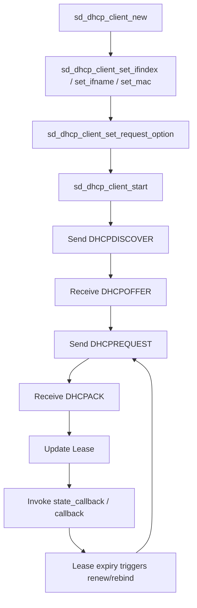
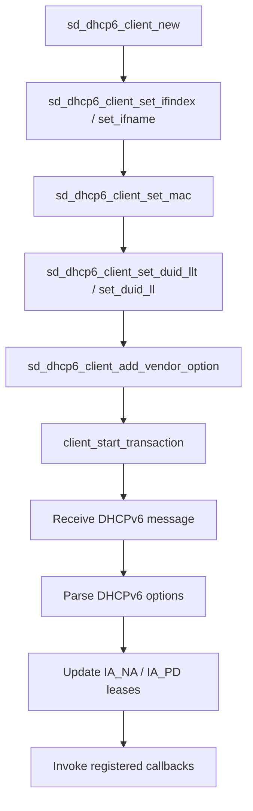
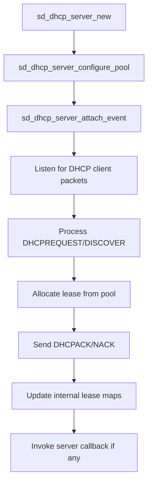
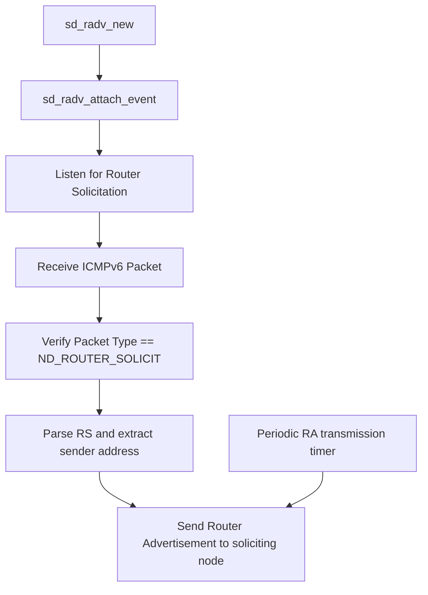
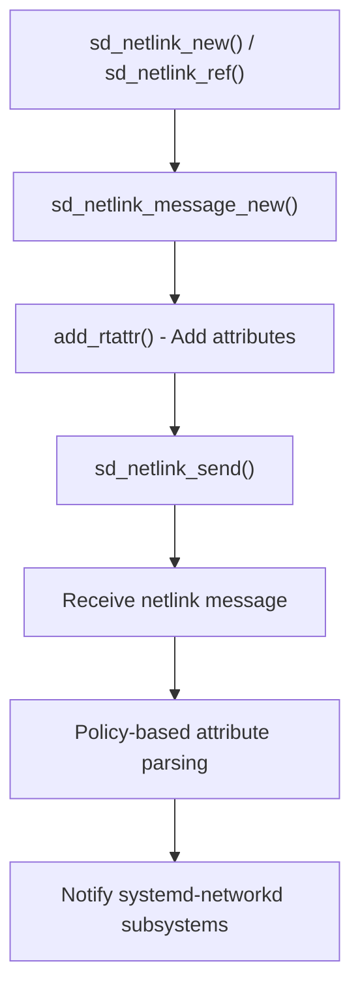
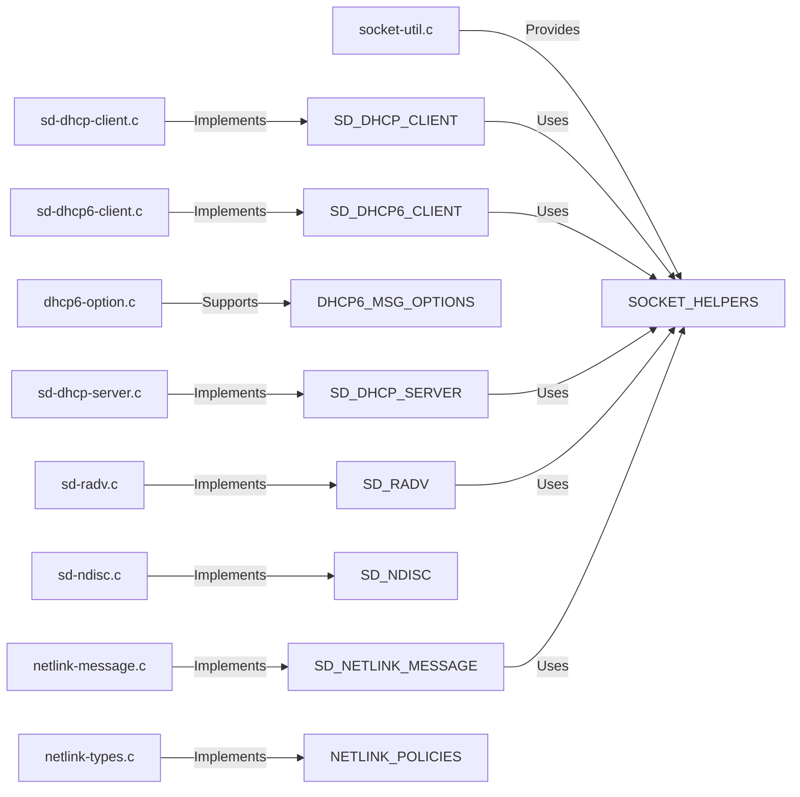
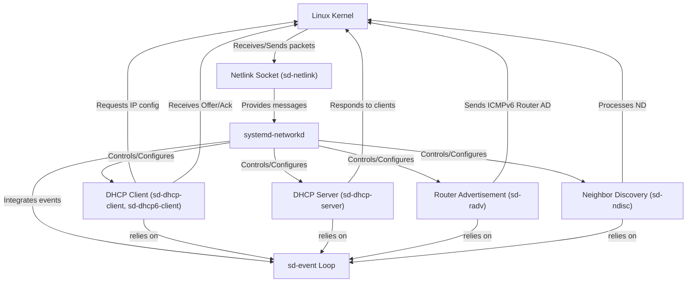

<!-- source: DeepWiki mcp.deepwiki.com · repo systemd/systemd · extra page Network Protocol Libraries (libsystemd-network) · fetched 2026-11-07 -->

# Network Protocol Libraries (libsystemd-network)

Relevant source files

The following files were used as context for generating this wiki page:

- [src/basic/cleanup-util.h](src/basic/cleanup-util.h)
- [src/basic/in-addr-util.c](src/basic/in-addr-util.c)
- [src/basic/in-addr-util.h](src/basic/in-addr-util.h)
- [src/basic/socket-util.c](src/basic/socket-util.c)
- [src/basic/socket-util.h](src/basic/socket-util.h)
- [src/basic/string-table.c](src/basic/string-table.c)
- [src/basic/string-table.h](src/basic/string-table.h)
- [src/boot/efi-string-table.h](src/boot/efi-string-table.h)
- [src/libsystemd-network/dhcp-lease-internal.h](src/libsystemd-network/dhcp-lease-internal.h)
- [src/libsystemd-network/dhcp-protocol.c](src/libsystemd-network/dhcp-protocol.c)
- [src/libsystemd-network/dhcp-protocol.h](src/libsystemd-network/dhcp-protocol.h)
- [src/libsystemd-network/dhcp-server-internal.h](src/libsystemd-network/dhcp-server-internal.h)
- [src/libsystemd-network/dhcp-server-lease-internal.h](src/libsystemd-network/dhcp-server-lease-internal.h)
- [src/libsystemd-network/dhcp-server-request.c](src/libsystemd-network/dhcp-server-request.c)
- [src/libsystemd-network/dhcp-server-request.h](src/libsystemd-network/dhcp-server-request.h)
- [src/libsystemd-network/dhcp-server-send.c](src/libsystemd-network/dhcp-server-send.c)
- [src/libsystemd-network/dhcp-server-send.h](src/libsystemd-network/dhcp-server-send.h)
- [src/libsystemd-network/dhcp6-internal.h](src/libsystemd-network/dhcp6-internal.h)
- [src/libsystemd-network/dhcp6-lease-internal.h](src/libsystemd-network/dhcp6-lease-internal.h)
- [src/libsystemd-network/dhcp6-network.c](src/libsystemd-network/dhcp6-network.c)
- [src/libsystemd-network/dhcp6-option.c](src/libsystemd-network/dhcp6-option.c)
- [src/libsystemd-network/dhcp6-option.h](src/libsystemd-network/dhcp6-option.h)
- [src/libsystemd-network/dhcp6-protocol.c](src/libsystemd-network/dhcp6-protocol.c)
- [src/libsystemd-network/dhcp6-protocol.h](src/libsystemd-network/dhcp6-protocol.h)
- [src/libsystemd-network/fuzz-dhcp-server.c](src/libsystemd-network/fuzz-dhcp-server.c)
- [src/libsystemd-network/fuzz-dhcp6-client.c](src/libsystemd-network/fuzz-dhcp6-client.c)
- [src/libsystemd-network/fuzz-ndisc-rs.c](src/libsystemd-network/fuzz-ndisc-rs.c)
- [src/libsystemd-network/icmp6-util.c](src/libsystemd-network/icmp6-util.c)
- [src/libsystemd-network/icmp6-util.h](src/libsystemd-network/icmp6-util.h)
- [src/libsystemd-network/ndisc-internal.h](src/libsystemd-network/ndisc-internal.h)
- [src/libsystemd-network/ndisc-option.c](src/libsystemd-network/ndisc-option.c)
- [src/libsystemd-network/ndisc-option.h](src/libsystemd-network/ndisc-option.h)
- [src/libsystemd-network/radv-internal.h](src/libsystemd-network/radv-internal.h)
- [src/libsystemd-network/sd-dhcp-client.c](src/libsystemd-network/sd-dhcp-client.c)
- [src/libsystemd-network/sd-dhcp-lease.c](src/libsystemd-network/sd-dhcp-lease.c)
- [src/libsystemd-network/sd-dhcp-server-lease.c](src/libsystemd-network/sd-dhcp-server-lease.c)
- [src/libsystemd-network/sd-dhcp-server.c](src/libsystemd-network/sd-dhcp-server.c)
- [src/libsystemd-network/sd-dhcp6-client.c](src/libsystemd-network/sd-dhcp6-client.c)
- [src/libsystemd-network/sd-dhcp6-lease.c](src/libsystemd-network/sd-dhcp6-lease.c)
- [src/libsystemd-network/sd-ndisc.c](src/libsystemd-network/sd-ndisc.c)
- [src/libsystemd-network/sd-radv.c](src/libsystemd-network/sd-radv.c)
- [src/libsystemd-network/test-dhcp-client.c](src/libsystemd-network/test-dhcp-client.c)
- [src/libsystemd-network/test-dhcp-server.c](src/libsystemd-network/test-dhcp-server.c)
- [src/libsystemd-network/test-dhcp6-client.c](src/libsystemd-network/test-dhcp6-client.c)
- [src/libsystemd-network/test-ndisc-ra.c](src/libsystemd-network/test-ndisc-ra.c)
- [src/libsystemd-network/test-ndisc-rs.c](src/libsystemd-network/test-ndisc-rs.c)
- [src/libsystemd-network/test-ndisc-send.c](src/libsystemd-network/test-ndisc-send.c)
- [src/libsystemd/sd-netlink/netlink-genl.c](src/libsystemd/sd-netlink/netlink-genl.c)
- [src/libsystemd/sd-netlink/netlink-internal.h](src/libsystemd/sd-netlink/netlink-internal.h)
- [src/libsystemd/sd-netlink/netlink-message-nfnl.c](src/libsystemd/sd-netlink/netlink-message-nfnl.c)
- [src/libsystemd/sd-netlink/netlink-message-rtnl.c](src/libsystemd/sd-netlink/netlink-message-rtnl.c)
- [src/libsystemd/sd-netlink/netlink-message.c](src/libsystemd/sd-netlink/netlink-message.c)
- [src/libsystemd/sd-netlink/netlink-slot.c](src/libsystemd/sd-netlink/netlink-slot.c)
- [src/libsystemd/sd-netlink/netlink-slot.h](src/libsystemd/sd-netlink/netlink-slot.h)
- [src/libsystemd/sd-netlink/netlink-socket.c](src/libsystemd/sd-netlink/netlink-socket.c)
- [src/libsystemd/sd-netlink/netlink-types-genl.c](src/libsystemd/sd-netlink/netlink-types-genl.c)
- [src/libsystemd/sd-netlink/netlink-types-internal.h](src/libsystemd/sd-netlink/netlink-types-internal.h)
- [src/libsystemd/sd-netlink/netlink-types-nfnl.c](src/libsystemd/sd-netlink/netlink-types-nfnl.c)
- [src/libsystemd/sd-netlink/netlink-types-rtnl.c](src/libsystemd/sd-netlink/netlink-types-rtnl.c)
- [src/libsystemd/sd-netlink/netlink-types.c](src/libsystemd/sd-netlink/netlink-types.c)
- [src/libsystemd/sd-netlink/netlink-types.h](src/libsystemd/sd-netlink/netlink-types.h)
- [src/libsystemd/sd-netlink/netlink-util.c](src/libsystemd/sd-netlink/netlink-util.c)
- [src/libsystemd/sd-netlink/netlink-util.h](src/libsystemd/sd-netlink/netlink-util.h)
- [src/libsystemd/sd-netlink/sd-netlink.c](src/libsystemd/sd-netlink/sd-netlink.c)
- [src/libsystemd/sd-netlink/test-netlink.c](src/libsystemd/sd-netlink/test-netlink.c)
- [src/network/networkd-dhcp-server-bus.c](src/network/networkd-dhcp-server-bus.c)
- [src/network/networkd-dhcp-server-bus.h](src/network/networkd-dhcp-server-bus.h)
- [src/network/networkd-dhcp-server.c](src/network/networkd-dhcp-server.c)
- [src/network/networkd-dhcp-server.h](src/network/networkd-dhcp-server.h)
- [src/network/networkd-dhcp4-bus.c](src/network/networkd-dhcp4-bus.c)
- [src/network/networkd-dhcp4-bus.h](src/network/networkd-dhcp4-bus.h)
- [src/network/networkd-dhcp6-bus.c](src/network/networkd-dhcp6-bus.c)
- [src/network/networkd-dhcp6-bus.h](src/network/networkd-dhcp6-bus.h)
- [src/network/networkd-manager-bus.h](src/network/networkd-manager-bus.h)
- [src/network/networkd-network-bus.h](src/network/networkd-network-bus.h)
- [src/network/networkd-radv.c](src/network/networkd-radv.c)
- [src/network/networkd-radv.h](src/network/networkd-radv.h)
- [src/shared/log-link.h](src/shared/log-link.h)
- [src/shared/socket-label.c](src/shared/socket-label.c)
- [src/shared/socket-label.h](src/shared/socket-label.h)
- [src/shared/socket-netlink.c](src/shared/socket-netlink.c)
- [src/shared/socket-netlink.h](src/shared/socket-netlink.h)
- [src/systemd/sd-dhcp-client.h](src/systemd/sd-dhcp-client.h)
- [src/systemd/sd-dhcp-lease.h](src/systemd/sd-dhcp-lease.h)
- [src/systemd/sd-dhcp-protocol.h](src/systemd/sd-dhcp-protocol.h)
- [src/systemd/sd-dhcp-server.h](src/systemd/sd-dhcp-server.h)
- [src/systemd/sd-dhcp6-client.h](src/systemd/sd-dhcp6-client.h)
- [src/systemd/sd-dhcp6-lease.h](src/systemd/sd-dhcp6-lease.h)
- [src/systemd/sd-dhcp6-option.h](src/systemd/sd-dhcp6-option.h)
- [src/systemd/sd-dhcp6-protocol.h](src/systemd/sd-dhcp6-protocol.h)
- [src/systemd/sd-dns-resolver.h](src/systemd/sd-dns-resolver.h)
- [src/systemd/sd-ndisc.h](src/systemd/sd-ndisc.h)
- [src/systemd/sd-netlink.h](src/systemd/sd-netlink.h)
- [src/systemd/sd-radv.h](src/systemd/sd-radv.h)
- [src/test/test-in-addr-prefix-util.c](src/test/test-in-addr-prefix-util.c)
- [src/test/test-in-addr-util.c](src/test/test-in-addr-util.c)
- [src/test/test-socket-netlink.c](src/test/test-socket-netlink.c)
- [src/test/test-socket-util.c](src/test/test-socket-util.c)

This page documents the core network protocol libraries contained in `libsystemd-network`, which provide implementation for DHCP clients and servers (both IPv4 and IPv6), Neighbor Discovery and Router Advertisement protocols, as well as low-level netlink and socket helper functionalities. These libraries are primarily used by `systemd-networkd` but are designed as reusable APIs that encapsulate complex protocol handling and kernel interactions, exposing clean and robust interfaces.

---

## Scope and Purpose

`libsystemd-network` implements:

- **DHCPv4 Client:** `sd-dhcp-client`
- **DHCPv6 Client:** `sd-dhcp6-client`
- **DHCPv4 Server:** `sd-dhcp-server`
- **Neighbor Discovery (NDISC) and Router Advertisement (RADV):** `sd-ndisc` and `sd-radv`
- **Network Link Communication via Netlink:** `sd-netlink`
- **Low-level socket and netlink helpers** for robust asynchronous I/O and packet transmission

The libraries encapsulate protocol state machines, packet parsing and construction, lease management, event loop integration, and interaction with the Linux kernel's networking stack.

---

## 1. DHCPv4 Client (`sd-dhcp-client`)

The DHCPv4 client implemented in `sd-dhcp-client.c` handles acquiring IP configuration via DHCP on given interfaces. It manages DHCP states, retransmissions, lease renewal, parsing DHCP offers, and notifying the user of lease changes or failures.

### Implementation Highlights

- **State Machine:** The client follows the DHCP client finite state machine, transitioning through states such as INIT, SELECTING, REQUESTING, BOUND, RENEWING, REBINDING, and INIT-REBOOT.

- **Callbacks Interface:** Consumers can register callbacks via `sd_dhcp_client_set_callback()` or `dhcp_client_set_state_callback()` to receive asynchronous updates about DHCP events or state changes.

- **Configuration:** Interfaces can be assigned by interface index or name using `sd_dhcp_client_set_ifindex()` or `sd_dhcp_client_set_ifname()`. The MAC address and ARP type are configurable for constructing DHCP packets.

- **Request Options:** The library manages which DHCP options to request, ensuring invalid options are rejected.

- **Lease Handling:** Internally tracks leases and timestamps with TTLs and timers to initiate renewals or transitions.

### Core Functionality Flow

1. **Initialization:** Create client instance and set interface parameters (MAC, ifindex, options).
2. **Start DHCP:** Client sends DHCPDISCOVER or DHCPREQUEST as per current state.
3. **Receive Response:** Parses DHCPOFFER and DHCPACK messages.
4. **Update Lease:** Updates internal lease data, resets timers.
5. **Notify User:** Invokes callback on lease acquisition or failure.
6. **Renewal:** On lease expiry, sends Renew or Rebind requests.

Sources: `src/libsystemd-network/sd-dhcp-client.c` [1-208]()

---

## 2. DHCPv6 Client (`sd-dhcp6-client`)

The DHCPv6 client in `sd-dhcp6-client.c` supports IPv6 address configuration using DHCPv6. It manages IA_NA (Non-temporary Addresses), IA_PD (Prefix Delegation), DUID generation, options management, and communication with DHCPv6 servers and relay agents.

### Implementation Highlights

- **Callback Support:** Similar to DHCPv4 client, allows setting notification callbacks (`sd_dhcp6_client_set_callback`).

- **Interface Configuration:** Set interface index or name, and local link-local IPv6 address.

- **DUID Management:** Supports setting and generating DHCP Unique Identifiers (DUID), including hardware-based and prefix-based DUIDs.

- **Vendor Options:** Can add vendor-specific DHCPv6 options.

- **Lease and Prefix Delegation:** Maintains IA_NA and IA_PD leases internally with associated addresses and prefixes.

- **State Transitions:** Client manages DHCPv6 states and retransmissions.

### Data Flow and Functions

- Client starts transactions via `client_start_transaction()` triggering solicit/request messages.
- Incoming DHCPv6 messages are parsed, with options extracted and leases updated.
- State callbacks inform user code about lease status changes and events.

Sources: `src/libsystemd-network/sd-dhcp6-client.c` [1-223]() and `src/libsystemd-network/dhcp6-option.c` [1-176]()

---

## 3. DHCPv4 Server (`sd-dhcp-server`)

The DHCPv4 server implementation provides management of pools of IP addresses, lease allocation and renewal, and network configuration distribution to DHCP clients.

### Implementation Highlights

- **Pool Configuration:** Configure server subnet, prefixlen, offset and pool size with `sd_dhcp_server_configure_pool()`.

- **Leases Storage:** Maintains data structures tracking bound and static leases indexed by address and client ID.

- **Event Loop Integration:** Attaches to `sd-event` for asynchronous packet reception and transmit.

- **Options Support:** Supports additional vendor and extra DHCP options.

- **Client Interaction:** Allocates addresses based on the pool for incoming requests, deals with DHCP message processing.

- **Lifecycle Management:** Start and stop the DHCP server, manage socket file descriptors.

### Data Flow Diagram

Sources: `src/libsystemd-network/sd-dhcp-server.c` [1-203]()

---

## 4. Neighbor Discovery and Router Advertisement (`sd-ndisc` and `sd-radv`)

The IPv6 neighbor discovery (NDISC) and router advertisement (RADV) protocols are implemented mainly in `sd-ndisc.c` and `sd-radv.c`.

### Key Functions and Features

- **Router Advertisements:** `sd-radv` manages sending unsolicited and solicited ICMPv6 Router Advertisement messages, with configurable lifetimes, hop limits and flags.

- **Router Solicitations Handling:** Listens for Neighbor Discovery Router Solicitations (RS) and responds appropriately.

- **Options Management:** Supports multiple options as sets, including Source Link-Layer Addresses.

- **Event Loop:** Integrates with systemd's event loop to schedule periodic and solicited RA transmissions.

- **Packet Parsing:** Validates incoming ICMPv6 packets and generates appropriate responses.

### Router Advertisement Processing Flow

Sources: `src/libsystemd-network/sd-radv.c` [1-211]() and `src/network/networkd-radv.c` [1-218]()

---

## 5. Netlink Communication Helpers (`sd-netlink`)

The `sd-netlink` subsystem provides reusable abstractions for asynchronous communication with the Linux kernel's Netlink sockets. It encapsulates message handling, policy-based attribute parsing, message sending, and socket management.

### Core Concepts and Structures

- **sd_netlink:** Represents a netlink socket, managing socket setup, message queues, and event loop integration.

- **sd_netlink_message:** Represents individual netlink messages, supports reference counting, attribute management, and type querying.

- **NLAPolicy and NLAPolicySet:** Define expected message formats and attribute types, enabling safe parsing of kernel messages.

### Key Functions and Features

- **Message Creation:** Use `message_new()`, `message_new_full()` to allocate messages with proper headers and policies.

- **Attribute Handling:** Add and inspect attributes via `add_rtattr()` and policy queries.

- **Error Handling:** Create synthetic error messages for kernel errors.

### Interaction Flow in Networkd

The netlink helpers underpin all network object management such as links, addresses, and routes inside `systemd-networkd`, enabling it to send RTM_NEWLINK, RTM_NEWADDR, RTM_NEWROUTE messages and parse kernel responses.

Sources: `src/libsystemd-network/sd-netlink/netlink-message.c` [1-222]() and `src/libsystemd/sd-netlink/netlink-types.c` [1-158]()

---

## 6. Low-level Socket and Netlink Helpers (`socket-util`)

The `socket-util.c` library provides foundational socket-related helper functions used by all the above network protocols. It includes:

- Address validation and printing (`socket_address_verify()`, `socket_address_print()`).
- Socket option configuration (send/receive buffer sizing).
- Generic send/receive wrappers for socket I/O.
- Netlink socket address validation and utilities.

The interface defined in `socket-util.h` provides type-safe manipulation of various socket address families (INET, INET6, UNIX, NETLINK, VSOCK) and supports consistent error checking.

This abstraction ensures robust and portable code that can reliably communicate on various socket types.

Sources: `src/basic/socket-util.c` [1-198]() and `src/basic/socket-util.h` [1-164]()

---

# Relationship Diagram: Protocol Libraries to Code Entities

---

# Typical Data Flow Inside `systemd-networkd` Using These Libraries

---

# Summary of Provided APIs

| Library / Component          | Key Functions / Types                                   | Purpose                                        |
|-----------------------------|--------------------------------------------------------|------------------------------------------------|
| `sd-dhcp-client.c`           | `sd_dhcp_client_new()`, `sd_dhcp_client_set_ifindex()`, `sd_dhcp_client_set_callback()`           | DHCPv4 client implementation                    |
| `sd-dhcp6-client.c`          | `sd_dhcp6_client_new()`, `sd_dhcp6_client_set_ifindex()`, `sd_dhcp6_client_set_callback()`        | DHCPv6 client implementation                     |
| `sd-dhcp-server.c`           | `sd_dhcp_server_new()`, `sd_dhcp_server_configure_pool()`, `sd_dhcp_server_attach_event()`        | DHCPv4 server implementation                      |
| `sd-radv.c`                  | `sd_radv_new()`, `sd_radv_attach_event()`, `sd_radv_send()`                                       | Router Advertisement protocol                     |
| `sd-ndisc.c` (not detailed) | Implements Neighbor Discovery protocol processing                                               | Neighbor Solicitation and Advertisement handling   |
| `sd-netlink/`                | `sd_netlink_new()`, `sd_netlink_message_new()`, message building and parsing with policies        | Netlink socket communication helpers               |
| `socket-util.c`              | `socket_address_verify()`, `socket_address_print()`, buffer sizing and generic send/recv helpers | Generic socket utilities for all network libs      |

---

# References to Source Code

- DHCPv4 Client: `src/libsystemd-network/sd-dhcp-client.c:1-208`  
- DHCPv6 Client: `src/libsystemd-network/sd-dhcp6-client.c:1-223`  
- DHCPv6 Option Support: `src/libsystemd-network/dhcp6-option.c:1-176`  
- DHCPv4 Server: `src/libsystemd-network/sd-dhcp-server.c:1-203`  
- Router Advertisement: `src/libsystemd-network/sd-radv.c:1-211`  
- Neighbor Discovery (NDISC): `src/libsystemd-network/sd-ndisc.c` (files exist, not fully shown)  
- Netlink Messages and Types: `src/libsystemd-network/sd-netlink/netlink-message.c:1-222`, `src/libsystemd-network/sd-netlink/netlink-types.c:1-158`  
- Socket Helpers: `src/basic/socket-util.c:1-198`, `src/basic/socket-util.h:1-164`  

---

# Conclusion

The `libsystemd-network` component implements a robust, modular foundation of network protocol libraries used primarily by `systemd-networkd`. It provides complete DHCPv4/IPv6 clients, DHCPv4 server, IPv6 Neighbor Discovery and Router Advertisement support along with powerful Netlink and socket utilities. These libraries abstract complex networking protocols and kernel interactions into manageable and event-driven APIs that can be integrated into the systemd network stack or reused by other components requiring DHCP or IPv6 networking capabilities.

---

# End of Page 3.1.1: Network Protocol Libraries (libsystemd-network)

---

