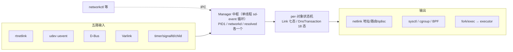

# systemd 新人入职文档（ONBOARDING）

> 图谱基线：commit `ca78951bd`（2026-11-07），版本 `263~devel`；知识图谱 23,980 节点 / 56,393 边 / 16 层 / 16 步 tour。

## 1. 这是什么项目

systemd 是 Linux 的 PID1 系统与服务管理器"全家桶"——不只是 1 号进程，而是一整套覆盖启动、服务、设备、网络、日志、安全引导的基础设施。本仓为上游完整源码（麒麟网络线工作目录）。规模：根 `meson.build`（3648 行）以 156 个 `subdir()` 串联 `src/` 下 135 个组件目录、216 个命名构建目标，算上别名与生成器，对外组件约 262 个。五类成员：**PID1 核心**（`src/core/`）；**30 余个专用守护进程**（networkd/resolved/journald/logind/udevd/timesyncd/homed/oomd/pcrlock……各自独立事件循环）；**CLI 工具群**（systemctl/networkctl/resolvectl/journalctl/busctl/analyze）；**公共库**（libsystemd 与 libsystemd-network）；**systemd-boot 与 ukify**（`src/boot/`）。

本仓在网络线目录下，阅读重心是 networkd 与 resolved，但两者的地基（sd-event/conf-parser/netlink）与宿主（PID1）都在全仓——本文全仓讲解、网络线加重。

## 2. 十分钟架构

一句话：**每个 systemd 守护进程都是"一个 sd-event 单线程事件循环 + 一个 Manager 中枢 + 若干状态机"**，没有多线程竞争。`sd-event`（`src/libsystemd/sd-event/sd-event.c`，5892 行）封装 epoll+timerfd+signalfd，支持 13 种事件源：io、四种 time、signal、child、inotify、defer、post、exit、watchdog、cpu/io-pressure（sd-event.c:69-91）。PID1 的 `manager_loop()`（manager.c:3636）就是"排空 load/gc/cleanup 队列 + sd_event_run 一轮"的循环。

以 networkd 走一遍：内核 RTM_NEWLINK → rtnetlink 回调 → `Manager.links` 找到/新建 `Link` → 等 udev 后进 CONFIGURING → 逐阶段配地址/路由/DHCP → CONFIGURED。守护进程骨架全一致：`main-func.h` 统一 main() 样板，manager_new → manager_setup 挂事件源 → sd_event_loop，退出 serialize。看懂一个，全家都会读。

## 3. 目录地图（16 层归 9 组）

1. **构建与仓库配置（L01）**：meson.build/meson_options.txt（289 个 option、66 个 feature 开关）、clang-format、ukify。
2. **契约与地基（L02+L03）**：`src/systemd/sd-*.h` 48 个公共 API 头；`src/include/uapi` 内核头同步 + override/musl 兼容层；`src/fundamental`（PID1 与 EFI 共用）与 `src/basic`（hashmap/string-util/log 等）。图谱 hub 几乎全在此——alloc-util.h 被 946 文件引用。
3. **公共库（L04+L05）**：`src/libsystemd`（sd-bus/sd-journal/sd-netlink/sd-varlink/sd-json 等 205 文件）；`src/libsystemd-network`（DHCPv4/v6、NDISC、LLDP、ACD 等 110 文件，networkd/resolved 共用的协议引擎）。
4. **shared 工具池（L06+L07）**：626 文件——conf-parser（几乎全部 ini 解析骨架）、bus-util、serialize、verbs（CLI 动词派发 DSL）；L07 含 51 个 `varlink-io.systemd.*` IDL，服务面 IPC 单一事实源。
5. **PID1 核心（L08）**：220 文件，见 §4.1。
6. **网络线（L09+L10）**：networkd 全族 301 文件 + resolved 113 文件，见 §4.3/§4.4。
7. **设备与引导（L11+L12）**：udev 规则引擎与 libudev；systemd-boot（freestanding C）。
8. **日志/会话/虚机/主机域（L13-L15）**：journald/logind/homed/NSS 插件；machined/nspawn/oomd/coredump/repart；timesync/pcrlock/sleep。
9. **CLI 与质量（L16）**：systemctl/analyze、九个 unit 生成器、`src/fuzz/` 模糊测试骨架。

## 4. 核心子系统深读（六处必看）

### 4.1 core：Manager 与 unit 事务

PID1 心跳 `manager_loop()`（manager.c:3636）：排空 load 队列（懒加载 unit）、gc job/unit、cleanup，再分发事件。job 由 `transaction_activate()`（transaction.c:804）落地；构建在 transaction.c:1034——沿 Requires/Wants/After 依赖图做逆序闭包，`transaction_merge_jobs()`（:321）合并同 unit 冲突，`transaction_verify_order_one()`（:412）查循环依赖。**Unit 抽象**在 unit.c（7327 行）：Unit 结构 + `UnitVtable` 多态接口表，11 种 unit 类型各注册一个 vtable；load-fragment.c 经 gperf 查表把 ini 灌入各类型 Context。`manager-serialize.c:119` 是 daemon-reexec/升级不重启的秘密。

### 4.2 executor：进程执行与沙箱现场

参数模型在 `execute.h`（ExecContext/ExecParameters/ExecRuntime 三层：配置/本次调用/跨次共享），执行现场是 **exec-invoke.c（7291 行）**：namespace 隔离（namespace.c，ProtectSystem/PrivateTmp 等 20 余种选项）、cgroup 归属、capability/SELinux 上下文、BPF 钩子（exec-invoke.c:2292 起、io_uring filter :1839）、凭据注入、stdio 对接 journald。**executor.c（245 行）是拆出的 stub 进程**：PID1 把序列化好的参数（execute-serialize.c）经 socket 交给独立 systemd-executor 代为 fork，升级重启不必持有执行细节。

### 4.3 networkd：链路状态机 + sysctl BPF 监控

中枢 `Manager`（networkd-manager.h）聚合三条 netlink（rtnl/genl/nfnl，:18-21）与**三个 varlink server**（io.systemd.Network、resolve-hook、metrics，:26-28），持有 links/networks/netdevs/routes/nexthops 索引。每张网卡一个 `Link` 状态机，七态：PENDING（等 udev）→ INITIALIZED → CONFIGURING → CONFIGURED，旁路 UNMANAGED/FAILED/LINGER（networkd-link.h:14-23）；`link_set_state()`（networkd-link.c:373）驱动，请求先经 networkd-queue.c 的 Request 队列防竞态。配置面是 networkd-network.h 里 300+ 字段的 Network 结构；netdev/ 管虚拟设备族，tc/ 管 22 种 qdisc。

**本仓网络线特色**：`networkd-sysctl.c:100 manager_install_sysctl_monitor()` 用 CO-RE BPF 监控 sysctl 写——`src/bpf/sysctl-monitor.bpf.c` 定义 cgroup_map + written_sysctls（RINGBUF 256KB）两张地图（:15-26），attach 到根 cgroup；用户态经 libbpf ring buffer（dlopen 弱依赖，bpf-util.c:85）把事件并入 sd_event_add_io。任何人在 netns 里写 /proc/sys，networkd 都能感知并重置影子状态。

### 4.4 resolved：三层对象模型

一次解析三层接力：**DnsQuery**（resolved-dns-query.h:28，面向调用方）→ **DnsQueryCandidate**（scope×搜索域组合）→ **DnsTransaction**（resolved-dns-transaction.h:11，单次 DNS 会话，18 态：NULL/PENDING/VALIDATING/SUCCESS/TIMEOUT/DNSSEC_FAILED/STUB_LOOP…）。scope 按协议族×链路划分，cache（正负缓存+TTL 修剪+DNSSEC 可信期）与 dnssec（15 种 DnssecResult 验证器）挂在事务下。Manager（resolved-manager.h，约 100 字段）持有 127.0.0.53 stub、LLMNR/mDNS 对等解析与 varlink/D-Bus 双接口。

### 4.5 libsystemd：sd-bus 与 sd-varlink 双 IPC 栈

**sd-bus**（sd-bus.c 4511 行 + bus-*.c 共 64 文件）：自研 D-Bus 实现（kernel dbus、memfd 大消息、匹配树/对象树/slot 生命周期），sd-bus.h 约 297 个原型是 libsystemd 最大 API 面。**sd-varlink**（sd-varlink.c 4495 行）：新一代 JSON-RPC 风格协议（AF_UNIX + JSON + fd 传递 + fiber 协程）。另有 sd-json、sd-netlink、sd-journal、sd-device。

### 4.6 BPF：systemd × eBPF 交汇（`src/bpf/`）

8 个 `.bpf.c` 字节码源（vmlinux.h + BTF CO-RE，编译期 bpftool 生成 skeleton）：sysctl-monitor（§4.3）、socket-bind（RestrictAddressFamilies 实施）、restrict-fs/restrict-ifaces、userns-restrict（770 行）、bind-iface、monitor-varlink。用户态 `dlopen_bpf()` 弱依赖使缺库环境只降级不崩——networkd 因此敢"装完就丢权限"。构建期经 meson `bpf_programs` 数组挂到宿主目标。

## 5. 新人第一周路线（16 步 tour 并成 5 天）

- **Day 1 骨架与 API**：build-overview（meson 模板拼 216 个目标）→ pid1-entry（main.c + manager_loop）→ libsystemd-api（sd-event 优先级队列）→ headers-libc（sd-*.h 契约与影子 libc）。动手：meson setup build && ninja -C build。
- **Day 2 调度核心**：unit-transaction（vtable + 依赖闭包，systemctl list-jobs 对照）→ executor（跟读 ProtectSystem/PrivateTmp 路径）。动手：写最小 service，systemd-analyze security 看评分。
- **Day 3 网络线上**：networkd 全步（三 netlink → link 状态机 → netdev/tc）。动手：手写 .network（DHCP=yes），networkctl status 看流转；精读 networkd-sysctl.c + sysctl-monitor.bpf.c。
- **Day 4 网络线下 + 质量**：resolved（三层对象）→ netstack-fuzz（协议库 + fuzz 骨架）。动手：resolvectl query + journalctl -u systemd-resolved。
- **Day 5 外围自选**：journald → udev → cli-tools 必读；boot-security / session-daemons / virt-daemons 选一。动手：busctl tree；varlinkctl call io.systemd.Manager.Describe。

## 6. 构建与测试

- **构建**：meson ≥ 0.62；`meson setup build && ninja -C build`。`developer`/`experimental` 门控开发特性，66 个 feature 开关裁组件；仓内 `mkosi/` 沙箱构建是不想装依赖时的首选。
- **单测**：各目录 `test-*.c` 用 `src/shared/tests.h` 的 `TEST()` 宏注册进链接段，`meson test -C build`（ctest）直接可见；网络集成测试在 `test/test-network/`（真实建 veth，需 root）。
- **fuzz 体系**：`src/fuzz/fuzz-main.c` 统一骨架（同一入口在 OSS-Fuzz libFuzzer 与本地 stdin 两模式跑），全仓 55 个 `fuzz-*.c` 覆盖各配置解析器/日志流/udev 规则——**新增 parser 必配 fuzzer** 是上游硬惯例。
- **风格**：clang-format/clang-tidy 强制；Python 工具走 ruff+mypy。

## 7. 设计哲学与坑

1. **单线程事件驱动是铁律**：守护进程不开工作线程，一切并发化作事件源；慢操作用 defer/post 源或独立子进程（executor 模式），别起线程。
2. **capability 最小化是渐进的**：networkd 启动 `drop_privileges()` 保留恰好 6 个 cap（NET_ADMIN/NET_BIND_SERVICE/NET_BROADCAST/NET_RAW/SYS_ADMIN/BPF，networkd.c:73-79），装 BPF 要后两个；`manager_start()` 装完 sysctl monitor 立刻 drop CAP_SYS_ADMIN、CAP_BPF（networkd-manager.c:885-893）。读 daemon 的 main 要带"此刻还剩哪些权限"的视角。
3. **serialize/deserialize 断点续配**：升级不重启靠 manager-serialize.c/execute-serialize.c/unit-serialize.c 把全部运行态写成行式线格式；新增 Manager 字段必须同步补 serialize 分支，否则重启即失忆。
4. **D-Bus → Varlink 迁移进行时**：51 个 `varlink-io.systemd.*` IDL；PID1 已在 varlink.c:424 注册 io.systemd.Manager，networkctl 已直连 `/run/systemd/netif/io.systemd.Network`（networkctl-util.c:22），但 org.freedesktop.systemd1 仍是兼容主力。新接口先在 shared 定义 IDL，两端共享。
5. **负 errno 约定**：失败返回 `-errno`，配 RET_GATHER 与 ERRNO_IS_* 谓词分类（errno-util.h）；改 meson 别忘 export 列表，新配置键要同步 conf-parser/serialize/varlink IDL 三处。

## 8. 深入索引

- **图谱资产**（本目录）：`knowledge-graph.json`（23,980 节点/56,393 边/16 层/16 步 tour）——问"X 被谁引用"先查图谱再 grep；`onboard-input.json` 为本文件输入。
- **grep 词表**：查配置键 `grep -rn 'IPv6AcceptRA=' src/network/`；查 varlink 方法 `grep -rn 'vl_method_' src/core/`；查 BPF 能力 `grep -rn 'dlopen_bpf' src/`；查守护进程入口 `grep -rn 'DEFINE_MAIN_FUNCTION' src/<dir>/`。
- **文档**：`man/` 是行为权威（改码必同步 man 页）；`NEWS` 变更清单；`docs/` 含 JOURNAL_FILE_FORMAT 等格式规范。
- **锚点回顾**：manager.c:3636 / transaction.c:804 / exec-invoke.c:2292 / networkd-link.h:14 / networkd-sysctl.c:100 / resolved-dns-transaction.h:10 / networkd.c:73（六 cap 降权）。
