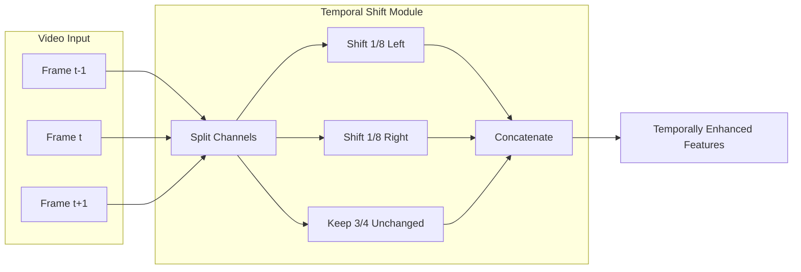
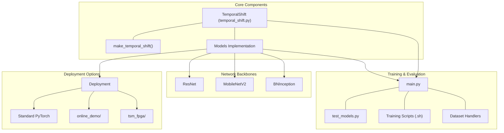
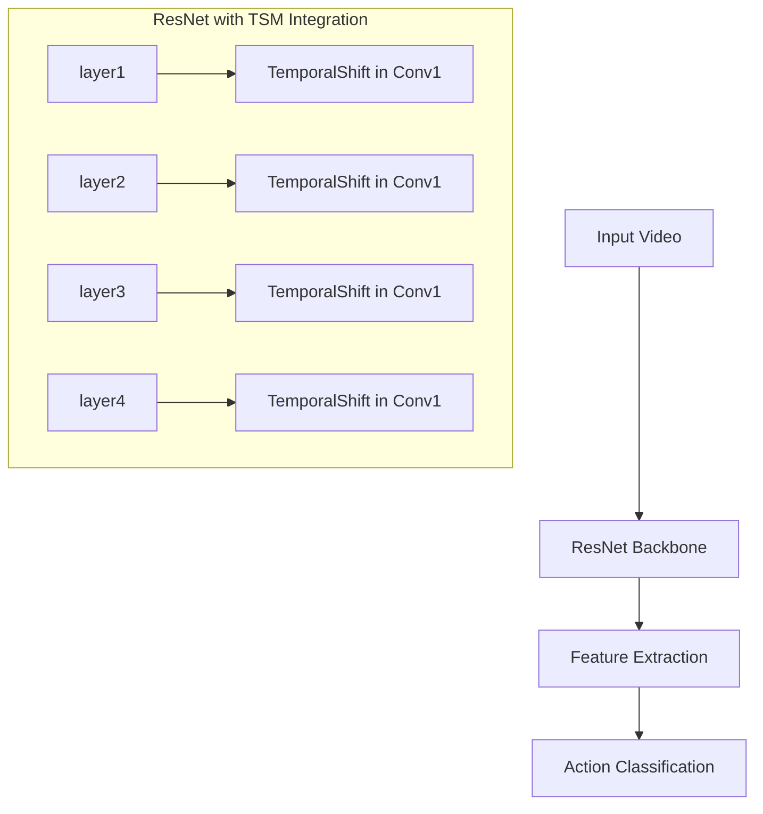
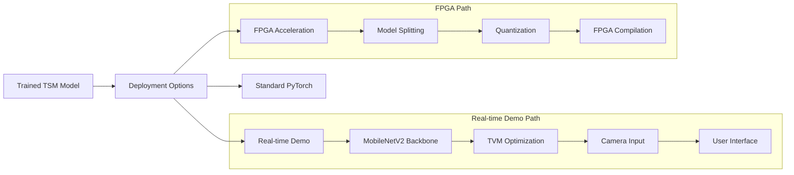

<!-- source: DeepWiki mcp.deepwiki.com · repo mit-han-lab/temporal-shift-module · page 1 Overview · fetched 2026-10-30 -->

# Overview

<details>
<summary>Relevant source files</summary>

The following files were used as context for generating this wiki page:

- [README.md](README.md)
- [ops/temporal_shift.py](ops/temporal_shift.py)

</details>


The Temporal Shift Module (TSM) is an efficient approach to video understanding that enables 2D CNNs to capture temporal information without adding parameters or computation. This document provides a high-level overview of the TSM system, its core concepts, and key components.

## Purpose and Scope

Video understanding typically requires modeling both spatial and temporal dimensions. Traditional approaches include 3D CNNs (which are computationally expensive) or optical flow (which requires additional preprocessing). TSM offers an elegant solution by enabling temporal modeling in standard 2D CNN architectures through a simple channel shifting mechanism.

This overview introduces the fundamental concepts and architecture of TSM. For details about specific deployment options, see [Deployment Options](#3) and for training and evaluation details, see [Training and Evaluation](#4).

Sources: [README.md:24-30]()

## What is Temporal Shift Module?

The Temporal Shift Module is a plug-and-play module that enables information exchange between adjacent frames by shifting part of the channels along the temporal dimension. This allows 2D CNNs to capture temporal relationships without adding parameters or computational cost.

**Diagram: Temporal Shift Module Concept**


The core implementation of TSM can be found in [ops/temporal_shift.py](). The main class `TemporalShift` implements the channel shifting operation that enables temporal modeling.

Sources: [ops/temporal_shift.py:12-24](), [README.md:68-83]()

### Temporal Shift Operation

The temporal shift operation works by:
1. Dividing the channels into three parts
2. Shifting 1/8 of channels to the left (previous frame)
3. Shifting 1/8 of channels to the right (next frame)
4. Keeping 3/4 of the channels unchanged

This operation is implemented in the `shift` method of the `TemporalShift` class:

```python
# The core implementation of the temporal shift operation
out = torch.zeros_like(x)
fold = c // fold_div
out[:, :-1, :fold] = x[:, 1:, :fold]  # shift left
out[:, 1:, fold: 2 * fold] = x[:, :-1, fold: 2 * fold]  # shift right
out[:, :, 2 * fold:] = x[:, :, 2 * fold:]  # not shift
```

Sources: [ops/temporal_shift.py:26-44]()

## System Architecture

The TSM system builds upon the Temporal Segment Networks (TSN) framework but introduces the temporal shift operation to enable temporal modeling.

**Diagram: TSM System Architecture**


The system consists of several components:
- **Core Implementation**: The Temporal Shift Module and its integration with network backbones
- **Training & Evaluation**: Scripts for training and testing models on various datasets
- **Deployment Options**: Different ways to deploy the trained models, including real-time demos and FPGA acceleration

Sources: [README.md:24-83](), [ops/temporal_shift.py:97-148]()

## Integration with CNN Architectures

TSM is integrated into CNN architectures using the `make_temporal_shift` function, which inserts the temporal shift module at specific locations in the network.

**Diagram: TSM Integration in ResNet**


The `make_temporal_shift` function supports two integration methods:
- **block**: Applies temporal shift to all blocks in each network stage
- **blockres**: Applies temporal shift to the first convolution layer of selected residual blocks (more efficient)

Sources: [ops/temporal_shift.py:97-139]()

## Implementation Variants

The TSM implementation provides two variants:

1. **Standard Implementation**: Creates a new tensor for the shifted channels
   ```python
   out = torch.zeros_like(x)
   out[:, :-1, :fold] = x[:, 1:, :fold]  # shift left
   out[:, 1:, fold: 2 * fold] = x[:, :-1, fold: 2 * fold]  # shift right
   out[:, :, 2 * fold:] = x[:, :, 2 * fold:]  # not shift
   ```

2. **In-place Implementation**: Performs the shift in-place to improve memory efficiency during training
   ```python
   # Implemented in InplaceShift class
   # Reduces memory consumption during training
   ```

The in-place implementation is recommended for better performance during training.

Sources: [ops/temporal_shift.py:12-20](), [ops/temporal_shift.py:47-74]()

## Key Features and Benefits

| Feature | Benefit |
|---------|---------|
| Zero additional parameters | Same model size as 2D CNNs |
| Zero additional computation | Same computational cost as 2D CNNs |
| Flexible backbone support | Works with ResNet, MobileNetV2, BNInception |
| Multiple deployment options | Standard PyTorch, Real-time demo, FPGA |
| State-of-the-art performance | High accuracy on video datasets |
| Efficiency | Real-time performance on edge devices |

Sources: [README.md:24-30](), [README.md:104-114]()

## Deployment Options

TSM can be deployed in several ways:

### Standard PyTorch Inference
Models can be deployed using standard PyTorch on CPUs or GPUs.

### Real-time Hand Gesture Recognition Demo
TSM has been deployed for real-time hand gesture recognition on resource-constrained devices like NVIDIA Jetson Nano. This implementation uses MobileNetV2 as the backbone and achieves real-time performance at only 8 watts.

### FPGA Acceleration
TSM has also been deployed on FPGA devices for hardware acceleration, making it suitable for embedded applications.

**Diagram: Deployment Workflow**


Sources: [README.md:19-22](), [README.md:254-260]()

## Supported Datasets

TSM has been evaluated on several datasets:

- **Kinetics-400**: A large-scale action recognition dataset
- **Something-Something V1 & V2**: Datasets focused on temporal relationships
- **UCF101**: Action recognition dataset
- **HMDB51**: Human motion database
- **Jester**: Hand gesture dataset

For dataset preparation details, see [Data Preparation](#5.1).

Sources: [README.md:57-66]()

This overview provides a foundation for understanding the Temporal Shift Module system. For more detailed information about specific components, please refer to the corresponding wiki pages.

---

