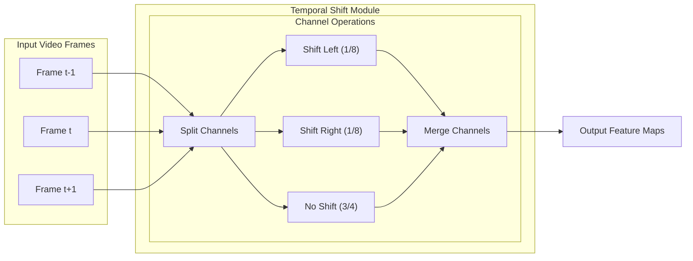
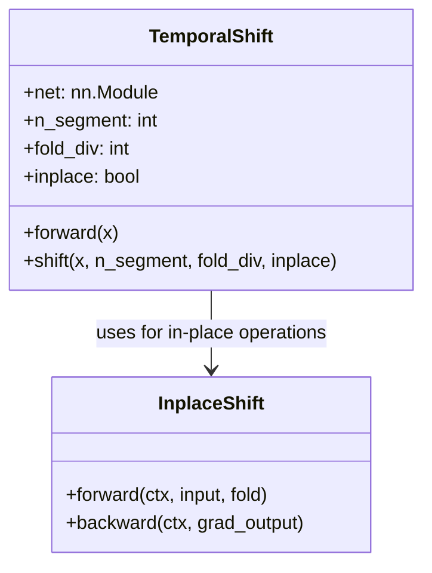
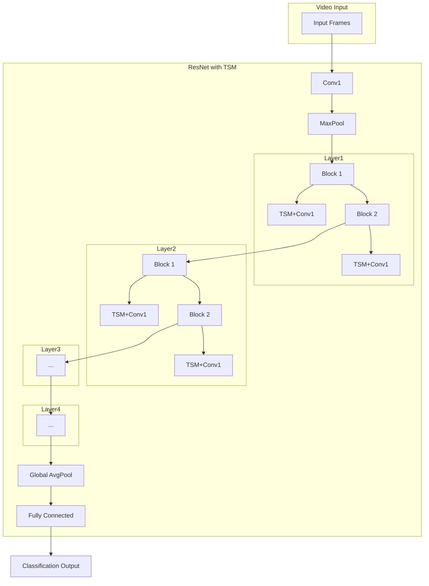

<!-- source: DeepWiki mcp.deepwiki.com · repo mit-han-lab/temporal-shift-module · page 1.1 What is Temporal Shift Module? · fetched 2026-10-30 -->

# What is Temporal Shift Module?

<details>
<summary>Relevant source files</summary>

The following files were used as context for generating this wiki page:

- [README.md](README.md)
- [ops/temporal_shift.py](ops/temporal_shift.py)

</details>


## Purpose

The Temporal Shift Module (TSM) is a key innovation designed to enable efficient temporal modeling in video understanding tasks. This page explains the core concept of TSM, its implementation details, and how it allows 2D Convolutional Neural Networks (CNNs) to capture temporal relationships in videos without adding additional parameters or computation. For information about training TSM models or deployment options, please see [Training and Evaluation](#4) and [Deployment Options](#3) respectively.

## Core Concept

The Temporal Shift Module enables 2D CNNs to perform temporal modeling by shifting a portion of the channels along the temporal dimension. This simple operation facilitates information exchange between neighboring frames, allowing models to capture temporal dependencies without adding extra parameters or computational complexity.



Sources: [ops/temporal_shift.py:27-44](), [README.md:75-80]()

The key innovation is deceptively simple: by shifting a portion of channels across the temporal dimension, spatial features from neighboring frames are intermixed, enabling temporal reasoning abilities while maintaining the computational efficiency of 2D convolutions.

## Implementation Details

TSM is implemented in the `TemporalShift` class, which wraps around an existing network module and adds the channel shifting functionality.



Sources: [ops/temporal_shift.py:11-44](), [ops/temporal_shift.py:47-74]()

The core shifting operation is implemented in the static `shift` method, which:

1. Reshapes the input tensor to separate the temporal dimension
2. Splits channels into three portions:
   - First 1/8 of channels: shifted left (forward in time)
   - Second 1/8 of channels: shifted right (backward in time)
   - Remaining 3/4 of channels: kept unchanged
3. Reshapes back to the original tensor shape

The implementation supports both standard and in-place operations. The in-place version is more memory-efficient but requires custom CUDA kernels for parallel computing.

## Integration with CNN Architectures

TSM is designed to be integrated into existing 2D CNN architectures like ResNet. The `make_temporal_shift` function handles this integration by applying the `TemporalShift` module to specific layers of the network.



Sources: [ops/temporal_shift.py:97-139]()

TSM can be integrated in two ways:
1. **Block-wise integration**: Applying TSM to each block in a ResNet
2. **Residual-wise integration**: Applying TSM only to the first convolution of each residual block

The residual-wise integration (referred to as `blockres` in the code) is more efficient as it reduces the number of shift operations while maintaining performance.

## Technical Advantages

The Temporal Shift Module offers several key advantages:

| Feature | Description |
|---------|-------------|
| Zero additional parameters | TSM doesn't introduce any new parameters beyond the original 2D CNN |
| Zero additional computation | The shifting operation has negligible computational cost |
| Flexible integration | Can be integrated into various CNN architectures (ResNet, MobileNetV2, etc.) |
| Efficient temporal modeling | Enables capturing temporal relationships in videos |
| State-of-the-art performance | Achieves high accuracy on temporal-related datasets like Something-Something |

Sources: [README.md:26-28](), [README.md:136-139]()

## Naive vs. In-place Implementation

TSM has two implementation variants:

1. **Naive implementation** (default):
```python
out = torch.zeros_like(x)
out[:, :-1, :fold] = x[:, 1:, :fold]  # shift left
out[:, 1:, fold: 2 * fold] = x[:, :-1, fold: 2 * fold]  # shift right
out[:, :, 2 * fold:] = x[:, :, 2 * fold:]  # not shift
```

2. **In-place implementation** (memory efficient):
Uses the `InplaceShift` custom autograd function to perform the shift operation without allocating additional memory.

The naive implementation is simpler but consumes more memory due to creating a new tensor. The in-place version is more memory-efficient but requires custom CUDA kernels for parallel computing.

Sources: [ops/temporal_shift.py:27-44](), [ops/temporal_shift.py:47-74](), [README.md:81-83]()

## Code Structure

The main components of the Temporal Shift Module implementation are:

```mermaid
flowchart LR
    subgraph "Core Implementation"
        TS["TemporalShift class"]
        IS["InplaceShift class"]
        MTS["make_temporal_shift function"]
    end
    
    subgraph "Integration"
        BB["CNN Backbones"]
        RES["ResNet"]
        MN["MobileNetV2"]
    end
    
    TS --> IS: uses for in-place operations
    MTS --> TS: creates instances
    MTS --> BB: integrates with
    BB --> RES & MN
```

Sources: [ops/temporal_shift.py](), [README.md:68-69]()

The code is structured to allow easy integration of TSM into different CNN architectures, with special handling for ResNet models in the `make_temporal_shift` function.

---

