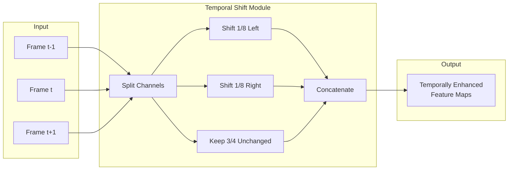
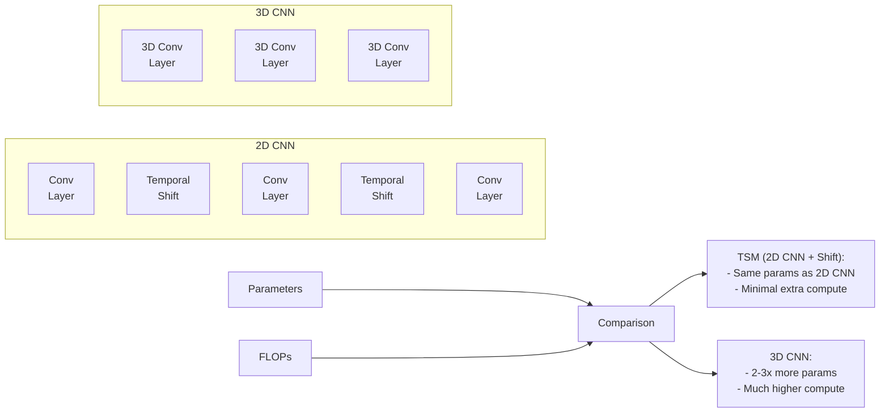
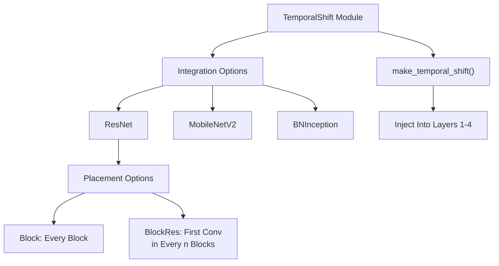
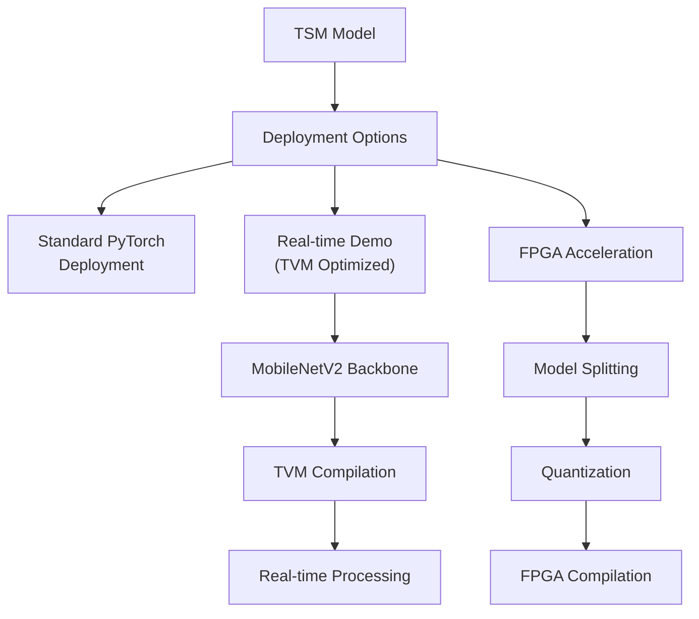

<!-- source: DeepWiki mcp.deepwiki.com · repo mit-han-lab/temporal-shift-module · page 1.2 Key Features and Advantages · fetched 2026-10-30 -->

# Key Features and Advantages

Relevant source files

The following files were used as context for generating this wiki page:

- [README.md](README.md)
- [ops/temporal_shift.py](ops/temporal_shift.py)

This page outlines the key features and advantages of the Temporal Shift Module (TSM), explaining why it offers an efficient approach to video understanding compared to other methods. For details on the core implementation, see [Temporal Shift Module](#2.1).

## Overview of TSM's Distinctive Features

The Temporal Shift Module represents a significant advancement in efficient video understanding by enabling 2D CNNs to capture temporal information with minimal overhead. TSM integrates temporal reasoning capabilities into standard 2D CNN architectures through an elegant and simple design principle.

Sources: [README.md:26-28]()

## Core Innovation: Zero-Cost Temporal Modeling

The primary innovation of TSM is its ability to capture temporal relationships without adding parameters or computational complexity to 2D CNNs.

**Diagram: Temporal Shift Operation Mechanism**

The module works by shifting a portion of the channels along the temporal dimension:
- 1/8 of channels shift left (future → present)
- 1/8 of channels shift right (past → present)
- 3/4 of channels remain unchanged

This simple operation enables information exchange between adjacent frames with zero additional parameters and negligible computational overhead.

Sources: [ops/temporal_shift.py:11-44](), [README.md:69-83]()

## Implementation Efficiency

TSM achieves remarkable efficiency through:

1. **Zero Additional Parameters**: Unlike 3D CNNs that significantly increase model size, TSM adds no parameters
2. **Minimal Computation Increase**: The shift operation introduces negligible computational overhead
3. **In-place Implementation**: An optimized in-place version reduces memory consumption during training

**Diagram: TSM Efficiency Compared to 3D CNNs**

Sources: [ops/temporal_shift.py:11-83](), [README.md:69-83]()

## Flexible Network Integration

TSM can be integrated into various CNN backbones with minimal modifications:

**Diagram: TSM Integration with CNN Backbones**

The integration is controlled by the `make_temporal_shift` function which inserts TSM at specific locations in the network:
- Can be inserted after every block or selectively in certain layers
- Works with various network architectures like ResNet, MobileNetV2, and BNInception

Sources: [ops/temporal_shift.py:97-139](), [README.md:112-114](), [README.md:61-65]()

## Performance Advantages

TSM delivers exceptional performance on video understanding tasks:

| Model | Dataset | Performance | Advantage over Baseline |
|-------|---------|-------------|-------------------------|
| TSM ResNet50 (8-frame) | Kinetics-400 | 74.1% | +3.5% over TSN (2D)|
| TSM ResNet50 NL (8-frame) | Kinetics-400 | 75.6% | +1.5% over TSM |
| TSM ResNet50 (8-frame) | Something-Something V1 | 47.2% | +1.6% over 16-frame variant |
| TSM ResNet50 (16-frame) | Something-Something V2 | 63.1% | +1.9% over 8-frame variant |

Key performance highlights:
- Outperforms I3D (3D CNN) while using fewer frames (8 vs 32)
- Achieves state-of-the-art performance on temporal-focused datasets
- Maintains high accuracy with efficient frame sampling strategies

Sources: [README.md:96-102](), [README.md:136-156]()

## Deployment Versatility

TSM supports multiple deployment paths with excellent efficiency:

**Diagram: TSM Deployment Options**

The deployment advantages include:
- **Edge Device Compatibility**: Runs efficiently on resource-constrained devices
- **Real-time Performance**: Optimized for real-time applications such as hand gesture recognition
- **Hardware Acceleration**: Supports FPGA deployment with model splitting and quantization
- **Latency Optimization**: TVM compilation further enhances runtime performance

Sources: [README.md:18-22](), [README.md:254-260]()

## Comparison with Alternative Approaches

TSM offers significant advantages over alternative video understanding approaches:

| Approach | Parameters | Computation | Temporal Modeling | Accuracy | 
|----------|------------|-------------|-------------------|----------|
| 2D CNN (TSN) | Base | Base | Limited | Lower |
| 3D CNN (I3D) | 2-3x more | Much higher | Strong | Higher |
| Two-Stream | 2x more | 2x higher | Strong | Higher |
| TSM | Same as 2D | Minimal increase | Strong | Higher |

The key differentiation is that TSM achieves:
- Strong temporal modeling capability of 3D CNNs
- Computational efficiency of 2D CNNs
- No additional parameters over 2D CNNs

Sources: [README.md:96-102](), [README.md:25-28]()

## Summary of Key Advantages

1. **Zero-Cost Temporal Modeling**: Enables temporal reasoning without additional parameters
2. **Efficiency**: Minimal computation overhead compared to standard 2D CNNs
3. **Flexibility**: Works with various CNN architectures and deployment scenarios
4. **State-of-the-Art Performance**: Achieves excellent results on video understanding benchmarks
5. **Edge Compatibility**: Efficient enough for real-time inference on edge devices
6. **Simple Implementation**: Easy to integrate into existing 2D CNN frameworks

TSM represents a significant advancement in efficient video understanding by bridging the gap between 2D CNNs (efficient but temporally limited) and 3D CNNs (powerful but computationally expensive).

Sources: [README.md:24-28](), [README.md:254-260](), [ops/temporal_shift.py:11-44]()

---

