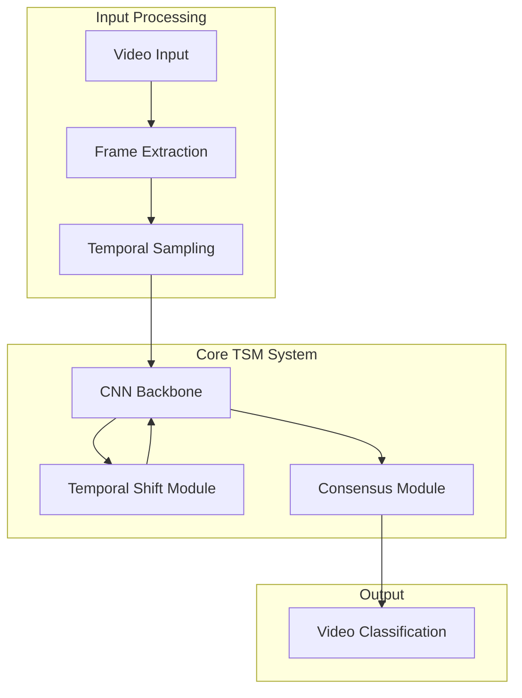
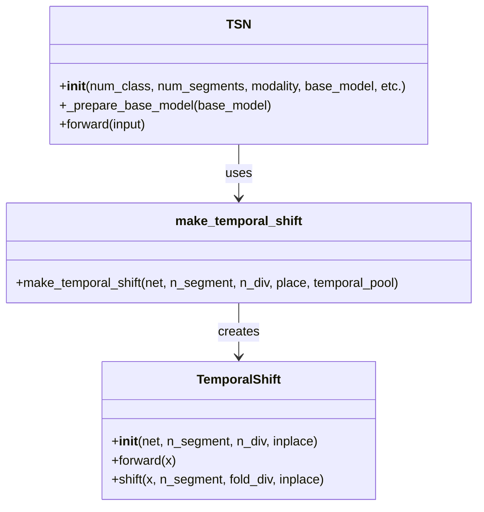
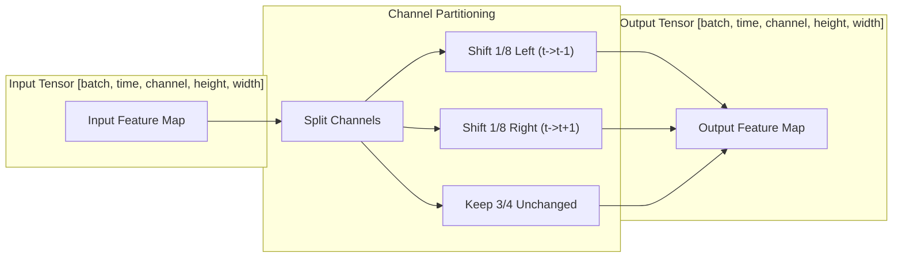
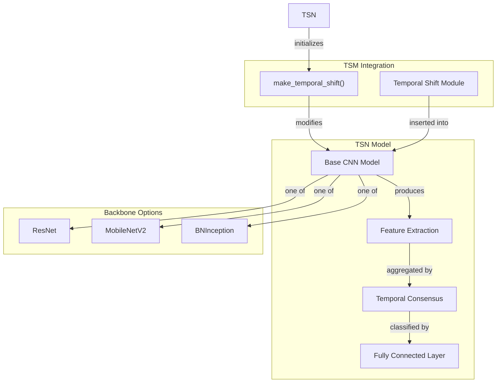
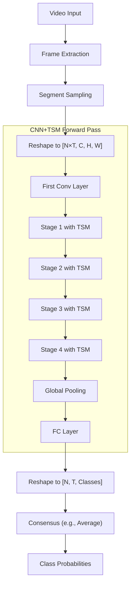
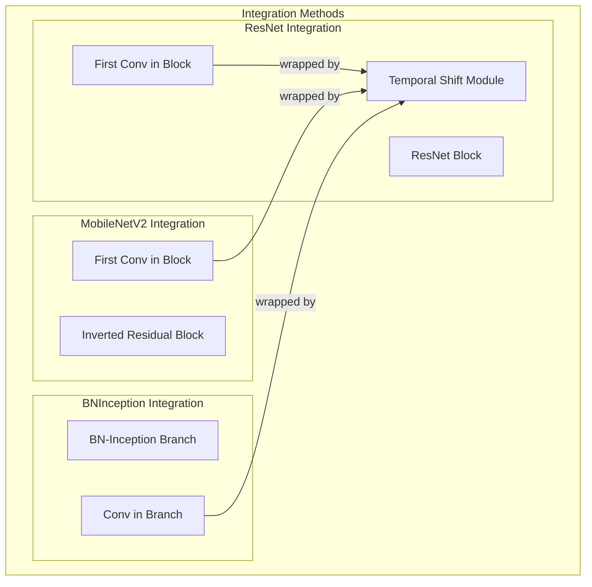
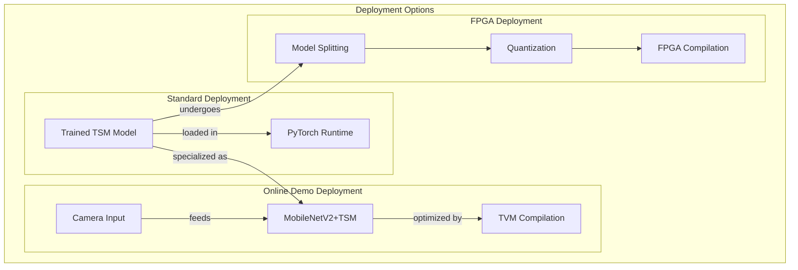
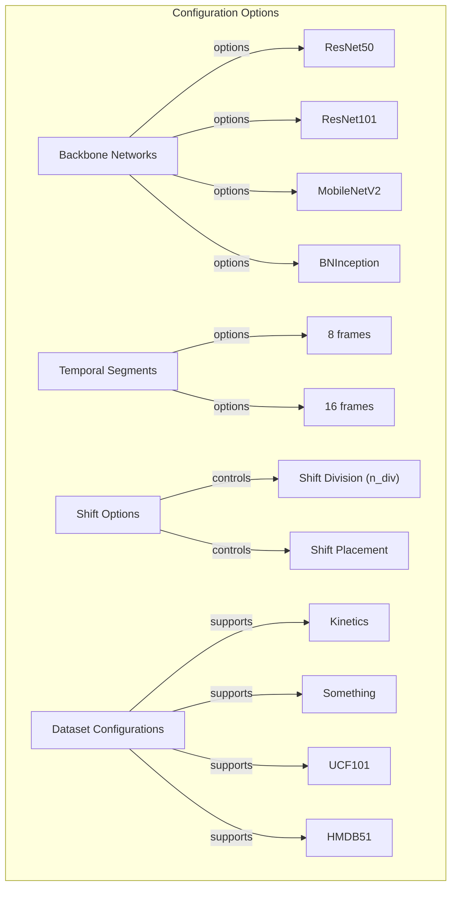
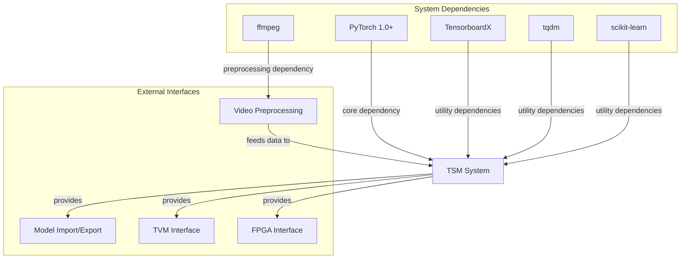

<!-- source: DeepWiki mcp.deepwiki.com · repo mit-han-lab/temporal-shift-module · page 1.3 System Architecture · fetched 2026-10-30 -->

# System Architecture

<details>
<summary>Relevant source files</summary>

The following files were used as context for generating this wiki page:

- [README.md](README.md)
- [ops/models.py](ops/models.py)
- [ops/temporal_shift.py](ops/temporal_shift.py)

</details>


## Purpose and Scope

This document describes the overall architecture of the Temporal Shift Module (TSM) system. It covers the core components, their interactions, and the system's pipeline from video input processing to action recognition output. For specific details about the Temporal Shift Module itself, see [Temporal Shift Module](#2.1). For model architecture details, see [Model Architecture](#2.2).

## High-Level Architecture Overview

The TSM system is designed as an efficient approach to video understanding that integrates temporal information into 2D CNN models through a zero-parameter, zero-FLOP operation.



Sources: [README.md:24-30](), [ops/temporal_shift.py:11-44]()

The TSM architecture follows a modular design where temporal shift operations are integrated into existing CNN architectures. The key innovation is the channel-shifting mechanism that enables temporal reasoning with negligible computational overhead.

## TSM Implementation Architecture

The TSM system is implemented through a wrapper-based design that allows integrating temporal shift operations into various CNN backbones.



Sources: [ops/temporal_shift.py:11-44](), [ops/temporal_shift.py:97-139](), [ops/models.py:13-23]()

The `TemporalShift` class wraps existing network modules and applies channel shifting operations. The `make_temporal_shift` function injects temporal shift modules into appropriate locations within the backbone network.

## Channel Shifting Mechanism

The core innovation of TSM is the temporal shift operation, which enables information exchange between adjacent frames.



Sources: [ops/temporal_shift.py:26-44](), [README.md:72-81]()

The temporal shift operation divides channels into three parts:
1. 1/8 channels are shifted forward in time (t → t-1)
2. 1/8 channels are shifted backward in time (t → t+1)
3. 3/4 channels remain unchanged

This allows information flow between adjacent frames without adding parameters or computation cost, as demonstrated in the implementation:

```python
fold = c // fold_div
out[:, :-1, :fold] = x[:, 1:, :fold]  # shift left
out[:, 1:, fold: 2 * fold] = x[:, :-1, fold: 2 * fold]  # shift right
out[:, :, 2 * fold:] = x[:, :, 2 * fold:]  # not shift
```

## System Component Relationships

The TSM system integrates with the Temporal Segment Network (TSN) framework, providing temporal modeling abilities to 2D CNNs.



Sources: [ops/models.py:13-72](), [ops/models.py:100-170](), [ops/temporal_shift.py:97-139]()

The `make_temporal_shift` function modifies the base CNN model by inserting temporal shift operations at strategic locations, typically in residual connections. Different implementation strategies are used for different backbone architectures.

## Data Flow Architecture

The following diagram illustrates how data flows through the TSM system during both training and inference.



Sources: [ops/models.py:263-288](), [README.md:26-32]()

Key architectural decisions in the data flow:
1. Videos are split into segments (8 or 16 frames typically)
2. Frames are processed by the CNN backbone
3. TSM modules are inserted within CNN layers to enable temporal modeling
4. Features are aggregated using a consensus function (typically averaging)

## Integration with CNN Architectures

TSM integrates with different CNN backbones through specific strategies for each architecture.



Sources: [ops/temporal_shift.py:97-139](), [ops/models.py:100-170]()

The integration varies by backbone:
- For ResNet, TSM is applied to the first convolution layer in residual blocks
- For MobileNetV2, TSM is applied to the first convolution in inverted residual blocks
- For BNInception, TSM is integrated through a custom implementation

## Deployment Architecture Options

The TSM system supports multiple deployment paths to accommodate different hardware targets.



Sources: [README.md:254-260]()

The TSM system supports three main deployment paths:
1. Standard PyTorch deployment for general-purpose hardware
2. Online demo deployment optimized with TVM for edge devices
3. FPGA deployment with model splitting and quantization for hardware acceleration

## Configuration Architecture

The TSM system provides a flexible configuration architecture to accommodate different use cases.



Sources: [ops/models.py:14-38](), [ops/temporal_shift.py:12-17](), [README.md:217-253]()

Key configuration parameters:
1. Backbone network (ResNet, MobileNetV2, BNInception)
2. Number of segments (typically 8 or 16)
3. Shift division factor (typically 8)
4. Shift placement (blockres, block)
5. Dataset-specific configurations

## System Dependencies and External Interfaces

The TSM system relies on several external dependencies and provides interfaces for integration with other systems.



Sources: [README.md:47-56]()

The system is built primarily on PyTorch with additional libraries for training monitoring, progress display, and evaluation metrics. It provides interfaces for model export, TVM compilation, and FPGA deployment.

## Summary

The TSM system architecture is designed for efficient video understanding by augmenting 2D CNNs with temporal modeling capabilities. Key architectural features include:

1. Zero-parameter temporal modeling through channel shifting
2. Flexible integration with various CNN backbones
3. Multiple deployment paths for different hardware targets
4. Configurable system parameters for different use cases

This architecture enables state-of-the-art performance on temporal understanding tasks while maintaining computational efficiency.

---

