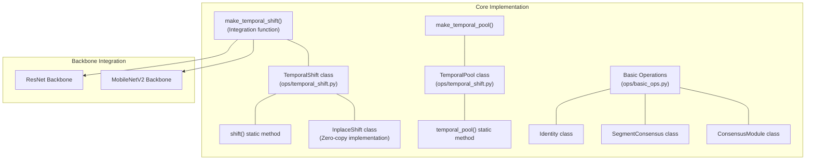
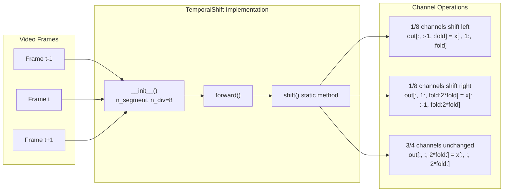
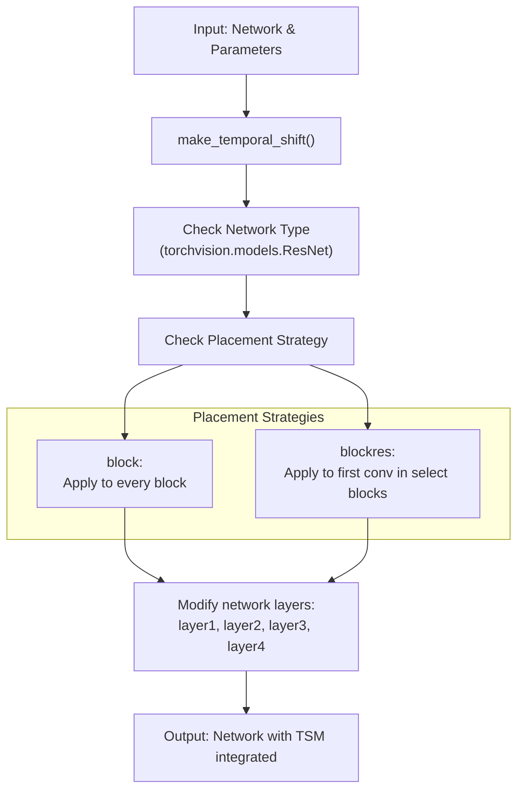
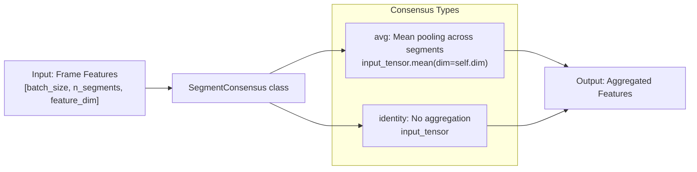
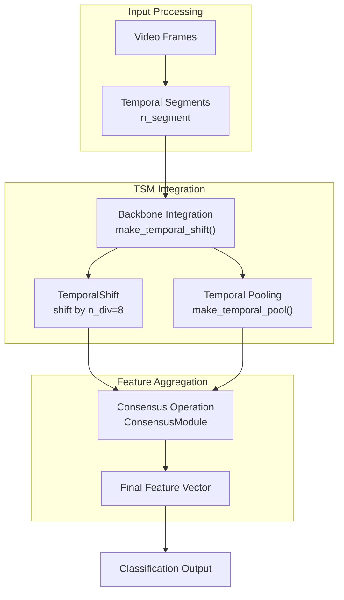

<!-- source: DeepWiki mcp.deepwiki.com · repo mit-han-lab/temporal-shift-module · page 2 Core Components · fetched 2026-10-30 -->

# Core Components

<details>
<summary>Relevant source files</summary>

The following files were used as context for generating this wiki page:

- [README.md](README.md)
- [ops/__init__.py](ops/__init__.py)
- [ops/basic_ops.py](ops/basic_ops.py)
- [ops/temporal_shift.py](ops/temporal_shift.py)

</details>


This document provides an overview of the main modules and components that constitute the Temporal Shift Module (TSM) system. For detailed information on specific components, refer to the dedicated pages on [Temporal Shift Module](#2.1), [Model Architecture](#2.2), [Non-local Blocks](#2.3), and [Basic Operations](#2.4).

## System Component Overview

The TSM system consists of several key components that work together to enable efficient video understanding:



Sources: [ops/temporal_shift.py]()/[ops/basic_ops.py]()

## Temporal Shift Module

The Temporal Shift Module is the core innovation of the system, enabling temporal modeling in 2D CNNs without adding extra parameters or computation.



Sources: [ops/temporal_shift.py:11-44]()

The `TemporalShift` class wraps any PyTorch module (typically a convolutional block) and applies the temporal shift operation to its input. The key parameters are:

| Parameter | Description |
|-----------|-------------|
| `net` | The network module to wrap |
| `n_segment` | Number of frames in a video clip |
| `n_div` | Division factor for channel shifting (default: 8) |
| `inplace` | Whether to use inplace operations (more efficient) |

The core shift operation works by:
1. Reshaping the input tensor to separate the temporal dimension
2. Dividing channels into three groups
3. Shifting the first group left (to the future)
4. Shifting the second group right (to the past)
5. Keeping the third group unchanged

Sources: [ops/temporal_shift.py:22-44]()

## Model Integration

The function `make_temporal_shift()` is responsible for integrating the TSM into backbone architectures. It supports different integration strategies:

| Strategy | Description |
|----------|-------------|
| `block` | Applies TSM to all blocks in each layer |
| `blockres` | Applies TSM only to the first convolutional layer of selected blocks |



Sources: [ops/temporal_shift.py:97-139]()

The integration process works by:
1. Creating a list of segments for each layer, with optional temporal pooling
2. Checking the backbone architecture type (currently supporting ResNet)
3. Applying TSM to each layer based on the selected placement strategy
4. Handling special cases for deeper networks (e.g., ResNet-101)

## Basic Operations

The TSM system includes several fundamental operations implemented in `ops/basic_ops.py`:

| Class | Purpose |
|-------|---------|
| `Identity` | Simple pass-through operation that returns input unchanged |
| `SegmentConsensus` | Aggregates information across temporal segments (avg, identity) |
| `ConsensusModule` | Wrapper for SegmentConsensus that can be used in a network |

The segment consensus operations are critical for combining information from multiple frames:



Sources: [ops/basic_ops.py:1-37]()

## Temporal Pooling

The `TemporalPool` class provides a way to reduce the temporal dimension through pooling:

```python
# Apply temporal pooling to a module
temporal_pool = TemporalPool(net, n_segment)

# The temporal pooling operation
x = x.view(n_batch, n_segment, c, h, w).transpose(1, 2)  # n, c, t, h, w
x = F.max_pool3d(x, kernel_size=(3, 1, 1), stride=(2, 1, 1), padding=(1, 0, 0))
x = x.transpose(1, 2).contiguous().view(nt // 2, c, h, w)
```

The `make_temporal_pool()` function injects temporal pooling into specific layers of the network, typically layer2 in ResNet:

```python
def make_temporal_pool(net, n_segment):
    # ...
    net.layer2 = TemporalPool(net.layer2, n_segment)
```

Sources: [ops/temporal_shift.py:77-148]()

## System Integration

The core components are integrated into the overall system as follows:



Sources: [ops/temporal_shift.py]()/[ops/basic_ops.py]()

The integration process involves:
1. Converting input videos into frame segments
2. Applying the temporal shift operation to selected layers
3. Optionally applying temporal pooling to reduce resolution
4. Using consensus operations to aggregate features across frames
5. Producing the final classification output

This architecture allows TSM to achieve efficient temporal modeling with zero additional parameters and minimal computational overhead compared to 2D CNNs.

---

