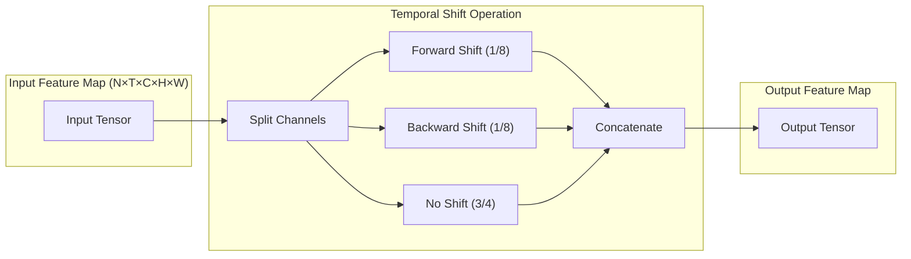
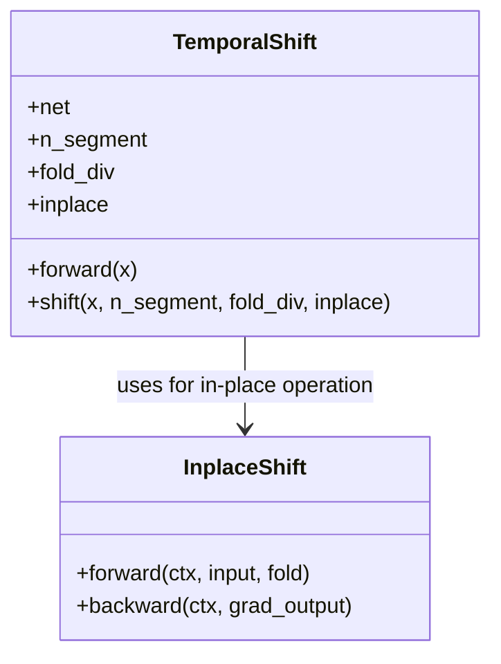
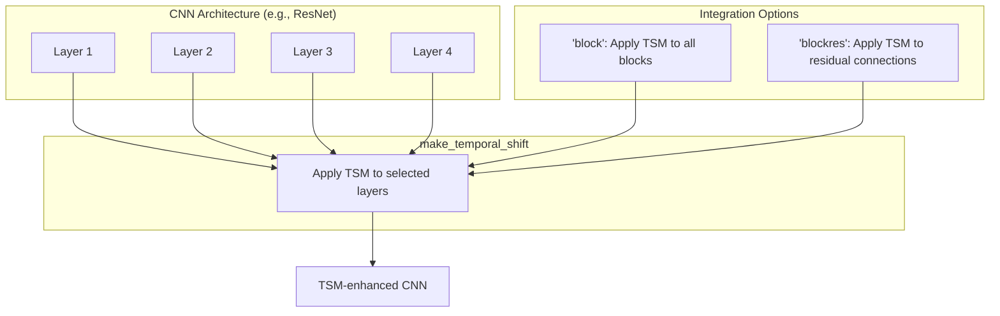

<!-- source: DeepWiki mcp.deepwiki.com · repo mit-han-lab/temporal-shift-module · page 2.1 Temporal Shift Module · fetched 2026-10-30 -->

# Temporal Shift Module

Relevant source files

The following files were used as context for generating this wiki page:

- [README.md](README.md)
- [ops/temporal_shift.py](ops/temporal_shift.py)

The Temporal Shift Module (TSM) is the core innovation of this codebase that enables efficient temporal modeling in 2D Convolutional Neural Networks (CNNs) for video understanding. This document explains the implementation, working mechanism, and integration of TSM within the system. For information about the overall model architecture incorporating TSM, see [Model Architecture](#2.2).

## Overview

The Temporal Shift Module enables 2D CNNs to capture temporal relationships in videos without adding any parameters or computational overhead. It achieves this by shifting a portion of channels along the temporal dimension, allowing information exchange between frames.

Key advantages of TSM:
- Zero additional parameters compared to 2D CNNs
- Negligible additional computation
- Compatible with any 2D CNN architecture 
- Enables efficient video understanding on resource-constrained devices

Sources: [README.md:24-29](), [ops/temporal_shift.py:1-4]()

## Core Mechanism

The fundamental idea behind TSM is to shift part of the channels along the temporal dimension before conventional 2D convolution. This temporal shift operation facilitates information exchange across frames.

The temporal shift operation:
1. Divides the channels into three parts
2. Shifts 1/8 of channels forward in time (to previous frame)
3. Shifts 1/8 of channels backward in time (to next frame)
4. Keeps 3/4 of channels unchanged
5. Concatenates all channels back together

This allows each frame to access information from adjacent frames, enabling temporal modeling.

Sources: [ops/temporal_shift.py:26-44](), [README.md:26-83]()

## Implementation

The TSM is implemented in the `TemporalShift` class, which wraps an existing network layer and applies the shift operation to its input.

### TemporalShift Class

The `TemporalShift` class is defined in `ops/temporal_shift.py` and has the following components:

- **Initialization**: Takes a network layer (`net`), number of segments (`n_segment`), division factor (`n_div`), and whether to use in-place operation (`inplace`).
- **Forward method**: Applies the shift operation and passes the result through the wrapped network.
- **Shift method**: Static method that performs the actual channel shifting.

The shift operation reshapes the input tensor from `(N*T, C, H, W)` to `(N, T, C, H, W)`, performs the shifting, and then reshapes back.

Sources: [ops/temporal_shift.py:11-44]()

### In-place vs. Regular Implementation

TSM provides two implementation options:
1. **Regular implementation**: Creates a new tensor for the output (default)
2. **In-place implementation**: Modifies the input tensor directly (potentially more memory efficient)

The in-place implementation is handled by the `InplaceShift` class, which is defined as a custom PyTorch autograd function to ensure proper gradient computation.

Sources: [ops/temporal_shift.py:47-74](), [README.md:82-83]()

## Integration with CNN Architectures

TSM is designed to be integrated with various CNN backbones. The function `make_temporal_shift` handles the integration process.

### Integration with ResNet

For ResNet architectures, TSM can be integrated in two ways:

1. **Block mode**: Apply TSM to all blocks in the network
2. **BlockRes mode**: Apply TSM only to the first convolutional layer (conv1) of selected residual blocks

The `make_temporal_shift` function:
- Takes a network model, number of segments, division factor, and placement strategy
- Iterates through specified layers of the network
- Wraps selected convolutional layers with `TemporalShift`

Sources: [ops/temporal_shift.py:97-139]()

## Temporal Pooling

In addition to the shift module, the codebase also provides a `TemporalPool` class that applies temporal pooling to reduce the temporal dimension. This can be used in conjunction with TSM to create more efficient architectures.

The `make_temporal_pool` function injects temporal pooling into specified layers of the network.

Sources: [ops/temporal_shift.py:77-148]()

## Usage Example

Here's how TSM is typically used in the codebase:

1. Create a 2D CNN model (e.g., ResNet50)
2. Apply TSM using `make_temporal_shift`
3. Train the model on video data

The model processes video frames in batches, where each batch contains multiple frames from multiple videos. The TSM enables the model to capture temporal relationships between frames.

Sources: [README.md:160-196](), [README.md:217-230]()

## Performance Considerations

### Testing

The TSM implementation includes tests to verify the correctness of both regular and in-place implementations. These tests check that:
- Forward pass results match between regular and in-place implementations
- Gradient calculations match between both implementations

Sources: [ops/temporal_shift.py:151-199]()

### Impact on Accuracy

According to the provided information, integrating TSM into 2D CNN architectures significantly improves accuracy on video understanding tasks compared to baseline models without temporal modeling.

On the Kinetics dataset, TSM with ResNet50 (8 frames) achieves 74.1% accuracy, outperforming the I3D-ResNet50 (32 frames) baseline at 73.3%.

Sources: [README.md:97-102]()

## Summary

The Temporal Shift Module is an elegant solution for enabling 2D CNNs to perform temporal modeling for video understanding. By simply shifting channels across the temporal dimension, TSM achieves effective temporal modeling without adding parameters or computation, making it particularly suitable for efficient video understanding on resource-constrained devices.

---

