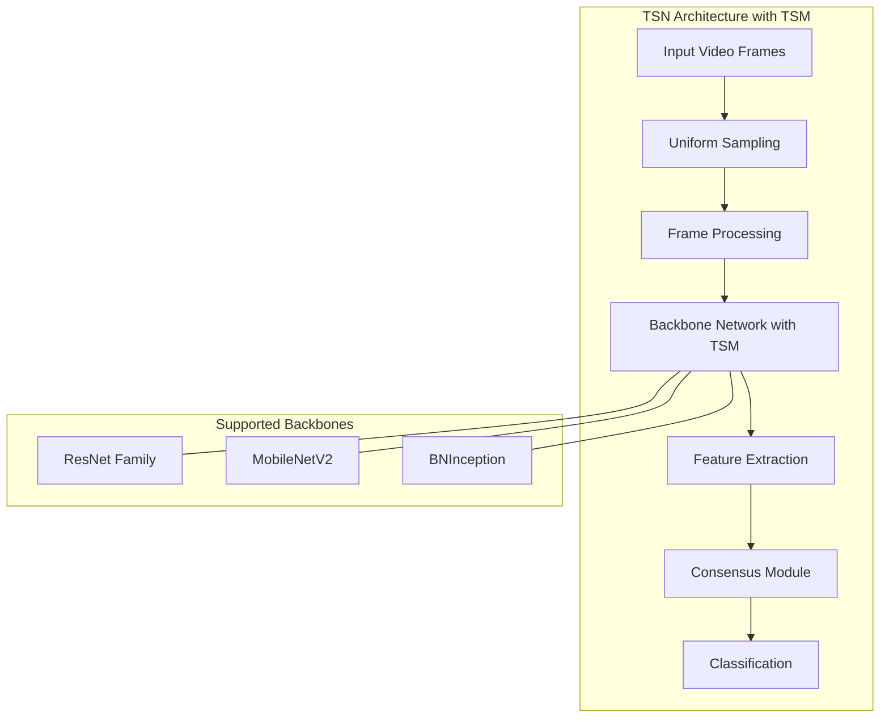
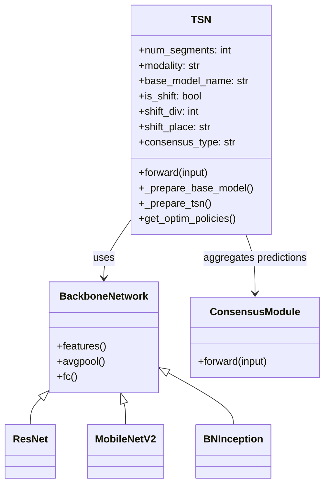
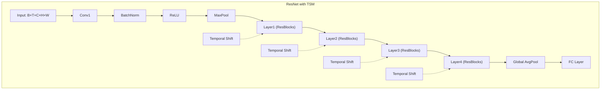
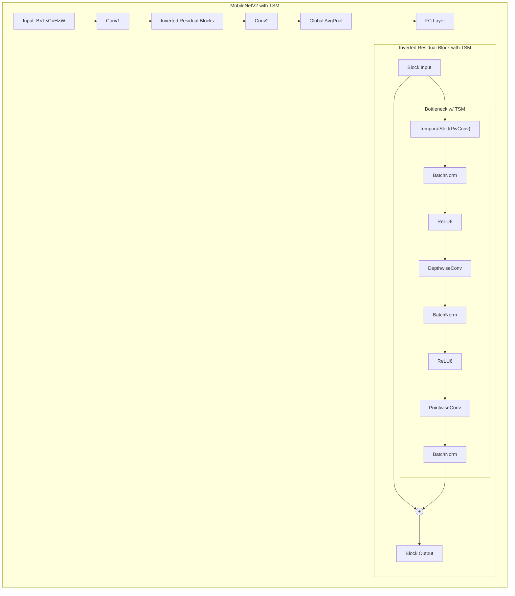
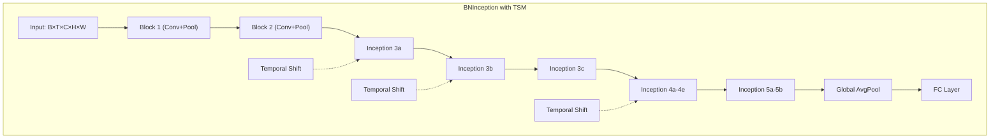
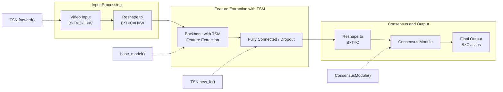
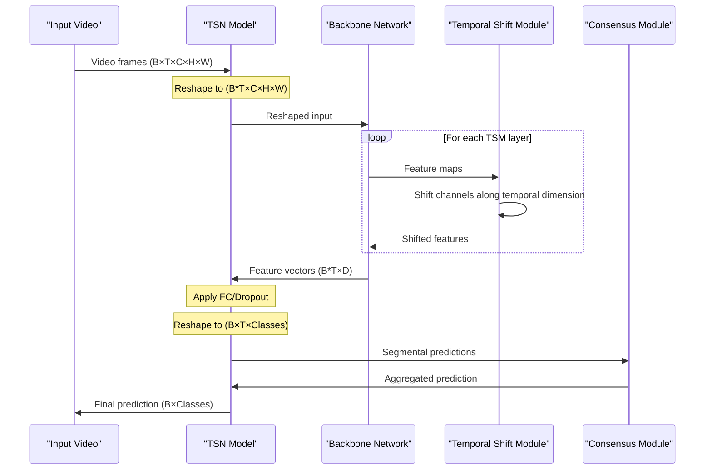

<!-- source: DeepWiki mcp.deepwiki.com · repo mit-han-lab/temporal-shift-module · page 2.2 Model Architecture · fetched 2026-10-30 -->

# Model Architecture

Relevant source files

The following files were used as context for generating this wiki page:

- [LICENSE](LICENSE)
- [archs/__init__.py](archs/__init__.py)
- [archs/bn_inception.py](archs/bn_inception.py)
- [ops/models.py](ops/models.py)

This page documents the model architecture used in the Temporal Shift Module (TSM) framework. It describes how the TSM is integrated into various backbone networks and how the overall architecture processes video data. For details on the Temporal Shift Module itself, see [Temporal Shift Module](#2.1).

## Overview

The TSM framework builds upon the Temporal Segment Network (TSN) architecture, enhancing it with temporal modeling capabilities through the Temporal Shift Module. The core architecture is implemented as the `TSN` class in the codebase, which supports various backbone networks and input modalities.

Sources: [ops/models.py:13-395]()

## TSN Class Architecture

The TSN (Temporal Segment Network) class serves as the main model implementation, which incorporates the Temporal Shift Module to enable temporal modeling. It's designed to be flexible, supporting different backbone networks, input modalities, and consensus functions.

### Key Components and Parameters

The TSN model architecture is characterized by several key parameters that control its behavior:

| Parameter | Description | Default Values |
|-----------|-------------|----------------|
| `num_segments` | Number of segments to divide the video into | Varies by dataset |
| `modality` | Input type (RGB, Flow, RGBDiff) | RGB |
| `base_model` | Backbone architecture | ResNet |
| `consensus_type` | Method to aggregate segment predictions | avg |
| `is_shift` | Whether to use temporal shift | True |
| `shift_div` | Division factor for channel shifting | 8 |
| `shift_place` | Where to apply shifting | blockres |
| `non_local` | Whether to use non-local blocks | False |

Sources: [ops/models.py:13-38]()

Sources: [ops/models.py:13-38](), [ops/models.py:172-192](), [ops/models.py:263-287]()

## Integration with Backbone Networks

The TSM is integrated differently into each supported backbone architecture. Let's examine how TSM is incorporated into each backbone network.

### ResNet with TSM

For ResNet-based models, the temporal shift operation is applied to residual blocks. The `make_temporal_shift` function is used to modify the network by inserting TSM modules at specified locations.

Sources: [ops/models.py:103-117]()

### MobileNetV2 with TSM

For MobileNetV2, the temporal shift operation is selectively applied to inverted residual blocks with residual connections. Specifically, it's applied to the first operation (pointwise convolution) in eligible blocks.

Sources: [ops/models.py:130-152]()

### BNInception with TSM

For BNInception, the model's internal `build_temporal_ops` method is called to integrate temporal shift operations at specified locations within the network.

Sources: [ops/models.py:154-168](), [archs/bn_inception.py:76-92]()

## Data Flow Through the Model

The following diagram shows how data flows through the TSN architecture with TSM:

Sources: [ops/models.py:263-287]()

## Forward Pass Operation

During the forward pass, the TSN model with TSM processes data as follows:

1. The input video frames are reshaped to match the expected input format of the backbone network
2. For RGBDiff modality, frame differences are computed
3. The reshaped input is passed through the backbone network with TSM
4. Dropout is applied (if configured) followed by the final classification layer
5. The output features are reshaped to separate the segments
6. The consensus module aggregates predictions across segments
7. The final prediction is returned

Sources: [ops/models.py:263-287]()

## Optimization Strategies

The TSN model implements custom optimization strategies for different parameter groups:

1. First convolution weights and biases: Higher learning rate for Flow modality
2. Normal weights and biases: Standard learning rates
3. BatchNorm parameters: No weight decay
4. Final fully connected layer: Optional higher learning rate (5x for weights, 10x for biases)

This strategy ensures efficient training by applying appropriate learning rates to different components of the model.

Sources: [ops/models.py:193-261]()

## Support for Different Input Modalities

The TSN architecture supports three input modalities:

| Modality | Description | Input Channels | Preprocessing |
|----------|-------------|----------------|---------------|
| RGB | Standard RGB frames | 3 | Standard normalization |
| Flow | Optical flow fields | 2×n_frames | Special weight initialization |
| RGBDiff | Frame differences | 3×(n_frames+1) | Computes differences between consecutive frames |

Each modality requires specific modifications to the input layer of the backbone network.

Sources: [ops/models.py:43-46](), [ops/models.py:63-70](), [ops/models.py:289-303]()

## Summary

The model architecture in the TSM framework is built upon TSN with the integration of the Temporal Shift Module for efficient temporal modeling. The architecture supports various backbone networks (ResNet, MobileNetV2, BNInception) and input modalities (RGB, Flow, RGBDiff). The TSM is inserted at strategic locations in the backbone networks to enable temporal modeling without additional parameters or computational overhead.

---

