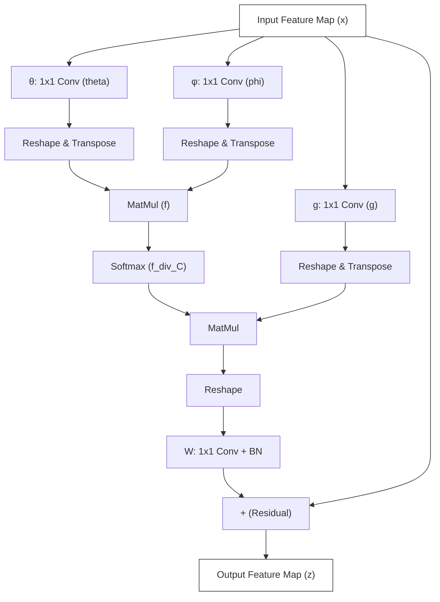

<!-- source: DeepWiki mcp.deepwiki.com · repo mit-han-lab/temporal-shift-module · page 2.3 Non-local Blocks · fetched 2026-10-30 -->

# Non-local Blocks

<details>
<summary>Relevant source files</summary>

The following files were used as context for generating this wiki page:

- [ops/non_local.py](ops/non_local.py)

</details>


## Purpose and Scope

This document describes the implementation and functionality of Non-local Blocks in the Temporal Shift Module (TSM) system. Non-local Blocks are neural network components that capture long-range dependencies in video data by computing relationships between all positions in the feature map, complementing the temporal modeling provided by the Temporal Shift Module. For information about the core Temporal Shift Module, see [Temporal Shift Module](#2.1).

## Overview of Non-local Blocks

Non-local Blocks are designed to capture global dependencies in data, unlike traditional convolutional operations that only process local neighborhoods. This makes them particularly valuable for video understanding tasks where important relationships may exist between distant frames or spatial regions.

```mermaid
flowchart LR
    subgraph "Convolution Operation"
        C1["Local Receptive Field"] --> C2["Local Feature"]
    end
    
    subgraph "Non-local Operation"
        N1["Position i"] --> N2["Computes Relationship\nwith ALL Positions"]
        N2 --> N3["Global Context-aware\nFeature at Position i"]
    end
    
    style "Convolution Operation" fill:none,stroke:#333
    style "Non-local Operation" fill:none,stroke:#333
```

Sources: [ops/non_local.py:1-8]()

## Architecture and Implementation

The TSM repository implements Non-local Blocks using the embedded Gaussian approach. The core implementation is in the `_NonLocalBlockND` class, with specialized versions for different dimensionalities: `NONLocalBlock1D`, `NONLocalBlock2D`, and `NONLocalBlock3D`.

### Internal Structure of a Non-local Block



Sources: [ops/non_local.py:9-88]()

### Key Components

1. **Feature Transformations**:
   - `theta`: 1×1 convolution that projects input features to an embedding space
   - `phi`: 1×1 convolution for the same purpose but potentially downsampled
   - `g`: 1×1 convolution that creates value features to be weighted

2. **Attention Mechanism**:
   - Computes pairwise similarity between all positions
   - Normalizes similarities using softmax
   - Uses similarities to weight value features

3. **Residual Connection**:
   - The final output adds a weighted transformed version to the original input
   - This creates a residual connection that helps with gradient flow

### Implementation Details

The base class `_NonLocalBlockND` supports 1D, 2D, and 3D data through the `dimension` parameter:

```
_NonLocalBlockND
├── NONLocalBlock1D (dimension=1)
├── NONLocalBlock2D (dimension=2)
└── NONLocalBlock3D (dimension=3)
```

Key parameters include:

| Parameter | Description |
|-----------|-------------|
| `in_channels` | Number of input channels |
| `inter_channels` | Number of channels in the internal transformations (defaults to `in_channels/2`) |
| `dimension` | Dimensionality of the input data (1D, 2D, or 3D) |
| `sub_sample` | Whether to apply max pooling to reduce computational cost |
| `bn_layer` | Whether to use batch normalization in the output projection |

Sources: [ops/non_local.py:9-112]()

## Integration with ResNet

In the TSM system, Non-local Blocks are integrated into ResNet models using the `NL3DWrapper` class and the `make_non_local` function.

```mermaid
flowchart TB
    subgraph "ResNet with Non-local Blocks"
        Input["Input Video"] --> Conv1["Conv1 + BN + MaxPool"]
        Conv1 --> Layer1["Layer 1"]
        
        Layer1 --> L2B1["Layer 2\nBlock 1 + NL"]
        L2B1 --> L2B2["Layer 2\nBlock 2"]
        L2B2 --> L2B3["Layer 2\nBlock 3 + NL"]
        L2B3 --> L2B4["Layer 2\nBlock 4"]
        
        L2B4 --> L3B1["Layer 3\nBlock 1 + NL"]
        L3B1 --> L3B2["Layer 3\nBlock 2"]
        L3B2 --> L3B3["Layer 3\nBlock 3 + NL"]
        L3B3 --> L3B4["Layer 3\nBlock 4"]
        L3B4 --> L3B5["Layer 3\nBlock 5 + NL"]
        L3B5 --> L3B6["Layer 3\nBlock 6"]
        
        L3B6 --> Layer4["Layer 4"]
        Layer4 --> AvgPool["Average Pooling"]
        AvgPool --> FC["Fully Connected"]
        FC --> Output["Classification Output"]
    end
    
    style "ResNet with Non-local Blocks" fill:none,stroke:#333
```

The `NL3DWrapper` class wraps a ResNet block and attaches a Non-local Block after it:

1. The block processes the input normally
2. The output is reshaped to expose the temporal dimension (n, c, t, h, w)
3. The Non-local Block processes this 5D tensor
4. The output is reshaped back to the original format

The `make_non_local` function modifies a ResNet model by replacing specific blocks in layers 2 and 3 with wrapped versions that include Non-local Blocks. This function is selective about which blocks receive Non-local augmentation to balance computational cost and performance.

Sources: [ops/non_local.py:115-151]()

## How Non-local Blocks Process Video Data

For video data, the 3D Non-local Block operates on a 5D tensor (batch_size, channels, time, height, width). This allows it to compute relationships not just between spatial positions but also across temporal frames.

```mermaid
flowchart LR
    subgraph "Video Input"
        F1["Frame t-1"]
        F2["Frame t"]
        F3["Frame t+1"]
    end
    
    subgraph "Feature Extraction"
        CNN["CNN Backbone"]
    end
    
    subgraph "Non-local Block"
        Reshape["Reshape to\n(n,c,t,h,w)"]
        NL["Non-local\nOperations"]
        Reshape2["Reshape back\nto (nt,c,h,w)"]
    end
    
    F1 & F2 & F3 --> CNN
    CNN --> Reshape
    Reshape --> NL
    NL --> Reshape2
    Reshape2 --> Output["Output Features"]
    
    style "Video Input" fill:none,stroke:#333
    style "Feature Extraction" fill:none,stroke:#333
    style "Non-local Block" fill:none,stroke:#333
```

The workflow for video processing with Non-local Blocks:

1. Input video frames are processed by the CNN backbone
2. The `NL3DWrapper` reshapes the feature tensor to expose the temporal dimension
3. The Non-local Block computes pairwise relationships across all spatial and temporal positions
4. This allows the network to capture long-range dependencies across the entire video segment
5. The output is reshaped back to the original format for further processing

Sources: [ops/non_local.py:115-129]()

## Comparison with Temporal Shift Module

While both Non-local Blocks and the Temporal Shift Module (TSM) aim to capture temporal information in videos, they use different approaches:

| Feature | Non-local Blocks | Temporal Shift Module |
|---------|------------------|------------------------|
| Operation | Computes pairwise relationships between all positions | Shifts channels along temporal dimension |
| Range | Global (can relate any two positions) | Local (relates adjacent frames) |
| Computation | Higher (quadratic complexity) | Lower (linear complexity) |
| Parameters | Adds substantial parameters | Zero additional parameters |
| Integration | Added to specific layers | Can be inserted into any ResNet block |
| Memory Usage | Higher | Lower |

Non-local Blocks are more powerful for capturing global dependencies but come with higher computational cost. The TSM repository allows using either approach or combining them for optimal performance.

Sources: [ops/non_local.py:1-174]()

## Usage in the TSM System

To incorporate Non-local Blocks into a model, the `make_non_local` function can be called on a ResNet model along with the number of segments parameter:

```python
model = torchvision.models.resnet50(pretrained=True)
make_non_local(model, n_segment=8)
```

This will modify the model in-place, replacing specific blocks in layers 2 and 3 with versions that include Non-local operations. The model can then be used like any other PyTorch model for training and inference.

Currently, the implementation supports integrating Non-local Blocks with torchvision's ResNet models. Support for other architectures would require extending the `make_non_local` function.

Sources: [ops/non_local.py:132-151]()

---

