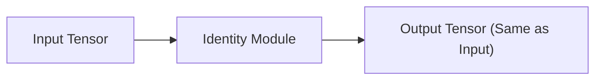
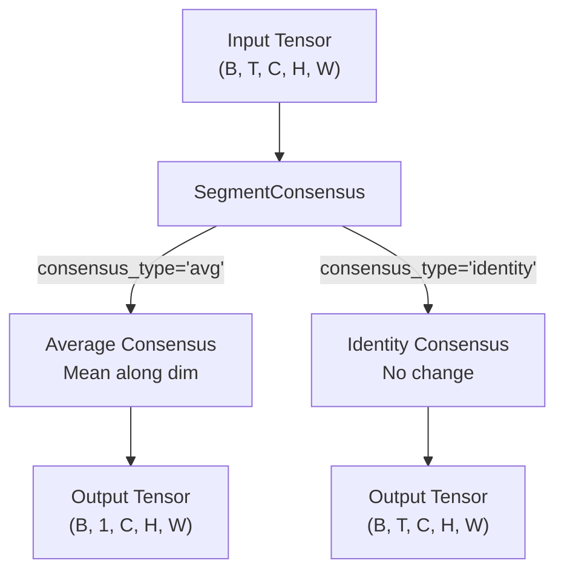
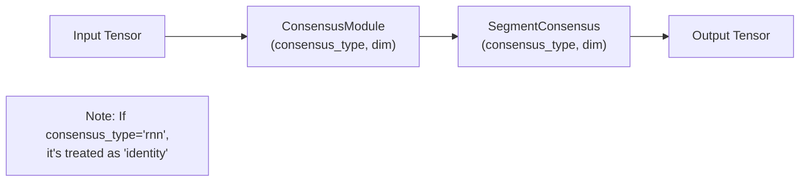
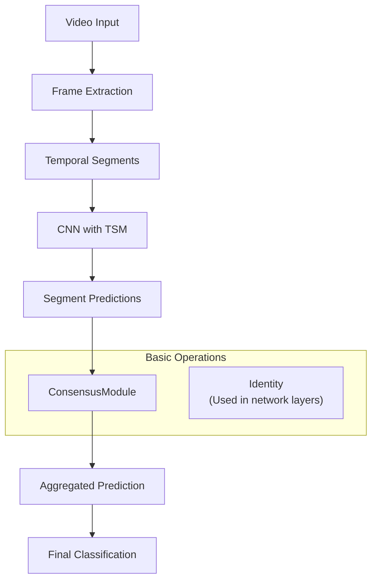

<!-- source: DeepWiki mcp.deepwiki.com · repo mit-han-lab/temporal-shift-module · page 2.4 Basic Operations · fetched 2026-10-30 -->

# Basic Operations

<details>
<summary>Relevant source files</summary>

The following files were used as context for generating this wiki page:

- [ops/__init__.py](ops/__init__.py)
- [ops/basic_ops.py](ops/basic_ops.py)

</details>


## Purpose and Scope

This document describes the basic operations implemented in the TSM system that support temporal modeling in 2D CNNs. These operations form the fundamental building blocks for aggregating information across temporal segments in video understanding tasks. The basic operations include identity transformations and various consensus methods that combine predictions from multiple video frames to produce a final output.

For information about the Temporal Shift Module itself, see [Temporal Shift Module](#2.1). For details on model architecture, see [Model Architecture](#2.2).

Sources: [ops/basic_ops.py:1-38](), [ops/__init__.py:1]()

## Overview of Basic Operations

The TSM system implements several basic operations that handle video data processing, particularly for aggregating information across temporal segments. These operations are essential for enabling 2D CNNs to process video data efficiently by providing mechanisms to combine information from multiple frames.

```mermaid
flowchart TD
    subgraph "Basic Operations"
        Identity["Identity"]
        SegmentConsensus["SegmentConsensus"]
        ConsensusModule["ConsensusModule"]
    end
    
    VideoFrames["Video Frames"] --> FeatureExtraction["Feature Extraction (CNN)"]
    FeatureExtraction --> SegmentFeatures["Segment Features"]
    SegmentFeatures --> SegmentConsensus
    SegmentConsensus --> AggregatedFeatures["Aggregated Features"]
    
    ConsensusModule --> SegmentConsensus
    
    Identity --> "Pass-through Operations"
```

Sources: [ops/basic_ops.py:1-38]()

## Identity Operation

The `Identity` class is a simple PyTorch module that passes the input tensor through without any modification. This operation is useful as a placeholder in network architectures or when a no-operation transformation is needed.



### Implementation

The `Identity` class is implemented in `ops/basic_ops.py` and inherits from `torch.nn.Module`. It simply returns the input tensor in its forward method:

```python
class Identity(torch.nn.Module):
    def forward(self, input):
        return input
```

Sources: [ops/basic_ops.py:4-6]()

## Segment Consensus Operations

The `SegmentConsensus` class implements different methods to aggregate information across temporal segments of a video. It supports different consensus types:

1. **Average Consensus ('avg')**: Computes the mean of tensor values along a specified dimension
2. **Identity Consensus ('identity')**: Returns the input tensor without modifications

This class is crucial for combining predictions from multiple frames to produce a single prediction for the entire video.



### Implementation

The `SegmentConsensus` class takes a consensus type and dimension as parameters. The forward method applies the specified consensus operation along the given dimension:

```python
class SegmentConsensus(torch.nn.Module):
    def __init__(self, consensus_type, dim=1):
        super(SegmentConsensus, self).__init__()
        self.consensus_type = consensus_type
        self.dim = dim
        self.shape = None

    def forward(self, input_tensor):
        self.shape = input_tensor.size()
        if self.consensus_type == 'avg':
            output = input_tensor.mean(dim=self.dim, keepdim=True)
        elif self.consensus_type == 'identity':
            output = input_tensor
        else:
            output = None
        return output
```

Sources: [ops/basic_ops.py:9-26]()

## Consensus Module

The `ConsensusModule` class serves as a convenient wrapper around the `SegmentConsensus` class. It simplifies the use of consensus operations in the model architecture by providing a more streamlined interface. This module is particularly important for video understanding tasks where predictions from multiple frames need to be combined.



### Implementation

The `ConsensusModule` class initializes with a consensus type and dimension, then creates and applies a `SegmentConsensus` module in its forward method:

```python
class ConsensusModule(torch.nn.Module):
    def __init__(self, consensus_type, dim=1):
        super(ConsensusModule, self).__init__()
        self.consensus_type = consensus_type if consensus_type != 'rnn' else 'identity'
        self.dim = dim

    def forward(self, input):
        return SegmentConsensus(self.consensus_type, self.dim)(input)
```

Note that if the consensus type is specified as 'rnn', it's treated as 'identity' within the module.

Sources: [ops/basic_ops.py:29-37]()

## Usage in the TSM System

The basic operations play a crucial role in the TSM architecture, particularly for temporal modeling and prediction aggregation. Here's how they are utilized within the system:



The basic operations in the TSM system serve these primary functions:

1. **Feature Aggregation**: The `ConsensusModule` aggregates predictions across temporal segments, typically using average consensus to combine frame-level predictions into video-level predictions.

2. **Network Construction**: The `Identity` operation is used in network construction where a placeholder or no-op transformation is needed.

3. **Temporal Modeling Support**: These operations support the core TSM functionality by providing mechanisms to handle temporal data effectively.

These basic operations, while simple, are essential components that enable the TSM architecture to efficiently process and understand video data.

Sources: [ops/basic_ops.py:1-38](), [ops/__init__.py:1]()

---

