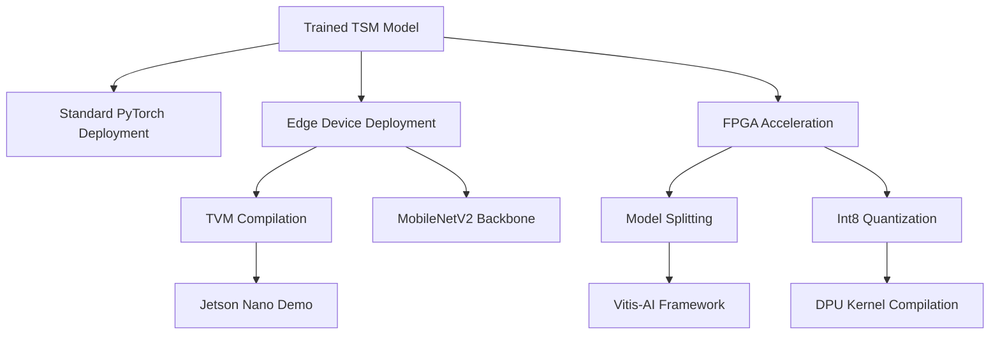
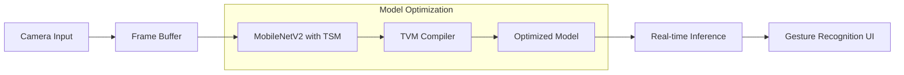
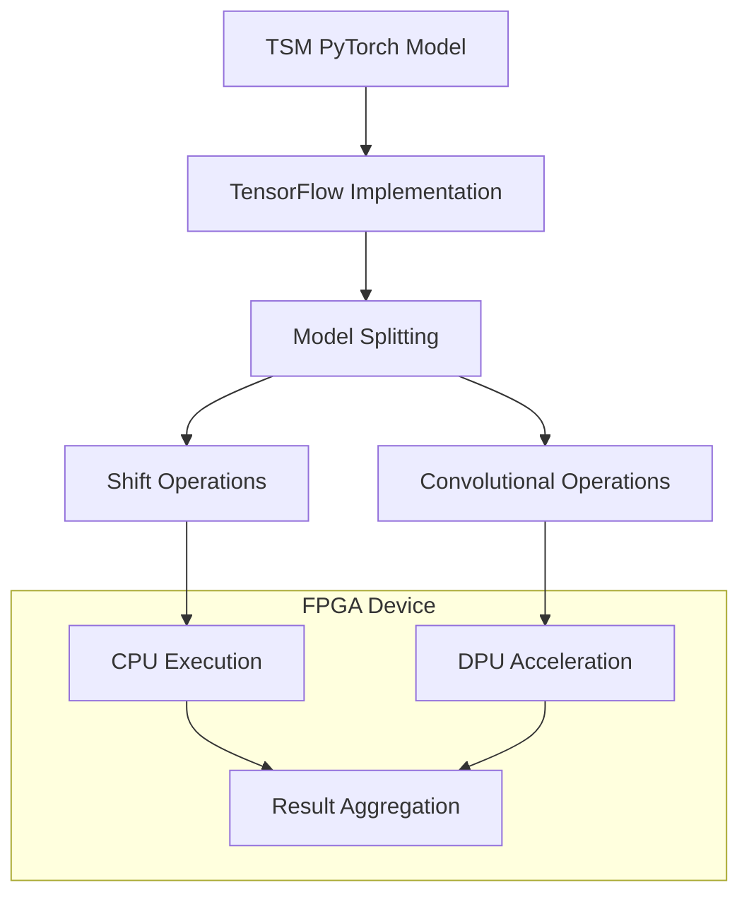
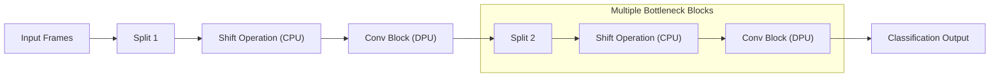

<!-- source: DeepWiki mcp.deepwiki.com · repo mit-han-lab/temporal-shift-module · page 3 Deployment Options · fetched 2026-10-30 -->

# Deployment Options

<details>
<summary>Relevant source files</summary>

The following files were used as context for generating this wiki page:

- [README.md](README.md)
- [online_demo/README.md](online_demo/README.md)
- [ops/temporal_shift.py](ops/temporal_shift.py)
- [tsm_fpga/README.md](tsm_fpga/README.md)

</details>


## Purpose and Scope

This document outlines the different deployment options available for TSM (Temporal Shift Module) models. It covers standard PyTorch inference, real-time gesture recognition on edge devices, and FPGA acceleration. For information about training TSM models, see [Training and Evaluation](#4).

## Overview of Deployment Options

The TSM repository supports three primary deployment paths, each optimized for different use cases:



Sources: [README.md:18-21](), [online_demo/README.md:18-23](), [tsm_fpga/README.md:3-7]()

### Deployment Options Comparison

| Deployment Option | Target Hardware | Optimization Method | Use Case | Performance |
|-------------------|-----------------|---------------------|----------|-------------|
| Standard PyTorch  | CPU/GPU         | None (direct inference) | Development, Testing | Model-dependent |
| Online Demo       | NVIDIA Jetson Nano | TVM compilation | Real-time gesture recognition | >70 FPS |
| FPGA Acceleration | Ultra96V2, ZCU104 | Vitis-AI, Model splitting | Edge computing, Power-constrained | 37 FPS @ 10.6W |

Sources: [online_demo/README.md:22-23](), [tsm_fpga/README.md:33-34]()

## Standard PyTorch Deployment

The most straightforward way to deploy TSM models is using PyTorch directly. This approach is suitable for development, testing, and non-resource-constrained environments.

### Usage

TSM models can be tested using the provided test scripts. For example:

```bash
python test_models.py kinetics \
    --weights=pretrained/TSM_kinetics_RGB_resnet50_shift8_blockres_avg_segment8_e50.pth \
    --test_segments=8 --test_crops=1 \
    --batch_size=64
```

The testing process loads the model weights, applies the temporal shift operation to the base network, and runs inference on the test data.

Sources: [README.md:160-174]()

## Online Hand Gesture Recognition Demo

The online demo showcases real-time hand gesture recognition running on an NVIDIA Jetson Nano. It demonstrates how TSM can be deployed on resource-constrained edge devices while maintaining real-time performance.

### Technical Implementation



The online demo uses:
- MobileNetV2 as the backbone network
- Temporal Shift Module (TSM) for modeling temporal relationships
- TVM compiler for model optimization
- ONNX and onnx-simplifier for model export and optimization

Sources: [online_demo/README.md:20-37]()

### Setup and Requirements

The demo requires:
1. NVIDIA Jetson Nano development board
2. OpenCV 4.x for camera access
3. PyTorch and torchvision
4. TVM built with CUDA and LLVM support
5. ONNX and onnx-simplifier for model optimization

The setup process involves installing the required dependencies and running the main script, which compiles the PyTorch model into a TVM binary on first run.

Sources: [online_demo/README.md:41-112]()

### Performance

Without considering data IO time, the demo achieves **>70 FPS** on the Jetson Nano GPU. This makes it suitable for real-time applications with low latency requirements.

The demo supports 19 different hand gestures, including:
- Basic gestures (Stop Sign, Thumb Up/Down)
- Dynamic gestures (Swiping, Zooming, Sliding)
- Complex movements (Pulling Hand In, Drumming Fingers)

Sources: [online_demo/README.md:22-23](), [online_demo/README.md:115-134]()

## FPGA Deployment

The FPGA deployment demonstrates how TSM can be accelerated on FPGA hardware using the Vitis-AI framework. This approach is particularly suited for power-constrained environments that still require high-throughput inference.

### Pipeline Architecture



The FPGA implementation:
1. Converts the PyTorch model to TensorFlow
2. Splits the model to isolate shift operations
3. Deploys shift operations to CPU
4. Accelerates convolutional operations on the DPU
5. Combines results for final inference

This split architecture is necessary because the temporal shift operation is more efficiently run on CPU while convolutional operations benefit from DPU acceleration.

Sources: [tsm_fpga/README.md:3-7]()

### MobileNetV2 TSM Split Model



For MobileNetV2 TSM, this results in 11 separate DPU kernels that must be quantized and compiled independently.

Sources: [tsm_fpga/README.md:6-9]()

### Build Process

The FPGA deployment involves a four-step process:

1. **Dump Split TF Models**: Generate split models where shift operations are isolated
2. **Dump Quantization Inputs**: Gather intermediate activations for quantization
3. **Quantize & Compile DPU Kernels**: Convert models to int8 and compile for DPU
4. **Compile Demo Executable**: Build the final application that orchestrates execution

This process has been tested with ZCU104 MPSOC DPU TRD and Ultra96V2 Avnet 2020.1 platforms.

Sources: [tsm_fpga/README.md:17-29]()

### Performance

On the Ultra96V2 platform, the FPGA-accelerated TSM achieves:
- 37 FPS inference throughput
- 10.6W power consumption

This makes it suitable for deployment in power-constrained environments where energy efficiency is critical.

Sources: [tsm_fpga/README.md:33-34]()

## Choosing a Deployment Option

When deciding which deployment option to use, consider the following factors:

1. **Hardware Availability**: Standard PyTorch works on most hardware, while the online demo requires Jetson Nano and FPGA deployment needs specific FPGA boards.

2. **Performance Requirements**: For real-time applications, TVM-optimized or FPGA deployments provide better performance.

3. **Power Constraints**: FPGA deployment offers the best power efficiency, making it suitable for edge devices with tight power budgets.

4. **Development Complexity**: Standard PyTorch is simplest to deploy, while FPGA deployment requires additional expertise in model quantization and hardware acceleration.

Each deployment pathway demonstrates the flexibility of TSM as an efficient video understanding method that can be adapted to various hardware targets and performance requirements.

---

