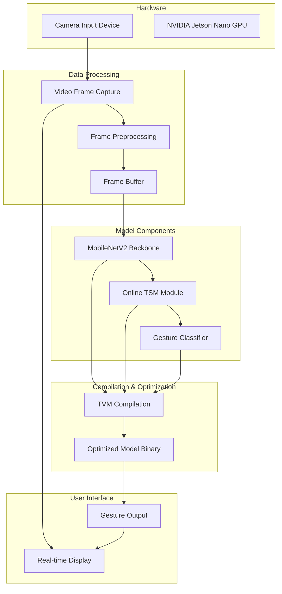
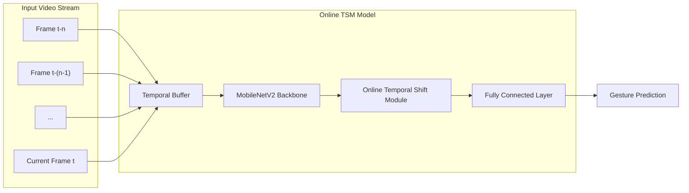
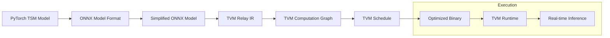
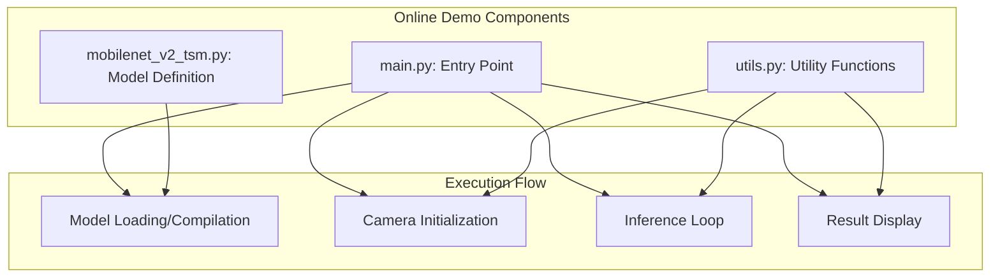
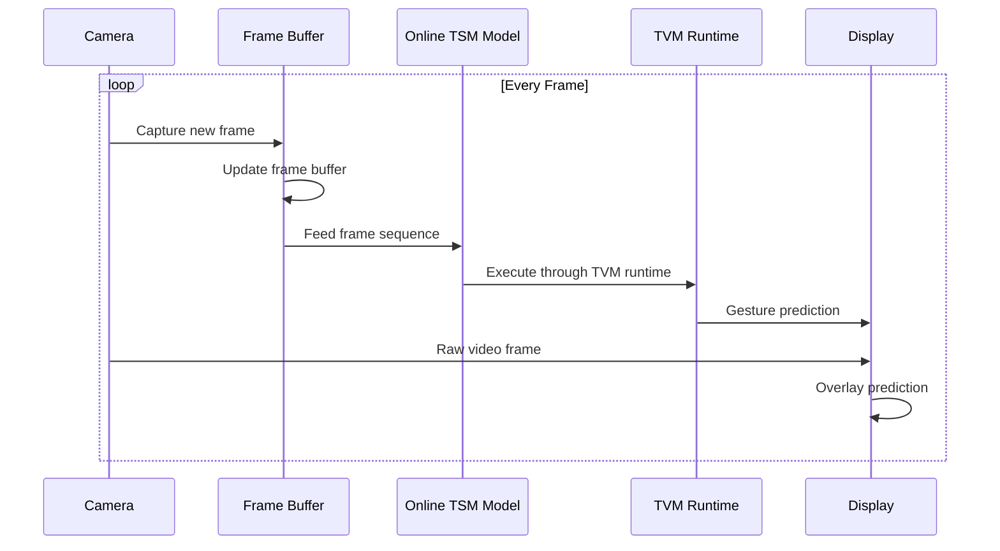

<!-- source: DeepWiki mcp.deepwiki.com · repo mit-han-lab/temporal-shift-module · page 3.1 Online Hand Gesture Recognition Demo · fetched 2026-10-30 -->

# Online Hand Gesture Recognition Demo

Relevant source files

The following files were used as context for generating this wiki page:

- [online_demo/README.md](online_demo/README.md)

## Purpose and Scope

This document provides a comprehensive overview of the Online Hand Gesture Recognition Demo, a real-time application that demonstrates the practical deployment of the Temporal Shift Module (TSM) for efficient video understanding. This page focuses on the system architecture, implementation details, and capabilities of the demo. For setup and configuration instructions, see [Setup and Configuration](#3.1.1). For technical implementation details, see [Technical Implementation](#3.1.2).

## Overview

The Online Hand Gesture Recognition Demo showcases TSM's efficiency in a real-time hand gesture recognition application, primarily designed for deployment on edge devices like the NVIDIA Jetson Nano. The system uses a MobileNetV2 backbone with the Temporal Shift Module to model temporal relationships in video streams, and is compiled with TVM (Tensor Virtual Machine) for acceleration.

The demo achieves impressive real-time performance, reaching over 70 FPS on a Jetson Nano GPU (excluding data I/O time), demonstrating TSM's capability for efficient deployment on low-power devices.

Sources: [online_demo/README.md:18-24]()

## System Architecture

The online hand gesture recognition system consists of several key components working together to provide real-time inference capabilities.

**Diagram: Online Hand Gesture Recognition System Architecture**

The demo implements an online version of the Temporal Shift Module, which is specially designed for real-time applications where future frames are not available at the current timestep. This is in contrast to the offline TSM version used for video classification tasks where the entire video is available during processing.

Sources: [online_demo/README.md:26-37]()

## Online TSM Model Design

The online demo uses a specialized version of TSM designed for real-time applications:

**Diagram: Online TSM Model Design**

The online version of TSM only shifts features from past frames to the current frame (not from future frames). This makes it suitable for real-time applications where future frames are not available at inference time. The model maintains a buffer of past frames to enable temporal modeling.

Sources: [online_demo/README.md:26-31]()

## TVM Compilation Process

The demo leverages TVM for model optimization and deployment:

**Diagram: TVM Compilation Pipeline for TSM Deployment**

The TVM compilation process converts the PyTorch model to ONNX format, then simplifies it before translating to TVM's Relay IR. This is then optimized and compiled into a platform-specific binary that can efficiently run on the target hardware.

Sources: [online_demo/README.md:33-37](), [online_demo/README.md:59-79](), [online_demo/README.md:82-97]()

## Performance on Low-Power Devices

One of the key advantages of the Online TSM implementation is its efficiency on edge devices:

| Device | Power Consumption | FPS (Frames Per Second) |
|--------|-------------------|-------------------------|
| NVIDIA Jetson Nano | 5-10W | >70 |
| NVIDIA Jetson TX2 | 7.5-15W | >120 |
| Intel Neural Compute Stick 2 | 1-2W | >20 |

This performance makes the system practical for deployment in battery-powered or resource-constrained environments.

Sources: [online_demo/README.md:33-37]()

## Gesture Recognition Capabilities

The demo system can recognize a wide range of hand gestures in real-time:

| Category | Supported Gestures |
|----------|-------------------|
| Static Gestures | No Gesture, Stop Sign, Thumb Up, Thumb Down |
| Dynamic Gestures - Fingers | Drumming Fingers |
| Dynamic Gestures - Zooming | Zooming In With Full Hand, Zooming In With Two Fingers, Zooming Out With Full Hand, Zooming Out With Two Fingers |
| Dynamic Gestures - Swiping | Swiping Down, Swiping Left, Swiping Right, Swiping Up |
| Dynamic Gestures - Sliding | Sliding Two Fingers Down, Sliding Two Fingers Left, Sliding Two Fingers Right, Sliding Two Fingers Up |
| Dynamic Gestures - Pulling | Pulling Hand In, Pulling Two Fingers In |

This diverse set of recognizable gestures enables a wide range of potential user interface applications.

Sources: [online_demo/README.md:113-134]()

## Implementation Components

The implementation of the online demo consists of several key files and components:

**Diagram: Online Demo Implementation Components**

The main entry point `main.py` orchestrates the entire demo process, including model compilation with TVM (if not already compiled), camera initialization, running the inference loop, and displaying results. The `mobilenet_v2_tsm.py` file contains the model definition that integrates the Temporal Shift Module with the MobileNetV2 backbone.

Sources: [online_demo/README.md:105-111]()

## Runtime Data Flow

**Diagram: Runtime Data Flow in Online Demo**

During execution, the system continuously captures frames from the camera, maintains a buffer of recent frames, processes them through the TSM model (optimized with TVM), and displays the recognition results in real-time. The user interface shows both the camera feed and the predicted gesture.

Sources: [online_demo/README.md:105-111]()

## Summary

The Online Hand Gesture Recognition Demo showcases the practical application of the Temporal Shift Module in a real-time, edge deployment scenario. By using the lightweight MobileNetV2 backbone, applying the online version of TSM, and optimizing with TVM, the system achieves impressive performance on low-power devices like the NVIDIA Jetson Nano.

This demo serves as a reference implementation for deploying efficient video understanding models in resource-constrained environments, demonstrating TSM's capability to enable temporal modeling without significantly increasing computational demands.

Sources: [online_demo/README.md:18-24](), [online_demo/README.md:33-37]()

---

