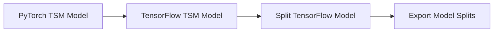
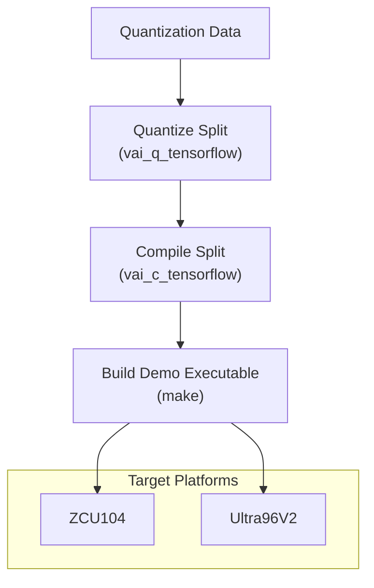
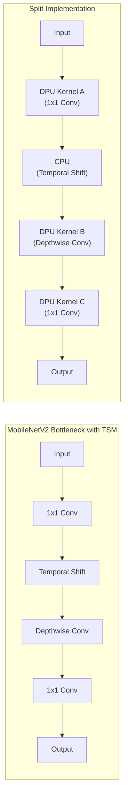

<!-- source: DeepWiki mcp.deepwiki.com · repo mit-han-lab/temporal-shift-module · page 3.2 FPGA Deployment · fetched 2026-10-30 -->

# FPGA Deployment

<details>
<summary>Relevant source files</summary>

The following files were used as context for generating this wiki page:

- [tsm_fpga/README.md](tsm_fpga/README.md)

</details>


## Purpose and Scope

This document covers the deployment of Temporal Shift Module (TSM) models to FPGA hardware using the Vitis-AI framework. It details the architecture, implementation process, and setup instructions for running TSM efficiently on FPGA devices. For information about other deployment options such as the real-time hand gesture recognition demo, see [Online Hand Gesture Recognition Demo](#3.1).

## Architecture Overview

The FPGA deployment of TSM uses a hybrid CPU-FPGA execution model where temporal shift operations are isolated and executed on the CPU while the computationally intensive convolutional operations are accelerated on the FPGA's Deep Learning Processing Unit (DPU).

```mermaid
flowchart LR
    subgraph "Input Processing"
        VideoInput["Video Input"] --> FrameBuffer["Frame Buffer"]
    end
    
    subgraph "Hybrid Execution"
        subgraph "CPU" 
            TemporalShift["Temporal Shift Operations"]
        end
        
        subgraph "FPGA DPU"
            DPUKernel1["DPU Kernel 1\n(Conv Layers)"]
            DPUKernel2["DPU Kernel 2\n(Conv Layers)"]
            DPUKernelN["DPU Kernel N\n(Conv Layers)"]
        end
    end
    
    subgraph "Output"
        Classification["Classification Result"]
    end
    
    FrameBuffer --> DPUKernel1
    DPUKernel1 --> TemporalShift
    TemporalShift --> DPUKernel2
    DPUKernel2 --> "..."
    "..." --> DPUKernelN
    DPUKernelN --> Classification
```

The MobileNetV2-based TSM implementation is split into 11 separate DPU kernels, with temporal shift operations isolated between them. This architecture allows for efficient execution of the model while maintaining the temporal modeling capabilities of TSM.

Sources: [tsm_fpga/README.md:3-5]()

## Model Splitting Design

The key insight of the FPGA deployment is isolating the temporal shift operations from the convolutional operations. This is done by splitting the model at the points where shift operations occur.

```mermaid
flowchart TB
    subgraph "Original MobileNetV2 with TSM"
        Conv1["Conv Layer"] --> Shift1["Temporal Shift"]
        Shift1 --> Conv2["Conv Layer"]
        Conv2 --> Shift2["Temporal Shift"]
        Shift2 --> Conv3["Conv Layer"]
    end
    
    subgraph "Split MobileNetV2 with TSM"
        SplitConv1["DPU Kernel 1\n(Conv Layer)"] --> CPU1["CPU\n(Temporal Shift)"]
        CPU1 --> SplitConv2["DPU Kernel 2\n(Conv Layer)"]
        SplitConv2 --> CPU2["CPU\n(Temporal Shift)"]
        CPU2 --> SplitConv3["DPU Kernel 3\n(Conv Layer)"]
    end
    
    "Original MobileNetV2 with TSM" -.-> "Split MobileNetV2 with TSM"
```

Each bottleneck in the MobileNetV2 architecture needs to be split to isolate the temporal shift operations, resulting in multiple DPU kernels that must be managed and executed in sequence.

Sources: [tsm_fpga/README.md:5-9]()

## Implementation Process

The implementation process involves four main steps:

1. Splitting the TensorFlow model
2. Dumping quantization inputs
3. Quantizing and compiling DPU kernels
4. Compiling the final demo executable

### Model Splitting

The first step is to generate a TensorFlow implementation of the TSM model and split it at the temporal shift operations.



The model splitting is handled by the `mobilenet_v2_tfslim.py` script, which can generate the split model when the `SPLIT_MODEL`, `SPLIT_EXPORT`, and `EXPORT` flags are set to `True`.

Sources: [tsm_fpga/README.md:17-18]()

### Quantization Process

Quantization requires intermediate activations from the unsplit model, which are then used as inputs for the quantizer.

| Step | Description | Configuration |
|------|-------------|--------------|
| 1 | Run unsplit model to gather activations | Set `SPLIT_MODEL`, `SPLIT_EXPORT`, `EXPORT` to `False` |
| 2 | Enable quantization data collection | Set `QUANTIZE_*` and `DUMP_QUANTIZE` flags to `True` |
| 3 | Collect activation data at split points | Data saved to `inputs.pickle` and `quantize_info.txt` |

This process generates the necessary data to quantize each split of the model to int8 precision, which is required for efficient execution on the DPU.

Sources: [tsm_fpga/README.md:20-22]()

### Compilation and Deployment

After quantization, each split of the model must be compiled for the target FPGA platform.



The `quantize_split.sh` and `compile_split.sh` scripts automate the quantization and compilation process using Vitis-AI tools. The final demo executable is built using make with the appropriate target platform.

Sources: [tsm_fpga/README.md:23-29]()

## Setup Instructions

The following steps outline how to set up and build the FPGA deployment:

1. **Prerequisites**:
   - Initialize the tensorflow-slim submodule: `git submodule update --init --recursive`
   - Set up the Vitis-AI environment for your target FPGA platform

2. **Generate Split TensorFlow Models**:
   - Modify `mobilenet_v2_tfslim.py` to set `SPLIT_MODEL`, `SPLIT_EXPORT`, and `EXPORT` to `True`
   - Run the script to generate the split model in the `model_tf_split_*` directories

3. **Generate Quantization Data**:
   - Set the quantization data paths in `mobilenet_v2_tfslim.py`
   - Set `SPLIT_MODEL`, `SPLIT_EXPORT`, and `EXPORT` to `False`
   - Enable `QUANTIZE_*` and `DUMP_QUANTIZE` flags
   - Run the script to generate quantization data

4. **Quantize and Compile DPU Kernels**:
   - Update `compile_split.sh` with the correct target architecture
   - Run `quantize_split.sh` to quantize each model split
   - Run `compile_split.sh` to compile each quantized model for the target DPU

5. **Build Demo Executable**:
   - Navigate to `fpga_build/model_tf_split`
   - Run `make ultra96v2.tsm_online` or `make zcu104.tsm_online` based on your target platform

Sources: [tsm_fpga/README.md:11-29]()

## Performance Metrics

On the Ultra96V2 platform, the TSM FPGA deployment achieves:

| Metric | Value |
|--------|-------|
| Inference Throughput | 37 FPS |
| Power Consumption | 10.6W |

This demonstrates that the FPGA deployment provides real-time performance suitable for embedded applications while maintaining low power consumption.

Sources: [tsm_fpga/README.md:31-34]()

## Supported Hardware Platforms

The FPGA deployment has been tested on the following platforms:

1. **ZCU104 MPSOC DPU TRD** - From the Vitis-AI repository
2. **Ultra96V2 Avnet** - 2020.1 beta branch

The implementation can be adapted to other FPGA platforms that support the Vitis-AI framework and have sufficient resources to run the quantized TSM model.

Sources: [tsm_fpga/README.md:14-15]()

## Implementation Details

The splitting of the MobileNetV2 TSM model requires careful handling of each bottleneck component:



This splitting approach allows the temporal shift operations to be executed on the CPU while leveraging the DPU for computationally intensive convolutional operations, resulting in an efficient hybrid execution model.

Sources: [tsm_fpga/README.md:5-9]()

---

