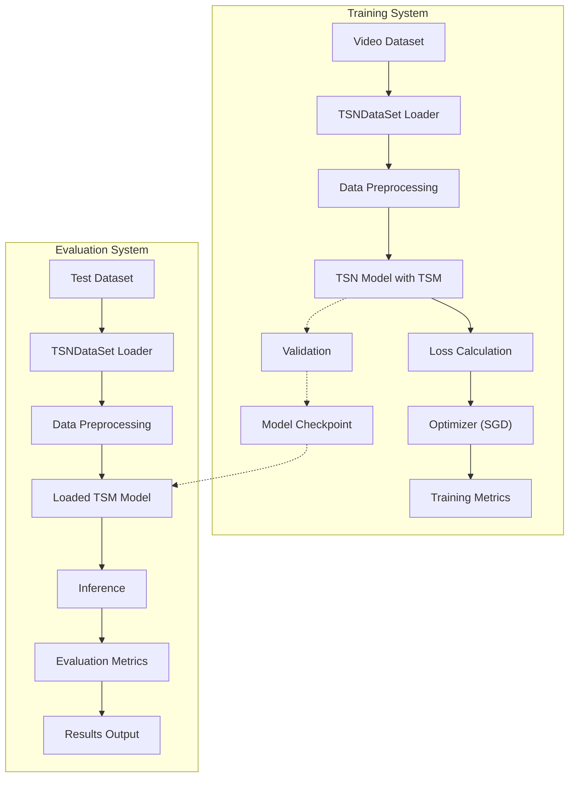
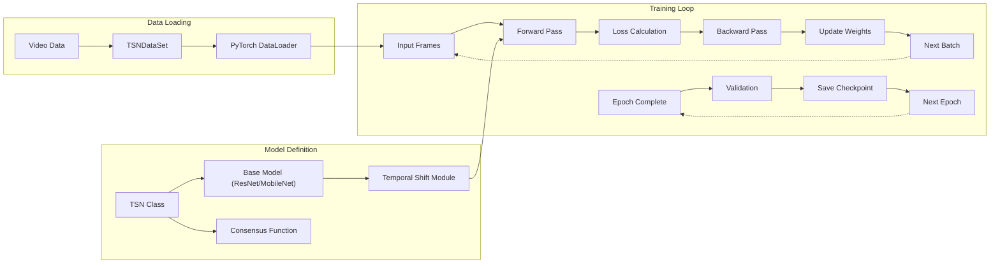
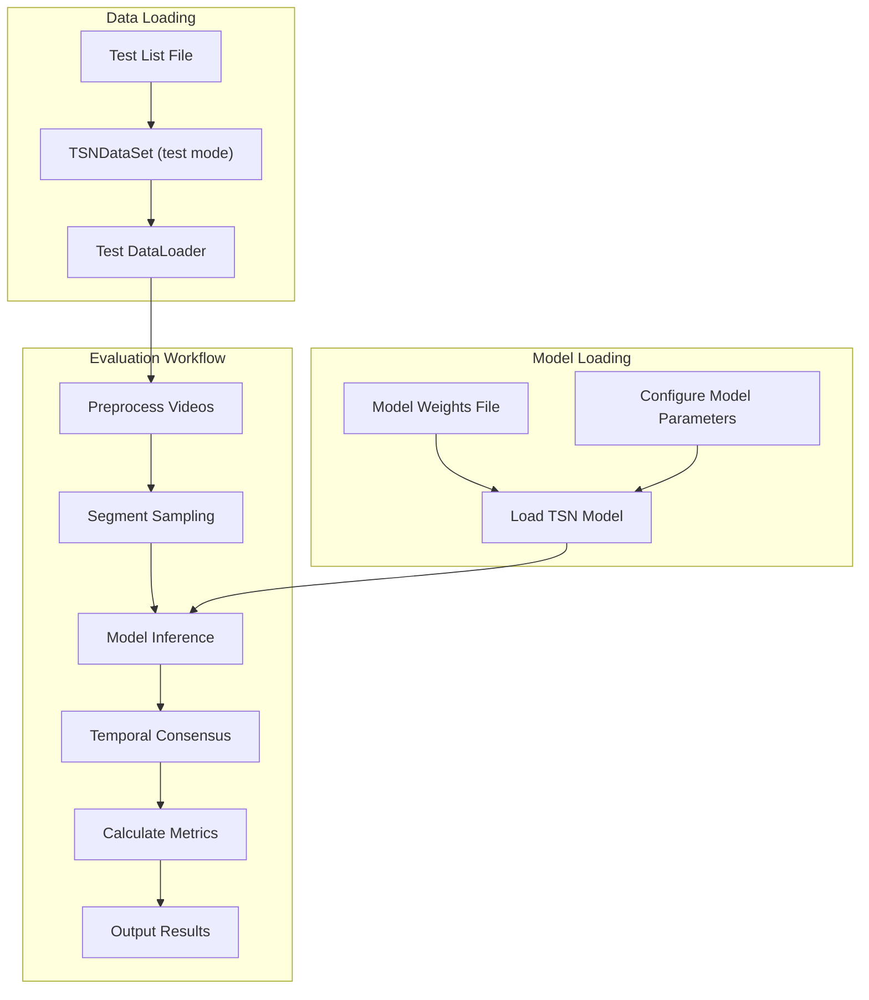
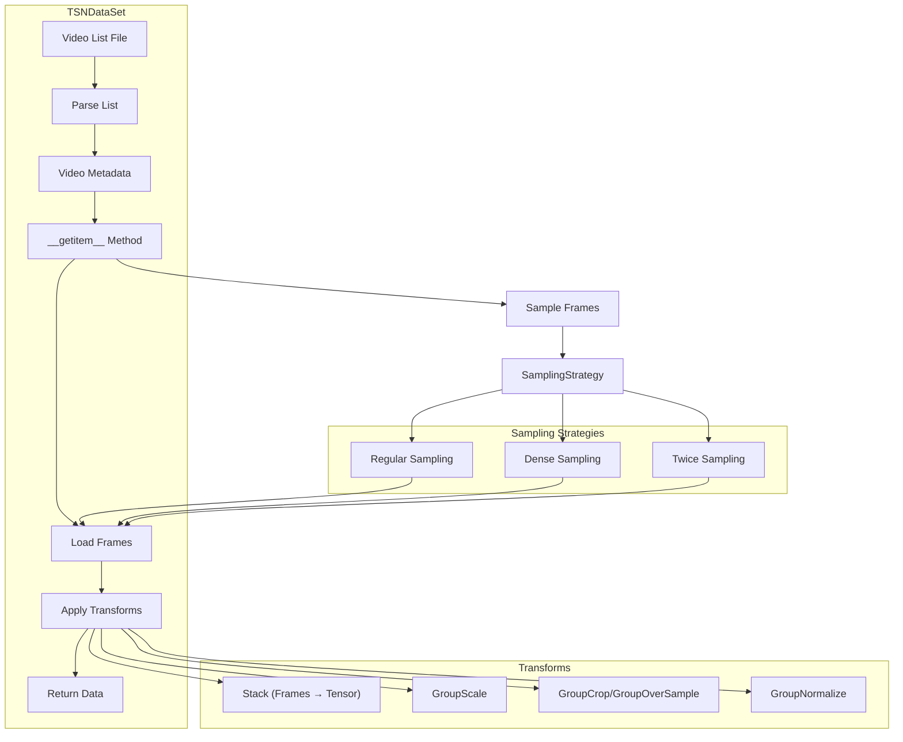
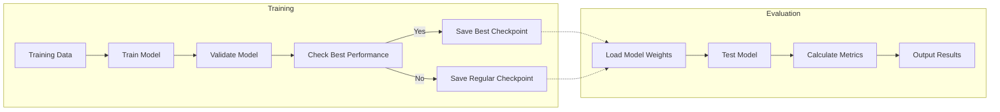

<!-- source: DeepWiki mcp.deepwiki.com · repo mit-han-lab/temporal-shift-module · page 4 Training and Evaluation · fetched 2026-10-30 -->

# Training and Evaluation

<details>
<summary>Relevant source files</summary>

The following files were used as context for generating this wiki page:

- [main.py](main.py)
- [test_models.py](test_models.py)

</details>


This document provides a comprehensive guide to the training and evaluation systems in the Temporal Shift Module (TSM) codebase. It covers the training pipeline, evaluation methods, command-line options, and key components that enable effective training and assessment of TSM models.

## Overview

The TSM repository includes a complete framework for training models on various video datasets and evaluating their performance. The system is designed to be flexible, supporting different network architectures, datasets, and training configurations.



Sources: [main.py:27-378](), [test_models.py:20-329]()

## Training Pipeline

The training pipeline is implemented in `main.py` and provides a comprehensive system for training TSM models on various datasets.

### Training Process



Sources: [main.py:219-283](), [main.py:27-190]()

### Key Components

The training pipeline consists of several important components:

1. **Model Initialization**: Creates a TSN model with the specified backbone architecture and TSM integration
2. **Data Loading**: Utilizes `TSNDataSet` to load video frames with appropriate transforms
3. **Optimization**: Uses SGD with momentum and learning rate scheduling
4. **Training Loop**: Iterates through epochs and batches, updating model weights
5. **Validation**: Periodically evaluates the model on validation data
6. **Checkpointing**: Saves model state when validation performance improves

### Command-line Arguments

The training pipeline supports numerous command-line arguments for customization:

| Category | Arguments | Description |
|----------|-----------|-------------|
| **Dataset** | `--dataset`, `--root_path` | Dataset name and root directory |
| **Model** | `--arch`, `--num_segments` | Backbone architecture and number of segments |
| **TSM** | `--shift`, `--shift_div`, `--shift_place` | TSM configuration options |
| **Training** | `--epochs`, `--batch_size`, `--lr` | Basic training parameters |
| **Optimization** | `--lr_type`, `--lr_steps`, `--momentum` | Learning rate scheduling and optimization |
| **Augmentation** | `--dense_sample` | Dense sampling for data augmentation |
| **Misc** | `--workers`, `--print_freq`, `--resume` | Utility options |

Sources: [main.py:17](), [main.py:29-31]()

### Training Procedure

The actual training procedure in `main.py` follows these steps:

1. Parse command-line arguments
2. Configure the model based on dataset and architecture
3. Set up data loaders for training and validation
4. Initialize the optimizer and loss function
5. For each epoch:
   - Train one epoch (forward pass, loss calculation, backpropagation)
   - Validate the model periodically
   - Update learning rate according to schedule
   - Save checkpoint if performance improves

The training function handles one epoch of training:

```
1. Set model to training mode
2. For each batch in the training data loader:
   a. Forward pass the input through the model
   b. Calculate loss using the specified criterion
   c. Backward pass to compute gradients
   d. Clip gradients if specified
   e. Update model weights
   f. Record metrics (loss, accuracy)
3. Log training metrics
```

Sources: [main.py:219-283]()

## Evaluation Pipeline

The evaluation pipeline in `test_models.py` enables comprehensive assessment of trained TSM models.

### Evaluation Process



Sources: [test_models.py:97-210](), [test_models.py:215-253]()

### Key Components

The evaluation pipeline includes:

1. **Model Loading**: Loads trained weights into a TSN model with the same architecture
2. **Data Sampling**: Supports various sampling strategies (dense, twice, etc.)
3. **Inference**: Runs forward pass on video segments
4. **Metrics Calculation**: Computes top-1/top-5 accuracy and other metrics
5. **Results Output**: Outputs metrics to console and optionally saves to CSV

### Evaluation Options

The `test_models.py` script offers numerous command-line options:

| Category | Arguments | Description |
|----------|-----------|-------------|
| **Model** | `--weights`, `--test_segments` | Model weights and segment count |
| **Sampling** | `--dense_sample`, `--twice_sample` | Video sampling strategies |
| **Testing** | `--test_crops`, `--batch_size` | Test-time cropping and batch size |
| **Output** | `--csv_file` | Output file for predictions |
| **Hardware** | `--gpus`, `--workers` | GPU IDs and worker threads |

Sources: [test_models.py:21-51]()

### Evaluation Methods

The core evaluation function `eval_video()` processes each video through these steps:

1. Set model to evaluation mode
2. Process input data (reshape for TSM if necessary)
3. Forward pass through the network
4. Apply softmax if specified
5. Calculate and return predictions

The script supports both single-model evaluation and ensemble testing by combining predictions from multiple models.

Sources: [test_models.py:215-253]()

## Data Management

Both training and evaluation rely on the `TSNDataSet` class for data handling and management.



Sources: [main.py:141-170](), [test_models.py:176-191]()

## Metrics and Logging

Both training and evaluation systems track and report metrics for model performance:

1. **Training Metrics**:
   - Loss
   - Top-1 and Top-5 accuracy
   - Learning rate
   - Batch time

2. **Evaluation Metrics**:
   - Top-1 and Top-5 accuracy
   - Per-class accuracy
   - Confusion matrix
   - Inference time

The `AverageMeter` class is used in both systems to track running averages of these metrics.

Sources: [main.py:220-225](), [test_models.py:55-70](), [test_models.py:259-260]()

## Model Checkpointing

The training system saves model checkpoints during training, which are later used by the evaluation system.



The checkpoint contains:
- Model state dict
- Optimizer state dict
- Epoch number
- Best precision achieved
- Architecture information

Sources: [main.py:210-216](), [main.py:342-346](), [test_models.py:141-153]()

## Training Scripts

The repository includes several training scripts that provide preconfigured settings for different datasets and model architectures. These scripts set appropriate command-line arguments for specific use cases, making it easier to reproduce results from the paper.

Sources: [main.py:377-378]()

## Performance Considerations

Several techniques are implemented to improve training and evaluation performance:

1. **cudnn.benchmark**: Enabled to optimize convolution algorithm selection
2. **Partial BN**: Freezes some batch normalization layers to improve training stability
3. **Gradient Clipping**: Prevents exploding gradients
4. **Learning Rate Scheduling**: Supports step-based and cosine annealing schedules
5. **Dense Sampling**: Improves evaluation accuracy by sampling more frames

Sources: [main.py:128](), [main.py:227-229](), [main.py:256-257](), [main.py:349-363]()

## Conclusion

The training and evaluation system in the TSM codebase provides a comprehensive framework for developing efficient video understanding models. With flexible configurations, support for various architectures, and rigorous evaluation methods, it enables reproducible research and practical deployment of video understanding models.

---

