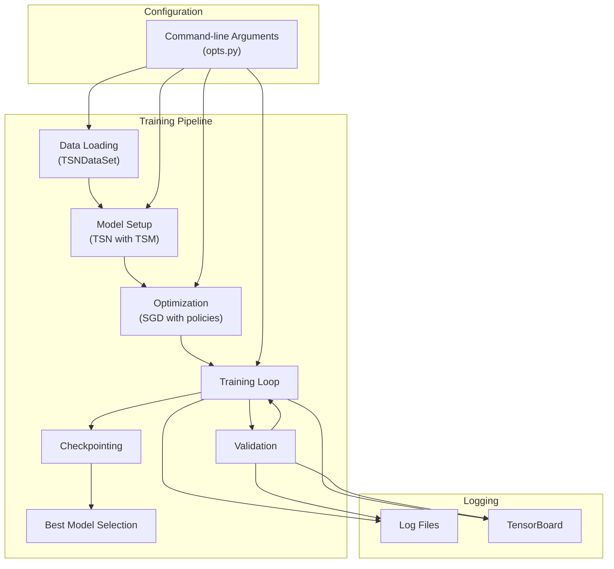
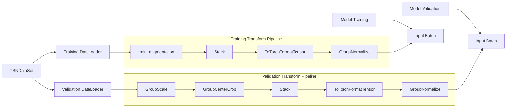
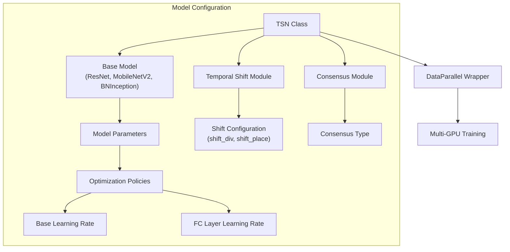
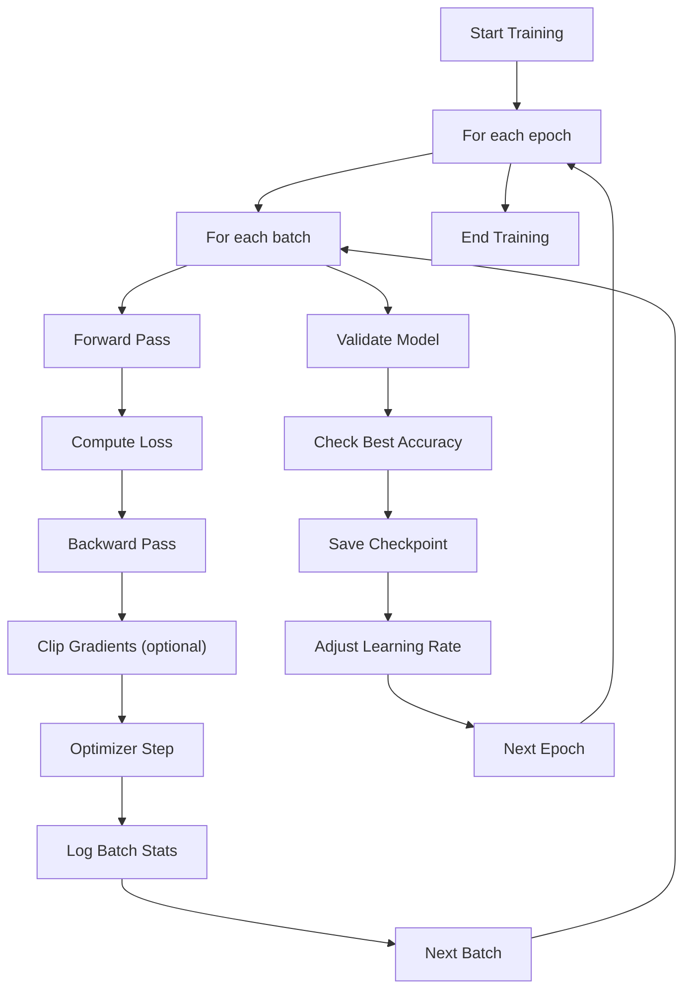
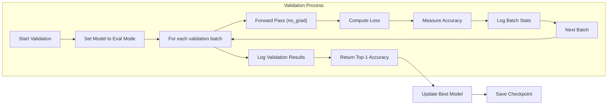
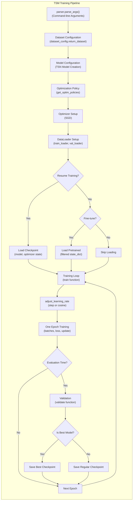

<!-- source: DeepWiki mcp.deepwiki.com · repo mit-han-lab/temporal-shift-module · page 4.1 Training Pipeline · fetched 2026-10-30 -->

# Training Pipeline

<details>
<summary>Relevant source files</summary>

The following files were used as context for generating this wiki page:

- [main.py](main.py)

</details>


This page documents the training pipeline for Temporal Shift Module (TSM) models. It explains how models are trained, how data flows through the system during training, and how the training pipeline is configured and customized. For information about evaluating trained models, see [Evaluation Methods](#4.4), and for details about dataset handling, see [Dataset Handling](#4.5).

## Overview

The TSM training pipeline provides a comprehensive framework for training video understanding models using the Temporal Shift Module. The pipeline handles data loading, model configuration, optimization, training loop management, validation, and checkpointing.



Sources: [main.py:27-190](). [main.py:342-347]()

## Training Pipeline Components

### Data Loading and Preparation

The pipeline uses the `TSNDataSet` class to load video data, which supports multiple modalities (RGB, Flow, RGBDiff). Data transformation pipelines are applied differently for training and validation sets:



Sources: [main.py:130-170]()

The data loading process handles:
- Different modalities (RGB, Flow, RGBDiff)
- Temporal segments from videos
- Data augmentation for training
- Center cropping for validation
- Normalization based on the pretrained model's requirements

### Model Configuration

The training pipeline creates a TSN model with Temporal Shift Module integration, configuring it based on command-line arguments:



Sources: [main.py:55-74](), [main.py:172-180]()

The model configuration process:
- Creates a TSN model with specified backbone architecture
- Integrates the Temporal Shift Module according to configuration
- Sets up consensus type (e.g., average)
- Prepares optimization policies (different learning rates for different layers)
- Wraps the model for multi-GPU training if available

### Optimization Setup

The training pipeline uses SGD optimization with customized learning rate policies for different parts of the model:

| Component | Learning Rate Multiplier | Weight Decay Multiplier |
|-----------|--------------------------|-------------------------|
| Base Layers | 1.0 | 1.0 |
| New FC Layers | 5.0 (if `fc_lr5=True`) | 1.0 |

Additionally, the pipeline supports:
- Gradient clipping to prevent exploding gradients
- Different learning rate schedules (step-based or cosine)
- Learning rate decay at specified epochs

Sources: [main.py:76-79](), [main.py:349-363]()

## Training Process

### Main Training Loop

The core training loop iterates through epochs and batches, computing loss and updating model parameters:



Sources: [main.py:190-216](), [main.py:219-283]()

The training function:
- Switches the model to train mode
- Enables partial batch normalization if specified
- Iterates through batches from the data loader
- Computes forward pass, loss, and backward pass
- Updates model parameters using the optimizer
- Records and logs metrics (loss, top-1/top-5 accuracy)
- Updates TensorBoard visualizations

### Validation Process

After specified epochs, the model is evaluated on the validation set:



Sources: [main.py:285-339]()

The validation process:
- Switches the model to evaluation mode
- Disables gradient computation for efficiency
- Computes model predictions on validation data
- Measures loss and accuracy metrics
- Logs performance to console and TensorBoard
- Returns top-1 accuracy for checkpoint comparison

### Checkpointing Mechanism

The training pipeline saves model checkpoints to enable resuming training and tracking the best model:

| Checkpoint Content | Description |
|-------------------|-------------|
| Epoch | Current epoch number |
| Architecture | Model architecture name |
| State Dict | Model weights |
| Optimizer | Optimizer state |
| Best Precision | Best validation accuracy so far |

Sources: [main.py:210-216](), [main.py:342-347]()

The checkpoint mechanism:
- Saves a checkpoint after each validation
- Maintains a separate "best" checkpoint for the highest validation accuracy
- Enables resuming training from a checkpoint by restoring model and optimizer state

## Customizing Training

The training pipeline is highly configurable through command-line arguments defined in `opts.py`. Key configuration options include:

### Dataset Configuration
- `--dataset`: Dataset name (e.g., kinetics, something, jester)
- `--modality`: Input modality (RGB, Flow, RGBDiff)
- `--num_segments`: Number of segments in each video
- `--dense_sample`: Whether to use dense sampling

### Model Configuration
- `--arch`: Backbone architecture (ResNet, MobileNetV2, BNInception)
- `--consensus_type`: Consensus function type
- `--shift`: Whether to use Temporal Shift Module
- `--shift_div`: Portion of channels to shift (default: 8)
- `--shift_place`: Where to place shift operations (default: blockres)
- `--non_local`: Whether to use non-local blocks

### Optimization Configuration
- `--lr`: Base learning rate
- `--lr_type`: Learning rate schedule (step, cos)
- `--lr_steps`: Epochs to decay learning rate (for step schedule)
- `--epochs`: Total training epochs
- `--clip_gradient`: Gradient clipping threshold
- `--weight_decay`: Weight decay factor

### Training Control
- `--batch_size`: Batch size for training
- `--workers`: Number of data loading workers
- `--print_freq`: How often to print training stats
- `--eval_freq`: How often to run validation
- `--resume`: Path to checkpoint for resuming training
- `--tune_from`: Path to model for fine-tuning

Sources: [main.py:27-52](), [main.py:190-216]()

## Complete Training Pipeline Diagram



Sources: [main.py:27-378]()

## Common Workflow Example

A typical training workflow for a TSM model involves:

1. **Preparing the dataset** according to the format expected by `TSNDataSet`
2. **Configuring the training** using command-line arguments
3. **Running the training** script with appropriate settings
4. **Monitoring the training** progress via console output and TensorBoard
5. **Retrieving the best model** after training completes

Example training command for Something-Something V1 dataset:

```
python main.py something RGB \
  --arch resnet50 --num_segments 8 \
  --batch_size 32 --lr 0.01 --lr_type step --lr_steps 20 40 \
  --epochs 50 --gd 20 --shift --shift_div 8 --shift_place blockres \
  --eval-freq 1
```

Sources: [main.py:27-52]()

---

