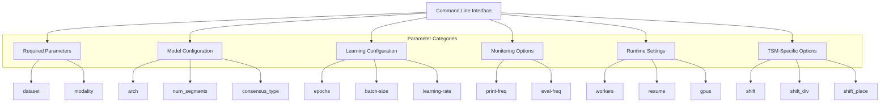
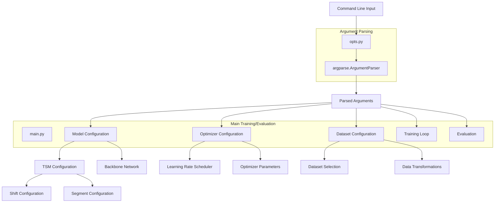
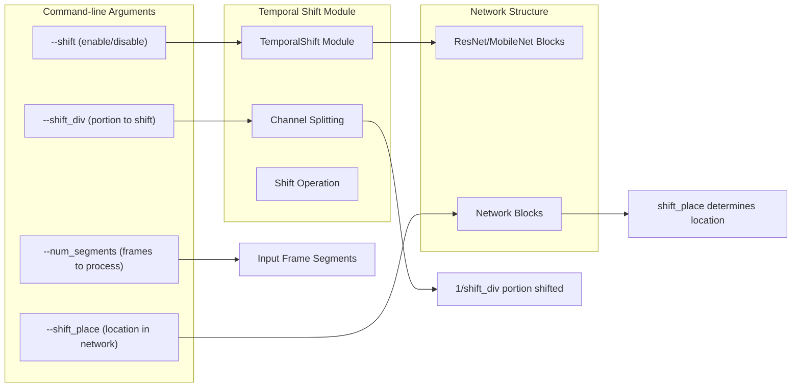

<!-- source: DeepWiki mcp.deepwiki.com · repo mit-han-lab/temporal-shift-module · page 4.2 Command-line Arguments · fetched 2026-10-30 -->

# Command-line Arguments

<details>
<summary>Relevant source files</summary>

The following files were used as context for generating this wiki page:

- [opts.py](opts.py)

</details>


This page documents the command-line arguments available for configuring the training and evaluation of TSM (Temporal Shift Module) models. The arguments allow for customization of the model architecture, learning parameters, runtime environment, and TSM-specific settings. For information about the actual training process, see [Training Pipeline](#4.1), and for evaluation methods, see [Evaluation Methods](#4.4).

## Overview

The TSM repository uses Python's `argparse` module to parse command-line arguments. All arguments are defined in the `opts.py` file and are categorized into logical groups.



Sources: [opts.py:6-76]()

## Required Arguments

These arguments must be provided when running the training or evaluation scripts.

| Argument | Description | Type |
|----------|-------------|------|
| `dataset` | The dataset to use (e.g., kinetics, something, jester) | String |
| `modality` | Input modality (RGB or Flow) | String |

Optional dataset-related arguments:

| Argument | Description | Type | Default |
|----------|-------------|------|---------|
| `--train_list` | Path to the file list for training data | String | "" |
| `--val_list` | Path to the file list for validation data | String | "" |
| `--root_path` | Root directory path for data | String | "" |

Sources: [opts.py:7-12]()

## Model Configuration Arguments

These arguments control the model architecture and structure.

| Argument | Description | Type | Default |
|----------|-------------|------|---------|
| `--arch` | Backbone architecture (e.g., BNInception, ResNet50) | String | "BNInception" |
| `--num_segments` | Number of segments in input sequence | Integer | 3 |
| `--consensus_type` | Consensus function type | String | "avg" |
| `--k` | Parameter k | Integer | 3 |
| `--dropout`, `--do` | Dropout ratio | Float | 0.5 |
| `--loss_type` | Loss function type | String | "nll" |
| `--img_feature_dim` | Feature dimension for each frame | Integer | 256 |
| `--suffix` | Customized suffix | String | None |
| `--pretrain` | Pretrained model source | String | "imagenet" |
| `--tune_from` | Fine-tune from checkpoint | String | None |

Sources: [opts.py:13-26]()

## Learning Configuration Arguments

These arguments control the training process and optimization parameters.

| Argument | Description | Type | Default |
|----------|-------------|------|---------|
| `--epochs` | Number of total epochs to run | Integer | 120 |
| `-b`, `--batch-size` | Mini-batch size | Integer | 128 |
| `--lr`, `--learning-rate` | Initial learning rate | Float | 0.001 |
| `--lr_type` | Learning rate scheduler type | String | "step" |
| `--lr_steps` | Epochs to decay learning rate by 10 | List of Floats | [50, 100] |
| `--momentum` | Momentum | Float | 0.9 |
| `--weight-decay`, `--wd` | Weight decay | Float | 5e-4 |
| `--clip-gradient`, `--gd` | Gradient norm clipping | Float | None |
| `--no_partialbn`, `--npb` | Disable partial batch normalization | Boolean | False |

Sources: [opts.py:28-45]()

## Monitoring Configuration Arguments

These arguments control how frequently information is displayed and evaluations are performed.

| Argument | Description | Type | Default |
|----------|-------------|------|---------|
| `--print-freq`, `-p` | Print frequency | Integer | 20 |
| `--eval-freq`, `-ef` | Evaluation frequency | Integer | 5 |

Sources: [opts.py:47-51]()

## Runtime Configuration Arguments

These arguments control the runtime environment and process.

| Argument | Description | Type | Default |
|----------|-------------|------|---------|
| `-j`, `--workers` | Number of data loading workers | Integer | 8 |
| `--resume` | Path to latest checkpoint | String | "" |
| `-e`, `--evaluate` | Evaluate model on validation set | Boolean | False |
| `--snapshot_pref` | Prefix for snapshots | String | "" |
| `--start-epoch` | Manual epoch number | Integer | 0 |
| `--gpus` | GPUs to use | List of Integers | None |
| `--flow_prefix` | Prefix for flow frames | String | "" |
| `--root_log` | Root directory for logs | String | "log" |
| `--root_model` | Root directory for models | String | "checkpoint" |

Sources: [opts.py:54-67]()

## TSM-Specific Arguments

These arguments are specific to the Temporal Shift Module functionality.

| Argument | Description | Type | Default |
|----------|-------------|------|---------|
| `--shift` | Use shift for models | Boolean | False |
| `--shift_div` | Number of divisions for shift | Integer | 8 |
| `--shift_place` | Place for shift (e.g., blockres) | String | "blockres" |
| `--temporal_pool` | Add temporal pooling | Boolean | False |
| `--non_local` | Add non-local block | Boolean | False |
| `--dense_sample` | Use dense sample for video dataset | Boolean | False |

Sources: [opts.py:69-76]()

## Command-line Argument Flow

The following diagram illustrates how the command-line arguments flow through the system during training and evaluation:



Sources: [opts.py:6-76]()

## Example Usage

Here's how to use the command-line arguments for typical training and evaluation scenarios:

### Basic Training Example

To train a TSM model with ResNet50 backbone on Something-Something V1 dataset:

```bash
python main.py something RGB \
  --arch resnet50 \
  --num_segments 8 \
  --batch-size 64 \
  --shift \
  --shift_div 8 \
  --shift_place blockres \
  --gpus 0 1 2 3
```

### Evaluation Example

To evaluate a trained model on the validation set:

```bash
python main.py something RGB \
  --arch resnet50 \
  --num_segments 8 \
  --batch-size 64 \
  --shift \
  --shift_div 8 \
  --shift_place blockres \
  --evaluate \
  --resume path/to/checkpoint.pth.tar \
  --gpus 0
```

### TSM Configuration Relationship

The following diagram shows how TSM-specific arguments relate to the model structure:



Sources: [opts.py:69-72]()

## Argument Dependencies

Some arguments have dependencies or are only meaningful when used with specific other arguments:

- `--shift_div` and `--shift_place` are only relevant when `--shift` is enabled
- `--tune_from` is used for fine-tuning from a checkpoint, as an alternative to `--resume`
- `--dense_sample` changes the sampling strategy for video frames and works together with `--num_segments`
- `--flow_prefix` is only used with the Flow modality

Understanding these dependencies is important for correctly configuring your experiments.

Sources: [opts.py:69-76]()

---

