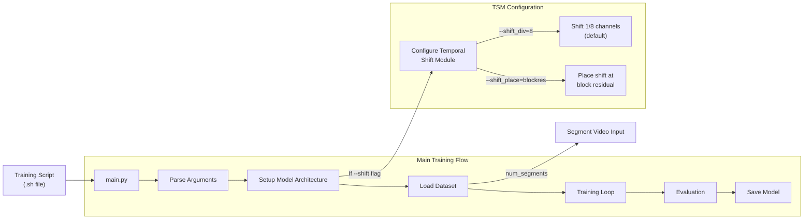
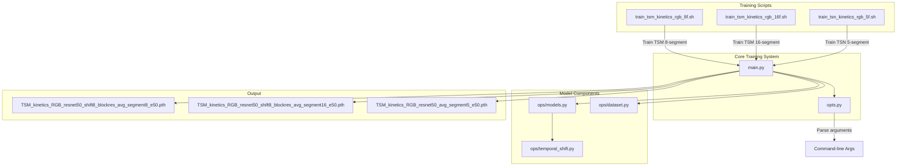

<!-- source: DeepWiki mcp.deepwiki.com · repo mit-han-lab/temporal-shift-module · page 4.3 Training Scripts · fetched 2026-10-30 -->

# Training Scripts

<details>
<summary>Relevant source files</summary>

The following files were used as context for generating this wiki page:

- [scripts/train_tsm_kinetics_rgb_16f.sh](scripts/train_tsm_kinetics_rgb_16f.sh)
- [scripts/train_tsm_kinetics_rgb_8f.sh](scripts/train_tsm_kinetics_rgb_8f.sh)
- [scripts/train_tsn_kinetics_rgb_5f.sh](scripts/train_tsn_kinetics_rgb_5f.sh)

</details>


## Purpose and Scope

This page documents the training scripts available in the Temporal Shift Module (TSM) repository. These scripts provide ready-to-use commands for training TSM and TSN (Temporal Segment Network) models on various datasets with different configurations. For information about the overall training pipeline, see [Training Pipeline](#4.1), and for details on the command-line arguments used in these scripts, see [Command-line Arguments](#4.2).

Sources: [scripts/train_tsm_kinetics_rgb_8f.sh:1-6](), [scripts/train_tsn_kinetics_rgb_5f.sh:1-8](), [scripts/train_tsm_kinetics_rgb_16f.sh:1-6]()

## Available Training Scripts

The repository provides several training scripts for different model configurations. Each script is designed for a specific use case, dataset, and model configuration. The main training scripts include:

| Script File | Purpose | Expected Model Output |
|-------------|---------|----------------------|
| `train_tsm_kinetics_rgb_8f.sh` | Train TSM on Kinetics with 8 segments | `TSM_kinetics_RGB_resnet50_shift8_blockres_avg_segment8_e50.pth` |
| `train_tsn_kinetics_rgb_5f.sh` | Train TSN (baseline) on Kinetics with 5 segments | `TSM_kinetics_RGB_resnet50_avg_segment5_e50.pth` |
| `train_tsm_kinetics_rgb_16f.sh` | Train TSM on Kinetics with 16 segments | `TSM_kinetics_RGB_resnet50_shift8_blockres_avg_segment16_e50.pth` |

Sources: [scripts/train_tsm_kinetics_rgb_8f.sh:1-1](), [scripts/train_tsn_kinetics_rgb_5f.sh:1-2](), [scripts/train_tsm_kinetics_rgb_16f.sh:1-1]()

## Training Script Structure and Parameters

All training scripts follow a similar structure, invoking the `main.py` script with specific parameters. Below is a breakdown of the common parameters used in these scripts:

### Common Parameters

| Parameter | Description | Example Value |
|-----------|-------------|---------------|
| First positional arg | Dataset name | `kinetics` |
| Second positional arg | Modality | `RGB` |
| `--arch` | Model architecture | `resnet50` |
| `--num_segments` | Number of segments to divide video into | `5`, `8`, or `16` |
| `--gd` | Gradient division factor | `20` |
| `--lr` | Initial learning rate | `0.02` |
| `--wd` | Weight decay | `1e-4` |
| `--lr_steps` | Learning rate reduction steps | `20 40` |
| `--epochs` | Total training epochs | `50` |
| `--batch-size` | Training batch size | `128` |
| `-j` | Number of data loading workers | `16` |
| `--dropout` | Dropout rate | `0.5` |
| `--consensus_type` | Consensus function for combining segments | `avg` |
| `--eval-freq` | Evaluation frequency | `1` |
| `--npb` | No progress bar flag | Flag only |

Sources: [scripts/train_tsm_kinetics_rgb_8f.sh:2-6](), [scripts/train_tsn_kinetics_rgb_5f.sh:4-8](), [scripts/train_tsm_kinetics_rgb_16f.sh:2-6]()

### TSM-Specific Parameters

The TSM model training scripts include additional parameters that enable the temporal shift operation:

| Parameter | Description | Example Value |
|-----------|-------------|---------------|
| `--shift` | Enable temporal shift | Flag only |
| `--shift_div` | Division factor for channel shifting | `8` |
| `--shift_place` | Where to place the shift module | `blockres` |

Sources: [scripts/train_tsm_kinetics_rgb_8f.sh:5-6](), [scripts/train_tsm_kinetics_rgb_16f.sh:5-6]()

## Training Script Workflow

Below is a diagram showing the typical workflow of a training script:



Sources: [scripts/train_tsm_kinetics_rgb_8f.sh:2-6](), [scripts/train_tsn_kinetics_rgb_5f.sh:4-8](), [scripts/train_tsm_kinetics_rgb_16f.sh:2-6]()

## Training Scripts in the System Context

This diagram shows how the training scripts fit into the larger TSM system:



Sources: [scripts/train_tsm_kinetics_rgb_8f.sh:1-6](), [scripts/train_tsn_kinetics_rgb_5f.sh:1-8](), [scripts/train_tsm_kinetics_rgb_16f.sh:1-6]()

## Script-Specific Details

### TSM Kinetics RGB 8-Frame Script

This script trains a TSM model on the Kinetics dataset using 8 segments with ResNet-50 as the backbone.

```bash
# You should get TSM_kinetics_RGB_resnet50_shift8_blockres_avg_segment8_e50.pth
python main.py kinetics RGB \
     --arch resnet50 --num_segments 8 \
     --gd 20 --lr 0.02 --wd 1e-4 --lr_steps 20 40 --epochs 50 \
     --batch-size 128 -j 16 --dropout 0.5 --consensus_type=avg --eval-freq=1 \
     --shift --shift_div=8 --shift_place=blockres --npb
```

Key configuration: 8 segments with temporal shift enabled, using 1/8 channel division and placing the shift module at the block residual connections.

Sources: [scripts/train_tsm_kinetics_rgb_8f.sh:1-6]()

### TSN Kinetics RGB 5-Frame Script

This script trains a TSN model (2D baseline without temporal shift) on the Kinetics dataset using 5 segments with ResNet-50 as the backbone.

```bash
# You should get TSM_kinetics_RGB_resnet50_avg_segment5_e50
# Notice that for TSN 2D baseline, it is recommended to train using 5 segments and test with more segments to avoid overfitting

python main.py kinetics RGB \
     --arch resnet50 --num_segments 5 \
     --gd 20 --lr 0.02 --wd 1e-4 --lr_steps 20 40 --epochs 50 \
     --batch-size 128 -j 16 --dropout 0.5 --consensus_type=avg --eval-freq=1 \
     --npb
```

Note: The script comment indicates that for the TSN 2D baseline, it's recommended to train with 5 segments but test with more segments to avoid overfitting.

Sources: [scripts/train_tsn_kinetics_rgb_5f.sh:1-8]()

### TSM Kinetics RGB 16-Frame Script

This script trains a TSM model on the Kinetics dataset using 16 segments with ResNet-50 as the backbone.

```bash
# You should get TSM_kinetics_RGB_resnet50_shift8_blockres_avg_segment16_e50
python main.py kinetics RGB \
     --arch resnet50 --num_segments 16 \
     --gd 20 --lr 0.02 --wd 1e-4 --lr_steps 20 40 --epochs 50 \
     --batch-size 128 -j 16 --dropout 0.5 --consensus_type=avg --eval-freq=1 \
     --shift --shift_div=8 --shift_place=blockres --npb
```

Key configuration: 16 segments with temporal shift enabled, using 1/8 channel division and placing the shift module at the block residual connections. The increased number of segments (16 vs 8) allows for more fine-grained temporal modeling but requires more GPU memory.

Sources: [scripts/train_tsm_kinetics_rgb_16f.sh:1-6]()

## Usage Guidelines

1. Select the appropriate script based on your needs:
   - Use `train_tsn_kinetics_rgb_5f.sh` as a 2D baseline without temporal modeling
   - Use `train_tsm_kinetics_rgb_8f.sh` for a good balance between performance and efficiency
   - Use `train_tsm_kinetics_rgb_16f.sh` for higher accuracy but more GPU memory consumption

2. Execute the script directly or modify the parameters as needed:
   ```bash
   bash scripts/train_tsm_kinetics_rgb_8f.sh
   ```

3. The trained model will be saved with a name following the pattern shown in the script comment, for example: `TSM_kinetics_RGB_resnet50_shift8_blockres_avg_segment8_e50.pth`

4. For evaluation of trained models, refer to the [Evaluation Methods](#4.4) section.

Sources: [scripts/train_tsm_kinetics_rgb_8f.sh:1-1](), [scripts/train_tsn_kinetics_rgb_5f.sh:1-2](), [scripts/train_tsm_kinetics_rgb_16f.sh:1-1]()

---

