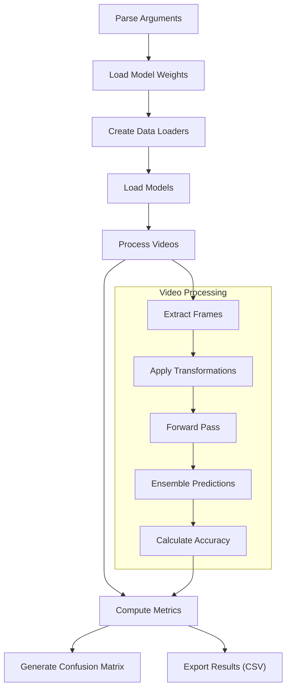
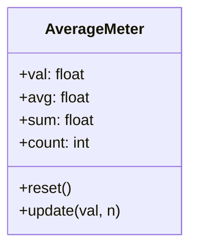
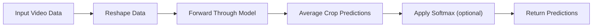
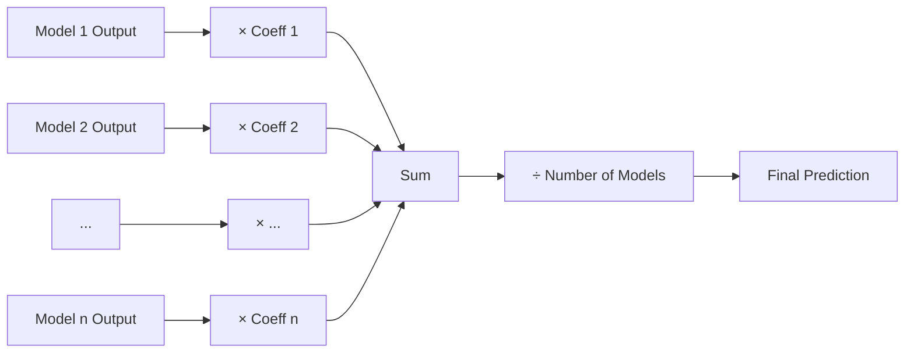
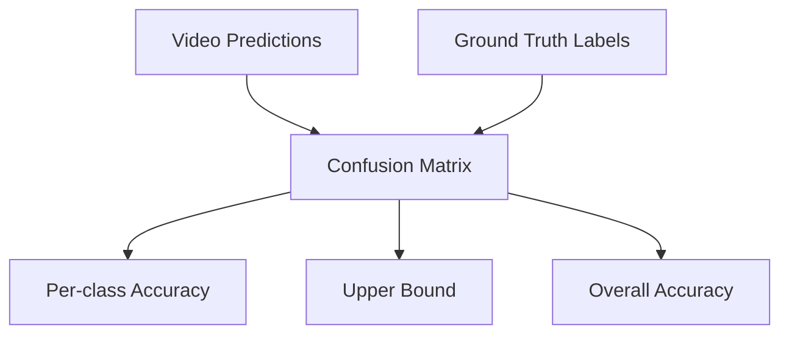
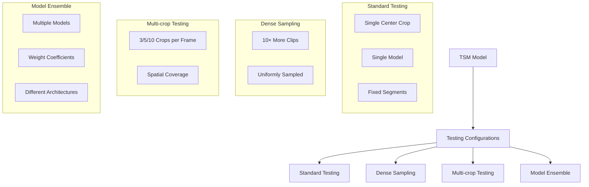

<!-- source: DeepWiki mcp.deepwiki.com · repo mit-han-lab/temporal-shift-module · page 4.4 Evaluation Methods · fetched 2026-10-30 -->

# Evaluation Methods

<details>
<summary>Relevant source files</summary>

The following files were used as context for generating this wiki page:

- [test_models.py](test_models.py)

</details>


This page documents the evaluation methods and procedures used to assess the performance of Temporal Shift Module (TSM) models. It covers the evaluation workflow, metrics, and configuration options for testing trained models. For information on the training process, see [Training Pipeline](#4.1), and for dataset preparation, see [Dataset Handling](#4.5).

## Overview

The TSM repository provides a comprehensive evaluation framework that supports various testing strategies, including multi-crop testing, dense sampling, and model ensembling. The primary evaluation script `test_models.py` allows for flexible configuration of the evaluation process to measure model performance accurately.

Sources: [test_models.py:1-52]()

## Evaluation Workflow

The evaluation process follows a well-defined workflow that processes video data through one or more trained models to produce classification results.



The evaluation script supports various testing scenarios:
- Single model evaluation
- Multi-model ensemble evaluation with weighted coefficients
- Different input modalities (RGB, Flow)
- Multiple crop and sampling strategies

Sources: [test_models.py:96-210](), [test_models.py:256-287]()

## Key Components

### AverageMeter

The `AverageMeter` class tracks and computes the running average of evaluation metrics as videos are processed.



Sources: [test_models.py:55-70]()

### Video Evaluation Function

The `eval_video` function processes individual videos through the model and generates predictions.



Sources: [test_models.py:215-253]()

## Configuration Options

The evaluation framework offers numerous configuration options to adapt the testing methodology to different scenarios.

### Testing Segments

The number of temporal segments used for testing affects the temporal granularity of the evaluation:

```
--test_segments N     Number of segments to use during testing (default: 25)
```

Higher segment counts provide more temporal context but require more computation.

### Crop and Sampling Strategies

Multiple cropping and sampling strategies are supported to handle different evaluation protocols:

| Strategy | Option | Description |
|----------|--------|-------------|
| Center crop | `--test_crops 1` | Single center crop from each frame |
| 3-crop | `--test_crops 3` | Three crops without flipping |
| 5-crop | `--test_crops 5` | Five crops without flipping |
| 10-crop | `--test_crops 10` | Ten crops with flipping |
| Dense sample | `--dense_sample` | Use dense sampling as in I3D |
| Twice sample | `--twice_sample` | Use twice sampling for ensemble |
| Full resolution | `--full_res` | Use full 256x256 resolution |

Sources: [test_models.py:26-36](), [test_models.py:155-174]()

### Model Ensemble

The framework supports ensembling multiple models with different configurations:

```
--weights model1.pth,model2.pth    Comma-separated list of model weights
--test_segments 8,16               Segments to use for each model
--coeff 1,0.5                      Weight coefficients for each model
```

Ensemble predictions are calculated as weighted averages of individual model outputs:



Sources: [test_models.py:98-104](), [test_models.py:266-275]()

## Evaluation Metrics

The evaluation framework calculates several performance metrics:

### Accuracy Metrics

- **Top-1 Accuracy**: Percentage of samples where the highest prediction matches the ground truth
- **Top-5 Accuracy**: Percentage of samples where the ground truth is among the top 5 predictions

The `accuracy` function calculates these metrics:

Sources: [test_models.py:73-84](), [test_models.py:280-282]()

### Confusion Matrix

A confusion matrix is generated to analyze per-class performance:



The confusion matrix is saved as `cm.npy` for further analysis.

Sources: [test_models.py:316-329]()

## CSV Export

For benchmarking or submission purposes, predictions can be exported to a CSV file:

```
--csv_file output.csv    Path to save CSV prediction results
```

The format varies depending on the dataset:
- For most datasets: `video_id;predicted_category`
- For Something-Something V2: `video_id;top1;top2;top3;top4;top5`

Sources: [test_models.py:294-313]()

## Running Evaluation

To evaluate a model, use the `test_models.py` script with appropriate arguments. Here's a basic example:

```bash
python test_models.py somethingv2 \
  --weights=checkpoints/TSM_somethingv2_RGB_resnet50_shift8_blockres_avg_segment8_e45.pth \
  --test_segments=8 \
  --batch_size=48 \
  --crop_fusion_type=avg
```

For ensemble testing, specify multiple model weights with corresponding segment counts:

```bash
python test_models.py somethingv2 \
  --weights=checkpoints/model1.pth,checkpoints/model2.pth \
  --test_segments=8,16 \
  --coeff=1,0.5
```

Sources: [test_models.py:21-52]()

## Advanced Testing Configurations

The framework provides several advanced testing configurations to optimize evaluation for different scenarios:



Sources: [test_models.py:26-30](), [test_models.py:221-222]()

## Conclusion

The evaluation methods in the TSM repository provide a flexible and comprehensive framework for assessing model performance. By supporting various testing strategies and configuration options, they enable accurate comparison between different model architectures and training approaches.

For information on handling different datasets during evaluation, see [Dataset Handling](#4.5), and for details on available model architectures, see [Supported Architectures](#6.1).

Sources: [test_models.py:1-331]()

---

