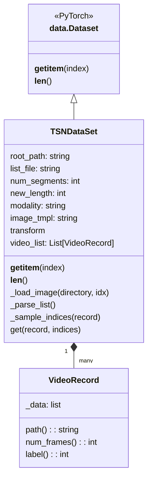
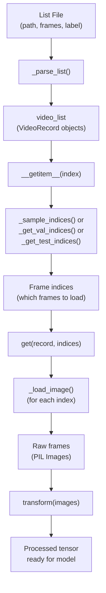
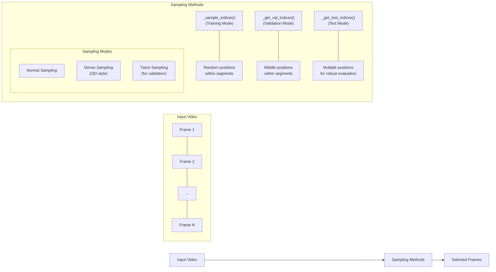
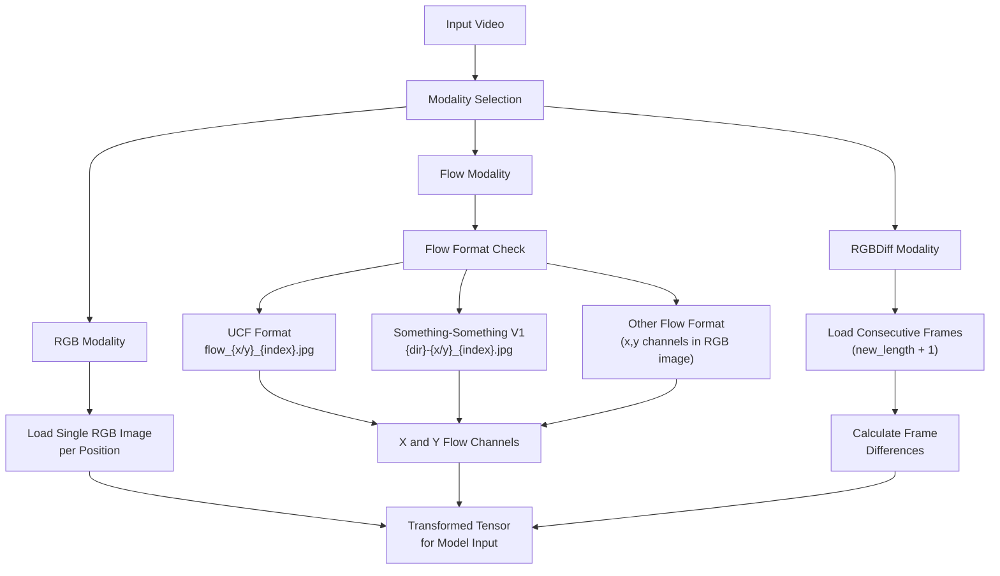
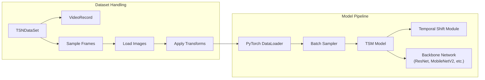

<!-- source: DeepWiki mcp.deepwiki.com · repo mit-han-lab/temporal-shift-module · page 4.5 Dataset Handling · fetched 2026-10-30 -->

# Dataset Handling

Relevant source files

The following files were used as context for generating this wiki page:

- [archs/mobilenet_v2.py](archs/mobilenet_v2.py)
- [ops/dataset.py](ops/dataset.py)

## Purpose and Scope

This document explains how video datasets are loaded, processed, and fed into the Temporal Shift Module (TSM) system. It covers the dataset classes, video record representation, frame sampling strategies, and the handling of different modalities (RGB, Flow). For information about preparing raw datasets before loading them, see [Data Preparation](#5.1).

## Dataset Structure Overview

The TSM system uses a flexible dataset handling approach based on PyTorch's Dataset class, with specialized functionality for video processing. The primary classes are `VideoRecord` (for representing individual videos) and `TSNDataSet` (for loading and processing the entire dataset).

**Diagram: Main dataset classes for TSM**

Sources: [ops/dataset.py:14-28](), [ops/dataset.py:31-214]()

### VideoRecord Class

The `VideoRecord` class is a simple wrapper for video metadata:
- `path` - Path to the video frames
- `num_frames` - Total number of frames in the video
- `label` - Class label of the video

### TSNDataSet Class

The `TSNDataSet` class handles loading and sampling of video data with these key parameters:

| Parameter | Default | Description |
|-----------|---------|-------------|
| `root_path` | - | Root directory containing video frame folders |
| `list_file` | - | List file with video metadata (path, frames, label) |
| `num_segments` | 3 | Number of segments to divide the video into |
| `new_length` | 1 | Number of frames per segment |
| `modality` | 'RGB' | Input modality (RGB, Flow, RGBDiff) |
| `image_tmpl` | 'img_{:05d}.jpg' | Template for frame filenames |
| `transform` | None | Transformations to apply to loaded frames |
| `random_shift` | True | Random frame selection for training |
| `test_mode` | False | Whether in test mode (affects sampling) |
| `dense_sample` | False | Whether to use dense sampling like I3D |
| `twice_sample` | False | Whether to use twice sampling for validation |

Sources: [ops/dataset.py:31-58]()

## Data Loading Flow

The data loading process follows a sequence from video metadata to processed tensor inputs ready for the model:

**Diagram: Dataset loading and processing flow**

Sources: [ops/dataset.py:165-211](), [ops/dataset.py:60-92](), [ops/dataset.py:94-104]()

### Dataset Initialization Process

When a `TSNDataSet` is initialized:

1. It stores all configuration parameters
2. For RGBDiff modality, it increments `new_length` by 1 (to calculate frame differences)
3. It parses the list file to create `VideoRecord` objects for each video
4. For certain image templates, it adjusts the frame count

Sources: [ops/dataset.py:31-104]()

### Data Retrieval Process

When an item is requested via `__getitem__(index)`:

1. Get the `VideoRecord` for the requested index
2. Verify the video exists and fallback to a random video if necessary
3. Determine which frames to sample based on the mode (train, val, test)
4. Load the selected frames using `_load_image()`
5. Apply transformations to the loaded frames
6. Return the processed frames and the label

Sources: [ops/dataset.py:165-211]()

## Frame Sampling Strategies

The TSM system implements several strategies for selecting frames from videos:

**Diagram: Frame sampling strategies**

Sources: [ops/dataset.py:106-163]()

### Regular Sampling

In regular sampling:
- The video is divided into `num_segments` equal segments
- From each segment, a frame is selected based on:
  - For training: Random position within the segment
  - For validation: Center position of the segment
  - For testing: Center position, with multiple samples for robust evaluation

### Dense Sampling (I3D-style)

Dense sampling is similar to the I3D approach:
- Uses a 64-frame snippet with fixed stride
- For training/validation: Randomly selects a starting point
- For testing: Uses 10 different starting points for robust evaluation

### Twice Sampling

For more thorough validation, twice sampling allows:
- Sampling both at the center of segments
- And at the beginning of segments
- Effectively doubling the number of frames evaluated

Sources: [ops/dataset.py:106-163]()

## Modality Handling

The dataset loader supports different input modalities:

**Diagram: Handling different input modalities**

Sources: [ops/dataset.py:60-92]()

### RGB Modality

For RGB modality:
- Loads standard RGB images
- Each frame is loaded as a single PIL Image
- Fallback to first frame if a specific frame is missing

### Flow Modality

For Flow modality:
- Supports multiple optical flow formats:
  - UCF format: Separate files for x and y components
  - Something-Something V1 format: Special directory structure
  - Generic format: RGB image with flow data in channels
- Returns two images per frame (x and y components)

### RGBDiff Modality

For RGBDiff modality:
- Loads one additional frame (new_length + 1)
- This enables frame differencing during processing
- Differences are calculated in the transform pipeline

Sources: [ops/dataset.py:60-92]()

## Integration with Model Pipeline

The dataset class integrates with the rest of the TSM system by:

1. Feeding properly sampled frames to the model during training and evaluation
2. Supporting transformations for data augmentation and normalization
3. Enabling different sampling strategies for training vs. testing
4. Providing metadata needed for temporal shift operations

**Diagram: Integration with model pipeline**

Sources: [ops/dataset.py:31-214](), [archs/mobilenet_v2.py:69-114]()

## Summary

The dataset handling in the TSM system provides a flexible, configurable approach to loading video data for action recognition tasks. Key features include:

- Support for multiple modalities (RGB, Flow, RGBDiff)
- Various frame sampling strategies (regular, dense, twice sampling)
- Efficient loading of frames from disk
- Integration with PyTorch's data loading pipeline
- Support for different video datasets through configurable templates

Understanding these dataset handling mechanisms is essential for properly training and evaluating TSM models on new datasets.

---

