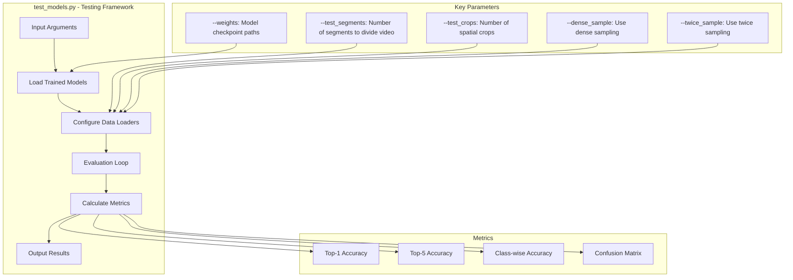
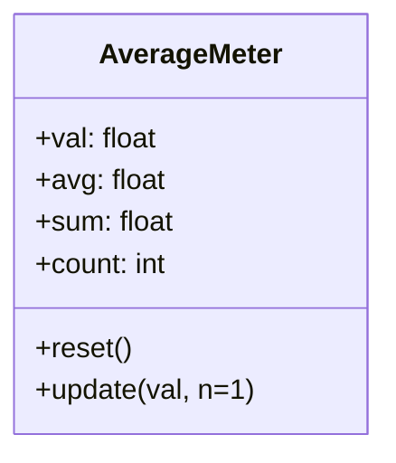
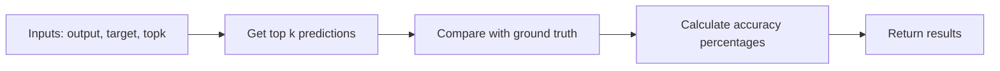
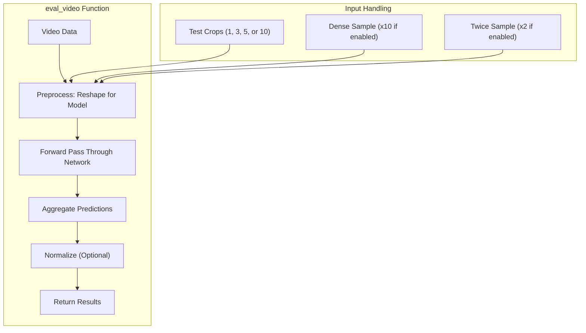
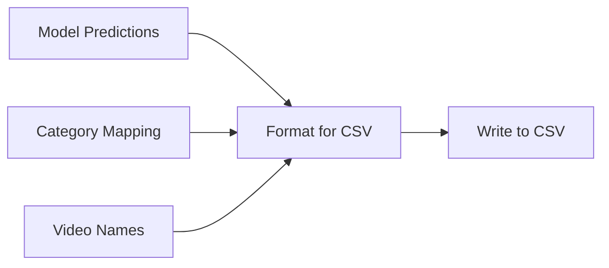
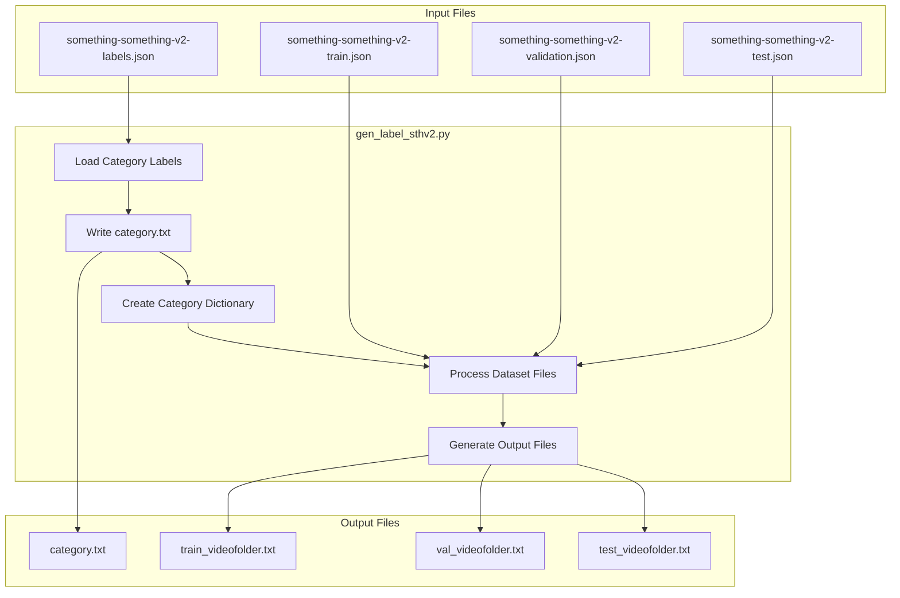
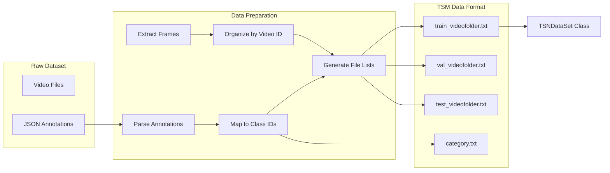
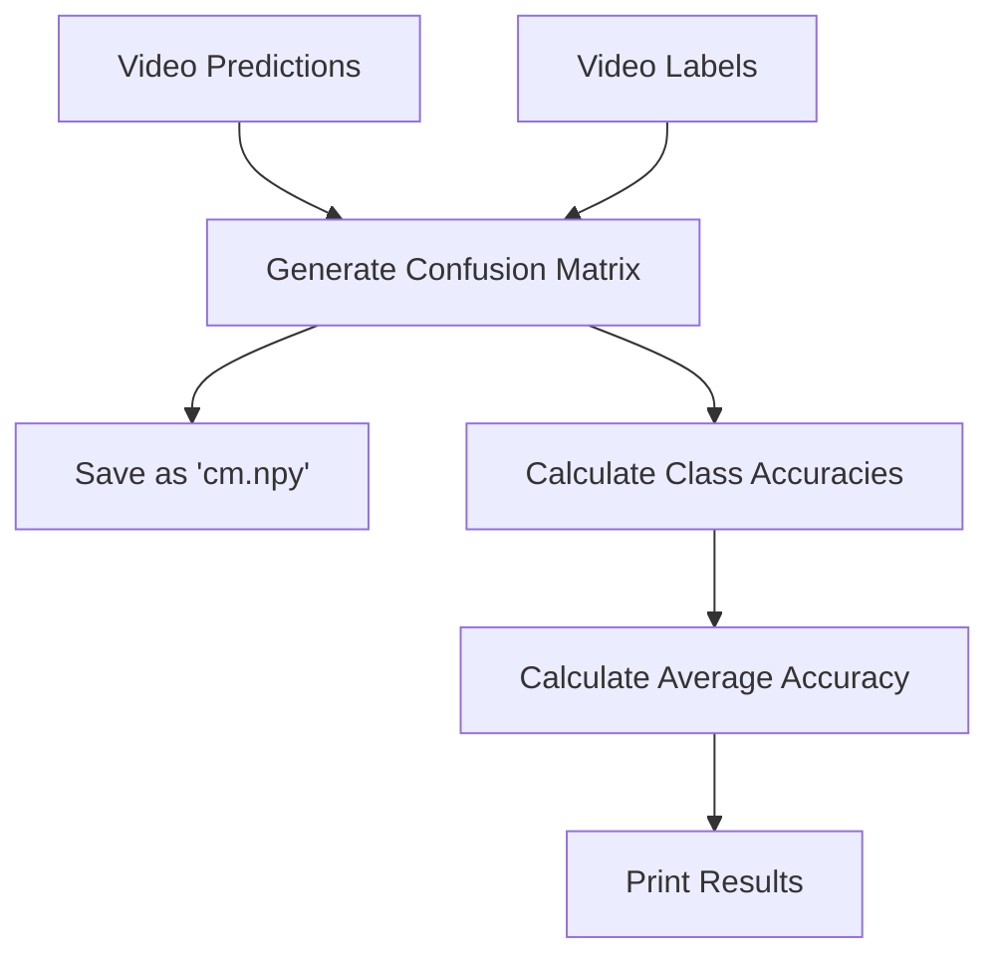
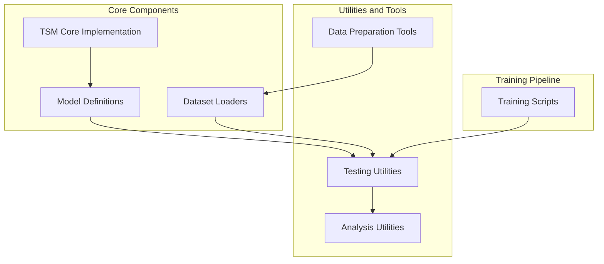

<!-- source: DeepWiki mcp.deepwiki.com · repo mit-han-lab/temporal-shift-module · page 5 Utilities and Tools · fetched 2026-10-30 -->

# Utilities and Tools

<details>
<summary>Relevant source files</summary>

The following files were used as context for generating this wiki page:

- [test_models.py](test_models.py)
- [tools/gen_label_sthv2.py](tools/gen_label_sthv2.py)

</details>


This page documents the auxiliary tools and utilities included in the Temporal Shift Module repository that support the testing, evaluation, and data preparation aspects of the system. These utilities are not core components of the TSM architecture itself, but they provide essential functionality for preparing datasets, testing models, and analyzing results.

For information about the core TSM implementation, see [Core Components](#2). For training pipeline details, see [Training and Evaluation](#4).

## Testing Utilities

The repository includes comprehensive tools for testing and evaluating trained TSM models, primarily located in the `test_models.py` script. 

### Model Testing Framework

The testing framework allows for flexible evaluation of trained models with support for:

- Single model testing or model ensemble testing
- Multiple test segments and crop strategies
- Dense sampling similar to I3D
- Full-resolution testing (256x256) as in Non-local I3D
- Softmax normalization option for prediction probabilities
- Parallel processing across multiple GPUs



Sources: [test_models.py:1-331]()

### Key Utility Classes and Functions

The testing framework utilizes several utility functions and classes:

#### AverageMeter

The `AverageMeter` class efficiently tracks running averages of values, used for monitoring metrics during evaluation:



Sources: [test_models.py:55-70]()

#### Accuracy Calculation

The `accuracy` function computes precision at k for specified values of k (typically 1 and 5):



Sources: [test_models.py:73-84]()

#### Model Parsing

The `parse_shift_option_from_log_name` function extracts TSM configuration from model checkpoint names:

```python
# Example usage of parse_shift_option_from_log_name
is_shift, shift_div, shift_place = parse_shift_option_from_log_name(weights_filename)
# Returns: is_shift (bool), shift_div (int), shift_place (str)
```

Sources: [test_models.py:87-95]()

### Video Evaluation Process

The evaluation process for each video follows a defined workflow:



Sources: [test_models.py:215-253]()

### Output Generation

The testing framework supports generating CSV files with predictions, useful for submitting results to benchmarks:



Sources: [test_models.py:294-313]()

## Data Preparation Tools

The repository includes utilities for processing dataset raw data into formats compatible with the TSM training and testing pipeline.

### Something-Something-V2 Data Processor

The `gen_label_sthv2.py` script processes the Something-Something-V2 dataset, creating the necessary label mappings and metadata files:



The generated output files have the format `[video_id] [num_frames] [class_idx]`, which is used by the data loader in the TSM framework.

Example output line:
```
12345 28 87
```
Where `12345` is the video folder ID, `28` is the number of frames, and `87` is the class index.

Sources: [tools/gen_label_sthv2.py:1-51]()

### Data Format Conversion Workflow

The data preparation pipeline transforms raw dataset files into the format required by the TSM data loaders:



This workflow ensures that datasets are properly organized and labeled for use with the TSM training and evaluation pipelines.

Sources: [tools/gen_label_sthv2.py:1-51](), [test_models.py:176-191]()

## Analysis Utilities

The TSM framework provides several utilities for analyzing model performance after evaluation.

### Confusion Matrix Generation

The testing framework automatically generates a confusion matrix and saves it to disk:



The confusion matrix analysis provides insights into per-class performance, helping identify classes where the model performs well or poorly.

Sources: [test_models.py:316-329]()

### Performance Metrics

The testing framework calculates and outputs various performance metrics:

- Top-1 and Top-5 accuracy across the entire dataset
- Class-wise accuracy for each category
- Upper bound performance estimate
- Average processing time per video

These metrics provide comprehensive evaluation of model performance and efficiency.

Sources: [test_models.py:259-287](), [test_models.py:322-329]()

## Integration with Core System

The utilities and tools integrate with the core TSM system components as shown below:



The utilities form a complementary ecosystem around the core TSM implementation, supporting the full lifecycle from data preparation to model evaluation and analysis.

Sources: [test_models.py:1-331](), [tools/gen_label_sthv2.py:1-51]()

---

