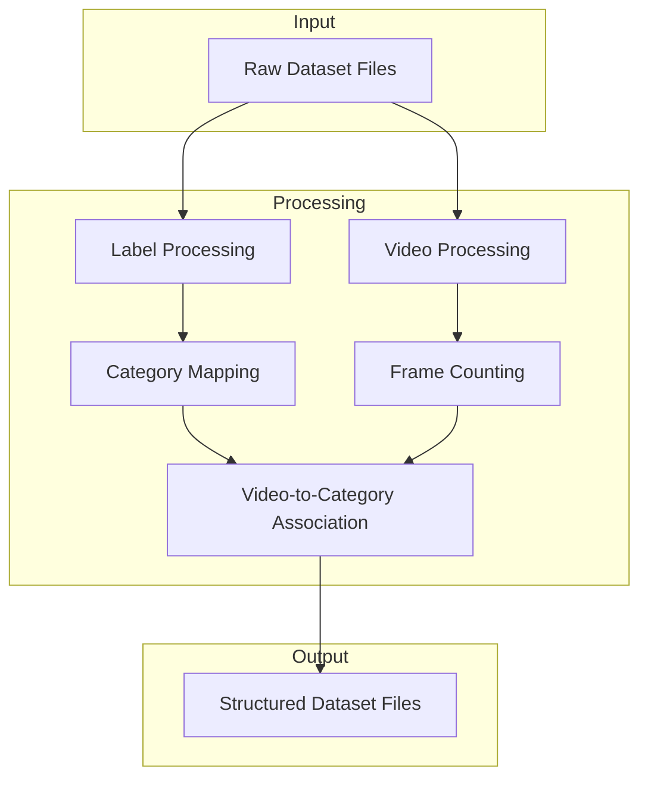
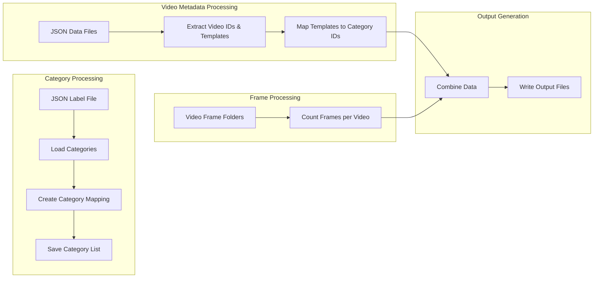
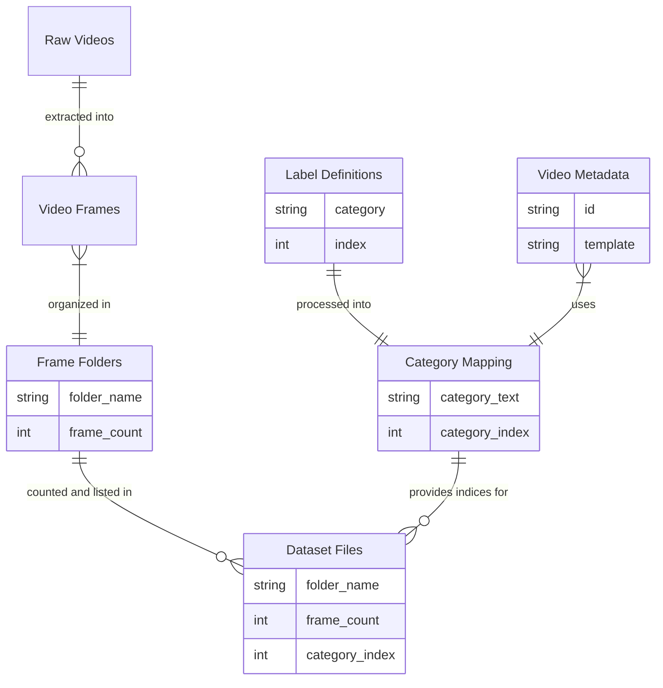

<!-- source: DeepWiki mcp.deepwiki.com · repo mit-han-lab/temporal-shift-module · page 5.1 Data Preparation · fetched 2026-10-30 -->

# Data Preparation

<details>
<summary>Relevant source files</summary>

The following files were used as context for generating this wiki page:

- [tools/gen_label_sthv2.py](tools/gen_label_sthv2.py)

</details>


## Purpose and Scope

This document describes the data preparation process for the Temporal Shift Module (TSM) system. It covers the tools and procedures used to transform raw video datasets into structured formats suitable for training and evaluating TSM models. For information about the dataset handling during training, see [Dataset Handling](#4.5).

## Overview of Data Preparation

The TSM repository includes tools for preparing video datasets, particularly for the Something-Something-V2 dataset. The data preparation process involves converting raw video data into a structured format that can be efficiently loaded during training and evaluation.



Sources: [tools/gen_label_sthv2.py](). This diagram shows the general flow of data preparation for video datasets in the TSM system.

## Data Formats

### Input Data Format

The data preparation process expects input data in the following formats:

1. Label definitions as JSON file (`something-something-v2-labels.json`)
2. Video metadata as JSON files:
   - `something-something-v2-train.json`
   - `something-something-v2-validation.json`
   - `something-something-v2-test.json`
3. Video frames organized in folders (one folder per video)

### Output Data Format

The data preparation process generates the following output files:

1. `category.txt`: A text file containing all category labels, one per line
2. Dataset files:
   - `train_videofolder.txt`
   - `val_videofolder.txt`
   - `test_videofolder.txt`

Each line in the dataset files follows the format:
```
video_folder_name frame_count category_index
```

Sources: [tools/gen_label_sthv2.py:29-50]()

## Data Preparation Process

The data preparation process involves several steps, as described below:



Sources: [tools/gen_label_sthv2.py:12-50]()

### Step 1: Process Category Labels

The system first processes the label definitions from a JSON file and creates a mapping between text labels and numerical indices.

1. Load the label file (e.g., `something-something-v2-labels.json`)
2. Extract category labels and verify their indices
3. Write all categories to `category.txt`
4. Create a dictionary mapping category text to category index

Sources: [tools/gen_label_sthv2.py:14-26]()

### Step 2: Process Video Metadata

Next, the system processes the video metadata files for train, validation, and test sets.

1. Load the JSON metadata file (train, validation, or test)
2. Extract video IDs and associated template text
3. Map the templates to category indices using the dictionary created in Step 1
   - For test files, a default category index of 0 is used

Sources: [tools/gen_label_sthv2.py:28-40]()

### Step 3: Count Frames and Generate Output

Finally, the system counts the number of frames in each video folder and combines all the information into the output files.

1. For each video folder:
   - Count the number of files in the folder to determine frame count
   - Combine video folder name, frame count, and category index
2. Write the combined information to the output files:
   - `train_videofolder.txt`
   - `val_videofolder.txt`
   - `test_videofolder.txt`

Sources: [tools/gen_label_sthv2.py:41-50]()

## Data Structure

The data preparation process transforms raw data into a structured format that can be efficiently loaded by the training and evaluation pipeline. The relationship between files is shown below:



Sources: [tools/gen_label_sthv2.py]()

## Usage Instructions

To prepare the Something-Something-V2 dataset, follow these steps:

1. Download the dataset files:
   - Video frames (extracted from original videos)
   - JSON metadata files

2. Place the JSON files in the working directory:
   - `something-something-v2-labels.json`
   - `something-something-v2-train.json`
   - `something-something-v2-validation.json`
   - `something-something-v2-test.json`

3. Place the video frame folders in a directory named `20bn-something-something-v2-frames`

4. Run the data preparation script:
   ```
   python tools/gen_label_sthv2.py
   ```

5. The script will generate the following output files:
   - `category.txt`
   - `train_videofolder.txt`
   - `val_videofolder.txt`
   - `test_videofolder.txt`

These output files can then be used by the training and evaluation scripts.

Sources: [tools/gen_label_sthv2.py:12-50]()

## Supported Datasets

The primary data preparation tool in the repository is designed for the Something-Something-V2 dataset. However, the code comments indicate that it can also be adapted for other datasets such as Jester-V1.

| Dataset | Support Level | Preparation Tool |
|---------|---------------|------------------|
| Something-Something-V2 | Primary | `tools/gen_label_sthv2.py` |
| Jester-V1 | Secondary (commented in code) | Adaptation of `tools/gen_label_sthv2.py` |

To adapt the data preparation script for other datasets, you would need to modify the dataset name and ensure the input JSON files follow the same format as the Something-Something-V2 dataset.

Sources: [tools/gen_label_sthv2.py:13]()

## Integration with Training Pipeline

After preparing the data as described above, the dataset files can be used by the training pipeline. The dataset handling is managed by the dataset module, which reads the generated files and loads the video frames during training and evaluation.

For more information about how datasets are loaded and processed during training, see the [Dataset Handling](#4.5) page.

---

