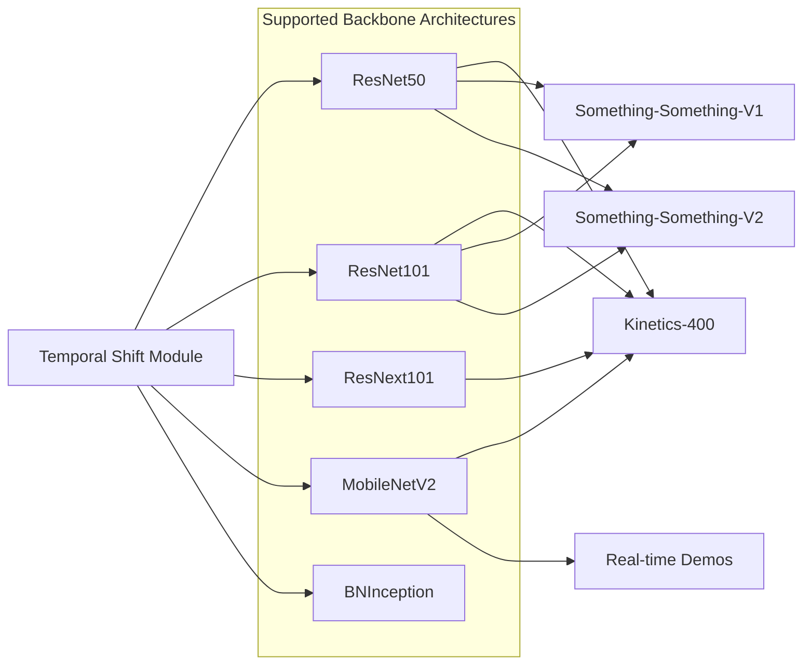
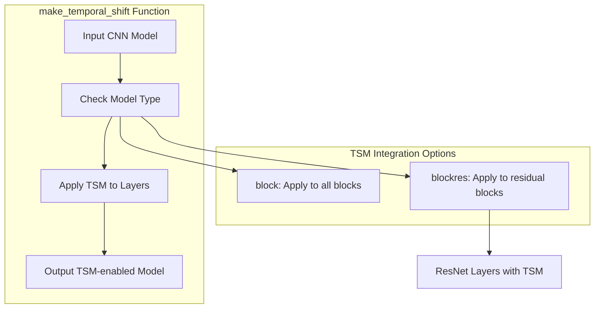
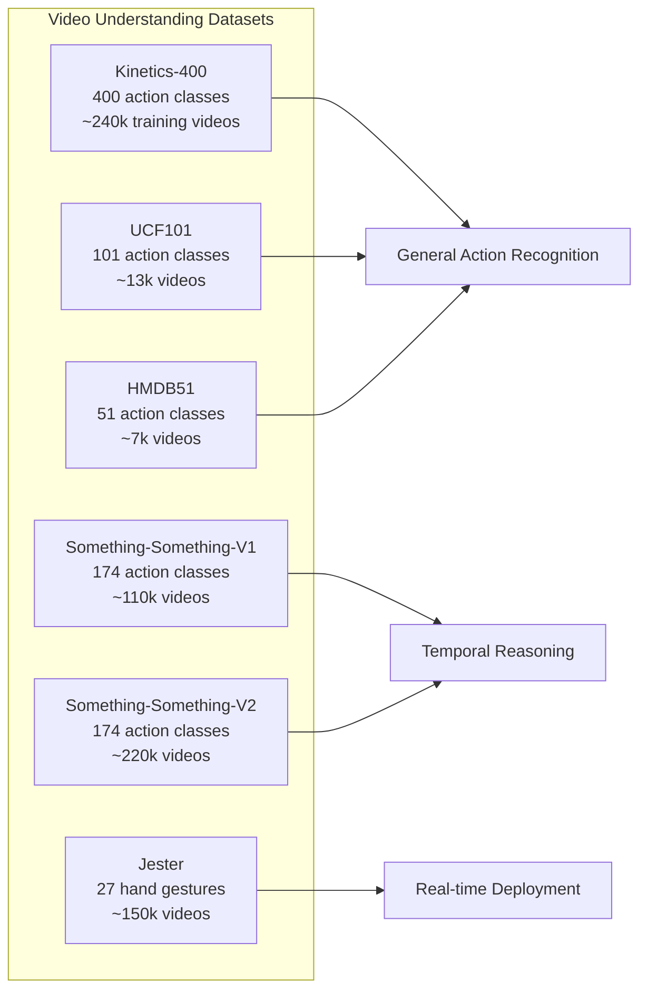
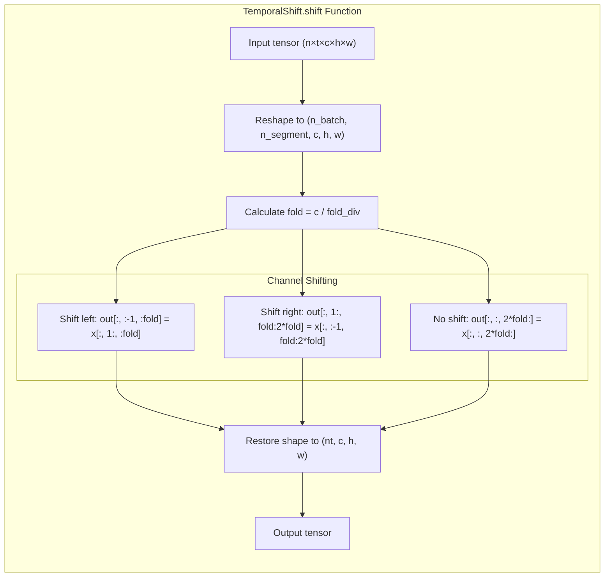

<!-- source: DeepWiki mcp.deepwiki.com · repo mit-han-lab/temporal-shift-module · page 6 Reference · fetched 2026-10-30 -->

# Reference

Relevant source files

The following files were used as context for generating this wiki page:

- [README.md](README.md)
- [ops/temporal_shift.py](ops/temporal_shift.py)

This page serves as a comprehensive reference for the Temporal Shift Module (TSM) codebase, documenting supported model architectures, datasets, and performance benchmarks. For implementation details of the Temporal Shift Module itself, see [Core Components](#2) and [Temporal Shift Module](#2.1).

## Supported Model Architectures

TSM is designed to be compatible with standard 2D CNN architectures, allowing them to capture temporal information without additional parameters. The following backbone architectures are officially supported:

Sources: [README.md:85-114](), [README.md:141-155]()

### ResNet Family

ResNet models (ResNet50, ResNet101, ResNext101) serve as the primary backbones for TSM implementation. They offer a balance between accuracy and computational efficiency. The temporal shift operation is applied to specific layers in the ResNet architecture.

#### Integration Method

TSM can be integrated into ResNet models in two ways:
- **Block mode**: Applies temporal shift to all blocks
- **Blockres mode**: Applies temporal shift only to residual blocks at specific intervals

Sources: [ops/temporal_shift.py:97-139]()

### MobileNetV2

MobileNetV2 is specifically used for efficient deployment scenarios, such as the real-time hand gesture recognition demo. It provides a more lightweight alternative to ResNet models, achieving 69.5% accuracy on Kinetics-400 with 8-frame input.

Sources: [README.md:114](), [README.md:256-260]()

## Supported Datasets

TSM has been successfully trained and evaluated on various action recognition datasets:

Sources: [README.md:61-62]()

### Dataset Processing Pipeline

For all datasets, the processing follows a similar pipeline:
1. Extract frames from videos using tools like [tools/vid2img_kinetics.py]() or [tools/vid2img_sthv2.py]()
2. Generate annotations using dataset-specific scripts like [tools/gen_label_kinetics.py]()
3. Configure dataset paths in [ops/dataset_configs.py]()

Sources: [README.md:57-66]()

## Performance Reference

### Kinetics-400 Performance

#### Dense Sampling Protocol

Results using I3D dense sampling protocol (8-frame and 16-frame):

| Model | Frames × Clips | Kinetics Accuracy |
|-------|----------------|------------------|
| TSN ResNet50 (2D) | 8 × 10 | 70.6% |
| TSM ResNet50 | 8 × 10 | 74.1% |
| TSM ResNet50 NL | 8 × 10 | 75.6% |
| TSM ResNext101 | 8 × 10 | 76.3% |
| TSM MobileNetV2 | 8 × 10 | 69.5% |

Sources: [README.md:92-114]()

#### Uniform Sampling Protocol

Results using uniform sampled frames (more efficient):

| Model | Frames × Clips | 1-crop Accuracy | 10-crop Accuracy |
|-------|----------------|-----------------|------------------|
| TSN ResNet50 (2D) | 8 × 1 | 68.8% | 69.9% |
| TSM ResNet50 | 8 × 1 | 71.2% | 72.8% |
| TSM ResNet50 | 16 × 1 | 72.6% | 73.7% |

Sources: [README.md:118-125]()

### Something-Something Performance

#### Something-Something-V1

| Model | Frames | Center crop × 1clip | Full res × 2clip |
|-------|--------|---------------------|------------------|
| TSM ResNet50 | 8 | 45.6% | 47.2% |
| TSM ResNet50 | 16 | 47.2% | 48.4% |
| TSM ResNet101 | 8 | 46.9% | 48.7% |

Sources: [README.md:142-146]()

#### Something-Something-V2

| Model | Frames × Clips | Accuracy |
|-------|----------------|----------|
| TSM ResNet50 | 8 × 2 | 61.2% |
| TSM ResNet50 | 16 × 2 | 63.1% |
| TSM ResNet101 | 8 × 2 | 63.3% |

Sources: [README.md:152-156]()

## Implementation Reference

### TSM Key Parameters

The Temporal Shift Module has several key parameters that control its behavior:

| Parameter | Description | Typical Values |
|-----------|-------------|----------------|
| `n_segment` | Number of frames in a video segment | 8, 16 |
| `n_div` | Number of divisions for channel shift | 8 (default) |
| `inplace` | Whether to perform shift operation in-place | False (default) |
| `fold_div` | Portion of channels to shift (derived from n_div) | n_div (default: 8) |
| `place` | Where to insert TSM in the network | 'blockres' (default) |

Sources: [ops/temporal_shift.py:12-20](), [ops/temporal_shift.py:97-139]()

### Shift Operation Implementation

The core TSM implementation shifts channels along the temporal dimension:

Sources: [ops/temporal_shift.py:26-44]()

## Testing Configurations

Various testing configurations are available for different performance-accuracy tradeoffs:

### Efficient Setting
- Center crop
- Single clip
- Example command: `python test_models.py something --test_segments=8 --test_crops=1`

### Accurate Setting
- Full resolution
- Multiple clips (2 or 10)
- Example command: `python test_models.py something --test_segments=8 --test_crops=3 --twice_sample`

### Dense Sampling Setting
- Full resolution
- Dense temporal sampling
- Example command: `python test_models.py kinetics --test_segments=8 --test_crops=3 --dense_sample --full_res`

Sources: [README.md:159-214]()

## Pre-trained Model References

Pre-trained models are available for:
- TSM models with RGB input on Kinetics-400 (8-frame and 16-frame)
- TSM models with RGB input on Something-Something-V1 and V2
- TSM models with optical flow input on Kinetics-400

These models can be used directly for inference or as initialization for fine-tuning on other datasets.

Sources: [README.md:85-133]()

---

