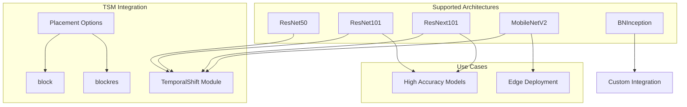
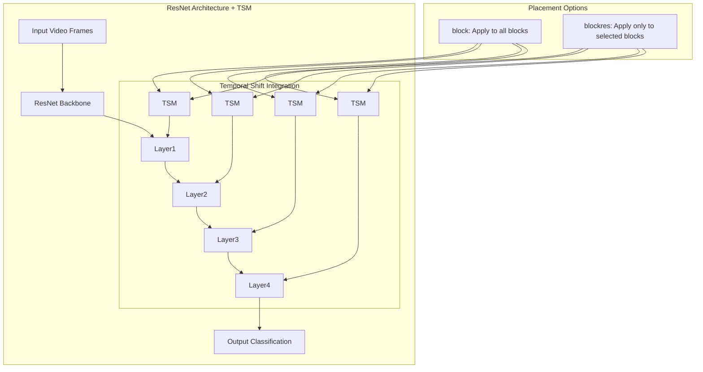
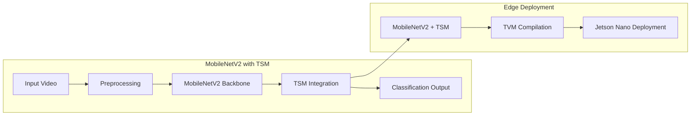
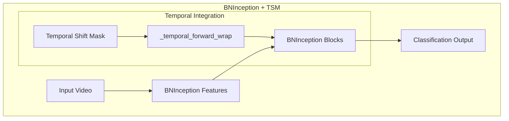
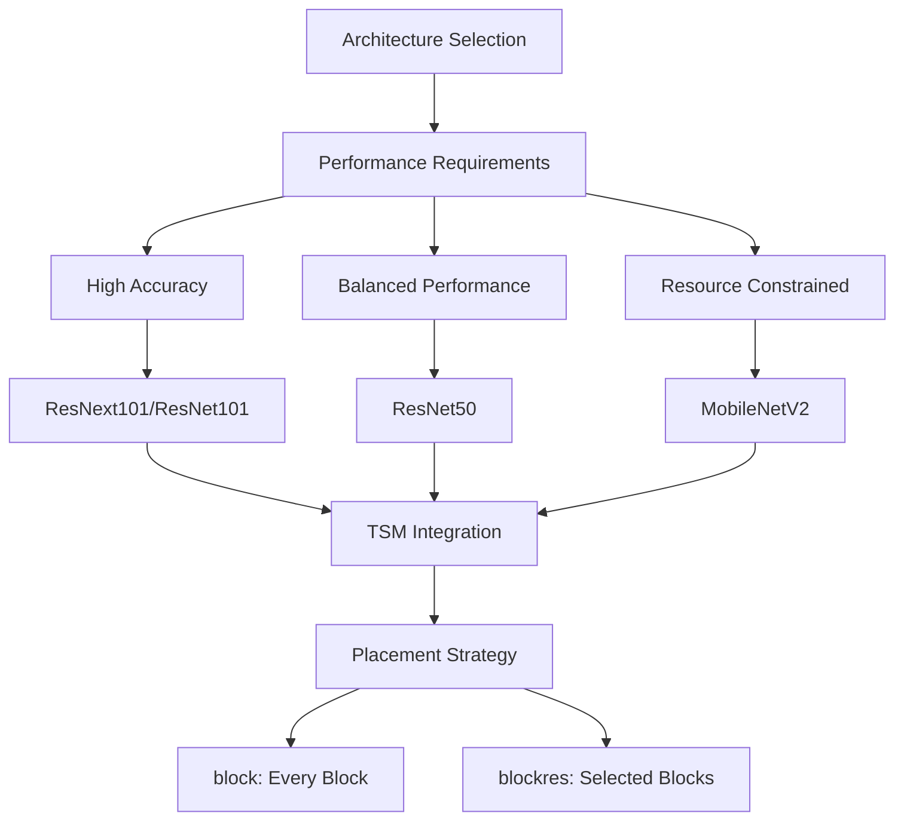

<!-- source: DeepWiki mcp.deepwiki.com · repo mit-han-lab/temporal-shift-module · page 6.1 Supported Architectures · fetched 2026-10-30 -->

# Supported Architectures

<details>
<summary>Relevant source files</summary>

The following files were used as context for generating this wiki page:

- [LICENSE](LICENSE)
- [README.md](README.md)
- [archs/__init__.py](archs/__init__.py)
- [archs/bn_inception.py](archs/bn_inception.py)
- [ops/temporal_shift.py](ops/temporal_shift.py)

</details>


This page documents the neural network architectures supported by the Temporal Shift Module (TSM) system and how temporal shifts are integrated with each architecture. For information about the core Temporal Shift Module concept, see [What is Temporal Shift Module?](#1.1).

## Overview

The TSM system is designed to be compatible with various convolutional neural network (CNN) architectures, transforming them from 2D image classifiers into efficient spatiotemporal video understanding models without adding extra parameters. The system primarily supports several mainstream CNN architectures that can be enhanced with temporal modeling capabilities through the Temporal Shift Module.



Sources: [README.md:85-114](), [ops/temporal_shift.py:97-139]()

## ResNet-based Architectures

The TSM implementation primarily supports the ResNet family of architectures, which can be integrated with temporal shifts using the `make_temporal_shift` function.

### ResNet50

ResNet50 is the most commonly used backbone in the TSM repository. It provides a good balance between accuracy and computational efficiency.

### ResNet101

ResNet101 provides higher accuracy than ResNet50 at the cost of increased computational requirements.

### ResNext101

ResNext101 is the highest performing backbone mentioned in the repository, achieving 76.3% accuracy on Kinetics dataset using dense sampling.



Sources: [ops/temporal_shift.py:97-139](), [README.md:85-114]()

### Implementation Details

For ResNet architectures, the TSM integration is implemented in the `make_temporal_shift` function which modifies the network's layers to include temporal shifting. There are two main placement strategies:

1. **Block Placement**: Applies temporal shift to every block in the ResNet model
   ```python
   def make_block_temporal(stage, this_segment):
       blocks = list(stage.children())
       for i, b in enumerate(blocks):
           blocks[i] = TemporalShift(b, n_segment=this_segment, n_div=n_div)
       return nn.Sequential(*(blocks))
   ```

2. **Block Residual Placement**: Applies temporal shift only to selected blocks (typically every n_round blocks) and specifically to the conv1 layer within each block
   ```python
   def make_block_temporal(stage, this_segment):
       blocks = list(stage.children())
       for i, b in enumerate(blocks):
           if i % n_round == 0:
               blocks[i].conv1 = TemporalShift(b.conv1, n_segment=this_segment, n_div=n_div)
       return nn.Sequential(*blocks)
   ```

Sources: [ops/temporal_shift.py:97-139]()

## MobileNetV2

MobileNetV2 is a lightweight architecture supported by TSM, making it suitable for edge device deployment. This architecture is particularly used in the online hand gesture recognition demo on NVIDIA Jetson Nano.



Sources: [README.md:113-114](), [README.md:254-260]()

MobileNetV2 with TSM achieves 69.5% accuracy on Kinetics using dense sampling, making it an effective lightweight solution for video understanding tasks.

## BNInception

BNInception is supported through a custom implementation in the `archs` directory. It uses a different approach for integrating temporal shifts compared to ResNet models.



Sources: [archs/bn_inception.py:76-108]()

### BNInception Implementation Details

BNInception uses a unique approach for temporal shift integration:

1. It employs a mask string (e.g., "010101010101") where each digit corresponds to a block in the network
2. A value of '1' indicates that temporal shift should be applied to that block
3. The integration is handled by the `_temporal_forward_wrap` method which wraps each block's forward function

```python
def _temporal_forward_wrap(self, layer_func, index):
    if hasattr(self, 'is_temporal_shift') and self.is_temporal_shift[index] == '1':
        from ops.temporal_shift import TemporalShift
        def wrapped_func(x, is_residual, n_segment, fold_div):
            if is_residual:
                x_shift = TemporalShift.shift(x, n_segment, fold_div=fold_div)
                return F.relu(x + layer_func(x_shift))
            else:
                x = TemporalShift.shift(x, n_segment, fold_div=fold_div)
                return layer_func(x)
        return partial(wrapped_func, is_residual=self.residual, n_segment=self.n_segment, fold_div=self.fold_div)
    else:
        return layer_func
```

Sources: [archs/bn_inception.py:94-108]()

## Performance Comparison

The table below shows the performance of different architectures with TSM on the Kinetics-400 dataset using dense sampling (8 frames, 10 clips):

| Architecture | Top-1 Accuracy | Checkpoint Available |
|--------------|----------------|----------------------|
| TSN ResNet50 (2D baseline) | 70.6% | Yes |
| TSM ResNet50 | 74.1% | Yes |
| TSM ResNet50 NL | 75.6% | Yes |
| TSM ResNext101 | 76.3% | Mentioned |
| TSM MobileNetV2 | 69.5% | Yes |

Sources: [README.md:97-114]()

On Something-Something-V1 dataset (full resolution, 2 clips):

| Architecture | Frames | Top-1 Accuracy |
|--------------|--------|----------------|
| TSM ResNet50 | 8 | 47.2% |
| TSM ResNet50 | 16 | 48.4% |
| TSM ResNet101 | 8 | 48.7% |

Sources: [README.md:142-146]()

## Architecture Selection Guidelines

When choosing an architecture for your use case, consider the following factors:

1. **Performance Requirements**:
   - For highest accuracy: ResNext101 or ResNet101
   - For balanced performance: ResNet50
   - For edge devices: MobileNetV2

2. **Computational Constraints**:
   - MobileNetV2 is suitable for deployment on resource-constrained devices
   - ResNet50 offers a good balance for standard GPU servers
   - ResNet101/ResNext101 require more computational resources

3. **Use Case**:
   - For real-time applications like the hand gesture demo, MobileNetV2 is recommended
   - For offline analysis with high accuracy requirements, consider ResNet101 or ResNext101



Sources: [README.md:85-156](), [ops/temporal_shift.py:97-139]()

## Integration with TSM

To integrate TSM with a supported architecture, use the appropriate function from `ops/temporal_shift.py`:

```python
# For ResNet architectures
from ops.temporal_shift import make_temporal_shift
make_temporal_shift(model, n_segment=8, n_div=8, place='blockres')

# For BNInception
model = bninception()
model.build_temporal_ops(n_segment=8, is_temporal_shift='blockres', shift_div=8)
```

The `n_segment` parameter specifies the number of frames, `n_div` controls the fraction of channels to shift, and `place` determines where to apply the temporal shifts.

Sources: [ops/temporal_shift.py:97-139](), [archs/bn_inception.py:76-92]()

---

