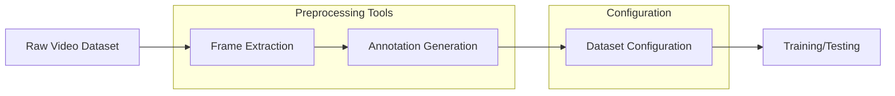
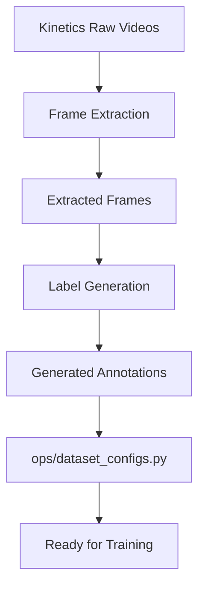
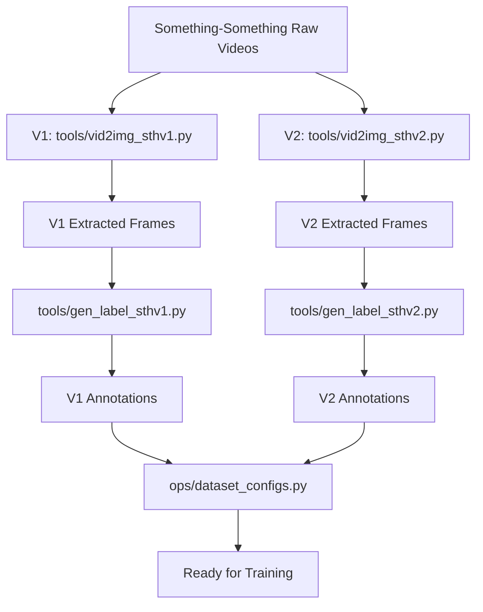
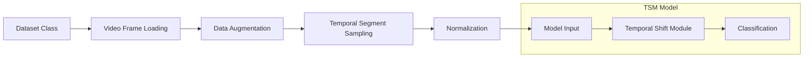

<!-- source: DeepWiki mcp.deepwiki.com · repo mit-han-lab/temporal-shift-module · page 6.2 Supported Datasets · fetched 2026-10-30 -->

# Supported Datasets

<details>
<summary>Relevant source files</summary>

The following files were used as context for generating this wiki page:

- [README.md](README.md)
- [ops/temporal_shift.py](ops/temporal_shift.py)

</details>


This document provides detailed information about the datasets supported by the Temporal Shift Module (TSM) codebase. It covers the datasets that have been validated with the TSM architecture, along with preparation procedures and performance benchmarks. For information about model architectures, see [Model Architecture](#2.2).

## Overview of Supported Datasets

The TSM repository has been successfully tested and optimized for the following video datasets:

| Dataset | Description | Classes | Videos | Temporal Sensitivity |
|---------|-------------|---------|--------|----------------------|
| Kinetics-400 | Human action recognition | 400 | ~300K | Medium |
| Something-Something-V1 | Object interaction | 174 | ~110K | High |
| Something-Something-V2 | Updated object interaction | 174 | ~220K | High |
| UCF101 | Action recognition | 101 | ~13K | Medium |
| HMDB51 | Human motion | 51 | ~7K | Medium |
| Jester | Hand gesture recognition | 27 | ~150K | High |

Sources: [README.md:61-61]()

## Dataset Preparation Process

All video datasets require preprocessing before they can be used with the TSM architecture. The general preparation workflow is shown below:



The preparation process consists of three main steps:

1. **Frame Extraction**: Videos are converted to frame sequences for efficient processing
2. **Annotation Generation**: Labels and metadata are formatted for the dataloader
3. **Dataset Configuration**: Parameters are added to the dataset configuration file

Sources: [README.md:61-65]()

## Dataset-Specific Preparation

### Kinetics-400

Kinetics is a large-scale dataset of human actions developed by DeepMind, consisting of approximately 300,000 video clips across 400 action categories.



Sources: [README.md:63-65]()

### Something-Something V1/V2

Something-Something is a dataset focused on fine-grained temporal actions and object interactions, which makes it particularly suitable for testing temporal reasoning capabilities.



Sources: [README.md:64-65]()

## Dataset Configuration Integration

Dataset configurations are managed in `ops/dataset_configs.py`. This file contains parameters specific to each dataset, including:

- Number of classes
- Data augmentation settings
- Input dimensions
- Dataset-specific paths

Newly prepared datasets must be added to this configuration file to be recognized by the TSM training and testing pipeline.

Sources: [README.md:65]()

## Performance Benchmarks

### Kinetics-400

TSM achieves state-of-the-art performance on Kinetics with various sampling strategies:

#### Dense Sampling Results

| Method | Frames × Clips | Accuracy |
|--------|---------------|----------|
| TSN ResNet50 (2D) | 8 × 10 | 70.6% |
| TSM ResNet50 | 8 × 10 | 74.1% |
| TSM ResNet50 NL | 8 × 10 | 75.6% |
| TSM ResNext101 | 8 × 10 | 76.3% |
| TSM MobileNetV2 | 8 × 10 | 69.5% |

Sources: [README.md:96-114]()

#### Uniform Sampling Results

| Model | Frames × Clips | 1-crop Acc. | 10-crop Acc. |
|-------|---------------|-------------|--------------|
| TSN ResNet50 (2D) | 8 × 1 | 68.8% | 69.9% |
| TSM ResNet50 | 8 × 1 | 71.2% | 72.8% |
| TSM ResNet50 | 16 × 1 | 72.6% | 73.7% |

Sources: [README.md:120-124]()

### Something-Something

TSM shows significant improvement on temporally-sensitive tasks like Something-Something:

#### Something-Something V1

| Model | Frames | Center crop × 1clip | Full res × 2clip |
|-------|--------|---------------------|------------------|
| TSM ResNet50 | 8 | 45.6% | 47.2% |
| TSM ResNet50 | 16 | 47.2% | 48.4% |
| TSM ResNet101 | 8 | 46.9% | 48.7% |

Sources: [README.md:142-146]()

#### Something-Something V2

| Model | Frames × Clips | Accuracy |
|-------|---------------|----------|
| TSM ResNet50 | 8 × 2 | 61.2% |
| TSM ResNet50 | 16 × 2 | 63.1% |
| TSM ResNet101 | 8 × 2 | 63.3% |

Sources: [README.md:152-156]()

## Data Loading and Processing Implementation

The dataset implementation in TSM enables efficient loading and processing of video frames:



The processing pipeline transforms raw video frames into model-ready input batches with appropriate temporal segment sampling to enable the shift operations performed by the TSM module.

Sources: [README.md:61-65](), [ops/temporal_shift.py:21-44]()

## Dataset Selection and Usage

When training or testing a TSM model, the dataset is specified as the first positional argument to the main script. For example:

```
python main.py kinetics RGB \
     --arch resnet50 --num_segments 8 \
     ...other parameters...
```

Or for Something-Something:

```
python main.py something RGB \
     --arch resnet50 --num_segments 8 \
     ...other parameters...
```

This argument automatically configures the appropriate dataset loader and parameters based on the entries in `ops/dataset_configs.py`.

Sources: [README.md:222-229](), [README.md:246-252]()

## Fine-tuning Between Datasets

A key advantage of TSM is the ability to transfer learning between datasets. For example, models pre-trained on Kinetics can be fine-tuned on UCF101:

```
python main.py ucf101 RGB \
     --arch resnet50 --num_segments 8 \
     ...other parameters... \
     --tune_from=pretrained/TSM_kinetics_RGB_resnet50_shift8_blockres_avg_segment8_e50.pth
```

This transfer learning capability is particularly useful for smaller datasets like UCF101 and HMDB51, where pre-training on larger datasets like Kinetics significantly improves performance.

Sources: [README.md:235-242]()