# Page: Overview

# Overview

<details>
<summary>Relevant source files</summary>

The following files were used as context for generating this wiki page:

- [README.md](README.md)
- [ops/temporal_shift.py](ops/temporal_shift.py)

</details>


The Temporal Shift Module (TSM) is an efficient approach to video understanding that enables 2D CNNs to capture temporal information without adding parameters or computation. This document provides a high-level overview of the TSM system, its core concepts, and key components.

## Purpose and Scope

Video understanding typically requires modeling both spatial and temporal dimensions. Traditional approaches include 3D CNNs (which are computationally expensive) or optical flow (which requires additional preprocessing). TSM offers an elegant solution by enabling temporal modeling in standard 2D CNN architectures through a simple channel shifting mechanism.

This overview introduces the fundamental concepts and architecture of TSM. For details about specific deployment options, see [Deployment Options](#3) and for training and evaluation details, see [Training and Evaluation](#4).

Sources: [README.md:24-30]()

## What is Temporal Shift Module?

The Temporal Shift Module is a plug-and-play module that enables information exchange between adjacent frames by shifting part of the channels along the temporal dimension. This allows 2D CNNs to capture temporal relationships without adding parameters or computational cost.

**Diagram: Temporal Shift Module Concept**
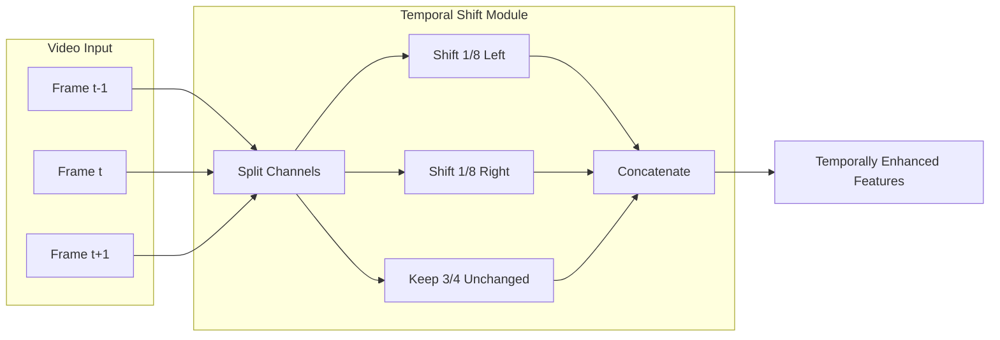

The core implementation of TSM can be found in [ops/temporal_shift.py](). The main class `TemporalShift` implements the channel shifting operation that enables temporal modeling.

Sources: [ops/temporal_shift.py:12-24](), [README.md:68-83]()

### Temporal Shift Operation

The temporal shift operation works by:
1. Dividing the channels into three parts
2. Shifting 1/8 of channels to the left (previous frame)
3. Shifting 1/8 of channels to the right (next frame)
4. Keeping 3/4 of the channels unchanged

This operation is implemented in the `shift` method of the `TemporalShift` class:

```python
# The core implementation of the temporal shift operation
out = torch.zeros_like(x)
fold = c // fold_div
out[:, :-1, :fold] = x[:, 1:, :fold]  # shift left
out[:, 1:, fold: 2 * fold] = x[:, :-1, fold: 2 * fold]  # shift right
out[:, :, 2 * fold:] = x[:, :, 2 * fold:]  # not shift
```

Sources: [ops/temporal_shift.py:26-44]()

## System Architecture

The TSM system builds upon the Temporal Segment Networks (TSN) framework but introduces the temporal shift operation to enable temporal modeling.

**Diagram: TSM System Architecture**
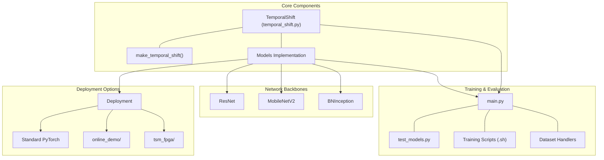

The system consists of several components:
- **Core Implementation**: The Temporal Shift Module and its integration with network backbones
- **Training & Evaluation**: Scripts for training and testing models on various datasets
- **Deployment Options**: Different ways to deploy the trained models, including real-time demos and FPGA acceleration

Sources: [README.md:24-83](), [ops/temporal_shift.py:97-148]()

## Integration with CNN Architectures

TSM is integrated into CNN architectures using the `make_temporal_shift` function, which inserts the temporal shift module at specific locations in the network.

**Diagram: TSM Integration in ResNet**
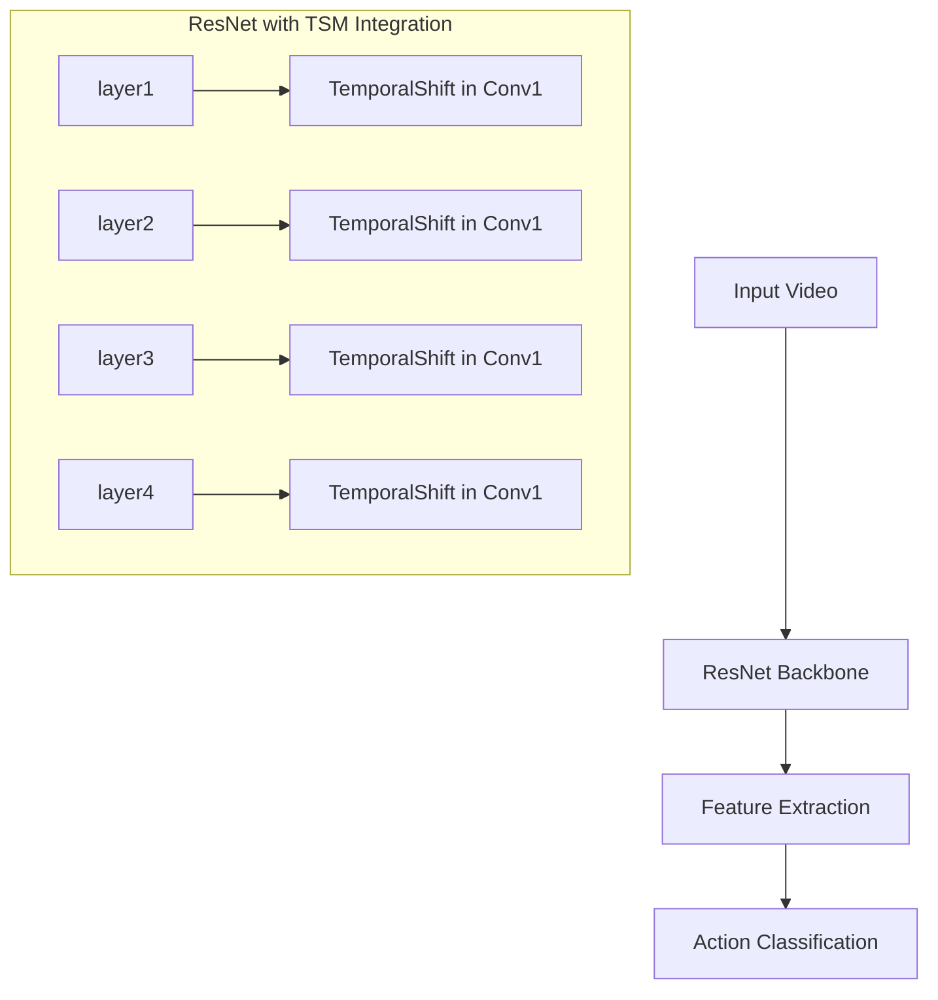

The `make_temporal_shift` function supports two integration methods:
- **block**: Applies temporal shift to all blocks in each network stage
- **blockres**: Applies temporal shift to the first convolution layer of selected residual blocks (more efficient)

Sources: [ops/temporal_shift.py:97-139]()

## Implementation Variants

The TSM implementation provides two variants:

1. **Standard Implementation**: Creates a new tensor for the shifted channels
   ```python
   out = torch.zeros_like(x)
   out[:, :-1, :fold] = x[:, 1:, :fold]  # shift left
   out[:, 1:, fold: 2 * fold] = x[:, :-1, fold: 2 * fold]  # shift right
   out[:, :, 2 * fold:] = x[:, :, 2 * fold:]  # not shift
   ```

2. **In-place Implementation**: Performs the shift in-place to improve memory efficiency during training
   ```python
   # Implemented in InplaceShift class
   # Reduces memory consumption during training
   ```

The in-place implementation is recommended for better performance during training.

Sources: [ops/temporal_shift.py:12-20](), [ops/temporal_shift.py:47-74]()

## Key Features and Benefits

| Feature | Benefit |
|---------|---------|
| Zero additional parameters | Same model size as 2D CNNs |
| Zero additional computation | Same computational cost as 2D CNNs |
| Flexible backbone support | Works with ResNet, MobileNetV2, BNInception |
| Multiple deployment options | Standard PyTorch, Real-time demo, FPGA |
| State-of-the-art performance | High accuracy on video datasets |
| Efficiency | Real-time performance on edge devices |

Sources: [README.md:24-30](), [README.md:104-114]()

## Deployment Options

TSM can be deployed in several ways:

### Standard PyTorch Inference
Models can be deployed using standard PyTorch on CPUs or GPUs.

### Real-time Hand Gesture Recognition Demo
TSM has been deployed for real-time hand gesture recognition on resource-constrained devices like NVIDIA Jetson Nano. This implementation uses MobileNetV2 as the backbone and achieves real-time performance at only 8 watts.

### FPGA Acceleration
TSM has also been deployed on FPGA devices for hardware acceleration, making it suitable for embedded applications.

**Diagram: Deployment Workflow**
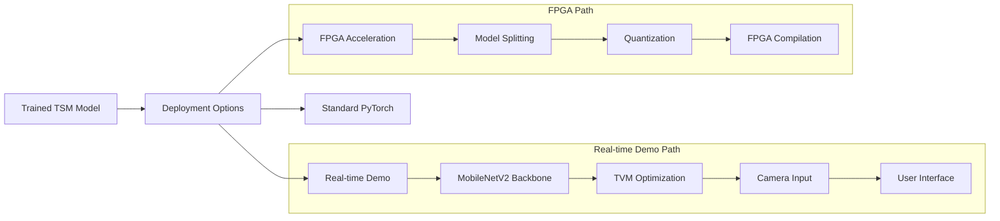

Sources: [README.md:19-22](), [README.md:254-260]()

## Supported Datasets

TSM has been evaluated on several datasets:

- **Kinetics-400**: A large-scale action recognition dataset
- **Something-Something V1 & V2**: Datasets focused on temporal relationships
- **UCF101**: Action recognition dataset
- **HMDB51**: Human motion database
- **Jester**: Hand gesture dataset

For dataset preparation details, see [Data Preparation](#5.1).

Sources: [README.md:57-66]()

This overview provides a foundation for understanding the Temporal Shift Module system. For more detailed information about specific components, please refer to the corresponding wiki pages.

---

# Page: What is Temporal Shift Module?

# What is Temporal Shift Module?

<details>
<summary>Relevant source files</summary>

The following files were used as context for generating this wiki page:

- [README.md](README.md)
- [ops/temporal_shift.py](ops/temporal_shift.py)

</details>


## Purpose

The Temporal Shift Module (TSM) is a key innovation designed to enable efficient temporal modeling in video understanding tasks. This page explains the core concept of TSM, its implementation details, and how it allows 2D Convolutional Neural Networks (CNNs) to capture temporal relationships in videos without adding additional parameters or computation. For information about training TSM models or deployment options, please see [Training and Evaluation](#4) and [Deployment Options](#3) respectively.

## Core Concept

The Temporal Shift Module enables 2D CNNs to perform temporal modeling by shifting a portion of the channels along the temporal dimension. This simple operation facilitates information exchange between neighboring frames, allowing models to capture temporal dependencies without adding extra parameters or computational complexity.

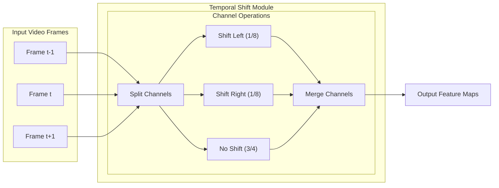

Sources: [ops/temporal_shift.py:27-44](), [README.md:75-80]()

The key innovation is deceptively simple: by shifting a portion of channels across the temporal dimension, spatial features from neighboring frames are intermixed, enabling temporal reasoning abilities while maintaining the computational efficiency of 2D convolutions.

## Implementation Details

TSM is implemented in the `TemporalShift` class, which wraps around an existing network module and adds the channel shifting functionality.

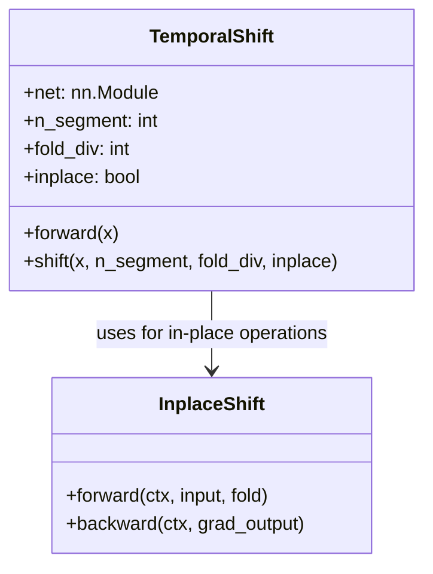

Sources: [ops/temporal_shift.py:11-44](), [ops/temporal_shift.py:47-74]()

The core shifting operation is implemented in the static `shift` method, which:

1. Reshapes the input tensor to separate the temporal dimension
2. Splits channels into three portions:
   - First 1/8 of channels: shifted left (forward in time)
   - Second 1/8 of channels: shifted right (backward in time)
   - Remaining 3/4 of channels: kept unchanged
3. Reshapes back to the original tensor shape

The implementation supports both standard and in-place operations. The in-place version is more memory-efficient but requires custom CUDA kernels for parallel computing.

## Integration with CNN Architectures

TSM is designed to be integrated into existing 2D CNN architectures like ResNet. The `make_temporal_shift` function handles this integration by applying the `TemporalShift` module to specific layers of the network.

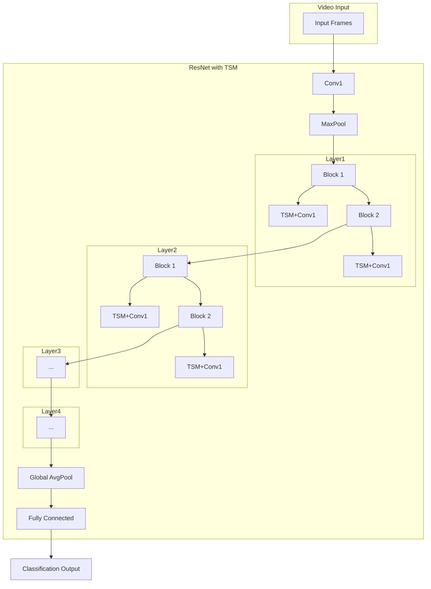

Sources: [ops/temporal_shift.py:97-139]()

TSM can be integrated in two ways:
1. **Block-wise integration**: Applying TSM to each block in a ResNet
2. **Residual-wise integration**: Applying TSM only to the first convolution of each residual block

The residual-wise integration (referred to as `blockres` in the code) is more efficient as it reduces the number of shift operations while maintaining performance.

## Technical Advantages

The Temporal Shift Module offers several key advantages:

| Feature | Description |
|---------|-------------|
| Zero additional parameters | TSM doesn't introduce any new parameters beyond the original 2D CNN |
| Zero additional computation | The shifting operation has negligible computational cost |
| Flexible integration | Can be integrated into various CNN architectures (ResNet, MobileNetV2, etc.) |
| Efficient temporal modeling | Enables capturing temporal relationships in videos |
| State-of-the-art performance | Achieves high accuracy on temporal-related datasets like Something-Something |

Sources: [README.md:26-28](), [README.md:136-139]()

## Naive vs. In-place Implementation

TSM has two implementation variants:

1. **Naive implementation** (default):
```python
out = torch.zeros_like(x)
out[:, :-1, :fold] = x[:, 1:, :fold]  # shift left
out[:, 1:, fold: 2 * fold] = x[:, :-1, fold: 2 * fold]  # shift right
out[:, :, 2 * fold:] = x[:, :, 2 * fold:]  # not shift
```

2. **In-place implementation** (memory efficient):
Uses the `InplaceShift` custom autograd function to perform the shift operation without allocating additional memory.

The naive implementation is simpler but consumes more memory due to creating a new tensor. The in-place version is more memory-efficient but requires custom CUDA kernels for parallel computing.

Sources: [ops/temporal_shift.py:27-44](), [ops/temporal_shift.py:47-74](), [README.md:81-83]()

## Code Structure

The main components of the Temporal Shift Module implementation are:

```mermaid
flowchart LR
    subgraph "Core Implementation"
        TS["TemporalShift class"]
        IS["InplaceShift class"]
        MTS["make_temporal_shift function"]
    end
    
    subgraph "Integration"
        BB["CNN Backbones"]
        RES["ResNet"]
        MN["MobileNetV2"]
    end
    
    TS --> IS: uses for in-place operations
    MTS --> TS: creates instances
    MTS --> BB: integrates with
    BB --> RES & MN
```

Sources: [ops/temporal_shift.py](), [README.md:68-69]()

The code is structured to allow easy integration of TSM into different CNN architectures, with special handling for ResNet models in the `make_temporal_shift` function.

---

# Page: Key Features and Advantages

# Key Features and Advantages

<details>
<summary>Relevant source files</summary>

The following files were used as context for generating this wiki page:

- [README.md](README.md)
- [ops/temporal_shift.py](ops/temporal_shift.py)

</details>


This page outlines the key features and advantages of the Temporal Shift Module (TSM), explaining why it offers an efficient approach to video understanding compared to other methods. For details on the core implementation, see [Temporal Shift Module](#2.1).

## Overview of TSM's Distinctive Features

The Temporal Shift Module represents a significant advancement in efficient video understanding by enabling 2D CNNs to capture temporal information with minimal overhead. TSM integrates temporal reasoning capabilities into standard 2D CNN architectures through an elegant and simple design principle.

Sources: [README.md:26-28]()

## Core Innovation: Zero-Cost Temporal Modeling

The primary innovation of TSM is its ability to capture temporal relationships without adding parameters or computational complexity to 2D CNNs.

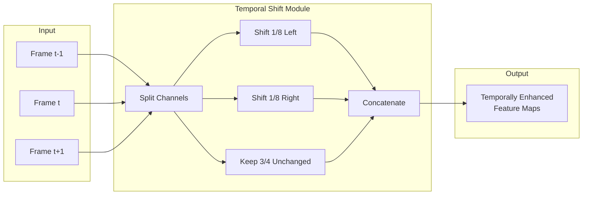

**Diagram: Temporal Shift Operation Mechanism**

The module works by shifting a portion of the channels along the temporal dimension:
- 1/8 of channels shift left (future → present)
- 1/8 of channels shift right (past → present)
- 3/4 of channels remain unchanged

This simple operation enables information exchange between adjacent frames with zero additional parameters and negligible computational overhead.

Sources: [ops/temporal_shift.py:11-44](), [README.md:69-83]()

## Implementation Efficiency

TSM achieves remarkable efficiency through:

1. **Zero Additional Parameters**: Unlike 3D CNNs that significantly increase model size, TSM adds no parameters
2. **Minimal Computation Increase**: The shift operation introduces negligible computational overhead
3. **In-place Implementation**: An optimized in-place version reduces memory consumption during training

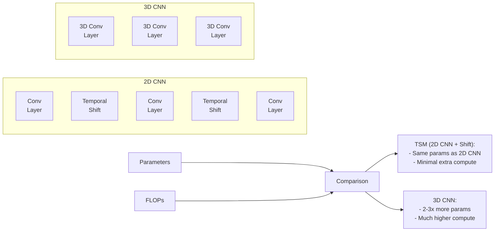

**Diagram: TSM Efficiency Compared to 3D CNNs**

Sources: [ops/temporal_shift.py:11-83](), [README.md:69-83]()

## Flexible Network Integration

TSM can be integrated into various CNN backbones with minimal modifications:

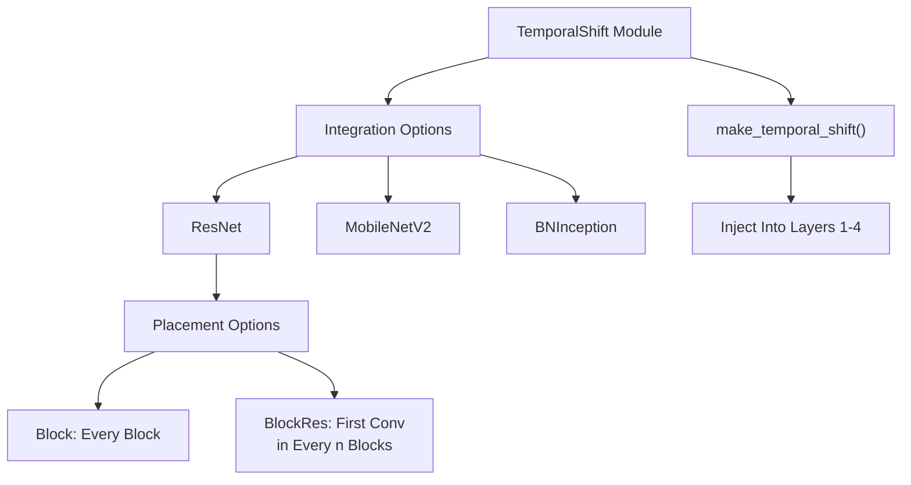

**Diagram: TSM Integration with CNN Backbones**

The integration is controlled by the `make_temporal_shift` function which inserts TSM at specific locations in the network:
- Can be inserted after every block or selectively in certain layers
- Works with various network architectures like ResNet, MobileNetV2, and BNInception

Sources: [ops/temporal_shift.py:97-139](), [README.md:112-114](), [README.md:61-65]()

## Performance Advantages

TSM delivers exceptional performance on video understanding tasks:

| Model | Dataset | Performance | Advantage over Baseline |
|-------|---------|-------------|-------------------------|
| TSM ResNet50 (8-frame) | Kinetics-400 | 74.1% | +3.5% over TSN (2D)|
| TSM ResNet50 NL (8-frame) | Kinetics-400 | 75.6% | +1.5% over TSM |
| TSM ResNet50 (8-frame) | Something-Something V1 | 47.2% | +1.6% over 16-frame variant |
| TSM ResNet50 (16-frame) | Something-Something V2 | 63.1% | +1.9% over 8-frame variant |

Key performance highlights:
- Outperforms I3D (3D CNN) while using fewer frames (8 vs 32)
- Achieves state-of-the-art performance on temporal-focused datasets
- Maintains high accuracy with efficient frame sampling strategies

Sources: [README.md:96-102](), [README.md:136-156]()

## Deployment Versatility

TSM supports multiple deployment paths with excellent efficiency:

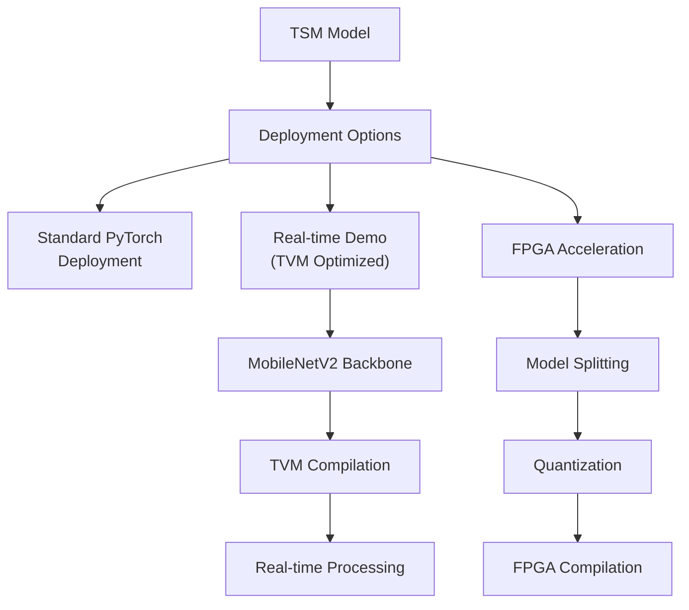

**Diagram: TSM Deployment Options**

The deployment advantages include:
- **Edge Device Compatibility**: Runs efficiently on resource-constrained devices
- **Real-time Performance**: Optimized for real-time applications such as hand gesture recognition
- **Hardware Acceleration**: Supports FPGA deployment with model splitting and quantization
- **Latency Optimization**: TVM compilation further enhances runtime performance

Sources: [README.md:18-22](), [README.md:254-260]()

## Comparison with Alternative Approaches

TSM offers significant advantages over alternative video understanding approaches:

| Approach | Parameters | Computation | Temporal Modeling | Accuracy | 
|----------|------------|-------------|-------------------|----------|
| 2D CNN (TSN) | Base | Base | Limited | Lower |
| 3D CNN (I3D) | 2-3x more | Much higher | Strong | Higher |
| Two-Stream | 2x more | 2x higher | Strong | Higher |
| TSM | Same as 2D | Minimal increase | Strong | Higher |

The key differentiation is that TSM achieves:
- Strong temporal modeling capability of 3D CNNs
- Computational efficiency of 2D CNNs
- No additional parameters over 2D CNNs

Sources: [README.md:96-102](), [README.md:25-28]()

## Summary of Key Advantages

1. **Zero-Cost Temporal Modeling**: Enables temporal reasoning without additional parameters
2. **Efficiency**: Minimal computation overhead compared to standard 2D CNNs
3. **Flexibility**: Works with various CNN architectures and deployment scenarios
4. **State-of-the-Art Performance**: Achieves excellent results on video understanding benchmarks
5. **Edge Compatibility**: Efficient enough for real-time inference on edge devices
6. **Simple Implementation**: Easy to integrate into existing 2D CNN frameworks

TSM represents a significant advancement in efficient video understanding by bridging the gap between 2D CNNs (efficient but temporally limited) and 3D CNNs (powerful but computationally expensive).

Sources: [README.md:24-28](), [README.md:254-260](), [ops/temporal_shift.py:11-44]()

---

# Page: System Architecture

# System Architecture

<details>
<summary>Relevant source files</summary>

The following files were used as context for generating this wiki page:

- [README.md](README.md)
- [ops/models.py](ops/models.py)
- [ops/temporal_shift.py](ops/temporal_shift.py)

</details>


## Purpose and Scope

This document describes the overall architecture of the Temporal Shift Module (TSM) system. It covers the core components, their interactions, and the system's pipeline from video input processing to action recognition output. For specific details about the Temporal Shift Module itself, see [Temporal Shift Module](#2.1). For model architecture details, see [Model Architecture](#2.2).

## High-Level Architecture Overview

The TSM system is designed as an efficient approach to video understanding that integrates temporal information into 2D CNN models through a zero-parameter, zero-FLOP operation.

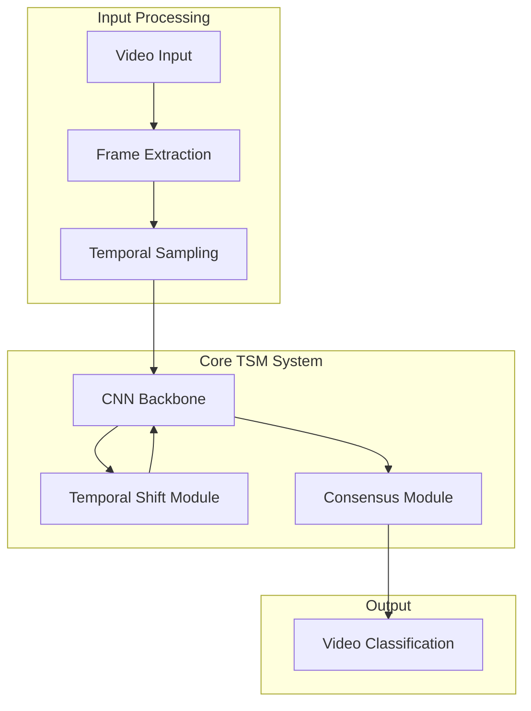

Sources: [README.md:24-30](), [ops/temporal_shift.py:11-44]()

The TSM architecture follows a modular design where temporal shift operations are integrated into existing CNN architectures. The key innovation is the channel-shifting mechanism that enables temporal reasoning with negligible computational overhead.

## TSM Implementation Architecture

The TSM system is implemented through a wrapper-based design that allows integrating temporal shift operations into various CNN backbones.

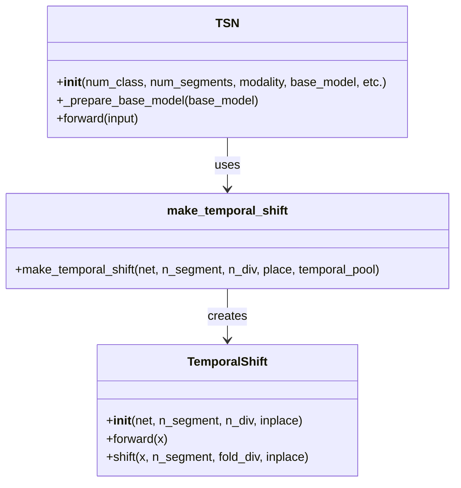

Sources: [ops/temporal_shift.py:11-44](), [ops/temporal_shift.py:97-139](), [ops/models.py:13-23]()

The `TemporalShift` class wraps existing network modules and applies channel shifting operations. The `make_temporal_shift` function injects temporal shift modules into appropriate locations within the backbone network.

## Channel Shifting Mechanism

The core innovation of TSM is the temporal shift operation, which enables information exchange between adjacent frames.

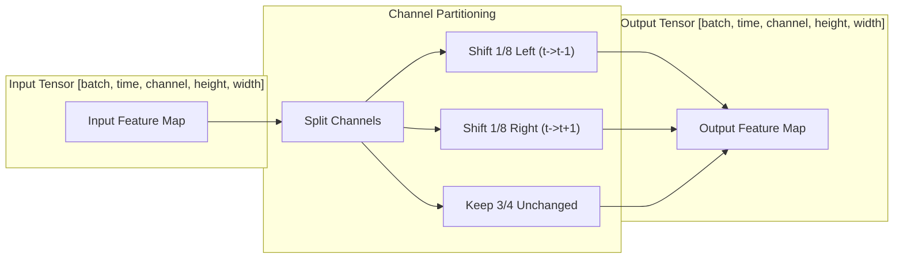

Sources: [ops/temporal_shift.py:26-44](), [README.md:72-81]()

The temporal shift operation divides channels into three parts:
1. 1/8 channels are shifted forward in time (t → t-1)
2. 1/8 channels are shifted backward in time (t → t+1)
3. 3/4 channels remain unchanged

This allows information flow between adjacent frames without adding parameters or computation cost, as demonstrated in the implementation:

```python
fold = c // fold_div
out[:, :-1, :fold] = x[:, 1:, :fold]  # shift left
out[:, 1:, fold: 2 * fold] = x[:, :-1, fold: 2 * fold]  # shift right
out[:, :, 2 * fold:] = x[:, :, 2 * fold:]  # not shift
```

## System Component Relationships

The TSM system integrates with the Temporal Segment Network (TSN) framework, providing temporal modeling abilities to 2D CNNs.

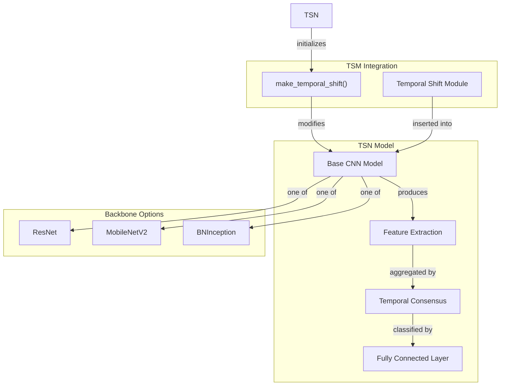

Sources: [ops/models.py:13-72](), [ops/models.py:100-170](), [ops/temporal_shift.py:97-139]()

The `make_temporal_shift` function modifies the base CNN model by inserting temporal shift operations at strategic locations, typically in residual connections. Different implementation strategies are used for different backbone architectures.

## Data Flow Architecture

The following diagram illustrates how data flows through the TSM system during both training and inference.

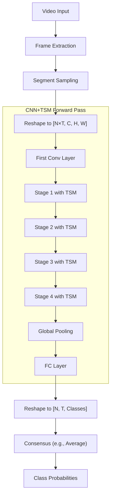

Sources: [ops/models.py:263-288](), [README.md:26-32]()

Key architectural decisions in the data flow:
1. Videos are split into segments (8 or 16 frames typically)
2. Frames are processed by the CNN backbone
3. TSM modules are inserted within CNN layers to enable temporal modeling
4. Features are aggregated using a consensus function (typically averaging)

## Integration with CNN Architectures

TSM integrates with different CNN backbones through specific strategies for each architecture.

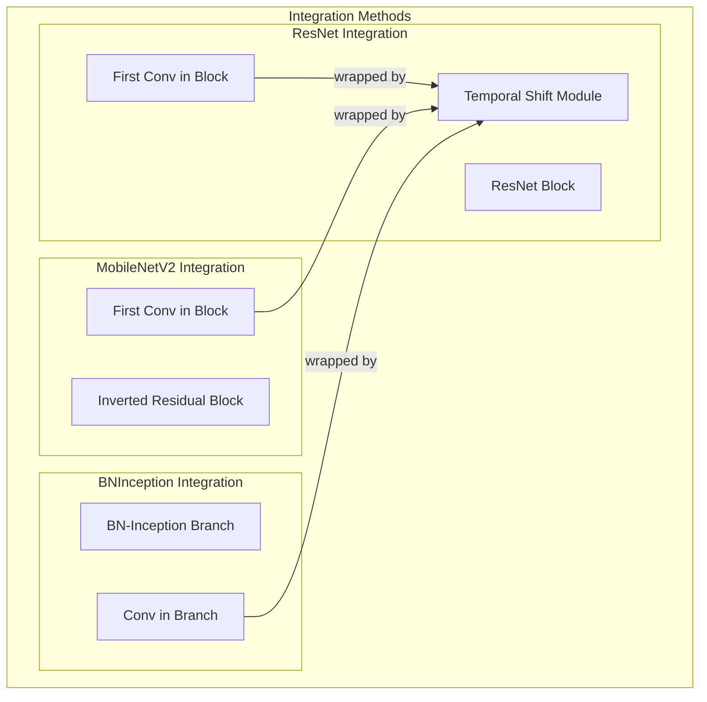

Sources: [ops/temporal_shift.py:97-139](), [ops/models.py:100-170]()

The integration varies by backbone:
- For ResNet, TSM is applied to the first convolution layer in residual blocks
- For MobileNetV2, TSM is applied to the first convolution in inverted residual blocks
- For BNInception, TSM is integrated through a custom implementation

## Deployment Architecture Options

The TSM system supports multiple deployment paths to accommodate different hardware targets.

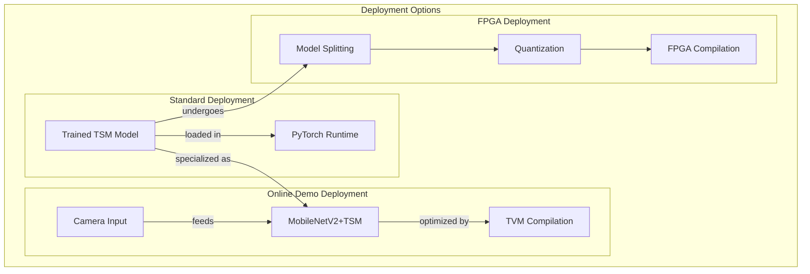

Sources: [README.md:254-260]()

The TSM system supports three main deployment paths:
1. Standard PyTorch deployment for general-purpose hardware
2. Online demo deployment optimized with TVM for edge devices
3. FPGA deployment with model splitting and quantization for hardware acceleration

## Configuration Architecture

The TSM system provides a flexible configuration architecture to accommodate different use cases.

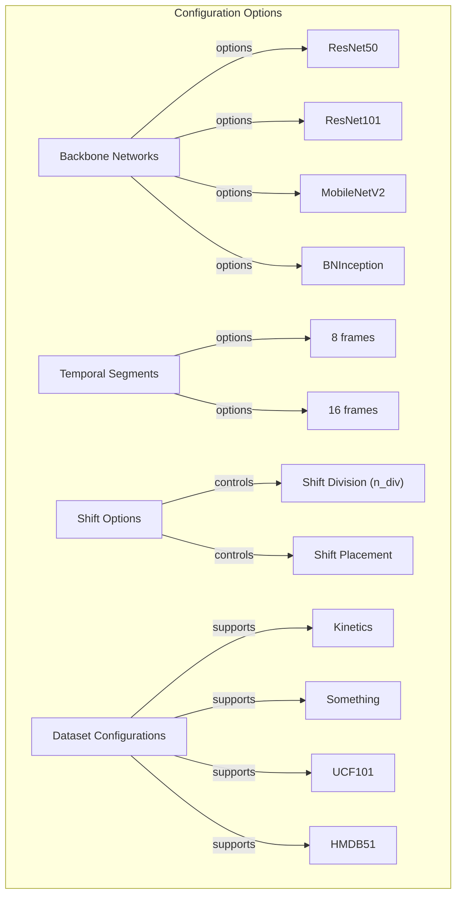

Sources: [ops/models.py:14-38](), [ops/temporal_shift.py:12-17](), [README.md:217-253]()

Key configuration parameters:
1. Backbone network (ResNet, MobileNetV2, BNInception)
2. Number of segments (typically 8 or 16)
3. Shift division factor (typically 8)
4. Shift placement (blockres, block)
5. Dataset-specific configurations

## System Dependencies and External Interfaces

The TSM system relies on several external dependencies and provides interfaces for integration with other systems.

```mermaid
graph TD
    subgraph "System Dependencies"
        PyTorch["PyTorch 1.0+"]
        TensorboardX["TensorboardX"]
        TQDM["tqdm"]
        ScikitLearn["scikit-learn"]
        FFMPEG["ffmpeg"]
    end
    
    subgraph "External Interfaces"
        VideoPrep["Video Preprocessing"]
        ModelIO["Model Import/Export"]
        TVMInterface["TVM Interface"]
        FPGAInterface["FPGA Interface"]
    end
    
    PyTorch -- "core dependency" --> TSM["TSM System"]
    TensorboardX & TQDM & ScikitLearn -- "utility dependencies" --> TSM
    FFMPEG -- "preprocessing dependency" --> VideoPrep
    
    TSM -- "provides" --> ModelIO & TVMInterface & FPGAInterface
    VideoPrep -- "feeds data to" --> TSM
```

Sources: [README.md:47-56]()

The system is built primarily on PyTorch with additional libraries for training monitoring, progress display, and evaluation metrics. It provides interfaces for model export, TVM compilation, and FPGA deployment.

## Summary

The TSM system architecture is designed for efficient video understanding by augmenting 2D CNNs with temporal modeling capabilities. Key architectural features include:

1. Zero-parameter temporal modeling through channel shifting
2. Flexible integration with various CNN backbones
3. Multiple deployment paths for different hardware targets
4. Configurable system parameters for different use cases

This architecture enables state-of-the-art performance on temporal understanding tasks while maintaining computational efficiency.

---

# Page: Core Components

# Core Components

<details>
<summary>Relevant source files</summary>

The following files were used as context for generating this wiki page:

- [README.md](README.md)
- [ops/__init__.py](ops/__init__.py)
- [ops/basic_ops.py](ops/basic_ops.py)
- [ops/temporal_shift.py](ops/temporal_shift.py)

</details>


This document provides an overview of the main modules and components that constitute the Temporal Shift Module (TSM) system. For detailed information on specific components, refer to the dedicated pages on [Temporal Shift Module](#2.1), [Model Architecture](#2.2), [Non-local Blocks](#2.3), and [Basic Operations](#2.4).

## System Component Overview

The TSM system consists of several key components that work together to enable efficient video understanding:

```mermaid
graph TD
    subgraph "Core Implementation"
        TemporalShift["TemporalShift class<br>(ops/temporal_shift.py)"] --- ShiftFunc["shift() static method"]
        TemporalShift --- InplaceShift["InplaceShift class<br>(Zero-copy implementation)"]
        MakeTS["make_temporal_shift()<br>(Integration function)"] --- TemporalShift
        
        TemporalPool["TemporalPool class<br>(ops/temporal_shift.py)"] --- PoolFunc["temporal_pool() static method"]
        MakeTP["make_temporal_pool()"] --- TemporalPool
        
        BasicOps["Basic Operations<br>(ops/basic_ops.py)"] --- Identity["Identity class"]
        BasicOps --- SegConsensus["SegmentConsensus class"]
        BasicOps --- ConsModule["ConsensusModule class"]
    end
    
    subgraph "Backbone Integration"
        ResNet["ResNet Backbone"]
        MobileNetV2["MobileNetV2 Backbone"]
    end
    
    MakeTS --> ResNet
    MakeTS --> MobileNetV2
    
    class TemporalShift,ShiftFunc important
```

Sources: [ops/temporal_shift.py]()/[ops/basic_ops.py]()

## Temporal Shift Module

The Temporal Shift Module is the core innovation of the system, enabling temporal modeling in 2D CNNs without adding extra parameters or computation.

```mermaid
flowchart LR
    subgraph "Video Frames"
        Frame1["Frame t-1"]
        Frame2["Frame t"]
        Frame3["Frame t+1"]
    end
    
    subgraph "TemporalShift Implementation"
        Init["__init__()<br>n_segment, n_div=8"]
        Forward["forward()"]
        ShiftMethod["shift() static method"]
    end
    
    subgraph "Channel Operations"
        ShiftLeft["1/8 channels shift left<br>out[:, :-1, :fold] = x[:, 1:, :fold]"]
        ShiftRight["1/8 channels shift right<br>out[:, 1:, fold:2*fold] = x[:, :-1, fold:2*fold]"]
        NoShift["3/4 channels unchanged<br>out[:, :, 2*fold:] = x[:, :, 2*fold:]"]
    end
    
    Frame1 & Frame2 & Frame3 --> Init
    Init --> Forward
    Forward --> ShiftMethod
    ShiftMethod --> ShiftLeft & ShiftRight & NoShift
```

Sources: [ops/temporal_shift.py:11-44]()

The `TemporalShift` class wraps any PyTorch module (typically a convolutional block) and applies the temporal shift operation to its input. The key parameters are:

| Parameter | Description |
|-----------|-------------|
| `net` | The network module to wrap |
| `n_segment` | Number of frames in a video clip |
| `n_div` | Division factor for channel shifting (default: 8) |
| `inplace` | Whether to use inplace operations (more efficient) |

The core shift operation works by:
1. Reshaping the input tensor to separate the temporal dimension
2. Dividing channels into three groups
3. Shifting the first group left (to the future)
4. Shifting the second group right (to the past)
5. Keeping the third group unchanged

Sources: [ops/temporal_shift.py:22-44]()

## Model Integration

The function `make_temporal_shift()` is responsible for integrating the TSM into backbone architectures. It supports different integration strategies:

| Strategy | Description |
|----------|-------------|
| `block` | Applies TSM to all blocks in each layer |
| `blockres` | Applies TSM only to the first convolutional layer of selected blocks |

```mermaid
flowchart TD
    Input["Input: Network & Parameters"] --> MakeTS["make_temporal_shift()"]
    
    MakeTS --> CheckType["Check Network Type<br>(torchvision.models.ResNet)"]
    
    CheckType --> CheckPlace["Check Placement Strategy"]
    
    subgraph "Placement Strategies"
        Block["block:<br>Apply to every block"]
        BlockRes["blockres:<br>Apply to first conv in select blocks"]
    end
    
    CheckPlace --> Block
    CheckPlace --> BlockRes
    
    Block --> ModifyLayers["Modify network layers:<br>layer1, layer2, layer3, layer4"]
    BlockRes --> ModifyLayers
    
    ModifyLayers --> Output["Output: Network with TSM integrated"]
```

Sources: [ops/temporal_shift.py:97-139]()

The integration process works by:
1. Creating a list of segments for each layer, with optional temporal pooling
2. Checking the backbone architecture type (currently supporting ResNet)
3. Applying TSM to each layer based on the selected placement strategy
4. Handling special cases for deeper networks (e.g., ResNet-101)

## Basic Operations

The TSM system includes several fundamental operations implemented in `ops/basic_ops.py`:

| Class | Purpose |
|-------|---------|
| `Identity` | Simple pass-through operation that returns input unchanged |
| `SegmentConsensus` | Aggregates information across temporal segments (avg, identity) |
| `ConsensusModule` | Wrapper for SegmentConsensus that can be used in a network |

The segment consensus operations are critical for combining information from multiple frames:

```mermaid
flowchart LR
    Input["Input: Frame Features<br>[batch_size, n_segments, feature_dim]"] --> SegConsensus["SegmentConsensus class"]
    
    subgraph "Consensus Types"
        Avg["avg: Mean pooling across segments<br>input_tensor.mean(dim=self.dim)"]
        Identity["identity: No aggregation<br>input_tensor"]
    end
    
    SegConsensus --> Avg
    SegConsensus --> Identity
    
    Avg & Identity --> Output["Output: Aggregated Features"]
```

Sources: [ops/basic_ops.py:1-37]()

## Temporal Pooling

The `TemporalPool` class provides a way to reduce the temporal dimension through pooling:

```python
# Apply temporal pooling to a module
temporal_pool = TemporalPool(net, n_segment)

# The temporal pooling operation
x = x.view(n_batch, n_segment, c, h, w).transpose(1, 2)  # n, c, t, h, w
x = F.max_pool3d(x, kernel_size=(3, 1, 1), stride=(2, 1, 1), padding=(1, 0, 0))
x = x.transpose(1, 2).contiguous().view(nt // 2, c, h, w)
```

The `make_temporal_pool()` function injects temporal pooling into specific layers of the network, typically layer2 in ResNet:

```python
def make_temporal_pool(net, n_segment):
    # ...
    net.layer2 = TemporalPool(net.layer2, n_segment)
```

Sources: [ops/temporal_shift.py:77-148]()

## System Integration

The core components are integrated into the overall system as follows:

```mermaid
flowchart TD
    subgraph "Input Processing"
        Frames["Video Frames"]
        Segments["Temporal Segments<br>n_segment"]
    end
    
    subgraph "TSM Integration"
        TShift["TemporalShift<br>shift by n_div=8"]
        BackboneInt["Backbone Integration<br>make_temporal_shift()"]
        TPool["Temporal Pooling<br>make_temporal_pool()"]
    end
    
    subgraph "Feature Aggregation"
        ConsOp["Consensus Operation<br>ConsensusModule"]
        Features["Final Feature Vector"]
    end
    
    Frames --> Segments
    Segments --> BackboneInt
    
    BackboneInt --> TShift
    BackboneInt --> TPool
    
    TShift & TPool --> ConsOp
    ConsOp --> Features
    Features --> Output["Classification Output"]
```

Sources: [ops/temporal_shift.py]()/[ops/basic_ops.py]()

The integration process involves:
1. Converting input videos into frame segments
2. Applying the temporal shift operation to selected layers
3. Optionally applying temporal pooling to reduce resolution
4. Using consensus operations to aggregate features across frames
5. Producing the final classification output

This architecture allows TSM to achieve efficient temporal modeling with zero additional parameters and minimal computational overhead compared to 2D CNNs.

---

# Page: Temporal Shift Module

# Temporal Shift Module

<details>
<summary>Relevant source files</summary>

The following files were used as context for generating this wiki page:

- [README.md](README.md)
- [ops/temporal_shift.py](ops/temporal_shift.py)

</details>


The Temporal Shift Module (TSM) is the core innovation of this codebase that enables efficient temporal modeling in 2D Convolutional Neural Networks (CNNs) for video understanding. This document explains the implementation, working mechanism, and integration of TSM within the system. For information about the overall model architecture incorporating TSM, see [Model Architecture](#2.2).

## Overview

The Temporal Shift Module enables 2D CNNs to capture temporal relationships in videos without adding any parameters or computational overhead. It achieves this by shifting a portion of channels along the temporal dimension, allowing information exchange between frames.

Key advantages of TSM:
- Zero additional parameters compared to 2D CNNs
- Negligible additional computation
- Compatible with any 2D CNN architecture 
- Enables efficient video understanding on resource-constrained devices

Sources: [README.md:24-29](), [ops/temporal_shift.py:1-4]()

## Core Mechanism

The fundamental idea behind TSM is to shift part of the channels along the temporal dimension before conventional 2D convolution. This temporal shift operation facilitates information exchange across frames.

```mermaid
flowchart LR
    subgraph "Input Feature Map (N×T×C×H×W)"
        Input["Input Tensor"]
    end

    subgraph "Temporal Shift Operation"
        Split["Split Channels"]
        ShiftForward["Forward Shift (1/8)"]
        ShiftBackward["Backward Shift (1/8)"]
        NoShift["No Shift (3/4)"]
        Concat["Concatenate"]
    end

    subgraph "Output Feature Map"
        Output["Output Tensor"]
    end

    Input --> Split
    Split --> ShiftForward
    Split --> ShiftBackward
    Split --> NoShift
    ShiftForward --> Concat
    ShiftBackward --> Concat
    NoShift --> Concat
    Concat --> Output
```

The temporal shift operation:
1. Divides the channels into three parts
2. Shifts 1/8 of channels forward in time (to previous frame)
3. Shifts 1/8 of channels backward in time (to next frame)
4. Keeps 3/4 of channels unchanged
5. Concatenates all channels back together

This allows each frame to access information from adjacent frames, enabling temporal modeling.

Sources: [ops/temporal_shift.py:26-44](), [README.md:26-83]()

## Implementation

The TSM is implemented in the `TemporalShift` class, which wraps an existing network layer and applies the shift operation to its input.

```mermaid
classDiagram
    class TemporalShift {
        +net
        +n_segment
        +fold_div
        +inplace
        +forward(x)
        +shift(x, n_segment, fold_div, inplace)
    }
    
    class InplaceShift {
        +forward(ctx, input, fold)
        +backward(ctx, grad_output)
    }
    
    TemporalShift --> InplaceShift: uses for in-place operation
```

### TemporalShift Class

The `TemporalShift` class is defined in `ops/temporal_shift.py` and has the following components:

- **Initialization**: Takes a network layer (`net`), number of segments (`n_segment`), division factor (`n_div`), and whether to use in-place operation (`inplace`).
- **Forward method**: Applies the shift operation and passes the result through the wrapped network.
- **Shift method**: Static method that performs the actual channel shifting.

The shift operation reshapes the input tensor from `(N*T, C, H, W)` to `(N, T, C, H, W)`, performs the shifting, and then reshapes back.

Sources: [ops/temporal_shift.py:11-44]()

### In-place vs. Regular Implementation

TSM provides two implementation options:
1. **Regular implementation**: Creates a new tensor for the output (default)
2. **In-place implementation**: Modifies the input tensor directly (potentially more memory efficient)

The in-place implementation is handled by the `InplaceShift` class, which is defined as a custom PyTorch autograd function to ensure proper gradient computation.

Sources: [ops/temporal_shift.py:47-74](), [README.md:82-83]()

## Integration with CNN Architectures

TSM is designed to be integrated with various CNN backbones. The function `make_temporal_shift` handles the integration process.

```mermaid
flowchart TB
    subgraph "CNN Architecture (e.g., ResNet)"
        Layer1["Layer 1"]
        Layer2["Layer 2"]
        Layer3["Layer 3"]
        Layer4["Layer 4"]
    end

    subgraph "make_temporal_shift"
        Process["Apply TSM to selected layers"]
    end

    subgraph "Integration Options"
        BlockOption["'block': Apply TSM to all blocks"]
        BlockResOption["'blockres': Apply TSM to residual connections"]
    end

    Layer1 --> Process
    Layer2 --> Process
    Layer3 --> Process
    Layer4 --> Process
    BlockOption --> Process
    BlockResOption --> Process
    Process --> TSM["TSM-enhanced CNN"]
```

### Integration with ResNet

For ResNet architectures, TSM can be integrated in two ways:

1. **Block mode**: Apply TSM to all blocks in the network
2. **BlockRes mode**: Apply TSM only to the first convolutional layer (conv1) of selected residual blocks

The `make_temporal_shift` function:
- Takes a network model, number of segments, division factor, and placement strategy
- Iterates through specified layers of the network
- Wraps selected convolutional layers with `TemporalShift`

Sources: [ops/temporal_shift.py:97-139]()

## Temporal Pooling

In addition to the shift module, the codebase also provides a `TemporalPool` class that applies temporal pooling to reduce the temporal dimension. This can be used in conjunction with TSM to create more efficient architectures.

The `make_temporal_pool` function injects temporal pooling into specified layers of the network.

Sources: [ops/temporal_shift.py:77-148]()

## Usage Example

Here's how TSM is typically used in the codebase:

1. Create a 2D CNN model (e.g., ResNet50)
2. Apply TSM using `make_temporal_shift`
3. Train the model on video data

The model processes video frames in batches, where each batch contains multiple frames from multiple videos. The TSM enables the model to capture temporal relationships between frames.

Sources: [README.md:160-196](), [README.md:217-230]()

## Performance Considerations

### Testing

The TSM implementation includes tests to verify the correctness of both regular and in-place implementations. These tests check that:
- Forward pass results match between regular and in-place implementations
- Gradient calculations match between both implementations

Sources: [ops/temporal_shift.py:151-199]()

### Impact on Accuracy

According to the provided information, integrating TSM into 2D CNN architectures significantly improves accuracy on video understanding tasks compared to baseline models without temporal modeling.

On the Kinetics dataset, TSM with ResNet50 (8 frames) achieves 74.1% accuracy, outperforming the I3D-ResNet50 (32 frames) baseline at 73.3%.

Sources: [README.md:97-102]()

## Summary

The Temporal Shift Module is an elegant solution for enabling 2D CNNs to perform temporal modeling for video understanding. By simply shifting channels across the temporal dimension, TSM achieves effective temporal modeling without adding parameters or computation, making it particularly suitable for efficient video understanding on resource-constrained devices.

---

# Page: Model Architecture

# Model Architecture

<details>
<summary>Relevant source files</summary>

The following files were used as context for generating this wiki page:

- [LICENSE](LICENSE)
- [archs/__init__.py](archs/__init__.py)
- [archs/bn_inception.py](archs/bn_inception.py)
- [ops/models.py](ops/models.py)

</details>


This page documents the model architecture used in the Temporal Shift Module (TSM) framework. It describes how the TSM is integrated into various backbone networks and how the overall architecture processes video data. For details on the Temporal Shift Module itself, see [Temporal Shift Module](#2.1).

## Overview

The TSM framework builds upon the Temporal Segment Network (TSN) architecture, enhancing it with temporal modeling capabilities through the Temporal Shift Module. The core architecture is implemented as the `TSN` class in the codebase, which supports various backbone networks and input modalities.

```mermaid
flowchart TB
    subgraph "TSN Architecture with TSM"
        Input["Input Video Frames"] --> Sampling["Uniform Sampling"]
        Sampling --> Processing["Frame Processing"]
        Processing --> BackboneWithTSM["Backbone Network with TSM"]
        BackboneWithTSM --> Features["Feature Extraction"]
        Features --> Consensus["Consensus Module"]
        Consensus --> Classification["Classification"]
    end
    
    subgraph "Supported Backbones"
        ResNet["ResNet Family"]
        MobileNetV2["MobileNetV2"]
        BNInception["BNInception"]
    end
    
    BackboneWithTSM --- ResNet & MobileNetV2 & BNInception
```

Sources: [ops/models.py:13-395]()

## TSN Class Architecture

The TSN (Temporal Segment Network) class serves as the main model implementation, which incorporates the Temporal Shift Module to enable temporal modeling. It's designed to be flexible, supporting different backbone networks, input modalities, and consensus functions.

### Key Components and Parameters

The TSN model architecture is characterized by several key parameters that control its behavior:

| Parameter | Description | Default Values |
|-----------|-------------|----------------|
| `num_segments` | Number of segments to divide the video into | Varies by dataset |
| `modality` | Input type (RGB, Flow, RGBDiff) | RGB |
| `base_model` | Backbone architecture | ResNet |
| `consensus_type` | Method to aggregate segment predictions | avg |
| `is_shift` | Whether to use temporal shift | True |
| `shift_div` | Division factor for channel shifting | 8 |
| `shift_place` | Where to apply shifting | blockres |
| `non_local` | Whether to use non-local blocks | False |

Sources: [ops/models.py:13-38]()

```mermaid
classDiagram
    class TSN {
        +num_segments: int
        +modality: str
        +base_model_name: str
        +is_shift: bool
        +shift_div: int
        +shift_place: str
        +consensus_type: str
        +forward(input)
        +_prepare_base_model()
        +_prepare_tsn()
        +get_optim_policies()
    }
    
    class BackboneNetwork {
        +features()
        +avgpool()
        +fc()
    }
    
    class ConsensusModule {
        +forward(input)
    }
    
    TSN --> BackboneNetwork: uses
    TSN --> ConsensusModule: aggregates predictions
    BackboneNetwork <|-- ResNet
    BackboneNetwork <|-- MobileNetV2
    BackboneNetwork <|-- BNInception
```

Sources: [ops/models.py:13-38](), [ops/models.py:172-192](), [ops/models.py:263-287]()

## Integration with Backbone Networks

The TSM is integrated differently into each supported backbone architecture. Let's examine how TSM is incorporated into each backbone network.

### ResNet with TSM

For ResNet-based models, the temporal shift operation is applied to residual blocks. The `make_temporal_shift` function is used to modify the network by inserting TSM modules at specified locations.

```mermaid
flowchart TB
    subgraph "ResNet with TSM"
        Input["Input: B×T×C×H×W"] --> Conv1["Conv1"]
        Conv1 --> BN1["BatchNorm"]
        BN1 --> ReLU1["ReLU"]
        ReLU1 --> MaxPool["MaxPool"]
        
        MaxPool --> Layer1["Layer1 (ResBlocks)"]
        Layer1 --> Layer2["Layer2 (ResBlocks)"]
        Layer2 --> Layer3["Layer3 (ResBlocks)"]
        Layer3 --> Layer4["Layer4 (ResBlocks)"]
        
        Layer4 --> AvgPool["Global AvgPool"]
        AvgPool --> FC["FC Layer"]
        
        TSM1["Temporal Shift"] -.-> Layer1
        TSM2["Temporal Shift"] -.-> Layer2
        TSM3["Temporal Shift"] -.-> Layer3
        TSM4["Temporal Shift"] -.-> Layer4
    end
```

Sources: [ops/models.py:103-117]()

### MobileNetV2 with TSM

For MobileNetV2, the temporal shift operation is selectively applied to inverted residual blocks with residual connections. Specifically, it's applied to the first operation (pointwise convolution) in eligible blocks.

```mermaid
flowchart TB
    subgraph "MobileNetV2 with TSM"
        Input["Input: B×T×C×H×W"] --> Conv1["Conv1"]
        Conv1 --> Blocks["Inverted Residual Blocks"]
        Blocks --> Conv2["Conv2"]
        Conv2 --> AvgPool["Global AvgPool"]
        AvgPool --> FC["FC Layer"]
        
        subgraph "Inverted Residual Block with TSM"
            BlockInput["Block Input"]
            
            subgraph "Bottleneck w/ TSM"
                PwConvWithTSM["TemporalShift(PwConv)"]
                BN1["BatchNorm"]
                ReLU1["ReLU6"]
                DwConv["DepthwiseConv"]
                BN2["BatchNorm"]
                ReLU2["ReLU6"]
                PwConv2["PointwiseConv"]
                BN3["BatchNorm"]
            end
            
            BlockInput --> PwConvWithTSM
            PwConvWithTSM --> BN1 --> ReLU1 --> DwConv --> BN2 --> ReLU2 --> PwConv2 --> BN3
            
            BlockInput --> Addition(("+"))
            BN3 --> Addition
            Addition --> BlockOutput["Block Output"]
        end
    end
```

Sources: [ops/models.py:130-152]()

### BNInception with TSM

For BNInception, the model's internal `build_temporal_ops` method is called to integrate temporal shift operations at specified locations within the network.

```mermaid
flowchart TB
    subgraph "BNInception with TSM"
        Input["Input: B×T×C×H×W"] --> Block1["Block 1 (Conv+Pool)"]
        Block1 --> Block2["Block 2 (Conv+Pool)"]
        Block2 --> Block3a["Inception 3a"]
        Block3a --> Block3b["Inception 3b"]
        Block3b --> Block3c["Inception 3c"]
        Block3c --> Block4["Inception 4a-4e"]
        Block4 --> Block5["Inception 5a-5b"]
        Block5 --> AvgPool["Global AvgPool"]
        AvgPool --> FC["FC Layer"]
        
        TSM1["Temporal Shift"] -.-> Block3a
        TSM2["Temporal Shift"] -.-> Block3b
        TSM3["Temporal Shift"] -.-> Block4
    end
```

Sources: [ops/models.py:154-168](), [archs/bn_inception.py:76-92]()

## Data Flow Through the Model

The following diagram shows how data flows through the TSN architecture with TSM:

```mermaid
flowchart LR
    subgraph "Input Processing"
        Input["Video Input\nB×T×C×H×W"] --> Reshape["Reshape to\nB*T×C×H×W"]
    end
    
    subgraph "Feature Extraction with TSM"
        Reshape --> BackboneFeatures["Backbone with TSM\nFeature Extraction"]
        BackboneFeatures --> FC["Fully Connected / Dropout"]
    end
    
    subgraph "Consensus and Output"
        FC --> Reshape2["Reshape to\nB×T×C"]
        Reshape2 --> Consensus["Consensus Module"]
        Consensus --> Output["Final Output\nB×Classes"]
    end
    
    ClassA["TSN.forward()"] -.-> Input
    ClassB["base_model()"] -.-> BackboneFeatures
    ClassC["TSN.new_fc()"] -.-> FC
    ClassD["ConsensusModule()"] -.-> Consensus
```

Sources: [ops/models.py:263-287]()

## Forward Pass Operation

During the forward pass, the TSN model with TSM processes data as follows:

1. The input video frames are reshaped to match the expected input format of the backbone network
2. For RGBDiff modality, frame differences are computed
3. The reshaped input is passed through the backbone network with TSM
4. Dropout is applied (if configured) followed by the final classification layer
5. The output features are reshaped to separate the segments
6. The consensus module aggregates predictions across segments
7. The final prediction is returned

```mermaid
sequenceDiagram
    participant Input as "Input Video"
    participant TSN as "TSN Model"
    participant Backbone as "Backbone Network"
    participant TSM as "Temporal Shift Module"
    participant Consensus as "Consensus Module"
    
    Input->>TSN: Video frames (B×T×C×H×W)
    Note over TSN: Reshape to (B*T×C×H×W)
    TSN->>Backbone: Reshaped input
    
    loop For each TSM layer
        Backbone->>TSM: Feature maps
        TSM->>TSM: Shift channels along temporal dimension
        TSM->>Backbone: Shifted features
    end
    
    Backbone->>TSN: Feature vectors (B*T×D)
    Note over TSN: Apply FC/Dropout
    Note over TSN: Reshape to (B×T×Classes)
    TSN->>Consensus: Segmental predictions
    Consensus->>TSN: Aggregated prediction
    TSN->>Input: Final prediction (B×Classes)
```

Sources: [ops/models.py:263-287]()

## Optimization Strategies

The TSN model implements custom optimization strategies for different parameter groups:

1. First convolution weights and biases: Higher learning rate for Flow modality
2. Normal weights and biases: Standard learning rates
3. BatchNorm parameters: No weight decay
4. Final fully connected layer: Optional higher learning rate (5x for weights, 10x for biases)

This strategy ensures efficient training by applying appropriate learning rates to different components of the model.

Sources: [ops/models.py:193-261]()

## Support for Different Input Modalities

The TSN architecture supports three input modalities:

| Modality | Description | Input Channels | Preprocessing |
|----------|-------------|----------------|---------------|
| RGB | Standard RGB frames | 3 | Standard normalization |
| Flow | Optical flow fields | 2×n_frames | Special weight initialization |
| RGBDiff | Frame differences | 3×(n_frames+1) | Computes differences between consecutive frames |

Each modality requires specific modifications to the input layer of the backbone network.

Sources: [ops/models.py:43-46](), [ops/models.py:63-70](), [ops/models.py:289-303]()

## Summary

The model architecture in the TSM framework is built upon TSN with the integration of the Temporal Shift Module for efficient temporal modeling. The architecture supports various backbone networks (ResNet, MobileNetV2, BNInception) and input modalities (RGB, Flow, RGBDiff). The TSM is inserted at strategic locations in the backbone networks to enable temporal modeling without additional parameters or computational overhead.

---

# Page: Non-local Blocks

# Non-local Blocks

<details>
<summary>Relevant source files</summary>

The following files were used as context for generating this wiki page:

- [ops/non_local.py](ops/non_local.py)

</details>


## Purpose and Scope

This document describes the implementation and functionality of Non-local Blocks in the Temporal Shift Module (TSM) system. Non-local Blocks are neural network components that capture long-range dependencies in video data by computing relationships between all positions in the feature map, complementing the temporal modeling provided by the Temporal Shift Module. For information about the core Temporal Shift Module, see [Temporal Shift Module](#2.1).

## Overview of Non-local Blocks

Non-local Blocks are designed to capture global dependencies in data, unlike traditional convolutional operations that only process local neighborhoods. This makes them particularly valuable for video understanding tasks where important relationships may exist between distant frames or spatial regions.

```mermaid
flowchart LR
    subgraph "Convolution Operation"
        C1["Local Receptive Field"] --> C2["Local Feature"]
    end
    
    subgraph "Non-local Operation"
        N1["Position i"] --> N2["Computes Relationship\nwith ALL Positions"]
        N2 --> N3["Global Context-aware\nFeature at Position i"]
    end
    
    style "Convolution Operation" fill:none,stroke:#333
    style "Non-local Operation" fill:none,stroke:#333
```

Sources: [ops/non_local.py:1-8]()

## Architecture and Implementation

The TSM repository implements Non-local Blocks using the embedded Gaussian approach. The core implementation is in the `_NonLocalBlockND` class, with specialized versions for different dimensionalities: `NONLocalBlock1D`, `NONLocalBlock2D`, and `NONLocalBlock3D`.

### Internal Structure of a Non-local Block

```mermaid
flowchart TB
    Input["Input Feature Map (x)"] --> Theta["θ: 1x1 Conv (theta)"]
    Input --> Phi["φ: 1x1 Conv (phi)"]
    Input --> G["g: 1x1 Conv (g)"]
    
    Theta --> ThetaReshaped["Reshape & Transpose"]
    Phi --> PhiReshaped["Reshape & Transpose"]
    G --> GReshaped["Reshape & Transpose"]
    
    ThetaReshaped --> MatMul1["MatMul (f)"]
    PhiReshaped --> MatMul1
    
    MatMul1 --> Softmax["Softmax (f_div_C)"]
    
    Softmax --> MatMul2["MatMul"]
    GReshaped --> MatMul2
    
    MatMul2 --> Reshape["Reshape"]
    Reshape --> W["W: 1x1 Conv + BN"]
    
    W --> Add["+ (Residual)"]
    Input --> Add
    
    Add --> Output["Output Feature Map (z)"]
    
    style Input fill:none,stroke:#333
    style Output fill:none,stroke:#333
```

Sources: [ops/non_local.py:9-88]()

### Key Components

1. **Feature Transformations**:
   - `theta`: 1×1 convolution that projects input features to an embedding space
   - `phi`: 1×1 convolution for the same purpose but potentially downsampled
   - `g`: 1×1 convolution that creates value features to be weighted

2. **Attention Mechanism**:
   - Computes pairwise similarity between all positions
   - Normalizes similarities using softmax
   - Uses similarities to weight value features

3. **Residual Connection**:
   - The final output adds a weighted transformed version to the original input
   - This creates a residual connection that helps with gradient flow

### Implementation Details

The base class `_NonLocalBlockND` supports 1D, 2D, and 3D data through the `dimension` parameter:

```
_NonLocalBlockND
├── NONLocalBlock1D (dimension=1)
├── NONLocalBlock2D (dimension=2)
└── NONLocalBlock3D (dimension=3)
```

Key parameters include:

| Parameter | Description |
|-----------|-------------|
| `in_channels` | Number of input channels |
| `inter_channels` | Number of channels in the internal transformations (defaults to `in_channels/2`) |
| `dimension` | Dimensionality of the input data (1D, 2D, or 3D) |
| `sub_sample` | Whether to apply max pooling to reduce computational cost |
| `bn_layer` | Whether to use batch normalization in the output projection |

Sources: [ops/non_local.py:9-112]()

## Integration with ResNet

In the TSM system, Non-local Blocks are integrated into ResNet models using the `NL3DWrapper` class and the `make_non_local` function.

```mermaid
flowchart TB
    subgraph "ResNet with Non-local Blocks"
        Input["Input Video"] --> Conv1["Conv1 + BN + MaxPool"]
        Conv1 --> Layer1["Layer 1"]
        
        Layer1 --> L2B1["Layer 2\nBlock 1 + NL"]
        L2B1 --> L2B2["Layer 2\nBlock 2"]
        L2B2 --> L2B3["Layer 2\nBlock 3 + NL"]
        L2B3 --> L2B4["Layer 2\nBlock 4"]
        
        L2B4 --> L3B1["Layer 3\nBlock 1 + NL"]
        L3B1 --> L3B2["Layer 3\nBlock 2"]
        L3B2 --> L3B3["Layer 3\nBlock 3 + NL"]
        L3B3 --> L3B4["Layer 3\nBlock 4"]
        L3B4 --> L3B5["Layer 3\nBlock 5 + NL"]
        L3B5 --> L3B6["Layer 3\nBlock 6"]
        
        L3B6 --> Layer4["Layer 4"]
        Layer4 --> AvgPool["Average Pooling"]
        AvgPool --> FC["Fully Connected"]
        FC --> Output["Classification Output"]
    end
    
    style "ResNet with Non-local Blocks" fill:none,stroke:#333
```

The `NL3DWrapper` class wraps a ResNet block and attaches a Non-local Block after it:

1. The block processes the input normally
2. The output is reshaped to expose the temporal dimension (n, c, t, h, w)
3. The Non-local Block processes this 5D tensor
4. The output is reshaped back to the original format

The `make_non_local` function modifies a ResNet model by replacing specific blocks in layers 2 and 3 with wrapped versions that include Non-local Blocks. This function is selective about which blocks receive Non-local augmentation to balance computational cost and performance.

Sources: [ops/non_local.py:115-151]()

## How Non-local Blocks Process Video Data

For video data, the 3D Non-local Block operates on a 5D tensor (batch_size, channels, time, height, width). This allows it to compute relationships not just between spatial positions but also across temporal frames.

```mermaid
flowchart LR
    subgraph "Video Input"
        F1["Frame t-1"]
        F2["Frame t"]
        F3["Frame t+1"]
    end
    
    subgraph "Feature Extraction"
        CNN["CNN Backbone"]
    end
    
    subgraph "Non-local Block"
        Reshape["Reshape to\n(n,c,t,h,w)"]
        NL["Non-local\nOperations"]
        Reshape2["Reshape back\nto (nt,c,h,w)"]
    end
    
    F1 & F2 & F3 --> CNN
    CNN --> Reshape
    Reshape --> NL
    NL --> Reshape2
    Reshape2 --> Output["Output Features"]
    
    style "Video Input" fill:none,stroke:#333
    style "Feature Extraction" fill:none,stroke:#333
    style "Non-local Block" fill:none,stroke:#333
```

The workflow for video processing with Non-local Blocks:

1. Input video frames are processed by the CNN backbone
2. The `NL3DWrapper` reshapes the feature tensor to expose the temporal dimension
3. The Non-local Block computes pairwise relationships across all spatial and temporal positions
4. This allows the network to capture long-range dependencies across the entire video segment
5. The output is reshaped back to the original format for further processing

Sources: [ops/non_local.py:115-129]()

## Comparison with Temporal Shift Module

While both Non-local Blocks and the Temporal Shift Module (TSM) aim to capture temporal information in videos, they use different approaches:

| Feature | Non-local Blocks | Temporal Shift Module |
|---------|------------------|------------------------|
| Operation | Computes pairwise relationships between all positions | Shifts channels along temporal dimension |
| Range | Global (can relate any two positions) | Local (relates adjacent frames) |
| Computation | Higher (quadratic complexity) | Lower (linear complexity) |
| Parameters | Adds substantial parameters | Zero additional parameters |
| Integration | Added to specific layers | Can be inserted into any ResNet block |
| Memory Usage | Higher | Lower |

Non-local Blocks are more powerful for capturing global dependencies but come with higher computational cost. The TSM repository allows using either approach or combining them for optimal performance.

Sources: [ops/non_local.py:1-174]()

## Usage in the TSM System

To incorporate Non-local Blocks into a model, the `make_non_local` function can be called on a ResNet model along with the number of segments parameter:

```python
model = torchvision.models.resnet50(pretrained=True)
make_non_local(model, n_segment=8)
```

This will modify the model in-place, replacing specific blocks in layers 2 and 3 with versions that include Non-local operations. The model can then be used like any other PyTorch model for training and inference.

Currently, the implementation supports integrating Non-local Blocks with torchvision's ResNet models. Support for other architectures would require extending the `make_non_local` function.

Sources: [ops/non_local.py:132-151]()

---

# Page: Basic Operations

# Basic Operations

<details>
<summary>Relevant source files</summary>

The following files were used as context for generating this wiki page:

- [ops/__init__.py](ops/__init__.py)
- [ops/basic_ops.py](ops/basic_ops.py)

</details>


## Purpose and Scope

This document describes the basic operations implemented in the TSM system that support temporal modeling in 2D CNNs. These operations form the fundamental building blocks for aggregating information across temporal segments in video understanding tasks. The basic operations include identity transformations and various consensus methods that combine predictions from multiple video frames to produce a final output.

For information about the Temporal Shift Module itself, see [Temporal Shift Module](#2.1). For details on model architecture, see [Model Architecture](#2.2).

Sources: [ops/basic_ops.py:1-38](), [ops/__init__.py:1]()

## Overview of Basic Operations

The TSM system implements several basic operations that handle video data processing, particularly for aggregating information across temporal segments. These operations are essential for enabling 2D CNNs to process video data efficiently by providing mechanisms to combine information from multiple frames.

```mermaid
flowchart TD
    subgraph "Basic Operations"
        Identity["Identity"]
        SegmentConsensus["SegmentConsensus"]
        ConsensusModule["ConsensusModule"]
    end
    
    VideoFrames["Video Frames"] --> FeatureExtraction["Feature Extraction (CNN)"]
    FeatureExtraction --> SegmentFeatures["Segment Features"]
    SegmentFeatures --> SegmentConsensus
    SegmentConsensus --> AggregatedFeatures["Aggregated Features"]
    
    ConsensusModule --> SegmentConsensus
    
    Identity --> "Pass-through Operations"
```

Sources: [ops/basic_ops.py:1-38]()

## Identity Operation

The `Identity` class is a simple PyTorch module that passes the input tensor through without any modification. This operation is useful as a placeholder in network architectures or when a no-operation transformation is needed.

```mermaid
flowchart LR
    Input["Input Tensor"] --> Identity["Identity Module"] --> Output["Output Tensor (Same as Input)"]
```

### Implementation

The `Identity` class is implemented in `ops/basic_ops.py` and inherits from `torch.nn.Module`. It simply returns the input tensor in its forward method:

```python
class Identity(torch.nn.Module):
    def forward(self, input):
        return input
```

Sources: [ops/basic_ops.py:4-6]()

## Segment Consensus Operations

The `SegmentConsensus` class implements different methods to aggregate information across temporal segments of a video. It supports different consensus types:

1. **Average Consensus ('avg')**: Computes the mean of tensor values along a specified dimension
2. **Identity Consensus ('identity')**: Returns the input tensor without modifications

This class is crucial for combining predictions from multiple frames to produce a single prediction for the entire video.

```mermaid
flowchart TD
    Input["Input Tensor\n(B, T, C, H, W)"] --> SegmentConsensus["SegmentConsensus"]
    
    SegmentConsensus --> |"consensus_type='avg'"| AvgConsensus["Average Consensus\nMean along dim"]
    SegmentConsensus --> |"consensus_type='identity'"| IdentityConsensus["Identity Consensus\nNo change"]
    
    AvgConsensus --> OutputAvg["Output Tensor\n(B, 1, C, H, W)"]
    IdentityConsensus --> OutputIdentity["Output Tensor\n(B, T, C, H, W)"]
    
    class SegmentConsensus important
```

### Implementation

The `SegmentConsensus` class takes a consensus type and dimension as parameters. The forward method applies the specified consensus operation along the given dimension:

```python
class SegmentConsensus(torch.nn.Module):
    def __init__(self, consensus_type, dim=1):
        super(SegmentConsensus, self).__init__()
        self.consensus_type = consensus_type
        self.dim = dim
        self.shape = None

    def forward(self, input_tensor):
        self.shape = input_tensor.size()
        if self.consensus_type == 'avg':
            output = input_tensor.mean(dim=self.dim, keepdim=True)
        elif self.consensus_type == 'identity':
            output = input_tensor
        else:
            output = None
        return output
```

Sources: [ops/basic_ops.py:9-26]()

## Consensus Module

The `ConsensusModule` class serves as a convenient wrapper around the `SegmentConsensus` class. It simplifies the use of consensus operations in the model architecture by providing a more streamlined interface. This module is particularly important for video understanding tasks where predictions from multiple frames need to be combined.

```mermaid
flowchart LR
    Input["Input Tensor"] --> ConsensusModule["ConsensusModule\n(consensus_type, dim)"]
    ConsensusModule --> SegmentConsensus["SegmentConsensus\n(consensus_type, dim)"]
    SegmentConsensus --> Output["Output Tensor"]
    
    note["Note: If consensus_type='rnn',\nit's treated as 'identity'"]
```

### Implementation

The `ConsensusModule` class initializes with a consensus type and dimension, then creates and applies a `SegmentConsensus` module in its forward method:

```python
class ConsensusModule(torch.nn.Module):
    def __init__(self, consensus_type, dim=1):
        super(ConsensusModule, self).__init__()
        self.consensus_type = consensus_type if consensus_type != 'rnn' else 'identity'
        self.dim = dim

    def forward(self, input):
        return SegmentConsensus(self.consensus_type, self.dim)(input)
```

Note that if the consensus type is specified as 'rnn', it's treated as 'identity' within the module.

Sources: [ops/basic_ops.py:29-37]()

## Usage in the TSM System

The basic operations play a crucial role in the TSM architecture, particularly for temporal modeling and prediction aggregation. Here's how they are utilized within the system:

```mermaid
flowchart TD
    VideoInput["Video Input"] --> FrameExtraction["Frame Extraction"]
    FrameExtraction --> TemporalSegments["Temporal Segments"]
    TemporalSegments --> CNN["CNN with TSM"]
    CNN --> SegmentPredictions["Segment Predictions"]
    
    SegmentPredictions --> ConsensusModule["ConsensusModule"]
    ConsensusModule --> AggregatedPrediction["Aggregated Prediction"]
    AggregatedPrediction --> Classification["Final Classification"]
    
    subgraph "Basic Operations"
        ConsensusModule
        Identity["Identity\n(Used in network layers)"]
    end
```

The basic operations in the TSM system serve these primary functions:

1. **Feature Aggregation**: The `ConsensusModule` aggregates predictions across temporal segments, typically using average consensus to combine frame-level predictions into video-level predictions.

2. **Network Construction**: The `Identity` operation is used in network construction where a placeholder or no-op transformation is needed.

3. **Temporal Modeling Support**: These operations support the core TSM functionality by providing mechanisms to handle temporal data effectively.

These basic operations, while simple, are essential components that enable the TSM architecture to efficiently process and understand video data.

Sources: [ops/basic_ops.py:1-38](), [ops/__init__.py:1]()

---

# Page: Deployment Options

# Deployment Options

<details>
<summary>Relevant source files</summary>

The following files were used as context for generating this wiki page:

- [README.md](README.md)
- [online_demo/README.md](online_demo/README.md)
- [ops/temporal_shift.py](ops/temporal_shift.py)
- [tsm_fpga/README.md](tsm_fpga/README.md)

</details>


## Purpose and Scope

This document outlines the different deployment options available for TSM (Temporal Shift Module) models. It covers standard PyTorch inference, real-time gesture recognition on edge devices, and FPGA acceleration. For information about training TSM models, see [Training and Evaluation](#4).

## Overview of Deployment Options

The TSM repository supports three primary deployment paths, each optimized for different use cases:

```mermaid
flowchart TD
    TSM["Trained TSM Model"] --> PyTorch["Standard PyTorch Deployment"]
    TSM --> EdgeDeployment["Edge Device Deployment"]
    TSM --> FPGADeployment["FPGA Acceleration"]
    
    EdgeDeployment --> TVM["TVM Compilation"]
    EdgeDeployment --> MobileNetV2["MobileNetV2 Backbone"]
    TVM --> JetsonNano["Jetson Nano Demo"]
    
    FPGADeployment --> ModelSplit["Model Splitting"]
    FPGADeployment --> Quantization["Int8 Quantization"]
    ModelSplit --> VitisAI["Vitis-AI Framework"]
    Quantization --> DPUCompilation["DPU Kernel Compilation"]
```

Sources: [README.md:18-21](), [online_demo/README.md:18-23](), [tsm_fpga/README.md:3-7]()

### Deployment Options Comparison

| Deployment Option | Target Hardware | Optimization Method | Use Case | Performance |
|-------------------|-----------------|---------------------|----------|-------------|
| Standard PyTorch  | CPU/GPU         | None (direct inference) | Development, Testing | Model-dependent |
| Online Demo       | NVIDIA Jetson Nano | TVM compilation | Real-time gesture recognition | >70 FPS |
| FPGA Acceleration | Ultra96V2, ZCU104 | Vitis-AI, Model splitting | Edge computing, Power-constrained | 37 FPS @ 10.6W |

Sources: [online_demo/README.md:22-23](), [tsm_fpga/README.md:33-34]()

## Standard PyTorch Deployment

The most straightforward way to deploy TSM models is using PyTorch directly. This approach is suitable for development, testing, and non-resource-constrained environments.

### Usage

TSM models can be tested using the provided test scripts. For example:

```bash
python test_models.py kinetics \
    --weights=pretrained/TSM_kinetics_RGB_resnet50_shift8_blockres_avg_segment8_e50.pth \
    --test_segments=8 --test_crops=1 \
    --batch_size=64
```

The testing process loads the model weights, applies the temporal shift operation to the base network, and runs inference on the test data.

Sources: [README.md:160-174]()

## Online Hand Gesture Recognition Demo

The online demo showcases real-time hand gesture recognition running on an NVIDIA Jetson Nano. It demonstrates how TSM can be deployed on resource-constrained edge devices while maintaining real-time performance.

### Technical Implementation

```mermaid
flowchart LR
    Input["Camera Input"] --> Frames["Frame Buffer"]
    Frames --> TSM["MobileNetV2 with TSM"]
    TSM --> TVM["TVM Compiler"]
    TVM --> OptimizedModel["Optimized Model"]
    OptimizedModel --> Inference["Real-time Inference"]
    Inference --> UI["Gesture Recognition UI"]
    
    subgraph "Model Optimization"
        TSM
        TVM
        OptimizedModel
    end
```

The online demo uses:
- MobileNetV2 as the backbone network
- Temporal Shift Module (TSM) for modeling temporal relationships
- TVM compiler for model optimization
- ONNX and onnx-simplifier for model export and optimization

Sources: [online_demo/README.md:20-37]()

### Setup and Requirements

The demo requires:
1. NVIDIA Jetson Nano development board
2. OpenCV 4.x for camera access
3. PyTorch and torchvision
4. TVM built with CUDA and LLVM support
5. ONNX and onnx-simplifier for model optimization

The setup process involves installing the required dependencies and running the main script, which compiles the PyTorch model into a TVM binary on first run.

Sources: [online_demo/README.md:41-112]()

### Performance

Without considering data IO time, the demo achieves **>70 FPS** on the Jetson Nano GPU. This makes it suitable for real-time applications with low latency requirements.

The demo supports 19 different hand gestures, including:
- Basic gestures (Stop Sign, Thumb Up/Down)
- Dynamic gestures (Swiping, Zooming, Sliding)
- Complex movements (Pulling Hand In, Drumming Fingers)

Sources: [online_demo/README.md:22-23](), [online_demo/README.md:115-134]()

## FPGA Deployment

The FPGA deployment demonstrates how TSM can be accelerated on FPGA hardware using the Vitis-AI framework. This approach is particularly suited for power-constrained environments that still require high-throughput inference.

### Pipeline Architecture

```mermaid
flowchart TD
    TSM["TSM PyTorch Model"] --> TF["TensorFlow Implementation"]
    TF --> Split["Model Splitting"]
    
    Split --> ShiftOps["Shift Operations"]
    Split --> ConvOps["Convolutional Operations"]
    
    ShiftOps --> CPU["CPU Execution"]
    ConvOps --> DPU["DPU Acceleration"]
    
    CPU --> Merge["Result Aggregation"]
    DPU --> Merge
    
    subgraph "FPGA Device"
        CPU
        DPU
        Merge
    end
```

The FPGA implementation:
1. Converts the PyTorch model to TensorFlow
2. Splits the model to isolate shift operations
3. Deploys shift operations to CPU
4. Accelerates convolutional operations on the DPU
5. Combines results for final inference

This split architecture is necessary because the temporal shift operation is more efficiently run on CPU while convolutional operations benefit from DPU acceleration.

Sources: [tsm_fpga/README.md:3-7]()

### MobileNetV2 TSM Split Model

```mermaid
flowchart LR
    Input["Input Frames"] --> Split1["Split 1"]
    Split1 --> Shift1["Shift Operation (CPU)"]
    Shift1 --> Conv1["Conv Block (DPU)"]
    Conv1 --> Split2["Split 2"]
    Split2 --> Shift2["Shift Operation (CPU)"]
    Shift2 --> Conv2["Conv Block (DPU)"]
    
    subgraph "Multiple Bottleneck Blocks"
        Split2
        Shift2
        Conv2
    end
    
    Conv2 --> Output["Classification Output"]
```

For MobileNetV2 TSM, this results in 11 separate DPU kernels that must be quantized and compiled independently.

Sources: [tsm_fpga/README.md:6-9]()

### Build Process

The FPGA deployment involves a four-step process:

1. **Dump Split TF Models**: Generate split models where shift operations are isolated
2. **Dump Quantization Inputs**: Gather intermediate activations for quantization
3. **Quantize & Compile DPU Kernels**: Convert models to int8 and compile for DPU
4. **Compile Demo Executable**: Build the final application that orchestrates execution

This process has been tested with ZCU104 MPSOC DPU TRD and Ultra96V2 Avnet 2020.1 platforms.

Sources: [tsm_fpga/README.md:17-29]()

### Performance

On the Ultra96V2 platform, the FPGA-accelerated TSM achieves:
- 37 FPS inference throughput
- 10.6W power consumption

This makes it suitable for deployment in power-constrained environments where energy efficiency is critical.

Sources: [tsm_fpga/README.md:33-34]()

## Choosing a Deployment Option

When deciding which deployment option to use, consider the following factors:

1. **Hardware Availability**: Standard PyTorch works on most hardware, while the online demo requires Jetson Nano and FPGA deployment needs specific FPGA boards.

2. **Performance Requirements**: For real-time applications, TVM-optimized or FPGA deployments provide better performance.

3. **Power Constraints**: FPGA deployment offers the best power efficiency, making it suitable for edge devices with tight power budgets.

4. **Development Complexity**: Standard PyTorch is simplest to deploy, while FPGA deployment requires additional expertise in model quantization and hardware acceleration.

Each deployment pathway demonstrates the flexibility of TSM as an efficient video understanding method that can be adapted to various hardware targets and performance requirements.

---

# Page: Online Hand Gesture Recognition Demo

# Online Hand Gesture Recognition Demo

<details>
<summary>Relevant source files</summary>

The following files were used as context for generating this wiki page:

- [online_demo/README.md](online_demo/README.md)

</details>


## Purpose and Scope

This document provides a comprehensive overview of the Online Hand Gesture Recognition Demo, a real-time application that demonstrates the practical deployment of the Temporal Shift Module (TSM) for efficient video understanding. This page focuses on the system architecture, implementation details, and capabilities of the demo. For setup and configuration instructions, see [Setup and Configuration](#3.1.1). For technical implementation details, see [Technical Implementation](#3.1.2).

## Overview

The Online Hand Gesture Recognition Demo showcases TSM's efficiency in a real-time hand gesture recognition application, primarily designed for deployment on edge devices like the NVIDIA Jetson Nano. The system uses a MobileNetV2 backbone with the Temporal Shift Module to model temporal relationships in video streams, and is compiled with TVM (Tensor Virtual Machine) for acceleration.

The demo achieves impressive real-time performance, reaching over 70 FPS on a Jetson Nano GPU (excluding data I/O time), demonstrating TSM's capability for efficient deployment on low-power devices.

Sources: [online_demo/README.md:18-24]()

## System Architecture

The online hand gesture recognition system consists of several key components working together to provide real-time inference capabilities.

```mermaid
flowchart TD
    subgraph "Hardware"
        camera["Camera Input Device"]
        gpu["NVIDIA Jetson Nano GPU"]
    end

    subgraph "Data Processing"
        videoFrame["Video Frame Capture"]
        preprocessing["Frame Preprocessing"]
        frameBuffer["Frame Buffer"]
    end

    subgraph "Model Components"
        backbone["MobileNetV2 Backbone"]
        tsm["Online TSM Module"]
        classifier["Gesture Classifier"]
    end

    subgraph "Compilation & Optimization"
        tvmCompilation["TVM Compilation"]
        optimizedModel["Optimized Model Binary"]
    end

    subgraph "User Interface"
        display["Real-time Display"]
        gestureOutput["Gesture Output"]
    end

    camera --> videoFrame
    videoFrame --> preprocessing
    preprocessing --> frameBuffer
    frameBuffer --> backbone
    backbone --> tsm
    tsm --> classifier
    backbone & tsm & classifier --> tvmCompilation
    tvmCompilation --> optimizedModel
    optimizedModel --> gestureOutput
    videoFrame --> display
    gestureOutput --> display
```

**Diagram: Online Hand Gesture Recognition System Architecture**

The demo implements an online version of the Temporal Shift Module, which is specially designed for real-time applications where future frames are not available at the current timestep. This is in contrast to the offline TSM version used for video classification tasks where the entire video is available during processing.

Sources: [online_demo/README.md:26-37]()

## Online TSM Model Design

The online demo uses a specialized version of TSM designed for real-time applications:

```mermaid
flowchart LR
    subgraph "Input Video Stream"
        frame1["Frame t-n"]
        frame2["Frame t-(n-1)"]
        frameDots["..."]
        frameCurrent["Current Frame t"]
    end

    subgraph "Online TSM Model"
        buffer["Temporal Buffer"]
        mobileNet["MobileNetV2 Backbone"]
        onlineTSM["Online Temporal Shift Module"]
        fc["Fully Connected Layer"]
    end

    frame1 & frame2 & frameDots & frameCurrent --> buffer
    buffer --> mobileNet
    mobileNet --> onlineTSM
    onlineTSM --> fc
    fc --> prediction["Gesture Prediction"]
```

**Diagram: Online TSM Model Design**

The online version of TSM only shifts features from past frames to the current frame (not from future frames). This makes it suitable for real-time applications where future frames are not available at inference time. The model maintains a buffer of past frames to enable temporal modeling.

Sources: [online_demo/README.md:26-31]()

## TVM Compilation Process

The demo leverages TVM for model optimization and deployment:

```mermaid
flowchart LR
    pytorch["PyTorch TSM Model"]
    onnx["ONNX Model Format"]
    onnxSimplified["Simplified ONNX Model"]
    tvmRelay["TVM Relay IR"]
    tvmGraph["TVM Computation Graph"]
    tvmSchedule["TVM Schedule"]
    binary["Optimized Binary"]

    pytorch --> onnx
    onnx --> onnxSimplified
    onnxSimplified --> tvmRelay
    tvmRelay --> tvmGraph
    tvmGraph --> tvmSchedule
    tvmSchedule --> binary

    subgraph "Execution"
        binary --> runtime["TVM Runtime"]
        runtime --> inference["Real-time Inference"]
    end
```

**Diagram: TVM Compilation Pipeline for TSM Deployment**

The TVM compilation process converts the PyTorch model to ONNX format, then simplifies it before translating to TVM's Relay IR. This is then optimized and compiled into a platform-specific binary that can efficiently run on the target hardware.

Sources: [online_demo/README.md:33-37](), [online_demo/README.md:59-79](), [online_demo/README.md:82-97]()

## Performance on Low-Power Devices

One of the key advantages of the Online TSM implementation is its efficiency on edge devices:

| Device | Power Consumption | FPS (Frames Per Second) |
|--------|-------------------|-------------------------|
| NVIDIA Jetson Nano | 5-10W | >70 |
| NVIDIA Jetson TX2 | 7.5-15W | >120 |
| Intel Neural Compute Stick 2 | 1-2W | >20 |

This performance makes the system practical for deployment in battery-powered or resource-constrained environments.

Sources: [online_demo/README.md:33-37]()

## Gesture Recognition Capabilities

The demo system can recognize a wide range of hand gestures in real-time:

| Category | Supported Gestures |
|----------|-------------------|
| Static Gestures | No Gesture, Stop Sign, Thumb Up, Thumb Down |
| Dynamic Gestures - Fingers | Drumming Fingers |
| Dynamic Gestures - Zooming | Zooming In With Full Hand, Zooming In With Two Fingers, Zooming Out With Full Hand, Zooming Out With Two Fingers |
| Dynamic Gestures - Swiping | Swiping Down, Swiping Left, Swiping Right, Swiping Up |
| Dynamic Gestures - Sliding | Sliding Two Fingers Down, Sliding Two Fingers Left, Sliding Two Fingers Right, Sliding Two Fingers Up |
| Dynamic Gestures - Pulling | Pulling Hand In, Pulling Two Fingers In |

This diverse set of recognizable gestures enables a wide range of potential user interface applications.

Sources: [online_demo/README.md:113-134]()

## Implementation Components

The implementation of the online demo consists of several key files and components:

```mermaid
graph TD
    subgraph "Online Demo Components"
        main["main.py: Entry Point"]
        mobilenet["mobilenet_v2_tsm.py: Model Definition"]
        utils["utils.py: Utility Functions"]
    end

    subgraph "Execution Flow"
        model["Model Loading/Compilation"]
        camera["Camera Initialization"]
        inference["Inference Loop"]
        display["Result Display"]
    end

    main --> model
    main --> camera
    main --> inference
    main --> display

    mobilenet --> model
    utils --> camera
    utils --> inference
    utils --> display
```

**Diagram: Online Demo Implementation Components**

The main entry point `main.py` orchestrates the entire demo process, including model compilation with TVM (if not already compiled), camera initialization, running the inference loop, and displaying results. The `mobilenet_v2_tsm.py` file contains the model definition that integrates the Temporal Shift Module with the MobileNetV2 backbone.

Sources: [online_demo/README.md:105-111]()

## Runtime Data Flow

```mermaid
sequenceDiagram
    participant Camera
    participant Buffer as Frame Buffer
    participant TSM as Online TSM Model
    participant TVM as TVM Runtime
    participant Display

    loop Every Frame
        Camera->>Buffer: Capture new frame
        Buffer->>Buffer: Update frame buffer
        Buffer->>TSM: Feed frame sequence
        TSM->>TVM: Execute through TVM runtime
        TVM->>Display: Gesture prediction
        Camera->>Display: Raw video frame
        Display->>Display: Overlay prediction
    end
```

**Diagram: Runtime Data Flow in Online Demo**

During execution, the system continuously captures frames from the camera, maintains a buffer of recent frames, processes them through the TSM model (optimized with TVM), and displays the recognition results in real-time. The user interface shows both the camera feed and the predicted gesture.

Sources: [online_demo/README.md:105-111]()

## Summary

The Online Hand Gesture Recognition Demo showcases the practical application of the Temporal Shift Module in a real-time, edge deployment scenario. By using the lightweight MobileNetV2 backbone, applying the online version of TSM, and optimizing with TVM, the system achieves impressive performance on low-power devices like the NVIDIA Jetson Nano.

This demo serves as a reference implementation for deploying efficient video understanding models in resource-constrained environments, demonstrating TSM's capability to enable temporal modeling without significantly increasing computational demands.

Sources: [online_demo/README.md:18-24](), [online_demo/README.md:33-37]()

---

# Page: Setup and Configuration

# Setup and Configuration

<details>
<summary>Relevant source files</summary>

The following files were used as context for generating this wiki page:

- [online_demo/README.md](online_demo/README.md)

</details>


This document provides detailed instructions for setting up and configuring the TSM Online Hand Gesture Recognition Demo on an NVIDIA Jetson Nano board. This guide focuses on the technical setup process required to deploy a real-time hand gesture recognition system using the Temporal Shift Module with TVM acceleration.

For information about the technical implementation details of the demo, see [Technical Implementation](#3.1.2). For specifics on how TSM is integrated with MobileNetV2, see [MobileNetV2 with TSM](#3.1.3).

## System Overview

The Online Hand Gesture Recognition Demo integrates several components to deliver real-time gesture recognition:

```mermaid
flowchart TD
    subgraph "Hardware"
        jetson["NVIDIA Jetson Nano"]
        camera["Camera"]
    end
    
    subgraph "Software Components"
        os["Nano System Image"]
        opencv["OpenCV 4.X"]
        pytorch["PyTorch"]
        torchvision["Torchvision"]
        tvm["TVM Compiler"]
        onnx["ONNX"]
        onnx_simplifier["ONNX-Simplifier"]
        cuda["CUDA Toolkit"]
    end
    
    subgraph "Application"
        tsm_model["mobilenet_v2_tsm.py"]
        main["main.py"]
    end
    
    jetson --> os
    camera --> opencv
    
    os --> opencv & pytorch & tvm & cuda
    pytorch --> torchvision
    tvm --> onnx
    onnx --> onnx_simplifier
    
    opencv & torchvision & tvm & onnx_simplifier --> main
    main --> tsm_model
```

Sources: [online_demo/README.md:17-42]()

## Hardware Requirements

- **NVIDIA Jetson Nano Developer Kit** ($99)
- **MicroSD Card** (16GB+ recommended)
- **Power Adapter** (5V⎓2A or 5V⎓4A, recommended for stable power supply)
- **Camera** (USB webcam or Raspberry Pi camera module)

Sources: [online_demo/README.md:43-44]()

## Setup Process

The setup process involves several steps to prepare the Jetson Nano environment for running the TSM demo:

```mermaid
flowchart TD
    A["1. Prepare Jetson Nano Board"] --> B["2. Flash System Image"]
    B --> C["3. Verify OpenCV Installation"]
    C --> D["4. Install PyTorch & Torchvision"]
    D --> E["5. Build TVM"]
    E --> F["6. Install ONNX"]
    F --> G["7. Install ONNX-Simplifier"]
    G --> H["8. Configure CUDA Path"]
    H --> I["9. Run the Demo"]
    
    style I fill:#f9f9f9
```

Sources: [online_demo/README.md:39-111]()

### 1. Prepare Jetson Nano Board

Acquire an NVIDIA Jetson Nano Developer Kit, which is specifically targeted for this deployment due to its balance of computational power and affordability.

Sources: [online_demo/README.md:43-44]()

### 2. System Image Installation

1. Download the Jetson Nano system image from NVIDIA's developer website
2. Flash the image to a microSD card using the recommended tools
3. Insert the card into the Nano and boot the device

Sources: [online_demo/README.md:44-45]()

### 3. OpenCV Verification

The system requires OpenCV 4.X for camera access and image processing:

```bash
$ python3
>> import cv2
>> cv2.__version__
```

If OpenCV 4.X is not installed or shows a lower version, build OpenCV 4.0.0:

```bash
# Build OpenCV 4.0.0
# This script will take considerable time to complete due to Nano's CPU limitations
<build script from JEP repository>

# Add CV2 to Python search path
export PYTHONPATH=/usr/local/python
```

Sources: [online_demo/README.md:46-56]()

### 4. PyTorch and Torchvision Installation

Follow NVIDIA's official instructions for installing PyTorch and torchvision, which are essential for loading and manipulating the TSM model.

Sources: [online_demo/README.md:58]()

### 5. TVM Compilation and Installation

TVM (Tensor Virtual Machine) is required to compile and optimize the PyTorch model for efficient execution on the Jetson Nano:

```bash
# Install LLVM (required by TVM)
sudo apt install llvm

# Clone TVM repository (version 0.6)
git clone -b v0.6 https://github.com/apache/incubator-tvm.git
cd incubator-tvm
git submodule update --init

# Configure and build TVM
mkdir build
cp cmake/config.cmake build/
cd build

# Edit config.cmake to enable CUDA and LLVM:
# Line 32: USE_CUDA OFF -> USE_CUDA ON
# Line 104: USE_LLVM OFF -> USE_LLVM ON

cmake ..
make -j4

# Install TVM Python packages
cd ..
cd python; sudo python3 setup.py install; cd ..
cd topi/python; sudo python3 setup.py install; cd ../..
```

Sources: [online_demo/README.md:59-79]()

### 6. ONNX Installation

ONNX (Open Neural Network Exchange) is used for model format standardization:

```bash
sudo apt-get install protobuf-compiler libprotoc-dev
pip3 install onnx
```

Sources: [online_demo/README.md:83-87]()

### 7. ONNX-Simplifier Installation

ONNX-Simplifier helps optimize the model structure for deployment:

```bash
git clone https://github.com/daquexian/onnx-simplifier
cd onnx-simplifier
# Remove 'onnxruntime >= 1.2.0' requirement in setup.py (not used)
pip install .
cd ..
```

Sources: [online_demo/README.md:91-97]()

### 8. CUDA Toolkit Configuration

Configure the path to include CUDA toolkit binaries:

```bash
export PATH=$PATH:/usr/local/cuda/bin
```

Sources: [online_demo/README.md:101-103]()

## Running the Demo

After completing all installation steps, execute the demo with:

```bash
python3 main.py
```

The first run will compile the PyTorch TSM model into TVM binary format and then execute it. Subsequent runs will use the pre-compiled model directly, providing faster startup times.

### Controls
- Press `Q` or `Esc` to quit
- Press `F` to enter/exit full-screen mode

Sources: [online_demo/README.md:105-111]()

## System Architecture and Data Flow

The following diagram illustrates how data flows through the configured system during the demo execution:

```mermaid
flowchart LR
    subgraph "Input"
        camera["Camera Input"]
    end
    
    subgraph "Processing Pipeline"
        opencv["OpenCV Frame\nProcessing"]
        preprocessing["Frame\nPreprocessing"]
        model["MobileNetV2\nwith TSM"]
        tvm_runtime["TVM Runtime"]
    end
    
    subgraph "Output"
        postprocessing["Gesture\nClassification"]
        display["Display Result"]
    end
    
    camera --> opencv
    opencv --> preprocessing
    preprocessing --> model
    model --> tvm_runtime
    tvm_runtime --> postprocessing
    postprocessing --> display
```

Sources: [online_demo/README.md:18-37]()

## Supported Gestures

The demo can recognize 19 different hand gestures:

| ID | Gesture |
|----|---------|
| 0 | No gesture |
| 1 | Stop Sign |
| 2 | Drumming Fingers |
| 3 | Thumb Up |
| 4 | Thumb Down |
| 5 | Zooming In With Full Hand |
| 6 | Zooming In With Two Fingers |
| 7 | Zooming Out With Full Hand |
| 8 | Zooming Out With Two Fingers |
| 9 | Swiping Down |
| 10 | Swiping Left |
| 11 | Swiping Right |
| 12 | Swiping Up |
| 13 | Sliding Two Fingers Down |
| 14 | Sliding Two Fingers Left |
| 15 | Sliding Two Fingers Right |
| 16 | Sliding Two Fingers Up |
| 17 | Pulling Hand In |
| 18 | Pulling Two Fingers In |

Sources: [online_demo/README.md:113-134]()

## Performance Considerations

The TSM online hand gesture recognition demo achieves real-time performance on the Jetson Nano. Without considering data I/O time, the system can achieve more than 70 frames per second (FPS) on the Nano's GPU after TVM optimization.

Sources: [online_demo/README.md:20-24]()

## Troubleshooting

### Common Issues and Solutions

1. **Power Supply Issues**: If the Nano shuts down unexpectedly during installation or when running the demo, ensure you're using a stable power supply (5V⎓4A recommended).

2. **OpenCV Compilation Failures**: The OpenCV build process is resource-intensive and may fail on the Nano. If this occurs, try reducing the build parallelism with `-j1` instead of `-j4`.

3. **TVM Compilation Errors**: Ensure CUDA and LLVM configurations are correctly set in the config.cmake file.

4. **Camera Access Problems**: If the camera is not recognized, verify that OpenCV is correctly installed with camera support and that your user has permissions to access the camera device.

5. **Path Configuration**: If you encounter module import errors, ensure that all required paths (Python, CUDA) are correctly set in your environment.

Sources: [online_demo/README.md:45-105]()

---

# Page: Technical Implementation

# Technical Implementation

<details>
<summary>Relevant source files</summary>

The following files were used as context for generating this wiki page:

- [online_demo/main.py](online_demo/main.py)

</details>


This document details the technical implementation of the online hand gesture recognition demo in the Temporal Shift Module (TSM) repository. It covers the core components, data flow, optimization techniques, and real-time processing aspects of the demo. For setup instructions, see [Setup and Configuration](#3.1.1). For specific details about MobileNetV2 with TSM integration, see [MobileNetV2 with TSM](#3.1.3).

## System Architecture

The online demo implements a real-time hand gesture recognition system that processes webcam video input and produces gesture classifications with minimal latency. The system uses TVM (Tensor Virtual Machine) to optimize a TSM-enhanced MobileNetV2 model for efficient inference.

```mermaid
flowchart TD
    subgraph "Input Processing"
        Camera["Camera Input"] --> FrameCapture["Frame Capture"]
        FrameCapture --> Preprocessing["Frame Preprocessing"]
        Preprocessing --> InputTensor["Input Tensor"]
    end

    subgraph "Inference Pipeline"
        InputTensor --> TSMMobileNetV2["TSM MobileNetV2 Model"]
        FeatureBuffer["Feature Buffers"] --> TSMMobileNetV2
        TSMMobileNetV2 --> OutputLogits["Output Logits"]
        TSMMobileNetV2 --> UpdatedBuffer["Updated Feature Buffers"]
        UpdatedBuffer --> FeatureBuffer
    end

    subgraph "Post-Processing"
        OutputLogits --> SoftmaxThresholding["Softmax Thresholding (Optional)"]
        SoftmaxThresholding --> LogitSmoothing["History-based Logit Smoothing"]
        LogitSmoothing --> ClassPrediction["Class Prediction"]
        ClassPrediction --> HistoryBasedRefinement["History-based Refinement"]
        HistoryBasedRefinement --> FinalPrediction["Final Prediction"]
    end

    subgraph "Visualization"
        FinalPrediction --> RenderPrediction["Render Prediction Text"]
        FrameCapture --> RenderFrame["Render Frame"]
        RenderPrediction --> DisplayOutput["Display Output"]
        RenderFrame --> DisplayOutput
    end
```

**Diagram: Online Demo Architecture and Data Flow**

Sources: [online_demo/main.py:262-386]()

## Key Components

### Model Optimization with TVM

The demo uses TVM to optimize the PyTorch model for faster inference. This involves:

1. Exporting the PyTorch model to ONNX
2. Simplifying the ONNX model
3. Converting to TVM Relay representation
4. Compiling for the target hardware (CPU or GPU)
5. Caching the compiled model for future use

```mermaid
flowchart LR
    subgraph "Model Optimization Pipeline"
        PyTorchModel["PyTorch TSM Model"] --> ONNXExport["ONNX Export"]
        ONNXExport --> ONNXSimplify["ONNX Simplification"]
        ONNXSimplify --> RelayConversion["TVM Relay Conversion"]
        RelayConversion --> Compilation["TVM Compilation"]
        Compilation --> RuntimeModule["TVM Runtime Module"]
        Compilation --> |"Cache"| SavedFiles["Saved Model Files"]
        SavedFiles --> |"Load if exists"| RuntimeModule
    end
```

**Diagram: TVM Optimization Pipeline**

Sources: [online_demo/main.py:21-73]()

The optimization process creates three key files to cache the compiled model:
- A `.tar` file containing the compiled library
- A `.json` file containing the graph structure
- A `.params` file containing the model parameters

The system first checks if these files exist before compiling the model again, which speeds up startup time for subsequent runs.

### Input Processing Pipeline

The demo implements a sophisticated image transformation pipeline to prepare camera frames for inference:

| Transformation | Purpose |
|---------------|---------|
| `GroupScale` | Rescales input images to have a smaller edge of specified size |
| `GroupCenterCrop` | Crops the center of the image to 224×224 pixels |
| `Stack` | Stacks multiple images along the channel dimension |
| `ToTorchFormatTensor` | Converts images to torch tensors and normalizes values to [0,1] |
| `GroupNormalize` | Normalizes tensors using ImageNet mean and std dev values |

Sources: [online_demo/main.py:102-198]()

### Feature Buffering Mechanism

The TSM architecture requires maintaining state between frames to capture temporal relationships. The demo implements this through a series of feature buffers:

```mermaid
flowchart LR
    subgraph "Feature Buffering System"
        Input["Current Frame"] --> Model["TSM MobileNetV2"]
        Buffers["Feature Buffers\n(Previous States)"] --> Model
        Model --> Prediction["Prediction"]
        Model --> UpdatedBuffers["Updated Feature Buffers"]
        UpdatedBuffers -->|"Next Frame"| Buffers
    end
```

**Diagram: Feature Buffering Mechanism**

Sources: [online_demo/main.py:286-297](), [online_demo/main.py:314-316]()

The buffers are initialized as empty tensors and updated with each frame's processing. This allows the model to maintain temporal context across frames, which is essential for the TSM approach to work effectively.

### Post-processing and Output Refinement

The demo implements several post-processing techniques to improve prediction stability:

1. **Softmax Thresholding**: Optional filtering of predictions based on confidence
2. **History-based Logit Smoothing**: Averaging logits over recent frames
3. **Prediction Refinement**: Temporal smoothing and illegal action masking

```mermaid
flowchart TD
    subgraph "Post-processing Pipeline"
        RawLogits["Raw Model Logits"] --> SoftmaxCheck{Apply Softmax Threshold?}
        SoftmaxCheck -->|"Yes"| ThresholdCheck{"Confidence > Threshold?"}
        ThresholdCheck -->|"Yes"| MaxClass["Take argmax"]
        ThresholdCheck -->|"No"| UsePrevious["Use Previous Prediction"]
        SoftmaxCheck -->|"No"| MaxClass
        
        MaxClass --> LogitHistoryCheck{Apply Logit History?}
        UsePrevious --> OutputRefinement
        
        LogitHistoryCheck -->|"Yes"| AverageLogits["Average Recent Logits"]
        LogitHistoryCheck -->|"No"| OutputRefinement["Output Refinement"]
        AverageLogits --> OutputRefinement
        
        OutputRefinement --> IllegalActionCheck{"Is Illegal Action?"}
        IllegalActionCheck -->|"Yes"| UsePreviousValid["Use Previous Valid Action"]
        IllegalActionCheck -->|"No"| StabilityCheck{"New != Recent History?"}
        
        StabilityCheck -->|"Yes"| StabilitySubCheck{"Recent History Stable?"}
        StabilityCheck -->|"No"| AppendHistory["Append to History"]
        
        StabilitySubCheck -->|"Yes"| UsePreviousValid
        StabilitySubCheck -->|"No"| AppendHistory
        
        UsePreviousValid --> AppendHistory
        AppendHistory --> FinalPrediction["Final Prediction"]
    end
```

**Diagram: Post-processing Pipeline**

Sources: [online_demo/main.py:233-258](), [online_demo/main.py:319-338]()

## Implementation Details

### Real-time Processing Loop

The main processing loop performs the following steps for each frame:

1. Capture a frame from the camera
2. Skip every other frame to maintain a suitable frame rate
3. Transform the frame into the format expected by the model
4. Run inference using the model and current feature buffers
5. Process the output using history-based smoothing
6. Display the prediction and performance metrics

The loop continues until the user presses 'q' to exit or 'f' to toggle fullscreen mode.

Sources: [online_demo/main.py:306-384]()

### Gesture Categories

The demo recognizes 27 different hand gestures, categorized as:

| Index | Gesture |
|-------|---------|
| 0 | Doing other things |
| 1 | Drumming Fingers |
| 2 | No gesture |
| ... | ... |
| 20 | Thumb Up |
| ... | ... |
| 26 | Zooming Out With Two Fingers |

Sources: [online_demo/main.py:200-228]()

### Model Executor Creation

The model executor is created using the following process:

1. Load the MobileNetV2 model with TSM
2. Download pre-trained weights if not available
3. Define input shapes for the model and feature buffers
4. Convert the model to TVM format for the target hardware
5. Create an executor function that handles input/output and runs the model

Sources: [online_demo/main.py:76-99]()

## Performance Considerations

Several optimizations are implemented to achieve real-time performance:

1. **Frame Skipping**: The demo processes every other frame to maintain real-time performance
2. **Resolution Reduction**: Camera input is downsized to 320×240 pixels before processing
3. **Model Caching**: The compiled TVM model is cached to disk to speed up startup time
4. **GPU Acceleration**: The model can be compiled for GPU execution when available
5. **Efficient Transformations**: Input transformations are optimized for speed

The system displays the current frame rate (videos processed per second) in real-time, allowing users to monitor performance.

Sources: [online_demo/main.py:269-270](), [online_demo/main.py:309](), [online_demo/main.py:355-358]()

## Integration with TSM

This demo showcases how TSM can be effectively deployed for real-time applications. The key TSM feature - temporal shifting of channels to capture motion information - is implemented through the feature buffer mechanism that maintains state between frames, enabling the recognition of dynamic hand gestures rather than just static hand poses.

Sources: [online_demo/main.py:286-297](), [online_demo/main.py:314-316]()

---

# Page: MobileNetV2 with TSM

# MobileNetV2 with TSM

<details>
<summary>Relevant source files</summary>

The following files were used as context for generating this wiki page:

- [online_demo/mobilenet_v2_tsm.py](online_demo/mobilenet_v2_tsm.py)

</details>


## Purpose and Scope

This document details the implementation of MobileNetV2 integrated with Temporal Shift Module (TSM) as used in the online hand gesture recognition demo. This specialized architecture enables efficient real-time video understanding on resource-constrained devices by incorporating temporal modeling capabilities into the lightweight MobileNetV2 architecture, without increasing computational complexity.

For information about the general TSM concept, see [Temporal Shift Module](#2.1).
For details on the overall online demo implementation, see [Online Hand Gesture Recognition Demo](#3.1).
For information about how this model is optimized for deployment, see [TVM Optimization](#3.1.4).

## Architecture Overview

MobileNetV2 with TSM adapts the standard MobileNetV2 architecture by replacing selected inverted residual blocks with specialized "shift-enabled" versions. Unlike the standard TSM implementation that processes multiple frames simultaneously, this version uses shift buffers to maintain temporal information while processing one frame at a time, making it suitable for real-time applications.

```mermaid
flowchart TB
    Input["Input Frame"] --> Features["Feature Extraction"]
    ShiftBuffers["Previous Frame Buffers"] --> Features
    
    subgraph "MobileNetV2_TSM"
        Features --> GlobalPool["Global Average Pooling"]
        GlobalPool --> Classifier["Linear Classifier"]
    end
    
    Features --> UpdatedBuffers["Updated Shift Buffers"]
    Classifier --> Output["Gesture Prediction"]
```

Sources: [online_demo/mobilenet_v2_tsm.py:99-157]()

## Core Components

### 1. Standard Inverted Residual Block

The `InvertedResidual` class implements the standard building block of MobileNetV2, consisting of:
- Expansion layer (1×1 convolution) that increases channel dimension
- Depthwise convolution (3×3) for spatial feature extraction
- Projection layer (1×1 convolution) that reduces channel dimension
- Residual connection when input/output channels match and stride=1

```mermaid
flowchart LR
    Input["Input"] --> ECheck{"expand_ratio == 1?"}
    
    ECheck -- "Yes" --> DWConv1["Depthwise Conv"]
    ECheck -- "No" --> Expand["1x1 Expansion Conv"]
    
    Expand --> DWConv2["Depthwise Conv"]
    DWConv1 --> PW1["1x1 Projection"]
    DWConv2 --> PW2["1x1 Projection"]
    
    PW1 --> ResCheck1{"use_res_connect?"}
    PW2 --> ResCheck2{"use_res_connect?"}
    
    ResCheck1 -- "Yes" --> Add1["Add Input"]
    ResCheck2 -- "Yes" --> Add2["Add Input"]
    
    ResCheck1 -- "No" --> Output1["Output"]
    ResCheck2 -- "No" --> Output2["Output"]
    
    Add1 --> Output1
    Add2 --> Output2
```

Sources: [online_demo/mobilenet_v2_tsm.py:27-65]()

### 2. Temporal Shift-Enabled Inverted Residual Block

The `InvertedResidualWithShift` class extends the standard block with temporal shift capabilities:

```mermaid
flowchart TB
    Input["Input x"] --> Split["Split Channels:\nx1 (1/8), x2 (7/8)"]
    ShiftBuf["shift_buffer"] --> Concat["Concatenate"]
    
    Split --> x1["x1: First 1/8 Channels"]
    Split --> x2["x2: Remaining 7/8 Channels"]
    
    x2 --> Concat
    ShiftBuf --> Concat
    
    Concat --> Conv["Inverted Residual\nConv Layers"]
    Conv --> Add["Add (Residual)"]
    Input --> Add
    
    Add --> Output["Output"]
    x1 --> NewBuf["New shift_buffer"]
```

Key characteristics:
- Only used with `expand_ratio > 1` and with residual connections
- Splits input tensor with 1/8 of channels saved for the next frame
- Previous frame's buffer is concatenated with current frame's remaining channels
- Returns both the processed tensor and the new shift buffer for temporal continuity

Sources: [online_demo/mobilenet_v2_tsm.py:67-96]()

### 3. Network Architecture

The `MobileNetV2` class defines the overall network architecture with the following structure:

```mermaid
flowchart TB
    subgraph "MobileNetV2_TSM_Architecture"
        Input["Input: 3×224×224"] --> FirstConv["First Conv: conv_bn(3,32,2)"]
        FirstConv --> Blocks["Inverted Residual Blocks"]
        Blocks --> LastConv["Last Conv: conv_1x1_bn(320,1280)"]
        LastConv --> GlobalPool["Global Average Pool"]
        GlobalPool --> Classifier["Linear(1280, n_class)"]
    end
    
    subgraph "Block_Configuration"
        direction TB
        B1["Block 1: t=1, c=16, n=1, s=1"]
        B2["Block 2: t=6, c=24, n=2, s=2"]
        B3["Block 3: t=6, c=32, n=3, s=2"]
        B4["Block 4: t=6, c=64, n=4, s=2"]
        B5["Block 5: t=6, c=96, n=3, s=1"]
        B6["Block 6: t=6, c=160, n=3, s=2"]
        B7["Block 7: t=6, c=320, n=1, s=1"]
    end
    
    Blocks --> ShiftIdx["Shift-Enabled Block Indices:\n[2,4,5,7,8,9,11,12,14,15]"]
```

Where parameters represent:
- t: expansion ratio
- c: output channels
- n: number of blocks
- s: stride for first block

Sources: [online_demo/mobilenet_v2_tsm.py:99-143]()

## Implementation Details

### Shift Block Selection Strategy

During network construction, specific inverted residual blocks are replaced with shift-enabled versions based on the predefined indices:

```mermaid
flowchart TB
    Start["Start Network Construction"] --> InitVars["Initialize variables:\nglobal_idx = 0\nshift_block_idx = [2,4,5,7,8,9,11,12,14,15]"]
    
    InitVars --> LoopLayers["For each layer configuration"]
    LoopLayers --> LoopBlocks["For each block in layer"]
    
    LoopBlocks --> CheckIdx{"global_idx in\nshift_block_idx?"}
    
    CheckIdx -- "Yes" --> ShiftBlock["Use InvertedResidualWithShift"]
    CheckIdx -- "No" --> StdBlock["Use InvertedResidual"]
    
    ShiftBlock --> IncIdx["global_idx += 1"]
    StdBlock --> IncIdx
    
    IncIdx --> CheckMoreBlocks{"More blocks?"}
    CheckMoreBlocks -- "Yes" --> LoopBlocks
    CheckMoreBlocks -- "No" --> MoreLayers
    
    MoreLayers["Continue with next layer"] --> End["Finish Network"]
```

The selection of these specific indices is strategic to balance temporal modeling capability and computational efficiency. The implementation uses a global index counter to track block position in the network.

Sources: [online_demo/mobilenet_v2_tsm.py:122-134]()

### Forward Pass Mechanism

The forward method processes frames and manages shift buffers:

```mermaid
sequenceDiagram
    participant Input as "Input Frame"
    participant Features as "Feature Layers"
    participant ShiftBuf as "Shift Buffers"
    participant Output as "Output & New Buffers"
    
    Input->>Features: x (input tensor)
    ShiftBuf->>Features: shift_buffer (list of tensors)
    
    activate Features
    Note over Features: shift_buffer_idx = 0
    Note over Features: out_buffer = []
    
    loop For each feature layer
        alt Is InvertedResidualWithShift
            Features->>Features: x, s = f(x, shift_buffer[shift_buffer_idx])
            Features->>Features: shift_buffer_idx += 1
            Features->>Features: out_buffer.append(s)
        else Other layer
            Features->>Features: x = f(x)
        end
    end
    
    Features->>Features: x = x.mean(3).mean(2)
    Features->>Features: x = classifier(x)
    deactivate Features
    
    Features->>Output: Return (x, *out_buffer)
```

This design allows the network to process one frame at a time while maintaining temporal connections between frames through the shift buffers.

Sources: [online_demo/mobilenet_v2_tsm.py:145-157]()

## Shift Buffer Management

The shift buffers are a critical component of the online temporal shift mechanism. Each buffer corresponds to a specific shift-enabled block and contains 1/8 of the channels from that block's input in the previous frame.

Initial buffer shapes for a 224×224 input:

| Buffer Index | Tensor Shape     | Corresponding Block |
|--------------|------------------|---------------------|
| 1            | [1, 3, 56, 56]   | Block 2             |
| 2            | [1, 4, 28, 28]   | Block 4             |
| 3            | [1, 4, 28, 28]   | Block 5             |
| 4            | [1, 8, 14, 14]   | Block 7             |
| 5            | [1, 8, 14, 14]   | Block 8             |
| 6            | [1, 8, 14, 14]   | Block 9             |
| 7            | [1, 12, 14, 14]  | Block 11            |
| 8            | [1, 12, 14, 14]  | Block 12            |
| 9            | [1, 20, 7, 7]    | Block 14            |
| 10           | [1, 20, 7, 7]    | Block 15            |

During initialization, these buffers are filled with zeros. As frames are processed, they're populated with actual feature data from previous frames.

Sources: [online_demo/mobilenet_v2_tsm.py:182-191]()

## Model Initialization and Usage

The model can be initialized with standard weights and optionally scaled using a width multiplier:

```python
# Standard MobileNetV2 with TSM
model = MobileNetV2(n_class=27)  # For 27 gesture classes

# Wider MobileNetV2 with TSM (1.4× channels)
model = mobilenet_v2_140()  # Returns MobileNetV2 with width_mult=1.4
```

When used in the online demo, the model processes a continuous stream of video frames:

```mermaid
flowchart LR
    subgraph "Frame_Processing_Loop"
        direction TB
        Frame["New Video Frame"] --> Preprocess["Preprocess Frame"]
        Preprocess --> ModelInference["Model Inference"]
        ShiftBuffers["Current Shift Buffers"] --> ModelInference
        ModelInference --> Result["Classification Result"]
        ModelInference --> NewBuffers["Updated Shift Buffers"]
        NewBuffers -->|"For next frame"| ShiftBuffers
    end
```

The updated shift buffers from one frame are used as inputs for processing the next frame, creating a continuous temporal connection across the video stream.

Sources: [online_demo/mobilenet_v2_tsm.py:175-195]()

## Performance Considerations

Several optimizations make this model suitable for real-time applications:

1. **Efficient Temporal Modeling**: The shift buffer approach allows temporal modeling without increasing the computational complexity of the base MobileNetV2 model.

2. **Channel Alignment**: The `make_divisible` function ensures channel counts are divisible by 8, which can improve computational efficiency on many hardware platforms:

```python
def make_divisible(x, divisible_by=8):
    import numpy as np
    return int(np.ceil(x * 1. / divisible_by) * divisible_by)
```

3. **Width Multiplier**: Adjustable width multiplier allows scaling the model capacity based on performance requirements. The online demo often uses a width multiplier of 1.4 for a good balance between accuracy and speed.

4. **Single-Frame Processing**: Unlike traditional video models that process multiple frames at once, this architecture processes one frame at a time, reducing memory requirements significantly.

Sources: [online_demo/mobilenet_v2_tsm.py:22-24](), [online_demo/mobilenet_v2_tsm.py:175-176]()

## Integration with the Online Demo

In the online hand gesture recognition demo, this MobileNetV2 with TSM model serves as the backbone for real-time gesture classification. The model is optimized using TVM compilation to further improve inference speed on target hardware. For details on this optimization process, see [TVM Optimization](#3.1.4).

The specialized temporal shift mechanism makes this model particularly well-suited for applications requiring real-time understanding of motion and gestures, while remaining computationally efficient enough to run on resource-constrained devices.

Sources: [online_demo/mobilenet_v2_tsm.py:179-195]()

---

# Page: TVM Optimization

# TVM Optimization

<details>
<summary>Relevant source files</summary>

The following files were used as context for generating this wiki page:

- [online_demo/main.py](online_demo/main.py)
- [online_demo/mobilenet_tsm_tvm_cuda.json](online_demo/mobilenet_tsm_tvm_cuda.json)

</details>


## Purpose and Scope

This document explains how TVM (Tensor Virtual Machine) is used to optimize the Temporal Shift Module (TSM) for efficient real-time inference in the online hand gesture recognition demo. It covers the process of converting PyTorch models to TVM's optimized representation, the compilation process, and runtime execution. For information about the MobileNetV2 architecture with TSM integration, see [MobileNetV2 with TSM](#3.1.3).

## Introduction to TVM in TSM

TVM is a deep learning compiler framework that optimizes models for deployment across different hardware platforms. In the TSM project, TVM is used to accelerate the inference speed of MobileNetV2-based TSM models, enabling real-time hand gesture recognition with minimal latency.

```mermaid
flowchart TB
    subgraph "TSM Model Optimization Flow"
        PyTorchModel["PyTorch MobileNetV2-TSM"] --> ONNXModel["ONNX Model"]
        ONNXModel --> ONNXSimplified["Simplified ONNX Model"]
        ONNXSimplified --> RelayIR["TVM Relay IR"]
        RelayIR --> OptimizedGraph["Optimized Computation Graph"]
        OptimizedGraph --> CompiledLib["Target-Specific Compiled Library"]
    end
    
    subgraph "Runtime Execution"
        CompiledLib --> TVMRuntime["TVM Runtime Module"]
        TVMRuntime --> Inference["Real-time Inference"]
        CameraInput["Camera Input"] --> Inference
        Inference --> GestureOutput["Gesture Recognition"]
    end
```

Sources: [online_demo/main.py:5-14](), [online_demo/main.py:21-41]()

## TVM Optimization Process

The TVM optimization process in TSM consists of several key steps that transform the PyTorch model into an optimized executable for the target platform.

### Model Conversion Pipeline

```mermaid
flowchart LR
    subgraph "torch2tvm_module Function"
        direction TB
        PyTorch["PyTorch Model"] --> |"torch.onnx.export"| ONNX["ONNX Model"]
        ONNX --> |"onnxsim.simplify"| ONNXSimplified["Simplified ONNX"]
        ONNXSimplified --> |"tvm.relay.frontend.from_onnx"| Relay["Relay IR"]
        Relay --> |"tvm.relay.build"| TVMModule["TVM Module"]
    end
    
    subgraph "torch2executor Function"
        direction TB
        CheckCache["Check Cache Files"] --> |"Cache exists"| LoadCache["Load Cached Model"]
        CheckCache --> |"Cache missing"| Convert["Convert Model"]
        Convert --> SaveCache["Cache Results"]
        
        LoadCache --> CreateRuntime["Create Runtime"]
        SaveCache --> CreateRuntime
        CreateRuntime --> ReturnExecutor["Return Executor"]
    end
```

Sources: [online_demo/main.py:21-41](), [online_demo/main.py:44-73]()

### Key Conversion Steps

1. **PyTorch to ONNX**: The PyTorch model is first exported to ONNX format, which provides a standard intermediate representation.

2. **ONNX Simplification**: The ONNX model is simplified using the ONNX Simplifier to remove redundant operations and optimize the graph structure.

3. **Relay IR Generation**: The simplified ONNX model is converted to TVM's Relay IR (Intermediate Representation), which allows for hardware-specific optimizations.

4. **Compilation**: The Relay IR is compiled with optimization level 3 to produce a target-specific module.

5. **Caching**: To avoid repeated compilation, the optimized model is cached by saving:
   - The compiled library (.tar)
   - The computation graph (.json)
   - The parameters (.params)

Sources: [online_demo/main.py:30-40](), [online_demo/main.py:47-60]()

## Implementation Details

### Model Loading and Optimization

The `get_executor` function handles loading the MobileNetV2-TSM model and creating an optimized TVM executor:

```mermaid
flowchart TB
    subgraph "get_executor Function"
        LoadModel["1. Load MobileNetV2-TSM Model"] --> PrepareInputs["2. Prepare Input Tensors"]
        PrepareInputs --> SelectTarget["3. Select Target (CPU/GPU)"]
        SelectTarget --> CreateExecutor["4. Create TVM Executor"]
    end
    
    subgraph "Model Inputs"
        InputFrame["Input Frame Tensor\n(1, 3, 224, 224)"]
        FeatureBuffers["10 Feature Buffer Tensors\nfor Temporal Shift"]
    end
    
    InputFrame --> CreateExecutor
    FeatureBuffers --> CreateExecutor
```

The function handles model initialization with the following key operations:
- Instantiates a MobileNetV2 model with 27 output classes (gestures)
- Downloads the pre-trained weights if needed
- Creates input tensors with appropriate shapes for the network
- Selects the target hardware (CUDA for GPU, LLVM for ARM CPU)
- Converts the model and creates an executor function

Sources: [online_demo/main.py:76-99]()

### Execution Context and Runtime

When the model is converted and compiled, TVM creates a Graph Runtime module that efficiently executes the computation graph:

```mermaid
flowchart LR
    subgraph "TVM Runtime Execution"
        direction TB
        InputTensors["Input Tensors"] --> SetInputs["Set Graph Inputs"]
        SetInputs --> RunGraph["Run Graph"]
        RunGraph --> GetOutputs["Get Outputs"]
        GetOutputs --> ReturnResults["Return Results"]
    end
    
    subgraph "Memory Management"
        CPUContext["CPU Context"]
        GPUContext["GPU Context"]
        TVMNDArray["TVM NDArray Buffers"]
    end
    
    CPUContext -.-> TVMNDArray
    GPUContext -.-> TVMNDArray
    TVMNDArray --> SetInputs
```

The executor function encapsulates:
- Setting input tensors on the graph
- Running the computation graph
- Retrieving output tensors
- Managing device memory (CPU or GPU)

Sources: [online_demo/main.py:62-72]()

## Computation Graph Structure

The compiled TVM model produces a computation graph that represents the optimized operations of the MobileNetV2-TSM network. The graph includes:

| Component | Description |
|-----------|-------------|
| Nodes | Operations like convolutions, additions, and activations |
| Inputs | 11 tensors (1 frame + 10 feature buffers) |
| Outputs | 11 tensors (1 prediction + 10 updated buffers) |
| Fused operations | Operations combined for efficiency (e.g., `fused_nn_conv2d_add_clip`) |

The optimization includes fusion of operations to reduce memory traffic and execution overhead. For example, convolution, bias addition, and ReLU activation are fused into single operations like `fused_nn_conv2d_add_clip`.

Sources: [online_demo/mobilenet_tsm_tvm_cuda.json:13-2509](), [online_demo/main.py:39-40]()

## Temporal Shift Implementation

TVM optimizes the temporal shift operations which are central to TSM. The temporal shift mechanism is implemented through:

```mermaid
flowchart LR
    subgraph "Temporal Shift in TVM"
        InputBuffers["Feature Buffers\n(Previous Frame Features)"] --> Concat["Concatenate with\nCurrent Features"]
        CurrentFeatures["Current Frame Features"] --> Concat
        Concat --> ShiftOps["Shift Operations\n(fused_strided_slice_concatenate)"]
        ShiftOps --> UpdatedFeatures["Updated Features"]
        ShiftOps --> UpdatedBuffers["Updated Buffers\n(For Next Frame)"]
    end
```

The temporal shift is implemented using strided slice and concatenation operations, which are optimized by TVM's fusion passes. These operations enable information exchange between adjacent frames without additional parameters.

Sources: [online_demo/mobilenet_tsm_tvm_cuda.json:279-301](), [online_demo/main.py:285-297]()

## Deployment Targets

TVM enables efficient deployment on both GPU and CPU platforms:

| Target | Description | TVM Configuration |
|--------|-------------|------------------|
| GPU | CUDA-enabled graphics cards | `target = 'cuda'` |
| ARM CPU | Embedded or mobile processors | `target = 'llvm -mcpu=cortex-a72 -target=armv7l-linux-gnueabihf'` |

The choice of target affects:
- Compilation strategy and optimizations
- Memory allocation (CPU or GPU memory)
- Runtime performance characteristics

Sources: [online_demo/main.py:95-98](), [online_demo/main.py:62-63]()

## Performance Benefits

The TVM optimization provides several key benefits for real-time inference:

1. **Improved throughput**: The main loop of the demo processes frames at interactive rates, displaying the frames-per-second (FPS) in the UI.

2. **Reduced latency**: Operation fusion and target-specific optimizations minimize processing time per frame.

3. **Efficient memory usage**: The buffer mechanism allows the model to maintain temporal information without storing all video frames.

4. **Cross-platform compatibility**: The same model can run efficiently on different hardware by changing the target.

Sources: [online_demo/main.py:355-358](), [online_demo/main.py:307-342]()

## Integration with TSM Demo

The TVM optimization is fully integrated into the online demo application:

```mermaid
flowchart TB
    subgraph "Online Demo Application Flow"
        Camera["Camera Capture"] --> ImageProcessing["Image Processing"]
        ImageProcessing --> TVMInference["TVM Inference"]
        TVMInference --> PostProcessing["Post-processing"]
        PostProcessing --> Display["Display Results"]
    end
    
    subgraph "TVM Components"
        Executor["TVM Executor"]
        RuntimeModule["Graph Runtime Module"]
        FeatureBuffers["Feature Buffers"]
    end
    
    TVMInference --> Executor
    Executor --> RuntimeModule
    RuntimeModule --> FeatureBuffers
    FeatureBuffers ---> Executor
```

The TVM inference is embedded in the main application loop, where:
1. Camera frames are captured and pre-processed
2. The TVM executor processes each frame
3. The output logits are post-processed with temporal smoothing
4. Results are displayed in real-time

Sources: [online_demo/main.py:262-386](), [online_demo/main.py:311-336]()

## Conclusion

TVM optimization is a crucial component of the TSM system that enables efficient real-time inference for video understanding tasks. By converting PyTorch models to optimized computation graphs, TVM significantly improves the performance of TSM models on both CPU and GPU platforms, making real-time hand gesture recognition possible even on resource-constrained devices.

---

# Page: FPGA Deployment

# FPGA Deployment

<details>
<summary>Relevant source files</summary>

The following files were used as context for generating this wiki page:

- [tsm_fpga/README.md](tsm_fpga/README.md)

</details>


## Purpose and Scope

This document covers the deployment of Temporal Shift Module (TSM) models to FPGA hardware using the Vitis-AI framework. It details the architecture, implementation process, and setup instructions for running TSM efficiently on FPGA devices. For information about other deployment options such as the real-time hand gesture recognition demo, see [Online Hand Gesture Recognition Demo](#3.1).

## Architecture Overview

The FPGA deployment of TSM uses a hybrid CPU-FPGA execution model where temporal shift operations are isolated and executed on the CPU while the computationally intensive convolutional operations are accelerated on the FPGA's Deep Learning Processing Unit (DPU).

```mermaid
flowchart LR
    subgraph "Input Processing"
        VideoInput["Video Input"] --> FrameBuffer["Frame Buffer"]
    end
    
    subgraph "Hybrid Execution"
        subgraph "CPU" 
            TemporalShift["Temporal Shift Operations"]
        end
        
        subgraph "FPGA DPU"
            DPUKernel1["DPU Kernel 1\n(Conv Layers)"]
            DPUKernel2["DPU Kernel 2\n(Conv Layers)"]
            DPUKernelN["DPU Kernel N\n(Conv Layers)"]
        end
    end
    
    subgraph "Output"
        Classification["Classification Result"]
    end
    
    FrameBuffer --> DPUKernel1
    DPUKernel1 --> TemporalShift
    TemporalShift --> DPUKernel2
    DPUKernel2 --> "..."
    "..." --> DPUKernelN
    DPUKernelN --> Classification
```

The MobileNetV2-based TSM implementation is split into 11 separate DPU kernels, with temporal shift operations isolated between them. This architecture allows for efficient execution of the model while maintaining the temporal modeling capabilities of TSM.

Sources: [tsm_fpga/README.md:3-5]()

## Model Splitting Design

The key insight of the FPGA deployment is isolating the temporal shift operations from the convolutional operations. This is done by splitting the model at the points where shift operations occur.

```mermaid
flowchart TB
    subgraph "Original MobileNetV2 with TSM"
        Conv1["Conv Layer"] --> Shift1["Temporal Shift"]
        Shift1 --> Conv2["Conv Layer"]
        Conv2 --> Shift2["Temporal Shift"]
        Shift2 --> Conv3["Conv Layer"]
    end
    
    subgraph "Split MobileNetV2 with TSM"
        SplitConv1["DPU Kernel 1\n(Conv Layer)"] --> CPU1["CPU\n(Temporal Shift)"]
        CPU1 --> SplitConv2["DPU Kernel 2\n(Conv Layer)"]
        SplitConv2 --> CPU2["CPU\n(Temporal Shift)"]
        CPU2 --> SplitConv3["DPU Kernel 3\n(Conv Layer)"]
    end
    
    "Original MobileNetV2 with TSM" -.-> "Split MobileNetV2 with TSM"
```

Each bottleneck in the MobileNetV2 architecture needs to be split to isolate the temporal shift operations, resulting in multiple DPU kernels that must be managed and executed in sequence.

Sources: [tsm_fpga/README.md:5-9]()

## Implementation Process

The implementation process involves four main steps:

1. Splitting the TensorFlow model
2. Dumping quantization inputs
3. Quantizing and compiling DPU kernels
4. Compiling the final demo executable

### Model Splitting

The first step is to generate a TensorFlow implementation of the TSM model and split it at the temporal shift operations.

```mermaid
flowchart LR
    PyTorchModel["PyTorch TSM Model"] --> TFModel["TensorFlow TSM Model"]
    TFModel --> SplitModel["Split TensorFlow Model"]
    SplitModel --> ExportModel["Export Model Splits"]
```

The model splitting is handled by the `mobilenet_v2_tfslim.py` script, which can generate the split model when the `SPLIT_MODEL`, `SPLIT_EXPORT`, and `EXPORT` flags are set to `True`.

Sources: [tsm_fpga/README.md:17-18]()

### Quantization Process

Quantization requires intermediate activations from the unsplit model, which are then used as inputs for the quantizer.

| Step | Description | Configuration |
|------|-------------|--------------|
| 1 | Run unsplit model to gather activations | Set `SPLIT_MODEL`, `SPLIT_EXPORT`, `EXPORT` to `False` |
| 2 | Enable quantization data collection | Set `QUANTIZE_*` and `DUMP_QUANTIZE` flags to `True` |
| 3 | Collect activation data at split points | Data saved to `inputs.pickle` and `quantize_info.txt` |

This process generates the necessary data to quantize each split of the model to int8 precision, which is required for efficient execution on the DPU.

Sources: [tsm_fpga/README.md:20-22]()

### Compilation and Deployment

After quantization, each split of the model must be compiled for the target FPGA platform.

```mermaid
flowchart TB
    QuantData["Quantization Data"] --> QuantizeStep["Quantize Split\n(vai_q_tensorflow)"]
    QuantizeStep --> CompileStep["Compile Split\n(vai_c_tensorflow)"]
    CompileStep --> BuildDemo["Build Demo Executable\n(make)"]
    
    subgraph "Target Platforms"
        ZCU104["ZCU104"]
        Ultra96V2["Ultra96V2"]
    end
    
    BuildDemo --> ZCU104
    BuildDemo --> Ultra96V2
```

The `quantize_split.sh` and `compile_split.sh` scripts automate the quantization and compilation process using Vitis-AI tools. The final demo executable is built using make with the appropriate target platform.

Sources: [tsm_fpga/README.md:23-29]()

## Setup Instructions

The following steps outline how to set up and build the FPGA deployment:

1. **Prerequisites**:
   - Initialize the tensorflow-slim submodule: `git submodule update --init --recursive`
   - Set up the Vitis-AI environment for your target FPGA platform

2. **Generate Split TensorFlow Models**:
   - Modify `mobilenet_v2_tfslim.py` to set `SPLIT_MODEL`, `SPLIT_EXPORT`, and `EXPORT` to `True`
   - Run the script to generate the split model in the `model_tf_split_*` directories

3. **Generate Quantization Data**:
   - Set the quantization data paths in `mobilenet_v2_tfslim.py`
   - Set `SPLIT_MODEL`, `SPLIT_EXPORT`, and `EXPORT` to `False`
   - Enable `QUANTIZE_*` and `DUMP_QUANTIZE` flags
   - Run the script to generate quantization data

4. **Quantize and Compile DPU Kernels**:
   - Update `compile_split.sh` with the correct target architecture
   - Run `quantize_split.sh` to quantize each model split
   - Run `compile_split.sh` to compile each quantized model for the target DPU

5. **Build Demo Executable**:
   - Navigate to `fpga_build/model_tf_split`
   - Run `make ultra96v2.tsm_online` or `make zcu104.tsm_online` based on your target platform

Sources: [tsm_fpga/README.md:11-29]()

## Performance Metrics

On the Ultra96V2 platform, the TSM FPGA deployment achieves:

| Metric | Value |
|--------|-------|
| Inference Throughput | 37 FPS |
| Power Consumption | 10.6W |

This demonstrates that the FPGA deployment provides real-time performance suitable for embedded applications while maintaining low power consumption.

Sources: [tsm_fpga/README.md:31-34]()

## Supported Hardware Platforms

The FPGA deployment has been tested on the following platforms:

1. **ZCU104 MPSOC DPU TRD** - From the Vitis-AI repository
2. **Ultra96V2 Avnet** - 2020.1 beta branch

The implementation can be adapted to other FPGA platforms that support the Vitis-AI framework and have sufficient resources to run the quantized TSM model.

Sources: [tsm_fpga/README.md:14-15]()

## Implementation Details

The splitting of the MobileNetV2 TSM model requires careful handling of each bottleneck component:

```mermaid
flowchart LR
    subgraph "MobileNetV2 Bottleneck with TSM"
        Input["Input"] --> Conv1x1["1x1 Conv"]
        Conv1x1 --> Shift["Temporal Shift"]
        Shift --> DWConv["Depthwise Conv"]
        DWConv --> Conv1x1_2["1x1 Conv"]
        Conv1x1_2 --> Output["Output"]
    end
    
    subgraph "Split Implementation"
        Split_Input["Input"] --> Split_Conv1x1["DPU Kernel A\n(1x1 Conv)"]
        Split_Conv1x1 --> Split_Shift["CPU\n(Temporal Shift)"]
        Split_Shift --> Split_DWConv["DPU Kernel B\n(Depthwise Conv)"]
        Split_DWConv --> Split_Conv1x1_2["DPU Kernel C\n(1x1 Conv)"]
        Split_Conv1x1_2 --> Split_Output["Output"]
    end
```

This splitting approach allows the temporal shift operations to be executed on the CPU while leveraging the DPU for computationally intensive convolutional operations, resulting in an efficient hybrid execution model.

Sources: [tsm_fpga/README.md:5-9]()

---

# Page: Model Splitting and Quantization

# Model Splitting and Quantization

<details>
<summary>Relevant source files</summary>

The following files were used as context for generating this wiki page:

- [tsm_fpga/README.md](tsm_fpga/README.md)
- [tsm_fpga/fpga_build/model_tf_split/quantize_split.sh](tsm_fpga/fpga_build/model_tf_split/quantize_split.sh)

</details>


This document describes the process of model splitting and quantization for deploying Temporal Shift Module (TSM) models on FPGA hardware. These techniques are critical pre-processing steps that enable efficient hardware acceleration of TSM models through the Vitis-AI framework. For information about the overall FPGA deployment process, see [FPGA Deployment](#3.2), and for compilation details after splitting and quantization, see [Compilation Process](#3.2.2).

## Overview and Purpose

Model splitting and quantization are essential techniques for deploying TSM models on FPGA hardware. The TSM architecture's temporal shift operations present unique challenges for hardware acceleration, requiring a specialized deployment approach.

```mermaid
flowchart TD
    subgraph "TSM FPGA Deployment Process"
        A["Original TSM Model"] --> B["Model Splitting"]
        B --> C["Intermediate Activation Dumping"]
        C --> D["Quantization"]
        D --> E["Compilation"]
        E --> F["FPGA Deployment"]
    end
    
    style B fill:#f9f9f9,stroke:#333,stroke-width:2px
    style C fill:#f9f9f9,stroke:#333,stroke-width:2px
    style D fill:#f9f9f9,stroke:#333,stroke-width:2px
```

**Diagram: FPGA Deployment Pipeline for TSM Models**

Sources: [tsm_fpga/README.md:3-7]()

## Model Splitting

### Why Split the Model?

The temporal shift operations in TSM models cannot be directly mapped to the Vitis-AI Deep Processing Unit (DPU) IP. To address this limitation, the model is split at each shift operation, creating a pipeline where:

1. Shift operations run on the CPU
2. Convolutional and other standard operations run on the DPU

This approach isolates the temporal shift operations while maintaining the model's functionality and preserving the advantages of hardware acceleration for the computationally intensive parts of the network.

```mermaid
flowchart LR
    subgraph "Original Model"
        A1["Conv"] --> B1["TSM Shift"] --> C1["Conv"] --> D1["TSM Shift"] --> E1["Conv"]
    end
    
    subgraph "Split Model"
        A2["DPU Kernel 1: Conv"] --> B2["CPU: TSM Shift"] --> C2["DPU Kernel 2: Conv"] --> D2["CPU: TSM Shift"] --> E2["DPU Kernel 3: Conv"]
    end
    
    Original -- "Splitting" --> Split
```

**Diagram: Model Splitting Process**

Sources: [tsm_fpga/README.md:3-5]()

### Split Model Structure

For MobileNetV2-based TSM, the splitting process results in 11 separate DPU kernels that need to be quantized and compiled individually. The figure below shows how a MobileNetV2 bottleneck is split to isolate the shift operations.

```mermaid
flowchart TB
    subgraph "MobileNetV2 Bottleneck with TSM"
        direction TB
        Input["Input Feature"] --> Split1["Split Channels"]
        Split1 --> NoShift["Keep Channels"]
        Split1 --> Shift["Shift Channels"]
        NoShift --> Concat["Concatenate"]
        Shift --> Concat
        Concat --> Conv1["1x1 Conv"]
        Conv1 --> DW["Depthwise Conv"]
        DW --> Conv2["1x1 Conv"]
        Conv2 --> Output["Output Feature"]
    end
    
    subgraph "Split Implementation"
        direction TB
        SInput["Input Feature"] --> SDPUKernel1["DPU Kernel: Feature Extraction"]
        SDPUKernel1 --> SCPU["CPU: Channel Shifting"]
        SCPU --> SDPUKernel2["DPU Kernel: Feature Processing"]
        SDPUKernel2 --> SOutput["Output Feature"]
    end
```

**Diagram: MobileNetV2 Bottleneck Splitting for TSM**

Sources: [tsm_fpga/README.md:9]()

## Quantization Process

### Purpose of Quantization

Quantization converts the model from floating-point (FP32) to fixed-point (INT8) representation, which is necessary for efficient execution on the DPU. This process:

1. Reduces model size
2. Decreases computation requirements
3. Speeds up inference
4. Lowers power consumption

### Quantization Workflow for Split Models

Quantizing a split model requires special handling to ensure accuracy across all model fragments:

```mermaid
flowchart TD
    A["Original TSM Model"] --> B["Run Unsplit Model"]
    B --> C["Dump Intermediate Activations"]
    C --> D["Split Model into Fragments"]
    D --> E["Quantize Each Fragment"]
    E --> F["Compile Quantized Fragments"]

    subgraph "Quantization Process Detail"
        C1["Get Calibration Data"] --> C2["Run vai_q_tensorflow"]
        C2 --> C3["Generate Quantized Model"]
    end

    E --> Quantization
```

**Diagram: Quantization Workflow for Split TSM Models**

Sources: [tsm_fpga/README.md:5-7]()

### Gathering Quantization Data

To properly quantize each split portion of the model:

1. Intermediate activations are captured from the original, unsplit model
2. These activations are saved at points corresponding to the inputs of each DPU kernel
3. The captured data serves as calibration input for the Vitis-AI quantizer

This ensures that each split portion receives realistic inputs during the quantization process, preserving the model's overall accuracy.

```mermaid
flowchart LR
    subgraph "Unsplit Model Execution"
        A["Input"] --> B["Layer 1"]
        B --> C["Layer 2"]
        C --> D["Layer 3"]
        D --> E["Output"]
        
        B -- "Dump" --> F1["Activation 1"]
        C -- "Dump" --> F2["Activation 2"]
        D -- "Dump" --> F3["Activation 3"]
    end
    
    subgraph "Quantization Process"
        F1 --> Q1["Quantize Split 1"]
        F2 --> Q2["Quantize Split 2"]
        F3 --> Q3["Quantize Split 3"]
    end
```

**Diagram: Gathering Quantization Data from Unsplit Model**

Sources: [tsm_fpga/README.md:21-22]()

## Implementation Steps

The process of splitting and quantizing the TSM model for FPGA deployment consists of the following steps:

| Step | Description | Script/Tool |
|------|-------------|-------------|
| 1. Create Split Model | Generate split TensorFlow models by isolating shift operations | `mobilenet_v2_tfslim.py` with `SPLIT_MODEL=True` |
| 2. Dump Quantization Inputs | Run unsplit model to gather calibration data for quantization | `mobilenet_v2_tfslim.py` with `DUMP_QUANTIZE=True` |
| 3. Quantize Each Split | Apply quantization to each split using calibration data | `quantize_split.sh` |
| 4. Compile DPU Kernels | Compile each quantized split for DPU | `compile_split.sh` |

### Quantization Script Execution

The quantization process processes each of the 11 split models sequentially:

```mermaid
flowchart TD
    Start["Start Quantization"] --> Loop["Process Each Split (0-10)"]
    Loop --> A["Read Split Configuration"]
    A --> B["Set Calibration Parameters"]
    B --> C["Run vai_q_tensorflow"]
    C --> D["Generate Quantized Model"]
    D --> Check["More Splits?"]
    Check -- "Yes" --> Loop
    Check -- "No" --> End["Complete Quantization"]
```

**Diagram: Quantization Script Execution Flow**

Sources: [tsm_fpga/fpga_build/model_tf_split/quantize_split.sh:28-41]()

## Key Parameters and Configuration

The quantization process uses several important parameters:

| Parameter | Value | Description |
|-----------|-------|-------------|
| Number of splits | 11 | The number of model fragments created by splitting |
| Calibration iterations | 50 | Number of iterations used during calibration |
| Quantization format | INT8 | Target format for quantized model |
| Quantization tool | vai_q_tensorflow | Vitis-AI quantizer for TensorFlow models |

Sources: [tsm_fpga/fpga_build/model_tf_split/quantize_split.sh:7-8]()

## Results and Performance

After model splitting and quantization, TSM can be deployed on FPGA hardware with significant performance benefits:

- **Ultra96V2 FPGA Performance**:
  - Inference throughput: 37 FPS
  - Power consumption: 10.6W

These performance metrics demonstrate the effectiveness of the model splitting and quantization approach for deploying TSM on resource-constrained FPGA devices.

Sources: [tsm_fpga/README.md:32-34]()

## Conclusion

Model splitting and quantization are critical steps in the FPGA deployment pipeline for TSM models. By isolating the temporal shift operations and converting the model to a fixed-point representation, we can leverage the acceleration capabilities of the DPU while maintaining the temporal modeling capabilities that make TSM effective for video understanding tasks.

After completing the model splitting and quantization process, the next step is compilation for the target FPGA hardware, which is covered in [Compilation Process](#3.2.2).

---

# Page: Compilation Process

# Compilation Process

<details>
<summary>Relevant source files</summary>

The following files were used as context for generating this wiki page:

- [tsm_fpga/README.md](tsm_fpga/README.md)
- [tsm_fpga/fpga_build/model_tf_split/compile_split.sh](tsm_fpga/fpga_build/model_tf_split/compile_split.sh)

</details>


This document details the compilation process for deploying Temporal Shift Module (TSM) models to FPGA hardware. It covers the steps required to convert quantized model splits into hardware-optimized executables using the Vitis-AI framework. For information about the preceding model splitting and quantization steps, see [Model Splitting and Quantization](#3.2.1).

## Overview of the Compilation Process

The compilation process converts the quantized TensorFlow model splits into optimized executables that can run efficiently on FPGA hardware. This is a critical step in the deployment pipeline that translates the neural network model into a format that can be executed on the Vitis-AI Deep Learning Processing Unit (DPU) IP.

The TSM FPGA deployment approach separates the temporal shift operations (which run on CPU) from the convolutional operations (which run on the DPU). This separation requires compiling multiple DPU kernels independently - up to 11 separate kernels for the MobileNetV2 TSM implementation.

Sources: [tsm_fpga/README.md:3-7]()

## Compilation Workflow

The compilation workflow takes the quantized model splits and compiles them for the target FPGA architecture using Vitis-AI tools.

```mermaid
flowchart TD
    subgraph "Pre-Compilation Steps"
        A["Quantized Model Splits (.pb files)"] --> B["Compilation Input"]
    end
    
    subgraph "Compilation Process"
        B --> C["Vitis-AI Compiler (vai_c_tensorflow)"]
        C --> D["Target Architecture JSON"]
        D --> E["Compilation Options"]
        E --> F["Compiled DPU Kernels"]
    end
    
    subgraph "Post-Compilation Steps"
        F --> G["Demo Executable Build"]
        G --> H["Final TSM FPGA Application"]
    end
```

Sources: [tsm_fpga/README.md:23-29](), [tsm_fpga/fpga_build/model_tf_split/compile_split.sh:14-28]()

## Compilation Tools and Commands

The compilation process uses the Vitis-AI TensorFlow compiler (`vai_c_tensorflow`) to compile each split of the model. This tool takes the quantized model (in frozen .pb format) and generates hardware-specific instructions for the target FPGA architecture.

### Compilation Script

The repository includes a bash script (`compile_split.sh`) that automates the compilation of all model splits:

```mermaid
flowchart LR
    A["compile_split.sh"] --> B["Count number of splits"]
    B --> C["Iterate through each split"]
    C --> D["Run vai_c_tensorflow compiler"]
    D --> E["Generate compiled kernel"]
    E --> F["Output to compile_results directory"]
```

The compilation command includes several important parameters:

- `--arch`: Specifies the target architecture JSON file
- `--frozen_pb`: Path to the quantized model in protobuf format
- `--output_dir`: Directory where compiled results are saved
- `--net_name`: Name of the network kernel
- `--options`: Additional compilation options for optimization

Sources: [tsm_fpga/fpga_build/model_tf_split/compile_split.sh:1-28]()

## Target FPGA Architectures

The compilation process supports multiple FPGA target architectures. The primary targets mentioned in the codebase are:

| Target Architecture | Description | Architecture File | Performance |
|--------------------|-------------|-------------------|-------------|
| ZCU104 | Xilinx ZCU104 MPSOC DPU TRD | zcu104_arch/arch.json | Not specified |
| Ultra96V2 | Avnet Ultra96V2 | ultra96v2_arch/arch.json | 37 FPS at 10.6W power consumption |

The architecture JSON file contains hardware-specific information that guides the compiler in generating optimized code for the target device.

Sources: [tsm_fpga/README.md:11-15](), [tsm_fpga/README.md:31-34](), [tsm_fpga/fpga_build/model_tf_split/compile_split.sh:5-11]()

## Compilation Execution Process

The compilation process executes systematically to process all model splits:

```mermaid
sequenceDiagram
    participant Script as "compile_split.sh"
    participant Counter as "Split Counter"
    participant Compiler as "vai_c_tensorflow"
    participant Output as "Compilation Output"
    
    Script->>Counter: Count number of splits
    loop For each split i
        Script->>Compiler: Compile split i
        Compiler->>Compiler: Process with architecture constraints
        Compiler->>Output: Generate "tsm_mobilenet_v2_i" kernel
        Compiler->>Script: Log compilation results
    end
```

Sources: [tsm_fpga/fpga_build/model_tf_split/compile_split.sh:14-28]()

## Integration with Deployment Pipeline

After compilation, the final step in the deployment process is to build the demo executable. This combines the compiled DPU kernels with the host CPU code (including the shift operations) into a single application.

```mermaid
flowchart TD
    subgraph "TSM FPGA Deployment Pipeline"
        A["1. TensorFlow Model Generation"] --> B["2. Model Splitting"]
        B --> C["3. Quantization Data Generation"]
        C --> D["4. Model Quantization"]
        D --> E["5. DPU Kernel Compilation"]
        E --> F["6. Demo Executable Build"]
    end
    
    subgraph "Compilation Process (Step 5)"
        G["Quantized Model Splits"] --> H["vai_c_tensorflow"]
        H --> I["Architecture Definition"]
        I --> J["Compiled DPU Kernels"]
    end
    
    subgraph "Demo Build (Step 6)"
        K["Compiled DPU Kernels"] --> L["make ultra96v2.tsm_online or make zcu104.tsm_online"]
        L --> M["Final Executable"]
    end
    
    D --> G
    J --> K
```

The final demo executable is built using a Makefile command specific to the target platform:
- For Ultra96V2: `make ultra96v2.tsm_online`
- For ZCU104: `make zcu104.tsm_online`

Sources: [tsm_fpga/README.md:23-29]()

## Technical Specifications and Performance

Once compiled and deployed to the Ultra96V2 FPGA, the TSM model achieves an inference throughput of 37 frames per second (FPS) with a power consumption of 10.6W. This performance metric demonstrates the efficiency of the compilation and deployment process for real-time video understanding applications.

Sources: [tsm_fpga/README.md:31-34]()

## Summary

The compilation process is a critical step in deploying TSM models to FPGA hardware. It converts the quantized TensorFlow model splits into hardware-optimized executables using the Vitis-AI framework. The process supports multiple target architectures and results in efficient real-time inference performance on FPGA devices.

---

# Page: Implementation Details

# Implementation Details

<details>
<summary>Relevant source files</summary>

The following files were used as context for generating this wiki page:

- [tsm_fpga/fpga_build/model_tf_split/Makefile](tsm_fpga/fpga_build/model_tf_split/Makefile)
- [tsm_fpga/fpga_build/model_tf_split/src/main.cpp](tsm_fpga/fpga_build/model_tf_split/src/main.cpp)

</details>


This page provides technical details of the Temporal Shift Module (TSM) implementation on FPGA devices. It covers the model splitting mechanism, memory management, temporal shift operation, and the execution pipeline specific to FPGA deployment. For information about the compilation process, see [Compilation Process](#3.2.2).

## FPGA Architecture Overview

The FPGA implementation of TSM follows a model splitting approach where the MobileNetV2-based TSM network is divided into multiple smaller kernels that are executed sequentially. This design enables efficient processing of video data while maintaining the temporal shift functionality that is core to TSM.

```mermaid
flowchart TB
    subgraph "TSM FPGA Implementation"
        input["Input Video Frame (224x224x3)"]
        kernels["11 Sequential DPU Kernels"]
        shift["Temporal Shift Buffers"]
        output["Output Classification (27 classes)"]
        
        input --> kernels
        kernels <--> shift
        kernels --> output
    end
    
    subgraph "Execution Flow"
        direction LR
        k0["Kernel 0"] --> s0["Shift"] --> k1["Kernel 1"] 
        k1 --> s1["Shift"] --> k2["Kernel 2"]
        k2 --> s2["..."] --> k10["Kernel 10"] --> result["Result"]
    end
```

Sources: [tsm_fpga/fpga_build/model_tf_split/src/main.cpp:242-285](), [tsm_fpga/fpga_build/model_tf_split/src/main.cpp:115-163]()

## Model Splitting Strategy

The MobileNetV2-based TSM model is split into 11 separate kernels that are executed sequentially. Each kernel processes a specific part of the network, with temporal shift operations performed between kernel executions.

### Kernel Structure

Each kernel in the split TSM model is defined by the following components:

```mermaid
classDiagram
    class "TSMSplit" {
        +string kernelName
        +Node resid_input_node
        +Node shift_input_node
        +Node output_node
        +aquant* residAddr()
        +aquant* shiftAddr()
        +aquant* outAddr()
    }
    
    class "Node" {
        +string name
        +int shape[3]
        +size_t size()
    }
    
    "TSMSplit" --> "Node" : contains
```

Sources: [tsm_fpga/fpga_build/model_tf_split/src/main.cpp:82-108]()

### Kernel Definitions

The FPGA implementation defines 11 kernels representing different parts of the MobileNetV2-based TSM model. Each kernel is configured with specific input and output tensor shapes.

| Kernel Name | Residual Input Shape | Shift Input Shape | Output Shape |
|-------------|----------------------|-------------------|--------------|
| tsm_mobilenet_v2_0 | None | 224×224×3 | 56×56×24 |
| tsm_mobilenet_v2_1 | 56×56×24 | 56×56×24 | 28×28×32 |
| tsm_mobilenet_v2_2 | 28×28×32 | 28×28×32 | 28×28×32 |
| tsm_mobilenet_v2_3 | 28×28×32 | 28×28×32 | 14×14×64 |
| tsm_mobilenet_v2_4 | 14×14×64 | 14×14×64 | 14×14×64 |
| tsm_mobilenet_v2_5 | 14×14×64 | 14×14×64 | 14×14×64 |
| tsm_mobilenet_v2_6 | 14×14×64 | 14×14×64 | 14×14×96 |
| tsm_mobilenet_v2_7 | 14×14×96 | 14×14×96 | 14×14×96 |
| tsm_mobilenet_v2_8 | 14×14×96 | 14×14×96 | 7×7×160 |
| tsm_mobilenet_v2_9 | 7×7×160 | 7×7×160 | 7×7×160 |
| tsm_mobilenet_v2_10 | 7×7×160 | 7×7×160 | 1×1×27 |

Sources: [tsm_fpga/fpga_build/model_tf_split/src/main.cpp:115-163]()

## Memory Management

The FPGA implementation uses a carefully designed memory management system to handle the data flow between kernels and to implement the temporal shift operation.

### Buffer Allocation

Each kernel has dedicated input and output buffers:

```mermaid
flowchart LR
    subgraph "Kernel Memory Structure"
        subgraph "Input Buffer"
            resid["Residual Input"]
            shift["Shift Input"]
        end
        
        kernel["DPU Kernel"]
        
        outbuf["Output Buffer"]
        
        resid --> kernel
        shift --> kernel
        kernel --> outbuf
    end
```

Buffers are allocated using the DPU API's memory allocation functions:

```cpp
splitInfo[i].inHandle = dpuAllocMem(splitInfo[i].inSize(),
        (int8_t*&)splitInfo[i].virt_in, (int8_t*&)splitInfo[i].phys_in);
splitInfo[i].outHandle = dpuAllocMem(splitInfo[i].outSize(),
        (int8_t*&)splitInfo[i].virt_out, (int8_t*&)splitInfo[i].phys_out);
```

Sources: [tsm_fpga/fpga_build/model_tf_split/src/main.cpp:166-185](), [tsm_fpga/fpga_build/model_tf_split/src/main.cpp:187-192]()

### Shift Buffer Pool

A key component of the TSM implementation is the `ShiftBufferPool`, which manages the buffers used for the temporal shift operation. This structure maintains separate buffers for each layer's temporal shift operation:

```mermaid
classDiagram
    class "ShiftBufferPool" {
        +aquant b0[56][56][3]
        +aquant b1[28][28][4]
        +aquant b2[28][28][4]
        +aquant b3[14][14][8]
        +aquant b4[14][14][8]
        +aquant b5[14][14][8]
        +aquant b6[14][14][12]
        +aquant b7[14][14][12]
        +aquant b8[7][7][20]
        +aquant b9[7][7][20]
        +aquant* operator[](int i)
    }
```

Sources: [tsm_fpga/fpga_build/model_tf_split/src/main.cpp:53-80]()

## Temporal Shift Implementation

The core of the TSM approach is the temporal shift operation, which enables temporal modeling in 2D CNNs by shifting a portion of the channels along the temporal dimension.

### Shift Operation

The FPGA implementation performs the temporal shift operation between kernel executions using the `doShift` function:

```mermaid
flowchart TD
    subgraph "Temporal Shift Operation"
        input["Previous Kernel Output"]
        shift["Shift Buffer"]
        output["Next Kernel Input"]
        
        input --> |"Store part of channels"| shift
        shift --> |"Load shifted channels"| output
        input --> |"Copy remaining channels"| output
    end
```

The shift operation involves:
1. Copying 1/8 of the channels from the shift buffer to the output (these are channels shifted from a previous frame)
2. Copying 7/8 of the channels directly from the input to the output (unchanged)
3. Storing 1/8 of the input channels to the shift buffer for use in the next frame

Sources: [tsm_fpga/fpga_build/model_tf_split/src/main.cpp:208-240]()

## Execution Pipeline

The execution of the TSM model on FPGA follows a sequential pipeline, with the `runTSMSerial` function coordinating the execution:

```mermaid
sequenceDiagram
    participant App as "Main Application"
    participant TSM as "TSM Sequential Runner"
    participant Shift as "Shift Operation"
    participant DPU as "DPU Tasks"
    
    App->>TSM: runTSMSerial()
    loop For each kernel (0-10)
        alt if not first kernel
            TSM->>TSM: rescale_input() (if needed)
            TSM->>Shift: doShift()
        end
        TSM->>DPU: dpuSyncMemToDev()
        TSM->>DPU: dpuRunTask()
        DPU-->>TSM: Task completion
        TSM->>DPU: dpuSyncDevToMem()
    end
    TSM-->>App: Return
```

Sources: [tsm_fpga/fpga_build/model_tf_split/src/main.cpp:242-285]()

### Input Rescaling

A unique aspect of the FPGA implementation is the need to rescale inputs between kernels to account for differences in quantization scales:

```cpp
float rescale = prev_out_scale * shift_scale;
if (rescale != 1) {
    rescale_input(i, rescale);
}
```

This ensures that the quantized values maintain their semantic meaning across kernel boundaries.

Sources: [tsm_fpga/fpga_build/model_tf_split/src/main.cpp:247-265](), [tsm_fpga/fpga_build/model_tf_split/src/main.cpp:194-206]()

## Post-Processing and Output Handling

After model execution, the classification results are post-processed using the `processOutput` function, which implements:

1. Feature history tracking to smooth predictions over time
2. Gesture classification based on accumulated features
3. Additional filtering to reduce jitter in predictions

The system recognizes 27 different gesture categories, with results displayed in real-time.

Sources: [tsm_fpga/fpga_build/model_tf_split/src/main.cpp:317-353](), [tsm_fpga/fpga_build/model_tf_split/src/main.cpp:287-315]()

## Build System

The FPGA implementation includes a Makefile that supports building for different FPGA targets:

| Target | Description |
|--------|-------------|
| zcu104.tsm_online | Build for the ZCU104 FPGA development board |
| ultra96v2.tsm_online | Build for the Ultra96v2 FPGA development board |

The build system compiles the C++ implementation, links with the appropriate DPU libraries, and generates an executable for the target platform.

Sources: [tsm_fpga/fpga_build/model_tf_split/Makefile:1-39]()

## Main Application Flow

The main application implements a complete pipeline for real-time hand gesture recognition:

1. Camera frame capture (224×224 RGB input)
2. Frame preprocessing (normalization, scaling)
3. TSM model execution on FPGA
4. Post-processing of classification results
5. Display of recognition results with FPS information

This enables an efficient, real-time hand gesture recognition system running on FPGA hardware.

Sources: [tsm_fpga/fpga_build/model_tf_split/src/main.cpp:355-533](), [tsm_fpga/fpga_build/model_tf_split/src/main.cpp:535-557]()

---

# Page: Training and Evaluation

# Training and Evaluation

<details>
<summary>Relevant source files</summary>

The following files were used as context for generating this wiki page:

- [main.py](main.py)
- [test_models.py](test_models.py)

</details>


This document provides a comprehensive guide to the training and evaluation systems in the Temporal Shift Module (TSM) codebase. It covers the training pipeline, evaluation methods, command-line options, and key components that enable effective training and assessment of TSM models.

## Overview

The TSM repository includes a complete framework for training models on various video datasets and evaluating their performance. The system is designed to be flexible, supporting different network architectures, datasets, and training configurations.

```mermaid
flowchart TD
    subgraph "Training System"
        T_Input["Video Dataset"] --> T_DataLoader["TSNDataSet Loader"]
        T_DataLoader --> T_Preprocess["Data Preprocessing"]
        T_Preprocess --> T_Model["TSN Model with TSM"]
        T_Model --> T_Loss["Loss Calculation"]
        T_Loss --> T_Optim["Optimizer (SGD)"]
        T_Optim --> T_Metrics["Training Metrics"]
        T_Model -.-> T_Val["Validation"]
        T_Val -.-> T_Checkpoint["Model Checkpoint"]
    end
    
    subgraph "Evaluation System"
        E_Input["Test Dataset"] --> E_DataLoader["TSNDataSet Loader"]
        E_DataLoader --> E_Preprocess["Data Preprocessing"]
        E_Preprocess --> E_Model["Loaded TSM Model"]
        E_Model --> E_Inference["Inference"]
        E_Inference --> E_Metrics["Evaluation Metrics"]
        E_Metrics --> E_Output["Results Output"]
    end
    
    T_Checkpoint -.-> E_Model
```

Sources: [main.py:27-378](), [test_models.py:20-329]()

## Training Pipeline

The training pipeline is implemented in `main.py` and provides a comprehensive system for training TSM models on various datasets.

### Training Process

```mermaid
flowchart LR
    subgraph "Data Loading"
        VideoData["Video Data"] --> TSNDataSet["TSNDataSet"]
        TSNDataSet --> DataLoader["PyTorch DataLoader"]
    end
    
    subgraph "Model Definition"
        TSN["TSN Class"] --> Backbone["Base Model (ResNet/MobileNet)"]
        Backbone --> TSM["Temporal Shift Module"]
        TSN --> Consensus["Consensus Function"]
    end
    
    subgraph "Training Loop"
        Input["Input Frames"] --> Forward["Forward Pass"]
        Forward --> Loss["Loss Calculation"]
        Loss --> Backward["Backward Pass"]
        Backward --> UpdateWeights["Update Weights"]
        UpdateWeights --> NextBatch["Next Batch"]
        NextBatch -.-> Input
        
        Epoch["Epoch Complete"] --> Validation["Validation"]
        Validation --> Checkpoint["Save Checkpoint"]
        Checkpoint --> NextEpoch["Next Epoch"]
        NextEpoch -.-> Epoch
    end
    
    DataLoader --> Input
    TSM --> Forward
```

Sources: [main.py:219-283](), [main.py:27-190]()

### Key Components

The training pipeline consists of several important components:

1. **Model Initialization**: Creates a TSN model with the specified backbone architecture and TSM integration
2. **Data Loading**: Utilizes `TSNDataSet` to load video frames with appropriate transforms
3. **Optimization**: Uses SGD with momentum and learning rate scheduling
4. **Training Loop**: Iterates through epochs and batches, updating model weights
5. **Validation**: Periodically evaluates the model on validation data
6. **Checkpointing**: Saves model state when validation performance improves

### Command-line Arguments

The training pipeline supports numerous command-line arguments for customization:

| Category | Arguments | Description |
|----------|-----------|-------------|
| **Dataset** | `--dataset`, `--root_path` | Dataset name and root directory |
| **Model** | `--arch`, `--num_segments` | Backbone architecture and number of segments |
| **TSM** | `--shift`, `--shift_div`, `--shift_place` | TSM configuration options |
| **Training** | `--epochs`, `--batch_size`, `--lr` | Basic training parameters |
| **Optimization** | `--lr_type`, `--lr_steps`, `--momentum` | Learning rate scheduling and optimization |
| **Augmentation** | `--dense_sample` | Dense sampling for data augmentation |
| **Misc** | `--workers`, `--print_freq`, `--resume` | Utility options |

Sources: [main.py:17](), [main.py:29-31]()

### Training Procedure

The actual training procedure in `main.py` follows these steps:

1. Parse command-line arguments
2. Configure the model based on dataset and architecture
3. Set up data loaders for training and validation
4. Initialize the optimizer and loss function
5. For each epoch:
   - Train one epoch (forward pass, loss calculation, backpropagation)
   - Validate the model periodically
   - Update learning rate according to schedule
   - Save checkpoint if performance improves

The training function handles one epoch of training:

```
1. Set model to training mode
2. For each batch in the training data loader:
   a. Forward pass the input through the model
   b. Calculate loss using the specified criterion
   c. Backward pass to compute gradients
   d. Clip gradients if specified
   e. Update model weights
   f. Record metrics (loss, accuracy)
3. Log training metrics
```

Sources: [main.py:219-283]()

## Evaluation Pipeline

The evaluation pipeline in `test_models.py` enables comprehensive assessment of trained TSM models.

### Evaluation Process

```mermaid
flowchart TD
    subgraph "Model Loading"
        ModelWeights["Model Weights File"] --> LoadModel["Load TSN Model"]
        ConfigModel["Configure Model Parameters"] --> LoadModel
    end
    
    subgraph "Data Loading"
        TestList["Test List File"] --> TestDataset["TSNDataSet (test mode)"]
        TestDataset --> TestLoader["Test DataLoader"]
    end
    
    subgraph "Evaluation Workflow"
        TestLoader --> Preprocess["Preprocess Videos"]
        Preprocess --> SegmentSampling["Segment Sampling"]
        SegmentSampling --> ModelInference["Model Inference"]
        ModelInference --> Consensus["Temporal Consensus"]
        Consensus --> Metrics["Calculate Metrics"]
        Metrics --> Output["Output Results"]
    end
    
    LoadModel --> ModelInference
```

Sources: [test_models.py:97-210](), [test_models.py:215-253]()

### Key Components

The evaluation pipeline includes:

1. **Model Loading**: Loads trained weights into a TSN model with the same architecture
2. **Data Sampling**: Supports various sampling strategies (dense, twice, etc.)
3. **Inference**: Runs forward pass on video segments
4. **Metrics Calculation**: Computes top-1/top-5 accuracy and other metrics
5. **Results Output**: Outputs metrics to console and optionally saves to CSV

### Evaluation Options

The `test_models.py` script offers numerous command-line options:

| Category | Arguments | Description |
|----------|-----------|-------------|
| **Model** | `--weights`, `--test_segments` | Model weights and segment count |
| **Sampling** | `--dense_sample`, `--twice_sample` | Video sampling strategies |
| **Testing** | `--test_crops`, `--batch_size` | Test-time cropping and batch size |
| **Output** | `--csv_file` | Output file for predictions |
| **Hardware** | `--gpus`, `--workers` | GPU IDs and worker threads |

Sources: [test_models.py:21-51]()

### Evaluation Methods

The core evaluation function `eval_video()` processes each video through these steps:

1. Set model to evaluation mode
2. Process input data (reshape for TSM if necessary)
3. Forward pass through the network
4. Apply softmax if specified
5. Calculate and return predictions

The script supports both single-model evaluation and ensemble testing by combining predictions from multiple models.

Sources: [test_models.py:215-253]()

## Data Management

Both training and evaluation rely on the `TSNDataSet` class for data handling and management.

```mermaid
flowchart TD
    subgraph "TSNDataSet"
        VideoList["Video List File"] --> ParseList["Parse List"]
        ParseList --> VideoInfo["Video Metadata"]
        VideoInfo --> GetItem["__getitem__ Method"]
        GetItem --> LoadFrames["Load Frames"]
        LoadFrames --> ApplyTransforms["Apply Transforms"]
        ApplyTransforms --> ReturnData["Return Data"]
    end
    
    subgraph "Transforms"
        Stack["Stack (Frames → Tensor)"]
        GroupScale["GroupScale"]
        GroupCrop["GroupCrop/GroupOverSample"]
        Normalize["GroupNormalize"]
    end
    
    GetItem --> SampleFrames["Sample Frames"]
    SampleFrames --> SamplingStrategy
    
    subgraph "Sampling Strategies"
        Regular["Regular Sampling"]
        Dense["Dense Sampling"]
        Twice["Twice Sampling"]
    end
    
    SamplingStrategy --> Regular
    SamplingStrategy --> Dense
    SamplingStrategy --> Twice
    
    Regular --> LoadFrames
    Dense --> LoadFrames
    Twice --> LoadFrames
    
    ApplyTransforms --> Stack
    ApplyTransforms --> GroupScale
    ApplyTransforms --> GroupCrop
    ApplyTransforms --> Normalize
```

Sources: [main.py:141-170](), [test_models.py:176-191]()

## Metrics and Logging

Both training and evaluation systems track and report metrics for model performance:

1. **Training Metrics**:
   - Loss
   - Top-1 and Top-5 accuracy
   - Learning rate
   - Batch time

2. **Evaluation Metrics**:
   - Top-1 and Top-5 accuracy
   - Per-class accuracy
   - Confusion matrix
   - Inference time

The `AverageMeter` class is used in both systems to track running averages of these metrics.

Sources: [main.py:220-225](), [test_models.py:55-70](), [test_models.py:259-260]()

## Model Checkpointing

The training system saves model checkpoints during training, which are later used by the evaluation system.

```mermaid
flowchart LR
    subgraph "Training"
        TrainData["Training Data"] --> TrainModel["Train Model"]
        TrainModel --> Validate["Validate Model"]
        Validate --> CheckBest["Check Best Performance"]
        CheckBest -->|"Yes"| SaveBest["Save Best Checkpoint"]
        CheckBest -->|"No"| SaveRegular["Save Regular Checkpoint"]
    end
    
    subgraph "Evaluation"
        LoadWeights["Load Model Weights"] --> TestModel["Test Model"]
        TestModel --> EvalMetrics["Calculate Metrics"]
        EvalMetrics --> OutputResults["Output Results"]
    end
    
    SaveBest -.-> LoadWeights
    SaveRegular -.-> LoadWeights
```

The checkpoint contains:
- Model state dict
- Optimizer state dict
- Epoch number
- Best precision achieved
- Architecture information

Sources: [main.py:210-216](), [main.py:342-346](), [test_models.py:141-153]()

## Training Scripts

The repository includes several training scripts that provide preconfigured settings for different datasets and model architectures. These scripts set appropriate command-line arguments for specific use cases, making it easier to reproduce results from the paper.

Sources: [main.py:377-378]()

## Performance Considerations

Several techniques are implemented to improve training and evaluation performance:

1. **cudnn.benchmark**: Enabled to optimize convolution algorithm selection
2. **Partial BN**: Freezes some batch normalization layers to improve training stability
3. **Gradient Clipping**: Prevents exploding gradients
4. **Learning Rate Scheduling**: Supports step-based and cosine annealing schedules
5. **Dense Sampling**: Improves evaluation accuracy by sampling more frames

Sources: [main.py:128](), [main.py:227-229](), [main.py:256-257](), [main.py:349-363]()

## Conclusion

The training and evaluation system in the TSM codebase provides a comprehensive framework for developing efficient video understanding models. With flexible configurations, support for various architectures, and rigorous evaluation methods, it enables reproducible research and practical deployment of video understanding models.

---

# Page: Training Pipeline

# Training Pipeline

<details>
<summary>Relevant source files</summary>

The following files were used as context for generating this wiki page:

- [main.py](main.py)

</details>


This page documents the training pipeline for Temporal Shift Module (TSM) models. It explains how models are trained, how data flows through the system during training, and how the training pipeline is configured and customized. For information about evaluating trained models, see [Evaluation Methods](#4.4), and for details about dataset handling, see [Dataset Handling](#4.5).

## Overview

The TSM training pipeline provides a comprehensive framework for training video understanding models using the Temporal Shift Module. The pipeline handles data loading, model configuration, optimization, training loop management, validation, and checkpointing.

```mermaid
flowchart TD
    subgraph "Training Pipeline"
        direction TB
        DataLoading["Data Loading\n(TSNDataSet)"] --> ModelSetup["Model Setup\n(TSN with TSM)"]
        ModelSetup --> Optimization["Optimization\n(SGD with policies)"]
        Optimization --> TrainingLoop["Training Loop"]
        TrainingLoop --> Validation["Validation"]
        TrainingLoop --> Checkpoint["Checkpointing"]
        
        Validation --> TrainingLoop
        Checkpoint --> BestModel["Best Model Selection"]
    end
    
    subgraph "Configuration"
        ArgParser["Command-line Arguments\n(opts.py)"] --> DataLoading
        ArgParser --> ModelSetup
        ArgParser --> Optimization
        ArgParser --> TrainingLoop
    end
    
    subgraph "Logging"
        TrainingLoop --> LogFiles["Log Files"]
        Validation --> LogFiles
        TrainingLoop --> TensorBoard["TensorBoard"]
        Validation --> TensorBoard
    end
```

Sources: [main.py:27-190](). [main.py:342-347]()

## Training Pipeline Components

### Data Loading and Preparation

The pipeline uses the `TSNDataSet` class to load video data, which supports multiple modalities (RGB, Flow, RGBDiff). Data transformation pipelines are applied differently for training and validation sets:

```mermaid
flowchart LR
    subgraph "Training Transform Pipeline"
        tAug["train_augmentation"] --> tStack["Stack"]
        tStack --> tTorch["ToTorchFormatTensor"]
        tTorch --> tNorm["GroupNormalize"]
    end
    
    subgraph "Validation Transform Pipeline"
        vScale["GroupScale"] --> vCrop["GroupCenterCrop"]
        vCrop --> vStack["Stack"]
        vStack --> vTorch["ToTorchFormatTensor"]
        vTorch --> vNorm["GroupNormalize"]
    end
    
    DataSource["TSNDataSet"] --> TrainLoad["Training DataLoader"]
    DataSource --> ValLoad["Validation DataLoader"]
    
    TrainLoad --> tAug
    ValLoad --> vScale
    
    TrainingModel["Model Training"] --> TrainBatch["Input Batch"]
    tNorm --> TrainBatch
    
    ValidationModel["Model Validation"] --> ValBatch["Input Batch"]
    vNorm --> ValBatch
```

Sources: [main.py:130-170]()

The data loading process handles:
- Different modalities (RGB, Flow, RGBDiff)
- Temporal segments from videos
- Data augmentation for training
- Center cropping for validation
- Normalization based on the pretrained model's requirements

### Model Configuration

The training pipeline creates a TSN model with Temporal Shift Module integration, configuring it based on command-line arguments:

```mermaid
flowchart TD
    subgraph "Model Configuration"
        TSN["TSN Class"] --> BackboneModel["Base Model\n(ResNet, MobileNetV2, BNInception)"]
        TSN --> TSModule["Temporal Shift Module"]
        TSN --> Consensus["Consensus Module"]
        
        BackboneModel --> Params["Model Parameters"]
        TSModule --> ShiftConfig["Shift Configuration\n(shift_div, shift_place)"]
        Consensus --> ConsType["Consensus Type"]
        
        Params --> OptPolicies["Optimization Policies"]
        OptPolicies --> BaseLR["Base Learning Rate"]
        OptPolicies --> FCLR["FC Layer Learning Rate"]
    end
    
    TSN --> DataParallel["DataParallel Wrapper"]
    DataParallel --> GPU["Multi-GPU Training"]
```

Sources: [main.py:55-74](), [main.py:172-180]()

The model configuration process:
- Creates a TSN model with specified backbone architecture
- Integrates the Temporal Shift Module according to configuration
- Sets up consensus type (e.g., average)
- Prepares optimization policies (different learning rates for different layers)
- Wraps the model for multi-GPU training if available

### Optimization Setup

The training pipeline uses SGD optimization with customized learning rate policies for different parts of the model:

| Component | Learning Rate Multiplier | Weight Decay Multiplier |
|-----------|--------------------------|-------------------------|
| Base Layers | 1.0 | 1.0 |
| New FC Layers | 5.0 (if `fc_lr5=True`) | 1.0 |

Additionally, the pipeline supports:
- Gradient clipping to prevent exploding gradients
- Different learning rate schedules (step-based or cosine)
- Learning rate decay at specified epochs

Sources: [main.py:76-79](), [main.py:349-363]()

## Training Process

### Main Training Loop

The core training loop iterates through epochs and batches, computing loss and updating model parameters:

```mermaid
flowchart TB
    Start["Start Training"] --> Epoch["For each epoch"]
    Epoch --> BatchIter["For each batch"]
    BatchIter --> Forward["Forward Pass"]
    Forward --> Loss["Compute Loss"]
    Loss --> Backward["Backward Pass"]
    Backward --> ClipGrad["Clip Gradients (optional)"]
    ClipGrad --> Optimize["Optimizer Step"]
    Optimize --> LogBatch["Log Batch Stats"]
    LogBatch --> NextBatch["Next Batch"]
    
    NextBatch --> BatchIter
    
    BatchIter --> Validate["Validate Model"]
    Validate --> BestCheck["Check Best Accuracy"]
    BestCheck --> SaveCheck["Save Checkpoint"]
    SaveCheck --> AdjustLR["Adjust Learning Rate"]
    AdjustLR --> NextEpoch["Next Epoch"]
    
    NextEpoch --> Epoch
    
    Epoch --> End["End Training"]
```

Sources: [main.py:190-216](), [main.py:219-283]()

The training function:
- Switches the model to train mode
- Enables partial batch normalization if specified
- Iterates through batches from the data loader
- Computes forward pass, loss, and backward pass
- Updates model parameters using the optimizer
- Records and logs metrics (loss, top-1/top-5 accuracy)
- Updates TensorBoard visualizations

### Validation Process

After specified epochs, the model is evaluated on the validation set:

```mermaid
flowchart LR
    subgraph "Validation Process"
        Start["Start Validation"] --> ModelEval["Set Model to Eval Mode"]
        ModelEval --> BatchIter["For each validation batch"]
        BatchIter --> Forward["Forward Pass (no_grad)"]
        Forward --> Loss["Compute Loss"]
        Loss --> Accuracy["Measure Accuracy"]
        Accuracy --> LogBatch["Log Batch Stats"]
        LogBatch --> NextBatch["Next Batch"]
        
        NextBatch --> BatchIter
        
        BatchIter --> LogResults["Log Validation Results"]
        LogResults --> ReturnAcc["Return Top-1 Accuracy"]
    end
    
    ReturnAcc --> BestModel["Update Best Model"]
    BestModel --> SaveCheck["Save Checkpoint"]
```

Sources: [main.py:285-339]()

The validation process:
- Switches the model to evaluation mode
- Disables gradient computation for efficiency
- Computes model predictions on validation data
- Measures loss and accuracy metrics
- Logs performance to console and TensorBoard
- Returns top-1 accuracy for checkpoint comparison

### Checkpointing Mechanism

The training pipeline saves model checkpoints to enable resuming training and tracking the best model:

| Checkpoint Content | Description |
|-------------------|-------------|
| Epoch | Current epoch number |
| Architecture | Model architecture name |
| State Dict | Model weights |
| Optimizer | Optimizer state |
| Best Precision | Best validation accuracy so far |

Sources: [main.py:210-216](), [main.py:342-347]()

The checkpoint mechanism:
- Saves a checkpoint after each validation
- Maintains a separate "best" checkpoint for the highest validation accuracy
- Enables resuming training from a checkpoint by restoring model and optimizer state

## Customizing Training

The training pipeline is highly configurable through command-line arguments defined in `opts.py`. Key configuration options include:

### Dataset Configuration
- `--dataset`: Dataset name (e.g., kinetics, something, jester)
- `--modality`: Input modality (RGB, Flow, RGBDiff)
- `--num_segments`: Number of segments in each video
- `--dense_sample`: Whether to use dense sampling

### Model Configuration
- `--arch`: Backbone architecture (ResNet, MobileNetV2, BNInception)
- `--consensus_type`: Consensus function type
- `--shift`: Whether to use Temporal Shift Module
- `--shift_div`: Portion of channels to shift (default: 8)
- `--shift_place`: Where to place shift operations (default: blockres)
- `--non_local`: Whether to use non-local blocks

### Optimization Configuration
- `--lr`: Base learning rate
- `--lr_type`: Learning rate schedule (step, cos)
- `--lr_steps`: Epochs to decay learning rate (for step schedule)
- `--epochs`: Total training epochs
- `--clip_gradient`: Gradient clipping threshold
- `--weight_decay`: Weight decay factor

### Training Control
- `--batch_size`: Batch size for training
- `--workers`: Number of data loading workers
- `--print_freq`: How often to print training stats
- `--eval_freq`: How often to run validation
- `--resume`: Path to checkpoint for resuming training
- `--tune_from`: Path to model for fine-tuning

Sources: [main.py:27-52](), [main.py:190-216]()

## Complete Training Pipeline Diagram

```mermaid
flowchart TB
    subgraph "TSM Training Pipeline"
        direction TB
        ArgParse["parser.parse_args()\n(Command-line Arguments)"] --> DataConfig["Dataset Configuration\n(dataset_config.return_dataset)"]
        DataConfig --> ModelConfig["Model Configuration\n(TSN Model Creation)"]
        ModelConfig --> PolicyConfig["Optimization Policy\n(get_optim_policies)"]
        PolicyConfig --> OptimizerConfig["Optimizer Setup\n(SGD)"]
        OptimizerConfig --> DataLoaderSetup["DataLoader Setup\n(train_loader, val_loader)"]
        
        DataLoaderSetup --> CheckResume{"Resume Training?"}
        CheckResume -->|"Yes"| LoadCheckpoint["Load Checkpoint\n(model, optimizer state)"]
        CheckResume -->|"No"| CheckTune{"Fine-tune?"}
        
        CheckTune -->|"Yes"| LoadPrerained["Load Pretrained\n(filtered state_dict)"]
        CheckTune -->|"No"| SkipLoad["Skip Loading"]
        
        LoadCheckpoint --> TrainingLoop["Training Loop\n(train function)"]
        LoadPrerained --> TrainingLoop
        SkipLoad --> TrainingLoop
        
        TrainingLoop --> AdjustLR["adjust_learning_rate\n(step or cosine)"]
        AdjustLR --> EpochTrain["One Epoch Training\n(batches, loss, update)"]
        EpochTrain --> CheckEval{"Evaluation Time?"}
        
        CheckEval -->|"Yes"| Validation["Validation\n(validate function)"]
        CheckEval -->|"No"| NextEpoch["Next Epoch"]
        
        Validation --> CheckBest{"Is Best Model?"}
        CheckBest -->|"Yes"| SaveBest["Save Best Checkpoint"]
        CheckBest -->|"No"| SaveRegular["Save Regular Checkpoint"]
        
        SaveBest --> NextEpoch
        SaveRegular --> NextEpoch
        
        NextEpoch --> TrainingLoop
    end
```

Sources: [main.py:27-378]()

## Common Workflow Example

A typical training workflow for a TSM model involves:

1. **Preparing the dataset** according to the format expected by `TSNDataSet`
2. **Configuring the training** using command-line arguments
3. **Running the training** script with appropriate settings
4. **Monitoring the training** progress via console output and TensorBoard
5. **Retrieving the best model** after training completes

Example training command for Something-Something V1 dataset:

```
python main.py something RGB \
  --arch resnet50 --num_segments 8 \
  --batch_size 32 --lr 0.01 --lr_type step --lr_steps 20 40 \
  --epochs 50 --gd 20 --shift --shift_div 8 --shift_place blockres \
  --eval-freq 1
```

Sources: [main.py:27-52]()

---

# Page: Command-line Arguments

# Command-line Arguments

<details>
<summary>Relevant source files</summary>

The following files were used as context for generating this wiki page:

- [opts.py](opts.py)

</details>


This page documents the command-line arguments available for configuring the training and evaluation of TSM (Temporal Shift Module) models. The arguments allow for customization of the model architecture, learning parameters, runtime environment, and TSM-specific settings. For information about the actual training process, see [Training Pipeline](#4.1), and for evaluation methods, see [Evaluation Methods](#4.4).

## Overview

The TSM repository uses Python's `argparse` module to parse command-line arguments. All arguments are defined in the `opts.py` file and are categorized into logical groups.

```mermaid
flowchart TD
    CLI["Command Line Interface"]
    
    subgraph "Parameter Categories"
        Required["Required Parameters"]
        Model["Model Configuration"]
        Learning["Learning Configuration"]
        Monitor["Monitoring Options"]
        Runtime["Runtime Settings"]
        TSM["TSM-Specific Options"]
    end
    
    CLI --> Required
    CLI --> Model
    CLI --> Learning
    CLI --> Monitor
    CLI --> Runtime
    CLI --> TSM
    
    Required --> R1["dataset"]
    Required --> R2["modality"]
    
    Model --> M1["arch"]
    Model --> M2["num_segments"]
    Model --> M3["consensus_type"]
    
    Learning --> L1["epochs"]
    Learning --> L2["batch-size"]
    Learning --> L3["learning-rate"]
    
    Monitor --> MO1["print-freq"]
    Monitor --> MO2["eval-freq"]
    
    Runtime --> RT1["workers"]
    Runtime --> RT2["resume"]
    Runtime --> RT3["gpus"]
    
    TSM --> T1["shift"]
    TSM --> T2["shift_div"]
    TSM --> T3["shift_place"]
```

Sources: [opts.py:6-76]()

## Required Arguments

These arguments must be provided when running the training or evaluation scripts.

| Argument | Description | Type |
|----------|-------------|------|
| `dataset` | The dataset to use (e.g., kinetics, something, jester) | String |
| `modality` | Input modality (RGB or Flow) | String |

Optional dataset-related arguments:

| Argument | Description | Type | Default |
|----------|-------------|------|---------|
| `--train_list` | Path to the file list for training data | String | "" |
| `--val_list` | Path to the file list for validation data | String | "" |
| `--root_path` | Root directory path for data | String | "" |

Sources: [opts.py:7-12]()

## Model Configuration Arguments

These arguments control the model architecture and structure.

| Argument | Description | Type | Default |
|----------|-------------|------|---------|
| `--arch` | Backbone architecture (e.g., BNInception, ResNet50) | String | "BNInception" |
| `--num_segments` | Number of segments in input sequence | Integer | 3 |
| `--consensus_type` | Consensus function type | String | "avg" |
| `--k` | Parameter k | Integer | 3 |
| `--dropout`, `--do` | Dropout ratio | Float | 0.5 |
| `--loss_type` | Loss function type | String | "nll" |
| `--img_feature_dim` | Feature dimension for each frame | Integer | 256 |
| `--suffix` | Customized suffix | String | None |
| `--pretrain` | Pretrained model source | String | "imagenet" |
| `--tune_from` | Fine-tune from checkpoint | String | None |

Sources: [opts.py:13-26]()

## Learning Configuration Arguments

These arguments control the training process and optimization parameters.

| Argument | Description | Type | Default |
|----------|-------------|------|---------|
| `--epochs` | Number of total epochs to run | Integer | 120 |
| `-b`, `--batch-size` | Mini-batch size | Integer | 128 |
| `--lr`, `--learning-rate` | Initial learning rate | Float | 0.001 |
| `--lr_type` | Learning rate scheduler type | String | "step" |
| `--lr_steps` | Epochs to decay learning rate by 10 | List of Floats | [50, 100] |
| `--momentum` | Momentum | Float | 0.9 |
| `--weight-decay`, `--wd` | Weight decay | Float | 5e-4 |
| `--clip-gradient`, `--gd` | Gradient norm clipping | Float | None |
| `--no_partialbn`, `--npb` | Disable partial batch normalization | Boolean | False |

Sources: [opts.py:28-45]()

## Monitoring Configuration Arguments

These arguments control how frequently information is displayed and evaluations are performed.

| Argument | Description | Type | Default |
|----------|-------------|------|---------|
| `--print-freq`, `-p` | Print frequency | Integer | 20 |
| `--eval-freq`, `-ef` | Evaluation frequency | Integer | 5 |

Sources: [opts.py:47-51]()

## Runtime Configuration Arguments

These arguments control the runtime environment and process.

| Argument | Description | Type | Default |
|----------|-------------|------|---------|
| `-j`, `--workers` | Number of data loading workers | Integer | 8 |
| `--resume` | Path to latest checkpoint | String | "" |
| `-e`, `--evaluate` | Evaluate model on validation set | Boolean | False |
| `--snapshot_pref` | Prefix for snapshots | String | "" |
| `--start-epoch` | Manual epoch number | Integer | 0 |
| `--gpus` | GPUs to use | List of Integers | None |
| `--flow_prefix` | Prefix for flow frames | String | "" |
| `--root_log` | Root directory for logs | String | "log" |
| `--root_model` | Root directory for models | String | "checkpoint" |

Sources: [opts.py:54-67]()

## TSM-Specific Arguments

These arguments are specific to the Temporal Shift Module functionality.

| Argument | Description | Type | Default |
|----------|-------------|------|---------|
| `--shift` | Use shift for models | Boolean | False |
| `--shift_div` | Number of divisions for shift | Integer | 8 |
| `--shift_place` | Place for shift (e.g., blockres) | String | "blockres" |
| `--temporal_pool` | Add temporal pooling | Boolean | False |
| `--non_local` | Add non-local block | Boolean | False |
| `--dense_sample` | Use dense sample for video dataset | Boolean | False |

Sources: [opts.py:69-76]()

## Command-line Argument Flow

The following diagram illustrates how the command-line arguments flow through the system during training and evaluation:

```mermaid
flowchart TD
    CMD["Command Line Input"]
    
    subgraph "Argument Parsing"
        OPTS["opts.py"]
        PARSER["argparse.ArgumentParser"]
    end
    
    subgraph "Main Training/Evaluation"
        MAIN["main.py"]
        MODEL["Model Configuration"]
        OPTIM["Optimizer Configuration"]
        DATA["Dataset Configuration"]
        TRAIN["Training Loop"]
        EVAL["Evaluation"]
    end
    
    CMD --> OPTS
    OPTS --> PARSER
    PARSER --> ARGS["Parsed Arguments"]
    
    ARGS --> MODEL
    ARGS --> OPTIM
    ARGS --> DATA
    ARGS --> TRAIN
    ARGS --> EVAL
    
    MODEL --> TSM_CONFIG["TSM Configuration"]
    MODEL --> BACKBONE["Backbone Network"]
    
    OPTIM --> LR_SCHED["Learning Rate Scheduler"]
    OPTIM --> OPT_PARAMS["Optimizer Parameters"]
    
    DATA --> DATASET["Dataset Selection"]
    DATA --> TRANSFORM["Data Transformations"]
    
    TSM_CONFIG --> SHIFT_CONFIG["Shift Configuration"]
    TSM_CONFIG --> SEG_CONFIG["Segment Configuration"]
```

Sources: [opts.py:6-76]()

## Example Usage

Here's how to use the command-line arguments for typical training and evaluation scenarios:

### Basic Training Example

To train a TSM model with ResNet50 backbone on Something-Something V1 dataset:

```bash
python main.py something RGB \
  --arch resnet50 \
  --num_segments 8 \
  --batch-size 64 \
  --shift \
  --shift_div 8 \
  --shift_place blockres \
  --gpus 0 1 2 3
```

### Evaluation Example

To evaluate a trained model on the validation set:

```bash
python main.py something RGB \
  --arch resnet50 \
  --num_segments 8 \
  --batch-size 64 \
  --shift \
  --shift_div 8 \
  --shift_place blockres \
  --evaluate \
  --resume path/to/checkpoint.pth.tar \
  --gpus 0
```

### TSM Configuration Relationship

The following diagram shows how TSM-specific arguments relate to the model structure:

```mermaid
flowchart LR
    subgraph "Command-line Arguments"
        SHIFT["--shift (enable/disable)"]
        DIV["--shift_div (portion to shift)"]
        PLACE["--shift_place (location in network)"]
        NSEG["--num_segments (frames to process)"]
    end
    
    subgraph "Temporal Shift Module"
        TSM["TemporalShift Module"]
        SPLIT["Channel Splitting"]
        SHIFT_OP["Shift Operation"]
    end
    
    subgraph "Network Structure"
        RES["ResNet/MobileNet Blocks"]
        BLOCKS["Network Blocks"]
    end
    
    SHIFT --> TSM
    DIV --> SPLIT
    PLACE --> BLOCKS
    NSEG --> INPUT["Input Frame Segments"]
    
    SPLIT --> PORTION["1/shift_div portion shifted"]
    
    TSM --> RES
    BLOCKS --> LOCATION["shift_place determines location"]
```

Sources: [opts.py:69-72]()

## Argument Dependencies

Some arguments have dependencies or are only meaningful when used with specific other arguments:

- `--shift_div` and `--shift_place` are only relevant when `--shift` is enabled
- `--tune_from` is used for fine-tuning from a checkpoint, as an alternative to `--resume`
- `--dense_sample` changes the sampling strategy for video frames and works together with `--num_segments`
- `--flow_prefix` is only used with the Flow modality

Understanding these dependencies is important for correctly configuring your experiments.

Sources: [opts.py:69-76]()

---

# Page: Training Scripts

# Training Scripts

<details>
<summary>Relevant source files</summary>

The following files were used as context for generating this wiki page:

- [scripts/train_tsm_kinetics_rgb_16f.sh](scripts/train_tsm_kinetics_rgb_16f.sh)
- [scripts/train_tsm_kinetics_rgb_8f.sh](scripts/train_tsm_kinetics_rgb_8f.sh)
- [scripts/train_tsn_kinetics_rgb_5f.sh](scripts/train_tsn_kinetics_rgb_5f.sh)

</details>


## Purpose and Scope

This page documents the training scripts available in the Temporal Shift Module (TSM) repository. These scripts provide ready-to-use commands for training TSM and TSN (Temporal Segment Network) models on various datasets with different configurations. For information about the overall training pipeline, see [Training Pipeline](#4.1), and for details on the command-line arguments used in these scripts, see [Command-line Arguments](#4.2).

Sources: [scripts/train_tsm_kinetics_rgb_8f.sh:1-6](), [scripts/train_tsn_kinetics_rgb_5f.sh:1-8](), [scripts/train_tsm_kinetics_rgb_16f.sh:1-6]()

## Available Training Scripts

The repository provides several training scripts for different model configurations. Each script is designed for a specific use case, dataset, and model configuration. The main training scripts include:

| Script File | Purpose | Expected Model Output |
|-------------|---------|----------------------|
| `train_tsm_kinetics_rgb_8f.sh` | Train TSM on Kinetics with 8 segments | `TSM_kinetics_RGB_resnet50_shift8_blockres_avg_segment8_e50.pth` |
| `train_tsn_kinetics_rgb_5f.sh` | Train TSN (baseline) on Kinetics with 5 segments | `TSM_kinetics_RGB_resnet50_avg_segment5_e50.pth` |
| `train_tsm_kinetics_rgb_16f.sh` | Train TSM on Kinetics with 16 segments | `TSM_kinetics_RGB_resnet50_shift8_blockres_avg_segment16_e50.pth` |

Sources: [scripts/train_tsm_kinetics_rgb_8f.sh:1-1](), [scripts/train_tsn_kinetics_rgb_5f.sh:1-2](), [scripts/train_tsm_kinetics_rgb_16f.sh:1-1]()

## Training Script Structure and Parameters

All training scripts follow a similar structure, invoking the `main.py` script with specific parameters. Below is a breakdown of the common parameters used in these scripts:

### Common Parameters

| Parameter | Description | Example Value |
|-----------|-------------|---------------|
| First positional arg | Dataset name | `kinetics` |
| Second positional arg | Modality | `RGB` |
| `--arch` | Model architecture | `resnet50` |
| `--num_segments` | Number of segments to divide video into | `5`, `8`, or `16` |
| `--gd` | Gradient division factor | `20` |
| `--lr` | Initial learning rate | `0.02` |
| `--wd` | Weight decay | `1e-4` |
| `--lr_steps` | Learning rate reduction steps | `20 40` |
| `--epochs` | Total training epochs | `50` |
| `--batch-size` | Training batch size | `128` |
| `-j` | Number of data loading workers | `16` |
| `--dropout` | Dropout rate | `0.5` |
| `--consensus_type` | Consensus function for combining segments | `avg` |
| `--eval-freq` | Evaluation frequency | `1` |
| `--npb` | No progress bar flag | Flag only |

Sources: [scripts/train_tsm_kinetics_rgb_8f.sh:2-6](), [scripts/train_tsn_kinetics_rgb_5f.sh:4-8](), [scripts/train_tsm_kinetics_rgb_16f.sh:2-6]()

### TSM-Specific Parameters

The TSM model training scripts include additional parameters that enable the temporal shift operation:

| Parameter | Description | Example Value |
|-----------|-------------|---------------|
| `--shift` | Enable temporal shift | Flag only |
| `--shift_div` | Division factor for channel shifting | `8` |
| `--shift_place` | Where to place the shift module | `blockres` |

Sources: [scripts/train_tsm_kinetics_rgb_8f.sh:5-6](), [scripts/train_tsm_kinetics_rgb_16f.sh:5-6]()

## Training Script Workflow

Below is a diagram showing the typical workflow of a training script:

```mermaid
flowchart LR
    Script["Training Script
    (.sh file)"] --> MainPy["main.py"]
    
    subgraph "Main Training Flow"
        MainPy --> ParseArgs["Parse Arguments"]
        ParseArgs --> SetupModel["Setup Model Architecture"]
        SetupModel --> LoadData["Load Dataset"]
        LoadData --> Train["Training Loop"]
        Train --> Evaluate["Evaluation"]
        Evaluate --> SaveModel["Save Model"]
    end
    
    subgraph "TSM Configuration"
        SetupModel --> |"If --shift flag"| TSM["Configure Temporal
        Shift Module"]
        TSM --> |"--shift_div=8"| ShiftChannels["Shift 1/8 channels 
        (default)"]
        TSM --> |"--shift_place=blockres"| ShiftLocation["Place shift at
        block residual"]
    end
    
    LoadData --> |"num_segments"| SegmentVideo["Segment Video Input"]
```

Sources: [scripts/train_tsm_kinetics_rgb_8f.sh:2-6](), [scripts/train_tsn_kinetics_rgb_5f.sh:4-8](), [scripts/train_tsm_kinetics_rgb_16f.sh:2-6]()

## Training Scripts in the System Context

This diagram shows how the training scripts fit into the larger TSM system:

```mermaid
graph TD
    subgraph "Training Scripts"
        TSM8f["train_tsm_kinetics_rgb_8f.sh"]
        TSM16f["train_tsm_kinetics_rgb_16f.sh"]
        TSN5f["train_tsn_kinetics_rgb_5f.sh"]
    end
    
    subgraph "Core Training System"
        MainPy["main.py"]
        OptsParser["opts.py"]
    end
    
    subgraph "Model Components"
        Models["ops/models.py"]
        TemporalShift["ops/temporal_shift.py"]
        Dataset["ops/dataset.py"]
    end
    
    TSM8f --> |"Train TSM 8-segment"| MainPy
    TSM16f --> |"Train TSM 16-segment"| MainPy
    TSN5f --> |"Train TSN 5-segment"| MainPy
    
    MainPy --> OptsParser
    MainPy --> Models
    Models --> TemporalShift
    MainPy --> Dataset
    
    OptsParser --> |"Parse arguments"| CommandArgs["Command-line Args"]
    
    subgraph "Output"
        MainPy --> TSM8Model["TSM_kinetics_RGB_resnet50_shift8_blockres_avg_segment8_e50.pth"]
        MainPy --> TSM16Model["TSM_kinetics_RGB_resnet50_shift8_blockres_avg_segment16_e50.pth"]
        MainPy --> TSNModel["TSM_kinetics_RGB_resnet50_avg_segment5_e50.pth"]
    end
```

Sources: [scripts/train_tsm_kinetics_rgb_8f.sh:1-6](), [scripts/train_tsn_kinetics_rgb_5f.sh:1-8](), [scripts/train_tsm_kinetics_rgb_16f.sh:1-6]()

## Script-Specific Details

### TSM Kinetics RGB 8-Frame Script

This script trains a TSM model on the Kinetics dataset using 8 segments with ResNet-50 as the backbone.

```bash
# You should get TSM_kinetics_RGB_resnet50_shift8_blockres_avg_segment8_e50.pth
python main.py kinetics RGB \
     --arch resnet50 --num_segments 8 \
     --gd 20 --lr 0.02 --wd 1e-4 --lr_steps 20 40 --epochs 50 \
     --batch-size 128 -j 16 --dropout 0.5 --consensus_type=avg --eval-freq=1 \
     --shift --shift_div=8 --shift_place=blockres --npb
```

Key configuration: 8 segments with temporal shift enabled, using 1/8 channel division and placing the shift module at the block residual connections.

Sources: [scripts/train_tsm_kinetics_rgb_8f.sh:1-6]()

### TSN Kinetics RGB 5-Frame Script

This script trains a TSN model (2D baseline without temporal shift) on the Kinetics dataset using 5 segments with ResNet-50 as the backbone.

```bash
# You should get TSM_kinetics_RGB_resnet50_avg_segment5_e50
# Notice that for TSN 2D baseline, it is recommended to train using 5 segments and test with more segments to avoid overfitting

python main.py kinetics RGB \
     --arch resnet50 --num_segments 5 \
     --gd 20 --lr 0.02 --wd 1e-4 --lr_steps 20 40 --epochs 50 \
     --batch-size 128 -j 16 --dropout 0.5 --consensus_type=avg --eval-freq=1 \
     --npb
```

Note: The script comment indicates that for the TSN 2D baseline, it's recommended to train with 5 segments but test with more segments to avoid overfitting.

Sources: [scripts/train_tsn_kinetics_rgb_5f.sh:1-8]()

### TSM Kinetics RGB 16-Frame Script

This script trains a TSM model on the Kinetics dataset using 16 segments with ResNet-50 as the backbone.

```bash
# You should get TSM_kinetics_RGB_resnet50_shift8_blockres_avg_segment16_e50
python main.py kinetics RGB \
     --arch resnet50 --num_segments 16 \
     --gd 20 --lr 0.02 --wd 1e-4 --lr_steps 20 40 --epochs 50 \
     --batch-size 128 -j 16 --dropout 0.5 --consensus_type=avg --eval-freq=1 \
     --shift --shift_div=8 --shift_place=blockres --npb
```

Key configuration: 16 segments with temporal shift enabled, using 1/8 channel division and placing the shift module at the block residual connections. The increased number of segments (16 vs 8) allows for more fine-grained temporal modeling but requires more GPU memory.

Sources: [scripts/train_tsm_kinetics_rgb_16f.sh:1-6]()

## Usage Guidelines

1. Select the appropriate script based on your needs:
   - Use `train_tsn_kinetics_rgb_5f.sh` as a 2D baseline without temporal modeling
   - Use `train_tsm_kinetics_rgb_8f.sh` for a good balance between performance and efficiency
   - Use `train_tsm_kinetics_rgb_16f.sh` for higher accuracy but more GPU memory consumption

2. Execute the script directly or modify the parameters as needed:
   ```bash
   bash scripts/train_tsm_kinetics_rgb_8f.sh
   ```

3. The trained model will be saved with a name following the pattern shown in the script comment, for example: `TSM_kinetics_RGB_resnet50_shift8_blockres_avg_segment8_e50.pth`

4. For evaluation of trained models, refer to the [Evaluation Methods](#4.4) section.

Sources: [scripts/train_tsm_kinetics_rgb_8f.sh:1-1](), [scripts/train_tsn_kinetics_rgb_5f.sh:1-2](), [scripts/train_tsm_kinetics_rgb_16f.sh:1-1]()

---

# Page: Evaluation Methods

# Evaluation Methods

<details>
<summary>Relevant source files</summary>

The following files were used as context for generating this wiki page:

- [test_models.py](test_models.py)

</details>


This page documents the evaluation methods and procedures used to assess the performance of Temporal Shift Module (TSM) models. It covers the evaluation workflow, metrics, and configuration options for testing trained models. For information on the training process, see [Training Pipeline](#4.1), and for dataset preparation, see [Dataset Handling](#4.5).

## Overview

The TSM repository provides a comprehensive evaluation framework that supports various testing strategies, including multi-crop testing, dense sampling, and model ensembling. The primary evaluation script `test_models.py` allows for flexible configuration of the evaluation process to measure model performance accurately.

Sources: [test_models.py:1-52]()

## Evaluation Workflow

The evaluation process follows a well-defined workflow that processes video data through one or more trained models to produce classification results.

```mermaid
flowchart TD
    A["Parse Arguments"] --> B["Load Model Weights"]
    B --> C["Create Data Loaders"]
    C --> D["Load Models"]
    D --> E["Process Videos"]
    E --> F["Compute Metrics"]
    F --> G["Generate Confusion Matrix"]
    F --> H["Export Results (CSV)"]
    
    subgraph "Video Processing"
        E1["Extract Frames"] --> E2["Apply Transformations"]
        E2 --> E3["Forward Pass"]
        E3 --> E4["Ensemble Predictions"]
        E4 --> E5["Calculate Accuracy"]
    end
    
    E --> E1
    E5 --> F
```

The evaluation script supports various testing scenarios:
- Single model evaluation
- Multi-model ensemble evaluation with weighted coefficients
- Different input modalities (RGB, Flow)
- Multiple crop and sampling strategies

Sources: [test_models.py:96-210](), [test_models.py:256-287]()

## Key Components

### AverageMeter

The `AverageMeter` class tracks and computes the running average of evaluation metrics as videos are processed.

```mermaid
classDiagram
    class AverageMeter {
        +val: float
        +avg: float
        +sum: float
        +count: int
        +reset()
        +update(val, n)
    }
```

Sources: [test_models.py:55-70]()

### Video Evaluation Function

The `eval_video` function processes individual videos through the model and generates predictions.

```mermaid
flowchart LR
    A["Input Video Data"] --> B["Reshape Data"]
    B --> C["Forward Through Model"]
    C --> D["Average Crop Predictions"]
    D --> E["Apply Softmax (optional)"]
    E --> F["Return Predictions"]
```

Sources: [test_models.py:215-253]()

## Configuration Options

The evaluation framework offers numerous configuration options to adapt the testing methodology to different scenarios.

### Testing Segments

The number of temporal segments used for testing affects the temporal granularity of the evaluation:

```
--test_segments N     Number of segments to use during testing (default: 25)
```

Higher segment counts provide more temporal context but require more computation.

### Crop and Sampling Strategies

Multiple cropping and sampling strategies are supported to handle different evaluation protocols:

| Strategy | Option | Description |
|----------|--------|-------------|
| Center crop | `--test_crops 1` | Single center crop from each frame |
| 3-crop | `--test_crops 3` | Three crops without flipping |
| 5-crop | `--test_crops 5` | Five crops without flipping |
| 10-crop | `--test_crops 10` | Ten crops with flipping |
| Dense sample | `--dense_sample` | Use dense sampling as in I3D |
| Twice sample | `--twice_sample` | Use twice sampling for ensemble |
| Full resolution | `--full_res` | Use full 256x256 resolution |

Sources: [test_models.py:26-36](), [test_models.py:155-174]()

### Model Ensemble

The framework supports ensembling multiple models with different configurations:

```
--weights model1.pth,model2.pth    Comma-separated list of model weights
--test_segments 8,16               Segments to use for each model
--coeff 1,0.5                      Weight coefficients for each model
```

Ensemble predictions are calculated as weighted averages of individual model outputs:

```mermaid
flowchart LR
    M1["Model 1 Output"] --> W1["× Coeff 1"]
    M2["Model 2 Output"] --> W2["× Coeff 2"]
    M3["..."] --> W3["× ..."]
    Mn["Model n Output"] --> Wn["× Coeff n"]
    
    W1 & W2 & W3 & Wn --> Sum["Sum"]
    Sum --> Avg["÷ Number of Models"]
    Avg --> Final["Final Prediction"]
```

Sources: [test_models.py:98-104](), [test_models.py:266-275]()

## Evaluation Metrics

The evaluation framework calculates several performance metrics:

### Accuracy Metrics

- **Top-1 Accuracy**: Percentage of samples where the highest prediction matches the ground truth
- **Top-5 Accuracy**: Percentage of samples where the ground truth is among the top 5 predictions

The `accuracy` function calculates these metrics:

Sources: [test_models.py:73-84](), [test_models.py:280-282]()

### Confusion Matrix

A confusion matrix is generated to analyze per-class performance:

```mermaid
flowchart TD
    Pred["Video Predictions"] --> CM["Confusion Matrix"]
    GT["Ground Truth Labels"] --> CM
    CM --> CLS["Per-class Accuracy"]
    CM --> UB["Upper Bound"]
    CM --> OA["Overall Accuracy"]
```

The confusion matrix is saved as `cm.npy` for further analysis.

Sources: [test_models.py:316-329]()

## CSV Export

For benchmarking or submission purposes, predictions can be exported to a CSV file:

```
--csv_file output.csv    Path to save CSV prediction results
```

The format varies depending on the dataset:
- For most datasets: `video_id;predicted_category`
- For Something-Something V2: `video_id;top1;top2;top3;top4;top5`

Sources: [test_models.py:294-313]()

## Running Evaluation

To evaluate a model, use the `test_models.py` script with appropriate arguments. Here's a basic example:

```bash
python test_models.py somethingv2 \
  --weights=checkpoints/TSM_somethingv2_RGB_resnet50_shift8_blockres_avg_segment8_e45.pth \
  --test_segments=8 \
  --batch_size=48 \
  --crop_fusion_type=avg
```

For ensemble testing, specify multiple model weights with corresponding segment counts:

```bash
python test_models.py somethingv2 \
  --weights=checkpoints/model1.pth,checkpoints/model2.pth \
  --test_segments=8,16 \
  --coeff=1,0.5
```

Sources: [test_models.py:21-52]()

## Advanced Testing Configurations

The framework provides several advanced testing configurations to optimize evaluation for different scenarios:

```mermaid
flowchart TD
    A["TSM Model"] --> B["Testing Configurations"]
    
    B --> C["Standard Testing"]
    B --> D["Dense Sampling"]
    B --> E["Multi-crop Testing"]
    B --> F["Model Ensemble"]
    
    subgraph "Standard Testing"
        C1["Single Center Crop"]
        C2["Single Model"]
        C3["Fixed Segments"]
    end
    
    subgraph "Dense Sampling"
        D1["10× More Clips"]
        D2["Uniformly Sampled"]
    end
    
    subgraph "Multi-crop Testing"
        E1["3/5/10 Crops per Frame"]
        E2["Spatial Coverage"]
    end
    
    subgraph "Model Ensemble"
        F1["Multiple Models"]
        F2["Weight Coefficients"]
        F3["Different Architectures"]
    end
```

Sources: [test_models.py:26-30](), [test_models.py:221-222]()

## Conclusion

The evaluation methods in the TSM repository provide a flexible and comprehensive framework for assessing model performance. By supporting various testing strategies and configuration options, they enable accurate comparison between different model architectures and training approaches.

For information on handling different datasets during evaluation, see [Dataset Handling](#4.5), and for details on available model architectures, see [Supported Architectures](#6.1).

Sources: [test_models.py:1-331]()

---

# Page: Dataset Handling

# Dataset Handling

<details>
<summary>Relevant source files</summary>

The following files were used as context for generating this wiki page:

- [archs/mobilenet_v2.py](archs/mobilenet_v2.py)
- [ops/dataset.py](ops/dataset.py)

</details>


## Purpose and Scope

This document explains how video datasets are loaded, processed, and fed into the Temporal Shift Module (TSM) system. It covers the dataset classes, video record representation, frame sampling strategies, and the handling of different modalities (RGB, Flow). For information about preparing raw datasets before loading them, see [Data Preparation](#5.1).

## Dataset Structure Overview

The TSM system uses a flexible dataset handling approach based on PyTorch's Dataset class, with specialized functionality for video processing. The primary classes are `VideoRecord` (for representing individual videos) and `TSNDataSet` (for loading and processing the entire dataset).

```mermaid
classDiagram
    class data.Dataset {
        <<PyTorch>>
        __getitem__(index)
        __len__()
    }
    
    class VideoRecord {
        _data: list
        path(): string
        num_frames(): int
        label(): int
    }
    
    class TSNDataSet {
        root_path: string
        list_file: string
        num_segments: int
        new_length: int
        modality: string
        image_tmpl: string
        transform
        video_list: List[VideoRecord]
        __getitem__(index)
        __len__()
        _load_image(directory, idx)
        _parse_list()
        _sample_indices(record)
        get(record, indices)
    }
    
    data.Dataset <|-- TSNDataSet
    TSNDataSet "1" *-- "many" VideoRecord
```

**Diagram: Main dataset classes for TSM**

Sources: [ops/dataset.py:14-28](), [ops/dataset.py:31-214]()

### VideoRecord Class

The `VideoRecord` class is a simple wrapper for video metadata:
- `path` - Path to the video frames
- `num_frames` - Total number of frames in the video
- `label` - Class label of the video

### TSNDataSet Class

The `TSNDataSet` class handles loading and sampling of video data with these key parameters:

| Parameter | Default | Description |
|-----------|---------|-------------|
| `root_path` | - | Root directory containing video frame folders |
| `list_file` | - | List file with video metadata (path, frames, label) |
| `num_segments` | 3 | Number of segments to divide the video into |
| `new_length` | 1 | Number of frames per segment |
| `modality` | 'RGB' | Input modality (RGB, Flow, RGBDiff) |
| `image_tmpl` | 'img_{:05d}.jpg' | Template for frame filenames |
| `transform` | None | Transformations to apply to loaded frames |
| `random_shift` | True | Random frame selection for training |
| `test_mode` | False | Whether in test mode (affects sampling) |
| `dense_sample` | False | Whether to use dense sampling like I3D |
| `twice_sample` | False | Whether to use twice sampling for validation |

Sources: [ops/dataset.py:31-58]()

## Data Loading Flow

The data loading process follows a sequence from video metadata to processed tensor inputs ready for the model:

```mermaid
flowchart TD
    ListFile["List File\n(path, frames, label)"] --> Parse["_parse_list()"]
    Parse --> VideoList["video_list\n(VideoRecord objects)"]
    VideoList --> GetItem["__getitem__(index)"]
    GetItem --> SampleIndices["_sample_indices() or\n_get_val_indices() or\n_get_test_indices()"]
    SampleIndices --> FrameIndices["Frame indices\n(which frames to load)"]
    FrameIndices --> Get["get(record, indices)"]
    Get --> LoadImages["_load_image()\n(for each index)"]
    LoadImages --> RawFrames["Raw frames\n(PIL Images)"]
    RawFrames --> Transform["transform(images)"]
    Transform --> ProcessedTensor["Processed tensor\nready for model"]
    
    class LoadImages important
    class SampleIndices important
```

**Diagram: Dataset loading and processing flow**

Sources: [ops/dataset.py:165-211](), [ops/dataset.py:60-92](), [ops/dataset.py:94-104]()

### Dataset Initialization Process

When a `TSNDataSet` is initialized:

1. It stores all configuration parameters
2. For RGBDiff modality, it increments `new_length` by 1 (to calculate frame differences)
3. It parses the list file to create `VideoRecord` objects for each video
4. For certain image templates, it adjusts the frame count

Sources: [ops/dataset.py:31-104]()

### Data Retrieval Process

When an item is requested via `__getitem__(index)`:

1. Get the `VideoRecord` for the requested index
2. Verify the video exists and fallback to a random video if necessary
3. Determine which frames to sample based on the mode (train, val, test)
4. Load the selected frames using `_load_image()`
5. Apply transformations to the loaded frames
6. Return the processed frames and the label

Sources: [ops/dataset.py:165-211]()

## Frame Sampling Strategies

The TSM system implements several strategies for selecting frames from videos:

```mermaid
flowchart LR
    subgraph "Input Video"
        Frame1[Frame 1] --- Frame2[Frame 2] --- FrameX["..."] --- FrameN[Frame N]
    end
    
    subgraph "Sampling Methods"
        direction TB
        
        Train["_sample_indices()\n(Training Mode)"] --- Random["Random positions\nwithin segments"]
        Val["_get_val_indices()\n(Validation Mode)"] --- Middle["Middle positions\nwithin segments"]
        Test["_get_test_indices()\n(Test Mode)"] --- Multiple["Multiple positions\nfor robust evaluation"]
        
        subgraph "Sampling Modes"
            direction TB
            Normal["Normal Sampling"]
            Dense["Dense Sampling\n(I3D style)"]
            Twice["Twice Sampling\n(for validation)"]
        end
    end
    
    Input["Input Video"] --> Sampling["Sampling Methods"]
    Sampling --> Output["Selected Frames"]
```

**Diagram: Frame sampling strategies**

Sources: [ops/dataset.py:106-163]()

### Regular Sampling

In regular sampling:
- The video is divided into `num_segments` equal segments
- From each segment, a frame is selected based on:
  - For training: Random position within the segment
  - For validation: Center position of the segment
  - For testing: Center position, with multiple samples for robust evaluation

### Dense Sampling (I3D-style)

Dense sampling is similar to the I3D approach:
- Uses a 64-frame snippet with fixed stride
- For training/validation: Randomly selects a starting point
- For testing: Uses 10 different starting points for robust evaluation

### Twice Sampling

For more thorough validation, twice sampling allows:
- Sampling both at the center of segments
- And at the beginning of segments
- Effectively doubling the number of frames evaluated

Sources: [ops/dataset.py:106-163]()

## Modality Handling

The dataset loader supports different input modalities:

```mermaid
flowchart TD
    Input["Input Video"] --> Modality["Modality Selection"]
    
    Modality --> RGB["RGB Modality"]
    Modality --> Flow["Flow Modality"]
    Modality --> RGBDiff["RGBDiff Modality"]
    
    RGB --> SingleFrame["Load Single RGB Image\nper Position"]
    
    Flow --> FlowType["Flow Format Check"]
    FlowType --> UCF["UCF Format\nflow_{x/y}_{index}.jpg"]
    FlowType --> SomethingV1["Something-Something V1\n{dir}-{x/y}_{index}.jpg"]
    FlowType --> Generic["Other Flow Format\n(x,y channels in RGB image)"]
    
    UCF & SomethingV1 & Generic --> XYChannels["X and Y Flow Channels"]
    
    RGBDiff --> ConsecutiveFrames["Load Consecutive Frames\n(new_length + 1)"]
    ConsecutiveFrames --> CalculateDiff["Calculate Frame\nDifferences"]
    
    SingleFrame & XYChannels & CalculateDiff --> Output["Transformed Tensor\nfor Model Input"]
```

**Diagram: Handling different input modalities**

Sources: [ops/dataset.py:60-92]()

### RGB Modality

For RGB modality:
- Loads standard RGB images
- Each frame is loaded as a single PIL Image
- Fallback to first frame if a specific frame is missing

### Flow Modality

For Flow modality:
- Supports multiple optical flow formats:
  - UCF format: Separate files for x and y components
  - Something-Something V1 format: Special directory structure
  - Generic format: RGB image with flow data in channels
- Returns two images per frame (x and y components)

### RGBDiff Modality

For RGBDiff modality:
- Loads one additional frame (new_length + 1)
- This enables frame differencing during processing
- Differences are calculated in the transform pipeline

Sources: [ops/dataset.py:60-92]()

## Integration with Model Pipeline

The dataset class integrates with the rest of the TSM system by:

1. Feeding properly sampled frames to the model during training and evaluation
2. Supporting transformations for data augmentation and normalization
3. Enabling different sampling strategies for training vs. testing
4. Providing metadata needed for temporal shift operations

```mermaid
flowchart LR
    subgraph "Dataset Handling"
        TSNDataSet["TSNDataSet"] --> VideoRecord["VideoRecord"]
        TSNDataSet --> SampleFrames["Sample Frames"]
        SampleFrames --> LoadImages["Load Images"]
        LoadImages --> Transform["Apply Transforms"]
    end
    
    subgraph "Model Pipeline"
        DataLoader["PyTorch DataLoader"] --> BatchSampler["Batch Sampler"]
        BatchSampler --> TSMModel["TSM Model"]
        TSMModel --> TemporalShift["Temporal Shift Module"]
        TSMModel --> Backbone["Backbone Network\n(ResNet, MobileNetV2, etc.)"]
    end
    
    Transform --> DataLoader
```

**Diagram: Integration with model pipeline**

Sources: [ops/dataset.py:31-214](), [archs/mobilenet_v2.py:69-114]()

## Summary

The dataset handling in the TSM system provides a flexible, configurable approach to loading video data for action recognition tasks. Key features include:

- Support for multiple modalities (RGB, Flow, RGBDiff)
- Various frame sampling strategies (regular, dense, twice sampling)
- Efficient loading of frames from disk
- Integration with PyTorch's data loading pipeline
- Support for different video datasets through configurable templates

Understanding these dataset handling mechanisms is essential for properly training and evaluating TSM models on new datasets.

---

# Page: Utilities and Tools

# Utilities and Tools

<details>
<summary>Relevant source files</summary>

The following files were used as context for generating this wiki page:

- [test_models.py](test_models.py)
- [tools/gen_label_sthv2.py](tools/gen_label_sthv2.py)

</details>


This page documents the auxiliary tools and utilities included in the Temporal Shift Module repository that support the testing, evaluation, and data preparation aspects of the system. These utilities are not core components of the TSM architecture itself, but they provide essential functionality for preparing datasets, testing models, and analyzing results.

For information about the core TSM implementation, see [Core Components](#2). For training pipeline details, see [Training and Evaluation](#4).

## Testing Utilities

The repository includes comprehensive tools for testing and evaluating trained TSM models, primarily located in the `test_models.py` script. 

### Model Testing Framework

The testing framework allows for flexible evaluation of trained models with support for:

- Single model testing or model ensemble testing
- Multiple test segments and crop strategies
- Dense sampling similar to I3D
- Full-resolution testing (256x256) as in Non-local I3D
- Softmax normalization option for prediction probabilities
- Parallel processing across multiple GPUs

```mermaid
flowchart TD
    subgraph "test_models.py - Testing Framework"
        input["Input Arguments"] --> modelLoad["Load Trained Models"]
        modelLoad --> dataLoader["Configure Data Loaders"]
        dataLoader --> evalLoop["Evaluation Loop"]
        evalLoop --> metrics["Calculate Metrics"]
        metrics --> results["Output Results"]
    end
    
    subgraph "Key Parameters"
        params1["--weights: Model checkpoint paths"] 
        params2["--test_segments: Number of segments to divide video"]
        params3["--test_crops: Number of spatial crops"]
        params4["--dense_sample: Use dense sampling"]
        params5["--twice_sample: Use twice sampling"]
    end
    
    params1 --> modelLoad
    params2 --> dataLoader
    params3 --> dataLoader
    params4 --> dataLoader
    params5 --> dataLoader
    
    subgraph "Metrics"
        top1["Top-1 Accuracy"]
        top5["Top-5 Accuracy"]
        classAcc["Class-wise Accuracy"]
        confMat["Confusion Matrix"]
    end
    
    metrics --> top1
    metrics --> top5
    metrics --> classAcc
    metrics --> confMat
```

Sources: [test_models.py:1-331]()

### Key Utility Classes and Functions

The testing framework utilizes several utility functions and classes:

#### AverageMeter

The `AverageMeter` class efficiently tracks running averages of values, used for monitoring metrics during evaluation:

```mermaid
classDiagram
    class AverageMeter {
        +val: float
        +avg: float
        +sum: float
        +count: int
        +reset()
        +update(val, n=1)
    }
```

Sources: [test_models.py:55-70]()

#### Accuracy Calculation

The `accuracy` function computes precision at k for specified values of k (typically 1 and 5):

```mermaid
flowchart LR
    input["Inputs: output, target, topk"] --> topK["Get top k predictions"]
    topK --> compare["Compare with ground truth"]
    compare --> calculate["Calculate accuracy percentages"]
    calculate --> return["Return results"]
```

Sources: [test_models.py:73-84]()

#### Model Parsing

The `parse_shift_option_from_log_name` function extracts TSM configuration from model checkpoint names:

```python
# Example usage of parse_shift_option_from_log_name
is_shift, shift_div, shift_place = parse_shift_option_from_log_name(weights_filename)
# Returns: is_shift (bool), shift_div (int), shift_place (str)
```

Sources: [test_models.py:87-95]()

### Video Evaluation Process

The evaluation process for each video follows a defined workflow:

```mermaid
flowchart TD
    subgraph "eval_video Function"
        videoData["Video Data"] --> preprocess["Preprocess: Reshape for Model"]
        preprocess --> forward["Forward Pass Through Network"]
        forward --> aggregate["Aggregate Predictions"]
        aggregate --> norm["Normalize (Optional)"]
        norm --> results["Return Results"]
    end
    
    subgraph "Input Handling"
        crop["Test Crops (1, 3, 5, or 10)"]
        dense["Dense Sample (x10 if enabled)"]
        twice["Twice Sample (x2 if enabled)"]
    end
    
    crop --> preprocess
    dense --> preprocess
    twice --> preprocess
```

Sources: [test_models.py:215-253]()

### Output Generation

The testing framework supports generating CSV files with predictions, useful for submitting results to benchmarks:

```mermaid
flowchart LR
    predictions["Model Predictions"] --> formatCSV["Format for CSV"]
    formatCSV --> writeFile["Write to CSV"]
    categories["Category Mapping"] --> formatCSV
    videoNames["Video Names"] --> formatCSV
```

Sources: [test_models.py:294-313]()

## Data Preparation Tools

The repository includes utilities for processing dataset raw data into formats compatible with the TSM training and testing pipeline.

### Something-Something-V2 Data Processor

The `gen_label_sthv2.py` script processes the Something-Something-V2 dataset, creating the necessary label mappings and metadata files:

```mermaid
flowchart TD
    subgraph "gen_label_sthv2.py"
        loadLabels["Load Category Labels"] --> writeCategories["Write category.txt"]
        writeCategories --> createDict["Create Category Dictionary"]
        createDict --> processFiles["Process Dataset Files"]
        processFiles --> genOutput["Generate Output Files"]
    end
    
    subgraph "Input Files"
        labelFile["something-something-v2-labels.json"]
        trainFile["something-something-v2-train.json"]
        valFile["something-something-v2-validation.json"] 
        testFile["something-something-v2-test.json"]
    end
    
    subgraph "Output Files"
        categories["category.txt"]
        trainFolder["train_videofolder.txt"]
        valFolder["val_videofolder.txt"]
        testFolder["test_videofolder.txt"]
    end
    
    labelFile --> loadLabels
    trainFile & valFile & testFile --> processFiles
    writeCategories --> categories
    genOutput --> trainFolder
    genOutput --> valFolder
    genOutput --> testFolder
```

The generated output files have the format `[video_id] [num_frames] [class_idx]`, which is used by the data loader in the TSM framework.

Example output line:
```
12345 28 87
```
Where `12345` is the video folder ID, `28` is the number of frames, and `87` is the class index.

Sources: [tools/gen_label_sthv2.py:1-51]()

### Data Format Conversion Workflow

The data preparation pipeline transforms raw dataset files into the format required by the TSM data loaders:

```mermaid
flowchart LR
    subgraph "Raw Dataset"
        videos["Video Files"]
        annotations["JSON Annotations"]
    end
    
    subgraph "Data Preparation"
        extract["Extract Frames"] --> organize["Organize by Video ID"]
        annotations --> parse["Parse Annotations"]
        parse --> mapLabels["Map to Class IDs"]
        organize & mapLabels --> generate["Generate File Lists"]
    end
    
    subgraph "TSM Data Format"
        trainList["train_videofolder.txt"]
        valList["val_videofolder.txt"]
        testList["test_videofolder.txt"]
        categoryList["category.txt"]
    end
    
    generate --> trainList & valList & testList
    mapLabels --> categoryList
    
    trainList --> TSNDataSet["TSNDataSet Class"]
```

This workflow ensures that datasets are properly organized and labeled for use with the TSM training and evaluation pipelines.

Sources: [tools/gen_label_sthv2.py:1-51](), [test_models.py:176-191]()

## Analysis Utilities

The TSM framework provides several utilities for analyzing model performance after evaluation.

### Confusion Matrix Generation

The testing framework automatically generates a confusion matrix and saves it to disk:

```mermaid
flowchart TD
    predictions["Video Predictions"] --> confMatrix["Generate Confusion Matrix"]
    labels["Video Labels"] --> confMatrix
    confMatrix --> saveMatrix["Save as 'cm.npy'"]
    confMatrix --> classAcc["Calculate Class Accuracies"]
    classAcc --> avgAcc["Calculate Average Accuracy"]
    avgAcc --> print["Print Results"]
```

The confusion matrix analysis provides insights into per-class performance, helping identify classes where the model performs well or poorly.

Sources: [test_models.py:316-329]()

### Performance Metrics

The testing framework calculates and outputs various performance metrics:

- Top-1 and Top-5 accuracy across the entire dataset
- Class-wise accuracy for each category
- Upper bound performance estimate
- Average processing time per video

These metrics provide comprehensive evaluation of model performance and efficiency.

Sources: [test_models.py:259-287](), [test_models.py:322-329]()

## Integration with Core System

The utilities and tools integrate with the core TSM system components as shown below:

```mermaid
flowchart TD
    subgraph "Core Components"
        TSMCore["TSM Core Implementation"]
        Models["Model Definitions"]
        DataLoader["Dataset Loaders"]
    end
    
    subgraph "Utilities and Tools"
        TestUtils["Testing Utilities"]
        DataPrep["Data Preparation Tools"]
        Analysis["Analysis Utilities"]
    end
    
    subgraph "Training Pipeline"
        Training["Training Scripts"]
    end
    
    DataPrep --> DataLoader
    TSMCore --> Models
    Models --> TestUtils
    DataLoader --> TestUtils
    TestUtils --> Analysis
    Training --> TestUtils
```

The utilities form a complementary ecosystem around the core TSM implementation, supporting the full lifecycle from data preparation to model evaluation and analysis.

Sources: [test_models.py:1-331](), [tools/gen_label_sthv2.py:1-51]()

---

# Page: Data Preparation

# Data Preparation

<details>
<summary>Relevant source files</summary>

The following files were used as context for generating this wiki page:

- [tools/gen_label_sthv2.py](tools/gen_label_sthv2.py)

</details>


## Purpose and Scope

This document describes the data preparation process for the Temporal Shift Module (TSM) system. It covers the tools and procedures used to transform raw video datasets into structured formats suitable for training and evaluating TSM models. For information about the dataset handling during training, see [Dataset Handling](#4.5).

## Overview of Data Preparation

The TSM repository includes tools for preparing video datasets, particularly for the Something-Something-V2 dataset. The data preparation process involves converting raw video data into a structured format that can be efficiently loaded during training and evaluation.

```mermaid
flowchart TD
    A["Raw Dataset Files"] --> B["Label Processing"]
    B --> C["Category Mapping"]
    A --> D["Video Processing"]
    D --> E["Frame Counting"]
    C --> F["Video-to-Category Association"]
    E --> F
    F --> G["Structured Dataset Files"]
    
    subgraph "Input"
        A
    end
    
    subgraph "Processing"
        B
        C
        D
        E
        F
    end
    
    subgraph "Output"
        G
    end
```

Sources: [tools/gen_label_sthv2.py](). This diagram shows the general flow of data preparation for video datasets in the TSM system.

## Data Formats

### Input Data Format

The data preparation process expects input data in the following formats:

1. Label definitions as JSON file (`something-something-v2-labels.json`)
2. Video metadata as JSON files:
   - `something-something-v2-train.json`
   - `something-something-v2-validation.json`
   - `something-something-v2-test.json`
3. Video frames organized in folders (one folder per video)

### Output Data Format

The data preparation process generates the following output files:

1. `category.txt`: A text file containing all category labels, one per line
2. Dataset files:
   - `train_videofolder.txt`
   - `val_videofolder.txt`
   - `test_videofolder.txt`

Each line in the dataset files follows the format:
```
video_folder_name frame_count category_index
```

Sources: [tools/gen_label_sthv2.py:29-50]()

## Data Preparation Process

The data preparation process involves several steps, as described below:

```mermaid
flowchart LR
    A["JSON Label File"] --> B["Load Categories"]
    B --> C["Create Category Mapping"]
    C --> D["Save Category List"]
    
    E["JSON Data Files"] --> F["Extract Video IDs & Templates"]
    F --> G["Map Templates to Category IDs"]
    
    H["Video Frame Folders"] --> I["Count Frames per Video"]
    
    G --> J["Combine Data"]
    I --> J
    J --> K["Write Output Files"]
    
    subgraph "Category Processing"
        A
        B
        C
        D
    end
    
    subgraph "Video Metadata Processing"
        E
        F
        G
    end
    
    subgraph "Frame Processing"
        H
        I
    end
    
    subgraph "Output Generation"
        J
        K
    end
```

Sources: [tools/gen_label_sthv2.py:12-50]()

### Step 1: Process Category Labels

The system first processes the label definitions from a JSON file and creates a mapping between text labels and numerical indices.

1. Load the label file (e.g., `something-something-v2-labels.json`)
2. Extract category labels and verify their indices
3. Write all categories to `category.txt`
4. Create a dictionary mapping category text to category index

Sources: [tools/gen_label_sthv2.py:14-26]()

### Step 2: Process Video Metadata

Next, the system processes the video metadata files for train, validation, and test sets.

1. Load the JSON metadata file (train, validation, or test)
2. Extract video IDs and associated template text
3. Map the templates to category indices using the dictionary created in Step 1
   - For test files, a default category index of 0 is used

Sources: [tools/gen_label_sthv2.py:28-40]()

### Step 3: Count Frames and Generate Output

Finally, the system counts the number of frames in each video folder and combines all the information into the output files.

1. For each video folder:
   - Count the number of files in the folder to determine frame count
   - Combine video folder name, frame count, and category index
2. Write the combined information to the output files:
   - `train_videofolder.txt`
   - `val_videofolder.txt`
   - `test_videofolder.txt`

Sources: [tools/gen_label_sthv2.py:41-50]()

## Data Structure

The data preparation process transforms raw data into a structured format that can be efficiently loaded by the training and evaluation pipeline. The relationship between files is shown below:

```mermaid
erDiagram
    "Raw Videos" ||--o{ "Video Frames" : "extracted into"
    "Video Frames" }|--|| "Frame Folders" : "organized in"
    "Label Definitions" ||--|| "Category Mapping" : "processed into"
    "Video Metadata" }|--|| "Category Mapping" : "uses"
    "Frame Folders" ||--o{ "Dataset Files" : "counted and listed in"
    "Category Mapping" ||--o{ "Dataset Files" : "provides indices for"
    
    "Label Definitions" {
        string category
        int index
    }
    
    "Video Metadata" {
        string id
        string template
    }
    
    "Frame Folders" {
        string folder_name
        int frame_count
    }
    
    "Category Mapping" {
        string category_text
        int category_index
    }
    
    "Dataset Files" {
        string folder_name
        int frame_count
        int category_index
    }
```

Sources: [tools/gen_label_sthv2.py]()

## Usage Instructions

To prepare the Something-Something-V2 dataset, follow these steps:

1. Download the dataset files:
   - Video frames (extracted from original videos)
   - JSON metadata files

2. Place the JSON files in the working directory:
   - `something-something-v2-labels.json`
   - `something-something-v2-train.json`
   - `something-something-v2-validation.json`
   - `something-something-v2-test.json`

3. Place the video frame folders in a directory named `20bn-something-something-v2-frames`

4. Run the data preparation script:
   ```
   python tools/gen_label_sthv2.py
   ```

5. The script will generate the following output files:
   - `category.txt`
   - `train_videofolder.txt`
   - `val_videofolder.txt`
   - `test_videofolder.txt`

These output files can then be used by the training and evaluation scripts.

Sources: [tools/gen_label_sthv2.py:12-50]()

## Supported Datasets

The primary data preparation tool in the repository is designed for the Something-Something-V2 dataset. However, the code comments indicate that it can also be adapted for other datasets such as Jester-V1.

| Dataset | Support Level | Preparation Tool |
|---------|---------------|------------------|
| Something-Something-V2 | Primary | `tools/gen_label_sthv2.py` |
| Jester-V1 | Secondary (commented in code) | Adaptation of `tools/gen_label_sthv2.py` |

To adapt the data preparation script for other datasets, you would need to modify the dataset name and ensure the input JSON files follow the same format as the Something-Something-V2 dataset.

Sources: [tools/gen_label_sthv2.py:13]()

## Integration with Training Pipeline

After preparing the data as described above, the dataset files can be used by the training pipeline. The dataset handling is managed by the dataset module, which reads the generated files and loads the video frames during training and evaluation.

For more information about how datasets are loaded and processed during training, see the [Dataset Handling](#4.5) page.

---

# Page: Reference

# Reference

<details>
<summary>Relevant source files</summary>

The following files were used as context for generating this wiki page:

- [README.md](README.md)
- [ops/temporal_shift.py](ops/temporal_shift.py)

</details>


This page serves as a comprehensive reference for the Temporal Shift Module (TSM) codebase, documenting supported model architectures, datasets, and performance benchmarks. For implementation details of the Temporal Shift Module itself, see [Core Components](#2) and [Temporal Shift Module](#2.1).

## Supported Model Architectures

TSM is designed to be compatible with standard 2D CNN architectures, allowing them to capture temporal information without additional parameters. The following backbone architectures are officially supported:

```mermaid
flowchart LR
    TSM["Temporal Shift Module"]
    
    subgraph "Supported Backbone Architectures"
        ResNet50["ResNet50"]
        ResNet101["ResNet101"]
        ResNext101["ResNext101"]
        MobileNetV2["MobileNetV2"]
        BNInception["BNInception"]
    end
    
    TSM --> ResNet50
    TSM --> ResNet101
    TSM --> ResNext101
    TSM --> MobileNetV2
    TSM --> BNInception
    
    ResNet50 --> Kinetics["Kinetics-400"]
    ResNet50 --> Something1["Something-Something-V1"]
    ResNet50 --> Something2["Something-Something-V2"]
    
    ResNet101 --> Kinetics
    ResNet101 --> Something1
    ResNet101 --> Something2
    
    ResNext101 --> Kinetics
    
    MobileNetV2 --> Kinetics
    MobileNetV2 --> OnlineDemo["Real-time Demos"]
```

Sources: [README.md:85-114](), [README.md:141-155]()

### ResNet Family

ResNet models (ResNet50, ResNet101, ResNext101) serve as the primary backbones for TSM implementation. They offer a balance between accuracy and computational efficiency. The temporal shift operation is applied to specific layers in the ResNet architecture.

#### Integration Method

TSM can be integrated into ResNet models in two ways:
- **Block mode**: Applies temporal shift to all blocks
- **Blockres mode**: Applies temporal shift only to residual blocks at specific intervals

```mermaid
flowchart TD
    subgraph "make_temporal_shift Function"
        direction LR
        Input["Input CNN Model"]
        CheckType["Check Model Type"]
        ApplyTSM["Apply TSM to Layers"]
        Output["Output TSM-enabled Model"]
        
        Input --> CheckType
        CheckType --> ApplyTSM
        ApplyTSM --> Output
    end
    
    subgraph "TSM Integration Options"
        Block["block: Apply to all blocks"]
        BlockRes["blockres: Apply to residual blocks"]
    end
    
    CheckType --> Block
    CheckType --> BlockRes
    
    BlockRes --> ResNet["ResNet Layers with TSM"]
```

Sources: [ops/temporal_shift.py:97-139]()

### MobileNetV2

MobileNetV2 is specifically used for efficient deployment scenarios, such as the real-time hand gesture recognition demo. It provides a more lightweight alternative to ResNet models, achieving 69.5% accuracy on Kinetics-400 with 8-frame input.

Sources: [README.md:114](), [README.md:256-260]()

## Supported Datasets

TSM has been successfully trained and evaluated on various action recognition datasets:

```mermaid
flowchart LR
    subgraph "Video Understanding Datasets"
        Kinetics["Kinetics-400
        400 action classes
        ~240k training videos"]
        
        SomethingV1["Something-Something-V1
        174 action classes
        ~110k videos"]
        
        SomethingV2["Something-Something-V2
        174 action classes
        ~220k videos"]
        
        UCF101["UCF101
        101 action classes
        ~13k videos"]
        
        HMDB51["HMDB51
        51 action classes
        ~7k videos"]
        
        Jester["Jester
        27 hand gestures
        ~150k videos"]
    end
    
    Kinetics --> GeneralActions["General Action Recognition"]
    SomethingV1 --> TemporalReasoning["Temporal Reasoning"]
    SomethingV2 --> TemporalReasoning
    UCF101 --> GeneralActions
    HMDB51 --> GeneralActions
    Jester --> Deployment["Real-time Deployment"]
```

Sources: [README.md:61-62]()

### Dataset Processing Pipeline

For all datasets, the processing follows a similar pipeline:
1. Extract frames from videos using tools like [tools/vid2img_kinetics.py]() or [tools/vid2img_sthv2.py]()
2. Generate annotations using dataset-specific scripts like [tools/gen_label_kinetics.py]()
3. Configure dataset paths in [ops/dataset_configs.py]()

Sources: [README.md:57-66]()

## Performance Reference

### Kinetics-400 Performance

#### Dense Sampling Protocol

Results using I3D dense sampling protocol (8-frame and 16-frame):

| Model | Frames × Clips | Kinetics Accuracy |
|-------|----------------|------------------|
| TSN ResNet50 (2D) | 8 × 10 | 70.6% |
| TSM ResNet50 | 8 × 10 | 74.1% |
| TSM ResNet50 NL | 8 × 10 | 75.6% |
| TSM ResNext101 | 8 × 10 | 76.3% |
| TSM MobileNetV2 | 8 × 10 | 69.5% |

Sources: [README.md:92-114]()

#### Uniform Sampling Protocol

Results using uniform sampled frames (more efficient):

| Model | Frames × Clips | 1-crop Accuracy | 10-crop Accuracy |
|-------|----------------|-----------------|------------------|
| TSN ResNet50 (2D) | 8 × 1 | 68.8% | 69.9% |
| TSM ResNet50 | 8 × 1 | 71.2% | 72.8% |
| TSM ResNet50 | 16 × 1 | 72.6% | 73.7% |

Sources: [README.md:118-125]()

### Something-Something Performance

#### Something-Something-V1

| Model | Frames | Center crop × 1clip | Full res × 2clip |
|-------|--------|---------------------|------------------|
| TSM ResNet50 | 8 | 45.6% | 47.2% |
| TSM ResNet50 | 16 | 47.2% | 48.4% |
| TSM ResNet101 | 8 | 46.9% | 48.7% |

Sources: [README.md:142-146]()

#### Something-Something-V2

| Model | Frames × Clips | Accuracy |
|-------|----------------|----------|
| TSM ResNet50 | 8 × 2 | 61.2% |
| TSM ResNet50 | 16 × 2 | 63.1% |
| TSM ResNet101 | 8 × 2 | 63.3% |

Sources: [README.md:152-156]()

## Implementation Reference

### TSM Key Parameters

The Temporal Shift Module has several key parameters that control its behavior:

| Parameter | Description | Typical Values |
|-----------|-------------|----------------|
| `n_segment` | Number of frames in a video segment | 8, 16 |
| `n_div` | Number of divisions for channel shift | 8 (default) |
| `inplace` | Whether to perform shift operation in-place | False (default) |
| `fold_div` | Portion of channels to shift (derived from n_div) | n_div (default: 8) |
| `place` | Where to insert TSM in the network | 'blockres' (default) |

Sources: [ops/temporal_shift.py:12-20](), [ops/temporal_shift.py:97-139]()

### Shift Operation Implementation

The core TSM implementation shifts channels along the temporal dimension:

```mermaid
flowchart LR
    subgraph "TemporalShift.shift Function"
        direction TB
        Input["Input tensor (n×t×c×h×w)"]
        Reshape["Reshape to (n_batch, n_segment, c, h, w)"]
        CalculateFold["Calculate fold = c / fold_div"]
        
        subgraph "Channel Shifting"
            ShiftLeft["Shift left: out[:, :-1, :fold] = x[:, 1:, :fold]"]
            ShiftRight["Shift right: out[:, 1:, fold:2*fold] = x[:, :-1, fold:2*fold]"]
            NoShift["No shift: out[:, :, 2*fold:] = x[:, :, 2*fold:]"]
        end
        
        Restore["Restore shape to (nt, c, h, w)"]
        Output["Output tensor"]
        
        Input --> Reshape
        Reshape --> CalculateFold
        CalculateFold --> ShiftLeft
        CalculateFold --> ShiftRight
        CalculateFold --> NoShift
        ShiftLeft --> Restore
        ShiftRight --> Restore
        NoShift --> Restore
        Restore --> Output
    end
```

Sources: [ops/temporal_shift.py:26-44]()

## Testing Configurations

Various testing configurations are available for different performance-accuracy tradeoffs:

### Efficient Setting
- Center crop
- Single clip
- Example command: `python test_models.py something --test_segments=8 --test_crops=1`

### Accurate Setting
- Full resolution
- Multiple clips (2 or 10)
- Example command: `python test_models.py something --test_segments=8 --test_crops=3 --twice_sample`

### Dense Sampling Setting
- Full resolution
- Dense temporal sampling
- Example command: `python test_models.py kinetics --test_segments=8 --test_crops=3 --dense_sample --full_res`

Sources: [README.md:159-214]()

## Pre-trained Model References

Pre-trained models are available for:
- TSM models with RGB input on Kinetics-400 (8-frame and 16-frame)
- TSM models with RGB input on Something-Something-V1 and V2
- TSM models with optical flow input on Kinetics-400

These models can be used directly for inference or as initialization for fine-tuning on other datasets.

Sources: [README.md:85-133]()

---

# Page: Supported Architectures

# Supported Architectures

<details>
<summary>Relevant source files</summary>

The following files were used as context for generating this wiki page:

- [LICENSE](LICENSE)
- [README.md](README.md)
- [archs/__init__.py](archs/__init__.py)
- [archs/bn_inception.py](archs/bn_inception.py)
- [ops/temporal_shift.py](ops/temporal_shift.py)

</details>


This page documents the neural network architectures supported by the Temporal Shift Module (TSM) system and how temporal shifts are integrated with each architecture. For information about the core Temporal Shift Module concept, see [What is Temporal Shift Module?](#1.1).

## Overview

The TSM system is designed to be compatible with various convolutional neural network (CNN) architectures, transforming them from 2D image classifiers into efficient spatiotemporal video understanding models without adding extra parameters. The system primarily supports several mainstream CNN architectures that can be enhanced with temporal modeling capabilities through the Temporal Shift Module.

```mermaid
flowchart TD
    subgraph "Supported Architectures"
        ResNet50["ResNet50"]
        ResNet101["ResNet101"]
        ResNext101["ResNext101"]
        MobileNetV2["MobileNetV2"]
        BNInception["BNInception"]
    end
    
    subgraph "TSM Integration"
        TemporalShift["TemporalShift Module"]
        PlacementOptions["Placement Options"]
        PlacementOptions --> Block["block"]
        PlacementOptions --> BlockRes["blockres"]
    end
    
    ResNet50 & ResNet101 & ResNext101 & MobileNetV2 --> TemporalShift
    BNInception --> CustomIntegration["Custom Integration"]
    
    subgraph "Use Cases"
        HighAccuracy["High Accuracy Models"]
        EdgeDeployment["Edge Deployment"]
    end
    
    ResNet101 & ResNext101 --> HighAccuracy
    MobileNetV2 --> EdgeDeployment
```

Sources: [README.md:85-114](), [ops/temporal_shift.py:97-139]()

## ResNet-based Architectures

The TSM implementation primarily supports the ResNet family of architectures, which can be integrated with temporal shifts using the `make_temporal_shift` function.

### ResNet50

ResNet50 is the most commonly used backbone in the TSM repository. It provides a good balance between accuracy and computational efficiency.

### ResNet101

ResNet101 provides higher accuracy than ResNet50 at the cost of increased computational requirements.

### ResNext101

ResNext101 is the highest performing backbone mentioned in the repository, achieving 76.3% accuracy on Kinetics dataset using dense sampling.

```mermaid
flowchart TB
    subgraph "ResNet Architecture + TSM"
        Input["Input Video Frames"]
        Input --> ResNetBackbone["ResNet Backbone"]
        
        subgraph "Temporal Shift Integration"
            direction TB
            Layer1["Layer1"] --> Layer2["Layer2"] --> Layer3["Layer3"] --> Layer4["Layer4"]
            TSM1["TSM"] --> Layer1
            TSM2["TSM"] --> Layer2
            TSM3["TSM"] --> Layer3
            TSM4["TSM"] --> Layer4
        end
        
        ResNetBackbone --> Layer1
        Layer4 --> Output["Output Classification"]
    end
    
    subgraph "Placement Options"
        direction TB
        BlockOption["block: Apply to all blocks"]
        BlockResOption["blockres: Apply only to selected blocks"]
    end
    
    BlockOption & BlockResOption --> TSM1 & TSM2 & TSM3 & TSM4
```

Sources: [ops/temporal_shift.py:97-139](), [README.md:85-114]()

### Implementation Details

For ResNet architectures, the TSM integration is implemented in the `make_temporal_shift` function which modifies the network's layers to include temporal shifting. There are two main placement strategies:

1. **Block Placement**: Applies temporal shift to every block in the ResNet model
   ```python
   def make_block_temporal(stage, this_segment):
       blocks = list(stage.children())
       for i, b in enumerate(blocks):
           blocks[i] = TemporalShift(b, n_segment=this_segment, n_div=n_div)
       return nn.Sequential(*(blocks))
   ```

2. **Block Residual Placement**: Applies temporal shift only to selected blocks (typically every n_round blocks) and specifically to the conv1 layer within each block
   ```python
   def make_block_temporal(stage, this_segment):
       blocks = list(stage.children())
       for i, b in enumerate(blocks):
           if i % n_round == 0:
               blocks[i].conv1 = TemporalShift(b.conv1, n_segment=this_segment, n_div=n_div)
       return nn.Sequential(*blocks)
   ```

Sources: [ops/temporal_shift.py:97-139]()

## MobileNetV2

MobileNetV2 is a lightweight architecture supported by TSM, making it suitable for edge device deployment. This architecture is particularly used in the online hand gesture recognition demo on NVIDIA Jetson Nano.

```mermaid
flowchart LR
    subgraph "MobileNetV2 with TSM"
        Input["Input Video"] --> Preprocessing["Preprocessing"]
        Preprocessing --> MobileNetV2["MobileNetV2 Backbone"]
        MobileNetV2 --> TSMIntegration["TSM Integration"]
        TSMIntegration --> Output["Classification Output"]
    end
    
    subgraph "Edge Deployment"
        MobileNetV2withTSM["MobileNetV2 + TSM"]
        TVM["TVM Compilation"]
        JetsonNano["Jetson Nano Deployment"]
    end
    
    TSMIntegration --> MobileNetV2withTSM --> TVM --> JetsonNano
```

Sources: [README.md:113-114](), [README.md:254-260]()

MobileNetV2 with TSM achieves 69.5% accuracy on Kinetics using dense sampling, making it an effective lightweight solution for video understanding tasks.

## BNInception

BNInception is supported through a custom implementation in the `archs` directory. It uses a different approach for integrating temporal shifts compared to ResNet models.

```mermaid
flowchart TB
    subgraph "BNInception + TSM"
        Input["Input Video"]
        Input --> Features["BNInception Features"]
        
        subgraph "Temporal Integration"
            TSMMask["Temporal Shift Mask"]
            TSMMask --> TemporalForward["_temporal_forward_wrap"]
            TemporalForward --> Blocks["BNInception Blocks"]
        end
        
        Features --> Blocks
        Blocks --> Output["Classification Output"]
    end
```

Sources: [archs/bn_inception.py:76-108]()

### BNInception Implementation Details

BNInception uses a unique approach for temporal shift integration:

1. It employs a mask string (e.g., "010101010101") where each digit corresponds to a block in the network
2. A value of '1' indicates that temporal shift should be applied to that block
3. The integration is handled by the `_temporal_forward_wrap` method which wraps each block's forward function

```python
def _temporal_forward_wrap(self, layer_func, index):
    if hasattr(self, 'is_temporal_shift') and self.is_temporal_shift[index] == '1':
        from ops.temporal_shift import TemporalShift
        def wrapped_func(x, is_residual, n_segment, fold_div):
            if is_residual:
                x_shift = TemporalShift.shift(x, n_segment, fold_div=fold_div)
                return F.relu(x + layer_func(x_shift))
            else:
                x = TemporalShift.shift(x, n_segment, fold_div=fold_div)
                return layer_func(x)
        return partial(wrapped_func, is_residual=self.residual, n_segment=self.n_segment, fold_div=self.fold_div)
    else:
        return layer_func
```

Sources: [archs/bn_inception.py:94-108]()

## Performance Comparison

The table below shows the performance of different architectures with TSM on the Kinetics-400 dataset using dense sampling (8 frames, 10 clips):

| Architecture | Top-1 Accuracy | Checkpoint Available |
|--------------|----------------|----------------------|
| TSN ResNet50 (2D baseline) | 70.6% | Yes |
| TSM ResNet50 | 74.1% | Yes |
| TSM ResNet50 NL | 75.6% | Yes |
| TSM ResNext101 | 76.3% | Mentioned |
| TSM MobileNetV2 | 69.5% | Yes |

Sources: [README.md:97-114]()

On Something-Something-V1 dataset (full resolution, 2 clips):

| Architecture | Frames | Top-1 Accuracy |
|--------------|--------|----------------|
| TSM ResNet50 | 8 | 47.2% |
| TSM ResNet50 | 16 | 48.4% |
| TSM ResNet101 | 8 | 48.7% |

Sources: [README.md:142-146]()

## Architecture Selection Guidelines

When choosing an architecture for your use case, consider the following factors:

1. **Performance Requirements**:
   - For highest accuracy: ResNext101 or ResNet101
   - For balanced performance: ResNet50
   - For edge devices: MobileNetV2

2. **Computational Constraints**:
   - MobileNetV2 is suitable for deployment on resource-constrained devices
   - ResNet50 offers a good balance for standard GPU servers
   - ResNet101/ResNext101 require more computational resources

3. **Use Case**:
   - For real-time applications like the hand gesture demo, MobileNetV2 is recommended
   - For offline analysis with high accuracy requirements, consider ResNet101 or ResNext101

```mermaid
flowchart TD
    Start["Architecture Selection"] --> Requirements["Performance Requirements"]
    
    Requirements --> HighAccuracy["High Accuracy"]
    Requirements --> Balanced["Balanced Performance"]
    Requirements --> ResourceConstrained["Resource Constrained"]
    
    HighAccuracy --> ResNext101["ResNext101/ResNet101"]
    Balanced --> ResNet50["ResNet50"]
    ResourceConstrained --> MobileNetV2["MobileNetV2"]
    
    ResNext101 & ResNet50 & MobileNetV2 --> TSMIntegration["TSM Integration"]
    
    TSMIntegration --> PlacementStrategy["Placement Strategy"]
    PlacementStrategy --> Block["block: Every Block"]
    PlacementStrategy --> BlockRes["blockres: Selected Blocks"]
```

Sources: [README.md:85-156](), [ops/temporal_shift.py:97-139]()

## Integration with TSM

To integrate TSM with a supported architecture, use the appropriate function from `ops/temporal_shift.py`:

```python
# For ResNet architectures
from ops.temporal_shift import make_temporal_shift
make_temporal_shift(model, n_segment=8, n_div=8, place='blockres')

# For BNInception
model = bninception()
model.build_temporal_ops(n_segment=8, is_temporal_shift='blockres', shift_div=8)
```

The `n_segment` parameter specifies the number of frames, `n_div` controls the fraction of channels to shift, and `place` determines where to apply the temporal shifts.

Sources: [ops/temporal_shift.py:97-139](), [archs/bn_inception.py:76-92]()

---

# Page: Supported Datasets

# Supported Datasets

<details>
<summary>Relevant source files</summary>

The following files were used as context for generating this wiki page:

- [README.md](README.md)
- [ops/temporal_shift.py](ops/temporal_shift.py)

</details>


This document provides detailed information about the datasets supported by the Temporal Shift Module (TSM) codebase. It covers the datasets that have been validated with the TSM architecture, along with preparation procedures and performance benchmarks. For information about model architectures, see [Model Architecture](#2.2).

## Overview of Supported Datasets

The TSM repository has been successfully tested and optimized for the following video datasets:

| Dataset | Description | Classes | Videos | Temporal Sensitivity |
|---------|-------------|---------|--------|----------------------|
| Kinetics-400 | Human action recognition | 400 | ~300K | Medium |
| Something-Something-V1 | Object interaction | 174 | ~110K | High |
| Something-Something-V2 | Updated object interaction | 174 | ~220K | High |
| UCF101 | Action recognition | 101 | ~13K | Medium |
| HMDB51 | Human motion | 51 | ~7K | Medium |
| Jester | Hand gesture recognition | 27 | ~150K | High |

Sources: [README.md:61-61]()

## Dataset Preparation Process

All video datasets require preprocessing before they can be used with the TSM architecture. The general preparation workflow is shown below:

```mermaid
flowchart LR
    A["Raw Video Dataset"] --> B["Frame Extraction"]
    B --> C["Annotation Generation"]
    C --> D["Dataset Configuration"]
    D --> E["Training/Testing"]
    
    subgraph "Preprocessing Tools"
        B
        C
    end
    
    subgraph "Configuration"
        D
    end
```

The preparation process consists of three main steps:

1. **Frame Extraction**: Videos are converted to frame sequences for efficient processing
2. **Annotation Generation**: Labels and metadata are formatted for the dataloader
3. **Dataset Configuration**: Parameters are added to the dataset configuration file

Sources: [README.md:61-65]()

## Dataset-Specific Preparation

### Kinetics-400

Kinetics is a large-scale dataset of human actions developed by DeepMind, consisting of approximately 300,000 video clips across 400 action categories.

```mermaid
flowchart TD
    A["Kinetics Raw Videos"] --> B["tools/vid2img_kinetics.py"]
    B["Frame Extraction"] --> C["Extracted Frames"]
    C --> D["tools/gen_label_kinetics.py"]
    D["Label Generation"] --> E["Generated Annotations"]
    E --> F["ops/dataset_configs.py"]
    F --> G["Ready for Training"]
```

Sources: [README.md:63-65]()

### Something-Something V1/V2

Something-Something is a dataset focused on fine-grained temporal actions and object interactions, which makes it particularly suitable for testing temporal reasoning capabilities.

```mermaid
flowchart TD
    A["Something-Something Raw Videos"] --> B1["V1: tools/vid2img_sthv1.py"]
    A --> B2["V2: tools/vid2img_sthv2.py"]
    B1 --> C1["V1 Extracted Frames"]
    B2 --> C2["V2 Extracted Frames"]
    C1 --> D1["tools/gen_label_sthv1.py"]
    C2 --> D2["tools/gen_label_sthv2.py"]
    D1 --> E1["V1 Annotations"]
    D2 --> E2["V2 Annotations"]
    E1 --> F["ops/dataset_configs.py"]
    E2 --> F
    F --> G["Ready for Training"]
```

Sources: [README.md:64-65]()

## Dataset Configuration Integration

Dataset configurations are managed in `ops/dataset_configs.py`. This file contains parameters specific to each dataset, including:

- Number of classes
- Data augmentation settings
- Input dimensions
- Dataset-specific paths

Newly prepared datasets must be added to this configuration file to be recognized by the TSM training and testing pipeline.

Sources: [README.md:65]()

## Performance Benchmarks

### Kinetics-400

TSM achieves state-of-the-art performance on Kinetics with various sampling strategies:

#### Dense Sampling Results

| Method | Frames × Clips | Accuracy |
|--------|---------------|----------|
| TSN ResNet50 (2D) | 8 × 10 | 70.6% |
| TSM ResNet50 | 8 × 10 | 74.1% |
| TSM ResNet50 NL | 8 × 10 | 75.6% |
| TSM ResNext101 | 8 × 10 | 76.3% |
| TSM MobileNetV2 | 8 × 10 | 69.5% |

Sources: [README.md:96-114]()

#### Uniform Sampling Results

| Model | Frames × Clips | 1-crop Acc. | 10-crop Acc. |
|-------|---------------|-------------|--------------|
| TSN ResNet50 (2D) | 8 × 1 | 68.8% | 69.9% |
| TSM ResNet50 | 8 × 1 | 71.2% | 72.8% |
| TSM ResNet50 | 16 × 1 | 72.6% | 73.7% |

Sources: [README.md:120-124]()

### Something-Something

TSM shows significant improvement on temporally-sensitive tasks like Something-Something:

#### Something-Something V1

| Model | Frames | Center crop × 1clip | Full res × 2clip |
|-------|--------|---------------------|------------------|
| TSM ResNet50 | 8 | 45.6% | 47.2% |
| TSM ResNet50 | 16 | 47.2% | 48.4% |
| TSM ResNet101 | 8 | 46.9% | 48.7% |

Sources: [README.md:142-146]()

#### Something-Something V2

| Model | Frames × Clips | Accuracy |
|-------|---------------|----------|
| TSM ResNet50 | 8 × 2 | 61.2% |
| TSM ResNet50 | 16 × 2 | 63.1% |
| TSM ResNet101 | 8 × 2 | 63.3% |

Sources: [README.md:152-156]()

## Data Loading and Processing Implementation

The dataset implementation in TSM enables efficient loading and processing of video frames:

```mermaid
flowchart LR
    A["Dataset Class"] --> B["Video Frame Loading"]
    B --> C["Data Augmentation"]
    C --> D["Temporal Segment Sampling"]
    D --> E["Normalization"]
    E --> F["Model Input"]
    
    subgraph "TSM Model"
        G["Temporal Shift Module"]
        F --> G
        G --> H["Classification"]
    end
```

The processing pipeline transforms raw video frames into model-ready input batches with appropriate temporal segment sampling to enable the shift operations performed by the TSM module.

Sources: [README.md:61-65](), [ops/temporal_shift.py:21-44]()

## Dataset Selection and Usage

When training or testing a TSM model, the dataset is specified as the first positional argument to the main script. For example:

```
python main.py kinetics RGB \
     --arch resnet50 --num_segments 8 \
     ...other parameters...
```

Or for Something-Something:

```
python main.py something RGB \
     --arch resnet50 --num_segments 8 \
     ...other parameters...
```

This argument automatically configures the appropriate dataset loader and parameters based on the entries in `ops/dataset_configs.py`.

Sources: [README.md:222-229](), [README.md:246-252]()

## Fine-tuning Between Datasets

A key advantage of TSM is the ability to transfer learning between datasets. For example, models pre-trained on Kinetics can be fine-tuned on UCF101:

```
python main.py ucf101 RGB \
     --arch resnet50 --num_segments 8 \
     ...other parameters... \
     --tune_from=pretrained/TSM_kinetics_RGB_resnet50_shift8_blockres_avg_segment8_e50.pth
```

This transfer learning capability is particularly useful for smaller datasets like UCF101 and HMDB51, where pre-training on larger datasets like Kinetics significantly improves performance.

Sources: [README.md:235-242]()