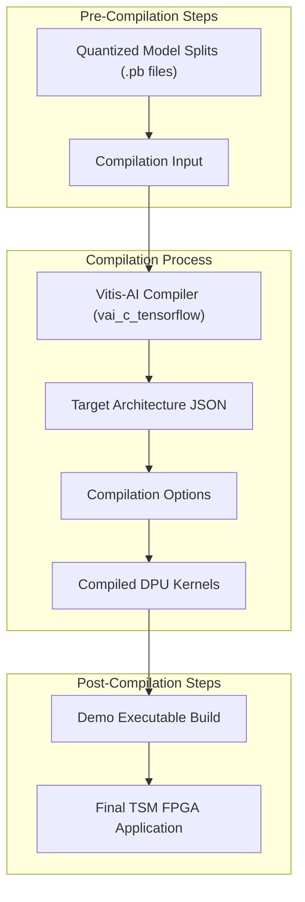
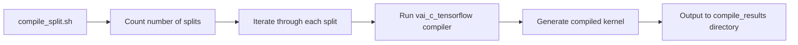
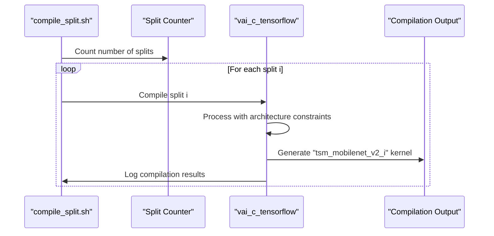
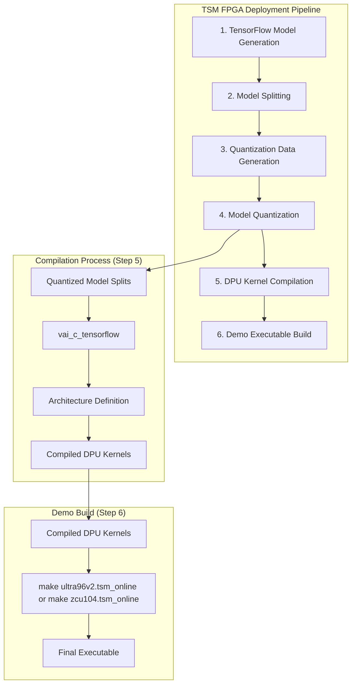

<!-- source: DeepWiki mcp.deepwiki.com · repo mit-han-lab/temporal-shift-module · extra page Compilation Process · fetched 2026-10-30 -->

# Compilation Process

Relevant source files

The following files were used as context for generating this wiki page:

- [tsm_fpga/README.md](tsm_fpga/README.md)
- [tsm_fpga/fpga_build/model_tf_split/compile_split.sh](tsm_fpga/fpga_build/model_tf_split/compile_split.sh)

This document details the compilation process for deploying Temporal Shift Module (TSM) models to FPGA hardware. It covers the steps required to convert quantized model splits into hardware-optimized executables using the Vitis-AI framework. For information about the preceding model splitting and quantization steps, see [Model Splitting and Quantization](#3.2.1).

## Overview of the Compilation Process

The compilation process converts the quantized TensorFlow model splits into optimized executables that can run efficiently on FPGA hardware. This is a critical step in the deployment pipeline that translates the neural network model into a format that can be executed on the Vitis-AI Deep Learning Processing Unit (DPU) IP.

The TSM FPGA deployment approach separates the temporal shift operations (which run on CPU) from the convolutional operations (which run on the DPU). This separation requires compiling multiple DPU kernels independently - up to 11 separate kernels for the MobileNetV2 TSM implementation.

Sources: [tsm_fpga/README.md:3-7]()

## Compilation Workflow

The compilation workflow takes the quantized model splits and compiles them for the target FPGA architecture using Vitis-AI tools.

Sources: [tsm_fpga/README.md:23-29](), [tsm_fpga/fpga_build/model_tf_split/compile_split.sh:14-28]()

## Compilation Tools and Commands

The compilation process uses the Vitis-AI TensorFlow compiler (`vai_c_tensorflow`) to compile each split of the model. This tool takes the quantized model (in frozen .pb format) and generates hardware-specific instructions for the target FPGA architecture.

### Compilation Script

The repository includes a bash script (`compile_split.sh`) that automates the compilation of all model splits:

The compilation command includes several important parameters:

- `--arch`: Specifies the target architecture JSON file
- `--frozen_pb`: Path to the quantized model in protobuf format
- `--output_dir`: Directory where compiled results are saved
- `--net_name`: Name of the network kernel
- `--options`: Additional compilation options for optimization

Sources: [tsm_fpga/fpga_build/model_tf_split/compile_split.sh:1-28]()

## Target FPGA Architectures

The compilation process supports multiple FPGA target architectures. The primary targets mentioned in the codebase are:

| Target Architecture | Description | Architecture File | Performance |
|--------------------|-------------|-------------------|-------------|
| ZCU104 | Xilinx ZCU104 MPSOC DPU TRD | zcu104_arch/arch.json | Not specified |
| Ultra96V2 | Avnet Ultra96V2 | ultra96v2_arch/arch.json | 37 FPS at 10.6W power consumption |

The architecture JSON file contains hardware-specific information that guides the compiler in generating optimized code for the target device.

Sources: [tsm_fpga/README.md:11-15](), [tsm_fpga/README.md:31-34](), [tsm_fpga/fpga_build/model_tf_split/compile_split.sh:5-11]()

## Compilation Execution Process

The compilation process executes systematically to process all model splits:

Sources: [tsm_fpga/fpga_build/model_tf_split/compile_split.sh:14-28]()

## Integration with Deployment Pipeline

After compilation, the final step in the deployment process is to build the demo executable. This combines the compiled DPU kernels with the host CPU code (including the shift operations) into a single application.

The final demo executable is built using a Makefile command specific to the target platform:
- For Ultra96V2: `make ultra96v2.tsm_online`
- For ZCU104: `make zcu104.tsm_online`

Sources: [tsm_fpga/README.md:23-29]()

## Technical Specifications and Performance

Once compiled and deployed to the Ultra96V2 FPGA, the TSM model achieves an inference throughput of 37 frames per second (FPS) with a power consumption of 10.6W. This performance metric demonstrates the efficiency of the compilation and deployment process for real-time video understanding applications.

Sources: [tsm_fpga/README.md:31-34]()

## Summary

The compilation process is a critical step in deploying TSM models to FPGA hardware. It converts the quantized TensorFlow model splits into hardware-optimized executables using the Vitis-AI framework. The process supports multiple target architectures and results in efficient real-time inference performance on FPGA devices.

---

