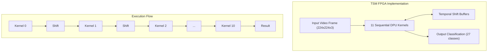
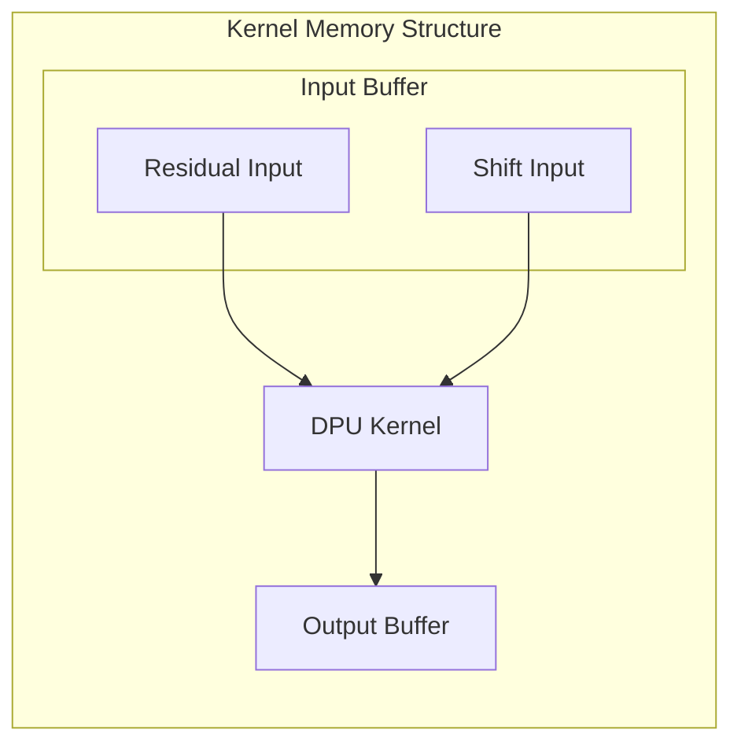
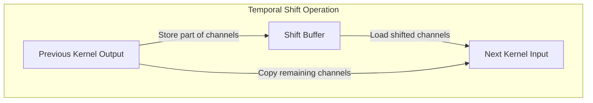
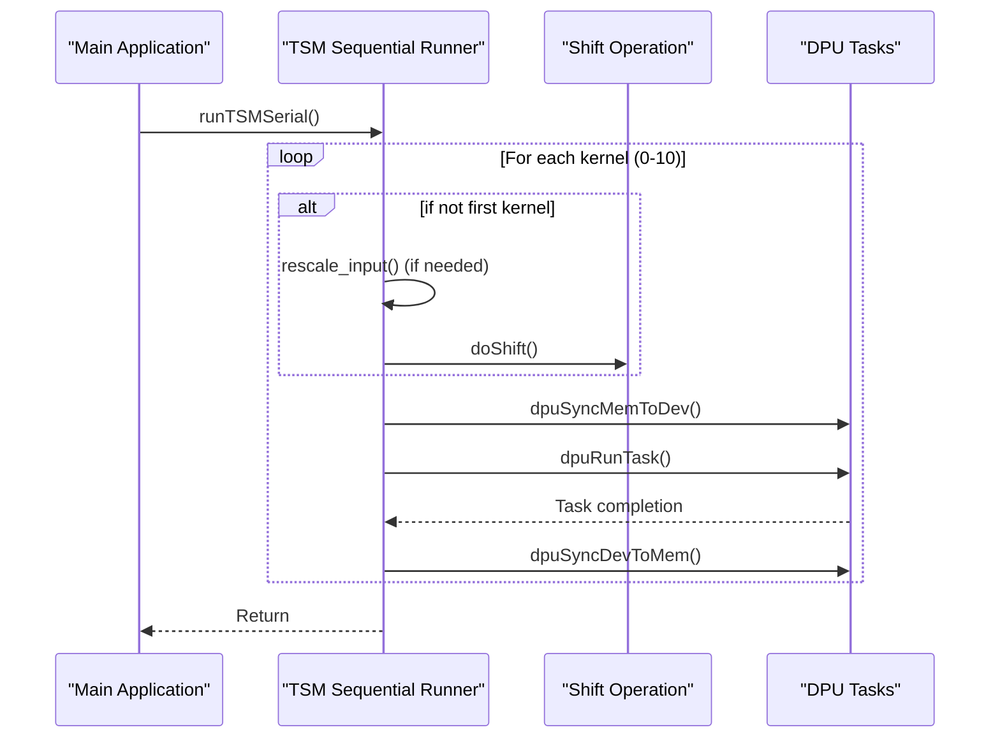

<!-- source: DeepWiki mcp.deepwiki.com · repo mit-han-lab/temporal-shift-module · extra page Implementation Details · fetched 2026-10-30 -->

# Implementation Details

<details>
<summary>Relevant source files</summary>

The following files were used as context for generating this wiki page:

- [tsm_fpga/fpga_build/model_tf_split/Makefile](tsm_fpga/fpga_build/model_tf_split/Makefile)
- [tsm_fpga/fpga_build/model_tf_split/src/main.cpp](tsm_fpga/fpga_build/model_tf_split/src/main.cpp)

</details>


This page provides technical details of the Temporal Shift Module (TSM) implementation on FPGA devices. It covers the model splitting mechanism, memory management, temporal shift operation, and the execution pipeline specific to FPGA deployment. For information about the compilation process, see [Compilation Process](#3.2.2).

## FPGA Architecture Overview

The FPGA implementation of TSM follows a model splitting approach where the MobileNetV2-based TSM network is divided into multiple smaller kernels that are executed sequentially. This design enables efficient processing of video data while maintaining the temporal shift functionality that is core to TSM.



Sources: [tsm_fpga/fpga_build/model_tf_split/src/main.cpp:242-285](), [tsm_fpga/fpga_build/model_tf_split/src/main.cpp:115-163]()

## Model Splitting Strategy

The MobileNetV2-based TSM model is split into 11 separate kernels that are executed sequentially. Each kernel processes a specific part of the network, with temporal shift operations performed between kernel executions.

### Kernel Structure

Each kernel in the split TSM model is defined by the following components:

```mermaid
classDiagram
    class "TSMSplit" {
        +string kernelName
        +Node resid_input_node
        +Node shift_input_node
        +Node output_node
        +aquant* residAddr()
        +aquant* shiftAddr()
        +aquant* outAddr()
    }
    
    class "Node" {
        +string name
        +int shape[3]
        +size_t size()
    }
    
    "TSMSplit" --> "Node" : contains
```

Sources: [tsm_fpga/fpga_build/model_tf_split/src/main.cpp:82-108]()

### Kernel Definitions

The FPGA implementation defines 11 kernels representing different parts of the MobileNetV2-based TSM model. Each kernel is configured with specific input and output tensor shapes.

| Kernel Name | Residual Input Shape | Shift Input Shape | Output Shape |
|-------------|----------------------|-------------------|--------------|
| tsm_mobilenet_v2_0 | None | 224×224×3 | 56×56×24 |
| tsm_mobilenet_v2_1 | 56×56×24 | 56×56×24 | 28×28×32 |
| tsm_mobilenet_v2_2 | 28×28×32 | 28×28×32 | 28×28×32 |
| tsm_mobilenet_v2_3 | 28×28×32 | 28×28×32 | 14×14×64 |
| tsm_mobilenet_v2_4 | 14×14×64 | 14×14×64 | 14×14×64 |
| tsm_mobilenet_v2_5 | 14×14×64 | 14×14×64 | 14×14×64 |
| tsm_mobilenet_v2_6 | 14×14×64 | 14×14×64 | 14×14×96 |
| tsm_mobilenet_v2_7 | 14×14×96 | 14×14×96 | 14×14×96 |
| tsm_mobilenet_v2_8 | 14×14×96 | 14×14×96 | 7×7×160 |
| tsm_mobilenet_v2_9 | 7×7×160 | 7×7×160 | 7×7×160 |
| tsm_mobilenet_v2_10 | 7×7×160 | 7×7×160 | 1×1×27 |

Sources: [tsm_fpga/fpga_build/model_tf_split/src/main.cpp:115-163]()

## Memory Management

The FPGA implementation uses a carefully designed memory management system to handle the data flow between kernels and to implement the temporal shift operation.

### Buffer Allocation

Each kernel has dedicated input and output buffers:



Buffers are allocated using the DPU API's memory allocation functions:

```cpp
splitInfo[i].inHandle = dpuAllocMem(splitInfo[i].inSize(),
        (int8_t*&)splitInfo[i].virt_in, (int8_t*&)splitInfo[i].phys_in);
splitInfo[i].outHandle = dpuAllocMem(splitInfo[i].outSize(),
        (int8_t*&)splitInfo[i].virt_out, (int8_t*&)splitInfo[i].phys_out);
```

Sources: [tsm_fpga/fpga_build/model_tf_split/src/main.cpp:166-185](), [tsm_fpga/fpga_build/model_tf_split/src/main.cpp:187-192]()

### Shift Buffer Pool

A key component of the TSM implementation is the `ShiftBufferPool`, which manages the buffers used for the temporal shift operation. This structure maintains separate buffers for each layer's temporal shift operation:

```mermaid
classDiagram
    class "ShiftBufferPool" {
        +aquant b0[56][56][3]
        +aquant b1[28][28][4]
        +aquant b2[28][28][4]
        +aquant b3[14][14][8]
        +aquant b4[14][14][8]
        +aquant b5[14][14][8]
        +aquant b6[14][14][12]
        +aquant b7[14][14][12]
        +aquant b8[7][7][20]
        +aquant b9[7][7][20]
        +aquant* operator[](int i)
    }
```

Sources: [tsm_fpga/fpga_build/model_tf_split/src/main.cpp:53-80]()

## Temporal Shift Implementation

The core of the TSM approach is the temporal shift operation, which enables temporal modeling in 2D CNNs by shifting a portion of the channels along the temporal dimension.

### Shift Operation

The FPGA implementation performs the temporal shift operation between kernel executions using the `doShift` function:



The shift operation involves:
1. Copying 1/8 of the channels from the shift buffer to the output (these are channels shifted from a previous frame)
2. Copying 7/8 of the channels directly from the input to the output (unchanged)
3. Storing 1/8 of the input channels to the shift buffer for use in the next frame

Sources: [tsm_fpga/fpga_build/model_tf_split/src/main.cpp:208-240]()

## Execution Pipeline

The execution of the TSM model on FPGA follows a sequential pipeline, with the `runTSMSerial` function coordinating the execution:



Sources: [tsm_fpga/fpga_build/model_tf_split/src/main.cpp:242-285]()

### Input Rescaling

A unique aspect of the FPGA implementation is the need to rescale inputs between kernels to account for differences in quantization scales:

```cpp
float rescale = prev_out_scale * shift_scale;
if (rescale != 1) {
    rescale_input(i, rescale);
}
```

This ensures that the quantized values maintain their semantic meaning across kernel boundaries.

Sources: [tsm_fpga/fpga_build/model_tf_split/src/main.cpp:247-265](), [tsm_fpga/fpga_build/model_tf_split/src/main.cpp:194-206]()

## Post-Processing and Output Handling

After model execution, the classification results are post-processed using the `processOutput` function, which implements:

1. Feature history tracking to smooth predictions over time
2. Gesture classification based on accumulated features
3. Additional filtering to reduce jitter in predictions

The system recognizes 27 different gesture categories, with results displayed in real-time.

Sources: [tsm_fpga/fpga_build/model_tf_split/src/main.cpp:317-353](), [tsm_fpga/fpga_build/model_tf_split/src/main.cpp:287-315]()

## Build System

The FPGA implementation includes a Makefile that supports building for different FPGA targets:

| Target | Description |
|--------|-------------|
| zcu104.tsm_online | Build for the ZCU104 FPGA development board |
| ultra96v2.tsm_online | Build for the Ultra96v2 FPGA development board |

The build system compiles the C++ implementation, links with the appropriate DPU libraries, and generates an executable for the target platform.

Sources: [tsm_fpga/fpga_build/model_tf_split/Makefile:1-39]()

## Main Application Flow

The main application implements a complete pipeline for real-time hand gesture recognition:

1. Camera frame capture (224×224 RGB input)
2. Frame preprocessing (normalization, scaling)
3. TSM model execution on FPGA
4. Post-processing of classification results
5. Display of recognition results with FPS information

This enables an efficient, real-time hand gesture recognition system running on FPGA hardware.

Sources: [tsm_fpga/fpga_build/model_tf_split/src/main.cpp:355-533](), [tsm_fpga/fpga_build/model_tf_split/src/main.cpp:535-557]()

---

