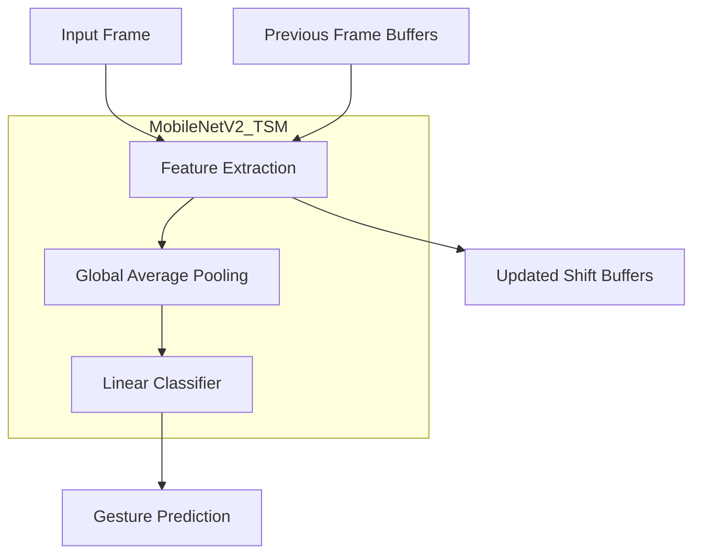
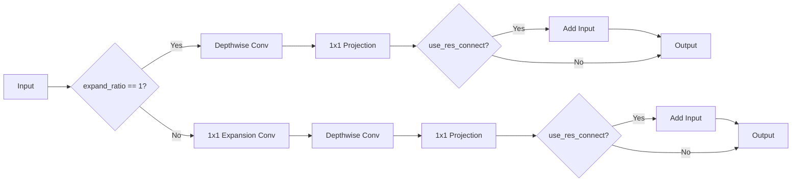
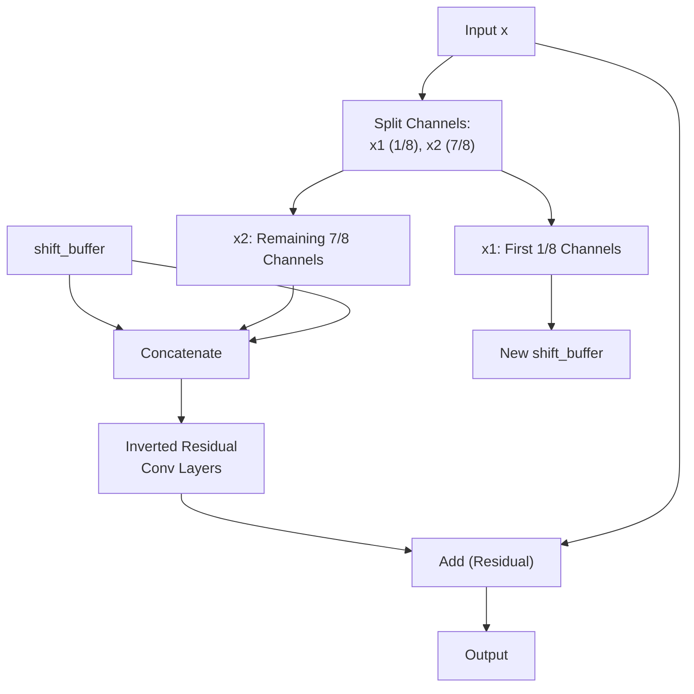
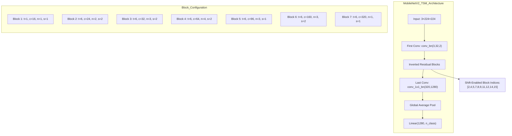
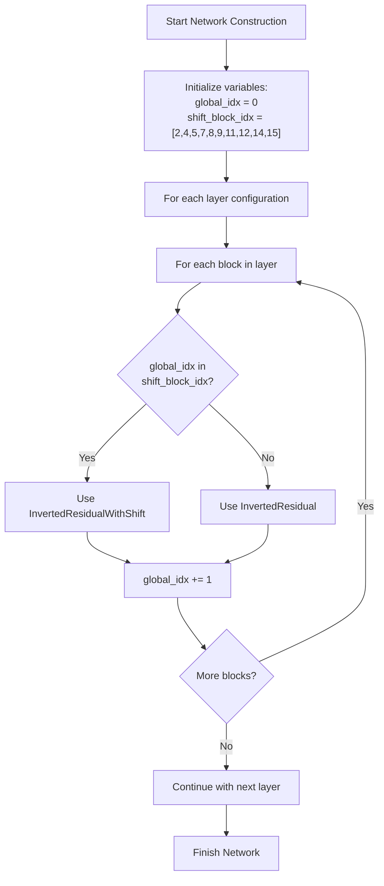
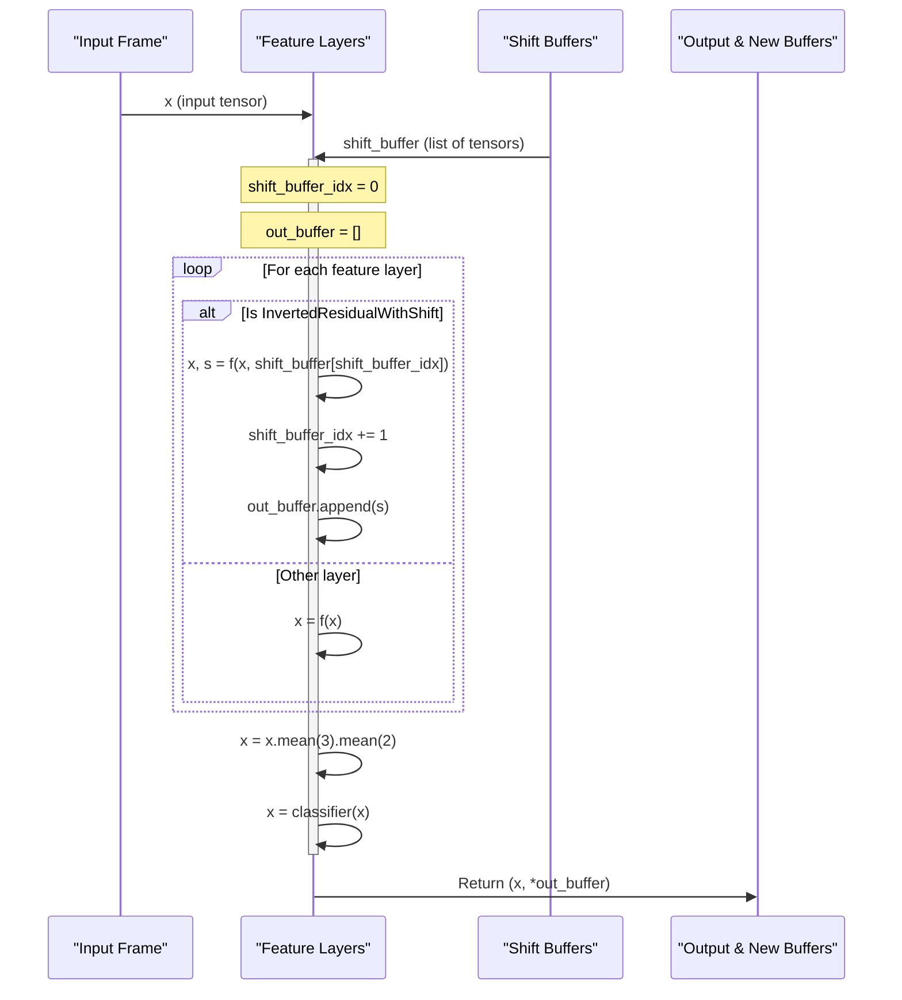
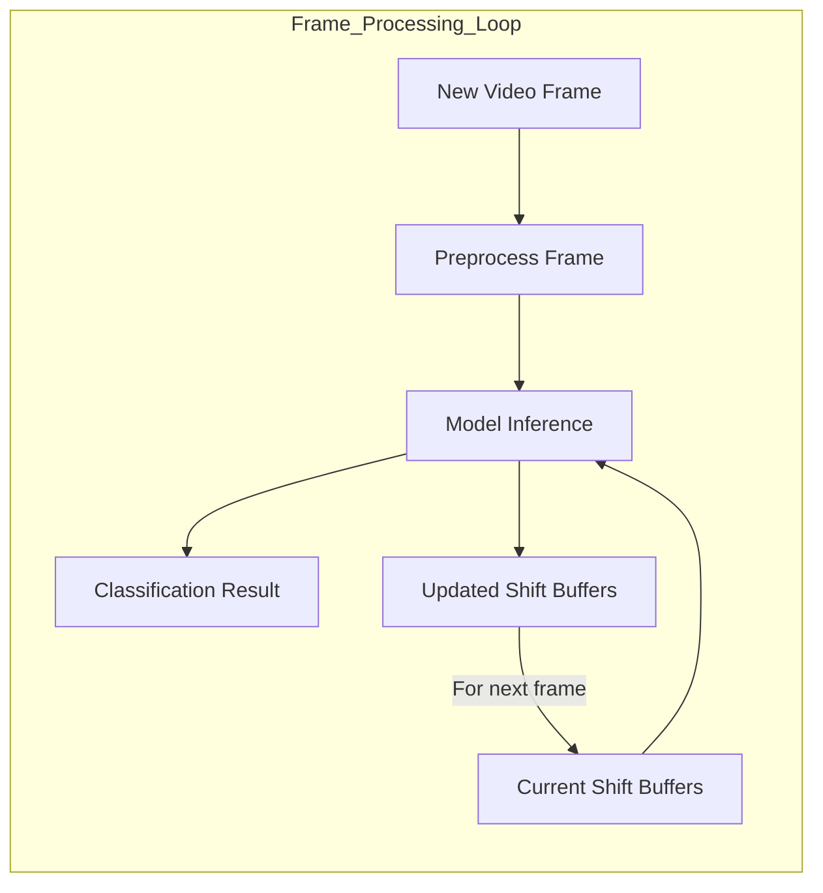

<!-- source: DeepWiki mcp.deepwiki.com · repo mit-han-lab/temporal-shift-module · extra page MobileNetV2 with TSM · fetched 2026-10-30 -->

# MobileNetV2 with TSM

<details>
<summary>Relevant source files</summary>

The following files were used as context for generating this wiki page:

- [online_demo/mobilenet_v2_tsm.py](online_demo/mobilenet_v2_tsm.py)

</details>


## Purpose and Scope

This document details the implementation of MobileNetV2 integrated with Temporal Shift Module (TSM) as used in the online hand gesture recognition demo. This specialized architecture enables efficient real-time video understanding on resource-constrained devices by incorporating temporal modeling capabilities into the lightweight MobileNetV2 architecture, without increasing computational complexity.

For information about the general TSM concept, see [Temporal Shift Module](#2.1).
For details on the overall online demo implementation, see [Online Hand Gesture Recognition Demo](#3.1).
For information about how this model is optimized for deployment, see [TVM Optimization](#3.1.4).

## Architecture Overview

MobileNetV2 with TSM adapts the standard MobileNetV2 architecture by replacing selected inverted residual blocks with specialized "shift-enabled" versions. Unlike the standard TSM implementation that processes multiple frames simultaneously, this version uses shift buffers to maintain temporal information while processing one frame at a time, making it suitable for real-time applications.



Sources: [online_demo/mobilenet_v2_tsm.py:99-157]()

## Core Components

### 1. Standard Inverted Residual Block

The `InvertedResidual` class implements the standard building block of MobileNetV2, consisting of:
- Expansion layer (1×1 convolution) that increases channel dimension
- Depthwise convolution (3×3) for spatial feature extraction
- Projection layer (1×1 convolution) that reduces channel dimension
- Residual connection when input/output channels match and stride=1



Sources: [online_demo/mobilenet_v2_tsm.py:27-65]()

### 2. Temporal Shift-Enabled Inverted Residual Block

The `InvertedResidualWithShift` class extends the standard block with temporal shift capabilities:



Key characteristics:
- Only used with `expand_ratio > 1` and with residual connections
- Splits input tensor with 1/8 of channels saved for the next frame
- Previous frame's buffer is concatenated with current frame's remaining channels
- Returns both the processed tensor and the new shift buffer for temporal continuity

Sources: [online_demo/mobilenet_v2_tsm.py:67-96]()

### 3. Network Architecture

The `MobileNetV2` class defines the overall network architecture with the following structure:



Where parameters represent:
- t: expansion ratio
- c: output channels
- n: number of blocks
- s: stride for first block

Sources: [online_demo/mobilenet_v2_tsm.py:99-143]()

## Implementation Details

### Shift Block Selection Strategy

During network construction, specific inverted residual blocks are replaced with shift-enabled versions based on the predefined indices:



The selection of these specific indices is strategic to balance temporal modeling capability and computational efficiency. The implementation uses a global index counter to track block position in the network.

Sources: [online_demo/mobilenet_v2_tsm.py:122-134]()

### Forward Pass Mechanism

The forward method processes frames and manages shift buffers:



This design allows the network to process one frame at a time while maintaining temporal connections between frames through the shift buffers.

Sources: [online_demo/mobilenet_v2_tsm.py:145-157]()

## Shift Buffer Management

The shift buffers are a critical component of the online temporal shift mechanism. Each buffer corresponds to a specific shift-enabled block and contains 1/8 of the channels from that block's input in the previous frame.

Initial buffer shapes for a 224×224 input:

| Buffer Index | Tensor Shape     | Corresponding Block |
|--------------|------------------|---------------------|
| 1            | [1, 3, 56, 56]   | Block 2             |
| 2            | [1, 4, 28, 28]   | Block 4             |
| 3            | [1, 4, 28, 28]   | Block 5             |
| 4            | [1, 8, 14, 14]   | Block 7             |
| 5            | [1, 8, 14, 14]   | Block 8             |
| 6            | [1, 8, 14, 14]   | Block 9             |
| 7            | [1, 12, 14, 14]  | Block 11            |
| 8            | [1, 12, 14, 14]  | Block 12            |
| 9            | [1, 20, 7, 7]    | Block 14            |
| 10           | [1, 20, 7, 7]    | Block 15            |

During initialization, these buffers are filled with zeros. As frames are processed, they're populated with actual feature data from previous frames.

Sources: [online_demo/mobilenet_v2_tsm.py:182-191]()

## Model Initialization and Usage

The model can be initialized with standard weights and optionally scaled using a width multiplier:

```python
# Standard MobileNetV2 with TSM
model = MobileNetV2(n_class=27)  # For 27 gesture classes

# Wider MobileNetV2 with TSM (1.4× channels)
model = mobilenet_v2_140()  # Returns MobileNetV2 with width_mult=1.4
```

When used in the online demo, the model processes a continuous stream of video frames:



The updated shift buffers from one frame are used as inputs for processing the next frame, creating a continuous temporal connection across the video stream.

Sources: [online_demo/mobilenet_v2_tsm.py:175-195]()

## Performance Considerations

Several optimizations make this model suitable for real-time applications:

1. **Efficient Temporal Modeling**: The shift buffer approach allows temporal modeling without increasing the computational complexity of the base MobileNetV2 model.

2. **Channel Alignment**: The `make_divisible` function ensures channel counts are divisible by 8, which can improve computational efficiency on many hardware platforms:

```python
def make_divisible(x, divisible_by=8):
    import numpy as np
    return int(np.ceil(x * 1. / divisible_by) * divisible_by)
```

3. **Width Multiplier**: Adjustable width multiplier allows scaling the model capacity based on performance requirements. The online demo often uses a width multiplier of 1.4 for a good balance between accuracy and speed.

4. **Single-Frame Processing**: Unlike traditional video models that process multiple frames at once, this architecture processes one frame at a time, reducing memory requirements significantly.

Sources: [online_demo/mobilenet_v2_tsm.py:22-24](), [online_demo/mobilenet_v2_tsm.py:175-176]()

## Integration with the Online Demo

In the online hand gesture recognition demo, this MobileNetV2 with TSM model serves as the backbone for real-time gesture classification. The model is optimized using TVM compilation to further improve inference speed on target hardware. For details on this optimization process, see [TVM Optimization](#3.1.4).

The specialized temporal shift mechanism makes this model particularly well-suited for applications requiring real-time understanding of motion and gestures, while remaining computationally efficient enough to run on resource-constrained devices.

Sources: [online_demo/mobilenet_v2_tsm.py:179-195]()

---

