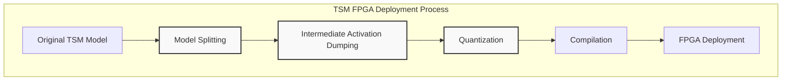
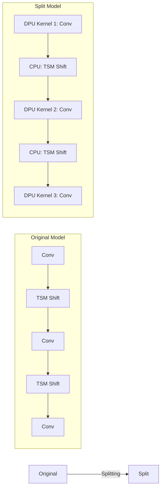
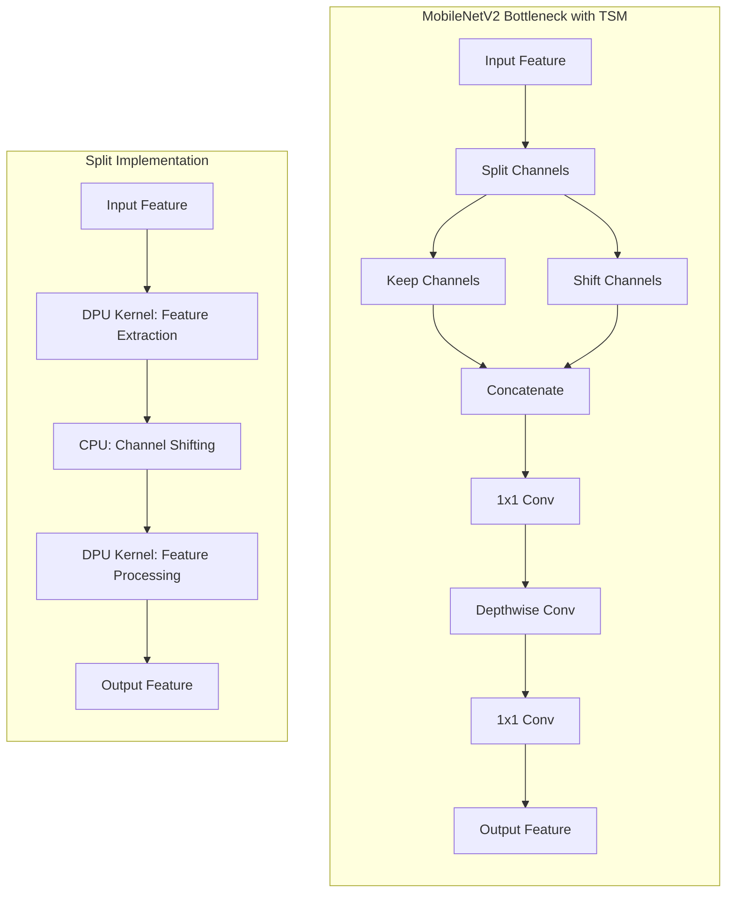
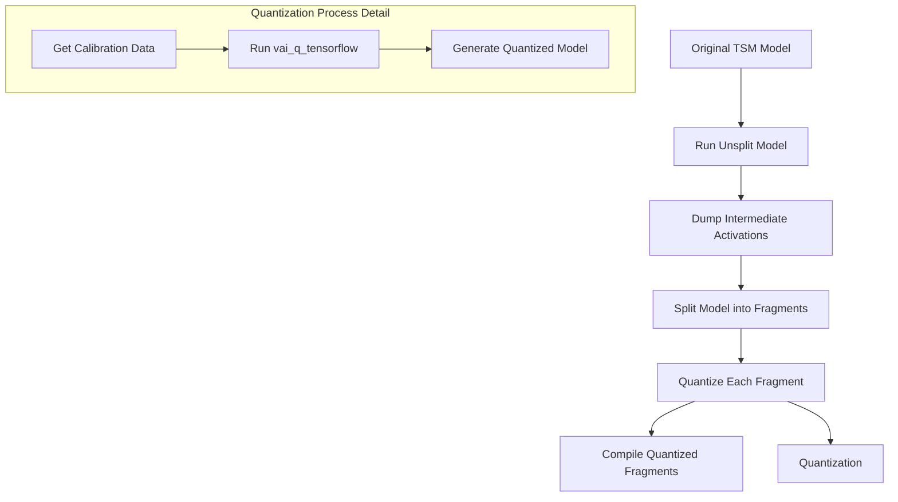
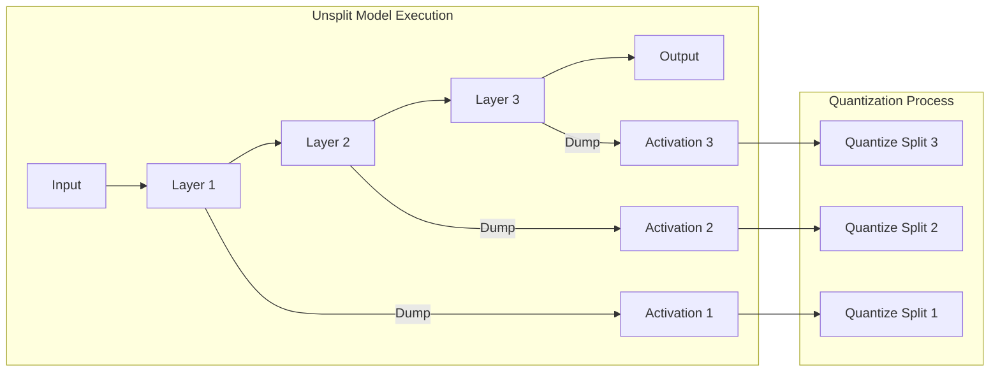
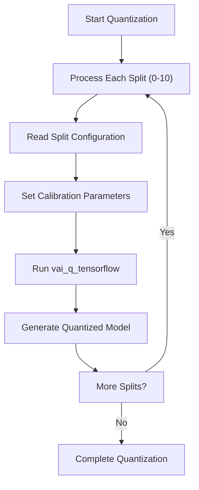

<!-- source: DeepWiki mcp.deepwiki.com · repo mit-han-lab/temporal-shift-module · extra page Model Splitting and Quantization · fetched 2026-10-30 -->

# Model Splitting and Quantization

Relevant source files

The following files were used as context for generating this wiki page:

- [tsm_fpga/README.md](tsm_fpga/README.md)
- [tsm_fpga/fpga_build/model_tf_split/quantize_split.sh](tsm_fpga/fpga_build/model_tf_split/quantize_split.sh)

This document describes the process of model splitting and quantization for deploying Temporal Shift Module (TSM) models on FPGA hardware. These techniques are critical pre-processing steps that enable efficient hardware acceleration of TSM models through the Vitis-AI framework. For information about the overall FPGA deployment process, see [FPGA Deployment](#3.2), and for compilation details after splitting and quantization, see [Compilation Process](#3.2.2).

## Overview and Purpose

Model splitting and quantization are essential techniques for deploying TSM models on FPGA hardware. The TSM architecture's temporal shift operations present unique challenges for hardware acceleration, requiring a specialized deployment approach.

**Diagram: FPGA Deployment Pipeline for TSM Models**

Sources: [tsm_fpga/README.md:3-7]()

## Model Splitting

### Why Split the Model?

The temporal shift operations in TSM models cannot be directly mapped to the Vitis-AI Deep Processing Unit (DPU) IP. To address this limitation, the model is split at each shift operation, creating a pipeline where:

1. Shift operations run on the CPU
2. Convolutional and other standard operations run on the DPU

This approach isolates the temporal shift operations while maintaining the model's functionality and preserving the advantages of hardware acceleration for the computationally intensive parts of the network.

**Diagram: Model Splitting Process**

Sources: [tsm_fpga/README.md:3-5]()

### Split Model Structure

For MobileNetV2-based TSM, the splitting process results in 11 separate DPU kernels that need to be quantized and compiled individually. The figure below shows how a MobileNetV2 bottleneck is split to isolate the shift operations.

**Diagram: MobileNetV2 Bottleneck Splitting for TSM**

Sources: [tsm_fpga/README.md:9]()

## Quantization Process

### Purpose of Quantization

Quantization converts the model from floating-point (FP32) to fixed-point (INT8) representation, which is necessary for efficient execution on the DPU. This process:

1. Reduces model size
2. Decreases computation requirements
3. Speeds up inference
4. Lowers power consumption

### Quantization Workflow for Split Models

Quantizing a split model requires special handling to ensure accuracy across all model fragments:

**Diagram: Quantization Workflow for Split TSM Models**

Sources: [tsm_fpga/README.md:5-7]()

### Gathering Quantization Data

To properly quantize each split portion of the model:

1. Intermediate activations are captured from the original, unsplit model
2. These activations are saved at points corresponding to the inputs of each DPU kernel
3. The captured data serves as calibration input for the Vitis-AI quantizer

This ensures that each split portion receives realistic inputs during the quantization process, preserving the model's overall accuracy.

**Diagram: Gathering Quantization Data from Unsplit Model**

Sources: [tsm_fpga/README.md:21-22]()

## Implementation Steps

The process of splitting and quantizing the TSM model for FPGA deployment consists of the following steps:

| Step | Description | Script/Tool |
|------|-------------|-------------|
| 1. Create Split Model | Generate split TensorFlow models by isolating shift operations | `mobilenet_v2_tfslim.py` with `SPLIT_MODEL=True` |
| 2. Dump Quantization Inputs | Run unsplit model to gather calibration data for quantization | `mobilenet_v2_tfslim.py` with `DUMP_QUANTIZE=True` |
| 3. Quantize Each Split | Apply quantization to each split using calibration data | `quantize_split.sh` |
| 4. Compile DPU Kernels | Compile each quantized split for DPU | `compile_split.sh` |

### Quantization Script Execution

The quantization process processes each of the 11 split models sequentially:

**Diagram: Quantization Script Execution Flow**

Sources: [tsm_fpga/fpga_build/model_tf_split/quantize_split.sh:28-41]()

## Key Parameters and Configuration

The quantization process uses several important parameters:

| Parameter | Value | Description |
|-----------|-------|-------------|
| Number of splits | 11 | The number of model fragments created by splitting |
| Calibration iterations | 50 | Number of iterations used during calibration |
| Quantization format | INT8 | Target format for quantized model |
| Quantization tool | vai_q_tensorflow | Vitis-AI quantizer for TensorFlow models |

Sources: [tsm_fpga/fpga_build/model_tf_split/quantize_split.sh:7-8]()

## Results and Performance

After model splitting and quantization, TSM can be deployed on FPGA hardware with significant performance benefits:

- **Ultra96V2 FPGA Performance**:
  - Inference throughput: 37 FPS
  - Power consumption: 10.6W

These performance metrics demonstrate the effectiveness of the model splitting and quantization approach for deploying TSM on resource-constrained FPGA devices.

Sources: [tsm_fpga/README.md:32-34]()

## Conclusion

Model splitting and quantization are critical steps in the FPGA deployment pipeline for TSM models. By isolating the temporal shift operations and converting the model to a fixed-point representation, we can leverage the acceleration capabilities of the DPU while maintaining the temporal modeling capabilities that make TSM effective for video understanding tasks.

After completing the model splitting and quantization process, the next step is compilation for the target FPGA hardware, which is covered in [Compilation Process](#3.2.2).

---

