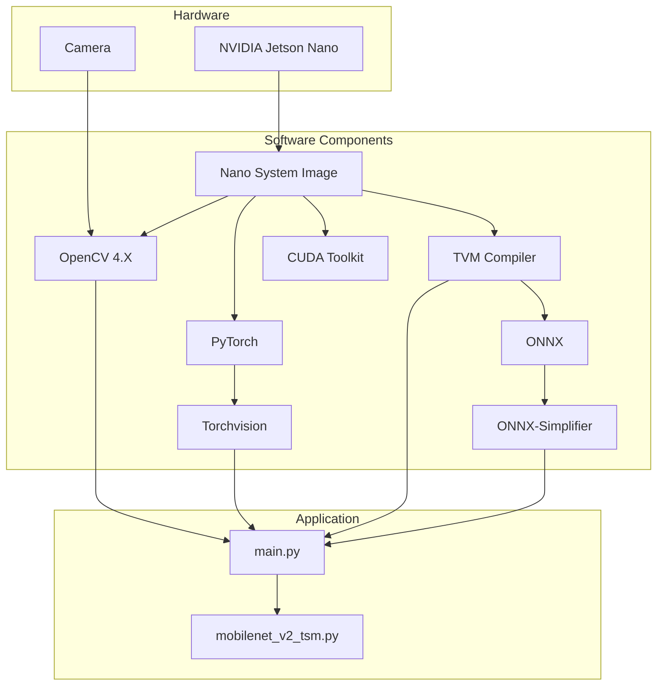
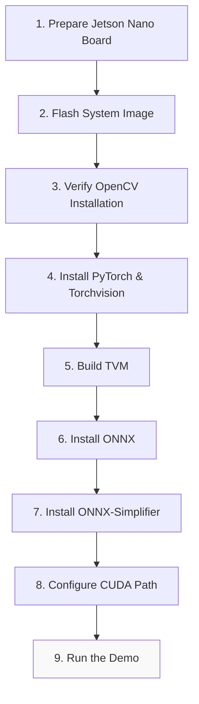
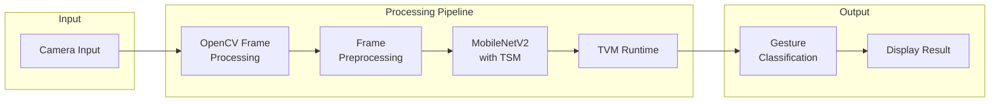

<!-- source: DeepWiki mcp.deepwiki.com · repo mit-han-lab/temporal-shift-module · extra page Setup and Configuration · fetched 2026-10-30 -->

# Setup and Configuration

<details>
<summary>Relevant source files</summary>

The following files were used as context for generating this wiki page:

- [online_demo/README.md](online_demo/README.md)

</details>


This document provides detailed instructions for setting up and configuring the TSM Online Hand Gesture Recognition Demo on an NVIDIA Jetson Nano board. This guide focuses on the technical setup process required to deploy a real-time hand gesture recognition system using the Temporal Shift Module with TVM acceleration.

For information about the technical implementation details of the demo, see [Technical Implementation](#3.1.2). For specifics on how TSM is integrated with MobileNetV2, see [MobileNetV2 with TSM](#3.1.3).

## System Overview

The Online Hand Gesture Recognition Demo integrates several components to deliver real-time gesture recognition:



Sources: [online_demo/README.md:17-42]()

## Hardware Requirements

- **NVIDIA Jetson Nano Developer Kit** ($99)
- **MicroSD Card** (16GB+ recommended)
- **Power Adapter** (5V⎓2A or 5V⎓4A, recommended for stable power supply)
- **Camera** (USB webcam or Raspberry Pi camera module)

Sources: [online_demo/README.md:43-44]()

## Setup Process

The setup process involves several steps to prepare the Jetson Nano environment for running the TSM demo:



Sources: [online_demo/README.md:39-111]()

### 1. Prepare Jetson Nano Board

Acquire an NVIDIA Jetson Nano Developer Kit, which is specifically targeted for this deployment due to its balance of computational power and affordability.

Sources: [online_demo/README.md:43-44]()

### 2. System Image Installation

1. Download the Jetson Nano system image from NVIDIA's developer website
2. Flash the image to a microSD card using the recommended tools
3. Insert the card into the Nano and boot the device

Sources: [online_demo/README.md:44-45]()

### 3. OpenCV Verification

The system requires OpenCV 4.X for camera access and image processing:

```bash
$ python3
>> import cv2
>> cv2.__version__
```

If OpenCV 4.X is not installed or shows a lower version, build OpenCV 4.0.0:

```bash
# Build OpenCV 4.0.0
# This script will take considerable time to complete due to Nano's CPU limitations
<build script from JEP repository>

# Add CV2 to Python search path
export PYTHONPATH=/usr/local/python
```

Sources: [online_demo/README.md:46-56]()

### 4. PyTorch and Torchvision Installation

Follow NVIDIA's official instructions for installing PyTorch and torchvision, which are essential for loading and manipulating the TSM model.

Sources: [online_demo/README.md:58]()

### 5. TVM Compilation and Installation

TVM (Tensor Virtual Machine) is required to compile and optimize the PyTorch model for efficient execution on the Jetson Nano:

```bash
# Install LLVM (required by TVM)
sudo apt install llvm

# Clone TVM repository (version 0.6)
git clone -b v0.6 https://github.com/apache/incubator-tvm.git
cd incubator-tvm
git submodule update --init

# Configure and build TVM
mkdir build
cp cmake/config.cmake build/
cd build

# Edit config.cmake to enable CUDA and LLVM:
# Line 32: USE_CUDA OFF -> USE_CUDA ON
# Line 104: USE_LLVM OFF -> USE_LLVM ON

cmake ..
make -j4

# Install TVM Python packages
cd ..
cd python; sudo python3 setup.py install; cd ..
cd topi/python; sudo python3 setup.py install; cd ../..
```

Sources: [online_demo/README.md:59-79]()

### 6. ONNX Installation

ONNX (Open Neural Network Exchange) is used for model format standardization:

```bash
sudo apt-get install protobuf-compiler libprotoc-dev
pip3 install onnx
```

Sources: [online_demo/README.md:83-87]()

### 7. ONNX-Simplifier Installation

ONNX-Simplifier helps optimize the model structure for deployment:

```bash
git clone https://github.com/daquexian/onnx-simplifier
cd onnx-simplifier
# Remove 'onnxruntime >= 1.2.0' requirement in setup.py (not used)
pip install .
cd ..
```

Sources: [online_demo/README.md:91-97]()

### 8. CUDA Toolkit Configuration

Configure the path to include CUDA toolkit binaries:

```bash
export PATH=$PATH:/usr/local/cuda/bin
```

Sources: [online_demo/README.md:101-103]()

## Running the Demo

After completing all installation steps, execute the demo with:

```bash
python3 main.py
```

The first run will compile the PyTorch TSM model into TVM binary format and then execute it. Subsequent runs will use the pre-compiled model directly, providing faster startup times.

### Controls
- Press `Q` or `Esc` to quit
- Press `F` to enter/exit full-screen mode

Sources: [online_demo/README.md:105-111]()

## System Architecture and Data Flow

The following diagram illustrates how data flows through the configured system during the demo execution:



Sources: [online_demo/README.md:18-37]()

## Supported Gestures

The demo can recognize 19 different hand gestures:

| ID | Gesture |
|----|---------|
| 0 | No gesture |
| 1 | Stop Sign |
| 2 | Drumming Fingers |
| 3 | Thumb Up |
| 4 | Thumb Down |
| 5 | Zooming In With Full Hand |
| 6 | Zooming In With Two Fingers |
| 7 | Zooming Out With Full Hand |
| 8 | Zooming Out With Two Fingers |
| 9 | Swiping Down |
| 10 | Swiping Left |
| 11 | Swiping Right |
| 12 | Swiping Up |
| 13 | Sliding Two Fingers Down |
| 14 | Sliding Two Fingers Left |
| 15 | Sliding Two Fingers Right |
| 16 | Sliding Two Fingers Up |
| 17 | Pulling Hand In |
| 18 | Pulling Two Fingers In |

Sources: [online_demo/README.md:113-134]()

## Performance Considerations

The TSM online hand gesture recognition demo achieves real-time performance on the Jetson Nano. Without considering data I/O time, the system can achieve more than 70 frames per second (FPS) on the Nano's GPU after TVM optimization.

Sources: [online_demo/README.md:20-24]()

## Troubleshooting

### Common Issues and Solutions

1. **Power Supply Issues**: If the Nano shuts down unexpectedly during installation or when running the demo, ensure you're using a stable power supply (5V⎓4A recommended).

2. **OpenCV Compilation Failures**: The OpenCV build process is resource-intensive and may fail on the Nano. If this occurs, try reducing the build parallelism with `-j1` instead of `-j4`.

3. **TVM Compilation Errors**: Ensure CUDA and LLVM configurations are correctly set in the config.cmake file.

4. **Camera Access Problems**: If the camera is not recognized, verify that OpenCV is correctly installed with camera support and that your user has permissions to access the camera device.

5. **Path Configuration**: If you encounter module import errors, ensure that all required paths (Python, CUDA) are correctly set in your environment.

Sources: [online_demo/README.md:45-105]()

---

